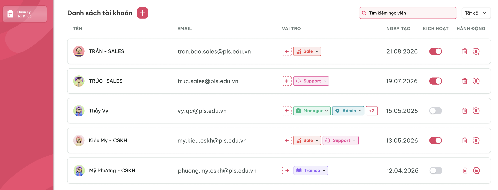
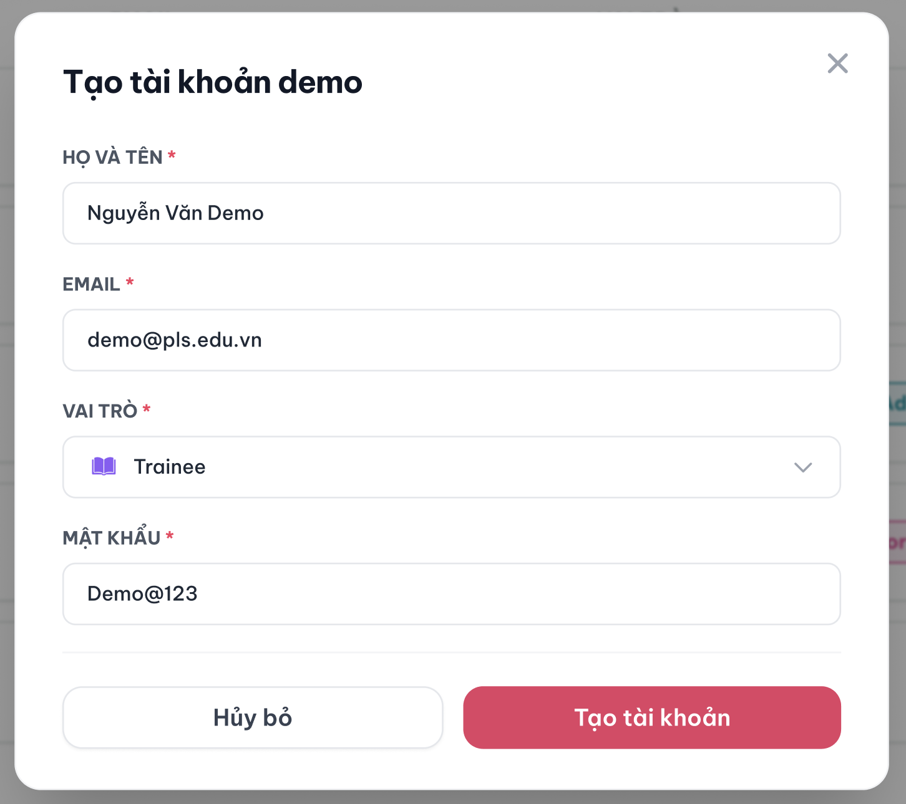

# Quản lý tài khoản (Master)

## 1. UI

### Trang 1: MST-TK-010000 — Danh sách tài khoản




**Mô tả:**
- Master xem toàn bộ tài khoản trong hệ thống, tìm kiếm theo tên/email, lọc theo bộ lọc "Tất cả" (role/trạng thái), tạo mới, gán role, kích hoạt/vô hiệu hóa, xóa và đặt lại mật khẩu cho từng tài khoản.

**Điểm cần lưu ý:**
- Badge **"+2"**: khi tài khoản có nhiều hơn 2 role, chỉ hiển thị 2 role đầu, phần dư gộp thành "+N"
- **Xóa tài khoản, Đặt lại mật khẩu** cần có popup xác nhận.
- Ô tìm kiếm "Tìm kiếm học viên": tìm theo **tên hoặc email**.
- Bộ lọc "Tất cả": gồm lọc theo **trạng thái kích hoạt** và lọc theo **role**, có thể **kết hợp đồng thời** với nhau và với ô tìm kiếm.

### Trang 2: MST-TK-010010 — Popup tạo / chỉnh sửa tài khoản




**Mô tả:**
- Master bấm dấu "+" tạo mới tài khoản, hiện popup "Tạo tài khoản".

**Điểm cần lưu ý:**
- Field **mật khẩu**: hiển thị dạng ẩn (dấu chấm), có icon con mắt để xem — hiển thị/ẩn phụ thuộc trạng thái đã đổi mật khẩu lần đầu hay chưa (xem REQ02).

---

### Trang 3: Toast phản hồi CRUD


*Toast phản hồi Create, Update, Delete và đổi trạng thái — nhấn để xem ảnh gốc*

**Mô tả:** Toast phản hồi kết quả các thao tác thay đổi dữ liệu trong requirement này.

**Điểm cần lưu ý:**

- `A03.01` **Thành công**: Tiêu đề: `Thành Công`; Khi sử dụng: Backend xác nhận thao tác thành công.
- `A03.02` **Thông tin**: Tiêu đề: `Thông Báo`; Khi sử dụng: Thao tác đã tiếp nhận nhưng dữ liệu cần thời gian đồng bộ.
- `A03.03` **Cảnh báo**: Tiêu đề: `Cảnh Báo`; Khi sử dụng: Dữ liệu/điều kiện cần người dùng kiểm tra.
- `A03.04` **Lỗi**: Tiêu đề: `Có Lỗi Xảy Ra`; Khi sử dụng: Backend/network không hoàn tất thao tác.

**Điểm cần lưu ý:** Nội dung dòng hai lấy từ flow CRUD tương ứng; mỗi thao tác chỉ có một Toast; Hủy/chỉ đọc không có Toast CRUD; nút `×` đóng thủ công; không hiển thị dữ liệu nhạy cảm.

---

## 2. Yêu cầu

### 2.1. Flow chính

**Flow 1: Tạo tài khoản**

```
Master bấm "+" 
      → Popup tạo tài khoản 
      → Nhập Email (bắt buộc) + Mật khẩu mặc định (hệ thống tự điền, cho sửa) + Chọn Role (bắt buộc ≥1)
      → Bấm "Tạo"
      → FE validate → BE tạo tài khoản
      → FE thêm dòng mới vào danh sách
```

**Flow 2: Thêm role cho tài khoản**

```
Master bấm "+" cạnh role của 1 dòng → Chọn thêm role → Xác nhận
      → FE gọi API cập nhật role → BE lưu → FE cập nhật badge role trên dòng đó
```

**Flow 3: Bật/Tắt kích hoạt tài khoản**

```
Master gạt toggle "Kích hoạt" (không áp dụng cho chính tài khoản Master đang đăng nhập)
      → FE gọi API cập nhật trạng thái
      → Bật: tài khoản hoạt động, đăng nhập được
      → Tắt: tài khoản bị vô hiệu hóa, không đăng nhập được
      → FE cập nhật lại trạng thái toggle
```

**Flow 4: Đặt lại mật khẩu**

```
Master bấm icon "Đặt lại mật khẩu" 
      → Popup xác nhận đặt lại mật khẩu → Master xác nhận
      → FE gọi API reset password
      → BE set mật khẩu về mặc định của hệ thống + hủy toàn bộ session hiện tại của tài khoản đó
      → Tài khoản bị văng khỏi phiên đăng nhập hiện tại (nếu đang đăng nhập), phải đăng nhập lại bằng mật khẩu mặc định mới
      → FE cập nhật trạng thái: tài khoản quay lại trạng thái "còn giữ mật khẩu mặc định" → icon con mắt xem được lại, không bị ẩn mật khẩu
```

**Flow 5: Xóa tài khoản (soft-delete)**

```
Master bấm icon "Xóa" (không áp dụng cho chính tài khoản Master đang đăng nhập)
      → Popup xác nhận xóa → Master xác nhận
      → FE gọi API xóa → BE soft-delete
      → FE loại bỏ dòng khỏi danh sách
```

**Flow 6: Tắt kích hoạt tài khoản đang có phiên đăng nhập**

```
Master gạt toggle Kích hoạt sang tắt trên tài khoản đang có session
      → FE gọi API vô hiệu hóa
      → BE hủy toàn bộ session hiện tại của tài khoản đó (giống Flow 4)
      → Tài khoản bị văng ra ngay lập tức, không đăng nhập được vì đã bị vô hiệu hóa
```

### 2.2. Ngoại lệ

- **EX01:** Tạo tài khoản không chọn role nào → chặn submit, báo lỗi "Vui lòng chọn ít nhất 1 role".
- **EX02:** Tạo tài khoản với email đã tồn tại → báo lỗi "Email đã được sử dụng".
- **EX03:** Đặt lại mật khẩu cho tài khoản đang có phiên đăng nhập → hủy session ở **tất cả thiết bị**, tài khoản phải đăng nhập lại.
- **EX04:** Vô hiệu hóa (tắt kích hoạt) tài khoản đang có phiên đăng nhập → **buộc đăng xuất ngay lập tức trên tất cả thiết bị** (hủy toàn bộ session, giống hành vi đặt lại mật khẩu), đồng thời chặn đăng nhập ở các lần sau.
- **EX05:** Master cố **xóa hoặc tắt kích hoạt chính tài khoản Master đang đăng nhập** → hệ thống **chặn hành động**, báo lỗi (tránh tự khóa mình khỏi hệ thống).

### 2.3. Yêu cầu khác

| Mã | Tên yêu cầu | Mô tả |
|---|---|---|
| REQ01 |  | Email là bắt buộc và phải duy nhất trong hệ thống. |
| REQ02 |  | Mật khẩu chỉ hiển thị được (qua icon con mắt) khi tài khoản **còn giữ mật khẩu mặc định** (chưa từng đổi). Nếu tài khoản đã tự đổi mật khẩu, hệ thống **không hiển thị** mật khẩu dưới bất kỳ hình thức nào (bấm vào con mắt không có gì để xem). |
| REQ03 |  | Mật khẩu mặc định khi tạo mới được hệ thống tự điền sẵn, Master có thể chỉnh sửa trước khi tạo. |
| REQ04 |  | Đặt lại mật khẩu = đưa mật khẩu tài khoản đó về đúng giá trị mật khẩu mặc định của hệ thống. |
| REQ05 |  | Một tài khoản phải có tối thiểu 1 role tại mọi thời điểm. Lúc tạo bắt buộc chọn >= 1 role. Lúc xóa không cho xóa role cuối cùng còn lại. |
| REQ06 |  | Trạng thái "Kích hoạt" mặc định của tài khoản mới tạo luôn là **bật**. |
| REQ07 |  | Xóa tài khoản là **soft-delete** |
| REQ08 |  | Master được **gán tự do mọi role** cho tài khoản, không giới hạn/loại trừ kết hợp role nào. |
| REQ09 |  | Bất kể Master có **sửa lại giá trị** mật khẩu mặc định lúc tạo hay không, mật khẩu đó vẫn được xem là **mật khẩu khởi tạo** → tài khoản **bắt buộc phải đổi mật khẩu** ở lần đăng nhập đầu tiên. Tương tự, sau khi bị **Đặt lại mật khẩu** (Flow 4), tài khoản cũng **bắt buộc phải đổi mật khẩu** ở lần đăng nhập tiếp theo. |
| REQ10 |  | "Đặt lại mật khẩu" và "Tắt kích hoạt" đều hủy session ở **tất cả thiết bị** mà tài khoản đó đang đăng nhập, không chỉ 1 phiên gần nhất. |

### 2.4. Ràng buộc

#### Quyền

| Role | Xem | Tạo | Gán role | Kích hoạt/Vô hiệu hóa | Đặt lại mật khẩu | Xóa |
|---|:---:|:---:|:---:|:---:|:---:|:---:|
| Master | ✅ | ✅ | ✅ | ✅ | ✅ | ✅ |
| Các role khác | ❌ | ❌ | ❌ | ❌ | ❌ | ❌ |

> Màn hình này chỉ dành riêng cho Master.

---

---

## 3. Testcase

### Feature: Quản lý tài khoản (Master)

| Tên testcase | Priority | Scenario | Role | Pre-condition | Given/When/Then | Expected Result |
|---|---|---|---|---|---|---|
| Toast Case 1: Thành công | High | Ràng buộc Toast CRUD | Role có quyền CRUD | Dữ liệu hợp lệ | **Given** người dùng xác nhận thay đổi<br>**When** backend thành công<br>**Then** hiển thị Toast `Thành Công` | - Đúng nội dung nghiệp vụ<br>- Đúng một Toast<br>- Chỉ hiện sau khi backend xác nhận |
| Toast Case 2: Cảnh báo | High | Ràng buộc Toast CRUD | Role có quyền CRUD | Dữ liệu/điều kiện chưa hợp lệ | **Given** thao tác chưa đủ điều kiện<br>**When** người dùng xác nhận<br>**Then** hiển thị Toast `Cảnh Báo` nếu flow có Toast validation | - Không lưu dữ liệu sai<br>- Vẫn đánh dấu field lỗi<br>- Không hiện thành công |
| Toast Case 3: Lỗi | High | Ràng buộc Toast CRUD | Role có quyền CRUD | Backend/network lỗi | **Given** request hợp lệ đã gửi<br>**When** xử lý thất bại<br>**Then** hiển thị Toast `Có Lỗi Xảy Ra` | - Không cập nhật một phần<br>- Cho phép thử lại<br>- Không lộ lỗi kỹ thuật |
| Toast Case 4: Thông tin, đóng và chống lặp | Medium | Ràng buộc Toast CRUD | Role có quyền CRUD | Đang đồng bộ hoặc Toast đang hiển thị | **Given** thao tác xử lý bất đồng bộ hoặc callback lặp<br>**When** UI nhận trạng thái hoặc người dùng bấm `×`<br>**Then** hiển thị tối đa một Toast `Thông Báo` và cho đóng thủ công | - Không báo thành công sớm<br>- Không nhân đôi Toast<br>- Đóng không hoàn tác dữ liệu |
| Case 1: Tạo tài khoản thành công | High · Smoke | Flow 1 | Master | Đã đăng nhập Master | Given: Popup "Tạo tài khoản" đang mở<br>When: Nhập email hợp lệ, giữ nguyên/sửa mật khẩu mặc định, chọn 1 role, bấm Tạo<br>Then: Hệ thống tạo tài khoản mới | - Mật khẩu trong popup ở trạng thái "mặc định", xem được qua icon con mắt<br>- Tài khoản mới xuất hiện trong danh sách<br>- Trạng thái Kích hoạt = bật (REQ06) |
| Case 2: Tạo tài khoản thiếu role | High | EX01 | Master | Đã đăng nhập Master | Given: Popup "Tạo tài khoản" đang mở<br>When: Nhập email + mật khẩu, không chọn role, bấm Tạo<br>Then: Hệ thống chặn submit | - Hiển thị lỗi "Vui lòng chọn ít nhất 1 role"<br>- Không tạo tài khoản |
| Case 3: Tạo tài khoản email trùng | High | EX02 | Master | Email đã tồn tại trong hệ thống | Given: Popup "Tạo tài khoản" đang mở<br>When: Nhập email đã tồn tại, bấm Tạo<br>Then: Hệ thống từ chối | - Hiển thị lỗi "Email đã được sử dụng"<br>- Không tạo tài khoản |
| Case 4: Thêm role cho tài khoản | Medium · Smoke | Flow 2 | Master | Tài khoản A đang có 1 role | Given: Đang ở danh sách<br>When: Bấm "+" cạnh role của A, chọn thêm 1 role, xác nhận<br>Then: Hệ thống cập nhật role | - Badge role của A hiển thị thêm role vừa chọn |
| Case 5: Badge "+N" khi nhiều hơn 2 role | Low | UI (Badge "+2") | Master | Tài khoản B có từ 3 role trở lên | Given: Đang ở danh sách<br>When: Quan sát cột Vai trò của B<br>When: Bấm vào badge "+N" của B<br>Then: Hệ thống chỉ rút gọn hiển thị | - Chỉ hiện 2 role đầu + badge "+N" cho số role còn lại |
| Case 6: Bấm vào hàng tài khoản mở popup chỉnh sửa | Medium | UI (Row click) | Master | Tài khoản B tồn tại trong danh sách | Given: Đang ở danh sách<br>When: Bấm vào hàng tài khoản B <br>Then: Hệ thống mở popup chỉnh sửa tài khoản | - Popup chỉnh sửa tài khoản B được mở<br>- Thông tin hiển thị trong popup đúng với tài khoản B |
| Case 7: Bật kích hoạt tài khoản | Medium · Smoke | Flow 3 | Master | Tài khoản C đang tắt kích hoạt | Given: Đang ở danh sách<br>When: Gạt toggle Kích hoạt sang bật<br>Then: Hệ thống kích hoạt lại C | - Toggle chuyển trạng thái bật<br>- C đăng nhập lại được |
| Case 8: Tắt kích hoạt tài khoản không có phiên đăng nhập | High | Flow 3 | Master | Tài khoản D đang bật kích hoạt, không có session nào đang mở | Given: Đang ở danh sách<br>When: Gạt toggle Kích hoạt sang tắt<br>Then: Hệ thống vô hiệu hóa D | - Toggle chuyển trạng thái tắt<br>- D không đăng nhập được ở lần sau |
| Case 9: Tắt kích hoạt tài khoản đang có phiên đăng nhập | High | Flow 6 / EX04 | Master | Tài khoản E đang bật kích hoạt và đang đăng nhập trên thiết bị khác | Given: Đang ở danh sách<br>When: Gạt toggle Kích hoạt sang tắt trên E<br>Then: Hệ thống vô hiệu hóa + hủy session | - E bị văng ra ngay lập tức trên **tất cả thiết bị** đang đăng nhập<br>- E không đăng nhập lại được vì tài khoản đã bị vô hiệu hóa |
| Case 10: Đặt lại mật khẩu cho tài khoản đang có phiên đăng nhập | High · Smoke | Flow 4 / EX03 | Master | Tài khoản F đang đăng nhập ở thiết bị khác, đã từng tự đổi mật khẩu | Given: Đang ở danh sách<br>When: Bấm icon "Đặt lại mật khẩu" trên F, xác nhận popup<br>Then: Hệ thống reset mật khẩu | - Mật khẩu F về đúng mật khẩu mặc định hệ thống (REQ04)<br>- Session F bị hủy trên **tất cả thiết bị**, F bị văng ra ngoài<br>- F quay lại trạng thái "còn giữ mật khẩu mặc định" → icon con mắt xem được mật khẩu, không còn bị ẩn |
| Case 11: Xem mật khẩu mặc định | Medium | REQ02 | Master | Tài khoản G chưa từng đổi mật khẩu | Given: Đang xem thông tin G trong popup<br>When: Bấm icon con mắt<br>Then: Hệ thống hiển thị mật khẩu | - Mật khẩu G hiện dạng plain text |
| Case 12: Không xem được mật khẩu đã đổi | High | REQ02 | Master | Tài khoản H đã tự đổi mật khẩu | Given: Đang xem thông tin H trong popup<br>When: Bấm icon con mắt (nếu có hiển thị)<br>Then: Hệ thống không lộ mật khẩu | - Không có icon con mắt hoặc bấm vào không hiển thị giá trị mật khẩu nào của H |
| Case 13: Xóa tài khoản (soft-delete) | Medium · Smoke | Flow 5 / REQ07 | Master | Tài khoản I tồn tại, có dữ liệu liên quan (vd: lịch sử thao tác) | Given: Đang ở danh sách<br>When: Bấm icon Xóa trên I, xác nhận popup<br>Then: Hệ thống soft-delete I | - I biến mất khỏi danh sách hiển thị<br>- Dữ liệu liên quan của I vẫn còn lưu trong hệ thống |
| Case 14: Chặn Master tự xóa/tắt kích hoạt chính mình | High | EX05 | Master | Master đang đăng nhập | Given: Đang xem dòng tài khoản của chính mình<br>When: Bấm icon Xóa hoặc gạt toggle Kích hoạt trên chính mình<br>Then: Hệ thống chặn hành động | - Hiển thị lỗi, không thực hiện được<br>- Tài khoản Master vẫn hoạt động, vẫn còn kích hoạt bình thường |
| Case 15: Không cho xóa role cuối cùng của tài khoản | High | REQ05 | Master | Tài khoản J chỉ còn đúng 1 role | Given: Đang thao tác gỡ role của J<br>When: Thử gỡ role duy nhất còn lại của J<br>Then: Hệ thống chặn | - Hiển thị lỗi, không cho gỡ<br>- J vẫn còn giữ đúng role đó |
| Case 16: Master gán role tự do, không giới hạn kết hợp | Low | REQ08 | Master | Tài khoản K đang có 1 role bất kỳ | Given: Đang ở popup gán role của K<br>When: Chọn thêm bất kỳ role khác (kể cả tổ hợp khác thường, vd Trainee + Admin)<br>Then: Hệ thống chấp nhận | - Role mới được gán thành công, không có cảnh báo/chặn kết hợp |
| Case 17: Bắt buộc đổi mật khẩu lần đầu mới tạo (dù Master đã sửa mật khẩu khởi tạo) | High | REQ09 | Tài khoản mới tạo | Tài khoản M được tạo, Master **có sửa** giá trị mật khẩu khởi tạo trước khi bấm Tạo | Given: M đăng nhập lần đầu bằng mật khẩu khởi tạo (đã bị Master sửa)<br>When: Đăng nhập thành công lần đầu<br>Then: Hệ thống bắt buộc đổi mật khẩu | - M bị yêu cầu đổi mật khẩu trước khi vào hệ thống, dù mật khẩu đó không phải giá trị mặc định gốc |
| Case 18: Bắt buộc đổi mật khẩu sau khi bị đặt lại | High | REQ09 / Flow 4 | Tài khoản đã có mật khẩu riêng | Tài khoản N đã từng tự đổi mật khẩu, vừa bị Master "Đặt lại mật khẩu" | Given: N đăng nhập lại bằng mật khẩu mặc định mới<br>When: Đăng nhập thành công<br>Then: Hệ thống bắt buộc đổi mật khẩu | - N bị yêu cầu đổi mật khẩu trước khi vào hệ thống |
| Case 19: Tìm kiếm kết hợp bộ lọc | Medium · Smoke | UI (Tìm kiếm & bộ lọc) | Master | Có nhiều tài khoản với role/trạng thái kích hoạt khác nhau | Given: Đang ở danh sách<br>When: Nhập từ khóa tìm kiếm (tên/email) + chọn lọc role + chọn lọc trạng thái kích hoạt<br>Then: Hệ thống lọc đồng thời | - Danh sách chỉ hiện tài khoản khớp **cả 3 điều kiện** cùng lúc |
| Case 20: Role khác không truy cập được màn hình | High | Ràng buộc quyền | Các role khác | Đăng nhập bằng role không phải Master | Given: Truy cập URL/màn hình quản lý tài khoản<br>When: Cố mở màn hình<br>Then: Hệ thống chặn truy cập | - Không xem/thao tác được màn hình này |

### Feature: Quản lý tài khoản (Master)
