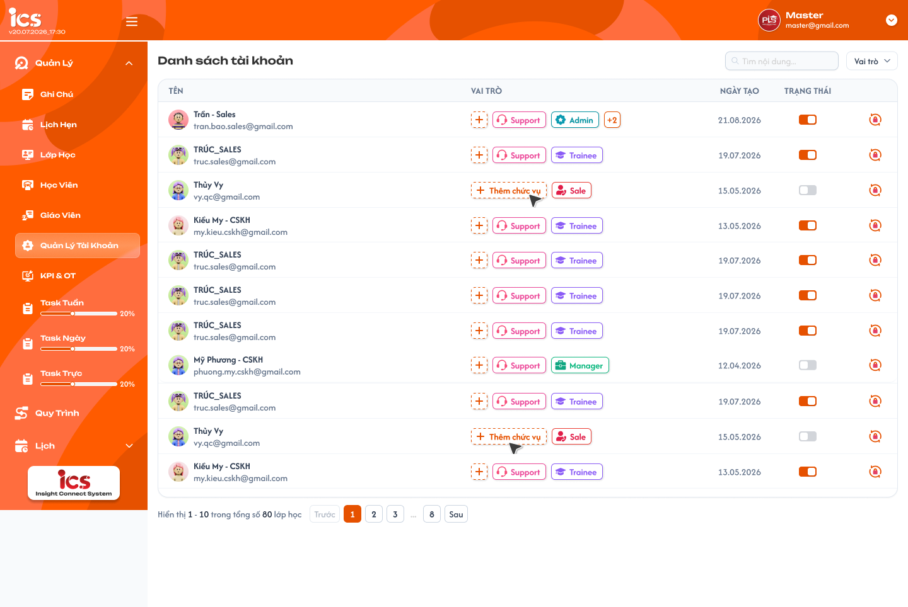
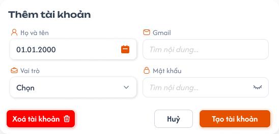
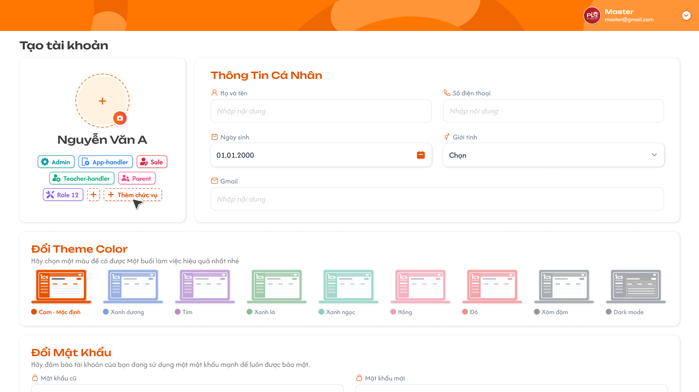
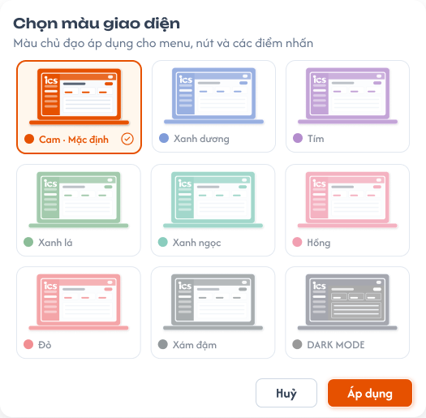

# Quản lý tài khoản (Master)

## 1. UI

### Trang 1: MST-TK-010000 — Tài khoản / Danh sách tài khoản



**Mô tả:**
- Master xem toàn bộ tài khoản trong hệ thống, tìm kiếm theo tên/email, lọc theo bộ lọc "Tất cả" (role/trạng thái), tạo mới, gán role, kích hoạt/vô hiệu hóa, xóa và đặt lại mật khẩu cho từng tài khoản. Màn hình này chỉ dành riêng cho Master.

**Điểm cần lưu ý:**
- Badge **"+2"**: khi tài khoản có nhiều hơn 2 role, chỉ hiển thị 2 role đầu, phần dư gộp thành "+N".
- **Xóa tài khoản, Đặt lại mật khẩu** cần có popup xác nhận.
- Ô tìm kiếm: tìm theo **tên hoặc email**.
- Bộ lọc "Tất cả": gồm lọc theo **trạng thái kích hoạt** và lọc theo **role**, có thể **kết hợp đồng thời** với nhau và với ô tìm kiếm.
- Toast phản hồi kết quả các thao tác thay đổi dữ liệu; nội dung dòng hai lấy từ flow CRUD tương ứng; mỗi thao tác chỉ có một Toast; Hủy/chỉ đọc không có Toast CRUD; nút `×` đóng thủ công; không hiển thị dữ liệu nhạy cảm.
- `A03.01` Toast Thành công `Thành Công`: backend xác nhận thao tác thành công (chỉ hiện sau khi backend xác nhận).
- `A03.02` Toast Thông tin `Thông Báo`: thao tác đã tiếp nhận nhưng dữ liệu cần thời gian đồng bộ.
- `A03.03` Toast Cảnh báo `Cảnh Báo`: dữ liệu / điều kiện cần người dùng kiểm tra.
- `A03.04` Toast Lỗi `Có Lỗi Xảy Ra`: backend / network không hoàn tất thao tác.


### Trang 2: MST-TK-010010 — Tài khoản / Popup thêm tài khoản



**Mô tả:**
- Master bấm dấu "+" tạo mới tài khoản, hiện popup "Thêm tài khoản" / "Tạo tài khoản" (Họ và tên, Ngày sinh, Gmail, Vai trò, Mật khẩu; nút `Huỷ`, `Tạo tài khoản`).

**Điểm cần lưu ý:**
- Field **mật khẩu**: hiển thị dạng ẩn (dấu chấm), có icon con mắt để xem; hiển thị/ẩn phụ thuộc trạng thái đã đổi mật khẩu lần đầu hay chưa (xem REQ02).

### Trang 3: MST-TK-010020 — Tài khoản / Danh sách tài khoản / Popup xác nhận xoá


**Mô tả:**
- Popup `Xác nhận xoá` (`Bạn có chắc chắn muốn xoá người dùng này?`), nút `Huỷ`, `Xoá`. Xóa là soft-delete (xem Flow 5).

### Trang 4: MST-TK-010030 — Tài khoản / Danh sách tài khoản / Popup đặt lại mật khẩu


**Mô tả:**
- Popup `Đặt lại mật khẩu mặc định`: mật khẩu của người dùng sẽ được khôi phục về mặc định; nút `Huỷ`, `Xác nhận` (xem Flow 4).

### Trang 5: MST-TK-020000 — Tài khoản / Chi tiết tài khoản



**Mô tả:**
- Màn chi tiết tài khoản: danh sách role của tài khoản (Admin, App-handler, Sale, Teacher-handler, Parent…, `Thêm chức vụ`), khối `Thông Tin Cá Nhân` (Họ và tên, Số điện thoại, Ngày sinh, Giới tính, Gmail) và khối `Đổi Theme Color` chọn màu giao diện.

**Điểm cần lưu ý:**
- Chưa có đặc tả hành vi cho màn này trong requirement (xem Q01).

### Trang 6: PRO-GD-010010 — Hồ sơ / Popup chọn màu giao diện



**Mô tả:**
- Popup `Chọn màu giao diện`: màu chủ đạo áp dụng cho menu, nút và các điểm nhấn (Cam mặc định, Xanh dương, Tím, Xanh lá, Xanh ngọc, Hồng, Đỏ, Xám đậm, DARK MODE); nút `Huỷ`, `Áp dụng`.

**Điểm cần lưu ý:**
- Chưa có đặc tả hành vi cho popup này trong requirement (xem Q01).

---

## 2. Yêu cầu

### 2.1. Flow chính

**Flow 1: Tạo tài khoản**

```
Master bấm "+"
      → Popup tạo tài khoản
      → Nhập Email (bắt buộc) + Mật khẩu mặc định (hệ thống tự điền, cho sửa) + Chọn Role (bắt buộc ≥1)
      → Bấm "Tạo"
      → FE validate → BE tạo tài khoản
      → FE thêm dòng mới vào danh sách
```

**Flow 2: Thêm role cho tài khoản**

```
Master bấm "+" cạnh role của 1 dòng → Chọn thêm role → Xác nhận
      → FE gọi API cập nhật role → BE lưu → FE cập nhật badge role trên dòng đó
```

**Flow 3: Bật/Tắt kích hoạt tài khoản**

```
Master gạt toggle "Kích hoạt" (không áp dụng cho chính tài khoản Master đang đăng nhập)
      → FE gọi API cập nhật trạng thái
      → Bật: tài khoản hoạt động, đăng nhập được
      → Tắt: tài khoản bị vô hiệu hóa, không đăng nhập được
      → FE cập nhật lại trạng thái toggle
```

**Flow 4: Đặt lại mật khẩu**

```
Master bấm icon "Đặt lại mật khẩu"
      → Popup xác nhận đặt lại mật khẩu (Trang 4) → Master xác nhận
      → FE gọi API reset password
      → BE set mật khẩu về mặc định của hệ thống + hủy toàn bộ session hiện tại của tài khoản đó
      → Tài khoản bị văng khỏi phiên đăng nhập hiện tại (nếu đang đăng nhập), phải đăng nhập lại bằng mật khẩu mặc định mới
      → FE cập nhật trạng thái: tài khoản quay lại trạng thái "còn giữ mật khẩu mặc định" → icon con mắt xem được lại, không bị ẩn mật khẩu
```

**Flow 5: Xóa tài khoản (soft-delete)**

```
Master bấm icon "Xóa" (không áp dụng cho chính tài khoản Master đang đăng nhập)
      → Popup xác nhận xóa (Trang 3) → Master xác nhận
      → FE gọi API xóa → BE soft-delete
      → FE loại bỏ dòng khỏi danh sách
```

**Flow 6: Tắt kích hoạt tài khoản đang có phiên đăng nhập**

```
Master gạt toggle Kích hoạt sang tắt trên tài khoản đang có session
      → FE gọi API vô hiệu hóa
      → BE hủy toàn bộ session hiện tại của tài khoản đó (giống Flow 4)
      → Tài khoản bị văng ra ngay lập tức, không đăng nhập được vì đã bị vô hiệu hóa
```

### 2.2. Ngoại lệ

- **EX01:** Tạo tài khoản không chọn role nào → chặn submit, báo lỗi "Vui lòng chọn ít nhất 1 role".
- **EX02:** Tạo tài khoản với email đã tồn tại → báo lỗi "Email đã được sử dụng".
- **EX03:** Đặt lại mật khẩu cho tài khoản đang có phiên đăng nhập → hủy session ở **tất cả thiết bị**, tài khoản phải đăng nhập lại.
- **EX04:** Vô hiệu hóa (tắt kích hoạt) tài khoản đang có phiên đăng nhập → **buộc đăng xuất ngay lập tức trên tất cả thiết bị** (hủy toàn bộ session, giống hành vi đặt lại mật khẩu), đồng thời chặn đăng nhập ở các lần sau.
- **EX05:** Master cố **xóa hoặc tắt kích hoạt chính tài khoản Master đang đăng nhập** → hệ thống **chặn hành động**, báo lỗi (tránh tự khóa mình khỏi hệ thống).

### 2.3. Yêu cầu khác

| Mã | Tên yêu cầu | Mô tả |
|---|---|---|
| REQ01 | Email | Email là bắt buộc và phải duy nhất trong hệ thống. |
| REQ02 | Hiển thị mật khẩu | Mật khẩu chỉ hiển thị được (qua icon con mắt) khi tài khoản **còn giữ mật khẩu mặc định** (chưa từng đổi). Nếu tài khoản đã tự đổi mật khẩu, hệ thống **không hiển thị** mật khẩu dưới bất kỳ hình thức nào (bấm vào con mắt không có gì để xem). |
| REQ03 | Mật khẩu mặc định khi tạo | Mật khẩu mặc định khi tạo mới được hệ thống tự điền sẵn, Master có thể chỉnh sửa trước khi tạo. |
| REQ04 | Đặt lại mật khẩu | Đặt lại mật khẩu = đưa mật khẩu tài khoản đó về đúng giá trị mật khẩu mặc định của hệ thống. |
| REQ05 | Tối thiểu 1 role | Một tài khoản phải có tối thiểu 1 role tại mọi thời điểm. Lúc tạo bắt buộc chọn >= 1 role. Lúc xóa không cho xóa role cuối cùng còn lại. |
| REQ06 | Kích hoạt mặc định | Trạng thái "Kích hoạt" mặc định của tài khoản mới tạo luôn là **bật**. |
| REQ07 | Soft-delete | Xóa tài khoản là **soft-delete**. |
| REQ08 | Gán role tự do | Master được **gán tự do mọi role** cho tài khoản, không giới hạn/loại trừ kết hợp role nào. |
| REQ09 | Bắt buộc đổi mật khẩu | Bất kể Master có **sửa lại giá trị** mật khẩu mặc định lúc tạo hay không, mật khẩu đó vẫn được xem là **mật khẩu khởi tạo** → tài khoản **bắt buộc phải đổi mật khẩu** ở lần đăng nhập đầu tiên. Tương tự, sau khi bị **Đặt lại mật khẩu** (Flow 4), tài khoản cũng **bắt buộc phải đổi mật khẩu** ở lần đăng nhập tiếp theo. |
| REQ10 | Hủy session mọi thiết bị | "Đặt lại mật khẩu" và "Tắt kích hoạt" đều hủy session ở **tất cả thiết bị** mà tài khoản đó đang đăng nhập, không chỉ 1 phiên gần nhất. |

### 2.4. Ràng buộc

#### Quyền

| Role | Xem | Tạo | Gán role | Kích hoạt/Vô hiệu hóa | Đặt lại mật khẩu | Xóa |
|---|:---:|:---:|:---:|:---:|:---:|:---:|
| Master | ✅ | ✅ | ✅ | ✅ | ✅ | ✅ |
| Các role khác | ❌ | ❌ | ❌ | ❌ | ❌ | ❌ |

#### Ràng buộc khác

- Màn hình này chỉ dành riêng cho Master.

---

## 3. Testcase

### Feature: Quản lý tài khoản (Master)

| Tên testcase | Priority | Scenario | Role | Pre-condition | Given/When/Then | Expected Result |
|---|---|---|---|---|---|---|
| Case 1: Tạo tài khoản thành công | High | Flow 1 / REQ01 / REQ03 / REQ06 | Master | Đã đăng nhập Master | **Given:** Popup "Tạo tài khoản" đang mở<br>**When:** Nhập email hợp lệ, giữ nguyên/sửa mật khẩu mặc định, chọn 1 role, bấm Tạo<br>**Then:** Hệ thống tạo tài khoản mới | - Mật khẩu trong popup ở trạng thái "mặc định", xem được qua icon con mắt<br>- Tài khoản mới xuất hiện trong danh sách<br>- Trạng thái Kích hoạt = bật |
| Case 2: Tạo tài khoản thiếu role hoặc email trùng | High | EX01 / EX02 / REQ01 | Master | Email đã tồn tại trong hệ thống | **Given:** Popup "Tạo tài khoản" đang mở<br>**When:** Nhập email + mật khẩu nhưng không chọn role, bấm Tạo; sau đó nhập email đã tồn tại, bấm Tạo<br>**Then:** Hệ thống từ chối | - Lỗi "Vui lòng chọn ít nhất 1 role"<br>- Lỗi "Email đã được sử dụng"<br>- Không tạo tài khoản |
| Case 3: Thêm role, badge "+N", gán tự do, không gỡ role cuối | Medium | Flow 2 / REQ05 / REQ08 | Master | Tài khoản A có 1 role; tài khoản B có từ 3 role; tài khoản J chỉ còn đúng 1 role | **Given:** Đang ở danh sách<br>**When:** Bấm "+" cạnh role của A, chọn thêm role bất kỳ (kể cả tổ hợp khác thường), xác nhận; xem cột Vai trò của B; thử gỡ role duy nhất của J<br>**Then:** Hệ thống cập nhật role / rút gọn hiển thị / chặn gỡ | - Badge role của A hiển thị thêm role vừa chọn, không có cảnh báo/chặn kết hợp<br>- B chỉ hiện 2 role đầu + badge "+N"<br>- J báo lỗi, vẫn giữ đúng role đó |
| Case 4: Bấm vào hàng tài khoản mở popup chỉnh sửa | Medium | Trang 1 (Row click) | Master | Tài khoản B tồn tại trong danh sách | **Given:** Đang ở danh sách<br>**When:** Bấm vào hàng tài khoản B<br>**Then:** Hệ thống mở popup chỉnh sửa tài khoản | - Popup chỉnh sửa tài khoản B được mở<br>- Thông tin hiển thị trong popup đúng với tài khoản B |
| Case 5: Bật/tắt kích hoạt tài khoản không có phiên | High | Flow 3 | Master | Tài khoản C đang tắt kích hoạt; tài khoản D đang bật, không có session | **Given:** Đang ở danh sách<br>**When:** Gạt toggle Kích hoạt của C sang bật; gạt toggle của D sang tắt<br>**Then:** Hệ thống cập nhật trạng thái | - C đăng nhập lại được<br>- D không đăng nhập được ở lần sau<br>- Toggle chuyển đúng trạng thái |
| Case 6: Tắt kích hoạt tài khoản đang có phiên đăng nhập | High | Flow 6 / EX04 / REQ10 | Master | Tài khoản E đang bật kích hoạt và đang đăng nhập trên thiết bị khác | **Given:** Đang ở danh sách<br>**When:** Gạt toggle Kích hoạt sang tắt trên E<br>**Then:** Hệ thống vô hiệu hóa + hủy session | - E bị văng ra ngay lập tức trên **tất cả thiết bị** đang đăng nhập<br>- E không đăng nhập lại được vì tài khoản đã bị vô hiệu hóa |
| Case 7: Đặt lại mật khẩu cho tài khoản đang có phiên | High | Flow 4 / EX03 / REQ04 / REQ10 | Master | Tài khoản F đang đăng nhập ở thiết bị khác, đã từng tự đổi mật khẩu | **Given:** Đang ở danh sách<br>**When:** Bấm icon "Đặt lại mật khẩu" trên F, xác nhận popup<br>**Then:** Hệ thống reset mật khẩu | - Mật khẩu F về đúng mật khẩu mặc định hệ thống<br>- Session F bị hủy trên **tất cả thiết bị**, F bị văng ra ngoài<br>- F quay lại trạng thái "còn giữ mật khẩu mặc định" → icon con mắt xem được mật khẩu |
| Case 8: Xem mật khẩu mặc định và mật khẩu đã đổi | High | REQ02 | Master | Tài khoản G chưa từng đổi mật khẩu; tài khoản H đã tự đổi mật khẩu | **Given:** Đang xem thông tin G rồi H trong popup<br>**When:** Bấm icon con mắt<br>**Then:** G hiển thị mật khẩu; H không lộ mật khẩu | - Mật khẩu G hiện dạng plain text<br>- H không có icon con mắt hoặc bấm vào không hiển thị giá trị mật khẩu nào |
| Case 9: Xóa tài khoản (soft-delete) | Medium | Flow 5 / REQ07 | Master | Tài khoản I tồn tại, có dữ liệu liên quan (vd: lịch sử thao tác) | **Given:** Đang ở danh sách<br>**When:** Bấm icon Xóa trên I, xác nhận popup<br>**Then:** Hệ thống soft-delete I | - I biến mất khỏi danh sách hiển thị<br>- Dữ liệu liên quan của I vẫn còn lưu trong hệ thống |
| Case 10: Chặn Master tự xóa/tắt kích hoạt chính mình | High | EX05 | Master | Master đang đăng nhập | **Given:** Đang xem dòng tài khoản của chính mình<br>**When:** Bấm icon Xóa hoặc gạt toggle Kích hoạt trên chính mình<br>**Then:** Hệ thống chặn hành động | - Hiển thị lỗi, không thực hiện được<br>- Tài khoản Master vẫn hoạt động, vẫn còn kích hoạt bình thường |
| Case 11: Bắt buộc đổi mật khẩu lần đầu và sau khi đặt lại | High | REQ09 / Flow 4 | Tài khoản mới tạo / tài khoản bị đặt lại | Tài khoản M được tạo, Master có sửa mật khẩu khởi tạo; tài khoản N đã từng tự đổi mật khẩu, vừa bị Master "Đặt lại mật khẩu" | **Given:** M đăng nhập lần đầu bằng mật khẩu khởi tạo; N đăng nhập bằng mật khẩu mặc định mới<br>**When:** Đăng nhập thành công<br>**Then:** Hệ thống bắt buộc đổi mật khẩu | - M và N bị yêu cầu đổi mật khẩu trước khi vào hệ thống, dù mật khẩu của M không phải giá trị mặc định gốc |
| Case 12: Tìm kiếm kết hợp bộ lọc | Medium | Trang 1 (Tìm kiếm & bộ lọc) | Master | Có nhiều tài khoản với role/trạng thái kích hoạt khác nhau | **Given:** Đang ở danh sách<br>**When:** Nhập từ khóa tìm kiếm (tên/email) + chọn lọc role + chọn lọc trạng thái kích hoạt<br>**Then:** Hệ thống lọc đồng thời | - Danh sách chỉ hiện tài khoản khớp **cả 3 điều kiện** cùng lúc |
| Case 13: Role khác không truy cập được màn hình | High | Ràng buộc quyền | Các role khác | Đăng nhập bằng role không phải Master | **Given:** Truy cập URL/màn hình quản lý tài khoản<br>**When:** Cố mở màn hình hoặc gửi request trực tiếp<br>**Then:** Hệ thống chặn truy cập | - Không xem/thao tác được màn hình này |
| Case 14: Toast phản hồi CRUD | High | Toast CRUD (`A03.01`–`A03.04`) | Master | Role có quyền CRUD | **Given:** Người dùng xác nhận thay đổi hợp lệ; dữ liệu/điều kiện chưa hợp lệ; backend/network lỗi; thao tác đồng bộ bất đồng bộ hoặc callback lặp<br>**When:** Backend phản hồi / người dùng bấm `×`<br>**Then:** Hiển thị đúng một Toast tương ứng | - `Thành Công` chỉ hiện sau khi backend xác nhận<br>- `Cảnh Báo`: không lưu dữ liệu sai, vẫn đánh dấu field lỗi<br>- `Có Lỗi Xảy Ra`: không cập nhật một phần, cho thử lại, không lộ lỗi kỹ thuật<br>- `Thông Báo`: không báo thành công sớm, không nhân đôi Toast, đóng không hoàn tác dữ liệu |

---

## 4. Câu hỏi cần xác nhận

- **Q01:** Figma có màn Chi tiết tài khoản (MST-TK-020000: Thông Tin Cá Nhân, Đổi Theme Color, Thêm chức vụ) và popup Chọn màu giao diện (PRO-GD-010010), cùng các field Họ và tên, Ngày sinh trong popup Thêm tài khoản; requirement chỉ đặc tả Email, Mật khẩu, Role. Các màn / field này thuộc phạm vi requirement nào và có bắt buộc không?
