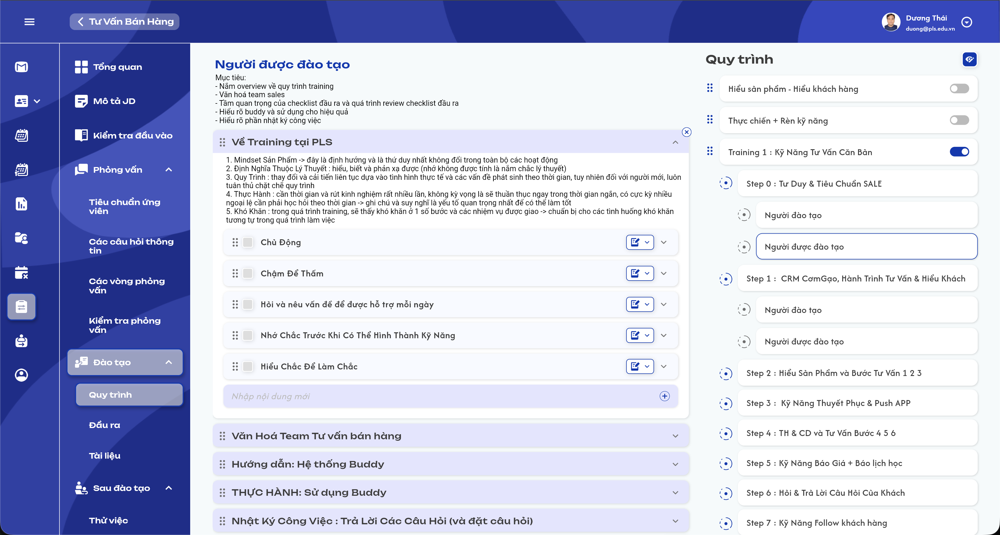
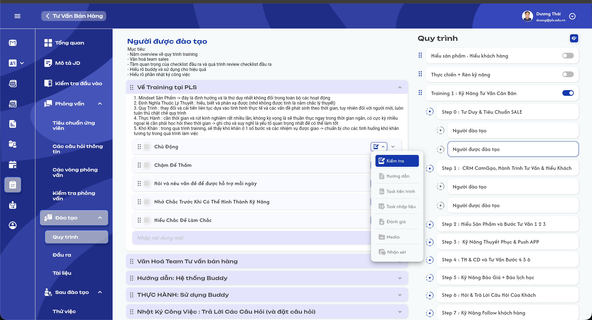
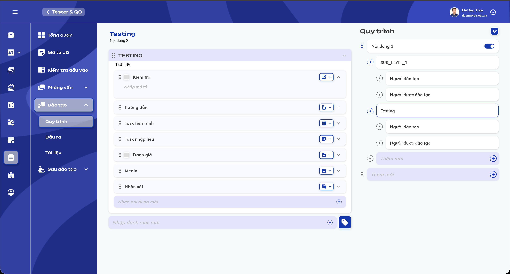
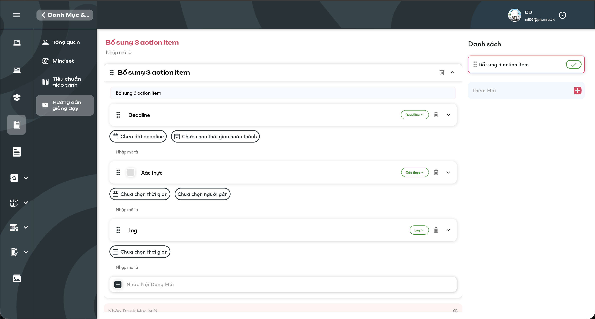
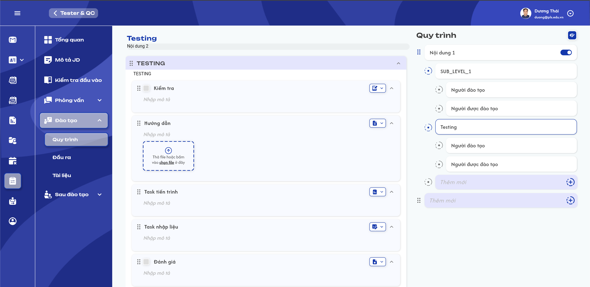
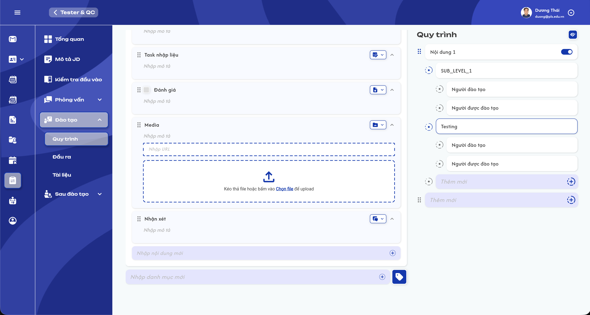

# Action Board

## 1. UI

### Trang 1: ADM-AB-010000 — Action Board tổng quát




*Ví dụ Action Board kiểu Pack - Sub - Role tại màn hình Đào tạo → Quy trình — nhấn để xem ảnh gốc*

**Mô tả:**

- Action Board là thành phần dùng chung để định nghĩa nội dung theo từng nghiệp vụ và ghi nhận kết quả thực hiện theo từng người sở hữu dữ liệu.
- Người có quyền định nghĩa nội dung sử dụng màn hình để tạo, sửa, sắp xếp, bật/tắt hoặc xóa các cấp Package, Category và Action.
- Người có quyền cập nhật kết quả sử dụng cùng cấu trúc đã được định nghĩa để đánh dấu hoàn thành, đánh giá, nhập ghi chú, cập nhật task hoặc đính kèm nội dung theo từng Action.
- Người dùng ở chế độ `COMMENT_ONLY` chỉ được thao tác nội dung của Action `Task nhập liệu` và `Task tiến trình` theo control mà từng loại Task cung cấp; chế độ này không áp dụng cho Action `Nhận xét` hoặc ghi chú kết quả chung.
- Người dùng ở chế độ `READ_ONLY` chỉ được xem dữ liệu FE cho phép hiển thị; theo FE hiện tại, phần nội dung riêng của `Task nhập liệu` và `Task tiến trình` không được render trong chế độ này.

**Điểm cần lưu ý:**

- Khi mở màn hình, UI hiển thị loading cho đến khi tải xong cây Package và nội dung của Package được chọn.
- Với các layout có Package, màn hình chia hai khu vực: bên trái là tiêu đề, mô tả, Category và Action của Package đang chọn; bên phải là cây Package và các cấp con.
- Package đầu tiên được chọn mặc định sau khi tải dữ liệu. Với trường hợp tải từ một Package cha tùy chỉnh, UI chọn Package con đầu tiên.
- Category được hiển thị dạng accordion; Action nằm trong Category và có thể mở rộng để xem nội dung chi tiết.
- Nút kéo thả, thêm mới, chỉnh sửa, bật/tắt, lịch sử và xóa chỉ hiển thị khi quyền hiện tại cho phép định nghĩa nội dung.
- Xóa Package, Category và Action là xóa mềm bằng cách cập nhật `status = 2`.
- Toggle Package dùng `status = 1` cho đang hoạt động và `status = 0` cho tạm ngưng.
- Màn hình hiện không có search, filter hoặc phân trang cho cây Package, Category và Action.
- Nếu không có dữ liệu và người dùng không có quyền định nghĩa, UI hiển thị trạng thái rỗng. Với layout Package, nội dung trống hiển thị `Không có dữ liệu`.

**Các kiểu bố cục:**

- `A01.01` **`PACK`**: Cấu trúc dữ liệu/UI: Package → Category → Action; Trạng thái UI hiện tại: Đã có màn hình
- `A01.02` **`CATE`**: Cấu trúc dữ liệu/UI: Category → Action; backend vẫn dùng một `MAIN_PACK` kỹ thuật; Trạng thái UI hiện tại: Đã có màn hình
- `A01.03` **`ACT`**: Cấu trúc dữ liệu/UI: Action trực tiếp; các cấp cha là lớp kỹ thuật; Trạng thái UI hiện tại: Mới hiển thị placeholder `ACT`
- `A01.04` **`PACK_SUBS`**: Cấu trúc dữ liệu/UI: Package → Sub-package → Category → Action; Trạng thái UI hiện tại: Đã có màn hình
- `A01.05` **`PACK_2SUBS`**: Cấu trúc dữ liệu/UI: Package → Sub cấp 1 → Sub cấp 2 → Category → Action; Trạng thái UI hiện tại: Đã có màn hình
- `A01.06` **`PACK_3SUBS`**: Cấu trúc dữ liệu/UI: Package → Sub cấp 1 → Sub cấp 2 → Sub cấp 3 → Category → Action; Trạng thái UI hiện tại: Mới hiển thị placeholder `PACK_3SUBS`
- `A01.07` **`PACK_ROLES`**: Cấu trúc dữ liệu/UI: Package → Role → Category → Action; Trạng thái UI hiện tại: Đã có màn hình
- `A01.08` **`PACK_SUBS_ROLES`**: Cấu trúc dữ liệu/UI: Package → Sub-package → Role → Category → Action; Trạng thái UI hiện tại: Đã có màn hình

**Mapping vị trí nghiệp vụ:**

- `A01.09` **Mô tả công việc**: Action Board type: `PACK`
- `A01.10` **Câu hỏi thông tin phỏng vấn**: Action Board type: `CATE`
- `A01.11` **Tiêu chuẩn ứng viên**: Action Board type: `CATE`
- `A01.12` **Các vòng phỏng vấn**: Action Board type: `PACK_ROLES`
- `A01.13` **Quy trình đào tạo**: Action Board type: `PACK_SUBS_ROLES`
- `A01.14` **Tài liệu đào tạo**: Action Board type: `PACK_SUBS`
- `A01.15` **Đầu ra đào tạo**: Action Board type: `CATE`
- `A01.16` **Đánh giá sau đào tạo**: Action Board type: `CATE`
- `A01.17` **Thử việc sau đào tạo**: Action Board type: `CATE`
- `A01.18` **Onboarding**: Action Board type: `PACK_SUBS_ROLES`
- `A01.19` **Bàn giao tài khoản**: Action Board type: `PACK`
- `A01.20` **Bàn giao tài liệu**: Action Board type: `PACK`
- `A01.21` **Bàn giao nghiệp vụ**: Action Board type: `PACK`
- `A01.22` **Nhật ký công việc**: Action Board type: `PACK`
- `A01.23` **Review**: Action Board type: `PACK`

### Trang 2: ADM-AB-010000 — Khu vực cây Package


**Field:**

- `A02.01` **Tên Package**: Bắt buộc khi tạo; FE loại khoảng trắng đầu/cuối để kiểm tra rỗng; code hiện tại chưa quy định giới hạn độ dài hoặc kiểm tra trùng tên.
- `A02.02` **Mô tả Package**: Không bắt buộc; hỗ trợ nội dung định dạng; chỉ người có quyền định nghĩa được sửa.
- `A02.03` **Loại node**: Do layout quyết định: `MAIN_PACK`, `SUB_PACK`, `TWO_SUB_PACK`, `THREE_SUB_PACK`, `ROLE_PACK`, `ROLE_SUB_PACK` hoặc `ROLE`.
- `A02.04` **Parent**: Bắt buộc; phải đúng quan hệ cha-con mà backend cho phép.
- `A02.05` **Trạng thái**: `1`: hoạt động; `0`: tạm ngưng; `2`: đã xóa.
- `A02.06` **Thứ tự**: Được cập nhật bằng kéo thả giữa các node cùng cấp. Backend lưu thứ tự từ `1` theo danh sách ID FE gửi lên.
- `A02.07` **Role node**: Tên và số lượng Role được sinh theo vị trí. Quy trình đào tạo/Onboarding gồm `Người đào tạo`, `Người được đào tạo`; vòng phỏng vấn gồm `Câu hỏi phỏng vấn`, `Đánh giá`.

**Điểm cần lưu ý:**

- Người có quyền định nghĩa có thể thêm Package ở đúng cấp của layout, sửa tiêu đề/mô tả, kéo thả, bật/tắt và xóa.
- Role node do hệ thống sinh khi tạo cây `PACK_ROLES` hoặc `PACK_SUBS_ROLES`; UI hiện không cho xóa trực tiếp node có type `ROLE`.
- Khi Package bị tắt, màn hình định nghĩa vẫn có thể tải node chưa bị xóa; màn hình theo người sở hữu chỉ tải Package đang hoạt động.
- Khi xóa một Package cha, code hiện tại chỉ đổi trạng thái node được chọn; chưa có xử lý cascade trạng thái xuống toàn bộ node con.

### Trang 3: ADM-AB-010000 — Khu vực Category và Action


**Field Category:**

- `A03.01` **Tên Category**: Bắt buộc khi tạo; FE trim để kiểm tra rỗng; chưa có giới hạn độ dài hoặc kiểm tra trùng tên.
- `A03.02` **Mô tả Category**: Không bắt buộc; hỗ trợ nội dung định dạng.
- `A03.03` **Package**: Category phải thuộc Package đang được chọn.
- `A03.04` **Tag**: Không bắt buộc; được lưu theo Category và `owner_id`, đồng thời phải thuộc tập Tag hiện hành của group Action Board để Category tiếp tục được hiển thị cho chính owner.
- `A03.05` **Trạng thái**: `1`: hoạt động; `2`: đã xóa. Repository hiện vẫn trả Category có `status = 0`.
- `A03.06` **Thứ tự**: Có thể kéo thả trong cùng Package khi có quyền định nghĩa.

**Field Action:**

- `A03.07` **Tên Action**: Bắt buộc khi tạo; FE trim để kiểm tra rỗng; chưa có giới hạn độ dài hoặc kiểm tra trùng tên.
- `A03.08` **Mô tả Action**: Không bắt buộc; hỗ trợ nội dung định dạng.
- `A03.09` **Category**: Action phải thuộc Category đang mở.
- `A03.10` **Loại Action**: Một trong: `Kiểm tra`, `Hướng dẫn`, `Task tiến trình`, `Task nhập liệu`, `Đánh giá`, `Media`, `Nhận xét`, `Deadline`, `Xác thực`, `Log`.
- `A03.11` **File**: Dùng cho nội dung hướng dẫn, nhận xét hoặc task nhập liệu tùy loại Action. Khu vực file tổng quát chấp nhận `PNG`, `JPG`, `JPEG`, `GIF`, `WEBP`, `MP4`, `MOV`, `PPTX`, `DOCX`, `PDF`, `XLSX`, `XLS`, `TXT`, `SVG`.
- `A03.12` **URL/Media**: Dùng cho Action loại Media; cho nhập URL hoặc upload `PNG`, `JPG`, `JPEG`, `GIF`, `WEBP`, `MP4`, `MOV`. UI hỗ trợ preview ảnh/video/YouTube và ghi log thời lượng xem video.
- `A03.13` **Trạng thái**: `1`: hoạt động; `2`: đã xóa. Repository hiện vẫn trả Action có `status = 0`.
- `A03.14` **Thứ tự**: Có thể kéo thả trong cùng Category khi có quyền định nghĩa.

**Quy tắc loại Action theo vị trí:**

- Mặc định cho phép chọn tất cả loại Action.
- Tại `Các vòng phỏng vấn`, Role `Câu hỏi phỏng vấn` chỉ cho loại `Kiểm tra`; Role `Đánh giá` chỉ cho loại `Đánh giá`.
- Tại `Review`, Action tạo mới mặc định là `Đánh giá` và UI không hiển thị dropdown đổi loại.
- Ngoài `Review`, Action tạo mới mặc định là loại đầu tiên trong danh sách loại hợp lệ; với danh sách mặc định hiện tại là `Kiểm tra`.

### Trang 4: ADM-AB-010010 — Popup chọn loại Action




*Dropdown chọn loại Action trên màn hình Quy trình đào tạo — nhấn để xem ảnh gốc*

**Mô tả:**

- Người có quyền định nghĩa bấm nút loại Action ở bên phải tiêu đề Action để mở dropdown.
- Dropdown hiển thị icon và tên loại; loại đang chọn có nền màu chính, icon và chữ màu trắng.
- Danh sách loại Action hỗ trợ: `Kiểm tra`, `Hướng dẫn`, `Task tiến trình`, `Task nhập liệu`, `Đánh giá`, `Media`, `Nhận xét`, `Deadline`, `Xác thực`, `Log`.
- Bảy loại hiện có giữ nguyên thứ tự UI. Ba loại mới phải xuất hiện trong dropdown; thứ tự chính thức của ba loại này cần được xác nhận.
- Chọn một loại khác cập nhật ngay type của Action; nội dung mở rộng bên dưới chuyển sang control tương ứng với type mới.

**Điểm cần lưu ý:**

- Dropdown chỉ cho tương tác khi quyền là `Định nghĩa nội dung` và vị trí hiện tại cho phép từ hai loại Action trở lên.
- Nếu vị trí/Role chỉ cho đúng một loại, UI chỉ hiển thị icon loại đó và không mở danh sách lựa chọn.
- Tại màn hình `Review`, dropdown đổi loại không hiển thị.
- Người không có quyền định nghĩa không được hiển thị dropdown đổi loại Action.

### Trang 5: ADM-AB-010000 — Danh sách Action trong Category




*Category hiển thị các Action Kiểm tra, Hướng dẫn, Task tiến trình, Task nhập liệu, Đánh giá, Media và Nhận xét — nhấn để xem ảnh gốc*

**Mô tả:**

- Mỗi Action hiển thị drag handle, control kết quả nếu có, tên, icon loại Action và nút mở/đóng nội dung chi tiết.
- Action `Kiểm tra`, `Đánh giá` và `Xác thực` có control kết quả nằm trước tên Action.
- Action được mở rộng hiển thị vùng `Nhập mô tả` và nội dung chuyên biệt theo loại; Action thu gọn chỉ hiển thị hàng tiêu đề.
- Ô `Nhập nội dung mới` ở cuối Category dùng để tạo Action; ô `Nhập danh mục mới` ở cuối danh sách dùng để tạo Category.

**Điểm cần lưu ý:**

- Chỉ người có quyền định nghĩa thấy drag handle hoạt động, ô tạo Category/Action và nút xóa khi hover.
- Nút chevron phải phản ánh đúng trạng thái mở/đóng của từng Action và không làm đổi Action đang chọn trong cây Package.
- Thứ tự Action sau kéo thả phải được giữ nguyên khi tải lại trang.

### Trang 6: ADM-AB-010001 — Nội dung Action loại Deadline, Xác thực và Log




*Ba loại Action mới với các control tương ứng khi được mở rộng — nhấn để xem ảnh gốc*

**Field:**

- `A06.01` **`Deadline`**: Field/control: Deadline; Hiển thị control chọn deadline; khi chưa có giá trị hiển thị `Chưa đặt deadline`.
- `A06.02` **`Deadline`**: Field/control: Thời gian hoàn thành; Hiển thị control chọn thời gian hoàn thành; khi chưa có giá trị hiển thị `Chưa chọn thời gian hoàn thành`.
- `A06.03` **`Deadline`**: Field/control: Mô tả; Không bắt buộc; hỗ trợ nội dung định dạng; placeholder `Nhập mô tả`.
- `A06.04` **`Xác thực`**: Field/control: Trạng thái xác thực; Hiển thị checkbox trước tên Action; checkbox phải phản ánh đúng giá trị đã lưu.
- `A06.05` **`Xác thực`**: Field/control: Thời gian; Hiển thị control chọn thời gian; khi chưa có giá trị hiển thị `Chưa chọn thời gian`.
- `A06.06` **`Xác thực`**: Field/control: Người gán; Hiển thị control chọn người gán; khi chưa có giá trị hiển thị `Chưa chọn người gán`.
- `A06.07` **`Xác thực`**: Field/control: Mô tả; Không bắt buộc; hỗ trợ nội dung định dạng; placeholder `Nhập mô tả`.
- `A06.08` **`Log`**: Field/control: Thời gian; Hiển thị control chọn thời gian; khi chưa có giá trị hiển thị `Chưa chọn thời gian`.
- `A06.09` **`Log`**: Field/control: Mô tả; Không bắt buộc; hỗ trợ nội dung định dạng; placeholder `Nhập mô tả`.

**Điểm cần lưu ý:**

- Cả ba Action giữ cấu trúc chung gồm drag handle, tên, chip loại Action, nút xóa và chevron mở/đóng theo quyền hiện tại.
- Khi đổi sang một trong ba loại mới, vùng nội dung mở rộng phải đổi đúng control và không giữ lại control không thuộc loại đã chọn.
- Giá trị đã lưu phải được khôi phục đúng khi tải lại trang; mở/đóng Action không được tự thay đổi dữ liệu.
- Ảnh tham chiếu chỉ xác nhận thành phần và trạng thái rỗng của UI. Kiểu dữ liệu, quy tắc bắt buộc, quyền cập nhật, validation và ảnh hưởng tới tiến độ cần được chốt trước khi triển khai backend.

### Trang 7: ADM-AB-010002 — Nội dung Action loại Hướng dẫn




*Action Hướng dẫn mở rộng với mô tả và vùng kéo thả/chọn file — nhấn để xem ảnh gốc*

**Field:**

- `A07.01` **Mô tả**: Không bắt buộc; hỗ trợ nội dung định dạng; placeholder `Nhập mô tả`; chỉ người có quyền định nghĩa được chỉnh sửa.
- `A07.02` **File hướng dẫn**: Không bắt buộc; cho kéo thả hoặc bấm `chọn file`; upload ngay sau khi chọn file hợp lệ.
- `A07.03` **Loại file**: Chỉ chấp nhận `PNG`, `JPG`, `JPEG`, `GIF`, `WEBP`, `MP4`, `MOV`, `PPTX`, `DOCX`, `PDF`, `XLSX`, `XLS`, `TXT`, `SVG`.
- `A07.04` **Danh sách file**: Hiển thị các file upload thành công; người có quyền định nghĩa được xóa file khỏi Action.

**Điểm cần lưu ý:**

- File sai extension bị từ chối và hiển thị `"{tên file}" không hợp lệ. Chỉ chấp nhận: {danh sách extension}`.
- File trùng tên với file đã có trong upload box hiện tại không được thêm lần nữa.
- Nếu upload thất bại, file ở trạng thái lỗi và không được thêm vào danh sách `files` đã lưu của Action.
- Code hiện tại không truyền giới hạn số file, dung lượng mỗi file hoặc tổng dung lượng cho vùng upload này.

### Trang 8: ADM-AB-010003 — Nội dung Action loại Media




*Action Media mở rộng với ô Nhập URL và vùng upload ảnh/video — nhấn để xem ảnh gốc*

**Field:**

- `A08.01` **URL**: Không bắt buộc; input một dòng với placeholder `Nhập URL`; submit khi Enter.
- `A08.02` **File Media**: Không bắt buộc; cho kéo thả hoặc chọn file và upload ngay. Khi upload thành công, FE lưu File ID vào trường URL của Action.
- `A08.03` **Loại file**: Chỉ chấp nhận `PNG`, `JPG`, `JPEG`, `GIF`, `WEBP`, `MP4`, `MOV`.
- `A08.04` **Preview**: URL/File ID hợp lệ được nhận diện và hiển thị dạng ảnh, video hoặc YouTube.

**Điểm cần lưu ý:**

- Khi submit URL khác rỗng, FE lưu URL rồi tải preview; URL rỗng đưa vùng Media về trạng thái nhập liệu.
- Khi upload thành công, FE tự điền File ID, lưu Action và tải preview tương ứng.
- Người có quyền định nghĩa được xóa Media khỏi Action; thao tác xóa đưa URL về chuỗi rỗng.
- Nếu không tải được Media, UI hiển thị khung lỗi với nút thử tải lại.
- Chỉ ghi log thời lượng xem khi video đã được xem lớn hơn `0` giây.
- Code hiện tại không truyền giới hạn dung lượng/số file và chưa có validation định dạng URL tại input.

### Trang 9: ADM-AB-010000 — Khu vực kết quả theo người sở hữu


**Field:**

- `A09.01` **Người sở hữu**: Bắt buộc để tạo kết quả; thường là ID ứng viên/người được đào tạo.
- `A09.02` **Kiểm tra**: Giá trị đúng/sai cho Action loại `Kiểm tra`.
- `A09.03` **Đánh giá**: Một trong `Tốt`, `Ổn`, `Trung bình`, `Chưa Tốt`, `Tệ`.
- `A09.04` **Ghi chú**: Nội dung theo từng Action và người sở hữu; không chấp nhận chuỗi rỗng khi submit trên UI.
- `A09.05` **File/URL**: Nội dung người dùng nộp hoặc đính kèm, tùy loại Action.
- `A09.06` **Task**: Có thể gồm yêu cầu, mô tả/ghi chú, file, danh sách checklist và tiến độ.
- `A09.07` **Tag Category theo người sở hữu**: Được lưu dưới Item type `ACTION_BOARD_RESULT` gắn với Category.

**Điểm cần lưu ý:**

- Khi tải board với `owner_id`, backend ghép Item kết quả vào từng Action theo cặp `action_id + owner_id`.
- FE tự tạo Item kết quả rỗng cho Action chưa có Item khi Action được khởi tạo trên màn hình có `owner_id`.
- Kết quả của hai người sở hữu trên cùng một cấu trúc board phải độc lập.
- Nếu người đang đăng nhập cũng là người sở hữu, FE chỉ hiển thị Category không có tag hoặc có ít nhất một tag thuộc tập Tag hiện hành của group Action Board. Tag gắn trên Category được lấy từ Item type `ACTION_BOARD_RESULT` của owner đó.
- Tiến độ Package được tính từ các Action đang tham gia tiến độ: `Kiểm tra`, `Đánh giá`, `Task tiến trình`.
- Trọng số đánh giá hiện tại: `Tốt = 100%`, `Ổn = 75%`, `Trung bình = 50%`, `Chưa Tốt = 25%`, `Tệ = 0%`.

---

### Trang 10: Toast phản hồi CRUD


*Toast phản hồi Create, Update, Delete và đổi trạng thái — nhấn để xem ảnh gốc*

**Mô tả:** Toast phản hồi kết quả các thao tác thay đổi dữ liệu trong requirement này.

**Điểm cần lưu ý:**

- `A10.01` **Thành công**: Tiêu đề: `Thành Công`; Khi sử dụng: Backend xác nhận thao tác thành công.
- `A10.02` **Thông tin**: Tiêu đề: `Thông Báo`; Khi sử dụng: Thao tác đã tiếp nhận nhưng dữ liệu cần thời gian đồng bộ.
- `A10.03` **Cảnh báo**: Tiêu đề: `Cảnh Báo`; Khi sử dụng: Dữ liệu/điều kiện cần người dùng kiểm tra.
- `A10.04` **Lỗi**: Tiêu đề: `Có Lỗi Xảy Ra`; Khi sử dụng: Backend/network không hoàn tất thao tác.

**Điểm cần lưu ý:** Nội dung dòng hai lấy từ flow CRUD tương ứng; mỗi thao tác chỉ có một Toast; Hủy/chỉ đọc không có Toast CRUD; nút `×` đóng thủ công; không hiển thị dữ liệu nhạy cảm.

---

## 2. Yêu cầu

### 2.1. Flow chính

**Flow 1: Mở hoặc khởi tạo Action Board**

```text
Người dùng mở một màn hình có Action Board
      → FE xác định role hiện tại, vị trí hiển thị, quyền thao tác và Action Board type
      → FE gửi ab_type + board_position + object_id; gửi thêm owner_id khi xem kết quả của một người
      → BE kiểm tra Action Board type hợp lệ và type khớp với vị trí
      → Board đã tồn tại: trả cây Package hiện tại
      → Board chưa tồn tại: tạo board + cây Package mặc định theo type + Role theo vị trí
      → FE chọn Package đầu tiên, tải Category + Action và ghép Item theo owner_id nếu có
      → Thành công: hiển thị cấu trúc và nội dung; không hiển thị notification
      → Thất bại: hiển thị toast lỗi do service trả về và không cho thao tác trên dữ liệu chưa tải xong
```

**Flow 2: Định nghĩa cây Package**

```text
Người có quyền định nghĩa nhập tên Package/Sub-package tại đúng cấp
      → Bấm nút thêm hoặc submit
      → FE trim và kiểm tra tên không rỗng
      → BE kiểm tra type của node và quan hệ parent hợp lệ
      → Với layout có Role: BE tự sinh đủ Role theo vị trí
      → Thành công: thêm cây mới vào UI và hiển thị "Tạo thành công"
      → Thất bại: không thêm node vào cây và hiển thị "Lỗi khi tạo" hoặc lỗi từ service
```

**Flow 3: Chỉnh sửa Package**

```text
Người có quyền định nghĩa chọn Package
      → Sửa tên hoặc mô tả và submit
      → FE gửi phần dữ liệu thay đổi
      → Thành công: cập nhật node đang chọn và hiển thị "Cập nhật thành công"
      → Thất bại: hiển thị lỗi; dữ liệu lưu trên server không thay đổi
```

**Flow 4: Tạo và quản lý Category/Action**

```text
Người có quyền định nghĩa chọn Package
      → Nhập tên Category và tạo
      → Category được gắn với Package đang chọn
      → Mở Category, nhập tên Action và tạo
      → FE chọn loại Action mặc định theo vị trí/Role
      → Người dùng có thể sửa tên, mô tả, loại, file, URL, deadline, thời gian hoặc người gán phù hợp với từng loại Action
      → Thành công khi tạo Category: hiển thị "Tạo Category mới thành công"
      → Thành công với Action: UI cập nhật danh sách và hiển thị "Cập nhật thành công"
      → Thất bại: không lưu thay đổi và hiển thị lỗi tương ứng
```

**Flow 5: Cập nhật kết quả Action**

```text
Người có quyền cập nhật kết quả mở board của một người sở hữu
      → FE tải hoặc tự tạo Item theo action_id + owner_id
      → Với UPDATE_RESULT: người dùng cập nhật checkbox Kiểm tra, mức Đánh giá, tag Category, ghi chú kết quả chung, file kết quả Nhận xét hoặc dữ liệu Task được FE cho phép
      → Với COMMENT_ONLY: người dùng chỉ thao tác Task nhập liệu/Task tiến trình, gồm ghi chú, nộp file hoặc cập nhật checklist tùy loại Task
      → COMMENT_ONLY không được cập nhật Kiểm tra/Đánh giá và không được thêm file hoặc ghi chú kết quả cho Action Nhận xét
      → FE cập nhật Item kết quả
      → Nếu thay đổi check/evaluate: BE tính lại tiến độ Package
      → Thành công: UI cập nhật kết quả, thời gian/người cập nhật và tiến độ liên quan; hiển thị "Cập nhật thành công"
      → Thất bại: hiển thị lỗi; kết quả lưu trên server không thay đổi
```

**Flow 6: Bật/tắt, xóa và sắp xếp**

```text
Người có quyền định nghĩa thao tác trên Package, Category hoặc Action
      → Bật/tắt Package: cập nhật status 1/0
      → Xóa: hiển thị popup xác nhận rồi cập nhật status = 2
      → Kéo thả: FE gửi toàn bộ ID của các node cùng cấp theo thứ tự mới
      → Thành công: cập nhật UI; xóa hiển thị "Xóa thành công"/"Xóa Category thành công"; reorder hiển thị "Đổi vị trí thành công"
      → Thất bại: hiển thị lỗi; toggle được hoàn nguyên; dữ liệu server giữ trạng thái trước request
```

**Flow 7: Quản lý Tag và lịch sử**

```text
Người có quyền định nghĩa mở quản lý Tag hoặc lịch sử Action Board
      → Tag được tổ chức theo group có title bằng board_id
      → Người có quyền cập nhật kết quả có thể gắn Tag được phép vào Category của owner_id
      → Hệ thống dùng Tag để lọc Category khi chính người sở hữu mở board
      → Các thao tác tạo/sửa/xóa/chọn Package, cập nhật Action/Item và xem video được gửi sang hệ thống log
```

### 2.2. Ngoại lệ

- **EX01:** `ab_type` không thuộc danh sách hỗ trợ → BE từ chối với `INVALID_BOARD_TYPE`; không tạo Action Board hoặc Package.
- **EX02:** `ab_type` không khớp `board_position` → BE từ chối với `POSITION_NOT_MATCH_BOARD_TYPE`; dữ liệu không thay đổi.
- **EX03:** Vị trí chưa được mapping sang Action Board type → BE từ chối với `NOT_DEFINE_POSITION_TO_AB_TYPE`.
- **EX04:** Tạo node với Package type không hợp lệ → BE từ chối với `INVALID_PACKAGE_TYPE`; không tạo node.
- **EX05:** Quan hệ cha-con không đúng → BE từ chối với `{package_type} cannot have parent type {parent_type}`; không tạo cây.
- **EX06:** Layout cần Role nhưng thiếu số lượng Role, tên Role hoặc số lượng không khớp → BE từ chối với `INVALID_ROLE`.
- **EX07:** Tên Package rỗng → FE hiển thị `Vui lòng nhập tên package`; không gửi request.
- **EX08:** Tên Category rỗng → FE không gửi request, giữ màn hình hiện tại và không hiển thị notification.
- **EX09:** Tên Action rỗng → FE hiển thị `Vui lòng nhập tên action`; không gửi request.
- **EX10:** Ghi chú rỗng → FE hiển thị `Vui lòng nhập ghi chú`; không gửi request.
- **EX11:** Người dùng không có quyền thay đổi nhưng tương tác vào control kết quả → UI không cập nhật dữ liệu và hiển thị `Bạn không có quyền thay đổi` tại các control đã triển khai thông báo này.
- **EX12:** ID Package/Category/Action không tồn tại hoặc sai định dạng → BE trả not found; không tạo hoặc cập nhật thay thế.
- **EX13:** Request tải dữ liệu lỗi mạng → FE hiển thị toast bắt đầu bằng `Lỗi mạng:`; giữ màn hình ở trạng thái không có dữ liệu hợp lệ để thao tác.
- **EX14:** Request tạo/cập nhật/reorder thất bại → FE hiển thị lỗi tương ứng; các thao tác optimistic phải hoàn nguyên về dữ liệu server gần nhất.
- **EX15:** Board không có Package hoặc Package không có Category/Action → hiển thị trạng thái rỗng phù hợp; không tự chọn phần tử không tồn tại.
- **EX16:** Upload file có extension ngoài danh sách của control → FE từ chối file, không upload và hiển thị `"{tên file}" không hợp lệ. Chỉ chấp nhận: {danh sách extension}`.
- **EX17:** Upload file trả về thất bại → hiển thị trạng thái `Upload thất bại`; không thêm File ID vào Action/Item.
- **EX18:** URL/File ID Media không tải được → hiển thị khung lỗi và cho thử tải lại; không tự xóa giá trị đã lưu nếu người dùng chưa thực hiện xóa.

### 2.3. Yêu cầu khác

| Mã | Tên yêu cầu | Mô tả |
|---|---|---|
| REQ01 |  | Một Action Board được xác định theo bộ `ab_type + board_position + object_id` và chỉ lấy board chưa bị xóa. |
| REQ02 |  | `ab_type` phải thuộc 8 giá trị được hỗ trợ và phải khớp mapping của `board_position`. |
| REQ03 |  | Cấu trúc chuẩn là `Action Board → Package tree → Category → Action`; `CATE` và `ACT` vẫn có node cha kỹ thuật để đáp ứng quan hệ dữ liệu. |
| REQ04 |  | Khi board chưa tồn tại hoặc chưa có Package, hệ thống phải tạo cây mặc định đúng Action Board type. |
| REQ05 |  | Tất cả node mới có `status = 1`; thời gian tạo/cập nhật và thứ tự mặc định do hệ thống sinh. |
| REQ06 |  | Chỉ sắp xếp các node cùng parent trong một request; thứ tự lưu bắt đầu từ `1` và theo đúng danh sách ID gửi lên. |
| REQ07 |  | Xóa Package, Category và Action là xóa mềm bằng `status = 2`; dữ liệu đã xóa không xuất hiện trong cây thông thường. |
| REQ08 |  | Tắt Package bằng `status = 0` không được xóa cấu trúc hoặc kết quả đã có; Package có thể được bật lại. |
| REQ09 |  | Category phải tham chiếu một Package tồn tại; Action phải tham chiếu một Category tồn tại; Item kết quả phải tham chiếu đúng đối tượng theo Item type. |
| REQ10 |  | Định nghĩa board được dùng chung theo `object_id`; Item kết quả phải độc lập theo `owner_id`. |
| REQ11 |  | Mỗi Action và owner chỉ có tối đa một Item kết quả đang hoạt động cho cùng Item type. |
| REQ12 |  | Khi có `owner_id`, API Category tree phải ghép đúng Item của owner vào Action và không làm lộ Item của owner khác. |
| REQ13 |  | Action loại `Kiểm tra` chỉ cho cập nhật giá trị đúng/sai; Action loại `Đánh giá` chỉ cho chọn một mức hợp lệ; Action loại `Deadline`, `Xác thực`, `Log` hiển thị đúng các field được quy định; các loại còn lại hiển thị đúng control nội dung tương ứng. |
| REQ14 |  | Tiến độ chỉ tính từ Action loại `Kiểm tra`, `Đánh giá`, `Task tiến trình`; Action không có kết quả đóng góp `0`. |
| REQ15 |  | Mức đánh giá được quy đổi: `Tốt = 1`, `Ổn = 0.75`, `Trung bình = 0.5`, `Chưa Tốt = 0.25`, `Tệ = 0`. |
| REQ16 |  | Khi cập nhật `check` hoặc `evaluate`, backend phải tính lại và lưu `progress` của Package chứa Action. |
| REQ17 |  | Package, Category và Action được sắp xếp tăng dần theo `order`, sau đó theo `created_at` khi tải cây. |
| REQ18 |  | Chỉ chế độ `DEFINE_ITEM` được thấy và dùng control tạo/sửa/xóa/reorder/toggle nội dung định nghĩa, sửa tên/mô tả, đổi loại Action, quản lý file `Hướng dẫn`, URL/Media và xem lịch sử. Chế độ này không được cập nhật Item kết quả của người sở hữu. |
| REQ19 |  | Chế độ `UPDATE_RESULT` chỉ được thay đổi Item của đúng `owner_id` trong phạm vi được phân công; được cập nhật checkbox `Kiểm tra`, mức `Đánh giá`, tag Category, ghi chú kết quả chung, file kết quả của Action `Nhận xét` và dữ liệu Task được FE hỗ trợ, nhưng không được sửa cấu trúc board. |
| REQ20 |  | Tất cả API Action Board, Package, Category, Action và Item phải yêu cầu phiên đăng nhập hợp lệ; backend phải kiểm tra quyền và phạm vi dữ liệu, không chỉ dựa vào việc FE ẩn control. |
| REQ21 |  | Tạo board phải an toàn khi có request đồng thời: không được tạo nhiều board hoạt động cho cùng `ab_type + board_position + object_id`. |
| REQ22 |  | Tạo/get Item phải an toàn khi có request đồng thời: không được tạo nhiều Item hoạt động cho cùng `object_id + owner_id + type`. |
| REQ23 |  | Dữ liệu title được trim để kiểm tra rỗng. Quy tắc có lưu title đã trim hay giữ chuỗi gốc phải thống nhất giữa FE và BE. |
| REQ24 |  | Khi request cập nhật thất bại, UI không được tiếp tục hiển thị dữ liệu optimistic khác với dữ liệu đã lưu. |
| REQ25 |  | Hệ thống ghi log tối thiểu cho chọn Package; tạo/sửa/xóa Package, Category, Action; cập nhật Item; và thời lượng xem video lớn hơn 0 giây. |
| REQ26 |  | Main tree không phân trang; hệ thống phải bảo đảm tải được toàn bộ cây trong giới hạn hiệu năng được xác nhận. |
| REQ27 |  | Dropdown loại Action phải hiển thị đúng danh sách loại được phép theo vị trí/Role, gồm ba loại mới `Deadline`, `Xác thực`, `Log` khi không bị giới hạn bởi vị trí/Role; đánh dấu rõ loại hiện tại và cập nhật nội dung chuyên biệt sau khi đổi loại thành công. |
| REQ28 |  | Trạng thái mở/đóng của Category và Action chỉ điều khiển phần nội dung chi tiết; không được làm thay đổi dữ liệu hoặc thứ tự node. |
| REQ29 |  | Upload file Action dùng chế độ upload ngay; chỉ thêm kết quả có File ID sau khi upload thành công và không thêm trùng tên trong cùng upload box. |
| REQ30 |  | Action `Hướng dẫn` chấp nhận đúng tập extension `png`, `jpg`, `jpeg`, `gif`, `webp`, `mp4`, `mov`, `pptx`, `docx`, `pdf`, `xlsx`, `xls`, `txt`, `svg`. |
| REQ31 |  | Action `Media` cho nhập URL hoặc upload đúng tập extension `png`, `jpg`, `jpeg`, `gif`, `webp`, `mp4`, `mov`; kết quả hợp lệ phải hiển thị preview ảnh, video hoặc YouTube tương ứng. |
| REQ32 |  | Chỉ người có quyền định nghĩa được sửa mô tả, upload/xóa file định nghĩa và thay đổi URL/Media của Action. |
| REQ33 |  | Hệ thống phải hỗ trợ lưu, tải và hiển thị ba loại Action mới `Deadline`, `Xác thực`, `Log`; loại đã chọn không được thay đổi sau khi tải lại trang. |
| REQ34 |  | Action `Deadline` khi mở rộng phải hiển thị control deadline, thời gian hoàn thành và mô tả; giá trị rỗng lần lượt hiển thị `Chưa đặt deadline`, `Chưa chọn thời gian hoàn thành` và `Nhập mô tả`. |
| REQ35 |  | Action `Xác thực` phải hiển thị checkbox trước tên Action; khi mở rộng phải hiển thị control thời gian, người gán và mô tả; giá trị rỗng lần lượt hiển thị `Chưa chọn thời gian`, `Chưa chọn người gán` và `Nhập mô tả`. |
| REQ36 |  | Action `Log` khi mở rộng phải hiển thị control thời gian và mô tả; giá trị rỗng lần lượt hiển thị `Chưa chọn thời gian` và `Nhập mô tả`. |
| REQ37 |  | Khi người dùng đổi loại Action, FE phải loại bỏ các control không thuộc loại mới khỏi UI nhưng không được tự ghi đè dữ liệu đã lưu ngoài payload cập nhật được xác nhận. |
| REQ38 |  | Chế độ `COMMENT_ONLY` chỉ được nhập nội dung trên Action `Task nhập liệu` và `Task tiến trình`, gồm nhập ghi chú, nộp file hoặc cập nhật checklist theo control của từng loại Task. Chế độ này không được cập nhật `Kiểm tra`/`Đánh giá`, ghi chú kết quả chung hoặc file kết quả của Action `Nhận xét`. |
| REQ39 |  | Chế độ `READ_ONLY` không được thay đổi bất kỳ dữ liệu nào. Theo FE hiện tại, phần nội dung riêng của `Task nhập liệu` và `Task tiến trình` không được render ở chế độ này. |

### 2.4. Ràng buộc

#### Ràng buộc khác

**Quyền theo chế độ**

| Chế độ quyền | Requirement theo FE hiện tại |
|---|---|
| **Định nghĩa nội dung** (`DEFINE_ITEM`) | Được xem board; tạo, sửa, xóa và sắp xếp Package, Category, Action; bật/tắt Package; sửa tên và mô tả; đổi loại Action; upload/xóa file `Hướng dẫn`; nhập URL, upload hoặc xóa `Media`; xem lịch sử thay đổi. Không được cập nhật checkbox `Kiểm tra`, mức `Đánh giá`, file kết quả `Nhận xét`, ghi chú kết quả hoặc dữ liệu Task của người sở hữu. |
| **Cập nhật kết quả** (`UPDATE_RESULT`) | Được xem cấu trúc board nhưng không được sửa Package, Category hoặc định nghĩa Action. Được cập nhật checkbox `Kiểm tra`, mức `Đánh giá`, tag kết quả của Category, ghi chú kết quả chung, file kết quả của Action `Nhận xét` và một số dữ liệu Task. |
| **Chỉ bình luận** (`COMMENT_ONLY`) | Được xem cấu trúc board nhưng không được sửa định nghĩa hoặc kết quả `Kiểm tra`/`Đánh giá`. Chỉ được nhập nội dung trên `Task nhập liệu` và `Task tiến trình`: nhập ghi chú, nộp file hoặc cập nhật checklist theo từng loại Task. Không được thêm file hoặc ghi chú kết quả cho Action `Nhận xét`. |
| **Chỉ xem** (`READ_ONLY`) | Chỉ được xem cấu trúc, mô tả, tài liệu, Media và kết quả đã có. Không được tạo, sửa, xóa, sắp xếp, bật/tắt hoặc cập nhật bất kỳ dữ liệu nào. Theo FE hiện tại, phần nội dung riêng của `Task nhập liệu` và `Task tiến trình` không được render ở chế độ này. |
| **Không có quyền** | Không được xem hoặc thao tác Action Board. |

> `COMMENT_ONLY` là tên chế độ quyền trong FE, không phải quyền dành cho Action `Nhận xét` và cũng không phải quyền ghi chú chung trên mọi Action.

#### Mapping role và vị trí theo FE hiện tại

| Role | Phạm vi/vị trí | Chế độ quyền |
|---|---|---|
| Người được đào tạo | Bàn giao nghiệp vụ, Bàn giao tài khoản, Bàn giao tài liệu, Nhật ký công việc | Định nghĩa nội dung |
| Người được đào tạo | Onboarding của ứng viên, Tài liệu đào tạo của ứng viên | Chỉ xem |
| Người được đào tạo | Các vị trí còn lại | Chỉ bình luận |
| Người phỏng vấn | Nhật ký công việc của người đào tạo, Tài liệu đào tạo của ứng viên | Chỉ xem |
| Người đào tạo | Nhật ký công việc của người đào tạo, Tài liệu đào tạo của ứng viên | Chỉ xem |
| Người phỏng vấn | Các vị trí còn lại | Cập nhật kết quả |
| Người đào tạo | Các vị trí còn lại | Cập nhật kết quả |
| Ứng viên, Người phụ trách, Master, Quản lý, Quản lý văn phòng | Nhật ký công việc; các màn hình bàn giao; tài liệu/quy trình/đầu ra đào tạo của ứng viên | Chỉ xem |
| Ứng viên, Người phụ trách, Master, Quản lý, Quản lý văn phòng | Gmail Inbox | Chỉ bình luận |
| Ứng viên, Người phụ trách, Master, Quản lý, Quản lý văn phòng | Đánh giá/thử việc sau đào tạo của ứng viên; ghi chú ứng viên; ghi chú phỏng vấn; tiêu chuẩn ứng viên; onboarding ứng viên | Cập nhật kết quả |
| Ứng viên, Người phụ trách, Master, Quản lý, Quản lý văn phòng | Các vị trí còn lại | Định nghĩa nội dung |
| Người dùng không có role | Mọi vị trí | Không có quyền |

> Bảng trên mô tả logic phân quyền FE hiện tại. Backend Action Board hiện mới kiểm tra token ở phần lớn endpoint và chưa áp cùng ma trận role/phạm vi. REQ20 yêu cầu backend phải là lớp thực thi quyền cuối cùng.

#### Phạm vi dữ liệu

- Board định nghĩa thuộc phạm vi `object_id` và vị trí nghiệp vụ; với luồng tuyển dụng/đào tạo, `object_id` thường là Job ID.
- Dữ liệu kết quả thuộc `owner_id`; với màn hình ứng viên/người được đào tạo, `owner_id` là Candidate ID.
- Người xem board của một owner chỉ được nhận Item kết quả của owner đó.
- Người dùng chỉ được cập nhật Item của owner nằm trong phạm vi được phân công; không được đổi `owner_id` bằng request trực tiếp.
- Không cho phép truy cập hoặc thực hiện hành động bị đánh dấu `❌`, kể cả khi gọi trực tiếp bằng URL hoặc request.

#### API

| Hành động | API |
|---|---|
| Lấy hoặc tạo Action Board | `POST /action-board/get-or-create-action-board` |
| Cập nhật Action Board | `PATCH /action-board/update-action-board` |
| Lấy cây Package | `GET /packages/get-package-tree/{parent_id}` |
| Tạo cây Package | `POST /packages/create-package-tree` |
| Cập nhật/xóa mềm/bật tắt Package | `PATCH /packages/update-package/{package_id}` |
| Sắp xếp Package | `PATCH /packages/reorder-packages` |
| Lấy Category tree và Action | `GET /categories/get-category-tree` |
| Tạo Category | `POST /categories/create-category` |
| Cập nhật/xóa mềm Category | `PATCH /categories/update-category/{category_id}` |
| Sắp xếp Category | `PATCH /categories/reorder-categories` |
| Tạo Action | `POST /actions/create-action` |
| Cập nhật/xóa mềm Action | `PATCH /actions/update-action/{action_id}` |
| Sắp xếp Action | `PATCH /actions/reorder-actions` |
| Lấy hoặc tạo Item kết quả | `GET /items/get-or-create-item` |
| Tạo Item | `POST /items/create-item` |
| Cập nhật Item | `PATCH /items/update-item/{item_id}` |
| Tạo/cập nhật Task | `POST /items/create-task`, `POST /items/update-task` |
| Thêm/cập nhật checklist của Task | `POST /items/add-check`, `POST /items/update-check` |

---

---

## 3. Testcase

### Feature: Action Board

| Tên testcase | Priority | Scenario | Role | Pre-condition | Given/When/Then | Expected Result |
|---|---|---|---|---|---|---|
| Toast Case 1: Thành công | High | Ràng buộc Toast CRUD | Role có quyền CRUD | Dữ liệu hợp lệ | **Given** người dùng xác nhận thay đổi<br>**When** backend thành công<br>**Then** hiển thị Toast `Thành Công` | - Đúng nội dung nghiệp vụ<br>- Đúng một Toast<br>- Chỉ hiện sau khi backend xác nhận |
| Toast Case 2: Cảnh báo | High | Ràng buộc Toast CRUD | Role có quyền CRUD | Dữ liệu/điều kiện chưa hợp lệ | **Given** thao tác chưa đủ điều kiện<br>**When** người dùng xác nhận<br>**Then** hiển thị Toast `Cảnh Báo` nếu flow có Toast validation | - Không lưu dữ liệu sai<br>- Vẫn đánh dấu field lỗi<br>- Không hiện thành công |
| Toast Case 3: Lỗi | High | Ràng buộc Toast CRUD | Role có quyền CRUD | Backend/network lỗi | **Given** request hợp lệ đã gửi<br>**When** xử lý thất bại<br>**Then** hiển thị Toast `Có Lỗi Xảy Ra` | - Không cập nhật một phần<br>- Cho phép thử lại<br>- Không lộ lỗi kỹ thuật |
| Toast Case 4: Thông tin, đóng và chống lặp | Medium | Ràng buộc Toast CRUD | Role có quyền CRUD | Đang đồng bộ hoặc Toast đang hiển thị | **Given** thao tác xử lý bất đồng bộ hoặc callback lặp<br>**When** UI nhận trạng thái hoặc người dùng bấm `×`<br>**Then** hiển thị tối đa một Toast `Thông Báo` và cho đóng thủ công | - Không báo thành công sớm<br>- Không nhân đôi Toast<br>- Đóng không hoàn tác dữ liệu |

| Tên testcase | Priority | Loại test | Tham chiếu | Vai trò | Tình huống kiểm thử | Kết quả mong đợi |
|---|---| --- |---|---|---|---|
| Case 1: Mở Action Board đã có nội dung | High | Smoke | Flow 1 / REQ01 | Người có quyền xem | Người dùng mở một Action Board đã được thiết lập | Hiển thị đúng các Package, Category và Action theo thứ tự đã lưu; Package đầu tiên được chọn; không tạo thêm nội dung trùng lặp. |
| Case 2: Mở Action Board lần đầu | High | Smoke | Flow 1 / REQ04 | Người có quyền truy cập | Người dùng mở một vị trí nghiệp vụ chưa có Action Board | Hiển thị cấu trúc mặc định phù hợp với vị trí; các nhóm vai trò cần thiết được tạo đầy đủ; người dùng có thể tiếp tục sử dụng màn hình. |
| Case 3: Không thể khởi tạo Action Board | High |  | EX01–EX03 / REQ02 | Người có quyền truy cập | Cấu hình Action Board của vị trí hiện tại không hợp lệ hoặc chưa được hỗ trợ | Hiển thị thông báo không thể tải/khởi tạo Action Board; không hiển thị một cấu trúc dở dang để người dùng thao tác. |
| Case 4: Hiển thị đúng bố cục Action Board | High |  | UI / REQ03 | Người có quyền xem | Người dùng lần lượt mở các bố cục đã được triển khai | Mỗi màn hình hiển thị đúng số cấp nội dung; chọn một mục trong danh sách phân cấp bên phải sẽ hiển thị đúng nội dung tương ứng ở bên trái. |
| Case 5: Tạo và chỉnh sửa Package | High | Smoke | Flow 2–3 / EX07 | Người định nghĩa nội dung | Người dùng tạo Package bằng tên hợp lệ, sau đó sửa tên và mô tả | Package xuất hiện đúng vị trí và hiển thị nội dung mới sau khi tải lại; tên để trống chỉ hiển thị cảnh báo và không tạo Package. |
| Case 6: Bật, tắt và xóa Package | High |  | Flow 6 / REQ07–REQ08 | Người định nghĩa nội dung | Người dùng tắt, bật lại, sau đó xác nhận xóa một Package | Trạng thái bật/tắt được hiển thị đúng và không làm mất nội dung đã có; Package đã xóa không còn xuất hiện sau khi tải lại. |
| Case 7: Sắp xếp nội dung | Medium |  | Flow 6 / REQ06 / REQ17 | Người định nghĩa nội dung | Người dùng kéo Package, Category hoặc Action sang vị trí mới trong cùng nhóm | Thứ tự mới hiển thị đúng và được giữ nguyên sau khi tải lại; nội dung không bị chuyển nhầm sang nhóm khác. |
| Case 8: Tạo Category và Action | High | Smoke | Flow 4 / EX08–EX09 | Người định nghĩa nội dung | Người dùng tạo Category trong Package và tạo Action trong Category | Category và Action xuất hiện đúng nơi; Action có loại mặc định phù hợp; tên Category hoặc Action để trống thì không tạo dữ liệu và hiển thị hướng dẫn hiện hành. |
| Case 9: Sửa và xóa Category/Action | High |  | Flow 4 / Flow 6 | Người định nghĩa nội dung | Người dùng sửa nội dung, sau đó xác nhận xóa Category hoặc Action | Nội dung đã sửa được giữ nguyên sau khi tải lại; nội dung đã xóa không còn hiển thị; các mục khác không bị ảnh hưởng. |
| Case 10: Giới hạn loại Action theo nghiệp vụ | High |  | Quy tắc loại Action | Người định nghĩa nội dung | Người dùng tạo Action tại `Các vòng phỏng vấn` và `Review` | Nhóm `Câu hỏi phỏng vấn` chỉ dùng `Kiểm tra`; nhóm `Đánh giá` chỉ dùng `Đánh giá`; tại `Review`, Action mặc định là `Đánh giá` và không cho đổi loại. |
| Case 11: Hiển thị nội dung theo loại Action | High |  | REQ13 / REQ33–REQ36 | Người có quyền xem | Người dùng mở lần lượt các loại Action | Mỗi loại hiển thị đúng nội dung: Kiểm tra, Hướng dẫn, hai loại Task, Đánh giá, Media, Nhận xét, Deadline, Xác thực và Log; mở/đóng một Action không làm thay đổi dữ liệu. |
| Case 12: Đổi loại Action | High |  | REQ27 / REQ37 | Người định nghĩa nội dung | Người dùng chọn một loại khác cho Action rồi tải lại màn hình | Tên loại, biểu tượng và vùng nội dung đổi theo loại mới; không còn hiển thị trường nhập liệu của loại cũ; loại đã chọn được giữ nguyên sau khi tải lại. |
| Case 13: Quản lý tài liệu Hướng dẫn | High |  | EX16–EX17 / REQ29–REQ30 | Người định nghĩa nội dung | Người dùng tải lên file hợp lệ, thử file không hỗ trợ, file trùng tên và xóa file | File hợp lệ xuất hiện trong danh sách; file không hỗ trợ hoặc trùng tên không được thêm và có thông báo phù hợp; file đã xóa không còn hiển thị. |
| Case 14: Quản lý nội dung Media | High |  | EX18 / REQ31–REQ32 | Người định nghĩa nội dung | Người dùng nhập liên kết hoặc tải lên ảnh/video, sau đó xóa Media | Nguồn hợp lệ hiển thị đúng ảnh/video xem trước; nguồn không tải được hiển thị trạng thái lỗi và cho thử lại; sau khi xóa, Action trở về trạng thái chưa có Media. |
| Case 15: Cập nhật kết quả Kiểm tra | High | Smoke | Flow 5 / REQ13 / REQ16 | Người cập nhật kết quả | Người dùng đánh dấu hoặc bỏ đánh dấu kết quả Kiểm tra của một học viên | Trạng thái mới được lưu và hiển thị lại đúng khi mở lại học viên; tiến độ liên quan được cập nhật; học viên khác không bị ảnh hưởng. |
| Case 16: Cập nhật kết quả Đánh giá | High |  | Flow 5 / REQ15–REQ16 | Người cập nhật kết quả | Người dùng chọn một trong năm mức đánh giá cho học viên | Mức đã chọn được lưu và hiển thị lại đúng; tiến độ phản ánh đúng mức đánh giá; kết quả của học viên khác không thay đổi. |
| Case 17: Cập nhật ghi chú và nội dung kết quả | Medium |  | EX10 / REQ19 | Người cập nhật kết quả | Người dùng nhập ghi chú, đính kèm kết quả Nhận xét hoặc cập nhật nội dung Task được cho phép | Nội dung hợp lệ được lưu và hiển thị lại; ghi chú chỉ gồm khoảng trắng không được lưu và có hướng dẫn cho người dùng. |
| Case 18: Kết quả độc lập giữa các học viên | High |  | REQ10–REQ12 | Người cập nhật kết quả | Người dùng cập nhật nhiều loại kết quả cho học viên A rồi mở cùng board của học viên B | Học viên A thấy đúng kết quả vừa cập nhật; học viên B không thấy kết quả của A; cấu trúc Action Board dùng chung không bị thay đổi. |
| Case 19: Hiển thị Category theo Tag của học viên | High |  | Flow 7 / REQ12 | Học viên/người sở hữu dữ liệu | Học viên mở board có Category không gắn tag, gắn tag phù hợp và gắn tag không còn phù hợp | Hiển thị Category không gắn tag và Category có tag phù hợp; không hiển thị Category chỉ có tag không còn áp dụng cho học viên. |
| Case 20: Không giữ thay đổi khi lưu thất bại | High |  | EX14 / REQ24 | Người có quyền thao tác | Người dùng thay đổi trạng thái, kết quả hoặc thứ tự nhưng hệ thống không thể lưu | Hiển thị thông báo lưu thất bại; màn hình trở về dữ liệu trước khi thay đổi hoặc tải lại dữ liệu đã lưu; tải lại trang không xuất hiện thay đổi thất bại. |
| Case 21: Quyền Định nghĩa nội dung | High |  | REQ18 | Người dùng có `DEFINE_ITEM` | Người dùng mở board và thử cả thao tác định nghĩa lẫn cập nhật kết quả | Được quản lý cấu trúc, mô tả, loại Action, tài liệu và Media; không thể cập nhật kết quả Kiểm tra, Đánh giá, Nhận xét hoặc Task của học viên. |
| Case 22: Quyền Cập nhật kết quả | High |  | REQ19 | Người dùng có `UPDATE_RESULT` | Người dùng mở board của học viên và thử sửa cấu trúc lẫn kết quả | Được cập nhật các kết quả được hỗ trợ cho đúng học viên; không thể tạo, sửa, xóa hoặc sắp xếp cấu trúc Action Board. |
| Case 23: Quyền Chỉ bình luận | High |  | REQ38 | Người dùng có `COMMENT_ONLY` | Người dùng thử thao tác `Task nhập liệu`, `Task tiến trình`, `Kiểm tra`, `Đánh giá` và `Nhận xét` | Chỉ được nhập ghi chú, nộp file hoặc cập nhật checklist trên hai loại Task theo nội dung được hỗ trợ; không thể sửa cấu trúc, Kiểm tra, Đánh giá hoặc kết quả Nhận xét. |
| Case 24: Quyền Chỉ xem và Không có quyền | Critical |  | REQ20 / REQ39 | Người dùng có `READ_ONLY`, không có quyền hoặc chưa đăng nhập | Người dùng mở Action Board và thử thay đổi dữ liệu | `READ_ONLY` chỉ xem được nội dung được hỗ trợ và không thấy phần nội dung riêng của hai loại Task; người không có quyền hoặc chưa đăng nhập không thể truy cập Action Board; không trường hợp nào thay đổi được dữ liệu. |

### Feature: Action Board

Các testcase dưới đây mô tả hành vi người dùng và kết quả có thể quan sát trên màn hình. Kiểm thử API, mã lỗi, dữ liệu đồng thời và hiệu năng được quản lý trong bộ integration/security/performance test sau khi có tiêu chí kỹ thuật cụ thể.

---

---

## 4. Câu hỏi cần xác nhận

- **Q01:** UI và hành vi đầy đủ của `ACT`; FE hiện chỉ hiển thị placeholder `ACT`.
- **Q02:** UI và hành vi đầy đủ của `PACK_3SUBS`; FE hiện chỉ hiển thị placeholder `PACK_3SUBS`.
- **Q03:** Có tiếp tục hỗ trợ đủ cả 8 Action Board type hay loại bỏ các type chưa có vị trí nghiệp vụ sử dụng.
- **Q04:** Giới hạn độ dài, ký tự cho phép và quy tắc trùng tên của Package, Category và Action.
- **Q05:** Khi tạo, hệ thống lưu title đã trim hay giữ nguyên khoảng trắng đầu/cuối sau khi chỉ dùng trim để validate.
- **Q06:** Category/Action có hỗ trợ trạng thái tạm ngưng `0` hay chỉ có hoạt động `1` và đã xóa `2`; repository hiện trả cả status `0`.
- **Q07:** Khi xóa Package/Category cha, có cần cascade xóa mềm hoặc ẩn toàn bộ node/con và Item liên quan hay không.
- **Q08:** Ma trận role/vị trí ở FE có phải quyền nghiệp vụ cuối cùng hay không; đặc biệt nhóm `Ứng viên, Người phụ trách, Master, Quản lý, Quản lý văn phòng` đang dùng chung nhánh mặc định.
- **Q09:** Quy tắc xác định một người được phép thao tác `owner_id` nào và mã lỗi chuẩn khi vượt phạm vi.
- **Q10:** Backend hiện chưa áp RoleChecker cho phần lớn API Action Board và endpoint `POST /items/update-check` chưa yêu cầu token; cần xác nhận kế hoạch bắt buộc phân quyền tại backend.
- **Q11:** Cần bổ sung unique constraint/transaction cho khóa board và Item hay chấp nhận khả năng tạo trùng khi request đồng thời.
- **Q12:** Quy tắc cascade tiến độ từ leaf Package lên các Package cha cho từng layout.
- **Q13:** Công thức tiến độ khi Action bị tắt, checklist task bị xóa, hoặc một Item đồng thời có nhiều trường `check`, `evaluate`, `task`; FE và BE hiện có điểm lọc khác nhau.
- **Q14:** Tag Category được gắn bởi role nào, tag của người sở hữu lấy từ nguồn nào và có cần backend lọc dữ liệu trước khi trả về thay vì chỉ lọc tại FE.
- **Q15:** SLA/số node tối đa cho board vì API hiện tải toàn bộ cây, không phân trang.
- **Q16:** Chuẩn notification lỗi mạng/lỗi hệ thống; FE hiện có nhiều message tổng quát khác nhau.
- **Q17:** API lấy Action theo Package đang lệch contract: FE khai báo query `GET /actions/get-actions-by-package?package_id=...`, BE khai báo path `GET /actions/get-actions-by-package/{package_id}`.
- **Q18:** `ActionBoardType.fromID` ở FE đang fallback mọi type không khớp về `PACK_ROLES`; cần xác nhận có đổi sang lỗi rõ ràng để tránh render sai layout.
- **Q19:** Tạo Item kết quả hiện xảy ra ngay khi render Action có `owner_id`; cần xác nhận có chấp nhận tạo dữ liệu dù người dùng chưa thao tác hay chuyển sang tạo khi cập nhật lần đầu.
- **Q20:** Package tag trên `PackageItem` có cần hỗ trợ thật sự hay không; model/update API Package hiện không định nghĩa trường `tags`.
- **Q21:** Giới hạn số file, dung lượng mỗi file và tổng dung lượng cho Action `Hướng dẫn`, `Nhận xét`, `Task nhập liệu` và `Media`; UI hiện không truyền các giới hạn này.
- **Q22:** Định dạng URL Media được chấp nhận ngoài ảnh/video/YouTube, quy tắc URL an toàn và notification khi URL không hợp lệ.
- **Q23:** Thứ tự chính thức và icon của `Deadline`, `Xác thực`, `Log` trong dropdown loại Action.
- **Q24:** Tên enum/API và cấu trúc dữ liệu dùng để lưu `deadline`, `thời gian hoàn thành`, `thời gian`, `người gán` và trạng thái `xác thực`.
- **Q25:** Các field thời gian của ba loại mới lưu ngày, giờ hay cả ngày giờ; timezone, format hiển thị và quy tắc so sánh giữa deadline với thời gian hoàn thành.
- **Q26:** Các field của `Deadline`, `Xác thực`, `Log` là bắt buộc hay không; validation, thông báo lỗi và quyền role nào được tạo/sửa/xóa từng giá trị.
- **Q27:** `Người gán` của Action `Xác thực` được chọn từ tập người dùng nào, có cho chọn nhiều người hay không và xử lý thế nào khi tài khoản ngừng hoạt động.
- **Q28:** Checkbox `Xác thực` và các giá trị thời gian/người gán được lưu ở định nghĩa Action dùng chung hay Item kết quả độc lập theo `owner_id`.
- **Q29:** Ba loại mới có tham gia tính tiến độ Package không; nếu có, cần xác nhận công thức và thời điểm tính lại tiến độ.
- **Q30:** Khi đổi từ một loại Action mới sang loại khác, dữ liệu chuyên biệt của loại cũ được giữ lại để khôi phục hay xóa khỏi backend sau khi xác nhận.
