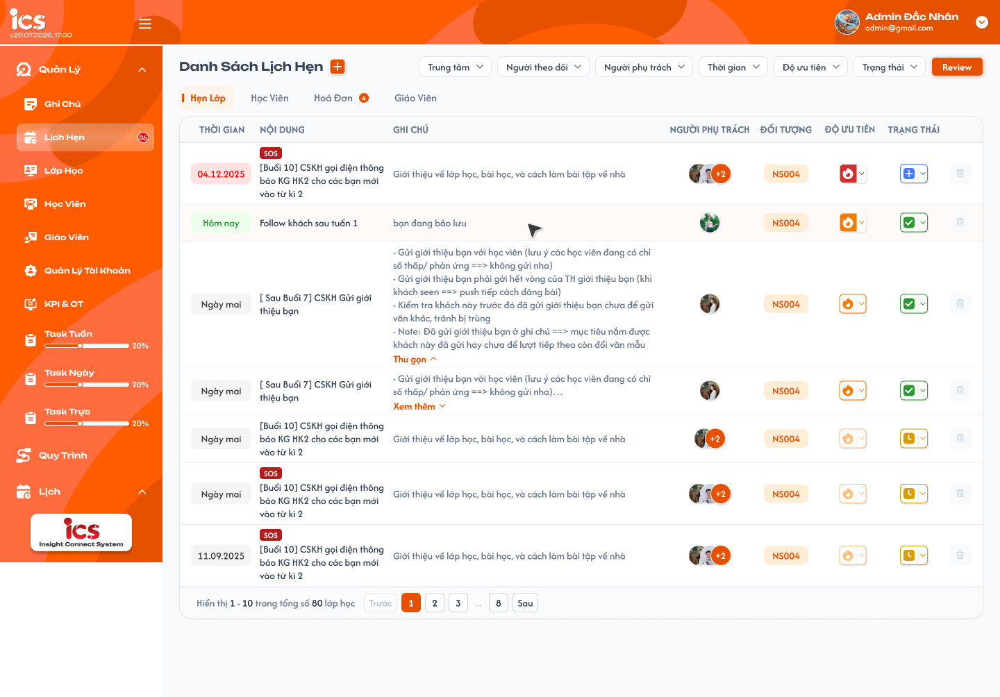
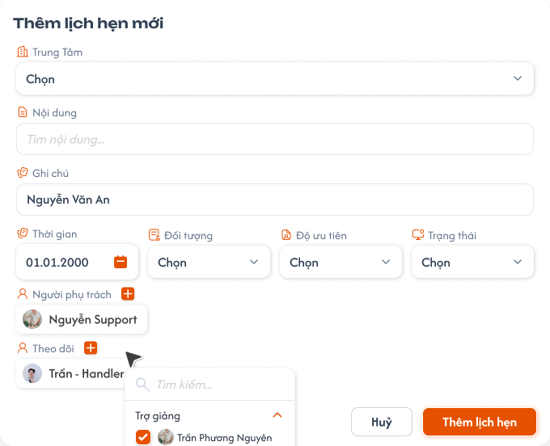
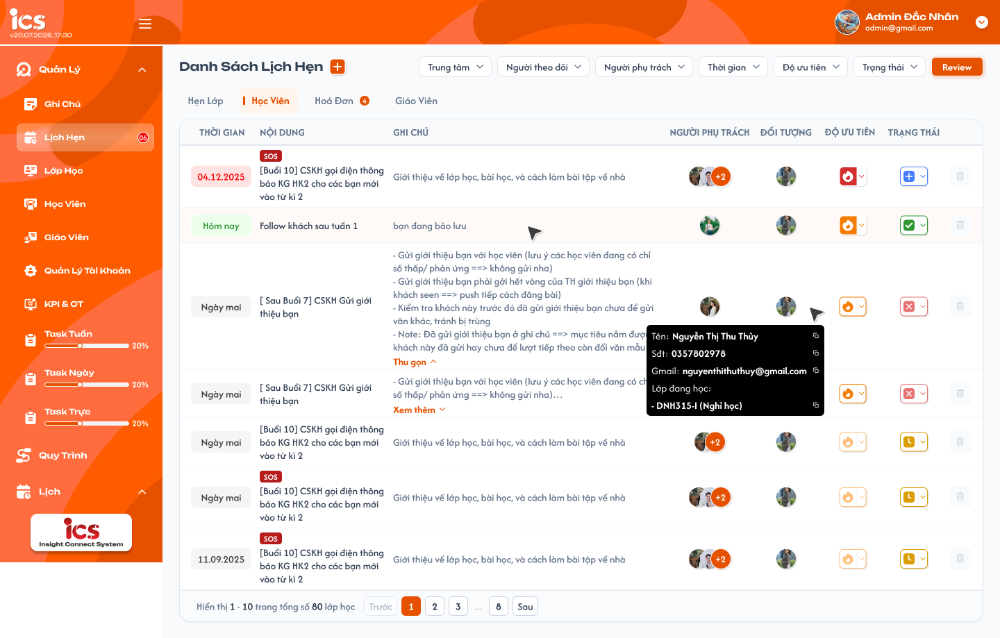
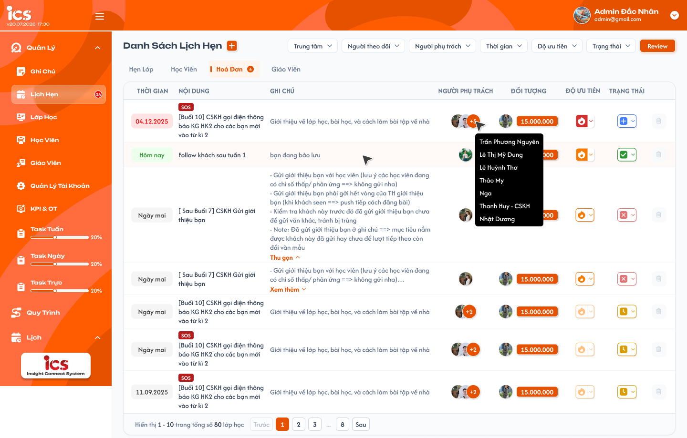
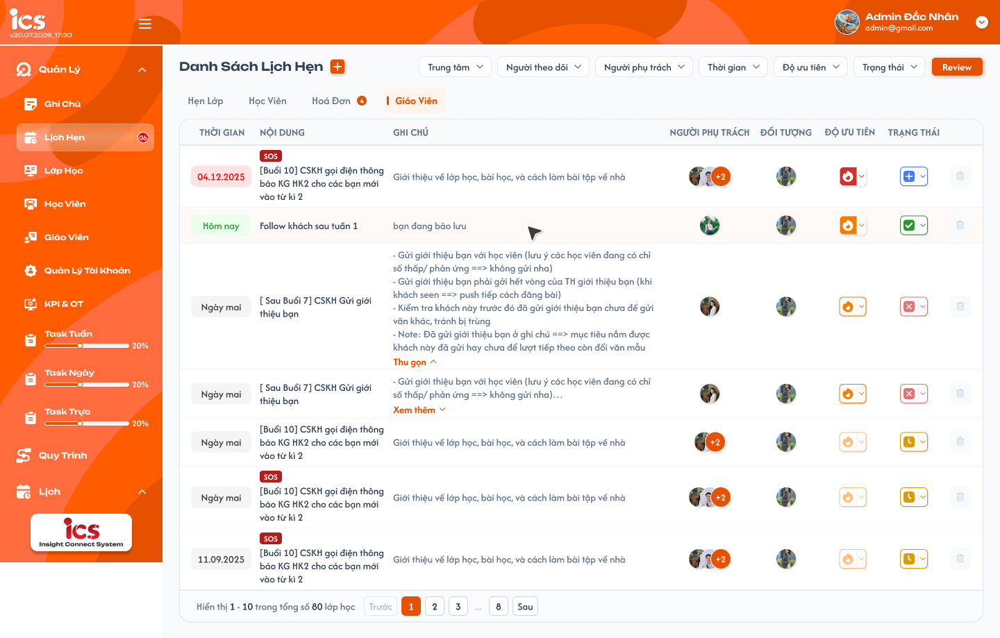
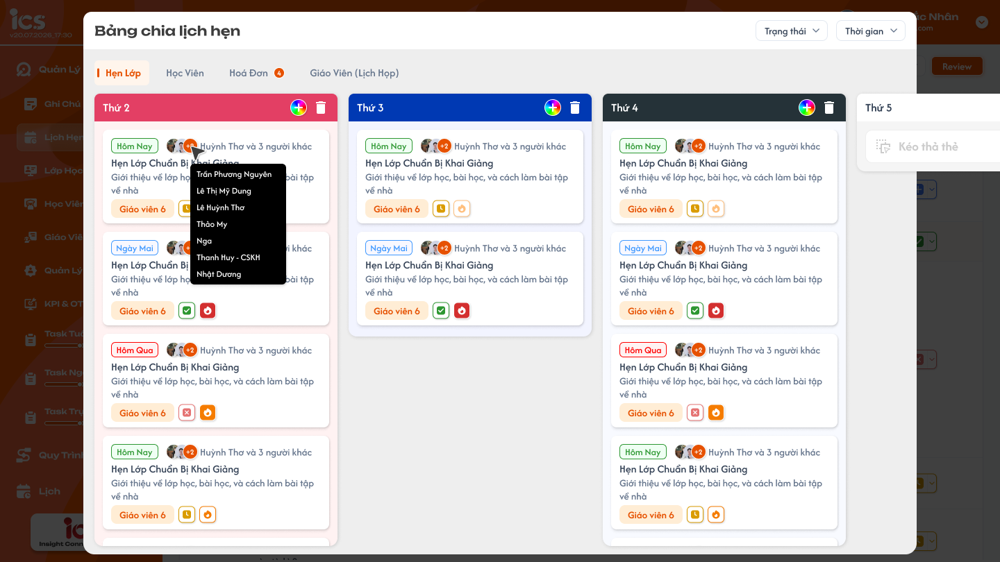

# Lịch hẹn — Danh sách, thêm lịch hẹn và Review

Menu **Lịch Hẹn** của ICS có bốn tab: **Hẹn lớp**, **Học viên**, **Hoá đơn**, **Giáo viên**. Tab Giáo viên là lịch hẹn giáo viên, không phải Cuộc họp lớp. Bốn loại dùng chung bảng lịch hẹn hiện có của ComGao; cùng một lịch hẹn là cùng một bản ghi ở menu này và màn hình nguồn.

## 1. UI

### Trang 1: ADM-LHN-010100 — Lịch hẹn / Hẹn lớp



**Mô tả:**
- Người có quyền mở menu `Lịch Hẹn` để xem lịch hẹn thuộc phạm vi của mình: Admin xem toàn bộ; người được chọn ở `Người phụ trách` hoặc `Theo dõi` xem được lịch hẹn tương ứng. Tab Hẹn lớp liệt kê lịch hẹn theo lớp; ba tab còn lại theo cùng bố cục (Trang 3–5).
- Dấu `+` bên cạnh `Danh Sách Lịch Hẹn` mở popup thêm lịch hẹn (Trang 2); nút `Review` mở Bảng chia lịch hẹn (Trang 6).

**Điểm cần lưu ý:**
- `A01.01` Bốn tab: `Hẹn lớp`, `Học viên`, `Hoá Đơn`, `Giáo Viên`; mỗi tab chỉ liệt kê lịch hẹn thuộc loại đối tượng đó, không nhân bản bản ghi khi chuyển tab. `Hẹn lớp` dùng cùng bản ghi tạo từ [Danh sách lớp](../management_requirement/class_management/class_management_requirements.md#popup-them-lich-hen-cho-lop) và hiển thị ở [Lịch Hẹn trong Chi tiết lớp](../management_requirement/class_management/class_detail_appointments_requirements.md).
- `A01.02` Bảng: bảy cột dữ liệu `Thời gian`, `Nội dung`, `Ghi chú`, `Người phụ trách`, `Đối tượng`, `Độ ưu tiên`, `Trạng thái` và một ô thao tác xoá ở cuối mỗi hàng.
- `A01.03` Thời gian / Ghi chú: hiện `Hôm nay`, `Ngày mai` hoặc ngày `dd.MM.yyyy`; ngày quá hạn (trước hôm nay) màu đỏ, `Hôm nay` màu xanh lá, ngày chưa tới hạn màu xám. Ghi chú dài có `Xem thêm` / `Thu gọn` (chỉ đổi hiển thị).
- `A01.04` Người phụ trách: avatar người được gán, `+N` là số người còn lại, rê chuột vào cụm avatar hiện danh sách tên toàn bộ; không gộp `Theo dõi` vào cột này.
- `A01.05` Đối tượng: tab Hẹn lớp hiển thị **lớp** (mã lớp); Học viên hiển thị **học viên** (rê chuột vào avatar hiện tooltip Tên, Sđt, Gmail và `Lớp đang học` — mã lớp kèm trạng thái của học viên trong lớp, mỗi dòng có nút sao chép); Hoá đơn hiển thị **số tiền hoá đơn và học viên** gắn với hoá đơn; Giáo viên hiển thị **giáo viên**. Giá trị lấy từ đúng đối tượng liên kết.
- `A01.06` Badge / phân trang: Độ ưu tiên `Quan trọng` hiển thị badge `SOS` ngay phía trên Nội dung (FE tự hiển thị theo Độ ưu tiên backend trả về, backend không lưu cờ SOS riêng và không có mức ưu tiên thứ năm). Badge mỗi tab đếm lịch hẹn đến hạn (ngày hẹn từ hôm nay trở về trước) của loại đó; badge menu `Lịch Hẹn` đếm lịch hẹn đến hạn của cả bốn loại trong phạm vi được xem. Footer hiển thị tổng **lịch hẹn** (không phải badge) và 50 dòng / trang; `Trước`, số trang, `Sau`.
- `A01.07` Xoá: biểu tượng thùng rác cố định ở cuối mỗi hàng của cả bốn tab, không cần hover, chỉ hiện với user thuộc `Người phụ trách` của lịch hẹn đó (không hiện cho người chỉ Theo dõi hoặc Admin không được gán phụ trách); bấm mở popup xác nhận.
- `A02.01` Trung tâm: chọn một hoặc nhiều trung tâm, nằm cùng hàng với các bộ lọc khác; không chọn thì hiển thị mọi trung tâm trong phạm vi được xem; danh sách, tổng số, phân trang chỉ tính trung tâm đã chọn, kết hợp `AND` với bộ lọc khác. Role Admin không dùng ô chọn trung tâm trên header.
- `A02.02` Người theo dõi / Người phụ trách: lọc theo đúng field phân công, không dùng lẫn hai danh sách. Chỉ `Admin` dùng được; các role khác luôn chỉ thấy lịch hẹn mà mình là Người phụ trách hoặc Theo dõi, chọn hai bộ lọc này không làm đổi danh sách.
- `A02.03` Thời gian: `Tới Hạn`, `Hôm Nay`, `Hôm Qua`, `Tuần Này`, `Tuần Trước`, `Tuần Sau`, `Tháng Này`, `Tháng Trước`, `3 Tháng Trước`, `Tháng Sau`, `Năm Nay`, `Năm Trước`, `Hôm Nay & Hôm Qua`, `Tuỳ Chọn` (dùng khoảng ngày, lọc theo ngày hẹn).
- `A02.04` Độ ưu tiên: lọc nhiều mức `Ưu tiên cao`, `Quan trọng`, `Bình thường`, `Ưu tiên thấp`, hoặc `Tất cả`.
- `A02.05` Trạng thái: lọc nhiều trạng thái `Mới`, `Chưa xử lý`, `Đang xử lý`, `Đã xử lý`, hoặc `Tất cả`; không có lựa chọn `Đã xoá`. Khi mở danh sách hoặc Review mặc định là `Tới hạn` + ba trạng thái `Mới`, `Chưa xử lý`, `Đang xử lý` (`Đã xử lý` bỏ chọn); đây là bộ lọc hiển thị, không tự đặt Trạng thái hay Độ ưu tiên cho lịch hẹn mới. `Tất cả` chỉ bỏ giới hạn của bộ lọc tương ứng, không lộ dữ liệu ngoài quyền. Bộ giá trị ưu tiên / trạng thái này là bộ chính thức theo xác nhận mới, các requirement lịch hẹn cũ dùng tên khác cần cập nhật thống nhất khi triển khai.
- `A04.01` Độ ưu tiên (chỉnh trên dòng): dropdown bốn mức chính thức, icon / màu theo UI; chọn mức khác cập nhật cùng bản ghi.
- `A04.02` Trạng thái (chỉnh trên dòng): dropdown `Mới`, `Chưa xử lý`, `Đang xử lý`, `Đã xử lý`; xoá dùng thùng rác cuối hàng, không có `Đã xoá`.
- `A04.03` Người sửa: chỉ user thuộc `Người phụ trách` của chính lịch hẹn được lưu thay đổi; Admin xem toàn bộ nhưng không tự sửa nếu không được gán Người phụ trách; `Theo dõi` chỉ đọc, nhiều Người phụ trách thì mỗi người đều được sửa. Kiểm tra quyền khi lưu kể cả request trực tiếp; chỉ cập nhật UI sau khi lưu thành công; chọn lại giá trị cũ không gửi thay đổi.
- `A06.01` Biểu tượng xoá: xem `A01.07`.
- `A06.02` Popup xác nhận: cho biết lịch hẹn sắp xoá, có `Hủy` và `Xóa`; chưa xác nhận thì không đổi dữ liệu.
- `A06.03` Kết quả: xác nhận thành công thì xoá lịch hẹn khỏi danh sách / tab và Review, cập nhật tổng / badge; không chuyển sang trạng thái `Đã xoá`. Backend kiểm tra lại quyền khi xác nhận; người phụ trách đã đổi hoặc xoá lỗi thì không xoá và không báo thành công giả. `Hủy` không có Toast CRUD.
- `A07.01` Toast `Thành Công`: tạo / cập nhật / xoá lịch hẹn hoặc thay đổi bảng Review đã lưu thành công.
- `A07.02` Toast `Thông Báo`: hệ thống đã nhận thao tác nhưng dữ liệu đang đồng bộ.
- `A07.03` Toast `Cảnh Báo`: dữ liệu không hợp lệ hoặc mất quyền sửa.
- `A07.04` Toast `Có Lỗi Xảy Ra`: tạo / cập nhật / xoá / sắp xếp không hoàn tất do lỗi xử lý. Mỗi thao tác một Toast; `Hủy`, lọc, chuyển tab, chỉ xem, chọn lại giá trị cũ không có Toast CRUD; nội dung chi tiết dùng component chung.

### Trang 2: ADM-LHN-010110 — Lịch hẹn / Hẹn lớp / Popup thêm lịch hẹn



**Mô tả:**
- Admin, Class Handler và Support nhấn `+` để tạo lịch hẹn thuộc tab / đối tượng đang chọn. Form chung dưới đây; popup tạo từ Danh sách học viên có UI chuẩn riêng (cuối mục).

**Điểm cần lưu ý:**
- `A03.01` Nội dung: **bắt buộc**, nhập tự do, không cần chọn nội dung từ nguồn.
- `A03.02` Ghi chú: không bắt buộc, nhập tự do, không giới hạn độ dài, hiển thị ở cột Ghi chú sau khi lưu.
- `A03.03` Thời gian: **bắt buộc**, chọn ngày bằng lịch chọn ngày, không chọn giờ, hiển thị `dd.MM.yyyy`, không giới hạn mốc thời gian; ngày mẫu `01.01.2000` không là giá trị mặc định.
- `A03.04` Trung tâm: **bắt buộc**, chọn một trung tâm; lịch hẹn thuộc trung tâm đã chọn và danh sách Đối tượng lấy theo trung tâm đó; backend kiểm tra lại khi lưu.
- `A03.05` Đối tượng: **bắt buộc**, chọn đúng một đối tượng theo tab (Hẹn lớp → lớp, Học viên → học viên, Hoá đơn → hoá đơn hiển thị số tiền và học viên, Giáo viên → giáo viên); Class Handler / Support chỉ chọn đối tượng thuộc phạm vi được phép truy cập, Admin theo phạm vi Admin. Chọn tab hoặc đối tượng khác không được gắn nhầm sang đối tượng cũ.
- `A03.06` Độ ưu tiên: **bắt buộc**, một trong `Ưu tiên cao`, `Quan trọng`, `Bình thường`, `Ưu tiên thấp`; giá trị mặc định chưa chốt (xem Q01).
- `A03.07` Trạng thái: **bắt buộc**, một trong `Mới`, `Chưa xử lý`, `Đang xử lý`, `Đã xử lý` (không có `Đã xoá`); giá trị mặc định của form chưa chốt, không lấy bộ lọc mặc định làm giá trị form (xem Q01).
- `A03.08` Người phụ trách: không bắt buộc; nút `+` mở danh sách có ô `Tìm kiếm...` và bốn nhóm role thu gọn / mở được `Trợ giảng` (Teaching Assistant), `Support`, `Nhân viên kinh doanh` (Sale), `Phụ trách lớp` (Class Handler), chọn bằng checkbox; không cho gán role khác kể cả request trực tiếp. Mở popup mặc định chọn sẵn người tạo nếu thuộc một trong bốn nhóm, người tạo gỡ mình hoặc thêm người khác được; khi tạo và khi sửa đều được bỏ hết Người phụ trách. Sau khi lưu, người tạo không tự có quyền sửa nếu không còn trong danh sách phụ trách; lịch hẹn không có Người phụ trách thì không ai sửa hoặc xoá được theo quy tắc quyền hiện tại.
- `A03.09` Theo dõi: không bắt buộc; chọn nhiều user thuộc cùng bốn nhóm role, cùng kiểu danh sách chọn với Người phụ trách; người được thêm chỉ xem. Người ở cả Người phụ trách và Theo dõi có quyền sửa theo tư cách Người phụ trách.
- `A03.10` Hủy / Thêm lịch hẹn: `Hủy` đóng popup không lưu; `Thêm lịch hẹn` kiểm tra dữ liệu / quyền rồi tạo đúng một lịch hẹn, xuất hiện ở tab này và mọi màn hình nguồn dùng cùng bản ghi; tạo lỗi không thêm dòng hoặc tăng badge. Dữ liệu mẫu trong ảnh (`Nguyễn Văn An`, ngày mẫu, avatar, danh sách ngôn ngữ ở Đối tượng) không được điền sẵn.
- Popup tạo từ `Quản lý → Học viên → Thêm lịch hẹn` theo [UI chuẩn học viên](../management_requirement/student_management/student_management_requirements.md#thêm-lịch-hẹn): Người phụ trách / Theo dõi chỉ chọn `Trợ giảng`, `Support`, `Nhân viên kinh doanh`; Thời gian chỉ chọn ngày; Đối tượng tự gắn học viên đang chọn, Trạng thái tự mặc định `Mới`, popup không có control Đối tượng / Trạng thái, submit bằng `Xác nhận`; người tạo chỉ được chọn sẵn làm Người phụ trách nếu thuộc role được gán của flow này, Người phụ trách được để trống, một user có thể ở cả hai field. Validation Nội dung / Ghi chú / Độ ưu tiên, bản ghi dùng chung, quyền sửa / xoá và phản hồi vẫn theo requirement này.

### Trang 3: ADM-LHN-010200 — Lịch hẹn / Học viên



**Mô tả:**
- Tab `Học viên`: lịch hẹn gắn với học viên, bố cục như Trang 1.

**Điểm cần lưu ý:**
- Cột Đối tượng là học viên; rê chuột vào avatar hiện tooltip Tên, Sđt, Gmail, `Lớp đang học` kèm nút sao chép.

### Trang 4: ADM-LHN-010300 — Lịch hẹn / Hoá đơn



**Mô tả:**
- Tab `Hoá Đơn`: lịch hẹn gắn với hoá đơn, bố cục như Trang 1.

**Điểm cần lưu ý:**
- Cột Đối tượng hiển thị số tiền hoá đơn và học viên gắn với hoá đơn.

### Trang 5: ADM-LHN-010400 — Lịch hẹn / Giáo viên



**Mô tả:**
- Tab `Giáo Viên`: lịch hẹn gắn với giáo viên (không phải Cuộc họp lớp), bố cục như Trang 1.

**Điểm cần lưu ý:**
- Cột Đối tượng là giáo viên; mỗi lịch hẹn vẫn là cùng một bản ghi với màn hình nguồn.

### Trang 6: ADM-LHN-020000 — Bảng chia lịch hẹn



**Mô tả:**
- Mở từ nút `Review` ở Danh sách Lịch Hẹn, xem bảng chia lịch hẹn của tab đang chọn. Admin và Class Handler sắp xếp bằng kéo thả; các role khác chỉ xem và lọc.

**Điểm cần lưu ý:**
- `A05.01` Tab / bộ lọc: bốn tab `Hẹn lớp`, `Học viên`, `Hoá đơn`, `Giáo viên` và bộ lọc `Trạng thái`, `Thời gian`; mặc định `Tới hạn` + `Mới`, `Chưa xử lý`, `Đang xử lý`, `Đã xử lý` bỏ chọn. Chỉ lọc các lịch hẹn người dùng được xem; bộ lọc chỉ đổi thẻ hiển thị, không đổi thứ tự đã lưu.
- `A05.02` Cột / cụm thẻ: mỗi cột có tiêu đề và màu do user có quyền quản lý cột tự chọn; ô `Nhập tiêu đề mục mới` và nút `+` thêm cột; biểu tượng màu mở bảng chọn màu; thùng rác chỉ xoá **cột trống**, cột còn lịch hẹn không được xoá; không giới hạn số cột hoặc độ dài tiêu đề. Cột Review là cấu hình chung cho mọi người xem **cùng tab**, tab khác không bị đổi.
- `A05.03` Thẻ lịch hẹn: hiển thị ngày hẹn (tới hạn / quá hạn màu đỏ), avatar / `+N` người phụ trách, nội dung, ghi chú ngắn, đối tượng, icon trạng thái và ưu tiên; dữ liệu lấy từ bản ghi lịch hẹn ở tab tương ứng.
- `A05.04` Kéo thả thẻ: Admin / Class Handler kéo một thẻ sang vị trí / cột khác; vùng đích có viền nét đứt.
- `A05.05` Kéo thả cụm: Admin / Class Handler kéo cả cột / cụm thẻ để đổi vị trí cột, các thẻ trong cụm đi cùng. Kéo thả chỉ đổi nhóm / vị trí trên Review, không cập nhật field nào của lịch hẹn; thất bại giữ vị trí cũ; không tạo lịch hẹn mới hoặc làm mất / nhân đôi thẻ. Quyền `Người phụ trách` ở danh sách không cấp quyền sắp xếp Review.

---

## 2. Yêu cầu

### 2.1. Flow chính

**Flow 1: Xem lịch hẹn**

```
Mở menu Lịch Hẹn → chọn một trong bốn tab (Trang 1, 3, 4, 5)
  → kiểm tra quyền xem, tải bản ghi chung từ nguồn ComGao
  → hiển thị bảng, đối tượng và phân trang theo tab / phạm vi
  → người trong Theo dõi xem bản ghi của mình ở chế độ chỉ đọc
```

**Flow 2: Lọc danh sách**

```
Chọn Trung tâm / Người theo dõi / Người phụ trách / Thời gian / Ưu tiên / Trạng thái
  → áp dụng các điều kiện trên tab đang xem và phạm vi quyền
  → cập nhật dòng, tổng số và phân trang
```

**Flow 3: Thêm lịch hẹn**

```
Người có quyền tạo chọn tab, nhấn + (Trang 2) → nhập / chọn field
  → chọn đối tượng, Người phụ trách / Theo dõi → Thêm lịch hẹn → kiểm tra dữ liệu và quyền
  → Thành công: lưu một bản ghi dùng chung, hiện ở đúng tab / màn nguồn, Toast Thành Công
  → Thất bại: không tạo bản ghi, giữ dữ liệu nhập, hiển thị lỗi phù hợp
```

**Flow 4: Cập nhật ưu tiên hoặc trạng thái**

```
Người trong Người phụ trách chọn giá trị mới trên dòng
  → kiểm tra quyền trên bản ghi, lưu cùng bản ghi
  → Thành công: cập nhật các màn liên quan, Toast Thành Công
  → Thất bại: giữ giá trị cũ, hiển thị lỗi phù hợp
```

**Flow 5: Xem Review**

```
Người có quyền xem bấm Review → mở Bảng chia lịch hẹn (Trang 6) tại tab đang chọn
  → chọn tab / Trạng thái / Thời gian để xem thẻ trong phạm vi được phép
  → role không phải Admin / Class Handler chỉ xem và lọc
```

**Flow 6: Sắp xếp Bảng chia lịch hẹn**

```
Admin / Class Handler mở Review
  → thêm / đổi màu cột, chỉ xoá cột trống, hoặc kéo thẻ / cả cụm vào vị trí hợp lệ
  → kiểm tra quyền, lưu vị trí / cấu hình
  → Thành công: hiển thị vị trí / cấu hình mới sau tải lại
  → Thất bại: trả về vị trí / cấu hình đã lưu, không mất thẻ
```

**Flow 7: Xoá lịch hẹn**

```
Người phụ trách nhấn thùng rác cuối hàng → popup xác nhận đúng lịch hẹn
  → Hủy: đóng popup, giữ bản ghi
  → Xác nhận: kiểm tra lại quyền, xoá
        → Thành công: bỏ dòng / thẻ khỏi danh sách và Review, cập nhật tổng / badge
        → Thất bại: giữ bản ghi, hiển thị lỗi phù hợp
```

### 2.2. Ngoại lệ

- **EX01:** Thiếu field bắt buộc, ngày / đối tượng không hợp lệ hoặc gán người ngoài phạm vi → không tạo lịch hẹn, chỉ rõ field lỗi.
- **EX02:** Người không thuộc `Người phụ trách` cố sửa, kể cả Admin chỉ có quyền xem hoặc người trong `Theo dõi` → từ chối, không đổi bản ghi.
- **EX03:** Lỗi tải / lưu hoặc request lặp → không sinh bản ghi / trạng thái trùng; giữ dữ liệu đã lưu, cho thử lại phù hợp.
- **EX04:** Role ngoài Admin / Class Handler cố thêm / xoá / đổi màu cột hoặc kéo thả Review, hoặc Admin / Class Handler cố xoá cột còn lịch hẹn → từ chối, bảng không đổi.
- **EX05:** User không thuộc Người phụ trách cố xoá, hoặc huỷ xác nhận / xoá thất bại → giữ lịch hẹn; không chuyển thành trạng thái `Đã xoá`.

### 2.3. Yêu cầu khác

| Mã | Tên yêu cầu | Mô tả |
|---|---|---|
| REQ01 | Bốn loại | Hẹn lớp chọn lớp, Học viên chọn học viên, Hoá đơn chọn hoá đơn (hiển thị số tiền và học viên gắn với hoá đơn), Giáo viên chọn giáo viên; mỗi lịch hẹn thuộc đúng một loại. |
| REQ02 | Dữ liệu chung | ICS dùng chung bảng lịch hẹn ComGao; menu và màn hình nguồn đọc / ghi cùng bản ghi, không đồng bộ bằng bản sao; Hẹn lớp dùng cùng bản ghi trong Manage Class. |
| REQ03 | Quyền xem | Admin xem toàn bộ; Người phụ trách và Người theo dõi xem được lịch hẹn được gán; Người theo dõi chỉ đọc. |
| REQ04 | Danh sách | Bảy cột dữ liệu và ô xoá cuối hàng, đúng đối tượng và phân công; 50 dòng / trang. Badge tab đếm lịch hẹn đến hạn của từng loại, badge menu đếm cả bốn loại theo phạm vi được xem; tổng dưới bảng là tổng lịch hẹn của tab, không phải badge. |
| REQ05 | Bộ lọc | Lọc theo các field trên cùng tab; hai bộ lọc Người theo dõi và Người phụ trách chỉ có tác dụng với Admin, role khác luôn chỉ thấy lịch hẹn của chính mình; Ưu tiên có bốn mức, Trạng thái có `Mới` / `Chưa xử lý` / `Đang xử lý` / `Đã xử lý`, hỗ trợ chọn nhiều và `Tất cả`. Danh sách và Review mở mặc định `Tới hạn` + ba trạng thái chưa hoàn tất. Thời gian có preset và `Tuỳ Chọn`; ngày thuộc `Tới Hạn` hiển thị đỏ. |
| REQ06 | Form tạo | Form chung gồm Trung tâm, Nội dung, Ghi chú, Thời gian, Đối tượng, Độ ưu tiên, Trạng thái, Người phụ trách, Theo dõi; bắt buộc trừ Ghi chú, Người phụ trách, Theo dõi. Người tạo được chọn sẵn ở Người phụ trách nếu thuộc nhóm role được gán, có thể gỡ / thêm người; tạo và sửa đều được bỏ hết Người phụ trách. Form chung chỉ gán user thuộc bốn nhóm Trợ giảng / Support / Nhân viên kinh doanh / Phụ trách lớp; flow tạo từ Danh sách học viên chỉ gán Trợ giảng / Support / Nhân viên kinh doanh, chỉ ngày không giờ, Đối tượng tự lấy học viên, Trạng thái tự `Mới`. Không dùng dữ liệu mẫu trong ảnh làm mặc định. |
| REQ07 | Liên kết | Lưu đúng một đối tượng và các user được gán; tạo thành công xuất hiện ở đúng tab và màn nguồn. |
| REQ08 | Quyền sửa | Chỉ user thuộc Người phụ trách được đổi ưu tiên / trạng thái trên lịch hẹn đó; không cấp quyền sửa chỉ vì là Admin hoặc Theo dõi. |
| REQ09 | Phản hồi | Tạo / cập nhật / xoá chỉ hoàn tất sau khi lưu; Toast theo component chung, mỗi thao tác một kết quả. |
| REQ10 | Review | Nút `Review` mở Bảng chia lịch hẹn với bốn tab và bộ lọc Trạng thái / Thời gian mặc định như danh sách; thẻ lấy từ đúng bản ghi ComGao trong phạm vi được xem. |
| REQ11 | Cấu trúc và sắp xếp bảng | Cột tuỳ chỉnh có tiêu đề / màu do user chọn, là cấu hình chung theo từng tab cho mọi người xem; không giới hạn số cột / độ dài tiêu đề. Thêm, đổi màu, chỉ xoá cột trống, kéo một thẻ giữa các vị trí / cột và kéo cả cột để sắp xếp. Kéo thả chỉ đổi nhóm / vị trí trên Review, không đổi field lịch hẹn, không nhân bản / mất thẻ. |
| REQ12 | Quyền Review | Chỉ Admin và Class Handler thay đổi bảng bằng các thao tác trên; role còn lại chỉ xem và lọc, dù là Người phụ trách lịch hẹn. |
| REQ13 | Xoá lịch hẹn | Người phụ trách thấy thùng rác cố định ở cuối hàng của cả bốn tab, bấm mở popup xác nhận rồi xoá. Huỷ / không có quyền / lỗi thì không xoá; thành công bỏ khỏi danh sách và Review. Không có trạng thái `Đã xoá`. `SOS` là badge FE theo Độ ưu tiên `Quan trọng`, không là field riêng và không là mức ưu tiên thứ năm. |
| REQ14 | Trung tâm | Bộ lọc `Trung tâm` chọn một hoặc nhiều, kết hợp `AND` với bộ lọc khác, không chọn thì mọi trung tâm; role Admin không dùng ô chọn trung tâm trên header. Tạo mới bắt buộc chọn `Trung tâm`, bản ghi thuộc trung tâm đã chọn; backend kiểm tra lại, không chỉ dựa vào UI. |

### 2.4. Ràng buộc

#### Quyền

| Role | Xem lịch hẹn / Review | Tạo tại menu | Sửa ưu tiên / trạng thái | Xoá lịch hẹn | Sắp xếp / quản lý cột Review |
|---|:---:|:---:|:---:|:---:|:---:|
| Admin | ✅ Toàn bộ | ✅ | ✅ Khi là Người phụ trách | ✅ Khi là Người phụ trách | ✅ |
| Class Handler | ✅ Trong phạm vi hoặc được gán | ✅ | ✅ Khi là Người phụ trách | ✅ Khi là Người phụ trách | ✅ Trong phạm vi được xem |
| Support | ✅ Trong phạm vi hoặc được gán | ✅ | ✅ Khi là Người phụ trách | ✅ Khi là Người phụ trách | ❌ |
| Sale | ✅ Nếu được gán | ❌ | ✅ Khi là Người phụ trách | ✅ Khi là Người phụ trách | ❌ |
| Role khác | ✅ Nếu được gán | ❌ | ✅ Khi là Người phụ trách | ✅ Khi là Người phụ trách | ❌ |

#### Ràng buộc khác

- Bản ghi trả theo quyền của user; được gán `Theo dõi` chỉ xem lịch hẹn đó, không cấp quyền xem toàn bộ lớp / học viên / hoá đơn / giáo viên.
- Mọi thao tác tạo / sửa kiểm tra quyền và đối tượng liên kết ở nguồn dữ liệu, không dựa vào việc ẩn nút trên UI.
- Chỉ Admin, Class Handler, Support được tạo trực tiếp ở menu này; quyền tạo ở màn nguồn khác theo requirement riêng của màn đó, không dùng để mở nút `+` tại menu Lịch Hẹn.
- Quyền thay đổi bố cục Review là quyền riêng của Admin / Class Handler; quyền sửa ưu tiên / trạng thái không cấp quyền kéo thả hay quản lý cột.
- Người chỉ `Theo dõi` xem nhưng không sửa hoặc xoá; người tạo tự gỡ mình khỏi Người phụ trách cũng không giữ quyền sửa / xoá sau khi lưu.
- Cách lưu lịch sử / xoá vật lý ở nguồn ComGao là chi tiết triển khai, không đổi hành vi UI đã chốt.


---

## 3. Testcase

### Feature: Lịch hẹn — Danh sách, thêm lịch hẹn và Review

| Tên testcase | Priority | Scenario | Role | Pre-condition | Given/When/Then | Expected Result |
|---|---|---|---|---|---|---|
| Case 1: Chuyển bốn tab và dùng chung bản ghi | High | Flow 1 / REQ01 / REQ02 | Admin / Class Handler / Support | Có lịch hẹn đủ bốn loại; một lịch hẹn lớp tạo ở Danh sách lớp | **Given:** đang ở menu Lịch Hẹn<br>**When:** lần lượt chọn bốn tab; xem lịch hẹn lớp ở Hẹn lớp và Chi tiết lớp<br>**Then:** hệ thống tải đúng loại | - Bảng đủ bảy cột và ô xoá cuối hàng khi có quyền<br>- Không trộn hoặc sao chép lịch hẹn giữa các tab<br>- Nội dung, thời gian, phân công, trạng thái khớp giữa các màn, cùng một bản ghi |
| Case 2: Dòng, badge, phân trang, SOS | Medium | Flow 1 / REQ04 | Người có quyền xem | Hơn 50 lịch hẹn trong một tab; có lịch hẹn đến hạn, chưa đến hạn, ưu tiên `Quan trọng`, ghi chú dài | **Given:** mở tab<br>**When:** chuyển trang, mở ghi chú dài, đổi ưu tiên khỏi `Quan trọng`<br>**Then:** hiển thị đúng | - 50 dòng / trang, tổng là tổng lịch hẹn<br>- Badge tab / menu chỉ đếm lịch hẹn đến hạn trong phạm vi xem<br>- `Xem thêm` / `Thu gọn` chỉ đổi hiển thị<br>- Ngày quá hạn đỏ, hôm nay xanh lá; `SOS` chỉ khi `Quan trọng`, ẩn khi đổi mức |
| Case 3: Người Theo dõi chỉ đọc | High | Flow 1 / REQ03 / EX02 | Người được gán Theo dõi | Không thuộc Người phụ trách | **Given:** được thêm vào Theo dõi<br>**When:** mở lịch hẹn, thử đổi ưu tiên / trạng thái / xoá trên UI hoặc request trực tiếp<br>**Then:** chỉ được xem | - Không lưu thay đổi, control chỉ đọc, không có thùng rác<br>- Không tự mở quyền vào toàn bộ đối tượng liên kết |
| Case 4: Lọc kết hợp và theo trung tâm | High | Flow 2 / REQ05 / REQ14 | Admin; role khác có quyền xem | Có nhiều lịch hẹn; lịch hẹn ở trung tâm A và B | **Given:** mở Hẹn lớp với mặc định `Tới hạn` + ba trạng thái chưa hoàn tất<br>**When:** Admin lọc thêm Người phụ trách, ưu tiên, trạng thái, `Tất cả`, `Tuỳ Chọn`, trung tâm B rồi bỏ chọn; role khác chọn Người phụ trách / Người theo dõi<br>**Then:** danh sách khớp mọi điều kiện | - `Đã xử lý` mặc định không chọn nhưng chọn thêm được; không có `Đã xoá`<br>- Tổng và số trang cập nhật, không trả dữ liệu ngoài quyền<br>- Trung tâm B không lẫn A; bỏ chọn thì hiện mọi trung tâm<br>- Role khác Admin chọn hai bộ lọc người thì danh sách không đổi |
| Case 5: Mở popup đúng tab, mặc định Người phụ trách | High | Flow 3 / REQ06 | Admin / Class Handler / Support | Đang ở tab Học viên, user A đăng nhập | **Given:** bấm `+`<br>**When:** xem Người phụ trách rồi gỡ A, chọn B<br>**Then:** popup mở với loại đối tượng Học viên | - Đủ field, không tự gắn lớp / hoá đơn / giáo viên<br>- A được chọn sẵn lúc mở, gỡ A / thêm B được<br>- Danh sách chỉ gồm bốn nhóm role; lưu được khi phụ trách rỗng |
| Case 6: Tạo lịch hẹn thành công | High | Flow 3 / REQ06 / REQ07 / REQ09 | Người có quyền tạo | Field bắt buộc hợp lệ | **Given:** nhập đủ Trung tâm, Nội dung, Thời gian, Đối tượng, Độ ưu tiên, Trạng thái; Theo dõi / Người phụ trách có hoặc trống<br>**When:** bấm `Thêm lịch hẹn`<br>**Then:** hệ thống lưu và đóng popup | - Một bản ghi ComGao, hiện ở đúng tab và màn nguồn<br>- Toast `Thành Công` sau khi lưu<br>- Tạo từ Danh sách học viên: Đối tượng tự gắn học viên, Trạng thái `Mới`, chỉ ngày, nhóm role chỉ Trợ giảng / Support / Nhân viên kinh doanh, submit `Xác nhận` |
| Case 7: Thiếu field, thiếu trung tâm, huỷ | High | EX01 / REQ06 / REQ14 | Người có quyền tạo | Popup đang mở | **Given:** thiếu một field bắt buộc (gồm Trung tâm) hoặc gán người ngoài bốn nhóm role; có dữ liệu chưa lưu<br>**When:** bấm `Thêm lịch hẹn` rồi `Hủy`<br>**Then:** không tạo lịch hẹn | - Lỗi chỉ rõ tại field, giữ dữ liệu<br>- Chọn trung tâm A rồi lưu: lọc A thấy, lọc B không thấy<br>- `Hủy` không có Toast CRUD |
| Case 8: Người phụ trách cập nhật, từ chối người khác | High | Flow 4 / REQ08 / EX02 | Người phụ trách; Admin không phụ trách; Người theo dõi | Lịch hẹn đang hiển thị | **Given:** người phụ trách đổi ưu tiên hoặc trạng thái; Admin / Theo dõi thử chỉnh trên UI hoặc request trực tiếp<br>**When:** hệ thống lưu<br>**Then:** chỉ người phụ trách lưu được | - Tải lại thấy giá trị mới ở mọi màn liên quan, một Toast thành công<br>- Chọn lại giá trị cũ không gửi thay đổi<br>- Người không phụ trách bị từ chối, control chỉ đọc, bản ghi không đổi |
| Case 9: Mở Review và lọc | High | Flow 5 / REQ10 | Người có quyền xem | Có lịch hẹn ở nhiều tab | **Given:** đang ở Hẹn lớp<br>**When:** bấm `Review`, đổi tab, lọc Trạng thái / Thời gian<br>**Then:** bảng hiện đúng thẻ được phép xem | - Mở mặc định `Tới hạn` + `Mới` / `Chưa xử lý` / `Đang xử lý`<br>- Không trộn bốn loại hoặc lộ dữ liệu ngoài quyền<br>- Lọc không đổi thứ tự đã lưu |
| Case 10: Sắp xếp thẻ, cụm; thêm cột và đổi màu | High | Flow 6 / REQ11 | Admin / Class Handler | Có nhiều cột và thẻ | **Given:** bảng Review đang mở<br>**When:** kéo một thẻ sang cột khác, kéo cả cụm sang vị trí mới; nhập tiêu đề dài, bấm `+`, chọn màu cột<br>**Then:** bảng lưu vị trí và cấu hình | - Đúng vị trí / màu sau tải lại; người xem khác cùng tab thấy, tab khác không đổi<br>- Không đổi field lịch hẹn, không nhân đôi / mất thẻ<br>- Không giới hạn số cột / độ dài tiêu đề |
| Case 11: Chỉ xoá cột trống, role khác chỉ xem | High | Flow 6 / REQ11 / REQ12 / EX04 | Admin / Class Handler; Support / Sale / Giáo viên / Người theo dõi | Một cột trống và một cột chứa lịch hẹn | **Given:** thử xoá từng cột; role khác mở Review và thử kéo thả / thêm / xoá / đổi màu bằng UI hoặc request trực tiếp<br>**When:** hệ thống xử lý<br>**Then:** chỉ cột trống được xoá; role khác chỉ xem và lọc | - Cột có lịch hẹn vẫn còn, lịch hẹn không bị chuyển hay xoá<br>- Role khác không lưu thay đổi nào, kể cả khi là Người phụ trách |
| Case 12: Xác nhận xoá lịch hẹn | High | Flow 7 / REQ13 | Người phụ trách | Lịch hẹn đang hiển thị | **Given:** thùng rác hiển thị ở cuối hàng không cần hover<br>**When:** bấm thùng rác rồi xác nhận `Xóa`<br>**Then:** hệ thống xoá lịch hẹn | - Dòng / thẻ biến mất sau lưu thành công, khỏi cả Review<br>- Không có trạng thái `Đã xoá`, tổng / badge cập nhật<br>- Toast `Thành Công` |
| Case 13: Huỷ hoặc không có quyền xoá | High | EX05 / REQ13 | Người phụ trách; Người theo dõi; Admin không phụ trách | Lịch hẹn đang hiển thị | **Given:** popup xác nhận đang mở hoặc user không có quyền<br>**When:** bấm `Hủy` hoặc thử xoá trực tiếp<br>**Then:** không xoá lịch hẹn | - `Hủy` không có Toast CRUD<br>- Người không phụ trách không thấy nút, request bị từ chối<br>- Người phụ trách bị đổi giữa chừng: không xoá, không báo thành công giả |
| Case 14: Toast và lỗi lưu | High | REQ09 / EX03 | Người có quyền thay đổi | Dữ liệu hợp lệ; trường hợp lưu bất đồng bộ; trường hợp lỗi xử lý | **Given:** tạo / cập nhật / xoá / sắp xếp<br>**When:** lưu thành công, đang đồng bộ, dữ liệu / quyền không hợp lệ, hoặc lỗi xử lý; request lặp<br>**Then:** hiện Toast tương ứng | - `Thành Công` chỉ sau khi lưu; `Thông Báo` khi đang đồng bộ; `Cảnh Báo` khi không hợp lệ / mất quyền; `Có Lỗi Xảy Ra` khi lỗi, bản ghi giữ giá trị cũ<br>- Mỗi thao tác một Toast, không sinh bản ghi trùng |

---

## 4. Câu hỏi cần xác nhận

- **Q01:** Giá trị mặc định của Độ ưu tiên và Trạng thái khi tạo lịch hẹn; thứ tự sắp xếp các lịch hẹn cùng điều kiện lọc?
- **Q02:** Dữ liệu ComGao đã lưu theo bộ giá trị cũ cần được đối chiếu khi triển khai; có tự đổi các bản ghi cũ sang bốn mức ưu tiên và bốn trạng thái mới không?
