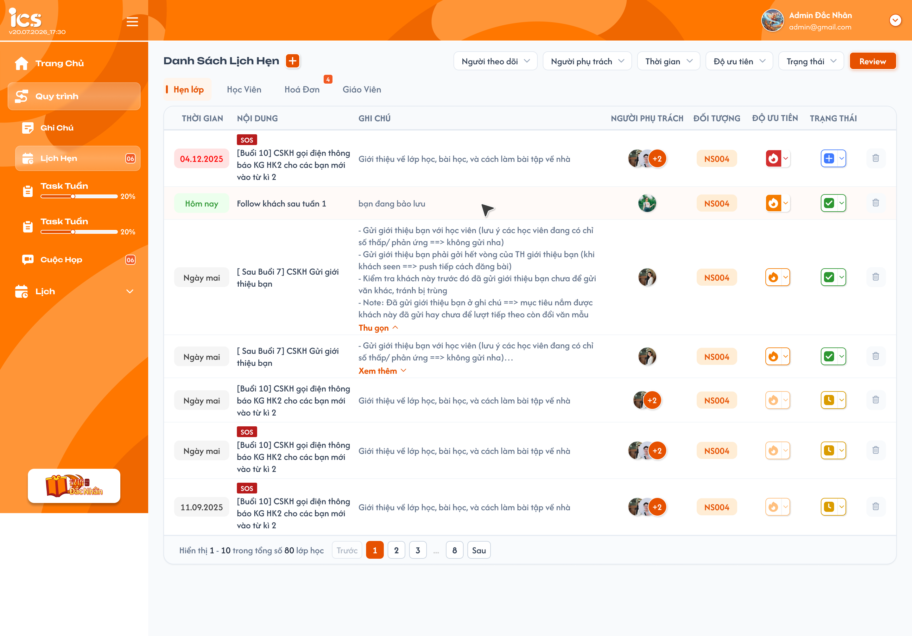
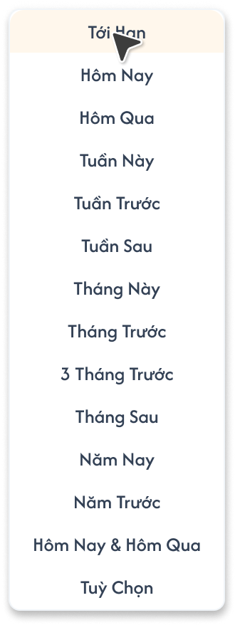
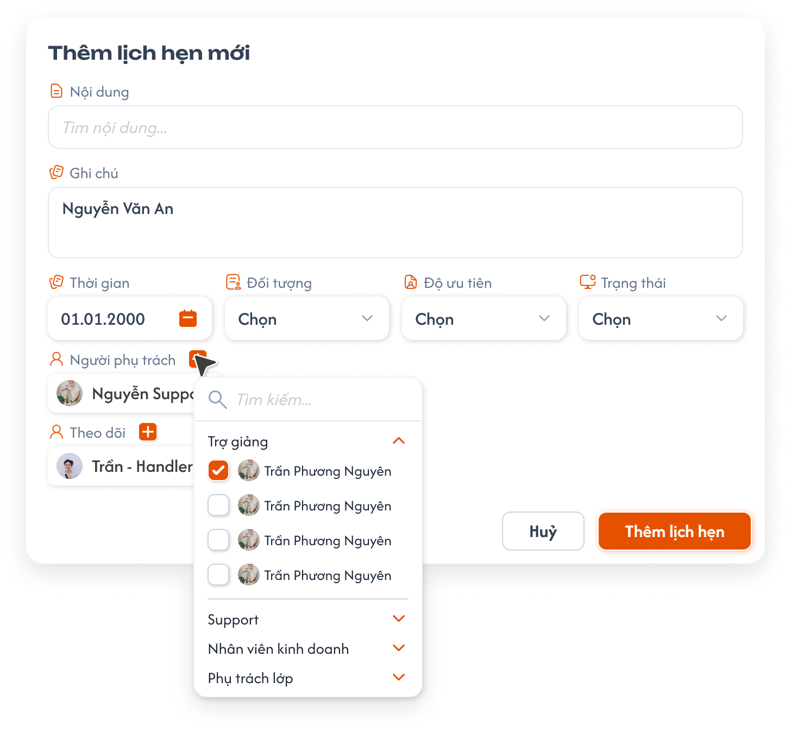
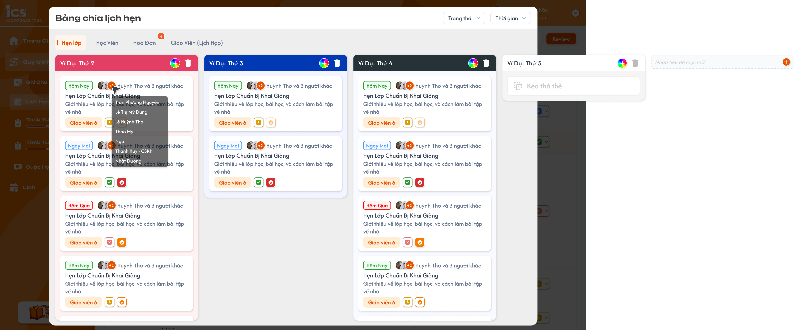
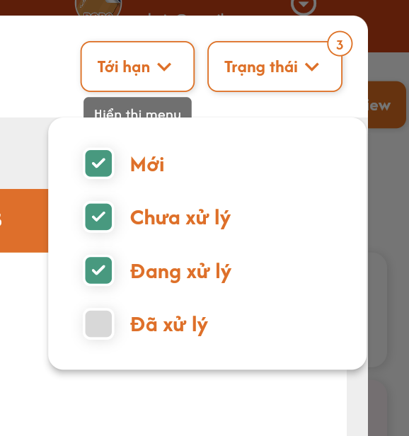

# Lịch hẹn — Danh sách, thêm lịch hẹn và Review

Menu **Lịch Hẹn** của ICS có bốn tab: **Hẹn lớp**, **Học viên**, **Hoá đơn**, **Giáo viên**. Tab Giáo viên là lịch hẹn giáo viên, không phải Cuộc họp lớp. Bốn loại dùng chung bảng lịch hẹn hiện có của ComGao; cùng một lịch hẹn là cùng một bản ghi ở menu này và màn hình nguồn. Ảnh là tham chiếu UI, không phải dữ liệu mặc định.

## 1. UI

### Trang 1: ADM-LHN-010100, ADM-LHN-010200, ADM-LHN-010300, ADM-LHN-010400 — Danh Sách Lịch Hẹn




*Danh sách Hẹn lớp; ba tab còn lại theo cùng bố cục — nhấn để xem ảnh gốc*

**Mô tả:**

- Người có quyền mở menu `Lịch Hẹn` để xem lịch hẹn thuộc phạm vi của mình. Admin xem toàn bộ; người được chọn ở `Người phụ trách` hoặc `Theo dõi` xem được lịch hẹn tương ứng.

**Điểm cần lưu ý:**

- `A01.01` **Bốn tab**: `Hẹn lớp`, `Học viên`, `Hoá đơn`, `Giáo viên`; mỗi tab chỉ liệt kê lịch hẹn thuộc loại đối tượng đó, không nhân bản bản ghi khi chuyển tab.
- `A01.02` **Bảng**: Bảy cột dữ liệu `Thời gian`, `Nội dung`, `Ghi chú`, `Người phụ trách`, `Đối tượng`, `Độ ưu tiên`, `Trạng thái` và một ô thao tác xóa ở cuối mỗi hàng.
- `A01.03` **Thời gian / Ghi chú**: Hiện `Hôm nay`, `Ngày mai` hoặc ngày `dd.MM.yyyy` theo ngày hẹn. Ngày quá hạn (trước hôm nay) hiện màu đỏ, `Hôm nay` hiện màu xanh lá, ngày chưa tới hạn hiện màu xám. Ghi chú dài có `Xem thêm` / `Thu gọn`.
- `A01.04` **Người phụ trách**: Hiện avatar người được gán; `+N` là số người còn lại; rê chuột vào cụm avatar hiện danh sách tên toàn bộ Người phụ trách. Không gộp `Theo dõi` vào cột này.
- `A01.05` **Đối tượng**: Tab Hẹn lớp hiển thị **lớp** (mã lớp); [Học viên](./images/03-appointments-student.png) hiển thị **học viên**; [Hoá đơn](./images/04-appointments-invoice.png) hiển thị **số tiền hoá đơn và học viên** gắn với hoá đơn; [Giáo viên](./images/05-appointments-teacher.png) hiển thị **giáo viên**. Giá trị lấy từ đúng đối tượng liên kết. Ở tab Học viên, rê chuột vào avatar hiện tooltip gồm Tên, Sđt, Gmail và `Lớp đang học` (mã lớp kèm trạng thái của học viên trong lớp); mỗi dòng có nút sao chép.
- `A01.06` **Badge / phân trang**: Lịch hẹn có Độ ưu tiên `Quan trọng` hiển thị badge `SOS` ngay phía trên Nội dung. Badge do FE tự hiển thị theo Độ ưu tiên backend trả về; backend không lưu cờ SOS riêng và không thêm mức ưu tiên thứ năm. Badge tại mỗi tab đếm lịch hẹn đến hạn của loại đó; badge menu Lịch Hẹn đếm lịch hẹn đến hạn ở cả bốn loại trong phạm vi được xem. Footer hiển thị tổng **lịch hẹn** và 50 dòng/trang; `Trước`, số trang, `Sau`.
- `A01.07` **Xóa**: Biểu tượng thùng rác nằm cố định ở cuối mỗi hàng của cả bốn tab đối với user có quyền xóa; không cần hover. Bấm để mở popup xác nhận.

- `Hẹn lớp` dùng cùng bản ghi đã tạo từ [Danh sách lớp](../management_requirement/class_management/class_management_requirements.md#popup-them-lich-hen-cho-lop) và hiển thị tại [Lịch Hẹn trong Chi tiết lớp](../management_requirement/class_management/class_detail_appointments_requirements.md). Các tab khác cũng phản ánh đúng bản ghi của đối tượng nguồn trong bảng ComGao.
- Danh sách có bộ lọc `Trung tâm` nằm cùng hàng với các bộ lọc khác, cho chọn một hoặc nhiều trung tâm; khi chọn thì danh sách, tổng số và phân trang chỉ tính dữ liệu của các trung tâm đã chọn, kết hợp `AND` với các bộ lọc khác. Không chọn thì hiển thị dữ liệu của mọi trung tâm. Role Admin không dùng ô chọn trung tâm trên header.
- `Theo dõi` được xem lịch hẹn được gán nhưng mọi control thay đổi là chỉ đọc; việc xem lịch hẹn không tự mở quyền xem toàn bộ đối tượng liên kết.
- Nút `Review` mở `Bảng chia lịch hẹn` theo phần bên dưới. Lịch hẹn đến hạn có ngày hẹn từ hôm nay trở về trước và được tính vào badge theo phạm vi xem; badge `SOS` hiện khi Độ ưu tiên là `Quan trọng`, ẩn khi đổi sang mức khác.

### Trang 2: ADM-LHN-010100 — Bộ lọc và lựa chọn Ưu tiên / Trạng thái




*Bộ lọc Thời gian, Độ ưu tiên và Trạng thái; ảnh cũ còn mục Đã xoá nhưng không áp dụng*

**Mô tả:**

- Lọc danh sách ở tab đang chọn bằng `Trung tâm`, `Người theo dõi`, `Người phụ trách`, `Thời gian`, `Độ ưu tiên` và `Trạng thái`.

**Điểm cần lưu ý:**

- `A02.01` **Trung tâm**: Chọn một hoặc nhiều trung tâm; không chọn thì hiển thị lịch hẹn của mọi trung tâm trong phạm vi được xem.
- `A02.02` **Người theo dõi / Người phụ trách**: Chọn người dùng để lọc theo đúng field phân công, không dùng lẫn hai danh sách. Chỉ `Admin` dùng được hai bộ lọc này để lọc theo người. Các role khác luôn chỉ thấy lịch hẹn mà chính mình là Người phụ trách hoặc Theo dõi; chọn hai bộ lọc này không làm thay đổi danh sách.
- `A02.03` **Thời gian**: Các lựa chọn trong UI: `Tới Hạn`, `Hôm Nay`, `Hôm Qua`, `Tuần Này`, `Tuần Trước`, `Tuần Sau`, `Tháng Này`, `Tháng Trước`, `3 Tháng Trước`, `Tháng Sau`, `Năm Nay`, `Năm Trước`, `Hôm Nay & Hôm Qua`, `Tuỳ Chọn`; Tuỳ Chọn dùng khoảng ngày. Màu ngày theo quy tắc ở cột Thời gian.
- `A02.04` **Độ ưu tiên**: Lọc nhiều mức: `Ưu tiên cao`, `Quan trọng`, `Bình thường`, `Ưu tiên thấp`, hoặc `Tất cả`.
- `A02.05` **Trạng thái**: Lọc nhiều trạng thái: `Mới`, `Chưa xử lý`, `Đang xử lý`, `Đã xử lý`, hoặc `Tất cả`. Mặc định chọn ba trạng thái đầu; không có lựa chọn `Đã xoá` dù ảnh tham chiếu cũ còn hiển thị.

- Các bộ lọc kết hợp trên dữ liệu người dùng được phép xem; đổi tab hoặc lọc cập nhật lại tổng số và phân trang. Không hiển thị dữ liệu ngoài quyền qua `Tất cả`.
- Khi mở danh sách hoặc Review, bộ lọc mặc định là `Tới hạn` và ba trạng thái được chọn: `Mới`, `Chưa xử lý`, `Đang xử lý`; `Đã xử lý` không được chọn. Đây là bộ lọc hiển thị, không tự đặt Trạng thái hoặc Độ ưu tiên cho lịch hẹn mới.
- Bộ giá trị ưu tiên/trạng thái nêu trên là bộ chính thức theo xác nhận mới; các requirement lịch hẹn cũ dùng tên khác cần cập nhật thống nhất khi triển khai. Không dùng `Đã xoá` làm trạng thái thay cho thao tác xóa có xác nhận.

### Trang 3: ADM-LHN-010110 — Popup Thêm lịch hẹn mới




*Popup tạo lịch hẹn và menu chọn người theo nhóm role — nhấn để xem ảnh gốc*

**Mô tả:**

- Admin, Class Handler và Support nhấn dấu `+` bên cạnh `Danh Sách Lịch Hẹn` để mở popup tạo lịch hẹn thuộc tab/đối tượng được chọn.

**Giải thích field/thành phần:**

Form chung theo bảng dưới; riêng popup tạo từ Danh sách học viên áp dụng các điểm đã chốt tại mục **Lịch hẹn tạo từ Danh sách học viên — UI chuẩn riêng** bên dưới.

- `A03.01` **Nội dung**: **Bắt buộc**, nhập tự do, không cần chọn nội dung từ nguồn.
- `A03.02` **Ghi chú**: Không bắt buộc, được để trống; nhập tự do, không giới hạn độ dài; hiển thị ở cột Ghi chú sau khi lưu.
- `A03.03` **Thời gian**: **Bắt buộc**, chọn ngày hẹn bằng lịch chọn ngày, không chọn giờ; hiển thị dạng `dd.MM.yyyy`. Không giới hạn mốc thời gian theo xác nhận. Ngày mẫu `01.01.2000` trong ảnh không là giá trị mặc định. Có [ảnh lịch chọn ngày](./images/06-date-picker.png).
- `A03.04` **Trung tâm**: **Bắt buộc**, chọn một trung tâm từ danh sách trung tâm; lịch hẹn được tạo thuộc trung tâm đã chọn. Danh sách Đối tượng lấy theo trung tâm đã chọn.
- `A03.05` **Đối tượng**: **Bắt buộc**, chọn đúng một đối tượng theo tab: Hẹn lớp → lớp, Học viên → học viên, Hoá đơn → hoá đơn (hiển thị số tiền và học viên), Giáo viên → giáo viên. Class Handler/Support chỉ chọn đối tượng thuộc phạm vi họ được phép truy cập; Admin theo phạm vi Admin.
- `A03.06` **Độ ưu tiên**: **Bắt buộc**, chọn một trong `Ưu tiên cao`, `Quan trọng`, `Bình thường`, `Ưu tiên thấp` theo [menu UI](./images/10-priority-options.png). Giá trị mặc định chưa được chốt.
- `A03.07` **Trạng thái**: **Bắt buộc**, chọn một trong `Mới`, `Chưa xử lý`, `Đang xử lý`, `Đã xử lý`; bỏ `Đã xoá` trong [ảnh menu cũ](./images/07-status-options.png). Giá trị mặc định của form chưa được chốt; không lấy bộ lọc mặc định làm giá trị form.
- `A03.08` **Người phụ trách**: Không bắt buộc, được để trống; chọn một hoặc nhiều user thuộc bốn nhóm role: `Trợ giảng` (Teaching Assistant), `Support`, `Nhân viên kinh doanh` (Sale), `Phụ trách lớp` (Class Handler). Nút `+` mở danh sách chọn có ô `Tìm kiếm...` và bốn nhóm role thu gọn/mở được, chọn bằng checkbox. Mở popup mặc định đã chọn chính người tạo nếu người tạo thuộc một trong bốn nhóm này; người tạo có thể gỡ mình ra hoặc thêm người khác. Khi tạo và khi sửa đều được bỏ hết Người phụ trách.
- `A03.09` **Theo dõi**: Không bắt buộc; tìm/chọn nhiều user thuộc cùng bốn nhóm role với Người phụ trách, nhóm theo role, dùng cùng kiểu danh sách chọn với Người phụ trách. Người được thêm chỉ xem lịch hẹn.
- `A03.10` **Hủy / Thêm lịch hẹn**: Hủy đóng popup không lưu; Thêm kiểm tra dữ liệu/quyền rồi tạo đúng một lịch hẹn.

**Điểm cần lưu ý:**

- Chọn tab hoặc đối tượng khác không được gắn nhầm lịch hẹn sang đối tượng cũ. Người xuất hiện trong cả Người phụ trách và Theo dõi có quyền sửa theo tư cách Người phụ trách.
- Người tạo được gỡ chính mình khỏi Người phụ trách mà không cần chọn người khác; sau khi lưu, người tạo không tự có quyền sửa nếu không còn trong danh sách phụ trách. Lịch hẹn không có Người phụ trách thì không ai sửa hoặc xóa được theo quy tắc quyền hiện tại.
- Sau khi lưu, lịch hẹn xuất hiện ở tab này và mọi màn hình nguồn dùng cùng bản ghi; tạo lỗi không thêm dòng hoặc tăng badge.
- Quyền tạo tại menu chỉ dành cho Admin, Class Handler, Support. Với form chung tại menu Lịch Hẹn, danh sách Người phụ trách/Theo dõi chỉ gồm bốn nhóm role Trợ giảng, Support, Nhân viên kinh doanh, Phụ trách lớp theo UI mới; không cho gán role khác kể cả bằng request trực tiếp. Danh sách mẫu ngôn ngữ (`Tiếng Đức`, `Tiếng Anh`...) trong ảnh dropdown Đối tượng chỉ là dữ liệu mẫu. Dữ liệu mẫu `Nguyễn Văn An`, ngày mẫu và các avatar trong ảnh không được điền sẵn.

#### Lịch hẹn tạo từ Danh sách học viên — UI chuẩn riêng

- Với flow `Quản lý → Học viên → Thêm lịch hẹn`, áp dụng [UI chuẩn học viên](../management_requirement/student_management/student_management_requirements.md#thêm-lịch-hẹn): Người phụ trách/Theo dõi chỉ chọn `Trợ giảng` (Teaching Assistant), `Support`, `Nhân viên kinh doanh` (Sale), theo đúng nhóm trong ảnh mới đã xác nhận.
- Thời gian chỉ chọn **ngày**, không chọn giờ; Đối tượng tự gắn học viên đang chọn, Trạng thái tự mặc định **Mới**. Popup không có control Đối tượng/Trạng thái; submit bằng nút **Xác nhận**.
- Người tạo chỉ được chọn sẵn làm Người phụ trách nếu thuộc một role được gán của flow này; Người phụ trách được để trống. Chọn nhiều user, Theo dõi không bắt buộc và một user có thể ở cả hai field.
- Các quy tắc form chung về bốn nhóm role không áp dụng thay thế các điểm riêng đã chốt ở flow học viên này. Validation Nội dung/Ghi chú/Độ ưu tiên, bản ghi dùng chung, quyền sửa/xóa và phản hồi vẫn theo requirement này.

### Trang 4: ADM-LHN-010100 — Chỉnh Độ ưu tiên và Trạng thái trên dòng


**Mô tả:**

- Người có trong `Người phụ trách` thay đổi độ ưu tiên/trạng thái của lịch hẹn qua dropdown ở bảng. Người trong `Theo dõi` chỉ xem.

**Điểm cần lưu ý:**

- `A04.01` **Độ ưu tiên**: Dropdown hiển thị bốn mức chính thức, icon/màu theo UI. Chọn mức khác cập nhật cùng bản ghi.
- `A04.02` **Trạng thái**: Dropdown có `Mới`, `Chưa xử lý`, `Đang xử lý`, `Đã xử lý` với icon/màu theo UI. Không có `Đã xoá`; xóa dùng biểu tượng thùng rác cuối hàng và popup xác nhận.
- `A04.03` **Người sửa**: Chỉ user thuộc `Người phụ trách` của chính lịch hẹn được lưu thay đổi, trong phạm vi được phép. Admin xem toàn bộ nhưng không tự sửa lịch hẹn nếu không được gán Người phụ trách.

- Kiểm tra quyền khi lưu, kể cả request trực tiếp. Chỉ cập nhật UI sau khi lưu thành công; chọn lại giá trị cũ không gửi thay đổi.
- `Theo dõi` chỉ đọc ngay cả khi được add; quyền xem không đồng nghĩa quyền sửa. Nhiều Người phụ trách thì mỗi người đều được sửa.

### Trang 5: ADM-LHN-020000 — Popup Review — Bảng chia lịch hẹn




*Review mở Bảng chia lịch hẹn theo bốn tab — nhấn để xem ảnh gốc*

**Mô tả:**

- Nhấn `Review` trên Danh Sách Lịch Hẹn để xem bảng chia lịch hẹn của tab đang chọn. Admin và Class Handler được sắp xếp bằng kéo thả; các role khác chỉ xem.



*Review mặc định lọc Tới hạn và ba trạng thái chưa hoàn tất — nhấn để xem ảnh gốc*

**Điểm cần lưu ý:**

- `A05.01` **Tab / bộ lọc**: Bốn tab `Hẹn lớp`, `Học viên`, `Hoá đơn`, `Giáo viên` và bộ lọc `Trạng thái`, `Thời gian`. Mặc định `Tới hạn` và chọn `Mới`, `Chưa xử lý`, `Đang xử lý`; `Đã xử lý` bỏ chọn. Chữ `Lịch Họp` cạnh Giáo viên trong ảnh Review cũ là sai. Chỉ lọc các lịch hẹn người dùng được xem.
- `A05.02` **Cột/cụm thẻ**: Mỗi cột có tiêu đề và màu do user có quyền quản lý cột tự chọn. Ô `Nhập tiêu đề mục mới` và nút `+` thêm cột; biểu tượng màu mở [bảng chọn màu](./images/15-review-color-picker.png). Thùng rác chỉ xóa **cột trống**; cột còn lịch hẹn không được xóa. **Không giới hạn số cột hoặc độ dài tiêu đề.** Tiêu đề `Ví Dụ: Thứ 2/3/...` là dữ liệu mẫu.
- `A05.03` **Thẻ lịch hẹn**: Hiển thị ngày hẹn (tới hạn/quá hạn màu đỏ), avatar/`+N` người phụ trách, nội dung, ghi chú ngắn, đối tượng, icon trạng thái và ưu tiên. Dữ liệu thẻ lấy từ bản ghi lịch hẹn ở tab tương ứng.
- `A05.04` **Kéo thả thẻ**: Admin/Class Handler kéo [một thẻ](./images/13-review-drag-card.png) sang vị trí/cột khác; vùng đích có viền nét đứt như ảnh.
- `A05.05` **Kéo thả cụm**: Admin/Class Handler kéo [cả cột/cụm thẻ](./images/14-review-drag-group.png) để đổi vị trí cột; các thẻ trong cụm đi cùng.

- Cột Review là cấu hình chung cho tất cả người xem **cùng tab**. Admin/Class Handler tạo, xóa, đổi màu hoặc sắp xếp cột thì người xem khác thấy thay đổi đó; cấu hình của tab khác không bị đổi.
- Chỉ Admin và Class Handler được tạo/xóa/đổi màu cột hoặc kéo thả thẻ/cụm; Support, Sale, Giáo viên và các role khác có quyền xem thì bảng ở chế độ chỉ đọc. Quyền `Người phụ trách` ở danh sách không tự cấp quyền sắp xếp Review.
- Kéo thả thẻ/cụm chỉ thay đổi nhóm hoặc vị trí trên Review; không cập nhật Nội dung, Đối tượng, Thời gian, Độ ưu tiên, Trạng thái hay field khác của lịch hẹn. Thao tác thất bại giữ vị trí cũ.
- Các tab dùng cùng bản ghi lịch hẹn ComGao; sắp xếp không tạo lịch hẹn mới hoặc làm mất thẻ. Bộ lọc chỉ thay đổi thẻ hiển thị, không thay đổi thứ tự đã lưu.

### Trang 6: ADM-LHN-010110, ADM-LHN-020000 — Nút xóa và popup xác nhận lịch hẹn


**Mô tả:**

- Trong danh sách Lịch Hẹn, biểu tượng thùng rác hiển thị cố định ở cuối mỗi hàng cho người có quyền xóa; nhấn biểu tượng mở popup xác nhận trước khi xóa.

**Điểm cần lưu ý:**

- `A06.01` **Biểu tượng xóa**: Nằm ở ô cuối hàng, luôn hiển thị không cần hover nếu user thuộc `Người phụ trách` của lịch hẹn đó; không hiển thị cho người chỉ Theo dõi hoặc Admin không được gán phụ trách.
- `A06.02` **Popup xác nhận**: Cho biết lịch hẹn sắp xóa, có `Hủy` và hành động xác nhận `Xóa`; chưa xác nhận thì không thay đổi dữ liệu.
- `A06.03` **Kết quả**: Xác nhận thành công xóa lịch hẹn khỏi danh sách/tab và Review tương ứng, cập nhật tổng/badge theo dữ liệu nguồn. Không chuyển sang trạng thái `Đã xoá`.

- Kiểm tra quyền tại backend khi xác nhận; nếu người phụ trách đã bị thay đổi hoặc xóa lỗi, không xóa lịch hẹn và không hiển thị thành công giả.
- Hủy popup không xóa, không phát sinh Toast CRUD. Cách lưu lịch sử/xóa vật lý ở nguồn ComGao là chi tiết triển khai, không thay đổi hành vi UI đã chốt.

### Trang 7: Toast phản hồi CRUD


*Toast chuẩn của requirement — nhấn để xem ảnh gốc*

**Mô tả:** Phản hồi kết quả tạo/cập nhật/xóa lịch hẹn và thay đổi Bảng chia lịch hẹn.

**Điểm cần lưu ý:**

- `A07.01` **Thành công**: Tiêu đề: `Thành Công`; Khi hiển thị: Tạo/cập nhật/xóa lịch hẹn hoặc thay đổi bảng Review đã được lưu thành công.
- `A07.02` **Thông tin**: Tiêu đề: `Thông Báo`; Khi hiển thị: Hệ thống đã nhận thao tác nhưng dữ liệu đang đồng bộ.
- `A07.03` **Cảnh báo**: Tiêu đề: `Cảnh Báo`; Khi hiển thị: Dữ liệu không hợp lệ hoặc mất quyền sửa.
- `A07.04` **Lỗi**: Tiêu đề: `Có Lỗi Xảy Ra`; Khi hiển thị: Tạo/cập nhật/xóa/sắp xếp không hoàn tất do lỗi xử lý.

- Mỗi thao tác chỉ có một Toast kết quả; Hủy, lọc, chuyển tab, chỉ xem và chọn lại giá trị cũ không hiện Toast CRUD. Nội dung chi tiết thông báo dùng component chung; chưa có copy mới từ UI.

---

## 2. Yêu cầu

### 2.1. Flow chính

**Flow 1 / REQ01–REQ04: Xem lịch hẹn**

```text
Mở menu Lịch Hẹn → Chọn một trong bốn tab
      → Kiểm tra quyền xem và tải bản ghi chung từ nguồn ComGao
      → Hiển thị bảng, đối tượng và phân trang theo tab/phạm vi
      → Người trong Theo dõi được xem bản ghi của mình ở chế độ chỉ đọc
```

**Flow 2 / REQ05: Lọc danh sách**

```text
Chọn Người theo dõi / Người phụ trách / Thời gian / Ưu tiên / Trạng thái
      → Áp dụng các điều kiện trên tab đang xem và phạm vi quyền
      → Cập nhật dòng, tổng số và phân trang
```

**Flow 3 / REQ06–REQ07 / REQ09: Thêm lịch hẹn**

```text
Người có quyền tạo chọn tab và nhấn + → Nhập/chọn các field trong popup
      → Chọn đối tượng và Người phụ trách/Theo dõi phù hợp
      → Nhấn Thêm lịch hẹn → Kiểm tra dữ liệu và quyền
      → Thành công: lưu một bản ghi dùng chung, hiện ở đúng tab/màn nguồn và Toast Thành Công
      → Thất bại: không tạo bản ghi, giữ dữ liệu nhập và hiển thị lỗi phù hợp
```

**Flow 4 / REQ08–REQ09: Cập nhật ưu tiên hoặc trạng thái**

```text
Người có trong Người phụ trách chọn giá trị mới trên dòng
      → Kiểm tra quyền trên bản ghi và lưu cùng bản ghi
      → Thành công: cập nhật các màn liên quan và Toast Thành Công
      → Thất bại: giữ giá trị cũ và hiển thị lỗi phù hợp
```

**Flow 5 / REQ10 / REQ12: Xem Review**

```text
Người có quyền xem lịch hẹn bấm Review
      → Mở Bảng chia lịch hẹn tại tab đang chọn
      → Chọn tab / Trạng thái / Thời gian để xem thẻ trong phạm vi được phép
      → Role không phải Admin/Class Handler chỉ được xem và lọc
```

**Flow 6 / REQ11–REQ12: Sắp xếp Bảng chia lịch hẹn**

```text
Admin hoặc Class Handler mở Review
      → Thêm/đổi màu cột, chỉ xóa cột trống, hoặc kéo thẻ/cả cụm vào vị trí hợp lệ
      → Hệ thống kiểm tra quyền, lưu vị trí/cấu hình bảng
      → Thành công: hiển thị vị trí/cấu hình mới sau tải lại
      → Thất bại: trả về vị trí/cấu hình đã lưu, không mất thẻ
```

**Flow 7 / REQ13: Xóa lịch hẹn**

```text
Người phụ trách nhấn biểu tượng thùng rác cuối hàng trong danh sách
      → Popup xác nhận hiển thị đúng lịch hẹn
      → Hủy: đóng popup, giữ bản ghi
      → Xác nhận: kiểm tra lại quyền và xóa lịch hẹn
      → Thành công: bỏ dòng/thẻ khỏi danh sách và Review, cập nhật tổng/badge
      → Thất bại: giữ bản ghi, hiển thị lỗi phù hợp
```

### 2.2. Ngoại lệ

- **EX01:** Thiếu field bắt buộc, ngày/đối tượng không hợp lệ hoặc gán người ngoài phạm vi → không tạo lịch hẹn, chỉ rõ field lỗi.
- **EX02:** Người không thuộc `Người phụ trách` cố sửa, kể cả Admin chỉ có quyền xem hoặc Người trong `Theo dõi` → từ chối, không thay đổi bản ghi.
- **EX03:** Lỗi tải/lưu hoặc request lặp → không sinh bản ghi/trạng thái trùng; giữ dữ liệu đã lưu, cho thử lại phù hợp.
- **EX04:** Role ngoài Admin/Class Handler cố thêm/xóa/đổi màu cột hoặc kéo thả Review, hoặc Admin/Class Handler cố xóa cột còn lịch hẹn → từ chối, bảng không đổi.
- **EX05:** User không thuộc Người phụ trách cố xóa, hoặc hủy xác nhận/xóa thất bại → giữ lịch hẹn; không chuyển thành trạng thái `Đã xoá`.

### 2.3. Yêu cầu khác

| Mã | Tên yêu cầu | Mô tả |
|---|---|---|
| REQ01 | Bốn loại | Hẹn lớp chọn lớp, Học viên chọn học viên, Hoá đơn chọn hoá đơn và hiển thị số tiền cùng học viên gắn với hoá đơn, Giáo viên chọn giáo viên; mỗi lịch hẹn thuộc đúng một loại. |
| REQ02 | Dữ liệu chung | ICS dùng chung bảng lịch hẹn ComGao; menu và màn hình nguồn đọc/ghi cùng bản ghi, không đồng bộ bằng bản sao. Đặc biệt Hẹn lớp dùng cùng bản ghi trong Manage Class. |
| REQ03 | Quyền xem | Admin xem toàn bộ; Người phụ trách và Người theo dõi xem được lịch hẹn được gán. Người theo dõi chỉ đọc. |
| REQ04 | Danh sách | Hiển thị bảy cột dữ liệu và ô thao tác xóa cuối hàng, đúng đối tượng và phân công; 50 dòng/trang. Badge tab đếm lịch hẹn đến hạn của từng loại, badge menu đếm lịch hẹn đến hạn ở cả bốn loại theo phạm vi được xem; tổng dưới bảng là tổng lịch hẹn của tab, không phải badge. |
| REQ05 | Bộ lọc | Lọc theo năm field trên cùng tab; riêng hai bộ lọc Người theo dõi và Người phụ trách chỉ có tác dụng với Admin, role khác luôn chỉ thấy lịch hẹn của chính mình; Ưu tiên có bốn mức, Trạng thái có `Mới`/`Chưa xử lý`/`Đang xử lý`/`Đã xử lý`, hỗ trợ chọn nhiều và `Tất cả`. Danh sách và Review mở mặc định với `Tới hạn` và ba trạng thái `Mới`/`Chưa xử lý`/`Đang xử lý`; `Đã xử lý` bỏ chọn. Thời gian có các preset và `Tuỳ Chọn`; ngày thuộc `Tới Hạn` hiển thị đỏ. |
| REQ06 | Form tạo | Form chung tại menu Lịch Hẹn gồm Trung tâm, Nội dung, Ghi chú, Thời gian, Đối tượng, Độ ưu tiên, Trạng thái, Người phụ trách, Theo dõi. Mọi field đều bắt buộc trừ Ghi chú, Người phụ trách và Theo dõi. Nội dung nhập tự do, Ghi chú không giới hạn độ dài, Thời gian không giới hạn mốc. Người tạo được chọn sẵn ở Người phụ trách nếu thuộc nhóm role được gán, và có thể gỡ/thêm người; khi tạo và khi sửa đều được bỏ hết Người phụ trách. Form chung chỉ gán user thuộc bốn nhóm Trợ giảng/Support/Nhân viên kinh doanh/Phụ trách lớp vào Người phụ trách hoặc Theo dõi; riêng flow tạo từ Danh sách học viên chỉ gán Trợ giảng/Support/Nhân viên kinh doanh, chỉ ngày không giờ, Đối tượng tự lấy học viên và Trạng thái tự Mới theo UI chuẩn riêng. Không dùng dữ liệu mẫu trên ảnh làm mặc định. |
| REQ07 | Liên kết | Lưu đúng một đối tượng và các user được gán; tạo thành công xuất hiện ở đúng tab và màn nguồn. |
| REQ08 | Quyền sửa | Chỉ user thuộc Người phụ trách được đổi ưu tiên/trạng thái trên lịch hẹn đó; không cấp quyền sửa chỉ vì là Admin hoặc Theo dõi. |
| REQ09 | Phản hồi | Tạo/cập nhật/xóa chỉ hoàn tất sau khi lưu; Toast theo component chung, mỗi thao tác một kết quả. |
| REQ10 | Review | Nút `Review` mở Bảng chia lịch hẹn với bốn tab và bộ lọc Trạng thái/Thời gian mặc định như danh sách; thẻ lấy từ đúng bản ghi ComGao trong phạm vi được xem. |
| REQ11 | Cấu trúc và sắp xếp bảng | Bảng có cột tùy chỉnh với tiêu đề/màu user tự chọn, là cấu hình chung theo từng tab cho mọi người xem; không giới hạn số cột/độ dài tiêu đề. Hỗ trợ thêm, đổi màu, chỉ xóa cột trống, kéo một thẻ giữa các vị trí/cột và kéo cả cột/cụm thẻ để sắp xếp. Kéo thả chỉ đổi nhóm/vị trí trên Review, không đổi field lịch hẹn; không nhân bản/mất thẻ. |
| REQ12 | Quyền Review | Chỉ Admin và Class Handler được thay đổi bảng bằng các thao tác trên; các role còn lại chỉ xem và lọc, dù là Người phụ trách lịch hẹn. |
| REQ13 | Xóa lịch hẹn | Người phụ trách thấy biểu tượng thùng rác cố định ở cuối hàng của cả bốn tab, không cần hover; bấm để mở popup xác nhận rồi xóa. Hủy/không có quyền/lỗi không xóa; thành công bỏ khỏi danh sách/Review. Không có trạng thái `Đã xoá`. `SOS` là badge FE hiển thị theo Độ ưu tiên `Quan trọng`, không là field riêng và không là mức ưu tiên thứ năm. |
| REQ14 | Trung tâm | Danh sách có bộ lọc `Trung tâm` nằm cùng hàng với các bộ lọc khác, cho chọn một hoặc nhiều trung tâm; khi chọn thì danh sách, tổng số và phân trang chỉ tính dữ liệu của các trung tâm đã chọn, kết hợp `AND` với các bộ lọc khác. Không chọn thì hiển thị dữ liệu của mọi trung tâm. Role Admin không dùng ô chọn trung tâm trên header. Khi tạo mới bắt buộc chọn `Trung tâm`; bản ghi được lưu thuộc trung tâm đã chọn. Backend kiểm tra lại trung tâm khi lưu, không chỉ dựa vào UI. |

### 2.4. Ràng buộc

#### Quyền

| Role | Xem lịch hẹn/Review | Tạo tại menu | Sửa ưu tiên/trạng thái | Xóa lịch hẹn | Sắp xếp/quản lý cột Review |
|---|:---:|:---:|:---:|:---:|:---:|
| Admin | ✅ Toàn bộ | ✅ | ✅ Khi là Người phụ trách | ✅ Khi là Người phụ trách | ✅ |
| Class Handler | ✅ Trong phạm vi hoặc được gán | ✅ | ✅ Khi là Người phụ trách | ✅ Khi là Người phụ trách | ✅ Trong phạm vi được xem |
| Support | ✅ Trong phạm vi hoặc được gán | ✅ | ✅ Khi là Người phụ trách | ✅ Khi là Người phụ trách | ❌ |
| Sale | ✅ Nếu được gán | ❌ | ✅ Khi là Người phụ trách | ✅ Khi là Người phụ trách | ❌ |
| Role khác | ✅ Nếu được gán | ❌ | ✅ Khi là Người phụ trách | ✅ Khi là Người phụ trách | ❌ |

#### Ràng buộc khác

**Phạm vi dữ liệu**

- Bản ghi lịch hẹn được trả theo quyền của user; được gán `Theo dõi` chỉ cho xem lịch hẹn đó, không cấp quyền xem toàn bộ lớp/học viên/hoá đơn/giáo viên.
- Mọi thao tác tạo/sửa phải kiểm tra quyền và đối tượng liên kết ở nguồn dữ liệu; không dựa vào việc ẩn nút trên UI.
- Chỉ Admin, Class Handler, Support được tạo trực tiếp ở menu này. Quyền tạo ở màn hình nguồn khác tuân theo requirement riêng của màn đó; không lấy quyền ở màn nguồn để mở nút `+` tại menu Lịch Hẹn.
- Trong Review, quyền thay đổi bố cục bảng là quyền riêng của Admin/Class Handler; quyền sửa ưu tiên/trạng thái trên một lịch hẹn không cấp quyền kéo thả hoặc quản lý cột.
- Người được gán chỉ `Theo dõi` xem lịch hẹn nhưng không sửa hoặc xóa; người tạo tự gỡ mình khỏi Người phụ trách cũng không tự giữ quyền sửa/xóa sau khi lưu.

---

## 3. Testcase

### Feature: Lịch hẹn — Danh sách, thêm lịch hẹn và Review

| Tên testcase | Priority | Scenario | Role | Pre-condition | Given/When/Then | Expected Result |
|---|---|---|---|---|---|---|
| Case 1: Chuyển bốn tab | High · Smoke | Flow 1 / REQ01 | Admin | Có lịch hẹn đủ bốn loại | **Given** đang ở menu Lịch Hẹn<br>**When** lần lượt chọn bốn tab<br>**Then** hệ thống tải đúng loại | - Bảng đủ bảy cột dữ liệu và ô xóa cuối mỗi hàng khi có quyền<br>- Không trộn hoặc sao chép lịch hẹn giữa các tab |
| Case 2: Cùng bản ghi với màn nguồn | High | Flow 1 / REQ02 | Admin / Class Handler / Support | Một lịch hẹn lớp đã được tạo ở Danh sách lớp | **Given** lịch hẹn đã lưu<br>**When** xem ở Hẹn lớp và Chi tiết lớp<br>**Then** nội dung, thời gian, phân công và trạng thái khớp | - Cùng một bản ghi<br>- Không tạo lịch hẹn thứ hai khi chỉ xem |
| Case 3: Người Theo dõi chỉ đọc | High | Flow 1 / REQ03 | Người được gán Theo dõi | Không thuộc Người phụ trách | **Given** người dùng được thêm vào Theo dõi<br>**When** mở lịch hẹn hoặc thử đổi ưu tiên/trạng thái<br>**Then** được xem nhưng không được lưu thay đổi | - Không có quyền chỉnh trên UI và request trực tiếp<br>- Không tự mở quyền vào toàn bộ đối tượng |
| Case 4: Dòng, badge và phân trang | Medium | Flow 1 / REQ04 | Người có quyền xem | Có hơn 50 lịch hẹn trong một tab | **Given** có lịch hẹn đến hạn và chưa đến hạn<br>**When** chuyển trang và mở ghi chú dài<br>**Then** hiển thị đúng 50 dòng/trang, tổng lịch hẹn và nội dung ghi chú | - Badge tab/menu chỉ đếm lịch hẹn đến hạn trong phạm vi xem<br>- `Xem thêm`/`Thu gọn` chỉ thay đổi hiển thị<br>- Ngày tới hạn/quá hạn màu đỏ; SOS chỉ theo Độ ưu tiên `Quan trọng`, do FE hiển thị |
| Case 20: Lọc danh sách theo trung tâm | High | REQ14 | Admin | Có lịch hẹn ở trung tâm A và trung tâm B | **Given** bộ lọc `Trung tâm` chưa chọn giá trị nào<br>**When** chọn trung tâm B ở bộ lọc `Trung tâm`, sau đó bỏ chọn<br>**Then** danh sách chỉ hiển thị lịch hẹn của trung tâm B | - Không lẫn dữ liệu của trung tâm A<br>- Tổng số và phân trang cập nhật theo trung tâm B<br>- Bỏ chọn thì hiển thị lại dữ liệu của mọi trung tâm |
| Case 5: Lọc kết hợp | High | Flow 2 / REQ05 | Admin; role khác có quyền xem | Có nhiều lịch hẹn trong tab | **Given** mở Hẹn lớp với bộ lọc mặc định `Tới hạn` và ba trạng thái chưa hoàn tất<br>**When** Admin lọc thêm theo Người phụ trách, ưu tiên và trạng thái; role khác lọc theo ưu tiên và trạng thái<br>**Then** chỉ các lịch hẹn khớp tất cả điều kiện được hiển thị | - `Đã xử lý` mặc định không được chọn nhưng có thể chọn thêm<br>- Tổng và số trang cập nhật<br>- Không trả dữ liệu ngoài quyền<br>- Role khác Admin chọn Người phụ trách/Người theo dõi thì danh sách không đổi, vẫn chỉ gồm lịch hẹn của chính mình |
| Case 6: Tất cả và Tuỳ Chọn | Medium | Flow 2 / REQ05 | Người có quyền xem | Bộ lọc đang có lựa chọn | **Given** đã chọn nhiều mức ưu tiên/trạng thái<br>**When** chọn `Tất cả` hoặc khoảng ngày `Tuỳ Chọn`<br>**Then** danh sách phản ánh lựa chọn mới | - `Tất cả` chỉ bỏ giới hạn của bộ lọc tương ứng<br>- Khoảng ngày lọc theo ngày hẹn<br>- Không có `Đã xoá` |
| Case 7: Mở popup đúng tab | High | Flow 3 / REQ06 | Người có quyền tạo | Đang chọn một tab | **Given** đang ở tab Học viên<br>**When** bấm `+`<br>**Then** popup mở với loại đối tượng Học viên | - Đủ các field theo ảnh<br>- Không tự gắn lớp/hoá đơn/giáo viên |
| Case 8: Mặc định và thay Người phụ trách | High | Flow 3 / REQ06 | Admin / Class Handler / Support | Popup vừa mở | **Given** user A tạo lịch hẹn<br>**When** xem Người phụ trách rồi gỡ A, chọn B<br>**Then** Người phụ trách được chọn là B | - A được chọn sẵn lúc mở<br>- Có thể gỡ A/thêm B<br>- Vẫn lưu được khi danh sách phụ trách rỗng |
| Case 9: Tạo lịch hẹn | High · Smoke | Flow 3 / REQ06 / REQ07 | Người có quyền tạo | Các field bắt buộc hợp lệ | **Given** đã nhập đầy đủ field bắt buộc, không chọn Theo dõi; Người phụ trách có hoặc để trống<br>**When** bấm `Thêm lịch hẹn`<br>**Then** hệ thống lưu và đóng popup | - Một bản ghi trong bảng ComGao<br>- Hiển thị ở đúng tab và màn nguồn<br>- Theo dõi và Người phụ trách để trống vẫn hợp lệ |
| Case 10: Hủy hoặc thiếu field | High | EX01 / REQ06 | Người có quyền tạo | Popup đang mở | **Given** thiếu một field bắt buộc hoặc đang có dữ liệu chưa lưu<br>**When** bấm Thêm với dữ liệu lỗi hoặc bấm Hủy<br>**Then** không tạo lịch hẹn | - Dữ liệu lỗi được chỉ rõ tại field<br>- Hủy không có Toast CRUD |
| Case 21: Bắt buộc chọn trung tâm khi tạo | High | REQ14 | Admin / Class Handler / Support | Popup/dòng tạo lịch hẹn đang mở | **Given** các field bắt buộc khác hợp lệ<br>**When** bỏ trống `Trung tâm` rồi xác nhận; sau đó chọn trung tâm A và xác nhận<br>**Then** thiếu Trung tâm thì không tạo; chọn A thì tạo thành công | - Báo lỗi tại field Trung tâm khi bỏ trống<br>- Lịch hẹn mới thuộc trung tâm A; lọc trung tâm A thì thấy, lọc trung tâm B thì không thấy |
| Case 11: Người phụ trách cập nhật | High · Smoke | Flow 4 / REQ08 | Người phụ trách | Lịch hẹn chưa bị khóa theo quy tắc nguồn | **Given** người dùng có trong Người phụ trách<br>**When** chọn ưu tiên hoặc trạng thái mới<br>**Then** hệ thống lưu trên bản ghi hiện có | - Tải lại thấy giá trị mới ở mọi màn liên quan<br>- Một Toast thành công |
| Case 12: Từ chối người không phụ trách | High | EX02 / REQ03 / REQ08 | Admin không phụ trách / Người theo dõi | Được xem lịch hẹn | **Given** user không có trong Người phụ trách<br>**When** thử chỉnh trên UI hoặc gửi request trực tiếp<br>**Then** hệ thống từ chối | - Không thay đổi bản ghi<br>- Control chỉ đọc |
| Case 13: Mở Review và lọc | High · Smoke | Flow 5 / REQ10 | Người có quyền xem lịch hẹn | Có lịch hẹn ở nhiều tab | **Given** đang ở tab Hẹn lớp<br>**When** bấm Review, đổi tab hoặc lọc Trạng thái/Thời gian<br>**Then** bảng hiện đúng thẻ được phép xem | - Mở mặc định Tới hạn + Mới/Chưa xử lý/Đang xử lý; Đã xử lý bỏ chọn<br>- Không trộn bốn loại hoặc lộ dữ liệu ngoài quyền |
| Case 14: Sắp xếp thẻ và cụm | High | Flow 6 / REQ11 | Admin / Class Handler | Có nhiều cột và thẻ | **Given** bảng Review đang mở<br>**When** kéo một thẻ vào cột khác rồi kéo cả cụm sang vị trí mới<br>**Then** bảng lưu vị trí hợp lệ | - Thẻ/cụm xuất hiện đúng vị trí sau tải lại<br>- Không đổi field lịch hẹn, không nhân đôi/mất thẻ |
| Case 15: Thêm cột và đổi màu | High · Smoke | Flow 6 / REQ11 | Admin / Class Handler | Bảng Review đang mở | **Given** có quyền sắp xếp<br>**When** nhập tiêu đề dài, bấm `+` rồi tự chọn màu cột<br>**Then** hệ thống lưu cột và màu đã chọn | - Người xem khác cùng tab thấy cột/màu sau tải lại; tab khác không đổi<br>- Không giới hạn số cột/độ dài tiêu đề |
| Case 16: Chỉ xóa cột trống | High | Flow 6 / REQ11 | Admin / Class Handler | Có một cột trống và một cột chứa lịch hẹn | **Given** hai cột đang hiển thị<br>**When** thử xóa từng cột<br>**Then** chỉ cột trống được xóa | - Cột có lịch hẹn vẫn còn<br>- Không chuyển hoặc xóa lịch hẹn |
| Case 17: Role khác chỉ xem | High | EX04 / REQ12 | Support / Sale / Giáo viên / Người theo dõi | Có quyền xem ít nhất một lịch hẹn | **Given** user không phải Admin/Class Handler<br>**When** mở Review hoặc thử kéo thả/thêm/xóa/đổi màu bằng UI hay request trực tiếp<br>**Then** chỉ được xem và lọc | - Không lưu bất kỳ thay đổi nào trên bảng<br>- Không cấp quyền qua vai trò Người phụ trách |
| Case 18: Xác nhận xóa | High · Smoke | Flow 7 / REQ13 | Người phụ trách | Lịch hẹn đang hiển thị | **Given** biểu tượng thùng rác hiển thị ở cuối hàng mà không cần hover<br>**When** owner bấm biểu tượng rồi xác nhận trong popup<br>**Then** hệ thống xóa lịch hẹn | - Dòng/thẻ biến mất sau lưu thành công<br>- Không có trạng thái `Đã xoá`<br>- Tổng cập nhật |
| Case 19: Hủy hoặc không có quyền | High | EX05 / REQ13 | Người phụ trách / Người theo dõi / Admin không phụ trách | Lịch hẹn đang hiển thị | **Given** popup xác nhận đang mở hoặc user không có quyền<br>**When** bấm Hủy hoặc thử xóa trực tiếp<br>**Then** không xóa lịch hẹn | - Hủy không có Toast CRUD<br>- Người không phụ trách không thấy nút và request bị từ chối |
| Toast Case 1: Thành công | High | Flow 3 / Flow 4 / Flow 6 / Flow 7 / REQ09 | Người có quyền thay đổi | Dữ liệu hợp lệ | **Given** có thao tác tạo/cập nhật/xóa/sắp xếp<br>**When** lưu thành công<br>**Then** hiện `Thành Công` | - Chỉ hiện sau khi lưu<br>- Một Toast |
| Toast Case 2: Thông tin | Medium | REQ09 | Người có quyền thay đổi | Lưu bất đồng bộ | **Given** hệ thống đã nhận thao tác<br>**When** danh sách chưa đồng bộ<br>**Then** hiện `Thông Báo` | - Không báo hoàn tất sớm |
| Toast Case 3: Cảnh báo | High | EX01 / EX02 / REQ09 | Người thao tác | Dữ liệu/quyền không hợp lệ | **Given** người dùng xác nhận thay đổi<br>**When** kiểm tra thất bại<br>**Then** hiện `Cảnh Báo` nếu flow có Toast | - Không lưu dữ liệu sai<br>- Field lỗi được chỉ rõ |
| Toast Case 4: Lỗi | High | EX03 / REQ09 | Người có quyền thay đổi | Lỗi xử lý | **Given** request hợp lệ đã gửi<br>**When** lưu thất bại<br>**Then** hiện `Có Lỗi Xảy Ra` | - Không báo thành công<br>- Bản ghi giữ giá trị cũ |

---

## 4. Câu hỏi cần xác nhận

- **Q01:** Giá trị mặc định của Độ ưu tiên/Trạng thái **khi tạo lịch hẹn**; bộ lọc mặc định khi xem danh sách/Review đã chốt ở phần UI. Thứ tự sắp xếp các lịch hẹn cùng điều kiện lọc chưa được chỉ định.
- **Q02:** Dữ liệu ComGao đã lưu theo bộ giá trị cũ cần được đối chiếu khi triển khai; chưa tự đổi các bản ghi cũ sang bốn mức ưu tiên và bốn trạng thái mới.
