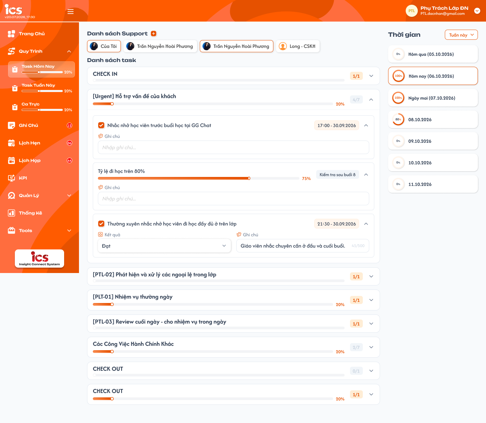
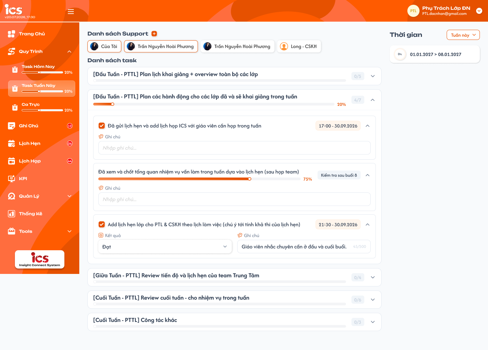
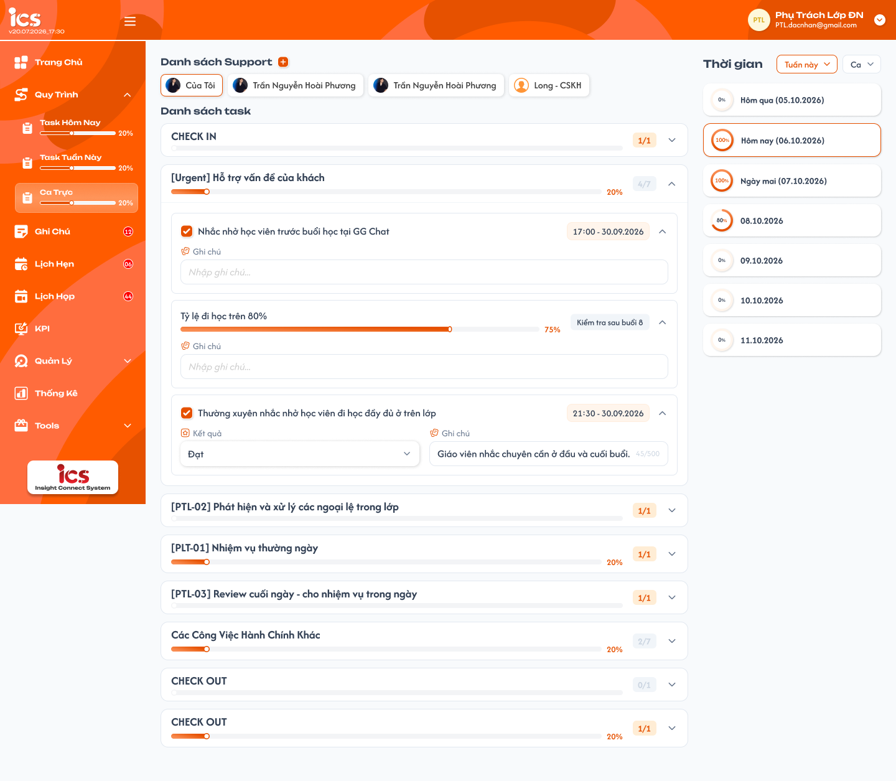
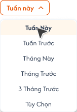
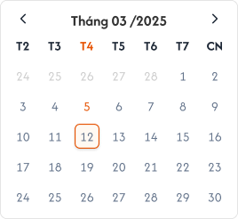
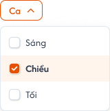
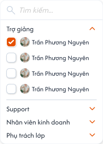

# [Phụ trách lớp] Quy trình — Task Hôm Nay, Task Tuần Này, Task Tháng Này, Ca Trực, Task Khác

## 1. UI

### Trang 1: SP-TASK-010000 — Quy trình / Task hôm nay


**Mô tả:**
- Menu **Quy Trình** của role `Class Handler` (Phụ trách lớp) gồm 5 menu con `Task Hôm Nay`, `Task Tuần Này`, `Task Tháng Này`, `Ca Trực`, `Task Khác`, tương ứng 5 Loại quy trình `Ngày`, `Tuần`, `Tháng`, `Ca trực`, `Khác` do Admin define tại [Define quy trình](../../process_definition_requirement/process_definition_requirements.md). Phụ trách lớp **chỉ chọn** trong các quy trình đã define (Công khai) để tick, không tạo/sửa quy trình tại đây. Quy trình **không chia theo trung tâm**. Cách hiển thị và ghi kết quả từng Action theo [Action Board](../../action_board_requirement/action_board_requirements.md).
- Màn hình Task Hôm Nay: chọn một quy trình đã define, tick/nhập kết quả từng Action, ghi chú, theo dõi tiến độ theo ngày.

**Điểm cần lưu ý:**
- `Task Khác` dùng quy trình loại `Khác`, khác 3 menu con còn lại: Phụ trách lớp tự **chọn nhiều quy trình** cần làm; không chia kỳ nên không có cột Thời gian.
- `A02.01` Nút `Chọn quy trình`: thay vị trí dropdown `Quy trình`, mở Popup chọn quy trình. Ẩn khi đang xem chip người khác.
- `A02.02` `Danh sách task` (Task Khác): các quy trình đã chọn, mỗi quy trình là một khối có tiêu đề tên quy trình (mở/thu gọn), bên trong là Category → Action Item như Task Hôm Nay. Xếp theo thứ tự chọn.
- `A02.03` Popup — ô `Tìm kiếm`: tìm theo tên quy trình, không phân biệt hoa thường.
- `A02.04` Popup — danh sách: chỉ quy trình `Công khai` loại `Khác`. Mỗi dòng: checkbox, tên, mô tả; quy trình đã chọn hiển thị sẵn trạng thái tick. Chọn nhiều. Không có quy trình Công khai loại Khác thì popup hiển thị `Chưa có quy trình được define`.
- `A02.05` Popup — `Hủy` / `Xác nhận`: Hủy đóng popup, không đổi lựa chọn. Xác nhận lưu toàn bộ lựa chọn và tải lại Danh sách task. Backend kiểm tra lúc lưu: quy trình phải còn `Công khai` và đúng loại `Khác`. Lưu thành công không cần Toast; lỗi có Toast `Có Lỗi Xảy Ra`, giữ lựa chọn cũ.
- `A02.06` Atom/Input: ô `Tìm kiếm` của popup chọn quy trình.
- `A02.07` Atom/Label: nhãn `Vô hiệu` của quy trình đã `Vô hiệu` nhưng có kết quả (vẫn hiện trong Danh sách task, chỉ xem).
- Task Khác không chia kỳ: kết quả lưu theo `Action Item + người làm`, một lượt duy nhất, giữ nguyên cho tới khi người làm sửa. Lựa chọn lưu riêng theo Phụ trách lớp, giữ lại khi tải lại trang. Chưa chọn quy trình nào → `Chưa chọn quy trình` kèm nút `Chọn quy trình`, `%` là `0%`. Bỏ chọn một quy trình: ẩn khỏi Danh sách task, kết quả không bị xóa; chọn lại thì kết quả cũ hiện lại; quy trình mới chọn thêm vào cuối.

### Trang 2: SP-TASK-010001 — Quy trình / Task hôm nay · Đã chọn thêm người



**Mô tả:**
- Task Hôm Nay khi đã thêm người vào `Danh sách Support` (chip người + nút `+`) để xem người đó đã làm quy trình đến đâu. Bố cục: menu con kèm thanh `%` ở sidebar; `Danh sách Support`; `Danh sách task` kèm dropdown `Quy trình` cùng hàng (Category → Action Item); cột `Thời gian` bên phải.

**Điểm cần lưu ý:**
- `A01.01` Sidebar: menu `Quy Trình` gồm 5 menu con, mỗi menu có thanh `%`. `%` tính theo **quy trình đang chọn** ở dropdown của menu con đó, kỳ hiện tại, của user đang đăng nhập (Task Hôm Nay = hôm nay; Task Tuần Này = tuần này; Task Tháng Này = tháng này; Ca Trực = hôm nay, ca hiện tại; Task Khác = tiến độ chung các quy trình đã chọn). Đổi quy trình ở dropdown thì `%` sidebar đổi theo ngay. Không có quy trình → `0%`.
- `A01.02` Dropdown `Quy trình`: cùng hàng tiêu đề `Danh sách task`; liệt kê quy trình `Công khai` đúng loại menu con, theo thứ tự danh sách Define khi lọc theo loại đó; mặc định chọn quy trình đứng đầu. Chọn 1 quy trình mỗi lần; đổi quy trình thì tải lại `Danh sách task`, vòng `%` từng kỳ, giữ nguyên chip người và khoảng thời gian. Quy trình đã chọn lưu theo `Phụ trách lớp + menu con`, giữ khi đổi kỳ/chip/menu/tải lại trang; chưa từng chọn hoặc không còn Công khai → về mặc định. Chỉ 1 quy trình thì dropdown vẫn hiển thị 1 lựa chọn. Không có quy trình Công khai → dropdown rỗng, `Danh sách task` hiển thị `Chưa có quy trình được define`, `%` là `0%`. Quy trình `Vô hiệu` biến mất khỏi dropdown; nếu kỳ đang xem có kết quả thì vẫn hiện với nhãn `Vô hiệu`, chỉ xem, không cập nhật.
- `A01.03` Danh sách task: Category của các Package đang Enable của quy trình đang chọn, giữ thứ tự Package → Category → Action. Mỗi khối Category: tên, `x/y` = số Action đã hoàn thành / tổng Action tham gia tiến độ, thanh tiến độ và `%`; mở/thu gọn không lưu dữ liệu. Tiến độ Category/kỳ = trung bình đóng góp của các Action tham gia tiến độ; Action chưa có kết quả đóng góp 0%; hiển thị số nguyên `%`.
- `A01.04` Cột `Thời gian`: dropdown khoảng thời gian `Tuần Này`, `Tuần Trước`, `Tháng Này`, `Tháng Trước`, `3 Tháng Trước`, `Tùy Chọn` (chọn khoảng ngày trên lịch, gồm cả 2 ngày biên). Danh sách kỳ có giao với khoảng đã chọn, mỗi dòng có vòng `%` tiến độ; mặc định chọn kỳ hiện tại (viền cam). Kỳ hiện tại và kỳ đã qua được cập nhật kết quả (cập nhật bù); kỳ tương lai chỉ xem. Mỗi kỳ là một lượt làm task độc lập, kết quả lưu theo `Action Item + người làm + kỳ`, sang kỳ mới thì task trống, không kế thừa.
- `A01.05` Task Hôm Nay: loại quy trình `Ngày`, đơn vị kỳ là Ngày; bộ lọc mặc định `Tuần Này` → 7 dòng ngày (Thứ 2 – Chủ Nhật), hôm qua/hôm nay/ngày mai ghi `Hôm qua (dd.MM.yyyy)`, `Hôm nay (dd.MM.yyyy)`, `Ngày mai (dd.MM.yyyy)`, ngày khác ghi `dd.MM.yyyy`; `%` sidebar là tiến độ hôm nay.
- `A01.09` Task Khác: loại `Khác`, không chia kỳ, không có cột Thời gian; `%` sidebar là tiến độ hiện tại (xem Trang 1).
- `A01.10` Loại task `Kiểm tra`: checkbox trước tên Action (hoàn thành / chưa); tham gia tiến độ, tick = 100%.
- `A01.11` Loại task `Đánh giá`: dropdown `Kết quả` theo Loại đánh giá đã cấu hình (VD `Đạt` / `Không đạt`); tham gia tiến độ, `Đạt` = 100%, `Không đạt` = 0% (thang 5 mức theo Action Board).
- `A01.12` Loại task `Task tiến trình`: thanh tiến độ kéo được 0–100%, hiển thị `%` bên phải; tham gia tiến độ theo `%` đã kéo.
- `A01.13` Loại task `Task nhập liệu`: ô nhập nội dung theo mô tả cấu hình; không tham gia tiến độ.
- `A01.14` Loại task `Hướng dẫn`, `Media`: xem tài liệu / video đã định nghĩa; không tham gia tiến độ.
- `A01.15` Loại task `Deadline`, `Xác thực`, `Log`: hiển thị field theo Action Board; không tham gia tiến độ. Mọi Action có ô `Ghi chú` (tối đa 500 ký tự, bộ đếm `/500`), lưu theo Action + người làm + kỳ (+ ca). Nhãn thời gian bên phải Action (VD `17:00 - 30.09.2026`) là thời điểm cập nhật kết quả gần nhất, dạng `HH:mm - dd.MM.yyyy`; chưa có kết quả thì không hiển thị; Action có mốc/thời hạn hiển thị thêm nhãn xám theo cấu hình (VD `Kiểm tra sau buổi 8`).
- `A01.16` Sidebar · MENU - CLASS HANDLER: khung menu của role Class Handler chứa menu `Quy trình`.
- Danh sách Support: chip gồm avatar + tên; mặc định chọn chip của chính người đang đăng nhập (đứng đầu). Bấm chip người khác thì hiển thị tiến độ của người đó trên quy trình đang chọn (Task Khác: các quy trình người đó đã chọn), chip đang chọn viền cam; xem người khác là **chỉ xem** (ẩn/disable checkbox, dropdown Kết quả, thanh kéo và ô Ghi chú; dropdown `Quy trình` vẫn đổi được). Hover chip người khác hiện nút `x` để gỡ; chip của chính mình không có `x`; gỡ chip đang chọn thì quay về chip của mình. Danh sách lưu riêng theo từng Phụ trách lớp, giữ khi tải lại và dùng chung cho cả 5 menu con.

### Trang 3: SP-TASK-020000 — Quy trình / Task tuần này


**Mô tả:**
- Menu con `Task Tuần Này` (quy trình loại `Tuần`), danh sách task của quy trình theo tuần, chip `Của tôi`.

**Điểm cần lưu ý:**
- Kỳ là Tuần (Thứ 2 – Chủ Nhật); bộ lọc mặc định `Tuần Này` → 1 dòng tuần ghi `Tuần này`, `Tuần trước` hoặc `dd.MM.yyyy - dd.MM.yyyy`.

### Trang 4: SP-TASK-020001 — Quy trình / Task tuần này · Đã chọn thêm người



**Mô tả:**
- Task Tuần Này khi đã chọn xem thêm người trong `Danh sách Support`.

**Điểm cần lưu ý:**
- `A01.06` Task Tuần Này: loại quy trình `Tuần`, đơn vị kỳ Tuần; `%` sidebar là tiến độ **tuần này**.
- `A01.07` Task Tháng Này: loại quy trình `Tháng`, đơn vị kỳ Tháng (ngày 1 – ngày cuối tháng); bộ lọc mặc định `Tháng Này` → 1 dòng ghi `Tháng này`, `Tháng trước` hoặc `MM.yyyy`; `%` sidebar là tiến độ **tháng này**. Frame Task Tháng Này chưa có riêng, dùng chung bố cục Task Tuần Này.

### Trang 5: SP-TASK-030000 — Quy trình / Ca trực



**Mô tả:**
- Giống Task Hôm Nay, dùng quy trình loại `Ca trực` (dropdown `Quy trình`); kỳ hiển thị theo từng ngày; cột `Thời gian` có thêm dropdown `Ca` cạnh dropdown khoảng thời gian.

**Điểm cần lưu ý:**
- `A03.01` Dropdown `Quy trình`: quy trình Công khai loại `Ca trực`; mặc định quy trình đứng đầu danh sách Define loại Ca trực.
- `A03.02` Dropdown khoảng thời gian: như Task Hôm Nay; mặc định `Tuần Này` (7 dòng ngày).
- `A03.03` Dropdown `Ca`: chọn 1 trong `Sáng`, `Chiều`, `Tối`; mặc định ca của thời điểm hiện tại. Đổi ca thì tải lại Danh sách task và vòng `%` từng ngày theo ca đã chọn.
- `A03.04` `Sáng`: 00:00 – 11:59 (Asia/Saigon).
- `A03.05` `Chiều`: 12:00 – 17:59.
- `A03.06` `Tối`: 18:00 – 23:59. Ba ca phủ kín 24h.
- Quy trình ca trực hiển thị cho **mọi ngày và mọi ca**; ngày/ca không trực thì user không đánh kết quả, không có ràng buộc lịch trực. Kết quả lưu theo `Action Item + người làm + ngày + ca`; mỗi ca là một lượt độc lập.
- `A04.01` Popup thêm người vào `Danh sách Support` (mở từ nút `+`): ô `Tìm kiếm` tìm theo tên hoặc email, không phân biệt hoa thường, tìm trên tất cả nhóm.
- `A04.02` Nhóm người dùng: chia theo role `Trợ giảng`, `Support`, `Nhân viên kinh doanh`, `Phụ trách lớp`; mỗi nhóm mở/thu gọn được. Chỉ hiển thị tài khoản đang hoạt động; không hiển thị chính người đang đăng nhập.
- `A04.03` Checkbox: chọn nhiều; người đã có trong danh sách hiển thị sẵn trạng thái đã tick. Tick thì thêm, bỏ tick thì gỡ; lưu ngay, cập nhật chip, không có nút xác nhận. Thêm/gỡ người chỉ thay đổi danh sách theo dõi, không đổi task, lựa chọn quy trình hay kết quả của người đó.

### Trang 6: SP-TASK-030001 — Quy trình / Ca trực · Đã chọn thêm người


**Mô tả:**
- Ca Trực khi đã chọn xem thêm người trong `Danh sách Support`.

**Điểm cần lưu ý:**
- `A01.08` Ca Trực: loại quy trình `Ca trực`, đơn vị kỳ Ngày + Ca; mặc định `Tuần Này` → 7 dòng ngày, ca hiện tại; `%` sidebar là tiến độ **hôm nay, ca hiện tại**.

### Trang 7: SP-TASK-030002 — Quy trình / Ca trực / Dropdown thời gian (đang mở)



**Mô tả:**
- Dropdown khoảng thời gian đang mở với 6 lựa chọn: `Tuần này`, `Tuần trước`, `Tháng này`, `Tháng trước`, `3 tháng trước`, `Tùy chọn`.

### Trang 8: SP-TASK-030003 — Quy trình / Ca trực / Lịch chọn ngày (đang mở)



**Mô tả:**
- Lịch chọn ngày khi chọn `Tùy chọn`: tháng hiển thị theo lưới T2–CN, chọn khoảng ngày (bao gồm cả 2 ngày biên).

### Trang 9: SP-TASK-030004 — Quy trình / Ca trực / Dropdown ca (đang mở)



**Mô tả:**
- Dropdown `Ca` đang mở với 3 lựa chọn `Sáng`, `Chiều`, `Tối`.

### Trang 10: SP-TASK-030010 — Quy trình / Ca trực / Dialog người phụ trách



**Mô tả:**
- Popup thêm người vào `Danh sách Support`: ô `Tìm kiếm...`, các nhóm `Trợ giảng`, `Support`, `Nhân viên kinh doanh`, `Phụ trách lớp` (chi tiết ở Trang 5).

---

## 2. Yêu cầu

### 2.1. Flow chính

**Flow 1: Task Hôm Nay / Tuần Này / Tháng Này / Ca Trực**

```
Phụ trách lớp mở Task Hôm Nay / Task Tuần Này / Task Tháng Này / Ca Trực
      → BE trả danh sách quy trình Công khai đúng loại (Ngày / Tuần / Tháng / Ca trực) + quy trình user đã chọn
      → FE chọn quy trình đã lưu; chưa có hoặc không còn Công khai → quy trình đứng đầu danh sách Define của loại đó
      → Mặc định: chip của mình; Thời gian = Tuần Này (Ngày, Ca trực: 7 ngày; Tuần: 1 tuần) / Tháng Này (Tháng: 1 tháng); kỳ hiện tại; Ca Trực: ca hiện tại
      → BE trả Category/Action của Package Enable + kết quả của user theo kỳ → FE hiển thị Danh sách task và cột Thời gian
      → (tùy chọn) Đổi dropdown Quy trình → BE lưu lựa chọn → FE tải lại task, vòng % và % sidebar theo quy trình mới
      → User tick / chọn Kết quả / kéo tiến độ / nhập Ghi chú → FE gọi API lưu kết quả (Action + user + kỳ [+ ca])
      → BE kiểm tra quyền, kỳ không ở tương lai, quy trình còn Công khai → lưu, ghi thời điểm cập nhật, tính lại tiến độ
      → FE cập nhật nhãn thời gian, tiến độ Category, vòng % của kỳ và % ở sidebar
                    ↓ (lưu thất bại)
              Khôi phục giá trị cũ, Toast lỗi
```

**Flow 2: Xem / cập nhật bù kỳ khác**

```
Đổi dropdown Thời gian (hoặc Tùy Chọn trên lịch) / đổi Ca → FE tải danh sách kỳ + % từng kỳ của quy trình đang chọn
      → Bấm một kỳ → FE tải task + kết quả của kỳ đó
                    ↓ (kỳ đã qua)              ↓ (kỳ tương lai)
              Cho cập nhật bù               Chỉ xem
```

**Flow 3: Task Khác**

```
Mở Task Khác → FE hiển thị các quy trình user đã chọn + kết quả (không chia kỳ)
      → Bấm Chọn quy trình → BE trả quy trình Công khai loại Khác + lựa chọn hiện tại
      → Tìm, tick / bỏ tick → Xác nhận → BE kiểm tra còn Công khai, đúng loại → lưu lựa chọn
      → FE tải lại Danh sách task và % sidebar → user tick kết quả như Flow 1 (không có kỳ)
                    ↓ (lỗi / quy trình không hợp lệ)
              Giữ lựa chọn cũ, Toast Có Lỗi Xảy Ra
```

**Flow 4: Theo dõi người khác**

```
Bấm + → Popup thêm người → tìm, tick người → BE lưu danh sách theo dõi → hiển thị chip
      → Bấm chip → FE tải tiến độ của người đó theo quy trình đang chọn (Task Khác: quy trình người đó đã chọn), chỉ xem
      → Hover chip → bấm x → gỡ khỏi danh sách (chip đang chọn bị gỡ thì quay về chip của mình)
```

### 2.2. Ngoại lệ

- **EX01:** Không có quy trình Công khai đúng loại → `Chưa có quy trình được define`; Task Khác chưa chọn quy trình → `Chưa chọn quy trình`; vòng `%` và `%` sidebar là `0%`.
- **EX02:** Cập nhật kết quả kỳ tương lai, kết quả của người khác, hoặc quy trình đã `Vô hiệu` (kể cả gửi request trực tiếp) → backend từ chối, giữ kết quả cũ.
- **EX03:** Ghi chú vượt 500 ký tự → không lưu, báo lỗi tại ô.
- **EX04:** Lưu kết quả lỗi / mất mạng → khôi phục giá trị đã lưu, Toast `Có Lỗi Xảy Ra`, không hiển thị dữ liệu optimistic.
- **EX05:** Ở Task Khác chọn quy trình Nháp/Vô hiệu, sai loại, hoặc vừa bị Vô hiệu sau khi mở popup; ở 3 menu còn lại gửi kết quả cho quy trình sai loại → backend từ chối, giữ dữ liệu cũ.
- **EX06:** Người trong Danh sách Support bị khóa tài khoản → ẩn khỏi danh sách; dữ liệu theo dõi không bị xóa.
- **EX07:** Đổi quy trình / kỳ / chip / menu con liên tục, response cũ về sau → bỏ qua response cũ.

### 2.3. Yêu cầu khác

| Mã | Tên yêu cầu | Mô tả |
|---|---|---|
| REQ01 | Nguồn task | Task Hôm Nay = loại `Ngày`, Task Tuần Này = `Tuần`, Task Tháng Này = `Tháng`, Ca Trực = `Ca trực`, Task Khác = `Khác`; chỉ quy trình `Công khai`, Package Enable. Không chia theo trung tâm. |
| REQ02 | Kết quả theo kỳ | Kết quả lưu theo `Action Item + người làm + kỳ` (ngày; tuần bắt đầu Thứ 2; tháng dương lịch; Ca Trực = ngày + ca); mỗi kỳ độc lập, không kế thừa. Task Khác một lượt duy nhất theo `Action Item + người làm`. Kỳ hiện tại và đã qua được cập nhật; kỳ tương lai chỉ xem. |
| REQ03 | Control theo Loại task | Kiểm tra: checkbox; Đánh giá: dropdown Kết quả; Task tiến trình: thanh kéo %; Task nhập liệu: ô nhập; các loại khác hiển thị theo Action Board. Ghi chú tối đa 500 ký tự. Nhãn thời gian = thời điểm cập nhật gần nhất. |
| REQ04 | Tiến độ | Chỉ tính Kiểm tra, Đánh giá, Task tiến trình; Category `x/y` và `%`; vòng `%` mỗi kỳ theo quy trình đang chọn. `%` sidebar theo quy trình đang chọn: hôm nay (Ngày), tuần này (Tuần), tháng này (Tháng), hôm nay ca hiện tại (Ca trực); tiến độ chung các quy trình đã chọn (Khác). Tính lại sau mỗi lần lưu. |
| REQ05 | Danh sách Support | Mặc định chọn chính mình; lưu theo Phụ trách lớp, dùng chung 5 menu con; thêm/gỡ bằng popup checkbox chọn nhiều (tìm theo tên/email) hoặc nút `x` khi hover chip; bấm chip xem tiến độ người đó ở chế độ chỉ xem. |
| REQ06 | Cột Thời gian | Dropdown Tuần Này / Tuần Trước / Tháng Này / Tháng Trước / 3 Tháng Trước / Tùy Chọn. Mặc định: Task Hôm Nay và Ca Trực `Tuần Này` (7 ngày), Task Tuần Này `Tuần Này` (1 tuần), Task Tháng Này `Tháng Này` (1 tháng). Ca Trực thêm dropdown Ca (Sáng 00:00–11:59 / Chiều 12:00–17:59 / Tối 18:00–23:59, mặc định ca hiện tại). Danh sách kỳ kèm vòng `%`, mặc định chọn kỳ hiện tại. Task Khác không có cột Thời gian. |
| REQ07 | Dropdown Quy trình | Task Hôm Nay / Tuần Này / Tháng Này / Ca Trực: chọn 1 trong các quy trình Công khai đúng loại, theo thứ tự danh sách Define của loại đó; mặc định quy trình đứng đầu; lựa chọn lưu theo user + menu con, quy trình không còn Công khai thì về mặc định. |
| REQ08 | Chọn quy trình ở Task Khác | Popup chỉ liệt kê quy trình Công khai loại Khác; chọn nhiều, tìm theo tên, Hủy / Xác nhận; lưu theo Phụ trách lớp. Bỏ chọn không xóa kết quả. Không tạo/sửa quy trình tại đây. |
| REQ09 | Phản hồi | Lưu thành công không cần Toast (cập nhật tại chỗ); lỗi có Toast `Có Lỗi Xảy Ra`. |

### 2.4. Ràng buộc

#### Quyền

| Role | Xem task của mình | Đổi dropdown Quy trình / chọn quy trình Task Khác | Cập nhật kết quả (kỳ hiện tại, cập nhật bù) | Thêm/gỡ người theo dõi | Xem quy trình người khác |
|---|:---:|:---:|:---:|:---:|:---:|
| Class Handler | ✅ | ✅ | ✅ | ✅ | ✅ (chỉ xem, người trong danh sách của mình) |
| Role khác | ❌ (menu riêng) | ❌ | ❌ | ❌ | ❌ |

#### Ràng buộc khác

- Backend xác định người làm từ token khi lưu kết quả và lựa chọn quy trình Task Khác; không nhận `owner_id` từ client để ghi.
- Xem kết quả người khác chỉ khi người đó nằm trong Danh sách Support của user; kiểm tra ở backend.
- Kỳ hiện tại và ca hiện tại tính theo giờ máy chủ (Asia/Saigon); tuần bắt đầu Thứ 2; tháng theo dương lịch.
- Mỗi `Action + người làm + kỳ` (Ca Trực thêm `ca`; Task Khác: `Action + người làm`) chỉ có tối đa một bản ghi kết quả; request lặp không tạo bản ghi trùng. Mỗi lần lưu ghi lại người và thời điểm cập nhật.
- Định nghĩa quy trình đã Công khai bị khóa nên không có trường hợp đổi Loại task giữa chừng. Quy trình nhân bản ở Define là quy trình mới, không kế thừa kết quả hay lựa chọn của quy trình gốc.
- Quy trình không gắn trung tâm: không có bộ lọc `Trung tâm`; mọi Phụ trách lớp thấy cùng một tập quy trình.

---

## 3. Testcase

### Feature: [Phụ trách lớp] Quy trình — Task Hôm Nay, Task Tuần Này, Task Tháng Này, Ca Trực, Task Khác

| Tên testcase | Priority | Scenario | Role | Pre-condition | Given/When/Then | Expected Result |
|---|---|---|---|---|---|---|
| Case 1: Dropdown quy trình đúng loại, mặc định quy trình đầu tiên | High | Flow 1 / REQ01 / REQ07 | Class Handler | Loại Ngày có D1, D2 Công khai (D1 đứng trước), D3 Nháp, D4 Vô hiệu; loại Tuần có W1 | **Given:** H đăng nhập<br>**When:** mở Task Hôm Nay, mở dropdown Quy trình<br>**Then:** mặc định D1 (đứng đầu danh sách Define loại Ngày); dropdown chỉ có D1, D2 | - Không có D3, D4, W1<br>- Package Disable của D1 không hiện; thứ tự theo định nghĩa<br>- Không có bộ lọc Trung tâm |
| Case 2: Đổi quy trình và % sidebar | High | Flow 1 / REQ04 / REQ07 | Class Handler | D1 hôm nay 20%, D2 hôm nay 60%; Tuần tuần này 40%, Tháng tháng này 10%, Ca trực hôm nay ca Chiều 30%; bây giờ 14:00 | **Given:** đang xem D1, Hôm nay<br>**When:** chọn D2; xem sidebar<br>**Then:** Danh sách task và vòng % theo D2 | - Vòng Hôm nay = 60%, `%` sidebar Task Hôm Nay = 60%; sidebar Task Tuần Này 40%, Task Tháng Này 10%, Ca Trực 30%<br>- Giữ kỳ, chip và khoảng thời gian đang chọn<br>- Tải lại trang vẫn là D2; D2 chuyển Vô hiệu → về D1<br>- Cập nhật kết quả thì % sidebar và vòng % đổi ngay |
| Case 3: Làm task theo Loại task | High | Flow 1 / REQ03 / REQ04 / EX03 / EX04 | Class Handler | Category có 1 Kiểm tra, 1 Đánh giá (Đạt/Không đạt), 1 Task tiến trình, 1 Hướng dẫn; API lưu lỗi ở lần thử khác | **Given:** hôm nay chưa có kết quả<br>**When:** lúc 17:00 tick Kiểm tra, chọn Đạt, kéo tiến độ 50%, nhập Ghi chú; thử Ghi chú 501 ký tự; tick khi API lỗi<br>**Then:** lưu từng kết quả | - Tiến độ Category = (100 + 100 + 50) / 3 = 83%, `x/y` = 2/3; Hướng dẫn không tính tiến độ<br>- Nhãn `17:00 - dd.MM.yyyy` theo lần cập nhật gần nhất<br>- Ghi chú 501 ký tự bị chặn, báo lỗi tại ô<br>- Lỗi lưu: khôi phục giá trị cũ + Toast `Có Lỗi Xảy Ra`, tiến độ không đổi |
| Case 4: Mặc định bộ lọc Thời gian theo menu và đổi khoảng | High | Flow 2 / REQ06 | Class Handler | Hôm nay 06.10.2026 (Thứ 3) | **Given:** mở lần lượt Task Hôm Nay, Task Tuần Này, Task Tháng Này; sau đó chọn `Tháng Này` (Tuần), `3 Tháng Trước` (Tháng), Tùy Chọn 01.10–03.10 (Ngày)<br>**When:** xem cột Thời gian<br>**Then:** đúng mặc định và đúng kỳ giao với khoảng | - Task Hôm Nay: `Tuần Này`, 7 dòng 05.10–11.10, nhãn Hôm qua/Hôm nay/Ngày mai đúng, chọn Hôm nay<br>- Task Tuần Này 1 dòng `Tuần này`; Task Tháng Này 1 dòng `Tháng này`<br>- Tuần giao tháng 10.2026; Tháng: `Tháng này`, `Tháng trước`, `08.2026`; Ngày: 3 dòng 01.10–03.10 |
| Case 5: Kỳ mới không kế thừa, cập nhật bù, chặn kỳ tương lai | High | REQ02 / EX02 | Class Handler | Hôm qua làm được 50%; tháng trước làm 30%; đang ở Tuần Này | **Given:** sang ngày mới / tháng mới; mở Task Hôm Nay, bấm Hôm qua và tick thêm; chọn Ngày mai và thử tick hoặc gửi request trực tiếp<br>**When:** hệ thống xử lý<br>**Then:** hôm nay trống 0%; hôm qua lưu được kết quả bù; ngày mai chỉ xem | - Kết quả hôm nay không đổi; tháng này trống, tháng trước vẫn 30% và cập nhật bù được<br>- Backend từ chối ngày mai, không tạo kết quả |
| Case 6: Quy trình Vô hiệu hoặc không có quy trình | Medium | EX01 / EX02 / REQ01 | Class Handler | D1 có kết quả hôm qua, chuyển Vô hiệu hôm nay; loại Tháng chưa có quy trình Công khai | **Given:** mở Task Hôm Nay, xem hôm nay rồi hôm qua; mở Task Tháng Này<br>**When:** xem dropdown<br>**Then:** hôm nay không có D1, mặc định D2; hôm qua có D1 nhãn `Vô hiệu`, chỉ xem; Task Tháng Này hiển thị `Chưa có quy trình được define` | - Không cập nhật được kết quả D1<br>- Sidebar Task Tháng Này 0%, không NaN |
| Case 7: Ca Trực theo ngày và ca | High | Flow 1 / REQ02 / REQ06 / REQ07 | Class Handler | Loại Ca trực có C1, C2 Công khai; bây giờ 14:00 ngày 06.10.2026 | **Given:** mở Ca Trực<br>**When:** xem mặc định; tick task; đổi Ca sang Sáng<br>**Then:** mặc định C1, Tuần Này 7 dòng ngày, chọn Hôm nay, Ca Chiều; kết quả lưu cho ca Chiều; ca Sáng hiển thị kết quả riêng | - Mở lúc 11:59 mặc định Sáng, 12:00 Chiều, 18:00 Tối, 23:30 Tối<br>- Mọi ngày, mọi ca đều có task<br>- Sidebar Ca Trực = % hôm nay ca hiện tại của quy trình đang chọn |
| Case 8: Chọn quy trình ở Task Khác | High | Flow 3 / REQ08 | Class Handler | Loại Khác có K1, K2 Công khai, K3 Nháp; loại Ngày có D1 | **Given:** mở Task Khác, bấm `Chọn quy trình`<br>**When:** tick K1, K2 và Xác nhận<br>**Then:** Danh sách task hiện khối K1 rồi K2 | - Popup chỉ có K1, K2, tìm theo tên<br>- Không có cột Thời gian<br>- Tải lại vẫn giữ lựa chọn |
| Case 9: Task Khác không chia kỳ, bỏ chọn giữ kết quả | High | REQ02 / REQ08 / EX01 | Class Handler | Đã chọn K1, tick 2/4 Action hôm qua | **Given:** hôm nay mở Task Khác, tick thêm 1 Action; sau đó bỏ tick K1, Xác nhận; chọn lại K1; lần khác bấm Hủy<br>**When:** xem Danh sách task<br>**Then:** vẫn 2 Action đã tick, tiến độ 3/4; bỏ chọn ẩn K1; chọn lại hiện kết quả cũ; Hủy không đổi | - Không reset theo ngày/tuần/tháng; sidebar Task Khác = 75%<br>- Bỏ chọn hết → `Chưa chọn quy trình`, `0%` |
| Case 10: Chặn chọn quy trình không hợp lệ | High | EX05 / Ràng buộc quyền | Class Handler | K1 bị Vô hiệu sau khi H mở popup; có ID quy trình Nháp và quy trình loại Ngày | **Given:** tick K1, Xác nhận; gửi request chọn quy trình Nháp / loại Ngày<br>**When:** backend kiểm tra<br>**Then:** từ chối | - Toast `Có Lỗi Xảy Ra`, giữ lựa chọn cũ |
| Case 11: Thêm/gỡ người theo dõi | High | Flow 4 / REQ05 / EX06 | Class Handler | Có Support S, Sale B; B bị khóa tài khoản ở lần thử khác | **Given:** bấm `+`<br>**When:** tìm `s`, tick S và B; hover chip B, bấm `x`<br>**Then:** chỉ còn chip S | - Danh sách giữ khi tải lại, dùng chung 5 menu con<br>- Chip của mình không có `x`, không hiện trong popup<br>- Không đổi dữ liệu của S, B; người bị khóa ẩn khỏi danh sách, dữ liệu theo dõi không xóa |
| Case 12: Xem tiến độ người khác | High | Flow 4 / REQ05 | Class Handler | S trong danh sách; S có kết quả D1 hôm nay; S chọn K1 ở Task Khác | **Given:** ở Task Hôm Nay bấm chip S, đổi dropdown sang D2; mở Task Khác<br>**When:** tải dữ liệu<br>**Then:** hiển thị tiến độ của S theo quy trình đang chọn; Task Khác hiện K1 của S | - Mọi control kết quả chỉ xem, ẩn nút Chọn quy trình<br>- Dropdown Quy trình vẫn đổi được<br>- Gỡ chip S đang chọn thì quay về chip của mình |
| Case 13: Chặn xem/sửa ngoài quyền | High | EX02 / Ràng buộc quyền | Class Handler; Role khác | K không có trong danh sách của H | **Given:** H gọi API xem kết quả K, ghi kết quả hoặc đổi lựa chọn Task Khác với owner_id của S; role khác mở menu<br>**When:** backend kiểm tra<br>**Then:** từ chối | - Không trả dữ liệu K<br>- Không ghi kết quả, không đổi lựa chọn của S |
| Case 14: Response cũ về muộn | Medium | EX07 | Class Handler | Mạng chậm | **Given:** đổi quy trình / kỳ / chip / menu con liên tục<br>**When:** response cũ về sau<br>**Then:** bỏ qua response cũ | - Chỉ dữ liệu của lựa chọn mới nhất hiển thị |

---

## 4. Câu hỏi cần xác nhận

- **Q01:** Cần ảnh UI cho `Task Tháng Này`, `Task Khác`, dropdown `Quy trình` (cả ở Ca Trực) và Popup chọn quy trình; các frame hiện có (SP-TASK-010000 đến SP-TASK-030010) chưa có các thành phần này.
- **Q02:** Task Khác đang giả định không chia kỳ, một lượt duy nhất, không reset. Có đúng không?
