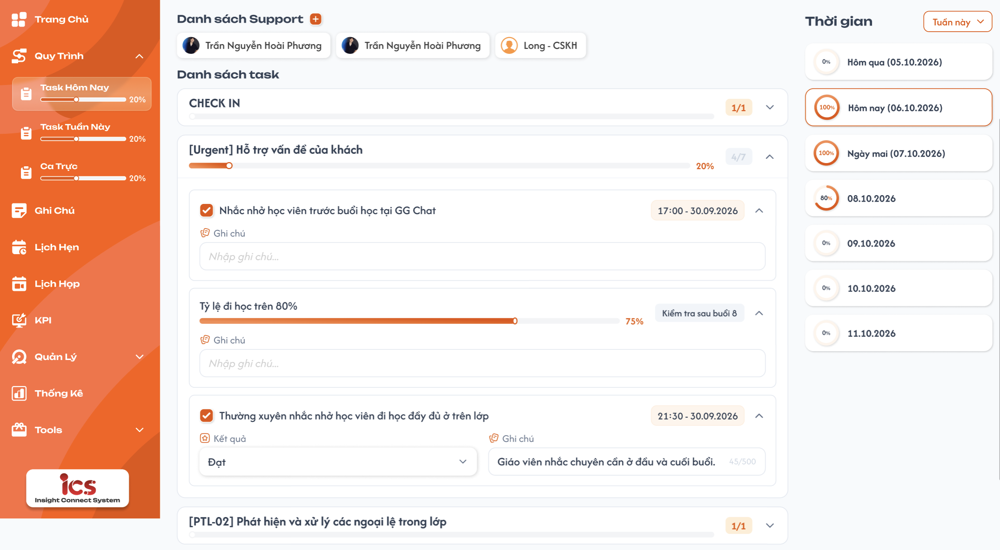
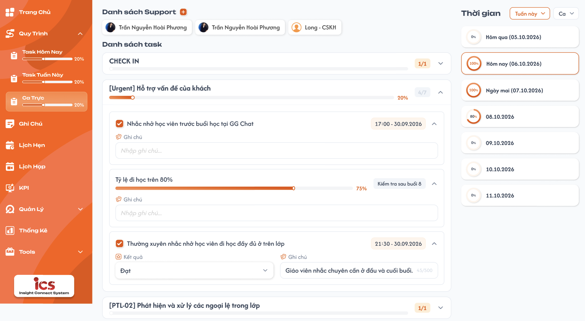
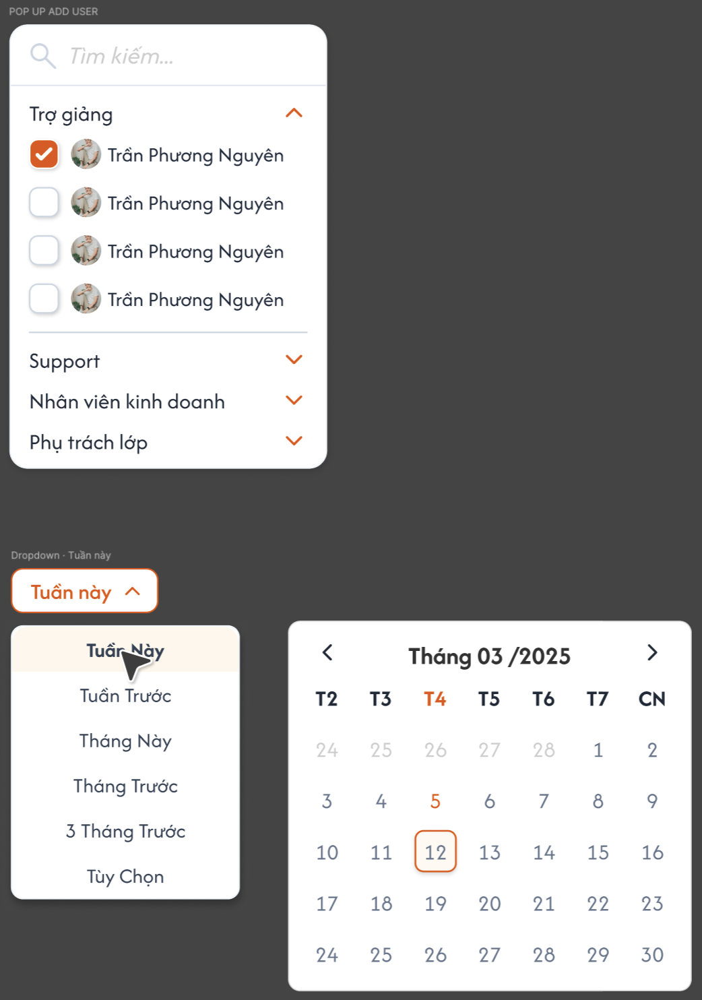

# [Phụ trách lớp] Quy trình — Task Hôm Nay, Task Tuần Này, Task Tháng Này, Ca Trực, Task Khác

Menu **Quy Trình** của role `Class Handler` (Phụ trách lớp) gồm 5 menu con `Task Hôm Nay`, `Task Tuần Này`, `Task Tháng Này`, `Ca Trực`, `Task Khác`, tương ứng 5 Loại quy trình `Ngày`, `Tuần`, `Tháng`, `Ca trực`, `Khác` do Admin define tại [Define quy trình](../../process_definition_requirement/process_definition_requirements.md). Phụ trách lớp **chỉ chọn** trong các quy trình đã define (Công khai) để tick, không tạo/sửa quy trình tại đây. Quy trình **không chia theo trung tâm**. Cách hiển thị và ghi kết quả từng Action theo [Action Board](../../action_board_requirement/action_board_requirements.md). Số liệu trong ảnh là dữ liệu mẫu.

## 1. UI

### Trang 1: SP-TASK-010001, SP-TASK-020001, SP-TASK-030001 — Task Hôm Nay / Task Tuần Này / Task Tháng Này / Ca Trực




**Mô tả:**

- Phụ trách lớp chọn một quy trình đã define ở dropdown `Quy trình`, sau đó tick/nhập kết quả từng Action, ghi chú, theo dõi tiến độ theo từng kỳ: Task Hôm Nay theo ngày, Task Tuần Này theo tuần, Task Tháng Này theo tháng, Ca Trực theo ngày + ca.
- Phụ trách lớp thêm người vào `Danh sách Support` để xem người đó đã làm quy trình đến đâu.
- Bố cục: menu con kèm thanh `%` ở sidebar; `Danh sách Support` (chip người + nút `+`); `Danh sách task` kèm dropdown `Quy trình` cùng hàng (Category → Action Item); cột `Thời gian` bên phải (bộ lọc khoảng thời gian + danh sách kỳ kèm vòng `%`).
- Ảnh hiện tại là bản cũ: chưa có `Task Tháng Này`, `Task Khác` và dropdown `Quy trình`. Requirement này là nguồn đúng. Ca Trực xem thêm Trang 3.

**Điểm cần lưu ý:**

- `A01.01` **Sidebar**: Menu `Quy Trình` gồm 5 menu con `Task Hôm Nay`, `Task Tuần Này`, `Task Tháng Này`, `Ca Trực`, `Task Khác`, mỗi menu có thanh `%`.
- `A01.02` **Dropdown `Quy trình`**: Cùng hàng tiêu đề `Danh sách task`. Chọn 1 trong các quy trình `Công khai` đúng loại của menu con. Mặc định quy trình Công khai đứng đầu danh sách Define của loại tương ứng.
- `A01.03` **`Danh sách task`**: Category và Action Item của quy trình đang chọn.
- `A01.04` **Cột `Thời gian`**: Dropdown khoảng thời gian và danh sách kỳ kèm vòng `%`.

**a. Nguồn task theo menu con**

- `A01.05` **`Task Hôm Nay`**: Loại quy trình: `Ngày`; Đơn vị kỳ: Ngày; Mặc định bộ lọc Thời gian: `Tuần Này` → 7 dòng ngày (Thứ 2 – Chủ Nhật); `%` ở sidebar: Tiến độ **hôm nay**
- `A01.06` **`Task Tuần Này`**: Loại quy trình: `Tuần`; Đơn vị kỳ: Tuần (Thứ 2 – Chủ Nhật); Mặc định bộ lọc Thời gian: `Tuần Này` → 1 dòng tuần; `%` ở sidebar: Tiến độ **tuần này**
- `A01.07` **`Task Tháng Này`**: Loại quy trình: `Tháng`; Đơn vị kỳ: Tháng (ngày 1 – ngày cuối tháng); Mặc định bộ lọc Thời gian: `Tháng Này` → 1 dòng tháng; `%` ở sidebar: Tiến độ **tháng này**
- `A01.08` **`Ca Trực`**: Loại quy trình: `Ca trực`; Đơn vị kỳ: Ngày + Ca; Mặc định bộ lọc Thời gian: `Tuần Này` → 7 dòng ngày; Ca = ca hiện tại; `%` ở sidebar: Tiến độ **hôm nay, ca hiện tại**
- `A01.09` **`Task Khác`**: Loại quy trình: `Khác`; Đơn vị kỳ: Không chia kỳ (Trang 2); Mặc định bộ lọc Thời gian: Không có cột Thời gian; `%` ở sidebar: Tiến độ **hiện tại**

- Quy trình không gắn trung tâm: không có bộ lọc `Trung tâm`; mọi Phụ trách lớp thấy cùng một tập quy trình.
- Mỗi kỳ là một lượt làm task độc lập: kết quả lưu theo `Action Item + người làm + kỳ` (Ca Trực thêm `ca`). Sang kỳ mới thì task bắt đầu trống, không kế thừa kết quả kỳ trước.
- Quy trình chuyển `Vô hiệu`: biến mất khỏi dropdown; nếu kỳ đã có kết quả thì vẫn xem được kết quả cũ ở chế độ chỉ xem (mục b).

**b. Dropdown Quy trình**

- Liệt kê toàn bộ quy trình `Công khai` có Loại quy trình đúng menu con, theo thứ tự ở danh sách [Define quy trình](../../process_definition_requirement/process_definition_requirements.md) khi lọc theo loại đó. Mặc định chọn quy trình đứng đầu danh sách Define của loại tương ứng.
- Chọn 1 quy trình mỗi lần. Đổi quy trình → tải lại `Danh sách task`, vòng `%` từng kỳ theo quy trình mới; giữ nguyên chip người và khoảng thời gian đang chọn.
- Quy trình đã chọn được lưu theo `Phụ trách lớp + menu con`, giữ lại khi đổi kỳ, đổi chip, đổi menu, tải lại trang. Chưa từng chọn, hoặc quy trình đã chọn không còn Công khai → về quy trình mặc định.
- `Danh sách task` gồm Category của các Package đang Enable của quy trình đang chọn, giữ thứ tự Package → Category → Action theo định nghĩa.
- Chỉ có 1 quy trình Công khai → dropdown vẫn hiển thị, chỉ có 1 lựa chọn. Không có quy trình Công khai nào → dropdown rỗng, `Danh sách task` hiển thị `Chưa có quy trình được define`, `%` là `0%`.
- Quy trình đã `Vô hiệu` nhưng có kết quả trong kỳ đang xem: hiển thị thêm trong dropdown với nhãn `Vô hiệu`, chỉ xem, không cập nhật.

**c. Danh sách Support**

- Chip gồm avatar + tên. Mặc định chọn chip của chính người đang đăng nhập (đứng đầu danh sách).
- Bấm chip người khác → hiển thị tiến độ của người đó trên quy trình đang chọn ở dropdown (Task Khác: các quy trình người đó đã chọn); chip đang chọn viền cam. Xem người khác là **chỉ xem**: ẩn/disable checkbox, dropdown Kết quả, thanh kéo tiến độ và ô Ghi chú; dropdown `Quy trình` vẫn đổi được để xem.
- Hover chip người khác hiện nút `x` để gỡ khỏi danh sách; chip của chính mình không có `x`. Gỡ chip đang chọn → quay về chip của mình.
- Danh sách lưu riêng theo từng Phụ trách lớp, giữ lại khi tải lại trang và dùng chung cho cả 5 menu con.
- Nút `+` mở **Popup thêm người** (Trang 4).

**d. Danh sách task**

- Mỗi khối Category: tên Category, `x/y` = số Action đã hoàn thành / tổng Action tham gia tiến độ, thanh tiến độ và `%` của Category. Bấm mũi tên để mở/thu gọn; mở/thu gọn không lưu dữ liệu.
- Mỗi Action Item hiển thị control kết quả theo Loại task:

- `A01.10` **`Kiểm tra`**: Control kết quả: Checkbox trước tên Action (hoàn thành / chưa); Tham gia tiến độ: Có: tick = 100%
- `A01.11` **`Đánh giá`**: Control kết quả: Dropdown `Kết quả` theo Loại đánh giá đã cấu hình (VD `Đạt` / `Không đạt`); Tham gia tiến độ: Có: `Đạt` = 100%, `Không đạt` = 0% (thang 5 mức theo Action Board)
- `A01.12` **`Task tiến trình`**: Control kết quả: Thanh tiến độ kéo được 0–100%, hiển thị `%` bên phải; Tham gia tiến độ: Có: theo `%` đã kéo
- `A01.13` **`Task nhập liệu`**: Control kết quả: Ô nhập nội dung theo mô tả cấu hình; Tham gia tiến độ: Không
- `A01.14` **`Hướng dẫn`, `Media`**: Control kết quả: Xem tài liệu / video đã định nghĩa; Tham gia tiến độ: Không
- `A01.15` **`Deadline`, `Xác thực`, `Log`**: Control kết quả: Hiển thị field theo Action Board; Tham gia tiến độ: Không

- Mọi Action có ô `Ghi chú` (tối đa 500 ký tự, có bộ đếm `/500`), lưu theo đúng Action + người làm + kỳ (+ ca).
- Nhãn thời gian bên phải Action (VD `17:00 - 30.09.2026`) là **thời điểm cập nhật kết quả gần nhất**, dạng `HH:mm - dd.MM.yyyy`; chưa có kết quả thì không hiển thị. Action có cấu hình mốc/thời hạn hiển thị thêm nhãn xám theo cấu hình (VD `Kiểm tra sau buổi 8`).
- Tiến độ Category/kỳ = trung bình đóng góp của các Action tham gia tiến độ; Action chưa có kết quả đóng góp 0%. Hiển thị số nguyên `%`.

**e. Cột Thời gian**

- Dropdown khoảng thời gian: `Tuần Này`, `Tuần Trước`, `Tháng Này`, `Tháng Trước`, `3 Tháng Trước`, `Tùy Chọn` (chọn khoảng ngày trên lịch, gồm cả 2 ngày biên). Mặc định theo bảng mục a.
- Danh sách kỳ có giao với khoảng đã chọn, mỗi dòng có vòng `%` tiến độ của kỳ đó trên quy trình đang chọn:
  - `Task Hôm Nay`, `Ca Trực`: mỗi ngày một dòng; hôm qua / hôm nay / ngày mai ghi `Hôm qua (dd.MM.yyyy)`, `Hôm nay (dd.MM.yyyy)`, `Ngày mai (dd.MM.yyyy)`, các ngày khác ghi `dd.MM.yyyy`.
  - `Task Tuần Này`: mỗi tuần một dòng, ghi `Tuần này`, `Tuần trước` hoặc `dd.MM.yyyy - dd.MM.yyyy`.
  - `Task Tháng Này`: mỗi tháng một dòng, ghi `Tháng này`, `Tháng trước` hoặc `MM.yyyy`.
- Mặc định chọn kỳ hiện tại (viền cam). Bấm một kỳ → `Danh sách task` hiển thị task và kết quả của kỳ đó.
- Kỳ hiện tại và kỳ đã qua được cập nhật kết quả (cập nhật bù); kỳ tương lai chỉ xem.

**f. `%` ở sidebar**

- Tính theo **quy trình đang chọn** ở dropdown của menu con đó, kỳ hiện tại, của user đang đăng nhập: Task Hôm Nay = hôm nay; Task Tuần Này = tuần này; Task Tháng Này = tháng này; Ca Trực = hôm nay, ca hiện tại.
- Đổi quy trình ở dropdown → `%` sidebar của menu đó đổi theo ngay.
- Task Khác: tiến độ chung của các quy trình user đã chọn.
- Không có quy trình → `0%`.

### Trang 2: SP-TASK-010000, SP-TASK-020000, SP-TASK-030000 — Task Khác và Popup chọn quy trình


**Mô tả:**

- `Task Khác` dùng quy trình loại `Khác`. Khác 3 menu con còn lại: Phụ trách lớp tự **chọn nhiều quy trình** cần làm bằng nút `Chọn quy trình`; không chia kỳ nên không có cột Thời gian. Chưa có ảnh UI.

**Điểm cần lưu ý:**

- `A02.01` **Nút `Chọn quy trình`**: Thay vị trí dropdown `Quy trình`, mở Popup chọn quy trình. Ẩn khi đang xem chip người khác.
- `A02.02` **`Danh sách task`**: Các quy trình đã chọn, mỗi quy trình là một khối có tiêu đề tên quy trình (mở/thu gọn), bên trong là Category → Action Item như Trang 1. Xếp theo thứ tự chọn.
- `A02.03` **Popup — Ô `Tìm kiếm`**: Tìm theo tên quy trình, không phân biệt hoa thường.
- `A02.04` **Popup — Danh sách**: Chỉ quy trình `Công khai` loại `Khác`. Mỗi dòng: checkbox, tên, mô tả; quy trình đã chọn hiển thị sẵn trạng thái tick. Chọn nhiều.
- `A02.05` **Popup — `Hủy` / `Xác nhận`**: Hủy đóng popup, không đổi lựa chọn. Xác nhận lưu toàn bộ lựa chọn và tải lại Danh sách task.

- Không chia kỳ: kết quả lưu theo `Action Item + người làm`, một lượt duy nhất, giữ nguyên cho tới khi người làm sửa.
- Lựa chọn lưu riêng theo Phụ trách lớp, giữ lại khi tải lại trang. Chưa chọn quy trình nào → `Chưa chọn quy trình` kèm nút `Chọn quy trình`, `%` là `0%`.
- Bỏ chọn một quy trình: ẩn khỏi Danh sách task, kết quả không bị xóa; chọn lại thì kết quả cũ hiện lại. Quy trình mới chọn thêm vào cuối.
- Không có quy trình Công khai loại Khác → popup hiển thị `Chưa có quy trình được define`.
- Quy trình chuyển `Vô hiệu`: tự bỏ khỏi popup; nếu đã có kết quả thì vẫn hiện trong Danh sách task với nhãn `Vô hiệu`, chỉ xem.
- Backend kiểm tra lúc lưu lựa chọn: quy trình phải còn `Công khai` và đúng loại `Khác`.
- Lưu thành công không cần Toast; lỗi có Toast `Có Lỗi Xảy Ra`, giữ lựa chọn cũ.

### Trang 3: SP-TASK-030000 — Ca Trực




**Mô tả:**

- Giống Trang 1, dùng quy trình loại `Ca trực` (dropdown `Quy trình`); kỳ hiển thị theo từng ngày như Task Hôm Nay; cột `Thời gian` có thêm dropdown `Ca` cạnh dropdown khoảng thời gian.

**Điểm cần lưu ý:**

- `A03.01` **Dropdown `Quy trình`**: Quy trình Công khai loại `Ca trực`; mặc định quy trình đứng đầu danh sách Define loại Ca trực.
- `A03.02` **Dropdown khoảng thời gian**: Như Trang 1; mặc định `Tuần Này` (7 dòng ngày).
- `A03.03` **Dropdown `Ca`**: Chọn 1 trong `Sáng`, `Chiều`, `Tối`; mặc định ca của thời điểm hiện tại.

- `A03.04` **`Sáng`**: Khung giờ (Asia/Saigon, phủ kín 24h): 00:00 – 11:59
- `A03.05` **`Chiều`**: Khung giờ (Asia/Saigon, phủ kín 24h): 12:00 – 17:59
- `A03.06` **`Tối`**: Khung giờ (Asia/Saigon, phủ kín 24h): 18:00 – 23:59

- Quy trình ca trực hiển thị cho **mọi ngày và mọi ca**; ngày/ca không trực thì user không đánh kết quả, không có ràng buộc lịch trực.
- Kết quả lưu theo `Action Item + người làm + ngày + ca`; mỗi ca là một lượt độc lập.
- Đổi ca → tải lại Danh sách task và vòng `%` từng ngày theo ca đã chọn.
- `%` ở sidebar của Ca Trực = tiến độ hôm nay, ca hiện tại, của quy trình đang chọn.
- Ảnh là bản cũ, chưa có dropdown `Quy trình`. Testcase xem Case 10a.

### Trang 4: SP-TASK-030010 — Popup thêm người vào Danh sách Support




**Mô tả:**

- Mở từ nút `+` cạnh `Danh sách Support`; chọn người để theo dõi tiến độ quy trình. Ảnh cũng gồm dropdown Thời gian và lịch `Tùy Chọn` của cột Thời gian.

**Điểm cần lưu ý:**

- `A04.01` **Ô `Tìm kiếm`**: Tìm theo tên hoặc email, không phân biệt hoa thường, tìm trên tất cả nhóm.
- `A04.02` **Nhóm người dùng**: Chia theo role: `Trợ giảng`, `Support`, `Nhân viên kinh doanh`, `Phụ trách lớp`; mỗi nhóm mở/thu gọn được. Chỉ hiển thị tài khoản đang hoạt động.
- `A04.03` **Checkbox**: Chọn nhiều; người đã có trong danh sách hiển thị sẵn trạng thái đã tick.

- Tick → thêm vào danh sách; bỏ tick → gỡ khỏi danh sách. Lưu ngay khi tick/bỏ tick, cập nhật chip, không có nút xác nhận.
- Không hiển thị chính người đang đăng nhập trong popup.
- Thêm/gỡ người chỉ thay đổi danh sách theo dõi; không thay đổi task, lựa chọn quy trình hoặc kết quả của người đó.

---

## 2. Yêu cầu

### 2.1. Flow chính

**Flow 1 / REQ01 / REQ03 / REQ04 / REQ07: Task Hôm Nay / Tuần Này / Tháng Này / Ca Trực**

```
Phụ trách lớp mở Task Hôm Nay / Task Tuần Này / Task Tháng Này / Ca Trực
      → BE trả danh sách quy trình Công khai đúng loại (Ngày / Tuần / Tháng / Ca trực) + quy trình user đã chọn
      → FE chọn quy trình đã lưu; chưa có hoặc không còn Công khai → quy trình đứng đầu danh sách Define của loại đó
      → Mặc định: chip của mình; Thời gian = Tuần Này (Ngày, Ca trực: 7 ngày; Tuần: 1 tuần) / Tháng Này (Tháng: 1 tháng); kỳ hiện tại; Ca Trực: ca hiện tại
      → BE trả Category/Action của Package Enable + kết quả của user theo kỳ → FE hiển thị Danh sách task và cột Thời gian
      → (tùy chọn) Đổi dropdown Quy trình → BE lưu lựa chọn → FE tải lại task, vòng % và % sidebar theo quy trình mới
      → User tick / chọn Kết quả / kéo tiến độ / nhập Ghi chú → FE gọi API lưu kết quả (Action + user + kỳ [+ ca])
      → BE kiểm tra quyền, kỳ không ở tương lai, quy trình còn Công khai → lưu, ghi thời điểm cập nhật, tính lại tiến độ
      → FE cập nhật nhãn thời gian, tiến độ Category, vòng % của kỳ và % ở sidebar
                    ↓ (lưu thất bại)
              Khôi phục giá trị cũ, Toast lỗi
```

**Flow 2 / REQ02 / REQ06: Xem / cập nhật bù kỳ khác**

```
Đổi dropdown Thời gian (hoặc Tùy Chọn trên lịch) / đổi Ca → FE tải danh sách kỳ + % từng kỳ của quy trình đang chọn
      → Bấm một kỳ → FE tải task + kết quả của kỳ đó
                    ↓ (kỳ đã qua)              ↓ (kỳ tương lai)
              Cho cập nhật bù               Chỉ xem
```

**Flow 3 / REQ08: Task Khác**

```
Mở Task Khác → FE hiển thị các quy trình user đã chọn + kết quả (không chia kỳ)
      → Bấm Chọn quy trình → BE trả quy trình Công khai loại Khác + lựa chọn hiện tại
      → Tìm, tick / bỏ tick → Xác nhận → BE kiểm tra còn Công khai, đúng loại → lưu lựa chọn
      → FE tải lại Danh sách task và % sidebar → user tick kết quả như Flow 1 (không có kỳ)
                    ↓ (lỗi / quy trình không hợp lệ)
              Giữ lựa chọn cũ, Toast Có Lỗi Xảy Ra
```

**Flow 4 / REQ05: Theo dõi người khác**

```
Bấm + → Popup thêm người → tìm, tick người → BE lưu danh sách theo dõi → hiển thị chip
      → Bấm chip → FE tải tiến độ của người đó theo quy trình đang chọn (Task Khác: quy trình người đó đã chọn), chỉ xem
      → Hover chip → bấm x → gỡ khỏi danh sách (chip đang chọn bị gỡ thì quay về chip của mình)
```

### 2.2. Ngoại lệ

- **EX01:** Không có quy trình Công khai đúng loại → `Chưa có quy trình được define`; Task Khác chưa chọn quy trình → `Chưa chọn quy trình`; vòng `%` và `%` sidebar là `0%`.
- **EX02:** Cập nhật kết quả kỳ tương lai, kết quả của người khác, hoặc quy trình đã `Vô hiệu` (kể cả gửi request trực tiếp) → backend từ chối, giữ kết quả cũ.
- **EX03:** Ghi chú vượt 500 ký tự → không lưu, báo lỗi tại ô.
- **EX04:** Lưu kết quả lỗi / mất mạng → khôi phục giá trị đã lưu, Toast `Có Lỗi Xảy Ra`, không hiển thị dữ liệu optimistic.
- **EX05:** Ở Task Khác chọn quy trình Nháp/Vô hiệu, sai loại, hoặc vừa bị Vô hiệu sau khi mở popup; ở 3 menu còn lại gửi kết quả cho quy trình sai loại → backend từ chối, giữ dữ liệu cũ.
- **EX06:** Người trong Danh sách Support bị khóa tài khoản → ẩn khỏi danh sách; dữ liệu theo dõi không bị xóa.
- **EX07:** Đổi quy trình / kỳ / chip / menu con liên tục, response cũ về sau → bỏ qua response cũ.

### 2.3. Yêu cầu khác

| Mã | Tên yêu cầu | Mô tả |
|---|---|---|
| REQ01 | Nguồn task | Task Hôm Nay = loại `Ngày`, Task Tuần Này = `Tuần`, Task Tháng Này = `Tháng`, Ca Trực = `Ca trực`, Task Khác = `Khác`; chỉ quy trình `Công khai`, Package Enable. Không chia theo trung tâm. |
| REQ02 | Kết quả theo kỳ | Kết quả lưu theo `Action Item + người làm + kỳ` (ngày; tuần bắt đầu Thứ 2; tháng dương lịch; Ca Trực = ngày + ca); mỗi kỳ độc lập, không kế thừa. Task Khác một lượt duy nhất theo `Action Item + người làm`. Kỳ hiện tại và đã qua được cập nhật; kỳ tương lai chỉ xem. |
| REQ03 | Control theo Loại task | Kiểm tra: checkbox; Đánh giá: dropdown Kết quả; Task tiến trình: thanh kéo %; Task nhập liệu: ô nhập; các loại khác hiển thị theo Action Board. Ghi chú tối đa 500 ký tự. Nhãn thời gian = thời điểm cập nhật gần nhất. |
| REQ04 | Tiến độ | Chỉ tính Kiểm tra, Đánh giá, Task tiến trình; Category `x/y` và `%`; vòng `%` mỗi kỳ theo quy trình đang chọn. `%` sidebar theo quy trình đang chọn: hôm nay (Ngày), tuần này (Tuần), tháng này (Tháng), hôm nay ca hiện tại (Ca trực); tiến độ chung các quy trình đã chọn (Khác). Tính lại sau mỗi lần lưu. |
| REQ05 | Danh sách Support | Mặc định chọn chính mình; lưu theo Phụ trách lớp, dùng chung 5 menu con; thêm/gỡ bằng popup checkbox chọn nhiều (tìm theo tên/email) hoặc nút `x` khi hover chip; bấm chip xem tiến độ người đó ở chế độ chỉ xem. |
| REQ06 | Cột Thời gian | Dropdown Tuần Này / Tuần Trước / Tháng Này / Tháng Trước / 3 Tháng Trước / Tùy Chọn. Mặc định: Task Hôm Nay và Ca Trực `Tuần Này` (7 ngày), Task Tuần Này `Tuần Này` (1 tuần), Task Tháng Này `Tháng Này` (1 tháng). Ca Trực thêm dropdown Ca (Sáng 00:00–11:59 / Chiều 12:00–17:59 / Tối 18:00–23:59, mặc định ca hiện tại). Danh sách kỳ kèm vòng `%`, mặc định chọn kỳ hiện tại. Task Khác không có cột Thời gian. |
| REQ07 | Dropdown Quy trình | Task Hôm Nay / Tuần Này / Tháng Này / Ca Trực: chọn 1 trong các quy trình Công khai đúng loại, theo thứ tự danh sách Define của loại đó; mặc định quy trình đứng đầu; lựa chọn lưu theo user + menu con, quy trình không còn Công khai thì về mặc định. |
| REQ08 | Chọn quy trình ở Task Khác | Popup chỉ liệt kê quy trình Công khai loại Khác; chọn nhiều, tìm theo tên, Hủy / Xác nhận; lưu theo Phụ trách lớp. Bỏ chọn không xóa kết quả. Không tạo/sửa quy trình tại đây. |
| REQ09 | Phản hồi | Lưu thành công không cần Toast (cập nhật tại chỗ); lỗi có Toast `Có Lỗi Xảy Ra`. |

### 2.4. Ràng buộc

#### Quyền

| Role | Xem task của mình | Đổi dropdown Quy trình / chọn quy trình Task Khác | Cập nhật kết quả (kỳ hiện tại, cập nhật bù) | Thêm/gỡ người theo dõi | Xem quy trình người khác |
|---|:---:|:---:|:---:|:---:|:---:|
| Class Handler | ✅ | ✅ | ✅ | ✅ | ✅ (chỉ xem, người trong danh sách của mình) |
| Role khác | ❌ (menu riêng) | ❌ | ❌ | ❌ | ❌ |

#### Ràng buộc khác

- Backend xác định người làm từ token khi lưu kết quả và lựa chọn quy trình Task Khác; không nhận `owner_id` từ client để ghi.
- Xem kết quả người khác chỉ khi người đó nằm trong Danh sách Support của user; kiểm tra ở backend.
- Kỳ hiện tại và ca hiện tại tính theo giờ máy chủ (Asia/Saigon); tuần bắt đầu Thứ 2; tháng theo dương lịch.
- Mỗi `Action + người làm + kỳ` (Ca Trực thêm `ca`; Task Khác: `Action + người làm`) chỉ có tối đa một bản ghi kết quả; request lặp không tạo bản ghi trùng. Mỗi lần lưu ghi lại người và thời điểm cập nhật.
- Định nghĩa quy trình đã Công khai bị khóa nên không có trường hợp đổi Loại task giữa chừng. Quy trình nhân bản ở Define là quy trình mới, không kế thừa kết quả hay lựa chọn của quy trình gốc.

---

---

## 3. Testcase

### Feature: [Phụ trách lớp] Quy trình — Task Hôm Nay, Task Tuần Này, Task Tháng Này, Ca Trực, Task Khác

| Tên testcase | Priority | Scenario | Role | Pre-condition | Given/When/Then | Expected Result |
|---|---|---|---|---|---|---|
| Case 1: Dropdown quy trình đúng loại, mặc định quy trình đầu tiên | High · Smoke | Flow 1 / REQ01 / REQ07 | Class Handler | Loại Ngày có D1, D2 Công khai (D1 đứng trước), D3 Nháp, D4 Vô hiệu; loại Tuần có W1 | **Given** H đăng nhập<br>**When** mở Task Hôm Nay, mở dropdown Quy trình<br>**Then** mặc định D1 (đứng đầu danh sách Define loại Ngày); dropdown chỉ có D1, D2 | - Không có D3, D4, W1<br>- Package Disable của D1 không hiện; thứ tự theo định nghĩa<br>- Không có bộ lọc Trung tâm |
| Case 2: Đổi quy trình | High · Smoke | Flow 1 / REQ07 | Class Handler | D1 hôm nay 20%, D2 hôm nay 60% | **Given** đang xem D1, Hôm nay<br>**When** chọn D2<br>**Then** Danh sách task và vòng % hiển thị theo D2 | - Vòng Hôm nay = 60%, `%` sidebar Task Hôm Nay = 60%<br>- Giữ kỳ, chip và khoảng thời gian đang chọn<br>- Tải lại trang vẫn là D2; D2 chuyển Vô hiệu → về D1 |
| Case 3: Làm task theo Loại task | High · Smoke | Flow 1 / REQ03 | Class Handler | Category có 1 Kiểm tra, 1 Đánh giá (Đạt/Không đạt), 1 Task tiến trình, 1 Hướng dẫn | **Given** hôm nay chưa có kết quả<br>**When** lúc 17:00 tick Kiểm tra, chọn Đạt, kéo tiến độ 50%, nhập Ghi chú<br>**Then** lưu từng kết quả | - Tiến độ Category = (100 + 100 + 50) / 3 = 83%, `x/y` = 2/3<br>- Hướng dẫn không tính tiến độ<br>- Nhãn `17:00 - dd.MM.yyyy` theo lần cập nhật gần nhất |
| Case 4: Mặc định bộ lọc Thời gian theo menu | High | REQ06 | Class Handler | Hôm nay 06.10.2026 (Thứ 3) | **Given** mở lần lượt 3 menu con<br>**When** xem cột Thời gian<br>**Then** đúng mặc định | - Task Hôm Nay: `Tuần Này`, 7 dòng 05.10–11.10, nhãn Hôm qua/Hôm nay/Ngày mai đúng, chọn Hôm nay<br>- Task Tuần Này: `Tuần Này`, 1 dòng `Tuần này`<br>- Task Tháng Này: `Tháng Này`, 1 dòng `Tháng này` |
| Case 5: Đổi khoảng thời gian | Medium | Flow 2 / REQ06 | Class Handler | Hôm nay 06.10.2026 | **Given** ở Task Tuần Này chọn `Tháng Này`; ở Task Tháng Này chọn `3 Tháng Trước`; ở Task Hôm Nay chọn Tùy Chọn 01.10–03.10<br>**When** xem danh sách kỳ<br>**Then** đúng kỳ giao với khoảng | - Tuần: các tuần giao tháng 10.2026<br>- Tháng: `Tháng này`, `Tháng trước`, `08.2026`<br>- Ngày: 3 dòng 01.10–03.10 |
| Case 6: % sidebar theo quy trình đang chọn | High | REQ04 | Class Handler | Quy trình đang chọn: Ngày hôm nay 20%, Tuần tuần này 40%, Tháng tháng này 10%, Ca trực hôm nay ca Chiều 30%; bây giờ 14:00 | **Given** mở Quy Trình<br>**When** xem sidebar<br>**Then** Task Hôm Nay 20%, Task Tuần Này 40%, Task Tháng Này 10%, Ca Trực 30% | - Cập nhật kết quả thì % sidebar và vòng % đổi ngay |
| Case 7: Kỳ mới không kế thừa, cập nhật bù | High | REQ02 | Class Handler | Hôm qua làm được 50%; tháng trước làm 30% | **Given** sang ngày mới / tháng mới<br>**When** mở Task Hôm Nay, bấm Hôm qua và tick thêm task; mở Task Tháng Này<br>**Then** hôm nay trống 0%; hôm qua lưu được kết quả bù; tháng này trống | - Kết quả hôm nay không đổi<br>- Tháng trước vẫn 30%, cập nhật bù được |
| Case 8: Chặn cập nhật kỳ tương lai | High | EX02 / REQ02 | Class Handler | Đang ở Tuần Này | **Given** chọn Ngày mai<br>**When** thử tick hoặc gửi request trực tiếp<br>**Then** chỉ xem, backend từ chối | - Không tạo kết quả cho ngày mai |
| Case 9: Quy trình chuyển Vô hiệu, không có quy trình | Medium | REQ01 / EX01 / EX02 | Class Handler | D1 có kết quả hôm qua, chuyển Vô hiệu hôm nay; loại Tháng chưa có quy trình Công khai | **Given** mở Task Hôm Nay, xem hôm nay rồi hôm qua; mở Task Tháng Này<br>**When** xem dropdown<br>**Then** hôm nay không có D1, mặc định D2; hôm qua có D1 nhãn `Vô hiệu`, chỉ xem; Task Tháng Này hiển thị `Chưa có quy trình được define` | - Không cập nhật được kết quả D1<br>- Sidebar Task Tháng Này 0%, không NaN |
| Case 10: Lỗi lưu, ghi chú quá dài | Medium | EX03 / EX04 | Class Handler | API lưu lỗi | **Given** tick checkbox khi API lỗi; nhập Ghi chú 501 ký tự<br>**When** lưu<br>**Then** khôi phục giá trị cũ + Toast `Có Lỗi Xảy Ra`; ghi chú bị chặn | - Tiến độ không đổi |
| Case 10a: Ca Trực theo ngày và ca | High · Smoke | Flow 1 / REQ02 / REQ06 / REQ07 | Class Handler | Loại Ca trực có C1, C2 Công khai; bây giờ 14:00 ngày 06.10.2026 | **Given** mở Ca Trực<br>**When** xem mặc định; tick task; đổi Ca sang Sáng<br>**Then** mặc định C1, Tuần Này 7 dòng ngày, chọn Hôm nay, Ca Chiều; kết quả lưu cho ca Chiều; ca Sáng hiển thị kết quả riêng | - Mở lúc 11:59 mặc định Sáng, 12:00 Chiều, 18:00 Tối, 23:30 Tối<br>- Mọi ngày, mọi ca đều có task<br>- Sidebar Ca Trực = % hôm nay ca hiện tại của quy trình đang chọn |
| Case 11: Chọn quy trình ở Task Khác | High · Smoke | Flow 3 / REQ08 | Class Handler | Loại Khác có K1, K2 Công khai, K3 Nháp; loại Ngày có D1 | **Given** mở Task Khác, bấm `Chọn quy trình`<br>**When** tick K1, K2 và Xác nhận<br>**Then** Danh sách task hiện khối K1 rồi K2 | - Popup chỉ có K1, K2<br>- Không có cột Thời gian<br>- Tải lại vẫn giữ lựa chọn |
| Case 12: Không chia kỳ | High | REQ02 / REQ08 | Class Handler | Đã chọn K1, tick 2/4 Action hôm qua | **Given** hôm nay mở Task Khác<br>**When** tick thêm 1 Action<br>**Then** vẫn thấy 2 Action đã tick, tiến độ 3/4 | - Không reset theo ngày/tuần/tháng<br>- Sidebar Task Khác = 75% |
| Case 13: Bỏ chọn giữ kết quả, Hủy, rỗng | Medium | REQ08 / EX01 | Class Handler | Đã chọn K1 có kết quả | **Given** bỏ tick K1, Xác nhận; chọn lại K1; lần khác bấm Hủy<br>**When** xem Danh sách task<br>**Then** bỏ chọn ẩn K1; chọn lại hiện kết quả cũ; Hủy không đổi | - Bỏ chọn hết → `Chưa chọn quy trình`, `0%` |
| Case 14: Chặn chọn quy trình không hợp lệ | High | EX05 / Ràng buộc | Class Handler | K1 bị Vô hiệu sau khi H mở popup; có ID quy trình Nháp và quy trình loại Ngày | **Given** tick K1, Xác nhận; gửi request chọn quy trình Nháp / loại Ngày<br>**When** backend kiểm tra<br>**Then** từ chối | - Toast `Có Lỗi Xảy Ra`, giữ lựa chọn cũ |
| Case 15: Thêm/gỡ người theo dõi | High · Smoke | Flow 4 / REQ05 | Class Handler | Có Support S, Sale B | **Given** bấm `+`<br>**When** tìm `s`, tick S và B; sau đó hover chip B, bấm `x`<br>**Then** chỉ còn chip S | - Danh sách giữ khi tải lại, dùng chung 5 menu con<br>- Chip của mình không có `x`, không hiện trong popup<br>- Không đổi dữ liệu của S, B |
| Case 16: Xem tiến độ người khác | High | Flow 4 / REQ05 | Class Handler | S trong danh sách; S có kết quả D1 hôm nay; S chọn K1 ở Task Khác | **Given** ở Task Hôm Nay bấm chip S, đổi dropdown sang D2; mở Task Khác<br>**When** tải dữ liệu<br>**Then** hiển thị tiến độ của S theo quy trình đang chọn; Task Khác hiện K1 của S | - Mọi control kết quả chỉ xem, ẩn nút Chọn quy trình<br>- Dropdown Quy trình vẫn đổi được<br>- Gỡ chip S đang chọn thì quay về chip của mình |
| Case 17: Chặn xem/sửa ngoài quyền | High | EX02 / Ràng buộc | Class Handler | K không có trong danh sách của H | **Given** H gọi API xem kết quả K, ghi kết quả hoặc đổi lựa chọn Task Khác với owner_id của S<br>**When** backend kiểm tra<br>**Then** từ chối | - Không trả dữ liệu K<br>- Không ghi kết quả, không đổi lựa chọn của S |

---

---

## 4. Câu hỏi cần xác nhận

- **Q01:** Task Khác đang giả định không chia kỳ, một lượt duy nhất, không reset.
- **Q02:** Ảnh UI cho `Task Tháng Này`, `Task Khác`, dropdown `Quy trình` (cả ở Ca Trực) và Popup chọn quy trình.
