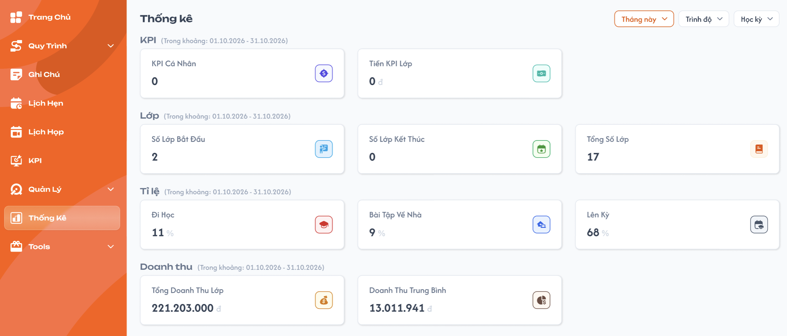
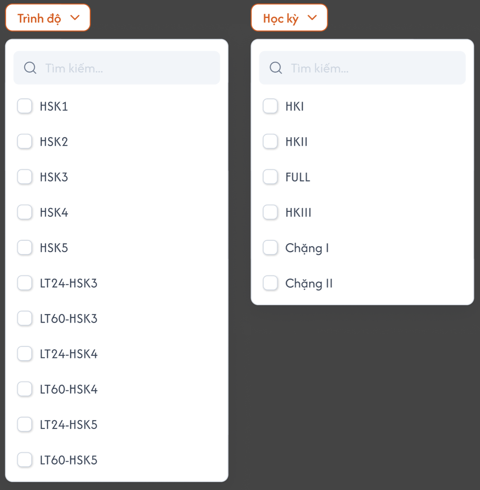

# [Phụ trách lớp] Thống kê

Menu **Thống Kê** của role `Class Handler` (Phụ trách lớp): tổng hợp KPI, số lớp, tỉ lệ học tập và doanh thu của **các lớp mà Phụ trách lớp được thêm vào** trong một khoảng thời gian. Công thức dùng chung với [Trang chủ Phụ trách lớp](../overview/overview.md), không tính lại khác. Số liệu trong ảnh là dữ liệu mẫu.

## 1. UI

### Trang 1: CH-TK-010000 — Thống kê




**Mô tả:**

- Phụ trách lớp xem nhanh kết quả của mình theo khoảng thời gian: KPI cá nhân, tiền KPI lớp, số lớp bắt đầu/kết thúc, tỉ lệ đi học/BTVN/lên kỳ và doanh thu lớp.
- Trang chỉ xem, gồm 4 nhóm thẻ: `KPI`, `Lớp`, `Tỉ lệ`, `Doanh thu`.

**Điểm cần lưu ý:**

**a. Bộ lọc**

- `A01.01` **`Trung tâm`**: Giá trị: Chọn nhiều, danh sách trung tâm (Phụ trách lớp không chọn trung tâm ở header); Mặc định: Tất cả
- `A01.02` **Thời gian (nút hiển thị giá trị đang chọn)**: Giá trị: Chọn 1: Tới hạn, Hôm nay, Hôm qua, Hôm nay và hôm qua, Tuần này, Tuần trước, Tháng này, Tháng trước, 3 tháng trước, Năm nay, Năm trước, Tùy chọn (phạm vi theo Trang chủ); Mặc định: `Tháng này`
- `A01.03` **`Trình độ`**: Giá trị: Chọn nhiều, có ô tìm kiếm; danh sách trình độ đã define (VD `HSK1`, `LT24-HSK3`); Mặc định: Tất cả
- `A01.04` **`Học kỳ`**: Giá trị: Chọn nhiều, có ô tìm kiếm; danh sách học kỳ đã define (VD `HKI`, `FULL`, `Chặng I`); Mặc định: Tất cả

- Trong cùng bộ lọc là `OR`, giữa các bộ lọc là `AND`. Giá trị đang chọn tô cam; chọn nhiều hiển thị số lượng đã chọn.
- Mọi thẻ đều tính theo bộ lọc đang chọn. `Trung tâm` và Thời gian áp cho tất cả thẻ (hoá đơn lọc theo trung tâm của hoá đơn). `Trình độ`, `Học kỳ` lọc theo giá trị đã lưu của lớp nên áp cho các thẻ dựa trên lớp, **không** áp được cho `KPI Cá Nhân` (hoá đơn không gắn lớp).
- Mỗi nhóm thẻ có dòng phụ `(Trong khoảng: dd.MM.yyyy - dd.MM.yyyy)` = khoảng ngày thực tế của bộ lọc Thời gian. `Tới hạn` hiển thị `(Trong khoảng: đến dd.MM.yyyy)`.
- Đổi bộ lọc → tính lại toàn bộ thẻ.

**b. Phạm vi lớp**

- **Lớp của PTL** = lớp có Phụ trách lớp đang đăng nhập trong danh sách Phụ trách lớp (Tab Trợ giảng & Phụ trách lớp), khớp `Trung tâm`, `Trình độ`, `Học kỳ`; không tính lớp trạng thái `Hủy`, `Xóa`.
- **Tập lớp trong khoảng** = Lớp của PTL **đang phụ trách trong khoảng Thời gian**: `Ngày bắt đầu chính thức ≤ Đến` và (`Ngày kết thúc chính thức ≥ Từ` hoặc chưa có ngày kết thúc chính thức). Lớp chưa có ngày bắt đầu chính thức không tính.

**c. Các thẻ**

- `A01.05` **KPI**: Thẻ: `KPI Cá Nhân`; Cách tính: Bằng thẻ `Số KPI` của Trang chủ: `Σ KPI PTL` trên các hoá đơn chưa xoá có Phụ trách lớp trong Người phụ trách, thuộc `Trung tâm` đã chọn, Ngày ghi nhận trong khoảng Thời gian; KPI dương cộng, âm trừ.; Hiển thị: Như Trang chủ (2 chữ số thập phân, bỏ phần `.00`)
- `A01.06` **KPI**: Thẻ: `Tiền KPI Lớp`; Cách tính: Tổng tiền thực tế các khoản KPI `Đã xác nhận` có người nhận là Phụ trách lớp đang đăng nhập, thuộc Lớp của PTL, `Ngày ghi nhận` của khoản KPI trong khoảng Thời gian.; Hiển thị: `x.xxx.xxx đ`
- `A01.07` **Lớp**: Thẻ: `Số Lớp Bắt Đầu`; Cách tính: Đếm Lớp của PTL có `Ngày bắt đầu chính thức` trong khoảng Thời gian.; Hiển thị: Số nguyên
- `A01.08` **Lớp**: Thẻ: `Số Lớp Kết Thúc`; Cách tính: Đếm Lớp của PTL có `Ngày kết thúc chính thức` trong khoảng Thời gian.; Hiển thị: Số nguyên
- `A01.09` **Lớp**: Thẻ: `Tổng Số Lớp`; Cách tính: Đếm Tập lớp trong khoảng = tổng số lớp đang phụ trách trong khoảng Thời gian, theo các bộ lọc đang chọn.; Hiển thị: Số nguyên
- `A01.10` **Tỉ lệ**: Thẻ: `Đi Học`; Cách tính: Công thức thẻ `Đi Học` của Trang chủ (trung bình theo học viên), chỉ tính các buổi của Tập lớp trong khoảng có ngày học trong khoảng Thời gian.; Hiển thị: `%`, 1 chữ số thập phân, bỏ `.0`
- `A01.11` **Tỉ lệ**: Thẻ: `Bài Tập Về Nhà`; Cách tính: Công thức thẻ `BTVN` của Trang chủ, chỉ tính BTVN được giao trong khoảng Thời gian của Tập lớp trong khoảng.; Hiển thị: `%`, 1 chữ số thập phân, bỏ `.0`
- `A01.12` **Tỉ lệ**: Thẻ: `Lên Kỳ`; Cách tính: Công thức thẻ `Lên Kỳ` của Trang chủ: trung bình tỷ lệ lên kỳ từng lớp (nhánh Hoàn thành / chưa hoàn thành) của Tập lớp trong khoảng, mỗi lớp trọng số bằng nhau.; Hiển thị: `%`, 1 chữ số thập phân, bỏ `.0`
- `A01.13` **Doanh thu**: Thẻ: `Tổng Doanh Thu Lớp`; Cách tính: Tổng học phí **đã đóng** của Tập lớp trong khoảng (theo học phí gắn lớp), ngày ghi nhận học phí trong khoảng Thời gian. Không tính học phí chưa thu.; Hiển thị: `x.xxx.xxx đ`
- `A01.14` **Doanh thu**: Thẻ: `Doanh Thu Trung Bình`; Cách tính: `Tổng Doanh Thu Lớp / Tổng Số Lớp`, làm tròn đến đồng. `Tổng Số Lớp = 0` → `0 đ`.; Hiển thị: `x.xxx.xxx đ`

- Ví dụ ảnh: `Tổng Doanh Thu Lớp` 221.203.000 đ / `Tổng Số Lớp` 17 = 13.011.941 đ.
- Không làm tròn trung gian; chỉ làm tròn kết quả cuối. Không chia 0, không NaN; không có dữ liệu hiển thị `0` / `0%` / `0 đ`.
- Đang tải hoặc tải lỗi không hiển thị `0` giả.

### Trang 2: Dropdown Trình độ và Học kỳ


**Mô tả:**

- Hai dropdown chọn nhiều của bộ lọc `Trình độ` và `Học kỳ`.

**Điểm cần lưu ý:**

- Ô `Tìm kiếm` không phân biệt hoa thường; áp dụng ngay khi tick/bỏ tick. Bỏ chọn hết = tất cả.
- Danh sách lấy động từ dữ liệu define, không hard-code theo ảnh.

---

---

## 2. Yêu cầu

### 2.1. Flow chính

**Flow 1: Xem thống kê**

```
Phụ trách lớp mở menu Thống Kê
      → FE gọi API với bộ lọc mặc định (Trung tâm = tất cả, Thời gian = Tháng này, Trình độ / Học kỳ = tất cả)
      → BE lấy Lớp của PTL, Tập lớp trong khoảng, hoá đơn và khoản KPI của PTL trong khoảng
      → BE tính 10 thẻ → FE hiển thị kèm dòng "(Trong khoảng: …)" cho từng nhóm
```

**Flow 2: Lọc**

```
Đổi Trung tâm / Thời gian / Trình độ / Học kỳ → BE tính lại các thẻ
      → KPI Cá Nhân theo Trung tâm + Thời gian; các thẻ còn lại theo cả 4 bộ lọc
                    ↓ (Tùy chọn: Từ ngày > Đến ngày)
              Báo lỗi tại bộ lọc, giữ điều kiện cũ
```

### 2.2. Ngoại lệ

- **EX01:** Phụ trách lớp chưa có lớp / bộ lọc không ra lớp → thẻ lớp, tỉ lệ, doanh thu, Tiền KPI Lớp hiển thị `0` / `0%` / `0 đ`; `KPI Cá Nhân` vẫn tính theo hoá đơn.
- **EX02:** Tải dữ liệu thất bại → vùng lỗi có `Thử lại`; không hiển thị `0` giả.
- **EX03:** Đổi bộ lọc liên tục, response cũ về sau → bỏ qua response cũ.
- **EX04:** Hoá đơn có tổng KPI = 0 hoặc lớp có mẫu số tỉ lệ = 0 → không chia 0, xử lý như Trang chủ.

### 2.3. Yêu cầu khác

| Mã | Tên yêu cầu | Mô tả |
|---|---|---|
| REQ01 | Phạm vi | Chỉ lớp có user trong danh sách Phụ trách lớp (loại Hủy, Xóa) và hoá đơn/khoản KPI của chính user; backend xác định user từ token. |
| REQ02 | Bộ lọc | Trung tâm (chọn nhiều, mặc định tất cả), Thời gian (chọn 1, mặc định Tháng này), Trình độ, Học kỳ (chọn nhiều, mặc định tất cả). Mọi thẻ theo bộ lọc; KPI Cá Nhân theo Trung tâm + Thời gian. |
| REQ03 | Thẻ KPI | KPI Cá Nhân = Số KPI của Trang chủ; Tiền KPI Lớp = KPI Đã xác nhận của user, ngày ghi nhận trong khoảng. |
| REQ04 | Thẻ Lớp | Số Lớp Bắt Đầu / Kết Thúc theo ngày bắt đầu / kết thúc chính thức trong khoảng; Tổng Số Lớp = lớp đang phụ trách trong khoảng. |
| REQ05 | Thẻ Tỉ lệ | Đi Học, BTVN, Lên Kỳ theo công thức Trang chủ, tính trên Tập lớp trong khoảng; Đi Học/BTVN chỉ lấy buổi/bài trong khoảng. |
| REQ06 | Thẻ Doanh thu | Tổng Doanh Thu Lớp = học phí đã đóng của Tập lớp trong khoảng; Doanh Thu Trung Bình = Tổng Doanh Thu Lớp / Tổng Số Lớp. |
| REQ07 | Dòng khoảng ngày | Mỗi nhóm thẻ hiển thị `(Trong khoảng: dd.MM.yyyy - dd.MM.yyyy)` theo bộ lọc Thời gian. |

### 2.4. Ràng buộc

#### Quyền

| Role | Xem Thống kê của mình | Xem số liệu Phụ trách lớp khác | Sửa dữ liệu |
|---|:---:|:---:|:---:|
| Class Handler | ✅ | ❌ | ❌ |
| Role khác | ❌ (menu riêng) | ❌ | ❌ |

#### Ràng buộc khác

- Backend kiểm tra role và quan hệ Phụ trách lớp–lớp; không nhận `handler_id` từ client.
- Số liệu cùng nguồn với Trang chủ, Hoá đơn, Tab KPI; cùng bộ lọc thì giá trị trùng khớp với Trang chủ.
- Ngày tính theo Asia/Saigon.

---

---

## 3. Testcase

### Feature: [Phụ trách lớp] Thống kê

| Tên testcase | Priority | Scenario | Role | Pre-condition | Given/When/Then | Expected Result |
|---|---|---|---|---|---|---|
| Case 1: Mở trang mặc định | High | Flow 1 / REQ02 / REQ07 | Class Handler | Hôm nay 26.10.2026 | **Given:** H đăng nhập<br>**When:** mở Thống Kê<br>**Then:** Thời gian = Tháng này, 4 nhóm thẻ có dòng `(Trong khoảng: 01.10.2026 - 31.10.2026)` | - Trình độ, Học kỳ = tất cả<br>- Chỉ số liệu lớp của H |
| Case 2: Thẻ Lớp | High | REQ04 | Class Handler | Lớp A bắt đầu 05.10, B bắt đầu 01.09 kết thúc 20.10, C bắt đầu 01.08 chưa kết thúc, D kết thúc 30.09, E bắt đầu 02.11 | **Given:** Thời gian = Tháng này (10/2026)<br>**When:** tính<br>**Then:** Bắt Đầu = 1 (A), Kết Thúc = 1 (B), Tổng = 3 (A, B, C) | - D, E không vào Tổng<br>- Lớp Hủy/Xóa không tính |
| Case 3: Doanh thu trung bình | High | REQ06 | Class Handler | Tập lớp 17 lớp, học phí đã đóng trong khoảng 221.203.000 đ, có thêm học phí chưa thu | **Given:** xem nhóm Doanh thu<br>**When:** tính<br>**Then:** Tổng 221.203.000 đ, Trung bình 13.011.941 đ | - Không tính học phí chưa thu<br>- Tổng Số Lớp = 0 thì Trung bình 0 đ |
| Case 4: KPI Cá Nhân | High | REQ03 | Class Handler | H có 2 hoá đơn trong tháng KPI 1.5 và -0.25, 1 hoá đơn tháng trước KPI 2 | **Given:** Thời gian = Tháng này<br>**When:** tính<br>**Then:** KPI Cá Nhân = 1.25 | - Đổi Trình độ/Học kỳ không đổi giá trị<br>- Trùng thẻ Số KPI của Trang chủ cùng khoảng |
| Case 5: Tiền KPI Lớp | High | REQ03 | Class Handler | KPI của H trong tháng: Đã xác nhận 300.000 đ, Mới 100.000 đ; tháng trước Đã xác nhận 200.000 đ; KPI của K 500.000 đ | **Given:** Thời gian = Tháng này<br>**When:** tính<br>**Then:** 300.000 đ | - Không cộng Mới, tháng trước, KPI của K |
| Case 6: Tỉ lệ trong khoảng | High | REQ05 | Class Handler | Học viên A tháng này có mặt 3/4 buổi, tháng trước 0/4; B có mặt 1/2 buổi tháng này | **Given:** Thời gian = Tháng này<br>**When:** tính Đi Học<br>**Then:** (75 + 50) / 2 = 62.5% | - Buổi tháng trước không tính<br>- Lên Kỳ = trung bình tỷ lệ lên kỳ từng lớp |
| Case 7: Lọc Trình độ / Học kỳ | Medium | Flow 2 / REQ02 | Class Handler | Lớp HSK3-HKI, HSK3-HKII, HSK4-HKI | **Given:** chọn Trình độ = HSK3, Học kỳ = HKI<br>**When:** áp dụng<br>**Then:** chỉ lớp HSK3-HKI vào các thẻ lớp/tỉ lệ/doanh thu/Tiền KPI Lớp | - KPI Cá Nhân không đổi<br>- Tìm kiếm trong dropdown không phân biệt hoa thường |
| Case 11: Lọc Trung tâm | High | Flow 2 / REQ02 | Class Handler | H phụ trách lớp ở trung tâm A và B; có hoá đơn ở A và B | **Given:** mặc định Trung tâm = tất cả<br>**When:** chọn Trung tâm = A<br>**Then:** mọi thẻ chỉ tính lớp và hoá đơn của trung tâm A | - KPI Cá Nhân chỉ hoá đơn trung tâm A<br>- Không có chọn trung tâm ở header |
| Case 8: Tùy chọn khoảng ngày | Medium | Flow 2 / REQ07 | Class Handler | — | **Given:** chọn Tùy chọn 05.10.2026 – 15.10.2026; sau đó thử Từ > Đến<br>**When:** áp dụng<br>**Then:** dòng phụ `(Trong khoảng: 05.10.2026 - 15.10.2026)`, thẻ tính lại; Từ > Đến báo lỗi | - Gồm cả 2 ngày biên |
| Case 9: Không có lớp, lỗi tải | Medium | EX01 / EX02 | Class Handler | H chưa được thêm vào lớp; API lỗi | **Given:** mở Thống Kê<br>**When:** tải<br>**Then:** thẻ lớp/tỉ lệ/doanh thu 0; API lỗi thì vùng lỗi có `Thử lại` | - KPI Cá Nhân vẫn tính<br>- Không NaN, không 0 giả khi lỗi |
| Case 10: Chặn xem số liệu người khác | High | Ràng buộc quyền | Class Handler; Support | — | **Given:** H gọi API với handler_id của K; Support mở trang<br>**When:** backend kiểm tra<br>**Then:** từ chối | - Không trả số liệu của K |

### Feature: Thống kê Phụ trách lớp
