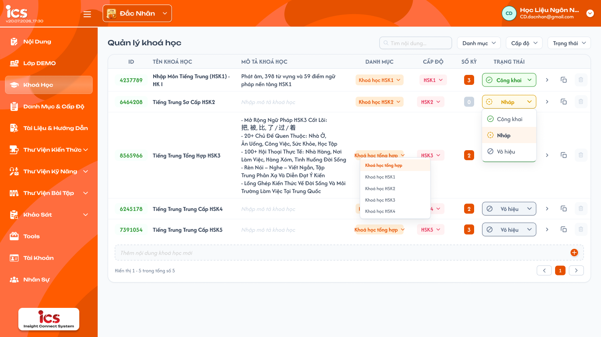
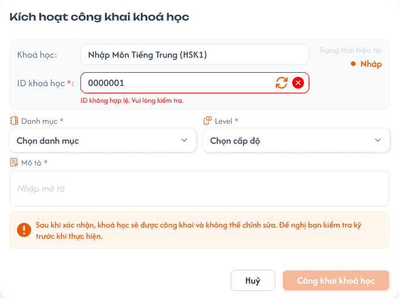
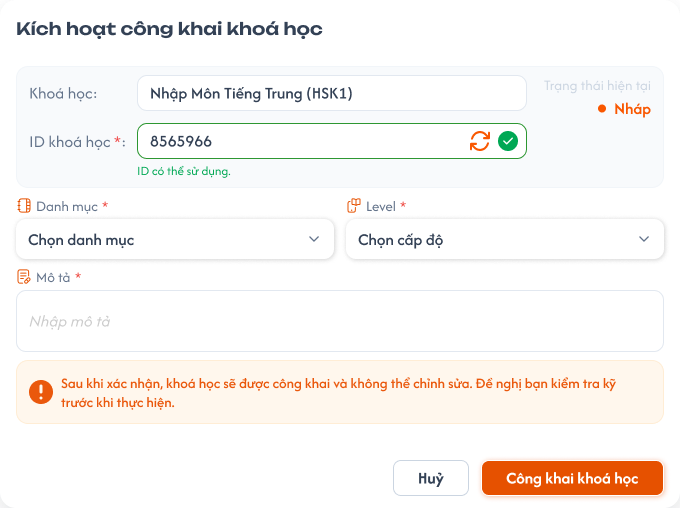

# Quản lý khoá học

## 1. UI

### Trang 1: CD-KH-010000 — Quản lý khoá học



**Mô tả:**
- CD định nghĩa và quản lý các khoá học trong hệ thống: thêm nhanh, lọc / tìm kiếm, đổi trạng thái, xoá, nhân bản và vào chi tiết khoá học.

**Điểm cần lưu ý:**
- **Danh mục**, **Cấp độ**: chọn từ danh sách đã define sẵn ở màn hình cấu hình riêng, không nhập tay. Dropdown gán cho khoá học chỉ hiển thị giá trị đang `Công Khai`; giá trị đã lưu trước đó mà nay `Vô hiệu` vẫn hiển thị đúng ở khoá học.
- Bộ lọc Danh mục / Cấp độ trên thanh lọc hiển thị cả `Công Khai` và `Vô hiệu` để lọc được khoá học cũ.
- Tìm kiếm khớp một phần theo `ID` hoặc `Tên khoá học`, kích hoạt sau khi nhấn Enter. `Tên khoá học` bắt buộc, chưa giới hạn độ dài.
- Danh sách không phân trang, hiển thị toàn bộ khoá học chưa xoá mềm. `Số kỳ` tự tính từ số kỳ học thuộc khoá, không nhập tay.
- **ID khoá học** 9 chữ số `CCAALLMMM` = mã trung tâm + ID danh mục + ID cấp độ + số thứ tự khoá (xem REQ06). Khoá học có ID ngay khi tạo; Danh mục / Cấp độ chưa chọn thì đoạn tương ứng là `00` (vd `100000062`). Khi còn `Nháp`, đổi Danh mục / Cấp độ thì ID đổi theo.
- **Xoá khoá học:** chỉ khoá `Nháp` được xoá. Khoá `Công Khai` / `Vô hiệu`: nút Xoá mờ, không bấm được, hover hiện tooltip `Chỉ xoá được khoá học ở trạng thái Nháp. Chuyển Vô hiệu nếu muốn ngừng dùng.`; gọi API trực tiếp thì BE từ chối (EX09). Khoá `Nháp` đang được sử dụng (có học kỳ nằm trong Tổng ôn của khoá khác, hoặc gán cho lớp) cũng không xoá được: sau khi CD xác nhận, BE từ chối và FE hiển thị Toast lỗi với nội dung BE trả về.
- **Quyền sửa theo trạng thái** (REQ10): `Nháp` sửa toàn bộ. `Công Khai` / `Vô hiệu` chỉ sửa `Tên khoá học` và `Mô tả`; ID, Danh mục, Cấp độ và toàn bộ dữ liệu chi tiết bên trong khoá (Tổng quan S2, Lộ trình S4, Kiến thức S1, Học kỳ, Bài học, Bài kiểm tra, Bài tập về nhà, bộ câu hỏi, Quản lý, Tài liệu) chỉ đọc. Muốn đổi nội dung khoá đã công khai thì **Nhân bản** rồi sửa trên bản sao `Nháp`.
- **Menu đổi trạng thái:** đang `Nháp` chỉ hiện `Công Khai`; đang `Công Khai` chỉ hiện `Vô hiệu`; đang `Vô hiệu` chỉ hiện `Công Khai` (REQ05).
- **Nhân bản khoá học:** có ở mọi khoá học (mọi trạng thái), tạo khoá `Nháp` mới sao chép toàn bộ dữ liệu liên quan của khoá gốc (REQ11).
- Icon `>` cuối mỗi dòng điều hướng vào chi tiết khoá học; mặc định mở mục `Học Kỳ`. Menu sidebar chi tiết gồm 3 nhóm: **Quy trình** (Tổng quan - S2, Lộ trình - S4, Học Kỳ), **Quản Lý**, **Tài Liệu**. Nhóm Quản Lý và Tài Liệu hiện mới có 2 tab lớn, nội dung mục con chưa chốt, sẽ bổ sung ở file khác.
- Popup `Nhân bản khoá học` mở khi chọn `Nhân bản` ở menu thao tác của một khoá học (mọi trạng thái `Nháp` / `Công Khai` / `Vô hiệu`).
- `A04.01` Tiêu đề popup: `Nhân bản khoá học`.
- `A04.02` Nội dung popup: `Tạo bản sao của khoá học "<Tên khoá học>"? Bản sao ở trạng thái Nháp, sao chép toàn bộ Tổng quan, Lộ trình, Kiến thức, Học kỳ, Bài học, Bài kiểm tra, Bài tập về nhà, Quản lý, Tài liệu. Lớp học và dữ liệu học viên không được sao chép.` Bản sao: `Tên khoá học` = tên gốc + ` (Bản sao)`; `ID` sinh mới theo REQ06 (giữ `CCAALL` của khoá gốc, `MMM` nhỏ nhất chưa dùng); trạng thái `Nháp`; giữ nguyên `Mô tả`, `Danh mục`, `Cấp độ`; khoá gốc giữ nguyên dữ liệu và trạng thái.
- `A04.03` Nút popup: `Huỷ` — `Nhân bản` (disable + loading trong lúc BE xử lý để tránh gửi lặp).
- `A04.04` Toast thành công: `Thành Công` — `Đã nhân bản khoá học "<Tên khoá học> (Bản sao)".` Sau khi nhân bản thành công FE tải lại danh sách, highlight dòng bản sao; Số khoá học của Danh mục tăng tương ứng.
- `A04.05` Toast lỗi: `Có Lỗi Xảy Ra` — nội dung BE trả về; không tạo bản sao dở dang (EX10).

### Trang 2: CD-KH-010010 — Quản lý khoá học / Popup kích hoạt công khai



**Mô tả:**
- Popup `Kích hoạt công khai khoá học` bắt buộc hiển thị khi CD chuyển khoá từ `Nháp` sang `Công Khai` (REQ07, Flow 5). Chiều `Vô hiệu → Công Khai` chuyển ngay, không mở popup vì 4 trường đã set ở lần công khai đầu tiên.

**Điểm cần lưu ý:**
- Popup luôn hiển thị đủ 4 trường **ID**, **Danh mục**, **Cấp độ**, **Mô tả**, kể cả khi đã điền sẵn ở danh sách — CD vẫn rà soát / xác nhận lại toàn bộ.
- **ID:** 9 chữ số `CCAALLMMM`. Phần `CCAALL` chỉ đọc, ghép tự động từ mã trung tâm của khoá và Danh mục / Cấp độ đang chọn trong popup (đổi thì đổi ngay; chưa chọn hiển thị `--`). CD chỉ nhập / sửa 3 số cuối `MMM`, có icon "làm mới" (sinh `MMM` nhỏ nhất chưa dùng trong `CCAALL`) và icon "xoá" (xoá `MMM`). `MMM` sai định dạng hoặc ID trùng → lỗi đỏ `ID không hợp lệ. Vui lòng kiểm tra.` ngay dưới ô.
- **Danh mục**, **Cấp độ:** dropdown chọn từ danh sách đã define, bỏ trống báo lỗi bắt buộc chọn. **Mô tả:** textarea bắt buộc, bỏ trống báo lỗi bắt buộc nhập.
- Cảnh báo cố định trong popup: `Sau khi công khai, khoá học chỉ còn sửa được Tên và Mô tả. ID, Danh mục, Cấp độ và toàn bộ nội dung bên trong (học kỳ, bài học, bài kiểm tra...) sẽ bị khoá.`
- Sau lần công khai đầu tiên, ID / Danh mục / Cấp độ và dữ liệu chi tiết bên trong bị khoá vĩnh viễn, kể cả khi chuyển `Vô hiệu` rồi `Công Khai` lại (khoá không thể về `Nháp`); Tên và Mô tả vẫn sửa được (REQ10).
- Hai nút: `Huỷ` (đóng popup, giữ nguyên trạng thái) và `Công khai khoá học` (chỉ bấm được khi mọi trường hợp lệ).

### Trang 3: CD-KH-010013 — Quản lý khoá học / Popup kích hoạt công khai / ID hợp lệ



**Mô tả:**
- Trạng thái popup khi ID nhập hợp lệ: dưới ô ID hiển thị `ID có thể sử dụng.` thay cho lỗi `ID không hợp lệ. Vui lòng kiểm tra.`; các trường Danh mục, Cấp độ, Mô tả vẫn cần điền đủ mới bấm được `Công khai khoá học`.

---

## 2. Yêu cầu

### 2.1. Flow chính

**Flow 1: Thêm khoá học mới**

```
CD nhập tên vào ô "Thêm khoá học mới" → nhấn "+" / Enter
  → FE gọi API tạo (trung tâm = trung tâm CD đang chọn ở header, Danh mục = Không, Cấp độ = Không → ID `CC0000MMM`, Số kỳ = 0, Trạng thái = Nháp)
  → BE tạo record → FE thêm dòng mới vào bảng
```

**Flow 2: Lọc / tìm kiếm khoá học**

```
CD chọn Danh Mục / Cấp Độ hoặc nhập từ khoá (khớp một phần theo ID / Tên, gọi sau khi nhấn Enter)
  → FE gọi API GET với query params → BE trả danh sách đã lọc → FE cập nhật bảng
```

**Flow 3: Chuyển sang Vô hiệu / Xoá khoá học**

```
Đổi trạng thái: mở dropdown (chỉ lựa chọn hợp lệ theo REQ05)
  ├─ Nháp → Công Khai: đi theo Flow 5
  └─ Công Khai ↔ Vô hiệu: FE gọi API cập nhật → BE cập nhật status → FE cập nhật danh sách (không popup)

Xoá (chỉ khoá Nháp; Công Khai / Vô hiệu: nút mờ + tooltip) → popup xác nhận xoá
  ├─ Huỷ → đóng popup, không xoá
  └─ Xoá → FE gọi API xoá mềm → BE kiểm tra
        ├─ Nháp và chưa được sử dụng: is_deleted = true cho khoá và toàn bộ học kỳ/dữ liệu con → đóng popup, loại khỏi danh sách
        └─ Không ở Nháp (gọi API trực tiếp) hoặc đang được sử dụng (REQ01, REQ08): BE từ chối (EX09) → đóng popup, Toast lỗi nội dung BE trả về, dữ liệu giữ nguyên
```

**Flow 4: Xem chi tiết khoá học**

```
CD nhấn icon ">" ở một dòng → FE điều hướng mặc định mục Học Kỳ
  → chuyển Tổng quan (S2), Lộ trình (S4), Quản Lý, Tài Liệu qua menu sidebar
```

**Flow 5: Chuyển trạng thái Nháp → Công Khai**

```
CD chọn "Công Khai" ở dropdown trạng thái (khoá đang Nháp)
  → KHÔNG đổi ngay, mở popup "Kích hoạt công khai khoá học" luôn hiển thị đủ ID (CD chỉ sửa MMM), Danh mục, Cấp độ, Mô tả
  → CD điền/kiểm tra, nhấn "Công khai khoá học" → FE validate:
       - MMM đúng 3 chữ số 001–999; ID 9 số (CCAALL + MMM) không trùng khoá khác
       - Danh mục, Cấp độ đã chọn; Mô tả không rỗng
  → không hợp lệ: lỗi ngay dưới trường, không cho xác nhận, trạng thái giữ nguyên
  → hợp lệ: FE gọi API cập nhật ID/Danh mục/Cấp độ/Mô tả + trạng thái = Công Khai
       → BE lưu, khoá vĩnh viễn ID/Danh mục/Cấp độ và dữ liệu chi tiết bên trong; Tên, Mô tả vẫn sửa được (REQ10)
       → FE đóng popup, cập nhật dòng trong bảng
  → "Huỷ" bất kỳ lúc nào: đóng popup, không thay đổi gì
```

**Flow 6: Nhân bản khoá học**

```
CD chọn "Nhân bản" ở một khoá (mọi trạng thái) → popup "Nhân bản khoá học"
  ├─ Huỷ → đóng popup, không tạo gì
  └─ Nhân bản → FE gọi API → BE sao chép trong một giao dịch (REQ11):
        1. Tạo khoá mới: Tên + " (Bản sao)", ID mới (giữ CCAALL, MMM nhỏ nhất chưa dùng), Nháp, giữ trung tâm / Mô tả / Danh mục / Cấp độ
        2. Sao chép Tổng quan (S2), Lộ trình (S4), Kiến thức (S1), Quản lý, Tài liệu
        3. Sao chép mọi học kỳ (giữ thứ tự) → mỗi học kỳ bản sao Nháp, ID mới theo rule học kỳ
             kèm Thông tin, Tổng ôn, Bài học (thông tin, nội dung, tài nguyên, liên kết kiến thức/kỹ năng), BTVN + bộ câu hỏi, Bài kiểm tra + bộ câu hỏi
        4. Ánh xạ lại tham chiếu nội bộ sang bản sao (Tổng ôn cùng khoá, liên kết kiến thức, tick Lộ trình, mã bài học)
  → thành công: đóng popup, tải lại danh sách, highlight bản sao, Toast "Đã nhân bản khoá học ..."
  → thất bại: BE rollback toàn bộ; FE giữ popup + Toast lỗi (EX10)
```

### 2.2. Ngoại lệ

- **EX01:** Tên khoá học mới bỏ trống hoặc chỉ khoảng trắng → chặn tạo mới, dữ liệu không đổi, disable nút "+" / Enter, không hiển thị notification.
- **EX02:** Lọc / tìm kiếm không khớp khoá học nào → trả danh sách rỗng, hiển thị "Không có dữ liệu".
- **EX03:** Gọi API cập nhật trạng thái hoặc xoá mềm thất bại (lỗi mạng / server) → giữ nguyên trạng thái / dữ liệu trên UI, hiển thị thông báo lỗi, không cập nhật is_deleted / status.
- **EX04:** Gọi API đổi trạng thái với transition không hợp lệ (Nháp → Vô hiệu, Công Khai → Nháp, Vô hiệu → Nháp) → BE từ chối, FE giữ nguyên và hiển thị thông báo lỗi.
- **EX05:** Trong popup Công khai, `MMM` không đúng 3 chữ số `001`–`999` (thiếu, thừa, ký tự không phải số, `000`) hoặc ID 9 số trùng khoá khác (kể cả khoá đã xoá mềm) → lỗi `ID không hợp lệ. Vui lòng kiểm tra.` dưới ô ID, chặn nút `Công khai khoá học`, trạng thái giữ nguyên.
- **EX06:** Trong popup Công khai, bỏ trống Danh mục và/hoặc Cấp độ và/hoặc Mô tả → lỗi bắt buộc dưới từng trường, chặn nút `Công khai khoá học`, trạng thái giữ nguyên.
- **EX07:** CD nhấn `Huỷ` hoặc đóng popup (icon "X") trước khi xác nhận thành công → đóng popup, không lưu, trạng thái giữ nguyên.
- **EX08:** Gọi API xác nhận Công khai thất bại (lỗi mạng / server) → giữ trạng thái Nháp, popup vẫn mở (hoặc hiển thị lại), hiển thị thông báo lỗi, ID / Danh mục / Cấp độ / Mô tả chưa lưu.
- **EX09:** Xoá khoá không ở `Nháp` (gọi API trực tiếp) hoặc khoá `Nháp` đang được sử dụng (gán cho lớp, có học kỳ nằm trong Tổng ôn của khoá khác), kể cả khi tham chiếu vừa phát sinh ngay trước lúc BE xoá → BE từ chối với lỗi (vd `Chỉ xoá được khoá học ở trạng thái Nháp.` hoặc `Khoá học đang được sử dụng, không thể xoá.`); FE đóng popup xác nhận, Toast lỗi đúng nội dung BE trả về, dữ liệu giữ nguyên.
- **EX10:** Nhân bản thất bại (lỗi mạng / server, lỗi ở bất kỳ bước sao chép) → BE rollback toàn bộ, không tạo khoá / học kỳ / bài học bản sao dở dang; FE Toast `Có Lỗi Xảy Ra` với nội dung BE trả về, khoá gốc không đổi.
- **EX11:** Sửa field ngoài `Tên khoá học` / `Mô tả`, hoặc thêm / sửa / xoá / sắp xếp bất kỳ dữ liệu chi tiết bên trong (học kỳ, bài học, bài kiểm tra, BTVN, bộ câu hỏi, S1, S2, S4, Quản lý, Tài liệu) khi khoá `Công Khai` / `Vô hiệu` (qua UI hoặc API trực tiếp) → UI chỉ đọc (ẩn / disable thao tác); BE từ chối với `Khoá học không ở trạng thái Nháp, chỉ được sửa Tên và Mô tả.`, dữ liệu không đổi.
- **EX12:** Chọn Danh mục / Cấp độ (ở danh sách, popup Công khai hoặc khi nhân bản) mà `CCAALL` tương ứng đã dùng hết `MMM` `001`–`999` → BE từ chối với `Đã hết ID khoá học khả dụng cho Danh mục và Cấp độ này.`; FE Toast lỗi (ở popup: lỗi dưới ô ID, tắt nút `Công khai khoá học`), Danh mục / Cấp độ / ID giữ như trước; nhân bản thì không tạo bản sao (giống EX10).

### 2.3. Yêu cầu khác

| Mã | Tên yêu cầu | Mô tả |
|---|---|---|
| REQ01 | Xoá khoá học | Xoá mềm, không xoá vật lý; các kỳ học con cũng xoá mềm; cần popup xác nhận. Chỉ khoá `Nháp` được xoá; `Công Khai` / `Vô hiệu` không xoá (muốn ngừng dùng thì chuyển `Vô hiệu`). Khoá `Nháp` đang được sử dụng cũng không xoá (REQ08). Nút Xoá mờ + tooltip với khoá `Công Khai` / `Vô hiệu`; BE kiểm tra lại trạng thái và tham chiếu lúc xoá, FE Toast lỗi nội dung BE trả về (EX09). Quy tắc "chỉ `Nháp` được xoá" áp dụng chung cho mọi dữ liệu có trạng thái Nháp / Công Khai / Vô hiệu trong Khoá học, Học kỳ, Danh mục, Cấp độ. |
| REQ02 | Danh mục, Cấp độ, Số kỳ | Danh mục và Cấp độ chỉ nhận giá trị từ danh sách đã define (cả ở danh sách lẫn popup Công khai), không nhập tự do. Số kỳ tự tính từ số kỳ học con, không nhập / sửa tay. |
| REQ03 | Không phân trang | Danh sách khoá học không phân trang, hiển thị toàn bộ khoá học chưa xoá mềm. |
| REQ04 | Khoá đã xoá | Khoá đã xoá mềm không hiển thị trong danh sách và không lọc / tìm kiếm ra được. |
| REQ05 | Chuyển trạng thái | 3 trạng thái `Nháp`, `Công Khai`, `Vô hiệu`. Nháp → Công Khai: cho phép, bắt buộc qua popup (REQ07 / Flow 5). Nháp → Vô hiệu: không. Công Khai ↔ Vô hiệu: cho phép hai chiều, chuyển ngay, không popup. Công Khai → Nháp, Vô hiệu → Nháp: không. UI chỉ hiện lựa chọn hợp lệ: Nháp chỉ hiện Công Khai; Công Khai chỉ hiện Vô hiệu; Vô hiệu chỉ hiện Công Khai. Nháp → Công Khai không đổi trực tiếp qua dropdown mà phải qua popup xác nhận. |
| REQ06 | ID khoá học | Đúng 9 chữ số `CCAALLMMM` (giữ số 0 đứng đầu): `CC` = mã trung tâm (2 số, trung tâm CD đang chọn ở header lúc tạo, không đổi về sau, nhân bản giữ trung tâm khoá gốc); `AA` = ID Danh mục (2 số, `category_management.md` REQ01); `LL` = ID Cấp độ (2 số, `level_management.md` REQ01); `MMM` = số thứ tự khoá (`001`–`999`) duy nhất trong cùng `CCAALL`, tính cả khoá đã xoá mềm. Khi tạo mới: Danh mục / Cấp độ = Không thì `AA` / `LL` = `00` (ID thật luôn `01`–`99`), `MMM` nhỏ nhất chưa dùng trong `CCAALL` (vd trung tâm `10` → `100000062`). Khi còn `Nháp`: đổi Danh mục / Cấp độ thì `AA` / `LL` đổi theo và BE cấp lại `MMM` nhỏ nhất chưa dùng trong `CCAALL` mới (`MMM` cũ được giải phóng); bỏ chọn thì về `00` và cấp lại `MMM`; mọi thay đổi ID đồng bộ ngay phần đầu ID học kỳ (`semester/information/information.md` REQ02) và Mã bài học (`semester/lesson/lesson.md` REQ05); tham chiếu giữa các bản ghi (Tổng ôn, lớp, Lộ trình…) theo bản ghi, không theo ID hiển thị. Trong popup Công khai: `CCAALL` chỉ đọc, CD giữ nguyên, nhập tay hoặc bấm làm mới `MMM`; BE kiểm tra lại tính duy nhất trong cùng giao dịch chuyển `Công Khai`. Sau lần công khai đầu tiên ID chốt vĩnh viễn. Hết `MMM`: xem EX12. ID khoá học và ID Danh mục / Cấp độ / Học kỳ kiểm tra trùng độc lập theo từng loại đối tượng. |
| REQ07 | Popup công khai bắt buộc | Chuyển Nháp → Công Khai bắt buộc hiện popup `Kích hoạt công khai khoá học` yêu cầu điền / xác nhận đủ 4 trường ID, Danh mục, Cấp độ, Mô tả, kể cả khi đã điền sẵn ở danh sách — không được bỏ qua popup hay tự công khai. Trạng thái chỉ đổi sau khi CD xác nhận thành công trong popup. Vô hiệu → Công Khai chuyển ngay, không popup. |
| REQ08 | Ràng buộc xoá | Ngoài điều kiện `Nháp` (REQ01), khoá đang được sử dụng (có lớp gắn với khoá, hoặc có học kỳ của khoá nằm trong Tổng ôn của học kỳ thuộc khoá khác; chỉ tính bản ghi chưa xoá mềm) thì không xoá được. BE kiểm tra trạng thái, tham chiếu và xoá mềm trong cùng một giao dịch, từ chối nếu không hợp lệ; FE Toast lỗi nội dung BE trả về (EX09). Khoá `Vô hiệu` không hiện để chọn mới ở nơi khác (vd tạo lớp), dữ liệu đang dùng giữ nguyên. |
| REQ09 | Tìm kiếm | Khớp một phần theo ID hoặc Tên khoá học, kích hoạt sau khi nhấn Enter. Tên khoá học chưa giới hạn độ dài. |
| REQ10 | Quyền sửa theo trạng thái | `Nháp`: sửa toàn bộ (Tên, Mô tả, ID trước khi công khai, Danh mục, Cấp độ và mọi dữ liệu chi tiết bên trong theo trạng thái riêng của học kỳ, xem `semester/information/information.md`); Số kỳ chỉ đọc (tự tính); xoá được khi chưa được sử dụng. `Công Khai` / `Vô hiệu`: chỉ sửa `Tên khoá học`, `Mô tả`; chỉ đọc ID, Danh mục, Cấp độ và toàn bộ dữ liệu chi tiết (S2, S4, S1, danh sách học kỳ — không thêm / xoá / nhân bản / kéo thả học kỳ, tab Thông tin + Tổng ôn của học kỳ, Bài học, Bài kiểm tra, BTVN, bộ câu hỏi, Quản lý, Tài liệu); không xoá. Đổi trạng thái khoá học và đổi trạng thái học kỳ bên trong vẫn được theo rule chuyển trạng thái (không phải "sửa dữ liệu"). Khoá không thể về `Nháp`; muốn đổi nội dung khoá đã công khai thì dùng Nhân bản (REQ11). BE kiểm tra trạng thái khoá (và học kỳ) với mọi request ghi dữ liệu con, không dựa vào việc ẩn nút ở FE (EX11). Áp dụng chung cho dữ liệu có trạng thái Nháp / Công Khai / Vô hiệu trong Khoá học, Học kỳ, Danh mục, Cấp độ. |
| REQ11 | Nhân bản khoá học (deep clone) | Nhân bản được ở mọi trạng thái khoá gốc; bản sao luôn `Nháp`, khoá gốc giữ nguyên; toàn bộ trong một giao dịch (EX10). Phạm vi: **Thông tin khoá** — Tên + ` (Bản sao)`, ID mới theo REQ06, giữ trung tâm / Mô tả / Danh mục / Cấp độ (kể cả khi Danh mục / Cấp độ gốc nay `Vô hiệu`; khi công khai bản sao, popup chỉ cho chọn giá trị `Công Khai` nên CD phải chọn lại), Số kỳ tự tính theo học kỳ bản sao. **Tổng quan (S2)** — Số buổi, Thời gian mỗi buổi, toàn bộ bảng Nội dung buổi học. **Lộ trình (S4)** — toàn bộ tick bài học × buổi học, ánh xạ sang bài học / nội dung buổi học bản sao. **Kiến thức (S1)** — toàn bộ mục kiến thức, cụm, thứ tự; mỗi mục tạo bản ghi thư viện mới cùng nội dung (như Nhân bản mục ở S1) để sửa bản sao không ảnh hưởng khoá gốc. **Học kỳ** — tất cả học kỳ chưa xoá mềm (mọi trạng thái), giữ thứ tự và tên (không hậu tố), mỗi học kỳ bản sao `Nháp`, ID mới theo rule REQ02 của học kỳ trên ID khoá bản sao, sao chép toàn bộ field tab Thông tin. **Tổng ôn** — học kỳ thuộc cùng khoá gốc trỏ sang học kỳ bản sao tương ứng; thuộc khoá khác giữ nguyên tham chiếu. **Bài học** — thông tin, nhóm + nội dung, tài nguyên (file sao thành file mới, link giữ URL), liên kết kiến thức (trỏ mục S1 bản sao) và kỹ năng; Mã bài học sinh lại theo `semester/lesson/lesson.md` REQ05 (`CCAALLBBBEEE`, `CCAALL` của khoá bản sao, `BBB` của học kỳ bản sao, `EEE` giữ nguyên). **BTVN** — bộ câu hỏi từng bài học (mọi loại câu, đáp án, câu hỏi con, file đính kèm, tag `AI`), tạo bản ghi câu hỏi mới. **Bài kiểm tra** — thông tin, thứ tự, bộ câu hỏi; ID bài 10 chữ số sinh mới. **Quản lý, Tài liệu** — toàn bộ nội dung hiện có (chi tiết theo requirement riêng khi chốt). **Không sao chép** — lớp học, học viên, lịch học, kết quả làm bài / chấm bài, lịch sử thay đổi; tham chiếu từ khoá khác vào khoá gốc (vd Tổng ôn của khoá khác vẫn trỏ học kỳ gốc). Ngày tạo / cập nhật của bản sao là thời điểm nhân bản. |

### 2.4. Ràng buộc

#### Quyền

| Role | Xem | Tạo | Chỉnh sửa | Xóa | Đổi trạng thái | Nhân bản |
|---|:---:|:---:|:---:|:---:|:---:|:---:|
| CD | ✅ | ✅ | ✅ (theo trạng thái, REQ10) | ✅ (chỉ `Nháp`, chưa được sử dụng) | ✅ | ✅ |
| Các role khác | ❌ | ❌ | ❌ | ❌ | ❌ | ❌ |

#### Ràng buộc khác

- Khoá học thuộc trung tâm CD đang chọn ở header; trung tâm không đổi sau khi tạo.
- Quy tắc trạng thái, xoá và quyền sửa theo REQ01, REQ05, REQ10 được BE kiểm tra với mọi request, không dựa vào việc ẩn nút ở FE.

---

## 3. Testcase

### Feature: Quản lý khoá học

| Tên testcase | Priority | Scenario | Role | Pre-condition | Given/When/Then | Expected Result |
|---|---|---|---|---|---|---|
| Case 1: Thêm khoá học mới | High | Flow 1 / EX01 / REQ06 | CD | Trung tâm đang chọn ở header | **Given:** CD ở trang danh sách<br>**When:** nhập tên hợp lệ rồi nhấn "+" hoặc Enter; lần khác để trống / chỉ khoảng trắng<br>**Then:** hệ thống tạo hoặc chặn | - Tên hợp lệ: khoá mới xuất hiện trong bảng (cả 2 cách đều như nhau), ID `CC0000MMM` (vd `100000062`), Danh mục / Cấp độ = Không, Số kỳ = 0, Nháp, đúng trung tâm header<br>- Tên trống: không tạo, nút "+" disable, không notification |
| Case 2: Lọc và tìm kiếm | High | Flow 2 / EX02 / REQ02 / REQ03 / REQ04 / REQ09 | CD | Có khoá thuộc nhiều Danh mục / Cấp độ; Danh mục / Cấp độ `Vô hiệu`; khoá đã xoá mềm | **Given:** CD ở trang danh sách<br>**When:** chọn Danh mục, Cấp độ (kể cả giá trị `Vô hiệu`), nhập một phần ID rồi một phần Tên và Enter; lọc điều kiện không khớp<br>**Then:** bảng lọc | - Kết hợp nhiều điều kiện vẫn đúng; tìm kiếm chỉ chạy sau Enter, khớp một phần ID hoặc Tên<br>- Bộ lọc có cả `Công Khai` và `Vô hiệu`; dropdown gán khoá chỉ có `Công Khai`, khoá đang gắn giá trị `Vô hiệu` vẫn hiển thị đúng<br>- Không khớp: "Không có dữ liệu"<br>- Khoá đã xoá mềm không xuất hiện; danh sách không phân trang |
| Case 3: Menu đổi trạng thái và Công Khai ↔ Vô hiệu | High | Flow 3 / REQ05 / EX03 / EX04 | CD | Có khoá ở cả 3 trạng thái | **Given:** mở dropdown trạng thái từng khoá<br>**When:** chọn "Vô hiệu" với khoá Công Khai, rồi "Công Khai" với khoá Vô hiệu; gọi API Nháp → Vô hiệu, Công Khai → Nháp, Vô hiệu → Nháp; giả lập lỗi mạng<br>**Then:** hệ thống xử lý | - Nháp chỉ có Công Khai; Công Khai chỉ có Vô hiệu; Vô hiệu chỉ có Công Khai<br>- Công Khai ↔ Vô hiệu đổi ngay, không popup; ID, Danh mục, Cấp độ, Mô tả giữ nguyên và vẫn bị khoá<br>- Transition không hợp lệ: BE từ chối, trạng thái không đổi, có thông báo lỗi<br>- Lỗi mạng: giữ nguyên trạng thái trên UI, có thông báo lỗi |
| Case 4: Popup Công khai luôn mở và đủ 4 trường | High | Flow 5 / REQ07 | CD | Khoá `Nháp` — (a) chưa điền, (b) đã điền sẵn Danh mục / Cấp độ / Mô tả ở danh sách | **Given:** CD chọn khoá ở một trong hai trường hợp<br>**When:** chọn "Công Khai" ở dropdown<br>**Then:** popup "Kích hoạt công khai khoá học" mở | - Hiện đủ ID, Danh mục, Cấp độ, Mô tả: (a) trống, (b) hiển thị lại giá trị để xác nhận / sửa<br>- Popup không bị bỏ qua dù dữ liệu inline đủ; trạng thái giữ Nháp tới khi xác nhận thành công<br>- `CCAALL` chỉ đọc đổi theo Danh mục / Cấp độ chọn trong popup, chưa chọn hiển thị `--`; có icon làm mới / xoá `MMM` |
| Case 5: Validate popup Công khai | High | EX05 / EX06 / EX12 / REQ06 | CD | Popup Công khai đang mở; có khoá đã xoá mềm ID `7654321`; một `CCAALL` đã dùng hết `001`–`999` | **Given:** popup đang mở<br>**When:** nhập `MMM` sai định dạng (thiếu số, `000`, ký tự khác), ID trùng khoá khác hoặc khoá đã xoá mềm; bỏ trống Danh mục / Cấp độ / Mô tả; chọn Danh mục / Cấp độ hết ID; bấm "Công khai khoá học"<br>**Then:** hệ thống chặn xác nhận | - Lỗi `ID không hợp lệ. Vui lòng kiểm tra.` dưới ô ID; ID hợp lệ hiện `ID có thể sử dụng.`<br>- Lỗi bắt buộc dưới từng trường trống<br>- Hết ID: BE trả `Đã hết ID khoá học khả dụng cho Danh mục và Cấp độ này.`, lỗi dưới ô ID, tắt nút `Công khai khoá học`<br>- Mọi trường hợp: trạng thái giữ nguyên |
| Case 6: Hủy, lỗi và xác nhận Công khai thành công | High | Flow 5 / EX07 / EX08 / REQ06 / REQ10 | CD | Popup Công khai đang mở, đã điền hợp lệ đủ 4 trường | **Given:** CD điền `MMM` hợp lệ, Danh mục, Cấp độ, Mô tả<br>**When:** nhấn "Huỷ" / icon "X"; lần khác giả lập API lỗi; lần khác nhấn "Công khai khoá học"<br>**Then:** hệ thống xử lý | - Huỷ / X: đóng popup, không lưu, trạng thái và dữ liệu giữ nguyên<br>- API lỗi: giữ Nháp, popup còn mở, thông báo lỗi, dữ liệu chưa lưu<br>- Thành công: popup đóng, bảng cập nhật Công Khai, ID / Danh mục / Cấp độ bị khoá vĩnh viễn, Tên và Mô tả vẫn sửa được |
| Case 7: Xoá mềm khoá Nháp chưa sử dụng | High | Flow 3 / REQ01 / REQ04 | CD | Khoá `Nháp`, chưa gán lớp, không nằm trong Tổng ôn khoá khác, có kỳ học con | **Given:** CD chọn Xoá<br>**When:** bấm Huỷ ở popup; lần khác xác nhận Xoá; giả lập lỗi BE<br>**Then:** hệ thống xử lý | - Huỷ: không xoá<br>- Xác nhận: khoá biến mất khỏi danh sách và tìm kiếm, khoá và kỳ học con is_deleted = true, không có Toast lỗi<br>- Lỗi BE (EX03): giữ dữ liệu, thông báo lỗi |
| Case 8: Chặn xoá khoá Công khai / Vô hiệu / đang sử dụng | High | EX09 / REQ01 / REQ08 | CD | A `Công Khai`; B `Vô hiệu`; C `Nháp` đang gán 2 lớp; D `Nháp` có học kỳ nằm trong Tổng ôn của khoá khác; E `Nháp` vừa phát sinh tham chiếu ngay trước lúc xoá | **Given:** CD mở thao tác Xoá từng khoá và gọi API xoá trực tiếp<br>**When:** xác nhận trong popup (với C, D, E)<br>**Then:** BE từ chối | - A, B: nút Xoá mờ, tooltip `Chỉ xoá được khoá học ở trạng thái Nháp. Chuyển Vô hiệu nếu muốn ngừng dùng.`; API trực tiếp bị từ chối `Chỉ xoá được khoá học ở trạng thái Nháp.`<br>- C, D, E: popup đóng, Toast lỗi đúng nội dung BE (vd `Khoá học đang được sử dụng, không thể xoá.`), khoá, lớp và Tổng ôn giữ nguyên, is_deleted không đổi |
| Case 9: Quyền sửa theo trạng thái khoá | High | REQ10 / EX11 | CD | Khoá `Công Khai` (và một khoá `Vô hiệu`) có học kỳ, bài học, bài kiểm tra; khoá `Nháp` có học kỳ `Nháp` | **Given:** CD mở từng khoá<br>**When:** sửa Tên, Mô tả; thử sửa Danh mục / Cấp độ / ID; thêm / xoá / kéo thả học kỳ, sửa S2, S4, S1, bài học, bài kiểm tra, bộ câu hỏi (UI và API trực tiếp); với khoá Nháp sửa toàn bộ<br>**Then:** hệ thống áp quyền | - Công Khai / Vô hiệu: chỉ Tên, Mô tả lưu được; phần còn lại chỉ đọc (ẩn / disable); API trực tiếp bị từ chối `Khoá học không ở trạng thái Nháp, chỉ được sửa Tên và Mô tả.`, dữ liệu không đổi; đổi trạng thái khoá / học kỳ vẫn được<br>- Nháp: mọi thay đổi lưu được (dữ liệu trong học kỳ theo trạng thái riêng của học kỳ) |
| Case 10: Xem chi tiết khoá và menu sidebar | Medium | Flow 4 | CD | Khoá tồn tại | **Given:** CD ở trang danh sách<br>**When:** nhấn icon ">" ở một dòng; chuyển các mục menu<br>**Then:** điều hướng vào chi tiết khoá | - Vào đúng khoá, mặc định mục "Học kỳ" active<br>- Menu 3 nhóm Quy trình (Tổng quan - S2, Lộ trình - S4, Học Kỳ), Quản Lý, Tài Liệu |
| Case 11: ID khoá học theo Danh mục / Cấp độ | High | REQ02 / REQ06 | CD | Danh mục, Cấp độ đã cấu hình sẵn | **Given:** CD tạo khoá, gán Danh mục và Cấp độ từ danh sách define<br>**When:** lưu, xem lại danh sách, đổi Danh mục hoặc Cấp độ khi còn Nháp, bỏ chọn một giá trị<br>**Then:** ID cập nhật | - Danh mục / Cấp độ hiển thị đúng; ID đúng 9 chữ số `CCAALLMMM`, `MMM` duy nhất trong `CCAALL`<br>- Đổi / bỏ chọn khi Nháp: `AA` / `LL` đổi theo (hoặc `00`), `MMM` cấp lại trong `CCAALL` mới; ID học kỳ và Mã bài học đồng bộ<br>- Số kỳ tự tính, không sửa tay |
| Case 12: Mở popup Nhân bản và nhân bản đầy đủ dữ liệu | High | Flow 6 / REQ11 | CD | Khoá A `Công Khai`: S2, S4, S1 có dữ liệu; HK I `Công khai`, HK II `Vô hiệu`, HK III `Nháp`; mỗi học kỳ có bài học (nội dung, tài nguyên, kiến thức), BTVN, bài kiểm tra có câu hỏi; HK II có Tổng ôn gồm HK I (cùng khoá) và một học kỳ khoá B | **Given:** CD mở thao tác của khoá ở cả 3 trạng thái, chọn `Nhân bản`, bấm `Huỷ`; sau đó với khoá A bấm `Nhân bản`<br>**When:** BE sao chép<br>**Then:** tạo `A (Bản sao)` | - `Nhân bản` có ở cả 3 trạng thái; popup đúng tiêu đề, nội dung, 2 nút; Huỷ không tạo bản sao<br>- Toast `Đã nhân bản khoá học "A (Bản sao)".`, danh sách tải lại, bản sao highlight; ID mới cùng `CCAALL`, `MMM` mới, Nháp, giữ Mô tả / Danh mục / Cấp độ<br>- Đủ 3 học kỳ theo thứ tự, đều Nháp, ID mới, tên giữ nguyên; bài học, nội dung, tài nguyên, kiến thức / kỹ năng, BTVN, bài kiểm tra, bộ câu hỏi, S1, S2, S4 giống gốc; Mã bài học theo `BBB` học kỳ mới<br>- Tổng ôn HK II bản sao trỏ HK I bản sao và giữ học kỳ khoá B; khoá A giữ nguyên dữ liệu, trạng thái |
| Case 13: Bản sao độc lập và phạm vi không sao chép | High | REQ11 | CD | Đã nhân bản khoá A (đang có 2 lớp, kết quả làm bài); Cấp độ gốc của A đã `Vô hiệu` | **Given:** CD sửa mục S1, nội dung bài học, câu hỏi, xoá tài nguyên ở bản sao; mở lại khoá A; chuyển bản sao sang `Công Khai`<br>**When:** xem bản sao và popup Công khai<br>**Then:** kiểm tra độc lập | - Khoá A không đổi sau khi sửa bản sao<br>- Bản sao không có lớp, học viên, lịch học, kết quả làm bài, lịch sử thay đổi; chưa được sử dụng nên xoá được<br>- Bản sao Nháp vẫn hiển thị Cấp độ cũ; dropdown popup Công khai chỉ có Cấp độ `Công Khai`, không chọn thì báo lỗi bắt buộc |
| Case 14: Nhân bản thất bại | Medium | EX10 / EX12 | CD | Giả lập lỗi BE ở bước sao chép bài kiểm tra; một `CCAALL` đã hết `MMM` | **Given:** CD bấm `Nhân bản`<br>**When:** BE lỗi giữa chừng hoặc hết ID<br>**Then:** rollback | - Toast `Có Lỗi Xảy Ra` với nội dung BE; popup giữ mở<br>- Không có khoá / học kỳ / bài học bản sao dở dang; khoá gốc không đổi<br>- Hết ID: BE trả `Đã hết ID khoá học khả dụng cho Danh mục và Cấp độ này.`, không tạo bản sao |
| Case 15: Role khác CD bị chặn | High | Ràng buộc quyền | Role khác CD | - | **Given:** mở URL quản lý khoá học; gửi request xem / tạo / sửa / xoá / đổi trạng thái / nhân bản<br>**When:** hệ thống xử lý<br>**Then:** bị từ chối | - Không xem, không thao tác được; dữ liệu không đổi |

---

## 4. Câu hỏi cần xác nhận

- **Q01:** Popup `Nhân bản khoá học` (tiêu đề, nội dung, nút `Huỷ` / `Nhân bản`, Toast thành công / lỗi) chưa có thiết kế trên Figma. Khi nào bổ sung frame để Dev đối chiếu?
