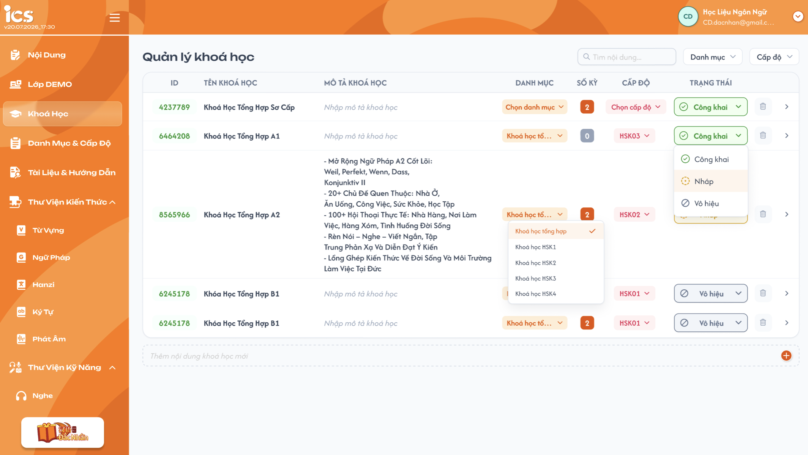
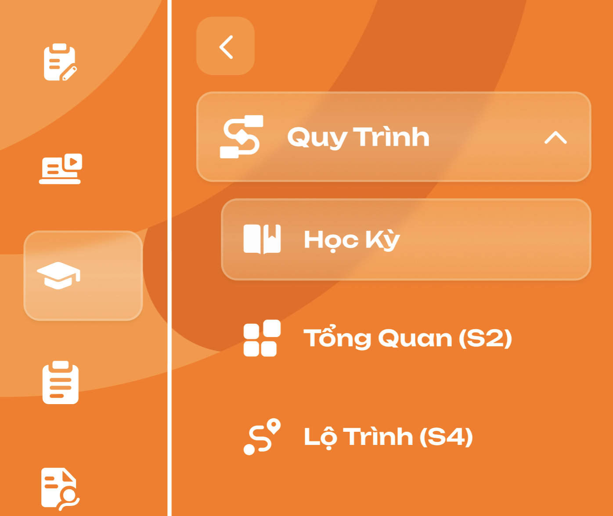
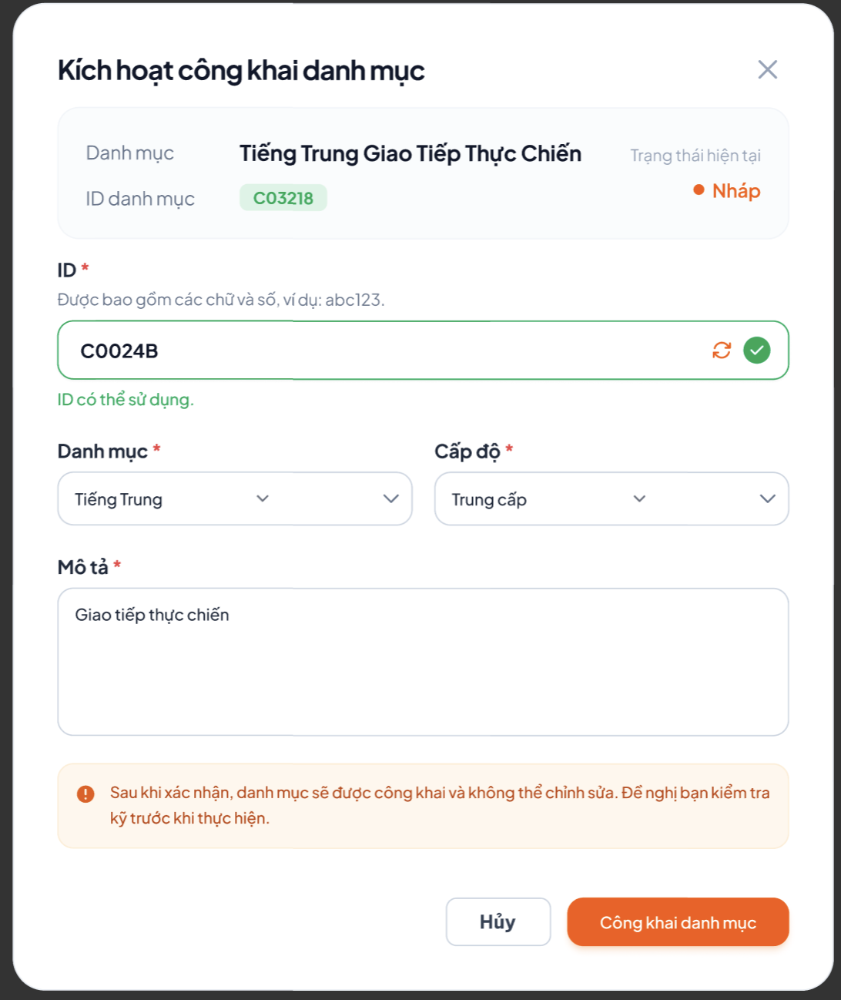

# Quản lý khoá học

## 1. UI

### Trang 1: Danh sách khoá học


**Mô tả:**
- Trang cho phép CD định nghĩa và quản lý các khoá học trong hệ thống.

**Điểm cần lưu ý:**
- **Danh mục**, **Cấp độ**: giá trị được chọn từ danh sách đã define sẵn ở màn hình cấu hình riêng, không nhập tay. Dropdown chỉ hiển thị Danh mục/Cấp độ đang `Công Khai`; giá trị đã lưu trước đó mà nay bị `Vô hiệu` vẫn hiển thị đúng ở khoá học.
- **Bộ lọc Danh mục / Cấp độ** trên thanh lọc hiển thị cả giá trị đang `Công Khai` và `Vô hiệu` để lọc được khoá học cũ (khác với dropdown gán giá trị cho khoá học chỉ hiển thị `Công Khai`).
- **Tìm kiếm**: khớp một phần theo `ID` hoặc `Tên khoá học`, kích hoạt sau khi nhấn Enter.
- **Tên khoá học**: bắt buộc, chưa giới hạn độ dài.
- **Xoá khoá học**: **chỉ khoá học `Nháp` được xoá**. Khoá học `Công Khai` / `Vô hiệu`: nút Xoá hiện mờ, không bấm được, hover hiện tooltip `Chỉ xoá được khoá học ở trạng thái Nháp. Chuyển Vô hiệu nếu muốn ngừng dùng.`; gọi API trực tiếp thì BE từ chối (EX09). Khoá học `Nháp` nhưng **đang được sử dụng** (có học kỳ nằm trong Tổng ôn của khoá khác, hoặc gán cho lớp) cũng không được xoá: sau khi CD xác nhận, BE từ chối và FE hiển thị Toast lỗi với nội dung BE trả về (xem REQ01, REQ08, Flow 3).
- **Quyền sửa theo trạng thái** (xem REQ10): `Nháp` sửa được toàn bộ. `Công Khai` / `Vô hiệu` **chỉ sửa được `Tên khoá học` và `Mô tả`**; mọi field khác (ID, Danh mục, Cấp độ) và **toàn bộ dữ liệu chi tiết bên trong khoá** (Tổng quan S2, Lộ trình S4, Kiến thức S1, Học kỳ, Bài học, Bài kiểm tra, Bài tập về nhà, bộ câu hỏi, Quản lý, Tài liệu) chỉ đọc. Muốn thay đổi nội dung khoá đã công khai thì **Nhân bản** khoá học rồi sửa trên bản sao `Nháp`.
- **Nhân bản khoá học**: thao tác có ở mọi khoá học (mọi trạng thái), tạo một khoá học `Nháp` mới sao chép **toàn bộ** dữ liệu liên quan của khoá gốc (xem Trang 4, Flow 6, REQ11).
- **Menu đổi trạng thái**: đang `Nháp` chỉ hiện `Công Khai`; đang `Công Khai` chỉ hiện `Vô hiệu`; đang `Vô hiệu` chỉ hiện `Công Khai` (xem REQ05).
- **Số kỳ**: tự động tính từ số lượng kỳ học thuộc khoá học đó, không nhập tay.
- **ID khoá học**: 9 chữ số `CCAALLMMM` = mã trung tâm + ID danh mục + ID cấp độ + số thứ tự khoá (xem REQ06). Khoá học luôn có ID ngay khi tạo; Danh mục / Cấp độ chưa chọn thì đoạn tương ứng là `00` (ví dụ `100000062`). Khi còn `Nháp`, đổi Danh mục / Cấp độ thì ID đổi theo.
- Icon **">"** cuối mỗi dòng: điều hướng đến trang Học kỳ (Trang 2).
- Danh sách không phân trang.

### Trang 2: Menu chi tiết khoá học


**Mô tả:**
- Sau khi bấm vào 1 khoá học, hiển thị menu sidebar để điều hướng giữa các mục quản lý của khoá học đó.

**Điểm cần lưu ý:**
- Menu gồm 3 nhóm: **Quy trình** (Tổng quan - S2, Lộ trình - S4, Học Kỳ), **Quản Lý**, **Tài Liệu**.
- Mặc định khi bấm vào 1 khoá học, hệ thống tự động chọn mục **Học Kỳ**.
- Nhóm **Quản Lý** và **Tài Liệu** hiện chỉ mới có 2 tab lớn ở ngoài, nội dung mục con bên trong chưa chốt, sẽ bổ sung sau ở file khác.

### Trang 3: Popup xác nhận Công khai khoá học


**Mô tả:**
- Popup bắt buộc hiển thị khi CD chuyển trạng thái khoá học từ **Nháp** sang **Công Khai** (xem REQ07, Flow 5). Chiều **Vô hiệu → Công Khai** chuyển ngay, không mở popup, vì 4 trường đã được set ở lần công khai đầu tiên.

**Điểm cần lưu ý:**
- Popup luôn hiển thị đầy đủ 4 trường: **ID**, **Danh mục**, **Cấp độ**, **Mô tả**, kể cả khi các trường này đã được điền sẵn ở màn hình danh sách (inline) trước đó — CD vẫn phải rà soát/xác nhận lại toàn bộ trong popup.
- **ID**: 9 chữ số `CCAALLMMM`. Phần `CCAALL` chỉ đọc, ghép tự động từ mã trung tâm của khoá học và Danh mục / Cấp độ đang chọn **trong popup** (đổi Danh mục / Cấp độ thì phần này đổi ngay; chưa chọn thì hiển thị `--`). CD chỉ nhập / sửa 3 số cuối `MMM`, có icon "làm mới" (sinh `MMM` nhỏ nhất chưa dùng trong `CCAALL`) và icon "xoá" (xoá `MMM`). Nếu `MMM` sai định dạng hoặc ID trùng → hiển thị lỗi đỏ "ID không hợp lệ. Vui lòng kiểm tra." ngay dưới ô.
- **Danh mục**, **Cấp độ**: dropdown chọn từ danh sách đã define sẵn, không nhập tự do; bỏ trống → báo lỗi bắt buộc chọn.
- **Mô tả**: textarea bắt buộc nhập; bỏ trống → báo lỗi bắt buộc nhập.
- Cảnh báo cố định trong popup: `Sau khi công khai, khoá học chỉ còn sửa được Tên và Mô tả. ID, Danh mục, Cấp độ và toàn bộ nội dung bên trong (học kỳ, bài học, bài kiểm tra...) sẽ bị khoá.` — nhắc CD kiểm tra kỹ trước khi xác nhận.
- Sau lần công khai đầu tiên, ID/Danh mục/Cấp độ và toàn bộ dữ liệu chi tiết bên trong bị khoá vĩnh viễn, kể cả khi khoá học chuyển Vô hiệu rồi Công Khai lại (khoá học không thể về `Nháp`). Tên và Mô tả vẫn sửa được ở `Công Khai` / `Vô hiệu` (REQ10).
- 2 nút hành động: **Hủy** (đóng popup, giữ nguyên trạng thái hiện tại) và **Công khai khoá học** (chỉ bấm được khi toàn bộ trường hợp lệ).

### Trang 4: Popup Nhân bản khoá học
**Mô tả:**
- Mở khi CD chọn `Nhân bản` ở menu thao tác của một khoá học (có ở mọi trạng thái `Nháp` / `Công Khai` / `Vô hiệu`). **UI cần bổ sung** trên Figma.

- `A04.01` **Tiêu đề**: `Nhân bản khoá học`
- `A04.02` **Nội dung**: `Tạo bản sao của khoá học "<Tên khoá học>"? Bản sao ở trạng thái Nháp, sao chép toàn bộ Tổng quan, Lộ trình, Kiến thức, Học kỳ, Bài học, Bài kiểm tra, Bài tập về nhà, Quản lý, Tài liệu. Lớp học và dữ liệu học viên không được sao chép.`
- `A04.03` **Nút**: `Huỷ` — `Nhân bản` (disable + loading trong lúc BE xử lý để tránh gửi lặp)
- `A04.04` **Toast thành công**: `Thành Công` — `Đã nhân bản khoá học "<Tên khoá học> (Bản sao)".`
- `A04.05` **Toast lỗi**: `Có Lỗi Xảy Ra` — nội dung BE trả về; không tạo bản sao dở dang (EX10).

**Điểm cần lưu ý:**
- Bản sao: `Tên khoá học` = tên gốc + hậu tố ` (Bản sao)`; `ID` sinh mới theo REQ06: giữ `CCAALL` của khoá gốc, `MMM` = số nhỏ nhất chưa dùng trong `CCAALL`; trạng thái `Nháp`; giữ nguyên `Mô tả`, `Danh mục`, `Cấp độ`. Khoá gốc giữ nguyên dữ liệu và trạng thái.
- Phạm vi sao chép chi tiết xem REQ11.
- Sau khi nhân bản thành công: FE tải lại danh sách, dòng bản sao được highlight; Số khoá học của Danh mục tăng tương ứng.

---

## 2. Yêu cầu

### 2.1. Flow chính

**Flow 1: Thêm khoá học mới**

```
CD nhập tên vào ô "Thêm khoá học mới" 
→ Nhấn nút "+" / Nhấn Enter 
→ FE gọi API tạo khoá học (trung tâm = trung tâm CD đang chọn ở header, Danh mục = Không, Cấp độ = Không → ID = `CC0000MMM`, Số kỳ = 0, Trạng thái = Nháp) 
→ BE tạo record 
→ FE thêm dòng mới vào bảng
```

**Flow 2: Lọc / tìm kiếm khoá học**

```
CD chọn Danh Mục / Cấp Độ hoặc nhập từ khoá tìm kiếm (khớp một phần theo ID / Tên, gọi sau khi nhấn Enter) 
→ FE gọi API GET với query params tương ứng 
→ BE trả về danh sách đã lọc 
→ FE cập nhật bảng
```

**Flow 3: Chuyển sang Vô hiệu / Xoá khoá học**

```
Đổi trạng thái: CD mở dropdown trạng thái → chỉ hiển thị lựa chọn hợp lệ theo REQ05
   (Nháp: chỉ có Công Khai → đi theo Flow 5; Công Khai: chỉ có Vô hiệu; Vô hiệu: chỉ có Công Khai → chuyển ngay, không popup)
→ Công Khai → Vô hiệu hoặc Vô hiệu → Công Khai: FE gọi API cập nhật trạng thái → BE cập nhật status → FE cập nhật lại danh sách (không mở popup)

Xoá: chỉ bấm được với khoá học Nháp (Công Khai / Vô hiệu: nút Xoá mờ + tooltip) → FE hiển thị popup xác nhận xoá
→ CD bấm Huỷ: đóng popup, không xoá
→ CD bấm Xoá → FE gọi API xoá mềm → BE kiểm tra
   → Khoá học đang Nháp và chưa được sử dụng: BE set is_deleted = true cho khoá học và toàn bộ học kỳ/dữ liệu con → FE đóng popup, loại khỏi danh sách
   → Khoá học không ở Nháp (gọi API trực tiếp) hoặc đang được sử dụng (REQ01, REQ08): BE từ chối, trả lỗi (EX09) → FE đóng popup, hiển thị Toast lỗi với nội dung BE trả về, dữ liệu giữ nguyên
```

**Flow 4: Xem chi tiết khoá học**

```
CD nhấn icon ">" ở 1 dòng khoá học 
→ FE điều hướng mặc định mục Học Kỳ 
→ CD có thể chuyển sang Tổng quan (S2), Lộ trình (S4), Quản Lý, Tài Liệu qua menu sidebar
```

**Flow 5: Chuyển trạng thái Nháp → Công Khai**

```
CD chọn "Công Khai" trong dropdown trạng thái (khi khoá học đang Nháp)
→ Hệ thống KHÔNG đổi trạng thái ngay, mà mở popup "Kích hoạt công khai khoá học"
→ Popup luôn hiển thị đầy đủ 4 trường bắt buộc: ID (9 số `CCAALLMMM`, CD chỉ sửa `MMM`), Danh mục, Cấp độ, Mô tả
   (dù các trường này đã có giá trị sẵn từ màn hình danh sách, vẫn hiển thị lại trong popup để CD xác nhận/chỉnh sửa lần cuối)
→ CD điền/kiểm tra đầy đủ các trường, nhấn "Công khai khoá học"
→ FE validate:
   - `MMM` đúng 3 chữ số trong dải `001`–`999`; ID 9 số ghép từ `CCAALL` + `MMM` không trùng với khoá học khác
   - Danh mục, Cấp độ: đã chọn (không rỗng)
   - Mô tả: không rỗng
→ Nếu có trường không hợp lệ: hiển thị lỗi ngay dưới trường tương ứng, không cho xác nhận, đóng popup không xảy ra, trạng thái giữ nguyên
→ Nếu hợp lệ: FE gọi API cập nhật ID/Danh mục/Cấp độ/Mô tả + trạng thái = Công Khai
→ BE lưu dữ liệu, khoá vĩnh viễn ID/Danh mục/Cấp độ và toàn bộ dữ liệu chi tiết bên trong (không mở lại để sửa khi Vô hiệu → Công Khai); Tên và Mô tả vẫn sửa được (REQ10)
→ FE đóng popup, cập nhật lại dòng trong bảng
→ (Nếu CD nhấn "Hủy" ở bất kỳ thời điểm nào) → đóng popup, không có gì thay đổi, trạng thái khoá học giữ nguyên
```

**Flow 6: Nhân bản khoá học**

```
CD chọn "Nhân bản" ở 1 khoá học (mọi trạng thái) → FE mở popup "Nhân bản khoá học" (Trang 4)
→ CD bấm "Huỷ": đóng popup, không tạo gì
→ CD bấm "Nhân bản" → FE gọi API nhân bản → BE sao chép trong cùng một giao dịch (REQ11):
   1. Tạo khoá học mới: Tên = tên gốc + " (Bản sao)", ID mới theo REQ06 (giữ `CCAALL`, `MMM` nhỏ nhất chưa dùng), trạng thái Nháp, giữ trung tâm / Mô tả / Danh mục / Cấp độ
   2. Sao chép Tổng quan (S2), Lộ trình (S4), Kiến thức (S1), Quản lý, Tài liệu
   3. Sao chép toàn bộ học kỳ (mọi trạng thái, giữ thứ tự) → mỗi học kỳ bản sao ở Nháp, ID mới theo rule học kỳ
      → kèm Thông tin, Tổng ôn, Bài học (thông tin, nội dung, tài nguyên, liên kết kiến thức/kỹ năng), BTVN + bộ câu hỏi, Bài kiểm tra + bộ câu hỏi
   4. Ánh xạ lại mọi tham chiếu nội bộ sang bản sao (Tổng ôn cùng khoá, liên kết kiến thức trong bài học, tick Lộ trình, mã bài học)
→ Thành công: FE đóng popup, tải lại danh sách, highlight bản sao, Toast "Đã nhân bản khoá học ..."
→ Thất bại: BE rollback toàn bộ, không có bản sao dở dang; FE giữ popup, hiển thị Toast lỗi (EX10)
```

### 2.2. Ngoại lệ
 
- **EX01:** Tên khoá học mới bị bỏ trống hoặc chỉ chứa khoảng trắng → Chặn tạo mới, dữ liệu không thay đổi, disable nút "+"/Enter, không có notification hiển thị.
- **EX02:** Lọc/tìm kiếm với điều kiện không khớp khoá học nào → Trả về danh sách rỗng, hiển thị "Không có dữ liệu".
- **EX03:** Gọi API cập nhật trạng thái hoặc xoá mềm thất bại (lỗi mạng/server) → Giữ nguyên trạng thái/dữ liệu hiện tại trên UI, hiển thị thông báo lỗi, không cập nhật is_deleted/status.
- **EX04:** Gọi API đổi trạng thái với transition không hợp lệ (Nháp → Vô hiệu, Công Khai → Nháp, Vô hiệu → Nháp) → BE từ chối, trả lỗi, FE giữ nguyên trạng thái hiện tại, hiển thị thông báo lỗi.
- **EX05:** Trong popup Công khai, `MMM` không đúng định dạng 3 chữ số `001`–`999` (thiếu số, thừa số, chứa ký tự không phải số, `000`) hoặc ID 9 số trùng với ID khoá học khác (kể cả khoá học đã xoá mềm) → hiển thị lỗi "ID không hợp lệ. Vui lòng kiểm tra." dưới ô ID, chặn nút "Công khai khoá học", trạng thái giữ nguyên.
- **EX06:** Trong popup Công khai, bỏ trống Danh mục và/hoặc Cấp độ và/hoặc Mô tả → hiển thị lỗi bắt buộc dưới từng trường tương ứng, chặn nút "Công khai khoá học", trạng thái giữ nguyên.
- **EX07:** CD nhấn "Hủy" hoặc đóng popup (icon "X") ở bất kỳ bước nào trước khi xác nhận thành công → đóng popup, không lưu thay đổi, trạng thái khoá học giữ nguyên như trước khi mở popup.
- **EX08:** Gọi API xác nhận Công khai thất bại (lỗi mạng/server) → giữ nguyên trạng thái Nháp, popup vẫn mở (hoặc hiển thị lại), hiển thị thông báo lỗi, dữ liệu ID/Danh mục/Cấp độ/Mô tả chưa lưu.
- **EX09:** Xoá khoá học không ở `Nháp` (`Công Khai` / `Vô hiệu`, gọi API trực tiếp) hoặc khoá học `Nháp` đang được sử dụng (gán cho lớp, có học kỳ nằm trong Tổng ôn của khoá khác), kể cả khi tham chiếu vừa phát sinh ngay trước lúc BE xoá → BE từ chối, trả lỗi (ví dụ `Chỉ xoá được khoá học ở trạng thái Nháp.` hoặc `Khoá học đang được sử dụng, không thể xoá.`); FE đóng popup xác nhận, hiển thị Toast lỗi với đúng nội dung BE trả về, dữ liệu giữ nguyên.
- **EX10:** Nhân bản khoá học thất bại (lỗi mạng/server, lỗi ở bất kỳ bước sao chép nào) → BE rollback toàn bộ, không tạo khoá học/học kỳ/bài học bản sao dở dang; FE hiển thị Toast lỗi `Có Lỗi Xảy Ra` với nội dung BE trả về, khoá gốc không đổi.
- **EX11:** Sửa field ngoài `Tên khoá học` / `Mô tả`, hoặc thêm / sửa / xoá / sắp xếp bất kỳ dữ liệu chi tiết bên trong (học kỳ, bài học, bài kiểm tra, BTVN, bộ câu hỏi, S1, S2, S4, Quản lý, Tài liệu) khi khoá học đang `Công Khai` / `Vô hiệu` (qua UI hoặc gọi API trực tiếp) → UI ở dạng chỉ đọc (ẩn/disable thao tác); BE từ chối, trả lỗi `Khoá học không ở trạng thái Nháp, chỉ được sửa Tên và Mô tả.`, dữ liệu không đổi.
- **EX12:** Chọn Danh mục / Cấp độ (ở danh sách, popup Công khai hoặc khi nhân bản) mà `CCAALL` tương ứng đã dùng hết `MMM` `001`–`999` → BE từ chối, trả lỗi `Đã hết ID khoá học khả dụng cho Danh mục và Cấp độ này.`; FE hiển thị Toast lỗi (ở popup: lỗi dưới ô ID, tắt nút `Công khai khoá học`), Danh mục / Cấp độ / ID giữ như trước; nhân bản thì không tạo bản sao (giống EX10).

### 2.3. Yêu cầu khác

| Mã | Tên yêu cầu | Mô tả |
|---|---|---|
| REQ01 |  | Xoá khoá học là xoá mềm, không xoá dữ liệu vật lý; các kỳ học con cũng được xoá mềm, cần có popup xác nhận trước khi xoá. **Chỉ khoá học `Nháp` được xoá**; khoá học `Công Khai` / `Vô hiệu` không được xoá (muốn ngừng dùng thì để/chuyển `Vô hiệu`). Khoá học `Nháp` đang được sử dụng cũng không được xoá (REQ08). Nút Xoá mờ + tooltip với khoá `Công Khai` / `Vô hiệu`; BE luôn kiểm tra lại trạng thái và tham chiếu tại thời điểm xoá, FE hiển thị Toast lỗi với nội dung BE trả về (EX09). Quy tắc **"chỉ `Nháp` được xoá; `Công Khai`, `Vô hiệu` không được xoá"** áp dụng chung cho mọi dữ liệu có trạng thái Nháp / Công Khai / Vô hiệu trong Khoá học, Học kỳ, Danh mục, Cấp độ. |
| REQ02 |  | Danh mục và Cấp độ chỉ nhận giá trị từ danh sách đã define sẵn ở màn hình cấu hình riêng, không cho nhập tự do (áp dụng cả ở màn hình danh sách lẫn trong popup Công khai); Số kỳ tự động tính từ số lượng kỳ học con, không cho nhập/sửa tay. |
| REQ03 |  | Danh sách khoá học không phân trang, hiển thị toàn bộ khoá học chưa bị xoá mềm. |
| REQ04 |  | Khoá học đã Xoá (xoá mềm) không hiển thị trong danh sách và không lọc/tìm kiếm ra được. |
| REQ05 |  | Ràng buộc chuyển trạng thái khoá học (3 trạng thái: **Nháp**, **Công Khai**, **Vô hiệu**): |
  - Nháp → Công Khai: **cho phép** (bắt buộc qua popup, REQ07/Flow 5).
  - Nháp → Vô hiệu: **không cho phép**.
  - Công Khai ↔ Vô hiệu: **cho phép chuyển qua lại 2 chiều**, chuyển ngay, không mở popup.
  - Công Khai → Nháp, Vô hiệu → Nháp: **không cho phép**.
  - UI chỉ hiển thị lựa chọn hợp lệ trong dropdown/menu đổi trạng thái: đang **Nháp** chỉ hiện **Công Khai**; đang **Công Khai** chỉ hiện **Vô hiệu**; đang **Vô hiệu** chỉ hiện **Công Khai**.
  - Riêng chuyển **Nháp → Công Khai**: không đổi trạng thái trực tiếp qua dropdown, mà bắt buộc phải đi qua popup xác nhận theo **REQ07/Flow 5**.
| Mã | Tên yêu cầu | Mô tả |
|---|---|---|
| REQ06 | ID khoá học | đúng **9 chữ số** `CCAALLMMM`, chỉ gồm chữ số (giữ số 0 đứng đầu): |

  | Đoạn | Ý nghĩa | Nguồn |
  |---|---|---|
  | `CC` | Mã trung tâm (2 số) | Trung tâm CD đang chọn ở header lúc tạo khoá học; không đổi về sau. Nhân bản giữ trung tâm của khoá gốc. |
  | `AA` | ID Danh mục (2 số) | ID của Danh mục đang gán (`category_management.md` REQ01). |
  | `LL` | ID Cấp độ (2 số) | ID của Cấp độ đang gán (`level_management.md` REQ01). |
  | `MMM` | Số thứ tự khoá học (3 số, `001`–`999`) | Duy nhất trong cùng `CCAALL`, tính cả khoá học đã xoá mềm. |

  - **Khi tạo mới** (Flow 1): khoá học có ID ngay. Danh mục / Cấp độ = Không thì đoạn `AA` / `LL` = `00` (ID danh mục, cấp độ thật luôn trong dải `01`–`99` nên `00` chỉ mang nghĩa "chưa chọn"); `MMM` = số nhỏ nhất chưa dùng trong `CCAALL`. Ví dụ trung tâm `10` → `100000062`.
  - **Khi còn `Nháp`**: ID chưa chốt. Đổi Danh mục hoặc Cấp độ → `AA` / `LL` đổi theo và BE cấp lại `MMM` nhỏ nhất chưa dùng trong `CCAALL` mới (`MMM` cũ được giải phóng); bỏ chọn Danh mục / Cấp độ → đoạn tương ứng về `00` và cấp lại `MMM`. Mọi thay đổi ID khoá học đồng bộ ngay phần đầu ID học kỳ (`semester/information/information.md` REQ02) và Mã bài học (`semester/lesson/lesson.md` REQ05). Tham chiếu giữa các bản ghi (Tổng ôn, lớp học, Lộ trình...) theo bản ghi, không theo ID hiển thị, nên không bị ảnh hưởng.
  - **Trong popup Công khai** (Flow 5): phần `CCAALL` chỉ đọc, ghép từ Danh mục / Cấp độ chọn trong popup; CD giữ nguyên, nhập tay hoặc bấm làm mới `MMM`. BE kiểm tra lại tính duy nhất ngay lúc lưu, trong cùng giao dịch chuyển `Công Khai`.
  - **Sau lần công khai đầu tiên**: ID chốt vĩnh viễn, kể cả khi khoá học chuyển Vô hiệu rồi Công Khai lại.
  - **Hết `MMM`** (đã dùng đủ `001`–`999` trong `CCAALL`): xem EX12.
  - ID khoá học và ID Danh mục / Cấp độ / Học kỳ kiểm tra trùng độc lập theo từng loại đối tượng.
- **REQ07:** Khi chuyển trạng thái khoá học từ Nháp sang Công Khai, hệ thống **bắt buộc** hiển thị popup "Kích hoạt công khai khoá học" yêu cầu điền/xác nhận đầy đủ 4 trường: ID (9 số `CCAALLMMM`, CD chỉ sửa `MMM`), Danh mục, Cấp độ, Mô tả. Popup này luôn hiển thị và yêu cầu xác nhận lại toàn bộ 4 trường **ngay cả khi** các trường đó đã được điền sẵn từ trước ở màn hình danh sách (inline) — không được bỏ qua popup hay tự động công khai chỉ vì dữ liệu inline đã đầy đủ. Trạng thái chỉ đổi thành Công Khai sau khi CD xác nhận thành công trong popup. Chiều Vô hiệu → Công Khai chuyển ngay, không mở popup.
- **REQ08:** Ràng buộc xoá khoá học: ngoài điều kiện phải đang `Nháp` (REQ01), khoá học **đang được sử dụng** (có lớp học gắn với khoá học, hoặc có học kỳ của khoá nằm trong Tổng ôn của học kỳ thuộc khoá khác — chỉ tính bản ghi chưa xoá mềm) thì **không được xoá**. BE kiểm tra trạng thái, tham chiếu và xoá mềm trong cùng một giao dịch, từ chối nếu không hợp lệ; FE hiển thị Toast lỗi với nội dung BE trả về (EX09). Khoá học `Vô hiệu` không hiển thị để chọn mới ở nơi khác (vd. tạo lớp), dữ liệu đang dùng giữ nguyên.
- **REQ09:** Tìm kiếm khoá học khớp một phần theo ID hoặc Tên khoá học, kích hoạt sau khi nhấn Enter. Tên khoá học chưa giới hạn độ dài.
- **REQ10 – Quyền sửa theo trạng thái khoá học** (áp dụng chung cho mọi dữ liệu có trạng thái Nháp / Công Khai / Vô hiệu trong Khoá học, Học kỳ, Danh mục, Cấp độ):

  | Trạng thái khoá học | Sửa được | Chỉ đọc | Xoá |
  |---|---|---|:---:|
  | `Nháp` | Toàn bộ: Tên, Mô tả, ID (trước khi công khai), Danh mục, Cấp độ và mọi dữ liệu chi tiết bên trong (theo trạng thái riêng của học kỳ, xem `semester/information/information.md`) | Số kỳ (tự tính) | ✅ (khi chưa được sử dụng) |
  | `Công Khai` | **Chỉ** `Tên khoá học`, `Mô tả` | ID, Danh mục, Cấp độ và **toàn bộ dữ liệu chi tiết bên trong**: Tổng quan (S2), Lộ trình (S4), Kiến thức (S1), danh sách học kỳ (không thêm / xoá / nhân bản / kéo thả học kỳ), tab Thông tin + Tổng ôn của học kỳ, Bài học, Bài kiểm tra, BTVN, bộ câu hỏi, Quản lý, Tài liệu | ❌ |
  | `Vô hiệu` | Giống `Công Khai` | Giống `Công Khai` | ❌ |

  - Đổi trạng thái khoá học và **đổi trạng thái học kỳ** bên trong vẫn được phép theo rule chuyển trạng thái (REQ05 và rule của học kỳ); đổi trạng thái không phải là "sửa dữ liệu".
  - Khoá học không thể quay về `Nháp`; muốn thay đổi nội dung khoá đã công khai thì dùng **Nhân bản khoá học** (REQ11) để có bản `Nháp` mới.
  - BE kiểm tra trạng thái khoá học (và học kỳ) với **mọi** request ghi dữ liệu con, không dựa vào việc ẩn nút ở FE (EX11).
| Mã | Tên yêu cầu | Mô tả |
|---|---|---|
| REQ11 | Nhân bản khoá học (deep clone) | Nhân bản được ở mọi trạng thái khoá gốc; bản sao luôn `Nháp`, khoá gốc giữ nguyên. Toàn bộ thao tác thực hiện trong **một giao dịch** (thành công hết hoặc không tạo gì, EX10). Phạm vi: |

  | Dữ liệu | Cách sao chép |
  |---|---|
  | Thông tin khoá học | Tên + ` (Bản sao)`; ID mới theo REQ06 (giữ `CCAALL` của khoá gốc, `MMM` nhỏ nhất chưa dùng); giữ trung tâm, Mô tả, Danh mục, Cấp độ (kể cả khi Danh mục / Cấp độ gốc nay đã `Vô hiệu` — khi công khai bản sao, popup chỉ cho chọn giá trị `Công Khai`, CD phải chọn lại). Số kỳ tự tính theo học kỳ bản sao. |
  | Tổng quan (S2) | Sao chép Số buổi, Thời gian mỗi buổi, toàn bộ bảng Nội dung buổi học. |
  | Lộ trình (S4) | Sao chép toàn bộ tick bài học × buổi học, ánh xạ sang bài học / nội dung buổi học bản sao. |
  | Kiến thức (S1) | Sao chép toàn bộ mục kiến thức, cụm, thứ tự. Mỗi mục được tạo **bản ghi thư viện mới** cùng nội dung (giống thao tác Nhân bản mục ở S1) để sửa ở bản sao không ảnh hưởng khoá gốc. |
  | Học kỳ | Sao chép **tất cả** học kỳ chưa xoá mềm (mọi trạng thái), giữ nguyên thứ tự, giữ nguyên tên (không thêm hậu tố). Mỗi học kỳ bản sao ở `Nháp`, ID mới theo rule REQ02 của học kỳ tính trên ID khoá bản sao. Sao chép toàn bộ field tab Thông tin. |
  | Tổng ôn | Học kỳ trong Tổng ôn thuộc **cùng khoá gốc** → trỏ sang học kỳ bản sao tương ứng; thuộc **khoá khác** → giữ nguyên tham chiếu. |
  | Bài học | Sao chép toàn bộ bài học: thông tin, nhóm + nội dung, tài nguyên (file được sao chép thành file mới, link giữ nguyên URL), liên kết kiến thức (trỏ sang mục S1 bản sao) và kỹ năng. Mã bài học sinh lại theo `semester/lesson/lesson.md` REQ05 (`CCAALLBBBEEE`, lấy `CCAALL` của khoá bản sao và `BBB` của học kỳ bản sao), `EEE` giữ nguyên. |
  | BTVN | Sao chép bộ câu hỏi BTVN của từng bài học (mọi loại câu, đáp án, câu hỏi con, file đính kèm, tag `AI`), tạo bản ghi câu hỏi mới. |
  | Bài kiểm tra | Sao chép toàn bộ bài kiểm tra (thông tin, thứ tự) và bộ câu hỏi; ID bài 10 chữ số sinh mới. |
  | Quản lý, Tài liệu | Sao chép toàn bộ nội dung hiện có (chi tiết theo file requirement riêng khi chốt). |
  | **Không sao chép** | Lớp học, học viên, lịch học, kết quả làm bài / chấm bài, lịch sử thay đổi; tham chiếu từ khoá khác vào khoá gốc (vd. Tổng ôn của khoá khác đang trỏ vào học kỳ gốc vẫn trỏ học kỳ gốc). Ngày tạo / cập nhật của bản sao là thời điểm nhân bản. |

### 2.4. Ràng buộc
 
#### Quyền
 
| Role | Xem | Tạo | Chỉnh sửa | Xóa | Đổi trạng thái | Nhân bản |
|---|:---:|:---:|:---:|:---:|:---:|:---:|
| CD | ✅ | ✅ | ✅ (theo trạng thái, REQ10) | ✅ (chỉ `Nháp`, chưa được sử dụng) | ✅ | ✅ |
| Các role khác | ❌ | ❌ | ❌ | ❌ | ❌ | ❌ |

---

---

## 3. Testcase

### Feature: Quản lý khoá học

| Tên testcase | Priority | Scenario | Role | Pre-condition | Given/When/Then | Expected Result |
|---|---|---|---|---|---|---|
| Case 1: Thêm khoá học mới (nút "+" / Enter) | High · Smoke | Flow 1 | CD | - | **Given:** CD ở trang danh sách<br>**When:** Nhập tên hợp lệ vào ô "Thêm khoá học mới", nhấn nút "+" **hoặc** phím Enter<br>**Then:** Khoá học mới được tạo (cả 2 cách đều cho kết quả như nhau) | - Khoá học mới xuất hiện trong bảng<br>- ID 9 số `CC0000MMM` hiển thị ngay (ví dụ `100000062`), Danh mục/Cấp độ = Không, Số kỳ = 0, Trạng thái = Nháp, trung tâm = trung tâm đang chọn ở header |
| Case 2: Thêm khoá học với tên trống | High | EX01 | CD | - | **Given:** CD ở trang danh sách<br>**When:** Để trống ô nhập, nhấn "+" hoặc Enter<br>**Then:** Hệ thống không cho tạo | - Không có khoá học mới<br>- Nút "+" bị disable |
| Case 3: Lọc theo Danh mục, Cấp độ, tìm kiếm | High · Smoke | Flow 2 | CD | Có khoá học thuộc nhiều danh mục, cấp độ khác nhau | **Given:** CD ở trang danh sách<br>**When:** Chọn Danh Mục, Cấp Độ và/hoặc nhập từ khoá tìm kiếm (kết hợp nhiều điều kiện)<br>**Then:** Bảng lọc đúng theo điều kiện đã chọn | - Chỉ hiển thị khoá học khớp điều kiện; kết hợp nhiều điều kiện vẫn lọc đúng |
| Case 4: Lọc không có kết quả | Medium | EX02 | CD | - | **Given:** CD ở trang danh sách<br>**When:** Lọc/tìm kiếm với điều kiện không khớp khoá học nào<br>**Then:** Bảng không có dữ liệu | - Hiển thị thông báo "Không có dữ liệu" |
| Case 5: Công Khai → Vô hiệu và menu đổi trạng thái | High · Smoke | Flow 3, REQ05 | CD | Có khoá học ở cả 3 trạng thái | **Given:** CD mở dropdown trạng thái của từng khoá học<br>**When:** Quan sát lựa chọn; với khoá Công Khai chọn "Vô hiệu"<br>**Then:** Chỉ hiện lựa chọn hợp lệ; Công Khai chuyển ngay sang Vô hiệu, không qua popup | - Nháp: chỉ có Công Khai; Công Khai: chỉ có Vô hiệu; Vô hiệu: chỉ có Công Khai<br>- Công Khai → Vô hiệu cập nhật ngay, không mở popup |
| Case 6: Chặn chuyển Nháp → Vô hiệu và chuyển về Nháp | High | EX04, REQ05 | CD | Có khoá học Nháp, Công Khai, Vô hiệu | **Given:** CD chọn 1 khoá học<br>**When:** Gọi API chuyển Nháp → Vô hiệu, Công Khai → Nháp, Vô hiệu → Nháp<br>**Then:** Hệ thống từ chối thao tác | - UI không có các lựa chọn này<br>- BE trả lỗi, trạng thái không đổi |
| Case 7: Xoá mềm khoá học | Medium · Smoke | Flow 3, REQ01 | CD | Khoá học `Nháp`, chưa được sử dụng, có kỳ học con | **Given:** CD chọn 1 khoá học<br>**When:** Chọn Xoá và xác nhận<br>**Then:** Khoá học được xoá mềm | - Khoá học không còn xuất hiện trong danh sách<br>- Dữ liệu khoá học và kỳ học con vẫn còn trong DB (is_deleted = true) |
| Case 23: Không xoá khoá học Công khai / Vô hiệu | High | Flow 3, REQ01, EX09 | CD | Khoá học A đang `Công Khai`; khoá học B đang `Vô hiệu`, chưa gán lớp | **Given:** CD mở thao tác Xoá ở A và B<br>**When:** quan sát nút Xoá; gọi API xoá trực tiếp<br>**Then:** không xoá được | - Nút Xoá mờ, hover hiện tooltip `Chỉ xoá được khoá học ở trạng thái Nháp. Chuyển Vô hiệu nếu muốn ngừng dùng.`<br>- API trực tiếp: BE từ chối, trả lỗi `Chỉ xoá được khoá học ở trạng thái Nháp.`<br>- Dữ liệu giữ nguyên; vẫn chuyển A sang Vô hiệu được |
| Case 8: Xem chi tiết khoá học - mặc định vào Học kỳ | High · Smoke | Flow 4 | CD | Khoá học tồn tại | **Given:** CD ở trang danh sách<br>**When:** Nhấn icon ">" ở 1 dòng<br>**Then:** Điều hướng đến trang chi tiết khoá học | - Vào đúng khoá học đã chọn<br>- Menu sidebar mặc định active/highlight mục "Học kỳ" |
| Case 9: Dữ liệu Danh mục/Cấp độ/ID được lưu và hiển thị chính xác | High | REQ02, REQ06 | CD | Danh mục, Cấp độ đã cấu hình sẵn | **Given:** CD tạo khoá học mới và gán Danh mục, Cấp độ từ danh sách đã define<br>**When:** Lưu lại và xem lại danh sách<br>**Then:** Dữ liệu hiển thị đúng | - Danh mục/Cấp độ hiển thị đúng giá trị đã chọn, không sai lệch<br>- ID khoá học tự sinh đúng 9 chữ số `CCAALLMMM`: `CC` = mã trung tâm, `AA`/`LL` = ID Danh mục/Cấp độ đã chọn, `MMM` duy nhất trong `CCAALL`<br>- Đổi Danh mục hoặc Cấp độ khi còn `Nháp` → `AA`/`LL` đổi theo, `MMM` cấp lại trong `CCAALL` mới; ID học kỳ và Mã bài học đồng bộ theo |
| Case 10: Chuyển sang Công Khai luôn mở popup xác nhận đủ trường | High | Flow 5, REQ07 | CD | Khoá học đang Nháp — thử cả 2 trường hợp: (a) Danh mục/Cấp độ/Mô tả **chưa** điền trước, (b) **đã** điền sẵn inline ở danh sách | **Given:** CD chọn 1 khoá học ở 1 trong 2 trường hợp trên<br>**When:** Chọn "Công Khai" trong dropdown trạng thái<br>**Then:** Popup "Kích hoạt công khai khoá học" luôn được mở | - Popup hiện đủ 4 trường: ID, Danh mục, Cấp độ, Mô tả — ở (a) là trống, ở (b) hiển thị lại giá trị đã điền để CD xác nhận/sửa<br>- Popup không bị bỏ qua dù dữ liệu inline đã đầy đủ; trạng thái vẫn giữ Nháp cho tới khi xác nhận thành công |
| Case 11: Validate dữ liệu trong popup Công khai | High | EX05, EX06 | CD | Popup Công khai đang mở | **Given:** CD đang ở popup Công khai<br>**When:** (a) Nhập `MMM` sai định dạng (không đủ 3 chữ số, `000`) hoặc ID 9 số trùng ID khác, **hoặc** (b) để trống Danh mục/Cấp độ/Mô tả, rồi nhấn "Công khai khoá học"<br>**Then:** Hệ thống chặn xác nhận | - (a) Hiển thị lỗi "ID không hợp lệ. Vui lòng kiểm tra." dưới ô ID<br>- (b) Hiển thị lỗi bắt buộc dưới từng trường trống tương ứng<br>- Cả 2 trường hợp: nút "Công khai khoá học" không xác nhận được, trạng thái giữ nguyên |
| Case 12: Hủy popup Công khai | Medium | EX07 | CD | Popup Công khai đang mở | **Given:** CD đang ở popup Công khai (đã hoặc chưa điền dữ liệu)<br>**When:** Nhấn "Hủy" hoặc icon "X"<br>**Then:** Popup đóng, không lưu gì | - Trạng thái khoá học giữ nguyên như trước khi mở popup (Nháp)<br>- Dữ liệu ID/Danh mục/Cấp độ/Mô tả không bị thay đổi trong DB |
| Case 13: Xác nhận Công khai thành công | High · Smoke | Flow 5, REQ07 | CD | Popup Công khai đang mở, đã điền hợp lệ đủ 4 trường | **Given:** CD đã điền `MMM` hợp lệ (ID 9 số không trùng), Danh mục, Cấp độ, Mô tả hợp lệ<br>**When:** Nhấn "Công khai khoá học"<br>**Then:** Khoá học chuyển sang Công Khai | - Popup đóng lại, trạng thái trong bảng cập nhật thành Công Khai<br>- ID/Danh mục/Cấp độ được lưu và không cho chỉnh sửa lại; Tên, Mô tả vẫn sửa được (REQ06, REQ10) |
| Case 14: Chặn xoá khoá học đang có lớp học | High · Smoke | Flow 3, REQ08 | CD | Khoá học đang được 2 lớp học sử dụng | **Given:** CD chọn Xoá khoá học<br>**When:** xác nhận trong popup<br>**Then:** BE từ chối | - Popup đóng, hiển thị Toast lỗi với nội dung BE trả về<br>- Khoá học vẫn còn, lớp học không bị ảnh hưởng |
| Case 15: Chặn xoá khi học kỳ nằm trong Tổng ôn của khoá khác | High | Flow 3, REQ08 | CD | Khoá A đang `Nháp`, học kỳ X của khoá A nằm trong Tổng ôn của học kỳ Y thuộc khoá B | **Given:** CD chọn Xoá khoá A<br>**When:** xác nhận trong popup<br>**Then:** BE từ chối | - Hiển thị Toast lỗi với nội dung BE trả về<br>- Khoá A và Tổng ôn của Y giữ nguyên |
| Case 16: Xoá khoá học đang Nháp chưa được sử dụng | High | Flow 3, REQ01 | CD | Khoá học Nháp, chưa gán lớp, không nằm trong Tổng ôn khoá khác | **Given:** CD chọn Xoá<br>**When:** xác nhận trong popup<br>**Then:** BE xoá mềm | - Khoá học biến mất khỏi danh sách<br>- Không hiện Toast lỗi |
| Case 17: BE chặn xoá khoá học đang được sử dụng | High | EX09, REQ08 | CD | Khoá học có tham chiếu (hoặc vừa phát sinh ngay trước lúc xoá) | **Given:** gửi API xoá trực tiếp hoặc xác nhận khi vừa phát sinh tham chiếu<br>**When:** BE xử lý<br>**Then:** BE từ chối | - Trả lỗi; qua UI hiển thị Toast lỗi với đúng nội dung BE trả về<br>- is_deleted không đổi |
| Case 18: Dropdown chỉ hiện Danh mục/Cấp độ Công Khai | Medium | REQ02, EX10 | CD | Có Danh mục/Cấp độ ở `Nháp`, `Công Khai`, `Vô hiệu`; khoá học đang gắn 1 cấp độ đã `Vô hiệu` | **Given:** CD mở dropdown Danh mục/Cấp độ<br>**When:** hệ thống tải lựa chọn<br>**Then:** chỉ hiện giá trị `Công Khai` | - Khoá học đang gắn cấp độ `Vô hiệu` vẫn hiển thị đúng tên cấp độ<br>- Không chọn mới được Danh mục/Cấp độ `Nháp`/`Vô hiệu` |
| Case 19: Tìm kiếm theo ID / Tên | High | Flow 2 / REQ09 | CD | Có nhiều khoá học | **Given:** CD ở trang danh sách<br>**When:** nhập một phần ID, sau đó một phần Tên, nhấn Enter<br>**Then:** bảng lọc theo từ khoá | - Khớp một phần theo ID hoặc Tên<br>- Chỉ gọi tìm kiếm sau khi nhấn Enter |
| Case 20: Bộ lọc hiển thị Danh mục / Cấp độ Vô hiệu | Medium | REQ02 | CD | Có khoá học gắn Danh mục / Cấp độ đã `Vô hiệu` | **Given:** CD mở bộ lọc Danh mục / Cấp độ<br>**When:** chọn giá trị đã `Vô hiệu`<br>**Then:** bảng lọc đúng | - Bộ lọc có cả giá trị `Công Khai` và `Vô hiệu`<br>- Dropdown gán cho khoá học vẫn chỉ có `Công Khai` |
| Case 21: Vô hiệu → Công Khai chuyển ngay, không mở popup | High | Flow 3 / REQ05, REQ06 | CD | Khoá học `Vô hiệu`, đã từng `Công Khai` | **Given:** CD mở dropdown trạng thái<br>**When:** chọn `Công Khai`<br>**Then:** khoá học chuyển `Công Khai` | - Không mở popup<br>- Trạng thái đổi ngay; ID, Danh mục, Cấp độ, Mô tả giữ nguyên và vẫn bị khoá |
| Case 22: ID trùng khoá học đã xoá mềm | Medium | EX05, REQ06 | CD | Popup Công khai đang mở; có khoá học đã xoá mềm ID `7654321` | **Given:** CD nhập ID `7654321`<br>**When:** nhấn "Công khai khoá học"<br>**Then:** hệ thống chặn xác nhận | - Hiển thị lỗi "ID không hợp lệ. Vui lòng kiểm tra."<br>- Trạng thái giữ nguyên |
| Case 24: Khoá học Công khai / Vô hiệu chỉ sửa được Tên, Mô tả | High · Smoke | REQ10, EX11 | CD | Khoá học `Công Khai` (và một khoá `Vô hiệu`) có học kỳ, bài học, bài kiểm tra | **Given:** CD mở khoá học<br>**When:** sửa Tên, Mô tả; thử sửa Danh mục / Cấp độ / ID; thử thêm / xoá / kéo thả học kỳ, sửa S2, S4, S1, bài học, bài kiểm tra, bộ câu hỏi (UI và API trực tiếp)<br>**Then:** chỉ Tên, Mô tả được lưu | - Tên, Mô tả lưu thành công<br>- Các phần còn lại ở dạng chỉ đọc (ẩn/disable thao tác)<br>- API trực tiếp: BE từ chối `Khoá học không ở trạng thái Nháp, chỉ được sửa Tên và Mô tả.`, dữ liệu không đổi<br>- Đổi trạng thái khoá / học kỳ vẫn được |
| Case 25: Khoá học Nháp sửa được toàn bộ | High | REQ10 | CD | Khoá học `Nháp` có học kỳ `Nháp` | **Given:** CD mở khoá học<br>**When:** sửa Tên, Mô tả, Danh mục, Cấp độ, S2, S4, S1, thêm học kỳ, sửa bài học / bài kiểm tra<br>**Then:** lưu thành công | - Mọi thay đổi được lưu (dữ liệu trong học kỳ theo trạng thái riêng của học kỳ) |
| Case 26: Mở popup Nhân bản khoá học | Medium | Trang 4, Flow 6 | CD | Có khoá học ở cả 3 trạng thái | **Given:** CD mở thao tác của từng khoá học<br>**When:** chọn `Nhân bản`, rồi bấm `Huỷ`<br>**Then:** popup mở / đóng đúng | - `Nhân bản` có ở cả 3 trạng thái<br>- Popup đúng tiêu đề, nội dung, 2 nút<br>- Huỷ: không tạo bản sao |
| Case 27: Nhân bản khoá học Công khai đầy đủ dữ liệu | High · Smoke | Flow 6, REQ11 | CD | Khoá A `Công Khai`: S2, S4, S1 có dữ liệu; HK I `Công khai`, HK II `Vô hiệu`, HK III `Nháp`; mỗi học kỳ có bài học (nội dung, tài nguyên, kiến thức), BTVN, bài kiểm tra có câu hỏi; HK II có Tổng ôn gồm HK I (cùng khoá) và 1 học kỳ khoá B | **Given:** CD chọn `Nhân bản` khoá A<br>**When:** bấm `Nhân bản`<br>**Then:** tạo khoá A (Bản sao) | - Khoá mới: Tên `A (Bản sao)`, ID mới 9 số cùng `CCAALL` với khoá A, `MMM` mới, `Nháp`, giữ Mô tả / Danh mục / Cấp độ<br>- Đủ 3 học kỳ theo thứ tự, tất cả `Nháp`, ID mới; tên học kỳ giữ nguyên<br>- Bài học, nội dung, tài nguyên, kiến thức / kỹ năng, BTVN, bài kiểm tra, bộ câu hỏi, S1, S2, S4 giống gốc; Mã bài học theo `BBB` học kỳ mới<br>- Tổng ôn HK II bản sao trỏ HK I **bản sao** và giữ học kỳ khoá B<br>- Khoá A giữ nguyên dữ liệu, trạng thái |
| Case 28: Sửa bản sao không ảnh hưởng khoá gốc | High | REQ11 | CD | Đã nhân bản khoá A thành A (Bản sao) | **Given:** CD sửa mục kiến thức S1, nội dung bài học, câu hỏi, xoá tài nguyên ở bản sao<br>**When:** mở lại khoá A<br>**Then:** khoá A không đổi | - Dữ liệu khoá A giữ nguyên |
| Case 29: Không sao chép lớp học, dữ liệu học viên | Medium | REQ11 | CD | Khoá A đang được 2 lớp sử dụng, có kết quả làm bài | **Given:** nhân bản khoá A<br>**When:** xem bản sao<br>**Then:** không có lớp / dữ liệu học viên | - Bản sao chưa gán lớp nào, xoá được (đang `Nháp`, chưa được sử dụng) |
| Case 30: Nhân bản thất bại | Medium | EX10 | CD | Giả lập lỗi BE ở bước sao chép bài kiểm tra | **Given:** CD bấm `Nhân bản`<br>**When:** BE lỗi giữa chừng<br>**Then:** không tạo gì | - Toast `Có Lỗi Xảy Ra`<br>- Không có khoá / học kỳ / bài học bản sao dở dang<br>- Khoá gốc không đổi |
| Case 31: Nhân bản khi Danh mục / Cấp độ gốc đã Vô hiệu | Low | REQ11 | CD | Khoá A gắn Cấp độ đã `Vô hiệu` | **Given:** nhân bản khoá A rồi chuyển bản sao sang `Công Khai`<br>**When:** mở popup Công khai<br>**Then:** phải chọn Cấp độ `Công Khai` | - Bản sao vẫn hiển thị Cấp độ cũ khi `Nháp`<br>- Dropdown popup chỉ có Cấp độ `Công Khai`; không chọn thì báo lỗi bắt buộc |

### Feature: Quản lý khoá học
