# [CD] Bài tập về nhà và Kiểm tra

## 1. UI

### Trang 1: CD-KH-060100 — Bài tập về nhà / BTVN


**Mô tả:**
- CD soạn bộ câu hỏi cho BTVN của từng bài học, chọn bài theo kỳ ở panel phải; vùng trái là bộ câu hỏi của bài đang chọn.

**Điểm cần lưu ý:**
- `A01.01` Tab `BTVN`: cây theo kỳ (`HK I`, `HK II`…), mở kỳ ra lesson của kỳ theo thứ tự bài học; mỗi bài kèm badge số câu (`0` màu vàng).
- `A01.03` Ô `Tìm bài học…` tìm theo tên bài; kỳ chứa bài khớp tự mở.
- `A01.04` Mặc định chọn kỳ đầu, bài đầu; bài đang chọn tô cam.
- `A01.05` Kỳ `Công khai` / `Vô hiệu` vẫn hiện trong cây (kỳ `Vô hiệu` kèm nhãn); CD chỉ xem, không sửa.
- Chỉ thêm / sửa / xoá / import / generate câu khi **học kỳ `Nháp` và khoá học `Nháp`**; ngược lại ẩn `+ Thêm câu hỏi`, `Import Excel`, `Tạo câu hỏi bằng AI`, ô nhập nhanh, checkbox xoá và `⋮` Sửa / Xoá; vẫn xem, `Export Excel`, `Soát lỗi bằng AI` được.
- `A02.01` Tiêu đề `BTVN · <tên bài>`, tag `N câu hỏi`; tag `N thiếu đáp án` khi có câu chưa có đáp án (không tính câu Giáo viên chấm).
- `A02.07` / `A02.09` BTVN có 2 thẻ tổng quan: `Tổng số câu` (câu cha, câu con không cộng thêm) và `Cơ cấu theo dạng câu`; cập nhật ngay sau mọi thay đổi.
- `A03.01` Bảng câu hỏi có cột `☐`, `STT`, `Câu hỏi`, `Loại câu`, `Đáp án đúng`, `Kiến thức / Kỹ năng`, `Điểm`, `⋮`.
- `A03.02` `Đáp án đúng`: loại `Đọc`, `Viết`, `Hình ảnh` hiện `Giáo viên chấm`; chưa có đáp án hiện `— chưa có đáp án —` màu cam; `Câu hỏi con` hiện `N câu hỏi con`.
- `A03.03` Câu hỏi con mở / thu dưới dòng cha, đánh `7.1`, `7.2`…, mỗi câu con có loại câu, đáp án, `⋮` riêng.
- `A03.04` Tag `AI` cạnh câu tạo bằng AI; mất khi CD sửa và lưu câu.
- `A03.06` / `A03.07` Lọc `Loại câu` và `Kiến thức / Kỹ năng` chọn nhiều, mặc định `Tất cả`; **không có lọc `Trạng thái`**.
- `A03.10` Enter ở ô nhập nhanh cuối bảng mở popup Chọn loại câu (Trang 5) với nội dung điền sẵn.
- `A03.11` 50 câu / trang; footer `Hiển thị 1–50 trong N câu hỏi`.
- Xoá câu là xoá mềm; số thứ tự các câu sau dồn lên.

### Trang 2: CD-KH-060200 — Bài tập về nhà / Kiểm tra

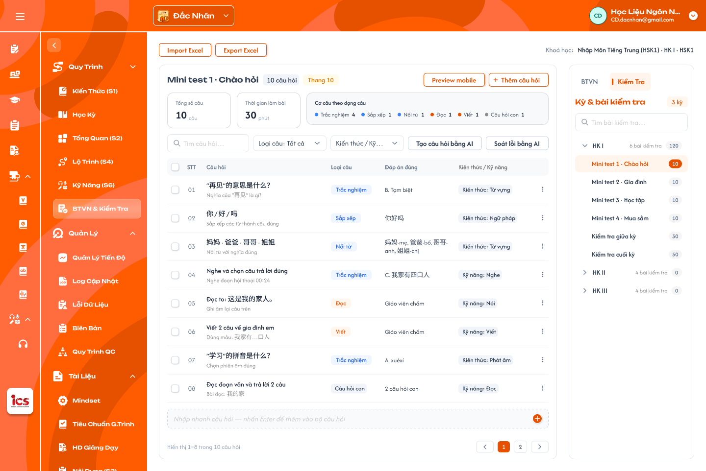

**Mô tả:**
- Tab `Kiểm tra`: soạn bộ câu hỏi cho từng bài kiểm tra của kỳ.

**Điểm cần lưu ý:**
- `A01.02` Cây theo kỳ giống BTVN: mỗi kỳ mở ra danh sách bài kiểm tra của kỳ (vd `Mini test 1 · Chào hỏi`, `Kiểm tra giữa kỳ`), kèm badge số câu.
- `A02.08` Có thêm thẻ `Thời gian làm bài` (phút) lấy từ cấu hình bài kiểm tra ở Học kỳ; tag `Thang 10` cạnh tiêu đề.
- Kỳ, lesson và bài kiểm tra tạo ở Khoá học → Học kỳ; menu này chỉ chọn bài để soạn câu hỏi.

### Trang 3: CD-KH-060130 — BTVN · Bài chưa có câu hỏi


**Mô tả:**
- Trạng thái khi bài chưa có câu nào.

**Điểm cần lưu ý:**
- `A04.01` Tiêu đề kèm tag `0 câu hỏi`; badge của bài trong cây là `0` màu vàng.
- `A04.02` / `A04.03` Hai nút `Thêm câu hỏi` (mở Trang 5) và `Tạo câu hỏi bằng AI` (mở Trang 16).
- `A04.04` `Import Excel` vẫn dùng được khi bài chưa có câu.

### Trang 4: CD-KH-060160 — Preview mobile (trên trang Kiểm tra)

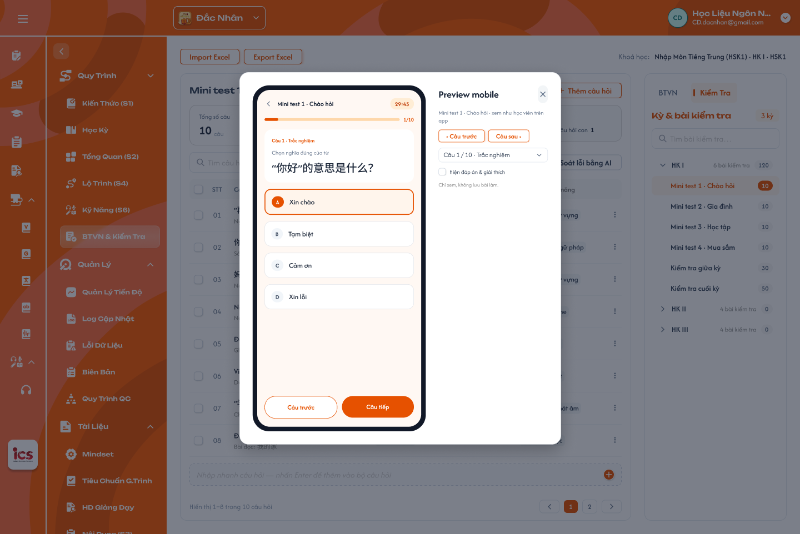

**Mô tả:**
- `A02.03` Nút `Preview mobile` xem bộ câu hỏi như học viên thấy trên app.

**Điểm cần lưu ý:**
- Preview chỉ đọc, không thay đổi bộ câu hỏi.

### Trang 5: CD-KH-060110 — Popup chọn loại câu

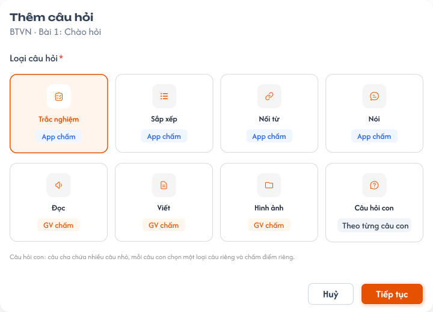

**Mô tả:**
- Bước đầu khi thêm câu: chọn một trong 8 loại câu rồi `Tiếp tục` sang popup soạn câu.

**Điểm cần lưu ý:**
- `A05.01`–`A05.08` 8 loại và người chấm: `Trắc nghiệm`, `Sắp xếp`, `Nối từ`, `Nói` (App chấm); `Đọc`, `Viết`, `Hình ảnh` (GV chấm); `Câu hỏi con` (chấm theo từng câu con).
- Mã loại câu ở source ICS cũ: Trắc nghiệm 1 / 5 / 11; Sắp xếp 7; Nối từ 8; Nói 22; Đọc 3 / 10; Viết 4 / 44 / 6; Hình ảnh 2.
- Mặc định chọn `Trắc nghiệm`; `Huỷ` đóng, không lưu.

### Trang 6: CD-KH-060120 — Popup soạn câu hỏi · Trắc nghiệm

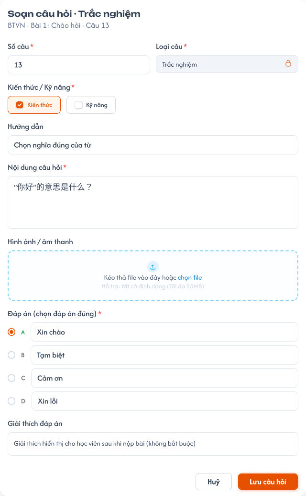

**Mô tả:**
- Soạn hoặc sửa một câu. Phần đầu chung cho mọi loại câu; phần đáp án đổi theo loại (Trang 6–11).

**Điểm cần lưu ý:**
- `A06.01` Dòng phụ `BTVN · <tên bài> · Câu <số câu>` hoặc `<tên bài kiểm tra> · Câu <số câu>`.
- `A06.02` `Số câu` *: số nguyên ≥ 1; mặc định câu tiếp theo cuối bộ; nhập số đã có thì chèn vào vị trí đó, các câu sau dồn xuống.
- `A06.03` `Loại câu` *: lấy từ popup chọn loại, khoá không sửa; muốn đổi loại thì tạo câu mới.
- `A06.04` `Kiến thức / Kỹ năng` *: chọn **một** cụm kiến thức của khoá **hoặc** một kỹ năng `Nghe`, `Đọc`, `Viết`, `Nói`.
- `Điểm` *: bắt buộc, điểm riêng của câu (xem REQ05).
- `A06.06` `Nội dung câu hỏi` * nhiều dòng; `A06.07` file hình ảnh / âm thanh tối đa 25MB mỗi file.
- `A06.11` Trắc nghiệm: 4 lựa chọn `A`–`D`, chọn đúng một đáp án đúng.
- Thiếu field bắt buộc: báo lỗi đỏ dưới field, chặn lưu. Câu thiếu đáp án vẫn lưu được nhưng tính vào tag `N thiếu đáp án` (trừ loại GV chấm).

### Trang 7: CD-KH-060121 — Popup soạn câu hỏi · Sắp xếp

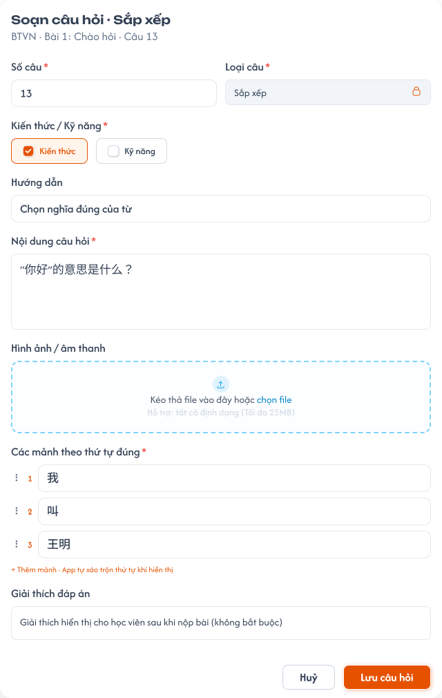

**Mô tả:**
- `A06.12` Nhập các mảnh theo thứ tự đúng.

**Điểm cần lưu ý:**
- App tự xáo trộn thứ tự mảnh khi hiển thị cho học viên.

### Trang 8: CD-KH-060122 — Popup soạn câu hỏi · Nối từ

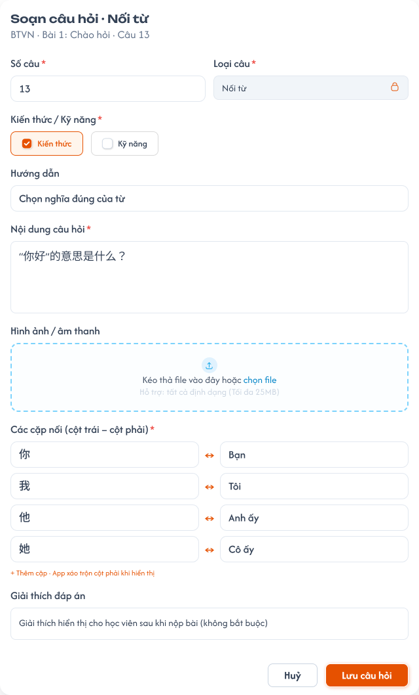

**Mô tả:**
- `A06.13` Nhập danh sách cặp cột trái – cột phải.

### Trang 9: CD-KH-060123 — Popup soạn câu hỏi · Nói

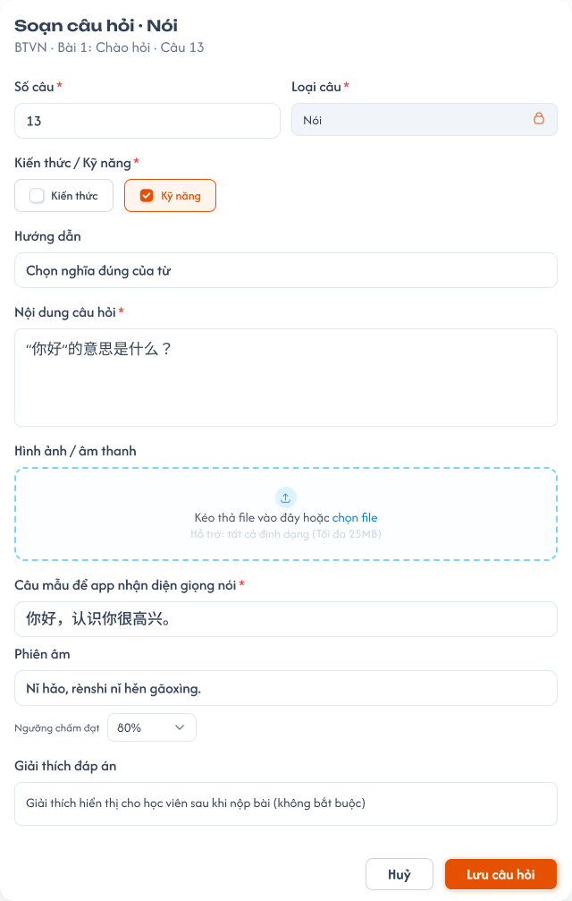

**Mô tả:**
- `A06.14` Nhập câu mẫu để app nhận diện giọng nói.

### Trang 10: CD-KH-060124 — Popup soạn câu hỏi · Viết

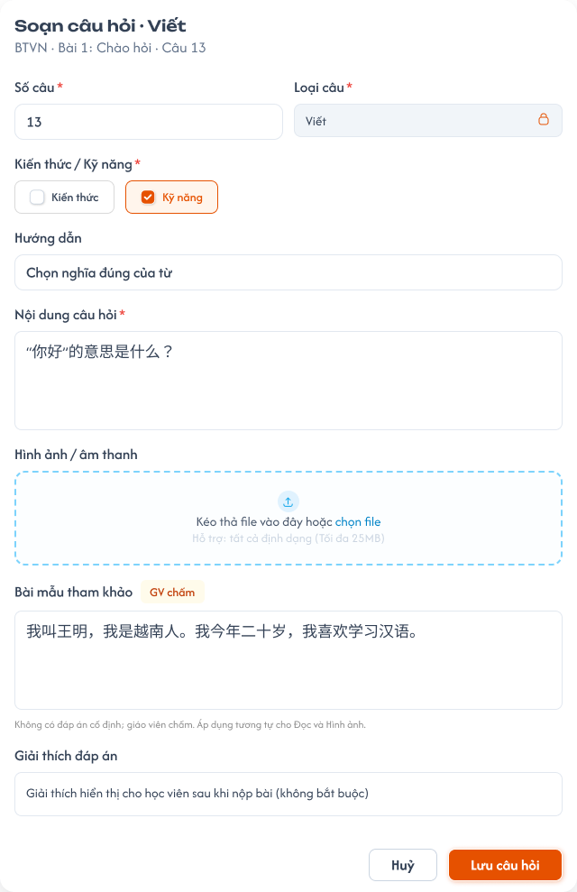

**Mô tả:**
- `A06.15` `Đọc`, `Viết`, `Hình ảnh` không có đáp án, giáo viên chấm; có thể nhập bài mẫu tham khảo.

### Trang 11: CD-KH-060125 — Popup soạn câu hỏi · Câu hỏi con

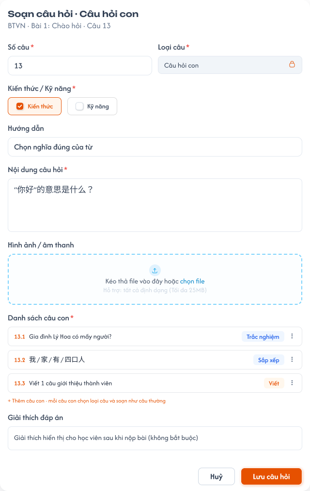

**Mô tả:**
- `A06.16` Danh sách câu con; mỗi câu con chọn loại câu riêng và soạn như câu thường.

**Điểm cần lưu ý:**
- Câu con không có Số câu riêng, đánh `N.1`, `N.2`…; điểm câu cha là điểm của cả câu.

### Trang 12: CD-KH-060140 — Kết quả Import · Có dòng lỗi

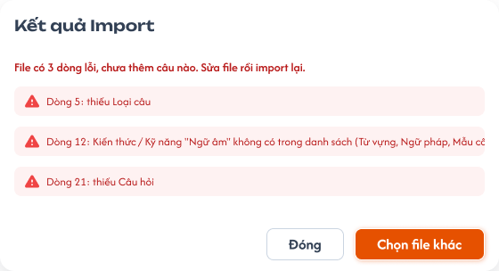

**Mô tả:**
- `A07.04` File import có dòng lỗi: chặn cả file, không thêm câu nào, liệt kê lỗi theo số dòng (vd `Dòng 5: thiếu Loại câu`).

**Điểm cần lưu ý:**
- `A07.03` Mỗi dòng bắt buộc có `STT`, `Câu hỏi`, `Loại câu` (một trong 8 loại), `Kiến thức / Kỹ năng` (cụm của khoá hoặc Nghe, Đọc, Viết, Nói).
- Chỉ nhận `.xlsx`; file khác hoặc sai cột tiêu đề báo lỗi, không import.
- Nút `Chọn file khác` mở lại chọn file; `Đóng` giữ nguyên bộ câu hỏi.

### Trang 13: CD-KH-060141 — Kết quả Import · Thành công

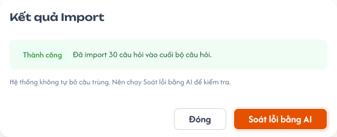

**Mô tả:**
- `A07.06` Import hợp lệ: thêm câu vào cuối bộ theo thứ tự `STT` trong file, báo `Đã import N câu hỏi`.

**Điểm cần lưu ý:**
- `A07.05` Không tự dò hay bỏ câu trùng; nút `Soát lỗi bằng AI` mở Trang 14 để tìm câu trùng.
- `A07.01` Cột file giống cột bảng câu hỏi: `STT`, `Câu hỏi`, `Hướng dẫn`, `Loại câu`, `Đáp án đúng`, `Kiến thức / Kỹ năng`, `Điểm`; câu hỏi con nằm ngay dưới câu cha, `STT` dạng `7.1`.
- `A07.02` `Export Excel` xuất toàn bộ câu của bài (không theo bộ lọc), tên file `<Khoá học>_<Bài>.xlsx`; file export import lại được.

### Trang 14: CD-KH-060150 — Soát lỗi bằng AI

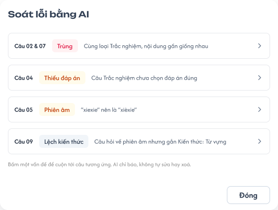

**Mô tả:**
- AI rà toàn bộ câu của bài và trả danh sách vấn đề để CD tự xử lý.

**Điểm cần lưu ý:**
- `A08.01` Phạm vi: toàn bộ câu của bài đang chọn, kể cả câu hỏi con.
- `A08.02` Vấn đề: câu trùng (cùng loại, nội dung giống hoặc gần giống), thiếu đáp án, đáp án không khớp nội dung, lỗi chính tả / phiên âm, câu lệch Kiến thức / Kỹ năng đã gắn.
- `A08.03` Bấm một vấn đề cuộn tới câu tương ứng; không có vấn đề thì báo `Không tìm thấy lỗi.`
- `A08.04` AI không tự sửa hay xoá; soát lỗi chỉ đọc dữ liệu.

### Trang 15: CD-KH-030340 — Học kỳ / Kiểm tra / Danh sách bài tập

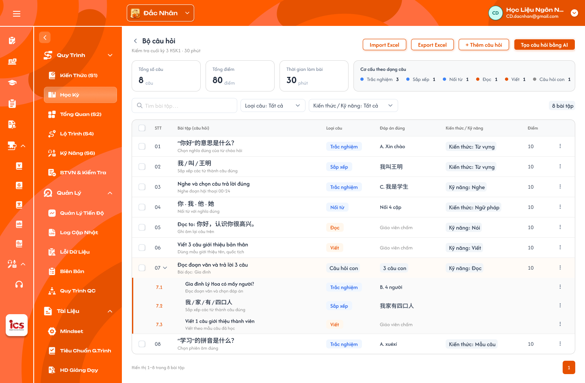

**Mô tả:**
- Bộ câu hỏi của bài kiểm tra mở từ Học kỳ → Kiểm tra; dùng chung thành phần với Trang 1–2 (thanh công cụ, thẻ tổng quan, bảng câu hỏi).

**Điểm cần lưu ý:**
- `A02.02` `Import Excel` / `Export Excel` như Trang 12–13.
- `A02.05` `Tạo câu hỏi bằng AI` mở Trang 16.
- Thẻ tổng quan, bảng câu hỏi và quyền sửa giống Trang 1–2.

### Trang 16: CD-KH-030341 — Popup Generate · Nhập prompt

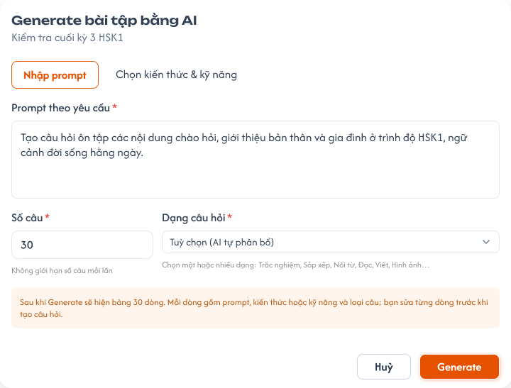

**Mô tả:**
- Popup `Generate bài tập bằng AI` (dòng phụ là tên bài). AI không tạo câu ngay mà sinh bảng N dòng để CD soát và chọn.

**Điểm cần lưu ý:**
- `A09.01` Tab `Nhập prompt`: `Prompt theo yêu cầu` * nhiều dòng.
- `A09.03` `Số câu` * số nguyên ≥ 1, **không giới hạn** số câu mỗi lần.
- `A09.04` `Dạng câu hỏi` *: `Tuỳ chọn (AI tự phân bổ)` hoặc một / nhiều trong 8 loại.
- `A09.06` `Generate` chỉ bật khi tab đang dùng đủ field bắt buộc.
- Chuyển tab giữ nguyên `Số câu` và `Dạng câu hỏi`; chế độ Generate theo tab đang mở khi bấm.

### Trang 17: CD-KH-030342 — Popup Generate · Chọn kiến thức & kỹ năng

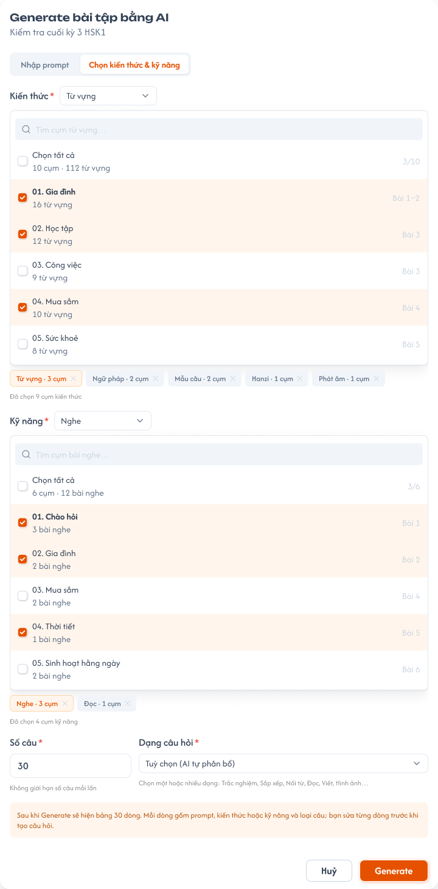

**Mô tả:**
- `A09.02` Generate theo cụm kiến thức và kỹ năng thay cho prompt.

**Điểm cần lưu ý:**
- `Cụm kiến thức` *: tìm cụm, tick ít nhất 1 cụm; dòng `Đã chọn N cụm · M mục kiến thức`.
- `Kỹ năng`: tick 0 hoặc nhiều trong Nghe, Nói, Đọc, Viết; chỉ tick kỹ năng mà chưa có cụm thì `Generate` khoá.

### Trang 18: CD-KH-030344 — Generate · Đang tạo bảng

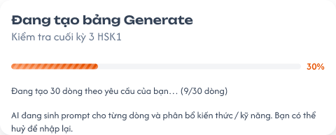

**Mô tả:**
- `A10.01` Thanh tiến độ `%` và dòng `Đang tạo N dòng từ prompt của bạn… (x/N dòng)`.

**Điểm cần lưu ý:**
- `Huỷ` dừng tạo, quay lại popup nhập, giữ dữ liệu đã nhập; không thêm câu nào.

### Trang 19: CD-KH-030346 — Generate · Lỗi

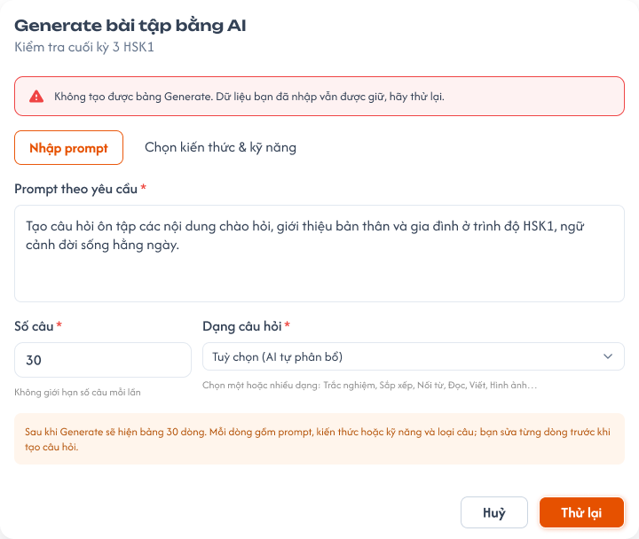

**Mô tả:**
- `A10.02` AI lỗi: popup nhập hiện thông báo đỏ `Không tạo được bảng Generate. Dữ liệu bạn đã nhập vẫn được giữ, hãy thử lại.`

**Điểm cần lưu ý:**
- Nút `Generate` đổi thành `Thử lại`; không thêm câu nào.

### Trang 20: CD-KH-030343 — Generate · Bảng N dòng


**Mô tả:**
- Màn `Generate bài tập · N dòng`: mỗi dòng là một câu sẽ tạo; CD sửa, tick dòng muốn dùng rồi `Thêm N câu đã chọn`.

**Điểm cần lưu ý:**
- `A11.01` Dòng tóm tắt: prompt (cắt `…`), `Chế độ`, `Số câu`, `Dạng`.
- `A11.02` Cột `☐`, `STT`, `Prompt` (sửa được), `Kiến thức / Kỹ năng` (dropdown), `Loại câu` (`Tuỳ chọn` hoặc 8 loại), `⋮` xoá dòng.
- `A11.03` `Sửa loại chung` + `Áp dụng` đổi Loại câu cho các dòng đã tick; `Bỏ chọn`.
- `A11.04` Chỉ dòng được tick mới tạo câu, thêm vào **cuối** bộ; dòng thiếu Prompt hoặc Kiến thức / Kỹ năng báo lỗi, chặn thêm. Chưa bấm thêm thì chưa có câu nào được tạo.

### Trang 21: CD-KH-030345 — Generate · Xác nhận bỏ bảng


**Mô tả:**
- `A11.05` `Huỷ` hoặc nút `<` ở Trang 20 mở popup `Bỏ bảng Generate?`.

**Điểm cần lưu ý:**
- `Tiếp tục chỉnh sửa` giữ bảng; `Bỏ bảng` xoá bảng và mọi chỉnh sửa, không thêm câu nào.

### Trang 22: CD-KH-030347 — Danh sách bài tập · Sau khi tạo


**Mô tả:**
- Sau khi thêm, quay về bộ câu hỏi, tự cuộn tới các câu mới.

**Điểm cần lưu ý:**
- `A12.01` Câu mới nền xanh nhạt, tag `AI`, số câu tiếp nối cuối bộ.
- `A12.02` Badge `N bài tập · M mới`; `A12.03` thẻ tổng quan cập nhật.
- Câu tạo bằng AI dùng như câu soạn tay; tag `AI` mất khi CD sửa và lưu.

### Trang 23: CD-KH-030348 — Học kỳ / Kiểm tra / Popup chọn loại câu


**Mô tả:**
- Popup chọn loại câu mở từ Trang 15; giống Trang 5.

### Trang 24: CD-KH-030349 — Học kỳ / Kiểm tra / Popup soạn câu hỏi · Trắc nghiệm

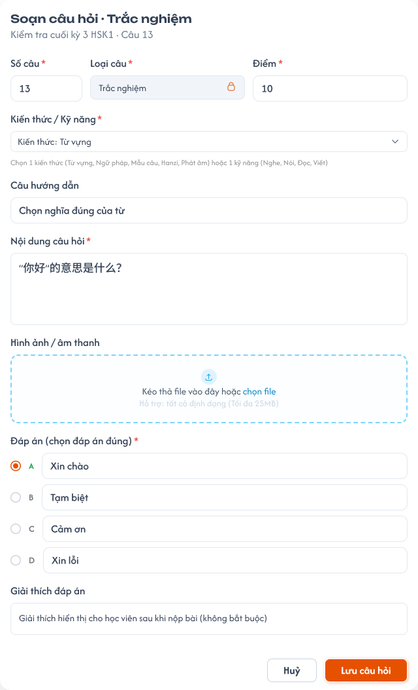

**Mô tả:**
- Popup soạn câu mở từ Trang 15; giống Trang 6.

---

## 2. Yêu cầu

### 2.1. Flow chính

**Flow 1: Chọn kỳ, bài và xem bộ câu hỏi**

```
CD mở khoá học → Bài Tập Về Nhà → tab BTVN / Kiểm tra (Trang 1 / 2)
  → chọn kỳ → danh sách lesson / bài kiểm tra của kỳ → chọn bài
  → FE tải tiêu đề, thẻ tổng quan, bảng câu hỏi
                    ↓ (bài chưa có câu)
              Trạng thái rỗng (Trang 3)
```

**Flow 2: Thêm câu hỏi soạn tay**

```
"+ Thêm câu hỏi" hoặc Enter ở ô nhập nhanh → Popup chọn loại câu (Trang 5) → Tiếp tục
  → Popup soạn câu (Trang 6–11) → Lưu câu hỏi → BE kiểm tra field bắt buộc + kỳ/khoá Nháp
  → Lưu, đóng popup, cập nhật bảng và thẻ tổng quan → Toast "Đã thêm câu hỏi."
                    ↓ (thiếu field)
              Báo lỗi dưới field, không lưu
```

**Flow 3: Sửa câu hỏi**

```
⋮ → Sửa → Popup soạn câu (Loại câu khoá) → Lưu → BE cập nhật
  → câu có tag AI thì mất tag → Toast "Đã cập nhật câu hỏi."
```

**Flow 4: Xoá câu hỏi**

```
⋮ → Xoá (hoặc chọn nhiều → Xoá) → Popup xác nhận → BE kiểm tra kỳ/khoá Nháp
  → Xoá mềm, các câu sau dồn số → Toast "Đã xoá N câu hỏi."
```

**Flow 5: Export và Import Excel**

```
Export Excel → BE xuất toàn bộ câu của bài → tải file .xlsx
Import Excel → chọn file .xlsx → BE kiểm tra từng dòng
  → hợp lệ: thêm mọi dòng vào cuối bộ → Kết quả Import thành công (Trang 13)
                    ↓ (có dòng lỗi / sai định dạng)
              Chặn cả file → Kết quả Import có dòng lỗi (Trang 12)
```

**Flow 6: Tạo câu hỏi bằng AI**

```
"Tạo câu hỏi bằng AI" → Popup Generate (Trang 16 / 17) → Generate
  → Đang tạo bảng (Trang 18) → Bảng N dòng (Trang 20) → sửa, tick dòng
  → "Thêm N câu đã chọn" → câu thêm vào cuối bộ, tag AI (Trang 22)
       ↓ (Huỷ khi đang tạo)        ↓ (AI lỗi)               ↓ (Huỷ ở bảng)
  Quay lại popup, giữ dữ liệu   Báo lỗi, Thử lại (Trang 19)   Bỏ bảng (Trang 21), không thêm câu
```

**Flow 7: Soát lỗi bằng AI**

```
"Soát lỗi bằng AI" → AI rà toàn bộ câu của bài → danh sách vấn đề (Trang 14)
  → bấm vấn đề cuộn tới câu → CD tự sửa / xoá bằng ⋮
```

### 2.2. Ngoại lệ

- **EX01:** Lưu câu thiếu field bắt buộc (Số câu, Loại câu, Kiến thức / Kỹ năng, Điểm, Nội dung câu hỏi) → báo lỗi dưới field, không lưu.
- **EX02:** File hình ảnh / âm thanh lớn hơn 25MB → không tải lên; Toast `Cảnh Báo` `File vượt quá dung lượng cho phép (25MB).`
- **EX03:** File import có dòng thiếu field bắt buộc, sai Loại câu, sai Kiến thức / Kỹ năng, không phải `.xlsx` hoặc sai cột tiêu đề → chặn cả file, báo lỗi theo dòng; không thêm câu nào.
- **EX04:** Lưu, import, export thất bại do backend / network → Toast `Có Lỗi Xảy Ra`; dữ liệu không thay đổi một phần.
- **EX05:** Thêm, sửa, xoá, import, generate câu thuộc học kỳ hoặc khoá học không ở `Nháp` (giao diện hoặc request trực tiếp) → backend từ chối; Toast `Cảnh Báo` `Học kỳ hoặc khoá học không ở trạng thái Nháp, không thể chỉnh sửa câu hỏi.`
- **EX06:** Generate thiếu field bắt buộc (prompt, cụm kiến thức, số câu, dạng câu hỏi) hoặc dòng bảng thiếu Prompt / Kiến thức / Kỹ năng → khoá nút hoặc báo lỗi dòng, không tạo.
- **EX07:** AI không tạo được bảng hoặc câu hỏi → báo lỗi, giữ dữ liệu đã nhập, cho `Thử lại`; không thêm câu nào.

### 2.3. Yêu cầu khác

| Mã | Tên yêu cầu | Mô tả |
|---|---|---|
| REQ01 | Chọn bài theo kỳ | Tab BTVN: kỳ → lesson của kỳ; tab Kiểm tra: kỳ → bài kiểm tra của kỳ; badge số câu từng bài; tìm theo tên bài; mặc định kỳ đầu, bài đầu. |
| REQ02 | Thẻ tổng quan | Tổng số câu (câu cha), Thời gian làm bài (chỉ Kiểm tra), Cơ cấu theo dạng câu; tag `N câu hỏi`, `N thiếu đáp án`, `Thang 10` (chỉ Kiểm tra); cập nhật ngay sau mọi thay đổi. |
| REQ03 | Bảng câu hỏi | Cột STT, Câu hỏi, Loại câu, Đáp án đúng, Kiến thức / Kỹ năng, Điểm; lọc Loại câu, Kiến thức / Kỹ năng và tìm kiếm (không có lọc Trạng thái); câu hỏi con mở / thu; 50 câu/trang; xoá mềm; chỉ thêm / sửa / xoá khi học kỳ và khoá học `Nháp`. |
| REQ04 | Loại câu | 8 loại: Trắc nghiệm, Sắp xếp, Nối từ, Nói (App chấm); Đọc, Viết, Hình ảnh (GV chấm); Câu hỏi con (theo từng câu con). |
| REQ05 | Soạn câu hỏi | Bắt buộc Số câu, Loại câu (khoá sau khi chọn), Kiến thức hoặc Kỹ năng, Điểm, Nội dung câu hỏi; đáp án theo loại câu; file tối đa 25MB; Số câu trùng thì chèn và dồn các câu sau. |
| REQ06 | Import / Export Excel | Cột file giống bảng UI, gồm cả cột Điểm; export toàn bộ câu của bài; import thêm vào cuối, kiểm tra từng dòng, có dòng lỗi thì chặn cả file; không tự dò câu trùng. |
| REQ07 | Soát lỗi bằng AI | Rà toàn bộ câu của bài, phát hiện câu trùng và các lỗi khác, chỉ báo, không tự sửa. |
| REQ08 | Generate bằng AI | Hai chế độ Nhập prompt / Chọn kiến thức & kỹ năng; Số câu không giới hạn; sinh bảng N dòng để sửa và chọn; chỉ dòng được tick mới tạo câu, thêm vào cuối bộ với tag `AI`; huỷ / lỗi không thêm câu. |
| REQ09 | Không trạng thái và kỳ Vô hiệu | BTVN, bộ câu hỏi và câu hỏi không có trạng thái riêng; chỉ sửa được khi học kỳ `Nháp` và khoá học `Nháp`, ngược lại chỉ đọc. Nhân bản học kỳ / khoá học sao chép toàn bộ BTVN và bộ câu hỏi. Kỳ `Vô hiệu`: BTVN đã tạo trong lớp trước khi vô hiệu vẫn dùng bình thường. |

### 2.4. Ràng buộc

#### Quyền

| Role | Xem bộ câu hỏi | Thêm / sửa câu | Xoá câu | Import / Export Excel | Generate / Soát lỗi bằng AI |
|---|:---:|:---:|:---:|:---:|:---:|
| CD | ✅ | ✅ | ✅ | ✅ | ✅ |
| Các role khác | ❌ | ❌ | ❌ | ❌ | ❌ |

#### Ràng buộc khác

- Thêm, sửa, xoá, import, generate chỉ khi học kỳ `Nháp` và khoá học `Nháp`; Export và Soát lỗi luôn dùng được.
- Dữ liệu theo khoá học và trung tâm CD đang chọn; Kiến thức / Kỹ năng chỉ chọn trong cụm của chính khoá học và 4 kỹ năng.
- File hình ảnh / âm thanh tối đa 25MB; import chỉ nhận `.xlsx`.
- Mọi request thêm, sửa, xoá, import được backend kiểm tra quyền, khoá học, bài và field bắt buộc; không dựa vào việc ẩn nút.
- Mỗi thao tác một Toast: `Thành Công`, `Cảnh Báo` hoặc `Có Lỗi Xảy Ra`; `Huỷ`, tìm kiếm, lọc, chọn bài, soát lỗi không có Toast CRUD.


---

## 3. Testcase

### Feature: [CD] Bài tập về nhà và Kiểm tra

| Tên testcase | Priority | Scenario | Role | Pre-condition | Given/When/Then | Expected Result |
|---|---|---|---|---|---|---|
| Case 1: Mở menu và chọn bài theo kỳ | High | Flow 1 / REQ01 | CD | Khoá học có 3 kỳ; HK I có 6 bài và 6 bài kiểm tra | **Given:** mở menu Bài Tập Về Nhà<br>**When:** chọn tab BTVN rồi tab Kiểm tra, mở HK I, chọn bài 4<br>**Then:** mặc định HK I bài 1; tab Kiểm tra chỉ hiện bài kiểm tra của HK I; vùng trái tải bộ câu hỏi bài 4 | - Badge số câu đúng từng bài<br>- Tìm `thời tiết` tự mở kỳ chứa bài khớp |
| Case 2: Thẻ tổng quan và bảng câu hỏi | High | REQ02 / REQ03 | CD | Bài kiểm tra 8 câu (3 Trắc nghiệm, 1 Câu hỏi con 3 câu con, 2 Viết, 1 câu thiếu đáp án), thời gian 30 phút | **Given:** chọn bài kiểm tra<br>**When:** bảng và thẻ tải xong<br>**Then:** thẻ 8 câu, 30 phút, cơ cấu đúng; tag `1 thiếu đáp án`, `Thang 10`; bảng đủ cột kể cả `Điểm` | - Câu con không cộng vào Tổng số câu<br>- Câu Viết hiện `Giáo viên chấm`, không tính thiếu đáp án<br>- Không có lọc Trạng thái; tab BTVN không có thẻ Thời gian |
| Case 3: Thêm câu soạn tay | High | Flow 2 / REQ04 / REQ05 | CD | Bộ có 12 câu; kỳ và khoá `Nháp` | **Given:** `+ Thêm câu hỏi` → chọn `Trắc nghiệm` → nhập đủ field, Số câu `3`, Điểm, gắn `Cụm 01. Chào hỏi`<br>**When:** bấm `Lưu câu hỏi`<br>**Then:** câu mới là câu 3, câu 3–12 cũ thành 4–13 | - Toast `Đã thêm câu hỏi.`<br>- Thẻ tổng quan cập nhật<br>- Enter ở ô nhập nhanh mở popup với nội dung điền sẵn |
| Case 4: Thiếu field và file quá lớn | High | EX01 / EX02 / REQ05 | CD | Popup soạn câu đang mở | **Given:** bỏ trống Kiến thức / Kỹ năng hoặc Điểm; chọn file âm thanh 30MB<br>**When:** bấm `Lưu câu hỏi`<br>**Then:** báo lỗi dưới field, không lưu; file không tải lên | - Toast `File vượt quá dung lượng cho phép (25MB).` |
| Case 5: Sửa câu AI và xoá câu | High | Flow 3 / Flow 4 / REQ03 | CD | Câu 09 có tag `AI`; kỳ và khoá `Nháp` | **Given:** sửa Hướng dẫn câu 09 rồi lưu; xoá câu 03<br>**When:** hệ thống xử lý<br>**Then:** câu 09 mất tag `AI`; câu 03 biến mất, các câu sau dồn số | - Toast `Đã cập nhật câu hỏi.` / `Đã xoá 1 câu hỏi.` |
| Case 6: Chỉ đọc khi không ở Nháp | High | EX05 / REQ09 | CD | Bài thuộc khoá `Công khai`; bài khác thuộc học kỳ `Vô hiệu` | **Given:** mở bộ câu hỏi; gửi request thêm / sửa / xoá trực tiếp<br>**When:** hệ thống xử lý<br>**Then:** không có nút thêm, sửa, xoá, import, generate; backend từ chối | - Toast `Cảnh Báo` đúng nội dung<br>- Vẫn xem, Export, Soát lỗi được<br>- BTVN đã dùng trong lớp trước khi vô hiệu vẫn làm và nộp được |
| Case 7: Export và Import thành công | High | Flow 5 / REQ06 | CD | Bài A có 8 câu (1 câu hỏi con 3 câu con); bài B trống | **Given:** đang lọc `Viết`, bấm `Export Excel` bài A; import file đó vào bài B<br>**When:** hệ thống xử lý<br>**Then:** file có đủ 8 câu và dòng `7.1`–`7.3`, cột như bảng (có `Điểm`); bài B có 8 câu giống bài A | - Export không theo bộ lọc<br>- Kết quả Import thành công (Trang 13)<br>- Câu trùng vẫn được thêm |
| Case 8: Import có dòng lỗi | High | EX03 / REQ06 | CD | File 10 dòng, dòng 5 thiếu Loại câu; một file `.csv` | **Given:** import từng file<br>**When:** hệ thống kiểm tra<br>**Then:** chặn cả file, báo `Dòng 5: thiếu Loại câu`; file `.csv` báo sai định dạng | - Không thêm câu nào<br>- Kết quả Import có dòng lỗi (Trang 12) |
| Case 9: Generate theo prompt và thêm câu đã chọn | High | Flow 6 / REQ08 | CD | Bài kiểm tra đang mở | **Given:** nhập prompt, Số câu `30`, Dạng `Tuỳ chọn`, Generate; ở bảng tick 5 dòng, `Sửa loại chung` = `Trắc nghiệm`<br>**When:** bấm `Thêm 5 câu đã chọn`<br>**Then:** 5 câu Trắc nghiệm thêm vào cuối bộ, tag `AI`, cuộn tới câu mới | - 25 dòng không tick bị bỏ<br>- Toast `Đã thêm 5 câu hỏi vào cuối danh sách bài tập.`<br>- Số câu `80` vẫn được chấp nhận |
| Case 10: Generate thiếu dữ liệu, huỷ và lỗi | Medium | EX06 / EX07 / REQ08 | CD | Popup Generate đang mở | **Given:** tab Chọn kiến thức & kỹ năng chỉ tick Nghe; hoặc Huỷ khi đang tạo 9/30; hoặc AI lỗi; hoặc Bỏ bảng; hoặc dòng 04 thiếu Kiến thức / Kỹ năng<br>**When:** thao tác<br>**Then:** nút Generate khoá; quay lại giữ dữ liệu; báo đỏ và `Thử lại`; dòng 04 báo lỗi | - Không thêm câu nào trong mọi trường hợp |
| Case 11: Soát lỗi bằng AI | Medium | Flow 7 / REQ07 | CD | Câu 02 và 11 trùng nội dung, cùng loại | **Given:** bấm `Soát lỗi bằng AI`<br>**When:** AI trả kết quả<br>**Then:** danh sách có vấn đề trùng giữa câu 02 và 11; bấm vào cuộn tới câu | - Không tự xoá câu nào<br>- Bộ đúng thì hiện `Không tìm thấy lỗi.` |
| Case 12: Role khác bị chặn | High | Ràng buộc quyền | Role khác CD | - | **Given:** mở URL menu Bài Tập Về Nhà; gửi request thêm câu<br>**When:** hệ thống xử lý<br>**Then:** bị từ chối | - Dữ liệu không đổi |
| Case 13: Toast lỗi hệ thống | Medium | EX04 / Ràng buộc khác | CD | Backend hoặc network lỗi | **Given:** lưu câu hoặc import<br>**When:** thất bại<br>**Then:** Toast `Có Lỗi Xảy Ra` | - Dữ liệu không thay đổi một phần |

---

## 4. Câu hỏi cần xác nhận

- **Q01:** Mỗi câu có `Điểm` riêng (REQ05). Điểm bài tính bằng tổng điểm các câu hay vẫn quy về thang 10 (REQ02 đang có tag `Thang 10`)? Thẻ tổng quan có hiện `Tổng điểm` không?
- **Q02:** Import có bắt buộc cột `Điểm` không, và dòng thiếu `Điểm` thì xử lý thế nào?
