# [CD] Bài tập về nhà và Kiểm tra

Menu **Bài Tập Về Nhà** trong khoá học của role **CD**: soạn **bộ câu hỏi** cho BTVN của từng bài học và cho từng **bài kiểm tra**, theo kỳ. Bộ câu hỏi được soạn tay, **Import / Export Excel** hoặc **tạo bằng AI** (Generate), kiểm tra bằng **Soát lỗi bằng AI**. Câu hỏi tạo tại đây là dữ liệu của [Thư viện bài tập](../library/library.md).

Ảnh lấy từ Figma `CD-KH-060100` → `CD-KH-060200` (BTVN, Kiểm tra) và `CD-KH-030340` → `CD-KH-030349` (Danh sách bài tập, luồng Generate — thiết kế ở Học kỳ / Kiểm tra, dùng chung cho BTVN và Kiểm tra). Điểm khác Figma ghi ngay dưới ảnh; phần chưa có thiết kế ghi rõ là **UI cần bổ sung**. Câu hỏi, điểm, tên bài trong ảnh là dữ liệu mẫu.

## 1. UI

### Trang 1: CD-KH-060100, CD-KH-060200 — Khung màn, cây kỳ và bài


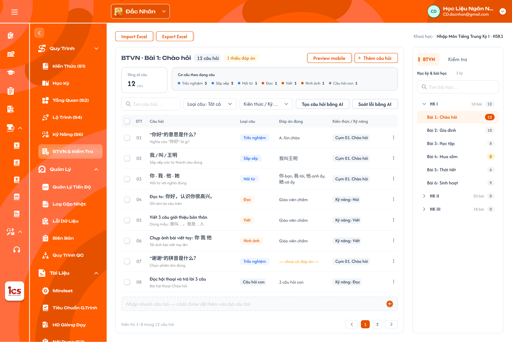

*Tab BTVN: cây Học kỳ & bài học bên phải, bộ câu hỏi của bài đang chọn bên trái (Figma CD-KH-060100) — nhấn để xem ảnh gốc*


*Tab Kiểm tra (Figma CD-KH-060200) — nhấn để xem ảnh gốc*

**Mô tả:**

- CD mở menu `Bài Tập Về Nhà` của khoá học. Vùng phải là panel chọn bài với 2 tab `BTVN` / `Kiểm tra`; vùng trái là bộ câu hỏi của bài đang chọn. Góc trên phải ghi `Khoá học: <tên khoá> · <cấp độ>`.

**Điểm cần lưu ý:**

- `A01.01` **Tab `BTVN`**: Cây theo kỳ: mỗi kỳ (`HK I`, `HK II`…) kèm số bài; mở kỳ ra **danh sách lesson của kỳ** theo thứ tự bài học. Mỗi bài kèm badge số câu hỏi (`0` màu vàng).
- `A01.02` **Tab `Kiểm tra`**: Cây theo kỳ giống BTVN: mỗi kỳ mở ra **danh sách bài kiểm tra của kỳ** (vd `Mini test 1 · Chào hỏi`, `Kiểm tra giữa kỳ`), kèm badge số câu.
- `A01.03` **Ô `Tìm bài học…` / `Tìm bài kiểm tra…`**: Tìm theo tên bài trong tab đang mở; kỳ chứa bài khớp tự mở.
- `A01.04` **Chọn bài**: Bấm bài: dòng tô cam, vùng trái tải bộ câu hỏi của bài. Mặc định kỳ đầu tiên, bài đầu tiên.
- `A01.05` **Kỳ `Công khai` / `Vô hiệu`**: Vẫn hiện trong cây (kỳ `Vô hiệu` kèm nhãn `Vô hiệu`); CD chỉ **xem** bộ câu hỏi, không sửa được (xem REQ09).

- Luồng: chọn kỳ → danh sách lesson (hoặc bài kiểm tra) của kỳ → chọn bài → bộ câu hỏi của bài.
- Kỳ, lesson và bài kiểm tra được định nghĩa ở **Khoá học → Học kỳ** ([Tab Bài học](../semester/lesson/lesson.md), [Tab Kiểm tra](../semester/test/test.md)); menu Bài Tập Về Nhà chỉ chọn bài để soạn bộ câu hỏi, không thêm / sửa / xoá kỳ, lesson hay bài kiểm tra.
- BTVN và bộ câu hỏi **không có trạng thái** riêng, đi theo trạng thái học kỳ và khoá học: chỉ thêm / sửa / xoá / import / generate câu hỏi khi **học kỳ `Nháp` và khoá học `Nháp`**; ngược lại bộ câu hỏi chỉ đọc (ẩn `+ Thêm câu hỏi`, `Import Excel`, `Tạo câu hỏi bằng AI`, ô nhập nhanh, checkbox xoá hàng loạt, menu `⋮` Sửa / Xoá); vẫn xem, `Export Excel`, `Soát lỗi bằng AI` được (xem [Quản lý khoá học](../course_management.md) REQ10).
- Kỳ bị `Vô hiệu`: BTVN của kỳ đó đã được tạo trong lớp trước khi vô hiệu vẫn dùng bình thường ở lớp (học viên vẫn làm, giáo viên vẫn chấm).
- Khác Figma CD-KH-060200: tab Kiểm tra trên Figma là danh sách phẳng; requirement là cây theo kỳ giống BTVN.

### Trang 2: CD-KH-030340, CD-KH-060100 — Bộ câu hỏi: thanh công cụ và thẻ tổng quan


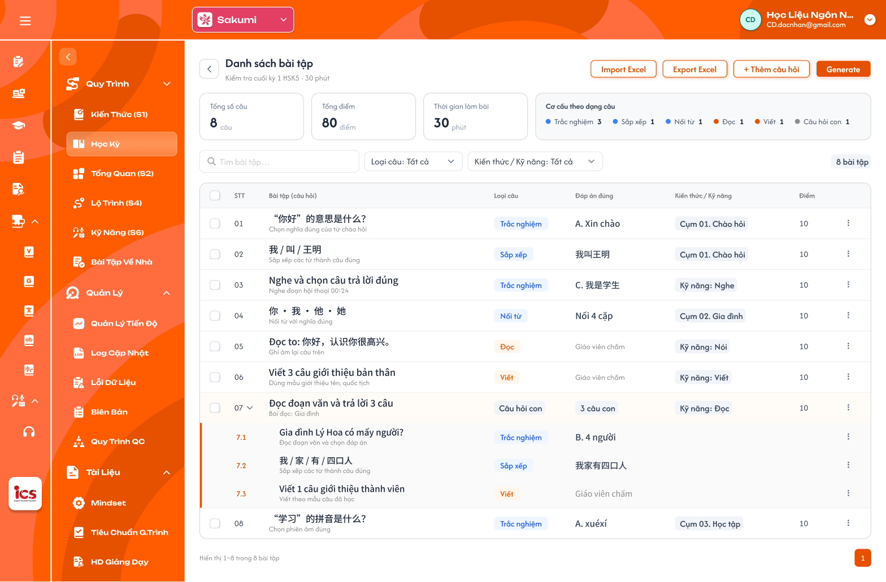

*Bộ câu hỏi của bài kiểm tra: nút Import / Export Excel, Thêm câu hỏi, Generate và thẻ tổng quan (Figma CD-KH-030340, còn vẽ thẻ Tổng điểm đã bỏ) — nhấn để xem ảnh gốc*

**Mô tả:**

- Đầu vùng trái là tên bài, các nút thao tác và thẻ tổng quan của bộ câu hỏi (Kiểm tra 3 thẻ, BTVN 2 thẻ). Áp dụng cho cả BTVN và Kiểm tra.

**Điểm cần lưu ý:**

- `A02.01` **Tiêu đề**: `BTVN · <tên bài>` hoặc `<tên bài kiểm tra>`; tag `N câu hỏi`; tag cảnh báo `N thiếu đáp án` khi có câu chưa có đáp án (không áp dụng câu Giáo viên chấm).
- `A02.02` **`Import Excel` / `Export Excel`**: Xem khu vực Import / Export Excel.
- `A02.03` **`Preview mobile`**: Xem bộ câu hỏi như học viên thấy trên app (**UI cần bổ sung**).
- `A02.04` **`+ Thêm câu hỏi`**: Mở popup Chọn loại câu.
- `A02.05` **`Tạo câu hỏi bằng AI`**: Mở popup Generate bài tập bằng AI.
- `A02.06` **`Soát lỗi bằng AI`**: Xem khu vực Soát lỗi bằng AI.
- `A02.07` **Thẻ `Tổng số câu`**: Số câu cha của bộ (câu hỏi con tính trong câu cha).
- `A02.08` **Thẻ `Thời gian làm bài`**: Chỉ bài kiểm tra: thời gian làm bài (phút) lấy từ cấu hình bài kiểm tra ở Học kỳ.
- `A02.09` **Thẻ `Cơ cấu theo dạng câu`**: Số câu theo từng loại câu có trong bộ (vd `Trắc nghiệm 3 · Sắp xếp 1 · Câu hỏi con 1`).

- Thẻ tổng quan cập nhật ngay sau khi thêm, sửa, xoá, import hoặc tạo câu bằng AI.
- Không có thẻ `Tổng điểm` và không có điểm riêng từng câu: mọi câu chấm trên thang 10, điểm bài của học viên là trung bình điểm các câu (tối đa 10) theo requirement chấm bài của Giáo viên. Bài kiểm tra hiển thị tag `Thang 10` cạnh tiêu đề.
- Khác Figma CD-KH-030340: còn thẻ `Tổng điểm` (đã bỏ theo thang 10, CD-KH-060100 / 060200 đã sửa); nút tạo bằng AI ghi `Generate`.

### Trang 3: CD-KH-060100, CD-KH-030340 — Bảng câu hỏi


**Mô tả:**

- Bảng các câu hỏi của bài đang chọn, có tìm kiếm, lọc, chọn nhiều, menu thao tác dòng và ô nhập nhanh cuối bảng.

**Điểm cần lưu ý:**

- `A03.01` **Cột**: `☐`, `STT`, `Câu hỏi` (nội dung + hướng dẫn), `Loại câu`, `Đáp án đúng`, `Kiến thức / Kỹ năng`, `Điểm`, `⋮`.
- `A03.02` **`Đáp án đúng`**: Theo loại câu; `Đọc`, `Viết`, `Hình ảnh` hiển thị `Giáo viên chấm`; chưa có đáp án hiển thị `— chưa có đáp án —` màu cam; `Câu hỏi con` hiển thị `N câu hỏi con`.
- `A03.03` **Câu hỏi con**: Dòng cha có mũi tên mở / thu các câu con `7.1`, `7.2`…; mỗi câu con có loại câu, đáp án và menu `⋮` riêng. Điểm câu cha là điểm của cả câu.
- `A03.04` **Tag `AI`**: Câu tạo bằng AI có tag `AI` cạnh nội dung; mất khi CD sửa và lưu câu.
- `A03.05` **Ô `Tìm câu hỏi…`**: Theo nội dung và hướng dẫn câu hỏi.
- `A03.06` **Lọc `Loại câu`**: Chọn nhiều trong 8 loại; mặc định `Tất cả`.
- `A03.07` **Lọc `Kiến thức / Kỹ năng`**: Chọn nhiều cụm kiến thức của khoá hoặc kỹ năng Nghe, Đọc, Viết, Nói; mặc định `Tất cả`.
- `A03.08` **Checkbox**: Chọn nhiều câu để `Xoá` hàng loạt; checkbox tiêu đề chọn tất cả câu đang hiển thị.
- `A03.09` **Menu `⋮`**: `Sửa` (mở popup soạn câu), `Xoá` (popup xác nhận).
- `A03.10` **Nhập nhanh cuối bảng**: Ô `Nhập nhanh câu hỏi — nhấn Enter để thêm vào bộ câu hỏi`; Enter mở popup Chọn loại câu với Nội dung câu hỏi điền sẵn chữ vừa nhập.
- `A03.11` **Phân trang**: 50 câu/trang; `Hiển thị 1–50 trong N câu hỏi`; nút trang trước / sau.

- Không có lọc `Trạng thái` vì câu hỏi và BTVN không có trạng thái.
- Câu hỏi thuộc học kỳ hoặc khoá học không ở `Nháp` (`Công khai` / `Vô hiệu`) không được thêm, sửa, xoá; muốn thay đổi thì nhân bản học kỳ / khoá học rồi sửa trên bản sao `Nháp`.
- Xoá câu là xoá mềm; số thứ tự các câu sau dồn lên.
- Khác Figma CD-KH-060100 / 060200: bảng chưa có cột `Kiến thức / Kỹ năng`, lọc `Kiến thức / Kỹ năng` (đã có ở CD-KH-030340) và còn lọc `Trạng thái`.

### Trang 4: CD-KH-060130 — Bài chưa có câu hỏi


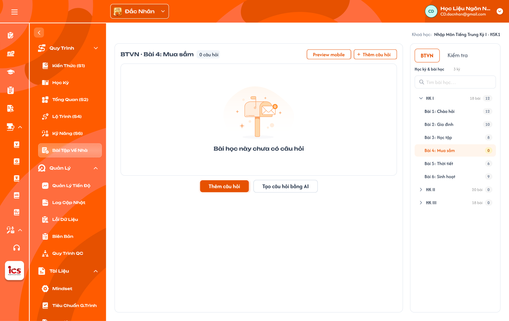

*Bài chưa có câu hỏi (Figma CD-KH-060130) — nhấn để xem ảnh gốc*

**Mô tả:**

- Bài chưa có câu nào: vùng trái hiển thị trạng thái rỗng `Bài học này chưa có câu hỏi` và 2 nút `Thêm câu hỏi`, `Tạo câu hỏi bằng AI`.

**Điểm cần lưu ý:**

- `A04.01` **Tiêu đề**: `BTVN · <tên bài>` và tag `0 câu hỏi`.
- `A04.02` **`Thêm câu hỏi`**: Mở popup Chọn loại câu.
- `A04.03` **`Tạo câu hỏi bằng AI`**: Mở popup Generate.
- `A04.04` **`Import Excel`**: Vẫn dùng được khi bài chưa có câu.

- Badge số câu của bài trong cây là `0` màu vàng.

### Trang 5: CD-KH-060110 — Popup Chọn loại câu


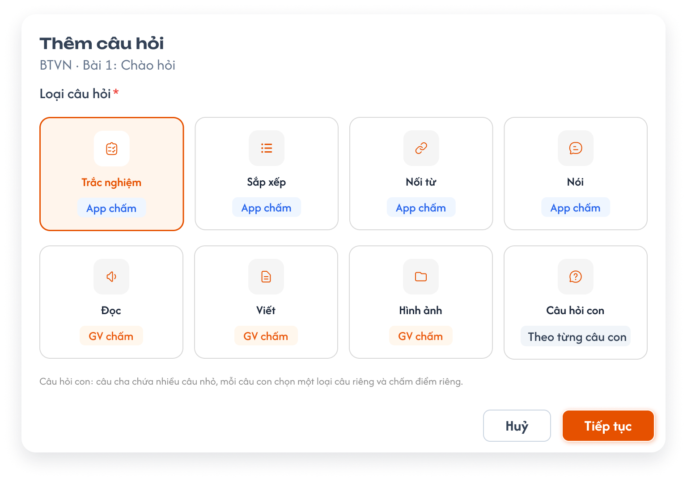

*Popup Thêm câu hỏi — chọn loại câu (Figma CD-KH-060110) — nhấn để xem ảnh gốc*

**Mô tả:**

- Bước đầu khi thêm câu: chọn **một** trong 8 loại câu rồi `Tiếp tục` sang popup soạn câu.

**Điểm cần lưu ý:**

- `A05.01` **`Trắc nghiệm`**: Người chấm: App chấm; Mã loại câu (source ICS cũ): 1 (từ vựng), 5 (câu), 11 (hình ảnh)
- `A05.02` **`Sắp xếp`**: Người chấm: App chấm; Mã loại câu (source ICS cũ): 7
- `A05.03` **`Nối từ`**: Người chấm: App chấm; Mã loại câu (source ICS cũ): 8
- `A05.04` **`Nói`**: Người chấm: App chấm; Mã loại câu (source ICS cũ): 22
- `A05.05` **`Đọc`**: Người chấm: GV chấm; Mã loại câu (source ICS cũ): 3, 10
- `A05.06` **`Viết`**: Người chấm: GV chấm; Mã loại câu (source ICS cũ): 4, 44, 6
- `A05.07` **`Hình ảnh`**: Người chấm: GV chấm; Mã loại câu (source ICS cũ): 2
- `A05.08` **`Câu hỏi con`**: Người chấm: Theo từng câu con; Mã loại câu (source ICS cũ): Câu có danh sách câu con

- Mặc định chọn sẵn `Trắc nghiệm`; `Huỷ` đóng popup không lưu.
- Ghi chú dưới lưới: `Câu hỏi con: câu cha chứa nhiều câu nhỏ, mỗi câu con chọn một loại câu riêng và chấm điểm riêng.`

### Trang 6: CD-KH-060120 — Popup Soạn câu hỏi


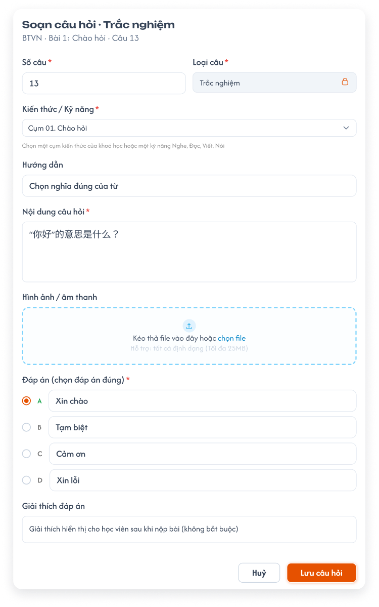

*Popup Soạn câu hỏi · Trắc nghiệm (Figma CD-KH-060120) — nhấn để xem ảnh gốc*

**Mô tả:**

- Soạn hoặc sửa một câu hỏi. Phần đầu chung cho mọi loại; phần đáp án đổi theo loại câu.

**Điểm cần lưu ý:**

- `A06.01` **Tiêu đề**: `Soạn câu hỏi · <loại câu>`; dòng phụ `BTVN · <tên bài> · Câu <số câu>` hoặc `<tên bài kiểm tra> · Câu <số câu>`.
- `A06.02` **`Số câu` ***: Bắt buộc; số thứ tự câu trong bộ, số nguyên ≥ 1. Thêm mới mặc định là câu tiếp theo cuối bộ; nhập số đã có thì chèn vào vị trí đó, các câu sau dồn xuống.
- `A06.03` **`Loại câu` ***: Bắt buộc; lấy từ popup Chọn loại câu, khoá không sửa (icon khoá). Muốn đổi loại thì tạo câu mới.
- `A06.04` **`Kiến thức / Kỹ năng` ***: Bắt buộc; chọn **một** cụm kiến thức của khoá học (vd `Cụm 01. Chào hỏi`) **hoặc** một kỹ năng `Nghe`, `Đọc`, `Viết`, `Nói`.
- `A06.05` **`Hướng dẫn`**: Không bắt buộc; lời dặn hiển thị trên câu (vd `Chọn nghĩa đúng của từ`).
- `A06.06` **`Nội dung câu hỏi` ***: Bắt buộc; nhiều dòng.
- `A06.07` **`Hình ảnh / âm thanh`**: Không bắt buộc; kéo thả hoặc chọn file, mỗi file tối đa 25MB.
- `A06.08` **Đáp án ***: Theo loại câu (bảng dưới).
- `A06.09` **`Giải thích đáp án`**: Không bắt buộc; hiển thị cho học viên sau khi nộp bài.
- `A06.10` **`Huỷ` / `Lưu câu hỏi`**: `Huỷ` đóng, không lưu. `Lưu câu hỏi` kiểm tra field bắt buộc, lưu và đóng popup.

- `A06.11` **`Trắc nghiệm`**: Phần đáp án: 4 lựa chọn `A`–`D`, chọn đúng một đáp án đúng.
- `A06.12` **`Sắp xếp`**: Phần đáp án: Các mảnh theo thứ tự đúng; app xáo trộn khi hiển thị (**UI cần bổ sung**).
- `A06.13` **`Nối từ`**: Phần đáp án: Danh sách cặp cột trái – cột phải (**UI cần bổ sung**).
- `A06.14` **`Nói`**: Phần đáp án: Câu mẫu để app nhận diện giọng nói (**UI cần bổ sung**).
- `A06.15` **`Đọc`, `Viết`, `Hình ảnh`**: Phần đáp án: Không có đáp án; giáo viên chấm. Có thể nhập bài mẫu tham khảo (**UI cần bổ sung**).
- `A06.16` **`Câu hỏi con`**: Phần đáp án: Danh sách câu con; mỗi câu con chọn loại câu riêng và soạn như câu thường, không có Số câu riêng (đánh `N.1`, `N.2`…) (**UI cần bổ sung**).

- Thiếu field bắt buộc: báo lỗi đỏ dưới field, chặn lưu.
- Câu thiếu đáp án vẫn được lưu nhưng tính vào tag `N thiếu đáp án` (trừ loại GV chấm).
- Sửa câu có tag `AI` rồi lưu thì tag `AI` mất.
- Khác Figma CD-KH-060120: popup chưa có field `Số câu` và `Kiến thức / Kỹ năng`; Figma mới có phần đáp án của Trắc nghiệm.

### Trang 7: CD-KH-030340 — Import / Export Excel


**Mô tả:**

- `Export Excel` tải bộ câu hỏi của bài đang chọn ra file `.xlsx`; `Import Excel` thêm câu hỏi từ file `.xlsx` vào cuối bộ câu hỏi của bài đang chọn (**UI popup kết quả cần bổ sung**).
- **Không cần đúng id (10/11):** file chỉ cần đủ field bắt buộc; mọi dòng hợp lệ vào **bài (BTVN / bài kiểm tra) đang chọn**.
  Cột `id`, `lesson_id`, `test_id`, mã câu (nếu có, vd file dạng sheet `btvn_question` / `test_question` của file dữ liệu
  khoá học) **bị bỏ qua**, không lọc dòng theo bài, không đối chiếu với dữ liệu hệ thống.

**Điểm cần lưu ý:**

- `A07.01` **Cột file**: **Giống cột bảng câu hỏi trên UI**: `STT`, `Câu hỏi`, `Hướng dẫn`, `Loại câu`, `Đáp án đúng`, `Kiến thức / Kỹ năng`, `Điểm`. Câu hỏi con nằm ở các dòng ngay dưới câu cha, `STT` dạng `7.1`, `7.2`.
- `A07.02` **Export**: Xuất toàn bộ câu của bài (không theo bộ lọc đang chọn); tên file `<Khoá học>_<Bài>.xlsx`.
- `A07.03` **Import — dòng bắt buộc**: Mỗi dòng phải có `STT`, `Câu hỏi`, `Loại câu` (một trong 8 loại), `Kiến thức / Kỹ năng` (cụm của khoá hoặc Nghe, Đọc, Viết, Nói). Không có cột `Điểm`.
- `A07.04` **Import — lỗi dữ liệu**: Dòng thiếu field bắt buộc hoặc sai giá trị (Loại câu ngoài 8 loại, Kiến thức / Kỹ năng không có trong khoá) → **bỏ dòng đó**, các dòng khác vẫn thêm; popup kết quả liệt kê lỗi theo số dòng (vd `Dòng 5: thiếu Loại câu`). Không còn dòng hợp lệ → không thêm câu nào, Toast `Cảnh Báo`.
- `A07.05` **Import — câu trùng**: Không tự dò hay bỏ câu trùng; mọi dòng hợp lệ đều được thêm. Câu trùng do **Soát lỗi bằng AI** phát hiện.
- `A07.07` **Import — câu hỏi con**: Câu con nối với câu cha theo `STT` dạng `7.1`, `7.2` trong file (không theo id); không tìm thấy câu cha `7` (hoặc câu cha bị bỏ) thì bỏ câu con, báo lỗi dòng.
- `A07.06` **Import — thành công**: Thêm vào cuối bộ theo thứ tự `STT` trong file; Toast `Thành Công` `Đã import N câu hỏi.` (kèm `, bỏ M dòng lỗi` nếu có); gợi ý chạy Soát lỗi bằng AI.

- File export dùng lại được để import (cùng cấu trúc cột), kể cả file export từ bài / khoá khác.
- Chỉ nhận `.xlsx`; file khác hoặc thiếu cột tiêu đề bắt buộc → báo lỗi, không import (cột thừa bị bỏ qua).
- Khác Figma: nút Import / Export mới có ở CD-KH-030340; chưa có popup kết quả import.

### Trang 8: CD-KH-060150 — Soát lỗi bằng AI


**Mô tả:**

- Nút `Soát lỗi bằng AI` cho AI rà toàn bộ câu của bài đang chọn và trả danh sách vấn đề để CD tự xử lý (**UI cần bổ sung**).

**Điểm cần lưu ý:**

- `A08.01` **Phạm vi**: Toàn bộ câu của bài đang chọn, kể cả câu hỏi con.
- `A08.02` **Vấn đề phát hiện**: Câu **trùng** (cùng loại câu, nội dung giống hoặc gần giống), thiếu đáp án, đáp án không khớp nội dung, lỗi chính tả / phiên âm, câu không khớp Kiến thức / Kỹ năng đã gắn.
- `A08.03` **Kết quả**: Danh sách vấn đề theo số câu, bấm một vấn đề cuộn tới câu tương ứng. Không có vấn đề thì báo `Không tìm thấy lỗi.`
- `A08.04` **Xử lý**: AI **không tự sửa hay xoá**; CD sửa hoặc xoá câu bằng menu `⋮`.

- Soát lỗi chỉ đọc dữ liệu, không thay đổi bộ câu hỏi.

### Trang 9: CD-KH-030341, CD-KH-030342 — Generate bài tập bằng AI — Popup nhập yêu cầu


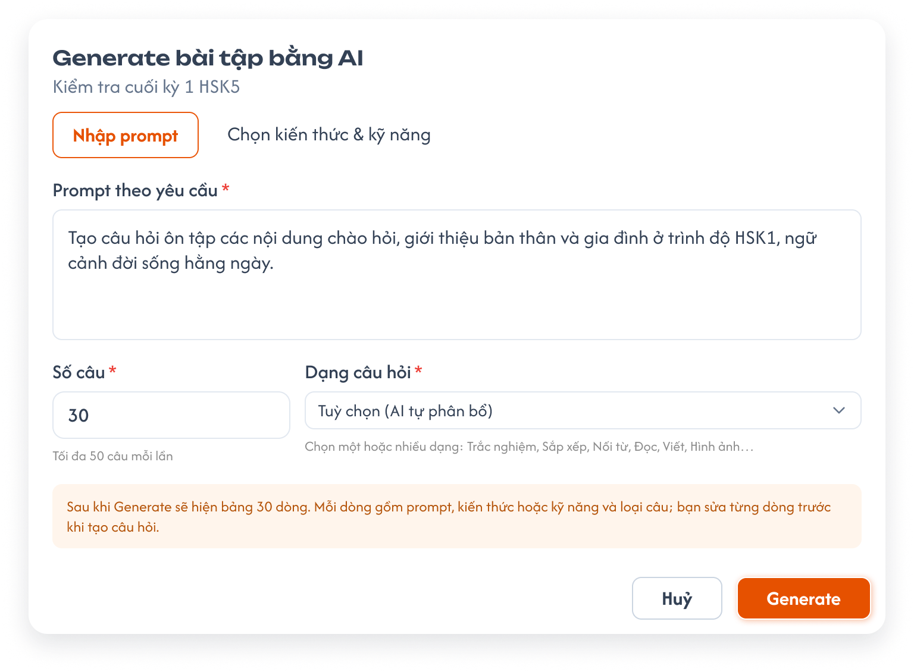

*Popup Generate bài tập bằng AI, tab Nhập prompt (Figma CD-KH-030341) — nhấn để xem ảnh gốc*

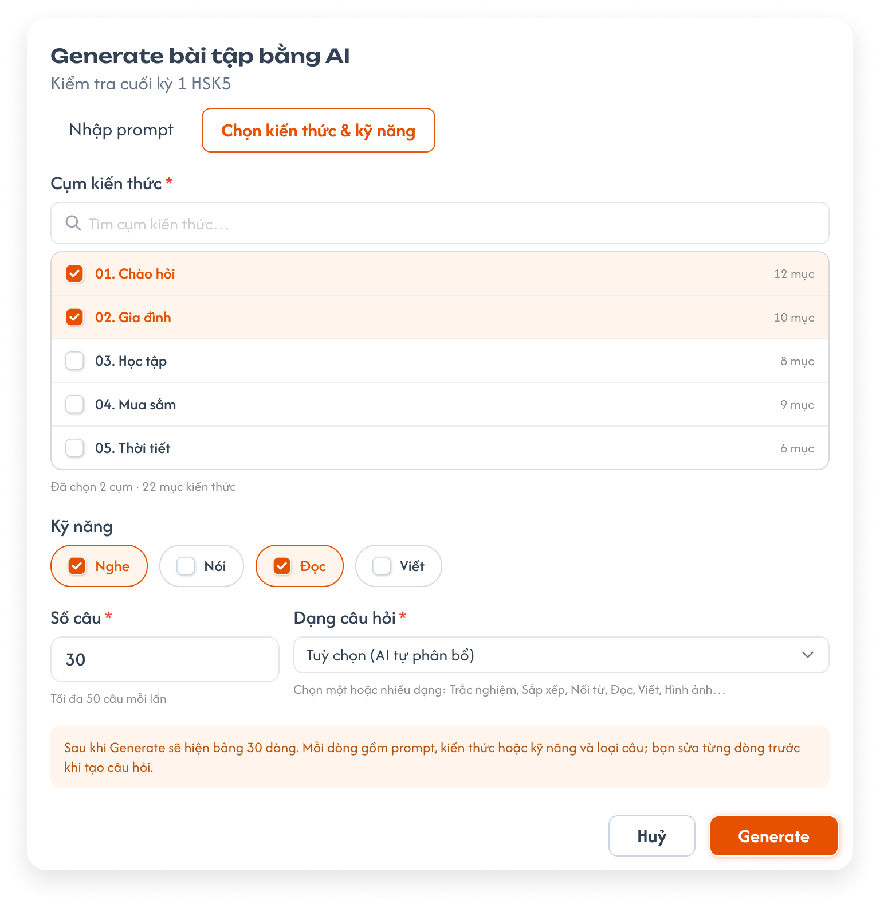

*Popup Generate, tab Chọn kiến thức & kỹ năng (Figma CD-KH-030342) — nhấn để xem ảnh gốc*

**Mô tả:**

- Bấm `Tạo câu hỏi bằng AI` mở popup `Generate bài tập bằng AI` (dòng phụ là tên bài). AI **không tạo câu hỏi ngay** mà sinh một bảng N dòng để CD soát, sửa rồi chọn dòng muốn tạo.

**Điểm cần lưu ý:**

- `A09.01` **Tab `Nhập prompt`**: `Prompt theo yêu cầu` * (nhiều dòng).
- `A09.02` **Tab `Chọn kiến thức & kỹ năng`**: `Cụm kiến thức` * (tìm cụm, tick ít nhất 1 cụm; mỗi cụm kèm số mục; dòng `Đã chọn N cụm · M mục kiến thức`); `Kỹ năng` (tick 0 hoặc nhiều trong Nghe, Nói, Đọc, Viết).
- `A09.03` **`Số câu` ***: Bắt buộc, số nguyên ≥ 1; **không giới hạn** số câu mỗi lần.
- `A09.04` **`Dạng câu hỏi` ***: `Tuỳ chọn (AI tự phân bổ)` hoặc chọn một / nhiều trong 8 loại câu.
- `A09.05` **Ghi chú**: `Sau khi Generate sẽ hiện bảng N dòng. Mỗi dòng gồm prompt, kiến thức hoặc kỹ năng và loại câu; bạn sửa từng dòng trước khi tạo câu hỏi.`
- `A09.06` **`Huỷ` / `Generate`**: `Generate` chỉ bật khi tab đang dùng đủ field bắt buộc.

- Chuyển tab giữ nguyên `Số câu` và `Dạng câu hỏi`; chế độ Generate theo tab đang mở khi bấm `Generate`.
- Khác Figma CD-KH-030341 / 030342: dòng phụ dưới `Số câu` ghi `Tối đa 50 câu mỗi lần`; requirement không giới hạn.

### Trang 10: CD-KH-030344, CD-KH-030346 — Generate — Đang tạo bảng và lỗi


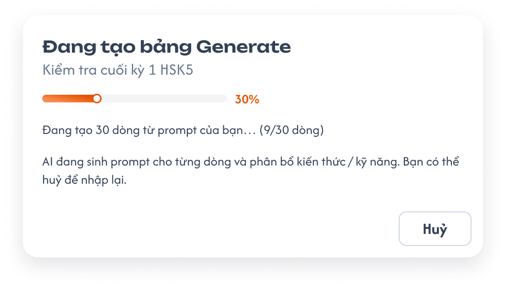

*Đang tạo bảng Generate (Figma CD-KH-030344) — nhấn để xem ảnh gốc*

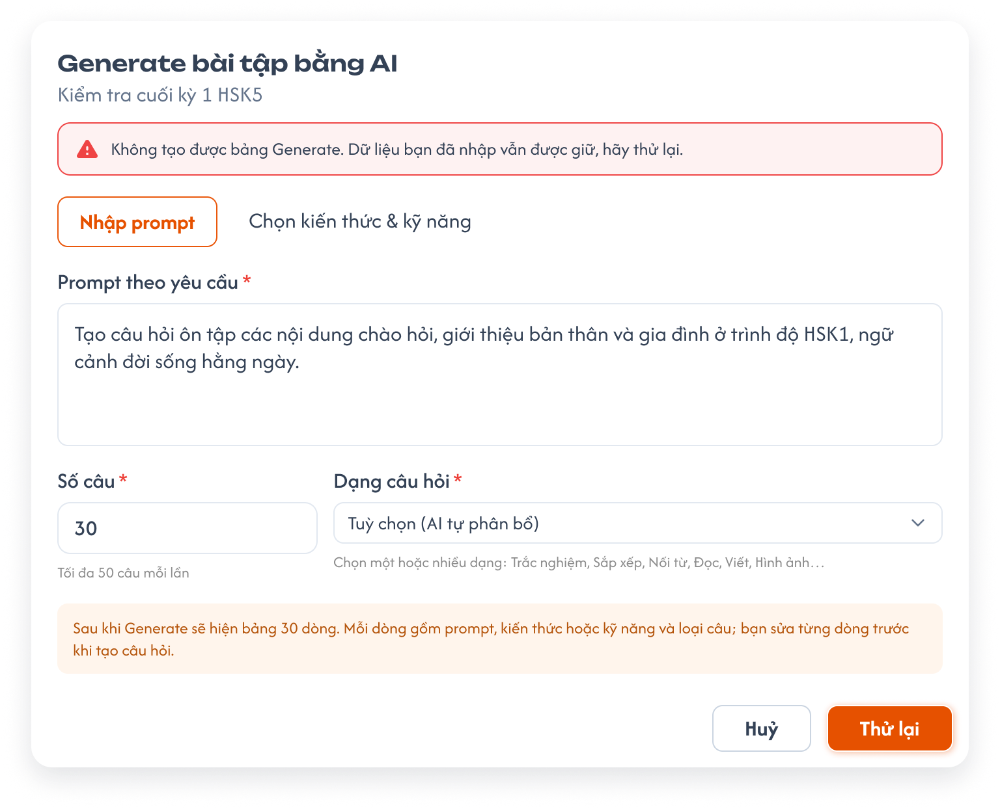

*Không tạo được bảng Generate (Figma CD-KH-030346) — nhấn để xem ảnh gốc*

**Mô tả:**

- Trong lúc AI sinh bảng, popup hiện tiến độ; lỗi thì quay lại popup nhập với dữ liệu đã nhập.

**Điểm cần lưu ý:**

- `A10.01` **`Đang tạo bảng Generate`**: Thanh tiến độ `%` và dòng `Đang tạo N dòng từ prompt của bạn… (x/N dòng)`; nút `Huỷ` dừng tạo, quay lại popup nhập, giữ dữ liệu.
- `A10.02` **Lỗi**: Popup nhập hiện thông báo đỏ `Không tạo được bảng Generate. Dữ liệu bạn đã nhập vẫn được giữ, hãy thử lại.`; nút `Generate` đổi thành `Thử lại`.

- Huỷ hoặc lỗi không thêm câu nào vào bộ câu hỏi.

### Trang 11: CD-KH-030343, CD-KH-030345 — Generate — Bảng N dòng


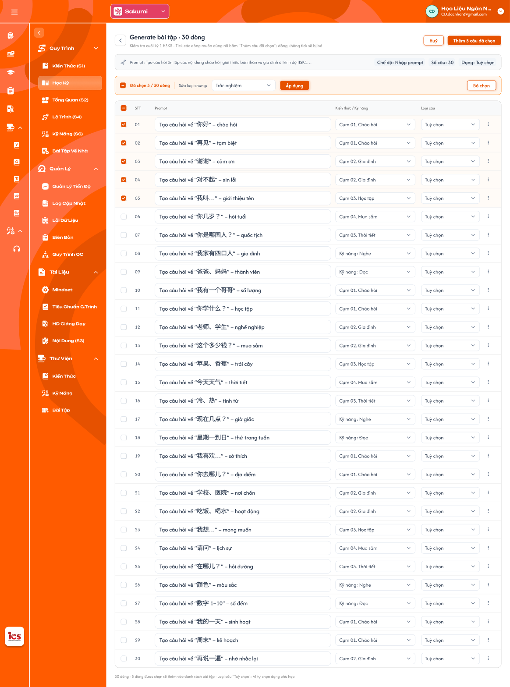

*Bảng 30 dòng sau Generate (Figma CD-KH-030343) — nhấn để xem ảnh gốc*

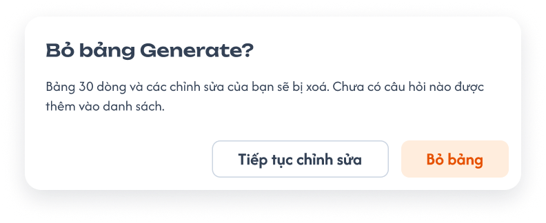

*Popup Bỏ bảng Generate (Figma CD-KH-030345) — nhấn để xem ảnh gốc*

**Mô tả:**

- Màn `Generate bài tập · N dòng`: mỗi dòng là một câu sẽ tạo. CD sửa từng dòng, tick các dòng muốn dùng rồi bấm `Thêm N câu đã chọn`.

**Điểm cần lưu ý:**

- `A11.01` **Dòng tóm tắt**: Prompt đã nhập (cắt `…`), `Chế độ` (Nhập prompt / Chọn kiến thức & kỹ năng), `Số câu`, `Dạng`.
- `A11.02` **Cột**: `☐`, `STT`, `Prompt` (sửa được), `Kiến thức / Kỹ năng` (dropdown cụm của khoá hoặc kỹ năng), `Loại câu` (dropdown `Tuỳ chọn` hoặc 8 loại), `⋮` (xoá dòng).
- `A11.03` **Thanh chọn**: `Đã chọn x / N dòng`; `Sửa loại chung` (dropdown) + `Áp dụng` đổi Loại câu cho các dòng đã tick; `Bỏ chọn`.
- `A11.04` **`Thêm N câu đã chọn`**: AI tạo câu hỏi cho các dòng đã tick, thêm vào **cuối** bộ câu hỏi; dòng không tick bị bỏ. `Tuỳ chọn` nghĩa là AI chọn loại câu phù hợp.
- `A11.05` **`Huỷ` / nút `<`**: Mở popup `Bỏ bảng Generate?` (`Bảng N dòng và các chỉnh sửa của bạn sẽ bị xoá. Chưa có câu hỏi nào được thêm vào danh sách.`, nút `Tiếp tục chỉnh sửa` / `Bỏ bảng`).

- Mỗi dòng phải có Prompt và Kiến thức / Kỹ năng trước khi thêm; dòng thiếu báo lỗi, chặn thêm.
- Chưa bấm `Thêm N câu đã chọn` thì chưa có câu nào được tạo.

### Trang 12: CD-KH-030347 — Generate — Sau khi tạo


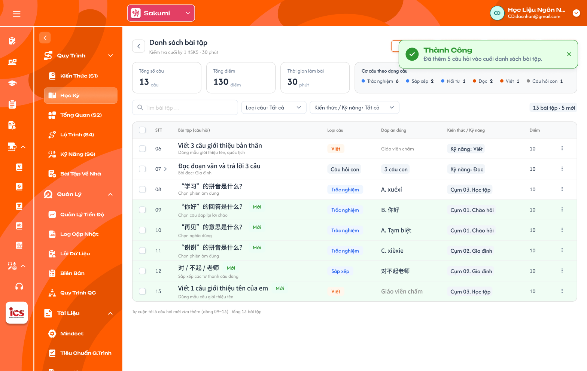

*Bộ câu hỏi sau khi thêm 5 câu tạo bằng AI (Figma CD-KH-030347) — nhấn để xem ảnh gốc*

**Mô tả:**

- Sau khi thêm, quay về bộ câu hỏi, tự cuộn tới các câu mới; Toast `Thành Công` `Đã thêm N câu hỏi vào cuối danh sách bài tập.`

**Điểm cần lưu ý:**

- `A12.01` **Câu mới**: Nền xanh nhạt và tag `AI`; số câu tiếp nối cuối bộ.
- `A12.02` **Badge tổng**: `N bài tập · M mới`.
- `A12.03` **Thẻ tổng quan**: Cập nhật Tổng số câu, Cơ cấu theo dạng câu.

- Câu tạo bằng AI không có trạng thái riêng, dùng như câu soạn tay. Tag `AI` mất khi CD sửa và lưu câu.
- Khác Figma CD-KH-030347: tag câu mới ghi `Mới`; requirement dùng tag `AI`.

### Trang 13: Toast phản hồi CRUD


*Toast Thành Công, Thông Báo, Cảnh Báo và Có Lỗi Xảy Ra — nhấn để xem ảnh gốc*

**Mô tả:**

- Phản hồi sau khi thêm, sửa, xoá câu, import, tạo câu bằng AI.

**Điểm cần lưu ý:**

- `A13.01` **Thành công**: Tiêu đề cố định: `Thành Công`; Khi sử dụng: `Đã thêm câu hỏi.`; `Đã cập nhật câu hỏi.`; `Đã xoá N câu hỏi.`; `Đã import N câu hỏi.`; `Đã thêm N câu hỏi vào cuối danh sách bài tập.`
- `A13.02` **Cảnh báo**: Tiêu đề cố định: `Cảnh Báo`; Khi sử dụng: `Học kỳ hoặc khoá học không ở trạng thái Nháp, không thể chỉnh sửa câu hỏi.`; `File vượt quá dung lượng cho phép (25MB).`; `File import có dòng lỗi, chưa thêm câu nào.`
- `A13.03` **Lỗi**: Tiêu đề cố định: `Có Lỗi Xảy Ra`; Khi sử dụng: Lưu, xoá, import, export, tạo câu bằng AI thất bại do backend / network.

- Mỗi thao tác một Toast; `Huỷ`, tìm kiếm, lọc, chọn bài, soát lỗi không có Toast CRUD.

---

## 2. Yêu cầu

### 2.1. Flow chính

**Flow 1 / REQ01 / REQ02 / REQ03: Chọn kỳ, bài và xem bộ câu hỏi**

```text
CD mở khoá học → Bài Tập Về Nhà
      → Chọn tab BTVN hoặc Kiểm tra → chọn kỳ → danh sách lesson / bài kiểm tra của kỳ
      → Chọn bài → vùng trái tải tiêu đề, thẻ tổng quan, bảng câu hỏi (hoặc trạng thái rỗng)
```

**Flow 2 / REQ04 / REQ05: Thêm câu hỏi soạn tay**

```text
CD bấm "+ Thêm câu hỏi" (hoặc Enter ở ô nhập nhanh)
      → Popup Chọn loại câu → chọn 1 trong 8 loại → Tiếp tục
      → Popup Soạn câu hỏi: Số câu, Kiến thức / Kỹ năng, Điểm, Nội dung, đáp án theo loại…
      → Lưu câu hỏi: thiếu field bắt buộc → báo lỗi; đủ → lưu, đóng popup, Toast "Đã thêm câu hỏi."
```

**Flow 3 / REQ05: Sửa câu hỏi**

```text
CD bấm ⋮ → Sửa → popup Soạn câu hỏi (loại câu khoá)
      → Lưu: cập nhật câu; câu có tag AI thì mất tag; Toast "Đã cập nhật câu hỏi."
```

**Flow 4 / REQ03: Xoá câu hỏi**

```text
CD bấm ⋮ → Xoá (hoặc chọn nhiều → Xoá)
      → Backend kiểm tra học kỳ và khoá học đang Nháp
      → Popup xác nhận → Xoá: xoá mềm, các câu sau dồn số, Toast "Đã xoá N câu hỏi."
```

**Flow 5 / REQ06: Export và Import Excel**

```text
Export Excel → tải file .xlsx toàn bộ câu của bài, cột như bảng UI
Import Excel → chọn file .xlsx → kiểm tra từng dòng
      → bỏ qua cột id / lesson_id / test_id → dòng lỗi: bỏ dòng, báo lỗi theo số dòng
      → Dòng hợp lệ: thêm vào cuối bộ của bài đang chọn (không bỏ câu trùng), Toast "Đã import N câu hỏi."
```

**Flow 6 / REQ08: Tạo câu hỏi bằng AI**

```text
CD bấm "Tạo câu hỏi bằng AI"
      → Tab Nhập prompt (prompt) hoặc Chọn kiến thức & kỹ năng (≥ 1 cụm, kỹ năng tuỳ chọn) + Số câu + Dạng câu hỏi
      → Generate → Đang tạo bảng (Huỷ: quay lại, giữ dữ liệu; lỗi: báo đỏ, Thử lại)
      → Bảng N dòng: sửa Prompt / Kiến thức / Kỹ năng / Loại câu, tick dòng
      → Thêm N câu đã chọn → câu thêm vào cuối bộ có tag AI, Toast thành công
      → Huỷ → popup Bỏ bảng → Bỏ bảng: không thêm câu nào
```

**Flow 7 / REQ07: Soát lỗi bằng AI**

```text
CD bấm "Soát lỗi bằng AI" → AI rà toàn bộ câu của bài
      → Trả danh sách vấn đề (trùng, thiếu đáp án, sai lệch…) theo số câu
      → CD tự sửa / xoá câu; AI không tự thay đổi dữ liệu
```

### 2.2. Ngoại lệ

- **EX01:** Lưu câu thiếu field bắt buộc (Số câu, Loại câu, Kiến thức / Kỹ năng, Điểm, Nội dung câu hỏi) → báo lỗi dưới field, không lưu.
- **EX02:** File hình ảnh / âm thanh lớn hơn 25MB → không tải lên; Toast `Cảnh Báo` `File vượt quá dung lượng cho phép (25MB).`
- **EX03:** File import không phải `.xlsx` hoặc thiếu cột tiêu đề bắt buộc → không import. Dòng thiếu field bắt buộc, sai Loại câu, sai Kiến thức / Kỹ năng, câu con không có câu cha → bỏ dòng, các dòng khác vẫn thêm, báo lỗi theo dòng. Cột `id`, `lesson_id`, `test_id` trong file bị bỏ qua, không gây lỗi.
- **EX04:** Lưu, import, export thất bại do backend / network → Toast `Có Lỗi Xảy Ra`; dữ liệu không thay đổi một phần.
- **EX05:** Thêm, sửa, xoá, import, generate câu thuộc học kỳ hoặc khoá học không ở `Nháp` (giao diện hoặc request trực tiếp) → backend từ chối; Toast `Cảnh Báo`; dữ liệu không đổi.
- **EX06:** Generate thiếu field bắt buộc (prompt, cụm kiến thức, số câu, dạng câu hỏi) hoặc dòng bảng thiếu Prompt / Kiến thức / Kỹ năng → khoá nút hoặc báo lỗi dòng, không tạo.
- **EX07:** AI không tạo được bảng hoặc câu hỏi → báo lỗi, giữ dữ liệu đã nhập, cho `Thử lại`; không thêm câu nào.

### 2.3. Yêu cầu khác

| Mã | Tên yêu cầu | Mô tả |
|---|---|---|
| REQ01 | Chọn bài theo kỳ | Tab BTVN: kỳ → lesson của kỳ; tab Kiểm tra: kỳ → bài kiểm tra của kỳ; badge số câu từng bài; tìm theo tên bài; mặc định kỳ đầu, bài đầu. |
| REQ02 | Thẻ tổng quan | Tổng số câu (câu cha), Thời gian làm bài (chỉ Kiểm tra), Cơ cấu theo dạng câu; tag `N câu hỏi`, `N thiếu đáp án`, `Thang 10` (chỉ Kiểm tra); cập nhật ngay sau mọi thay đổi. Không có Tổng điểm và điểm riêng từng câu: mọi câu thang 10, điểm bài là trung bình các câu. |
| REQ03 | Bảng câu hỏi | Cột STT, Câu hỏi, Loại câu, Đáp án đúng, Kiến thức / Kỹ năng; lọc Loại câu, Kiến thức / Kỹ năng và tìm kiếm (không có lọc Trạng thái); câu hỏi con mở / thu; 50 câu/trang; xoá mềm; chỉ thêm / sửa / xoá khi học kỳ và khoá học `Nháp`. |
| REQ04 | Loại câu | 8 loại Trắc nghiệm, Sắp xếp, Nối từ, Nói (App chấm); Đọc, Viết, Hình ảnh (GV chấm); Câu hỏi con (theo từng câu con). |
| REQ05 | Soạn câu hỏi | Bắt buộc Số câu, Loại câu (khoá sau khi chọn), Kiến thức hoặc Kỹ năng, Điểm, Nội dung câu hỏi; đáp án theo loại câu; file tối đa 25MB; Số câu trùng thì chèn và dồn các câu sau. |
| REQ06 | Import / Export Excel | Cột file giống bảng UI, không có cột Điểm; export toàn bộ câu của bài; import thêm vào cuối bài đang chọn, **không cần đúng id** (bỏ qua `id`, `lesson_id`, `test_id`), câu con nối theo STT, dòng lỗi bị bỏ và báo theo số dòng; không tự dò câu trùng. |
| REQ07 | Soát lỗi bằng AI | Rà toàn bộ câu của bài, phát hiện câu trùng và các lỗi khác, chỉ báo, không tự sửa. |
| REQ08 | Generate bằng AI | Hai chế độ Nhập prompt / Chọn kiến thức & kỹ năng; Số câu không giới hạn; sinh bảng N dòng để sửa và chọn; chỉ dòng được tick mới tạo câu, thêm vào cuối bộ với tag `AI`; huỷ / lỗi không thêm câu. |
| REQ09 | Không trạng thái và kỳ Vô hiệu | BTVN, bộ câu hỏi và câu hỏi không có trạng thái riêng (trạng thái hiển thị ở Thư viện theo khoá học); chỉ sửa được khi học kỳ `Nháp` và khoá học `Nháp`, ngược lại chỉ đọc. Nhân bản học kỳ / khoá học sao chép toàn bộ BTVN và bộ câu hỏi thành câu hỏi mới. Kỳ `Vô hiệu`: BTVN đã tạo trong lớp từ kỳ đó trước khi vô hiệu vẫn dùng bình thường. |

### 2.4. Ràng buộc

#### Quyền

| Role | Xem bộ câu hỏi | Thêm / sửa câu (kỳ + khoá Nháp) | Xoá câu (kỳ + khoá Nháp) | Import (kỳ + khoá Nháp) / Export Excel | Generate (kỳ + khoá Nháp) / Soát lỗi bằng AI |
|---|:---:|:---:|:---:|:---:|:---:|
| CD | ✅ | ✅ | ✅ | ✅ | ✅ |
| Các role khác | ❌ | ❌ | ❌ | ❌ | ❌ |

#### Ràng buộc khác

**Phạm vi dữ liệu**

- Dữ liệu theo khoá học và trung tâm CD đang chọn; Kiến thức / Kỹ năng chỉ chọn trong cụm của chính khoá học và 4 kỹ năng.
- Mọi request thêm, sửa, xoá, import được backend kiểm tra quyền, khoá học, bài và field bắt buộc; không dựa vào việc ẩn nút.

---

---

## 3. Testcase

### Feature: [CD] Bài tập về nhà và Kiểm tra

| Tên testcase | Priority | Scenario | Role | Pre-condition | Given/When/Then | Expected Result |
|---|---|---|---|---|---|---|
| Case 1: Mở menu Bài tập về nhà | High · Smoke | Flow 1 / REQ01 | CD | Khoá học có 3 kỳ, HK I có 6 bài | **Given** mở menu Bài Tập Về Nhà<br>**When** màn tải xong<br>**Then** tab BTVN, HK I mở, chọn bài 1, vùng trái là bộ câu hỏi bài 1 | - Badge số câu đúng từng bài |
| Case 2: Chọn bài khác | High | Flow 1 / REQ01 | CD | Đang ở bài 1 | **Given** bấm `Bài 4: Mua sắm` của HK I<br>**When** vùng trái tải<br>**Then** tiêu đề `BTVN · Bài 4: Mua sắm` và bộ câu hỏi bài 4 | - Bài 4 tô cam |
| Case 3: Tab Kiểm tra theo kỳ | High | REQ01 | CD | HK I có 4 mini test và 2 bài kiểm tra | **Given** chọn tab Kiểm tra<br>**When** mở HK I<br>**Then** hiện 6 bài kiểm tra của HK I | - Không trộn bài kiểm tra kỳ khác |
| Case 4: Tìm bài | Medium | REQ01 | CD | HK II có bài `Thời tiết` | **Given** nhập `thời tiết`<br>**When** tìm<br>**Then** HK II tự mở, chỉ còn bài khớp | - |
| Case 5: Kỳ Vô hiệu vẫn dùng ở lớp | High | REQ09 | CD | Lớp A đã dùng BTVN bài 2 của HK I; HK I chuyển `Vô hiệu` | **Given** học viên lớp A mở BTVN bài 2<br>**When** làm và nộp bài<br>**Then** vẫn làm và nộp được | - Cây hiển thị HK I kèm `Vô hiệu` |
| Case 5a: Role khác truy cập Bài Tập Về Nhà / gọi API | High | Ràng buộc quyền | Role khác CD | - | **Given** mở URL menu Bài Tập Về Nhà của khoá<br>**When** gửi request thêm câu hỏi<br>**Then** bị từ chối | - Không thay đổi dữ liệu |
| Case 6: Thẻ tổng quan đúng bộ câu | High | REQ02 | CD | Bài kiểm tra có 8 câu (3 Trắc nghiệm, 1 Câu hỏi con 3 câu con…), thời gian 30 phút | **Given** chọn bài kiểm tra<br>**When** xem thẻ<br>**Then** 8 câu, 30 phút, cơ cấu đúng từng loại; tag `Thang 10` | - Câu con không cộng thêm vào Tổng số câu<br>- Không có thẻ Tổng điểm |
| Case 7: Tag thiếu đáp án | Medium | REQ02 | CD | 1 câu Trắc nghiệm chưa có đáp án; 2 câu Viết | **Given** xem tiêu đề<br>**When** render<br>**Then** tag `1 thiếu đáp án` | - Câu Viết không tính thiếu |
| Case 8: BTVN không có thời gian làm bài | Low | REQ02 | CD | Đang ở tab BTVN | **Given** xem thẻ tổng quan<br>**When** render<br>**Then** không có thẻ Thời gian làm bài | - |
| Case 9: Bảng đủ cột | High · Smoke | Flow 1 / REQ03 | CD | Bài có câu Trắc nghiệm, Viết, Câu hỏi con | **Given** chọn bài<br>**When** bảng tải<br>**Then** đủ cột; Viết hiện `Giáo viên chấm`; Câu hỏi con hiện `N câu hỏi con` | - Không có lọc Trạng thái |
| Case 10: Lọc kết hợp | Medium | REQ03 | CD | Bài có câu Trắc nghiệm gắn Cụm 01 và Kỹ năng Nghe | **Given** lọc Loại câu `Trắc nghiệm` và Kiến thức / Kỹ năng `Kỹ năng: Nghe`<br>**When** áp dụng<br>**Then** chỉ còn câu Trắc nghiệm gắn Nghe | - Thẻ tổng quan vẫn tính cả bộ |
| Case 11: Xoá câu | High | Flow 4 / REQ03 | CD | Bài thuộc học kỳ `Nháp` của khoá `Nháp` | **Given** chọn `⋮` → `Xoá` câu 03<br>**When** xác nhận<br>**Then** câu 03 biến mất, các câu sau dồn số | - Toast `Thành Công`<br>- Thẻ tổng quan cập nhật |
| Case 12: Không thêm / sửa / xoá câu khi không ở Nháp | High | EX05 / REQ03 / REQ09 | CD | Bài thuộc khoá `Công khai`; bài khác thuộc học kỳ `Vô hiệu` của khoá `Nháp` | **Given** mở bộ câu hỏi, tìm `⋮` / `+ Thêm câu hỏi` / Import / Generate, hoặc gửi request thêm / sửa / xoá<br>**When** hệ thống xử lý<br>**Then** không có thao tác; backend từ chối | - Toast `Cảnh Báo` `Học kỳ hoặc khoá học không ở trạng thái Nháp, không thể chỉnh sửa câu hỏi.`<br>- Vẫn xem, Export Excel được |
| Case 13: Nhập nhanh | Medium | Flow 2 / REQ03 | CD | Đang ở bộ câu hỏi | **Given** nhập `你叫什么名字？` vào ô nhập nhanh<br>**When** nhấn Enter<br>**Then** mở popup Chọn loại câu, nội dung điền sẵn | - Chưa lưu câu đến khi bấm `Lưu câu hỏi` |
| Case 13a: Phân trang 50 câu / trang | Low | REQ03 | CD | Bài có 60 câu | **Given** mở bộ câu hỏi<br>**When** chuyển sang trang 2<br>**Then** trang 1 có câu 1–50, trang 2 có câu 51–60 | - Footer trang 2 `Hiển thị 51–60 trong 60 câu hỏi` |
| Case 14: Trạng thái rỗng | Medium | REQ03 | CD | Bài 4 chưa có câu | **Given** chọn bài 4<br>**When** vùng trái tải<br>**Then** hiện `Bài học này chưa có câu hỏi` và 2 nút | - Không có bảng rỗng giả |
| Case 15: Chọn loại và tiếp tục | High · Smoke | Flow 2 / REQ04 | CD | Bộ câu hỏi đang mở | **Given** bấm `+ Thêm câu hỏi`, chọn `Sắp xếp`<br>**When** bấm `Tiếp tục`<br>**Then** mở popup `Soạn câu hỏi · Sắp xếp` | - Loại câu khoá trong popup soạn |
| Case 16: Đủ 8 loại và người chấm | Medium | REQ04 | CD | Popup đang mở | **Given** xem lưới<br>**When** render<br>**Then** đủ 8 loại, nhãn App chấm / GV chấm / Theo từng câu con đúng | - |
| Case 17: Thêm câu Trắc nghiệm | High · Smoke | Flow 2 / REQ05 | CD | Bộ có 12 câu | **Given** soạn câu Trắc nghiệm đủ field, gắn `Cụm 01. Chào hỏi`<br>**When** bấm `Lưu câu hỏi`<br>**Then** câu 13 thêm cuối bảng | - Toast `Thành Công`<br>- Thẻ tổng quan cập nhật |
| Case 18: Thiếu Kiến thức / Kỹ năng | High | EX01 / REQ05 | CD | Popup đang mở | **Given** bỏ trống Kiến thức / Kỹ năng<br>**When** bấm `Lưu câu hỏi`<br>**Then** báo lỗi dưới field, không lưu | - Tương tự khi thiếu Số câu, Điểm, Nội dung |
| Case 19: Chèn theo Số câu | Medium | REQ05 | CD | Bộ có 12 câu | **Given** soạn câu mới với Số câu `3`<br>**When** lưu<br>**Then** câu mới là câu 3, câu 3–12 cũ thành 4–13 | - |
| Case 20: Sửa câu AI | Medium | REQ05 / REQ08 | CD | Câu 09 có tag `AI` | **Given** `⋮` → `Sửa` câu 09, đổi Hướng dẫn<br>**When** lưu<br>**Then** câu cập nhật, mất tag `AI` | - |
| Case 21: File quá 25MB | Medium | EX02 / REQ05 | CD | File âm thanh 30MB | **Given** chọn file<br>**When** tải lên<br>**Then** không thêm file, báo `File vượt quá dung lượng cho phép (25MB).` | - |
| Case 22: Export đúng cột | High · Smoke | Flow 5 / REQ06 | CD | Bài có 8 câu, 1 câu hỏi con 3 câu con | **Given** đang lọc Loại câu `Viết`<br>**When** bấm `Export Excel`<br>**Then** file có đủ 8 câu và 3 dòng `7.1`–`7.3`, cột như bảng UI | - Không phụ thuộc bộ lọc |
| Case 23: Import thành công | High · Smoke | Flow 5 / REQ06 | CD | File 10 dòng hợp lệ | **Given** bấm `Import Excel`, chọn file<br>**When** hệ thống xử lý<br>**Then** thêm 10 câu vào cuối bộ | - Toast `Đã import 10 câu hỏi.` |
| Case 24: Bỏ dòng lỗi, vẫn import dòng hợp lệ | High | EX03 / REQ06 | CD | File 10 dòng, dòng 5 thiếu Loại câu | **Given** import file<br>**When** kiểm tra<br>**Then** thêm 9 câu, báo `Dòng 5: thiếu Loại câu` | - Toast `Đã import 9 câu hỏi, bỏ 1 dòng lỗi.` |
| Case 24a: File có id của bài khác | High · Smoke | EX03 / REQ06 | CD | Đang chọn BTVN Bài 2; file 6 dòng có cột `lesson_id` = Bài 5, `id` là mã câu cũ | **Given** import file<br>**When** xử lý<br>**Then** 6 câu thêm vào Bài 2 | - Không báo lỗi id<br>- Bài 5 không đổi<br>- Áp dụng tương tự bài kiểm tra với cột `test_id` |
| Case 24b: Câu con không có câu cha | Medium | EX03 / REQ06 | CD | File có dòng `9.1` nhưng không có dòng `9` | **Given** import file<br>**When** xử lý<br>**Then** bỏ dòng `9.1`, báo `Dòng N: không tìm thấy câu cha 9` | - Các dòng khác vẫn thêm |
| Case 25: Không tự bỏ câu trùng | Medium | REQ06 / REQ07 | CD | File có 2 dòng trùng câu đã có | **Given** import file<br>**When** thành công<br>**Then** cả 2 dòng được thêm | - Soát lỗi bằng AI báo 2 câu trùng |
| Case 26: Export rồi import lại | Medium | REQ06 | CD | Bài A có 8 câu | **Given** export bài A, import file vào bài B trống<br>**When** thành công<br>**Then** bài B có 8 câu giống bài A | - |
| Case 26a: Import file không phải .xlsx / sai cột tiêu đề | Medium | EX03 / REQ06 | CD | Bài thuộc học kỳ và khoá `Nháp` | **Given** import file `.csv`; import file `.xlsx` sai cột tiêu đề<br>**When** xử lý<br>**Then** không import, báo lỗi định dạng / thiếu cột | - Không thêm câu nào |
| Case 27: Phát hiện câu trùng | High | Flow 7 / REQ07 | CD | Câu 02 và câu 11 cùng nội dung, cùng loại | **Given** bấm `Soát lỗi bằng AI`<br>**When** AI trả kết quả<br>**Then** danh sách có vấn đề trùng giữa câu 02 và 11 | - Không tự xoá câu nào |
| Case 28: Không có lỗi | Low | REQ07 | CD | Bộ câu hỏi đúng | **Given** soát lỗi<br>**When** AI trả kết quả<br>**Then** hiện `Không tìm thấy lỗi.` | - |
| Case 29: Generate theo prompt | High · Smoke | Flow 6 / REQ08 | CD | Bài kiểm tra đang mở | **Given** nhập prompt, Số câu `30`, Dạng `Tuỳ chọn`<br>**When** bấm `Generate`<br>**Then** mở trạng thái Đang tạo bảng | - |
| Case 30: Chọn cụm bắt buộc | High | EX06 / REQ08 | CD | Tab Chọn kiến thức & kỹ năng, chưa tick cụm | **Given** chỉ tick kỹ năng Nghe<br>**When** xem nút `Generate`<br>**Then** nút khoá | - Tick 1 cụm thì nút mở |
| Case 31: Không giới hạn số câu | Medium | REQ08 | CD | Popup đang mở | **Given** nhập Số câu `80`<br>**When** bấm `Generate`<br>**Then** hệ thống chấp nhận, sinh bảng 80 dòng | - Không báo vượt giới hạn |
| Case 32: Huỷ khi đang tạo | Medium | Flow 6 / REQ08 | CD | Đang tạo 9/30 dòng | **Given** bấm `Huỷ`<br>**When** popup xử lý<br>**Then** quay lại popup nhập, giữ prompt và số câu | - Không thêm câu |
| Case 33: Lỗi tạo bảng | High | EX07 / REQ08 | CD | AI lỗi | **Given** bấm `Generate`<br>**When** lỗi xảy ra<br>**Then** thông báo đỏ, nút `Thử lại`, dữ liệu giữ nguyên | - |
| Case 34: Thêm các dòng đã chọn | High · Smoke | Flow 6 / REQ08 | CD | Bảng 30 dòng, tick 5 dòng | **Given** bấm `Thêm 5 câu đã chọn`<br>**When** tạo xong<br>**Then** 5 câu thêm vào cuối bộ, có tag `AI` | - 25 dòng còn lại bị bỏ |
| Case 35: Sửa loại chung | Medium | REQ08 | CD | Tick 5 dòng | **Given** chọn `Trắc nghiệm` ở Sửa loại chung<br>**When** bấm `Áp dụng`<br>**Then** 5 dòng đổi Loại câu thành Trắc nghiệm | - Dòng không tick giữ nguyên |
| Case 36: Bỏ bảng | Medium | Flow 6 / REQ08 | CD | Đã sửa vài dòng | **Given** bấm `Huỷ`<br>**When** bấm `Bỏ bảng`<br>**Then** quay về bộ câu hỏi, không thêm câu nào | - `Tiếp tục chỉnh sửa` giữ bảng |
| Case 37: Dòng thiếu Kiến thức / Kỹ năng | Medium | EX06 / REQ08 | CD | Dòng 04 đã tick, bỏ trống Kiến thức / Kỹ năng | **Given** bấm `Thêm N câu đã chọn`<br>**When** kiểm tra<br>**Then** dòng 04 báo lỗi, không thêm | - |
| Case 38: Cuộn tới câu mới | Medium | REQ08 | CD | Bộ có 8 câu, thêm 5 câu AI | **Given** thêm thành công<br>**When** quay về bộ câu hỏi<br>**Then** cuộn tới câu 09–13, có tag `AI` | - Toast `Đã thêm 5 câu hỏi vào cuối danh sách bài tập.` |
| Toast Case 1: Thành công | High | Ràng buộc Toast CRUD | CD | Dữ liệu hợp lệ | **Given** lưu, xoá, import hoặc thêm câu AI<br>**When** backend thành công<br>**Then** Toast `Thành Công` đúng nội dung | - Một Toast |
| Toast Case 2: Lỗi | High | Ràng buộc Toast CRUD | CD | Backend / network lỗi | **Given** lưu hoặc import<br>**When** thất bại<br>**Then** Toast `Có Lỗi Xảy Ra` | - Dữ liệu không đổi một phần |

---

---

## 4. Câu hỏi cần xác nhận

- **Q01:** Giao diện chi tiết còn thiếu: phần đáp án của Sắp xếp, Nối từ, Nói, Đọc / Viết / Hình ảnh (bài mẫu), Câu hỏi con; popup kết quả Import; kết quả Soát lỗi bằng AI; Preview mobile.
