# Kiến thức (S1)

## 1. UI

### Trang 1: CD-KH-040100 — Kiến thức (S1) / Từ vựng

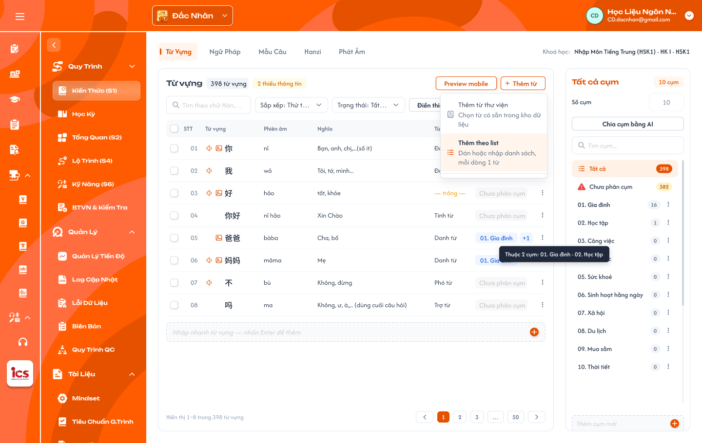

**Mô tả:**
- Màn **Kiến thức (S1)** nằm trong từng khoá học của role CD, dùng để định nghĩa toàn bộ kiến thức của khoá theo loại: Từ vựng, Ngữ pháp, Mẫu câu, Hanzi, Kanji, Phát âm; loại Bảng chữ chỉ có ở trung tâm có hệ chữ riêng. Mỗi tab gồm bảng mục (trái) và panel Cụm của loại đó (phải).
- Mỗi mục kiến thức là **bản ghi của Thư viện dữ liệu**: S1 tham chiếu bản ghi thư viện; thêm mới hoặc sửa tại S1 ghi thẳng vào thư viện. Kiến thức chỉ được sửa tại S1; Chi tiết bài học chỉ thêm / gỡ kiến thức đã có trong S1.

**Điểm cần lưu ý:**
- Dữ liệu theo trung tâm CD đang chọn ở header; ngôn ngữ lấy theo **trung tâm** (Đắc Nhân = Trung, Sakumi = Nhật, Saechang = Hàn, Créatis = Pháp, Creative English = Anh, Betreux = Đức), không suy từ Danh mục hay Cấp độ của khoá. Ngôn ngữ chỉ quyết định danh sách Từ loại và nội dung Bảng chữ.
- Quyền sửa theo trạng thái khoá học: chỉ sửa được khi khoá `Nháp`. Khoá `Công Khai` / `Vô hiệu` chỉ đọc (ẩn / disable mọi thao tác thêm, sửa, xoá, kéo thả); backend từ chối mọi request ghi. Muốn đổi thì nhân bản khoá rồi sửa trên bản `Nháp`; nhân bản khoá sao chép toàn bộ dữ liệu màn này (xem [Quản lý khoá học](../course_management.md) REQ10, REQ11), mỗi mục S1 được tạo bản ghi thư viện mới cùng nội dung.
- `A01.01` Switch Center (header): đổi trung tâm thì toàn bộ dữ liệu khoá học và S1 tải lại, kể cả danh sách Từ loại theo ngôn ngữ và tab Bảng chữ.
- `A01.02` Tab loại kiến thức, thứ tự: Từ vựng, Ngữ pháp, Mẫu câu, Hanzi, Kanji, Bảng chữ, Phát âm. Mọi trung tâm có đủ 6 tab; tab Bảng chữ chỉ hiện ở Sakumi (Hiragana / Katakana, Phụ lục A.7.1) và Saechang (Hangul, Phụ lục A.7.2); Đắc Nhân, Creative English, Betreux, Créatis không có. Tab chưa có dữ liệu (vd Kanji ở Đắc Nhân) vẫn hiện, bảng rỗng.
- `A01.09` Sakumi (tiếng Nhật): có tab Bảng chữ. `A01.10` Saechang (tiếng Hàn): có tab Bảng chữ. `A01.11` Đắc Nhân, Creative English, Betreux, Créatis: không có tab Bảng chữ.
- `A01.03` Tiêu đề bảng: tên loại (hoặc tên cụm đang chọn) + badge số mục (`398 từ vựng`) + badge `N thiếu thông tin`. Góc phải thanh tab hiện khoá học đang mở.
- `A01.04` `Preview mobile` mở panel xem trước mục đang chọn (xem Trang 5).
- `A01.05` / `A01.12` `+ Thêm …` mở menu `Thêm từ thư viện`, `Thêm theo list`; tên nút theo loại (`Thêm từ`, `Thêm kiến thức`).
- `A01.06` `Thêm bằng AI`: nút riêng, tối đa 50 mục / lần (xem Trang 10).
- `A01.07` Thanh công cụ: Tìm kiếm, Sắp xếp, Trạng thái, `Soát lỗi bằng AI` (toàn bộ mục của tab, không giới hạn). `Điền thiếu bằng AI` nằm ở thanh hàng loạt, chạy cho mục đang chọn.
- `A01.08` Panel Cụm: danh sách cụm của loại đang mở, `Số cụm`, `Chia cụm bằng AI`.
- Cột phiên âm dùng chung tên `Phiên âm` cho mọi ngôn ngữ (không dùng `Pinyin`). Bảng chữ và Phát âm giữ đúng cấu trúc dữ liệu app học viên đang dùng (Phụ lục A.6, A.7); mỗi loại có dữ liệu và audio riêng.
- Mục **thiếu thông tin** khi trống bất kỳ field bắt buộc nào của loại; field không bắt buộc trống vẫn tính là đủ. Ô field bắt buộc trống hiện `— trống —`; badge `N thiếu thông tin` và lọc Trạng thái tính theo field bắt buộc.
- Field bắt buộc / không bắt buộc theo loại (chi tiết ở Phụ lục A):
- `A02.01` Từ vựng: bắt buộc Từ, Phiên âm, Nghĩa, Từ loại, Hán Việt (chỉ tiếng Trung), Ví dụ (≥ 1; mỗi ví dụ gồm câu, phiên âm, nghĩa); không bắt buộc Mở rộng, Audio.
- `A02.03` Mẫu câu: bắt buộc Câu, Phiên âm, Nghĩa; không bắt buộc Audio.
- `A02.04` Hanzi: bắt buộc Chữ, Phiên âm, Âm Hán Việt, Nghĩa (ít nhất 1), Bộ thủ, Thành phần, Thứ tự nét; không bắt buộc Mẹo nhớ, Chữ giống, Từ liên quan, Nét viết (SVG), Mở rộng.
- `A02.05` Kanji: bắt buộc Chữ, Âm On hoặc Âm Kun (ít nhất 1), Âm Hán Việt, Nghĩa, Bộ thủ, Thành phần; không bắt buộc Mẹo nhớ, Từ liên quan, Nét viết (SVG). Chỉ tính thiếu khi trống cả Âm On và Âm Kun.
- `A02.06` Phát âm tiếng Trung (pinyin): bắt buộc Âm, Loại âm; Nhóm và Hướng dẫn phát âm (khi Loại = Thanh mẫu / Vận mẫu); Thanh mẫu và Vận mẫu thành phần (khi Loại = Âm tiết); không bắt buộc Cách đọc, Âm dễ nhầm, Audio theo thanh, Video hướng dẫn.
- `A02.07` Bảng chữ tiếng Nhật (Kana): bắt buộc Hiragana, Katakana, Romaji, Loại, Hàng; không bắt buộc Chữ dễ nhầm, Mẹo nhớ, Từ ví dụ, Audio, Thứ tự nét.
- `A02.08` Bảng chữ tiếng Hàn (Hangul): bắt buộc Chữ, Tên gọi, Phiên âm (Romaja đầu / cuối), Loại; không bắt buộc Từ ví dụ, Audio, Thứ tự nét.
- `A02.09` Từ vựng tiếng Trung: Hán Việt = `sino_vietnamese`, Nghĩa = `mean` (tiêu đề cột khi Import / Export Excel).
- `A02.10` Kanji: Hán Việt = `mean`, Nghĩa = `explanation`.
- `A02.11` Hanzi: Hán Việt = `mean`, Nghĩa = `meanings` (danh sách, ít nhất 1). Cùng tên `mean` nhưng nghĩa khác: ở Từ vựng là Nghĩa, ở Kanji và Hanzi là Âm Hán Việt.
- `A02.12` Từ loại: chọn **1 hoặc nhiều** giá trị từ danh sách cố định theo ngôn ngữ (Phụ lục A.8), không nhập tự do; mục dạng câu / cụm (vd `はじめまして。`) vẫn là Từ vựng với Từ loại `Câu`. Từ loại và Bộ thủ là hằng số hệ thống, chưa có màn quản lý.
- `A02.13` Phiên âm từng chữ (furigana) dạng `{chữ|phiên âm}`: hệ thống tự sinh từ Từ / Câu và Phiên âm, CD không nhập.
- `A02.14` Ví dụ: danh sách, mỗi ví dụ gồm câu, phiên âm, nghĩa; tối thiểu 1, thêm bằng `+ Thêm ví dụ` ở Chi tiết mục. Bảng hiện ví dụ đầu, nhiều hơn thì thêm nhãn `+N`. Đánh dấu từ đang học bằng `<...>` (vd `<{你|nǐ}>{好|hǎo}{吗|ma}？`). Dữ liệu cũ gộp nhiều ví dụ trong 1 ô thì import tách theo dòng trống.
- `A02.16` Mở rộng: `Không` (mặc định) = đẩy lên 3 bước học; `Có` = không đẩy lên 3 bước nhưng vẫn hiện trong danh sách.
- `A02.17` Nghĩa (Hán tự): một chữ có nhiều nghĩa tiếng Việt; bắt buộc ít nhất 1.
- `A02.18` Bộ thủ (Kanji, Hán tự): chọn **1 bộ** trong **214 bộ thủ Khang Hy** (số thứ tự 1–214, chữ bộ, tên Hán Việt, số nét, các biến thể như `亻`, `氵`, `讠`, `⺮`); dùng chung Hán tự và Kanji; hằng số hệ thống (Phụ lục A.9).
- `A02.19` Chuỗi tìm kiếm (Kanji): hệ thống tự sinh từ Âm On / Âm Kun (romaji, kana), CD không nhập.
- `A02.20` Audio: không bắt buộc; CD tải file âm thanh, không có file thì app đọc bằng TTS.
- `A02.21` Phiên âm: tiếng Trung là pinyin có dấu thanh (`nǐ`); tiếng Nhật là romaji (`hajimemashite`); ngôn ngữ khác theo IPA hoặc cách đọc quy ước của trung tâm.
- `A02.23` Hiragana, Katakana (Bảng chữ Nhật): một mục là một cặp chữ cùng âm, nhập cả hai bộ chữ trên cùng dòng (`あ` / `ア`).
- `A02.24` Loại (Bảng chữ Nhật): danh sách cố định `Âm cơ bản` (46), `Âm đục` (20), `Âm bán đục` (5), `Âm ghép` (33), ánh xạ Bảng con của sheet (Phụ lục A.7.1). Âm ngắt `っ` và trường âm ghi ở Từ ví dụ / Mẹo nhớ, không là mục riêng.
- `A02.25` Hàng (Bảng chữ Nhật): danh sách cố định `あ行`, `か行`, `さ行`, `た行`, `な行`, `は行`, `ま行`, `や行`, `ら行`, `わ行`, `ん`; cột nguyên âm `a / i / u / e / o` hệ thống suy từ Romaji.
- `A02.26` Loại (Bảng chữ Hàn): danh sách cố định `Phụ âm thường` (9), `Phụ âm bật hơi` (5), `Phụ âm căng` (5), `Nguyên âm đơn` (10), `Nguyên âm ghép` (11) (Phụ lục A.7.2).
- `A02.27` Phiên âm (Bảng chữ Hàn): Romaja dạng `đầu / cuối` (vd `g / k`); nguyên âm chỉ có một giá trị (`a`).
- `A02.28` Loại âm, Nhóm, Thanh điệu (Phát âm): danh sách cố định; Loại `Thanh mẫu` / `Vận mẫu` / `Âm tiết`; 12 Nhóm (6 nhóm thanh mẫu, 6 nhóm vận mẫu); 4 thanh `ˉ ˊ ˇ ˋ` (Phụ lục A.6).
- `A02.29` Audio (Phát âm): audio riêng của Phát âm. Thanh mẫu 1 file; Vận mẫu và Âm tiết mỗi thanh 1 file; tên file theo quy ước app `pinyin_<thanh>.mp3` (vd `ba_1.mp3`), thanh mẫu `b.mp3`. Không có file thì TTS.
- `A02.30` Cụm không phải field nhập; **mỗi mục thuộc tối đa 1 cụm** (hoặc `Chưa phân cụm`).
- Bảng chỉ hiện field chính của từng tab; field còn lại (Hán Việt, Mở rộng, Cách dùng, Lưu ý, Audio, Thành phần, Thứ tự nét…) nhập / sửa ở drawer `Chi tiết mục` (Trang 11). Mọi tab dùng cột `Cụm`, không có cột `Bài học`.
- `A03.01` Checkbox: chọn dòng để thao tác hàng loạt; checkbox header chọn / bỏ chọn các dòng của trang.
- `A03.02` STT theo thứ tự hiển thị; tay nắm kéo thả chỉ hiện khi đang xem 1 cụm và Sắp xếp = `Thứ tự trong cụm`. Kéo thả chỉ đổi thứ tự mục trong cụm (dùng khi thêm cụm vào bài học); các kiểu sắp xếp khác chỉ để xem.
- `A03.03` Cột field theo loại: Từ vựng (Từ vựng, Phiên âm, Nghĩa, Từ loại) · Ngữ pháp (Tên điểm ngữ pháp, Ý nghĩa, Ví dụ) · Mẫu câu (Câu, Phiên âm, Nghĩa) · Hanzi (Chữ, Phiên âm, Hán Việt, Nghĩa, Bộ thủ) · Kanji (Chữ, Âm On, Âm Kun, Hán Việt, Nghĩa) · Phát âm tiếng Trung (Âm, Loại âm, Nhóm, Thanh mẫu, Vận mẫu, Âm dễ nhầm, Audio dạng `tên file · đã tải lên` hoặc `Chưa có file · app đọc bằng TTS`) · Bảng chữ Nhật (Hiragana, Katakana, Romaji, Loại, Hàng, Từ ví dụ) · Bảng chữ Hàn (Chữ, Tên gọi, Phiên âm, Loại, Từ ví dụ).
- `A03.04` Cụm: nhãn cụm duy nhất của mục (vd `01. Gia đình`), không thuộc cụm nào hiện `Chưa phân cụm`; bấm nhãn mở popup Thêm vào cụm / Gỡ khỏi cụm của mục đó (Trang 4).
- `A03.05` ⋮ là menu thao tác dòng, xem nhóm `A07` bên dưới.
- `A03.06` Tìm kiếm theo field chính của loại (Từ vựng: chữ, phiên âm, nghĩa; Ngữ pháp: tên, ý nghĩa; Hán tự: chữ, phiên âm, Hán Việt; Kanji: chữ, âm On / Kun, nghĩa; Phát âm: âm, thanh mẫu, vận mẫu; Bảng chữ Nhật: hiragana, katakana, romaji; Bảng chữ Hàn: chữ, tên gọi, phiên âm).
- `A03.07` Sắp xếp: `Thứ tự thêm` (mặc định), `A–Z`, `Mới cập nhật`, `Thứ tự trong cụm` (chỉ khi đang xem 1 cụm).
- `A03.08` Trạng thái chọn 1: `Tất cả`, `Đủ thông tin`, `Thiếu thông tin`, `AI nghi sai`. Tìm kiếm, Trạng thái, cụm đang chọn kết hợp với nhau; đổi điều kiện thì về trang 1, badge và tổng số cập nhật theo.
- `A03.09` Phân trang `Hiển thị a–b trong N …` và Trước / số trang / Sau; theo UI mỗi trang 8 dòng.
- `A03.10` / `A06.01` Nhập nhanh: dòng cuối bảng `Nhập nhanh … — nhấn Enter để thêm`, nhập field đầu của loại (Từ vựng: Từ; Ngữ pháp: Tên điểm ngữ pháp…). Ô trống hoặc chỉ khoảng trắng thì không tạo mục.
- `A06.02` Enter / `+`: tạo bản ghi thư viện mới, gắn vào khoá, thêm dòng cuối bảng; ô nhập xoá trống để nhập tiếp; Toast `Thành Công` — `Đã thêm 1 từ vào <tên cụm>.` (vd `Đã thêm 1 từ vào Chưa phân cụm.`). Đang chọn cụm thì mục mới thuộc cụm đó, đang ở `Tất cả` thì thuộc `Chưa phân cụm`; mục mới thiếu field bắt buộc nên tính là `Thiếu thông tin`.
- `A07.01` Sửa nhanh (inline): sửa trực tiếp các ô field chính trên dòng; Enter / rời dòng thì lưu, Esc thì huỷ.
- `A07.02` Mở chi tiết …: mở drawer `Chi tiết mục` (Trang 11) để xem / sửa đầy đủ field của loại.
- `A07.03` Điền thiếu bằng AI: AI điền các field bắt buộc đang trống của mục (xem `A13`).
- `A07.04` Thêm vào cụm / Gỡ khỏi cụm: mở popup chọn cụm (Trang 4).
- `A07.05` Nhân bản: tạo bản ghi thư viện mới có cùng nội dung, gắn vào khoá, cùng cụm với mục gốc.
- `A07.06` Xoá khỏi danh sách: gỡ mục khỏi khoá (Trang 7). Sửa ở S1 là sửa bản ghi thư viện, mọi khoá và bài học đang dùng mục thấy nội dung mới; sắp xếp thứ tự dùng tay nắm kéo thả, không có mục riêng trong menu.
- `A11.01` `Tất cả cụm` + badge `N cụm`: tiêu đề panel và số cụm hiện có.
- `A11.02` `Số cụm` mặc định `0`, **chỉ nhập được khi chưa có cụm**: nhập N thì hệ thống tạo N cụm rỗng tên `Chủ đề 1` … `Chủ đề N`; chưa có cụm thì panel hiện `Chưa có cụm. Nhập Số cụm để tạo các cụm rỗng "Chủ đề 1 … N".` Đã có cụm thì ô chỉ đọc, hiện số cụm hiện tại; thêm / bớt bằng `Thêm cụm mới` và ⋮ của cụm. Xoá hết cụm (`0 cụm`) thì ô nhập lại được.
- `A11.03` `Chia cụm bằng AI` mở popup (Trang 9).
- `A11.04` Tìm cụm theo tên cụm.
- `A11.05` `Tất cả` hiện mọi mục của loại, badge tổng số mục.
- `A11.06` `Chưa phân cụm`: mục không thuộc cụm nào; icon cảnh báo + số mục.
- `A11.07` Dòng cụm: số thứ tự + tên + số mục; ⋮: `Đổi tên`, `Xoá cụm`. **Xoá cụm** (kể cả cụm có dữ liệu): cụm bị xoá, các mục về `Chưa phân cụm`, vẫn còn trong khoá.
- `A11.08` `Thêm cụm mới` thêm 1 cụm **rỗng** vào cuối danh sách.
- Cụm không liên kết với bài học; thêm mục mới vào cụm không tự vào bài, CD thêm thủ công ở Chi tiết bài học. Mục của cụm đang được thêm vào bài học: **Xoá cụm** / **Gỡ khỏi cụm** phải có cảnh báo `N mục đang dùng ở các bài học:` + danh sách bài; xác nhận thì các mục đó tự gỡ khỏi các bài liên quan (xoá cụm: mọi mục của cụm), mục vẫn còn trong khoá.
- Toast phản hồi CRUD, mỗi thao tác logic đúng một Toast:
- `A17.01` `Thành Công`: backend đã xác nhận (vd `Đã thêm 1 từ vào Chưa phân cụm.`).
- `A17.02` `Thông Báo`: đã tiếp nhận, cần thời gian xử lý (vd `AI đang điền thông tin cho 2 từ.`).
- `A17.03` `Cảnh Báo`: dữ liệu chưa hợp lệ (vd `Nhập Số cụm trước khi chia cụm bằng AI.`).
- `A17.04` `Có Lỗi Xảy Ra`: backend / network / AI không hoàn tất.
- Ngoài ra: `Huỷ`, tìm kiếm, lọc, đổi tab, Preview không có Toast CRUD; Toast không thay thế lỗi tại field và không chứa thông tin kỹ thuật.

### Trang 2: CD-KH-040110 — Kiến thức (S1) / Từ vựng / Chọn cụm · Chọn 1 từ

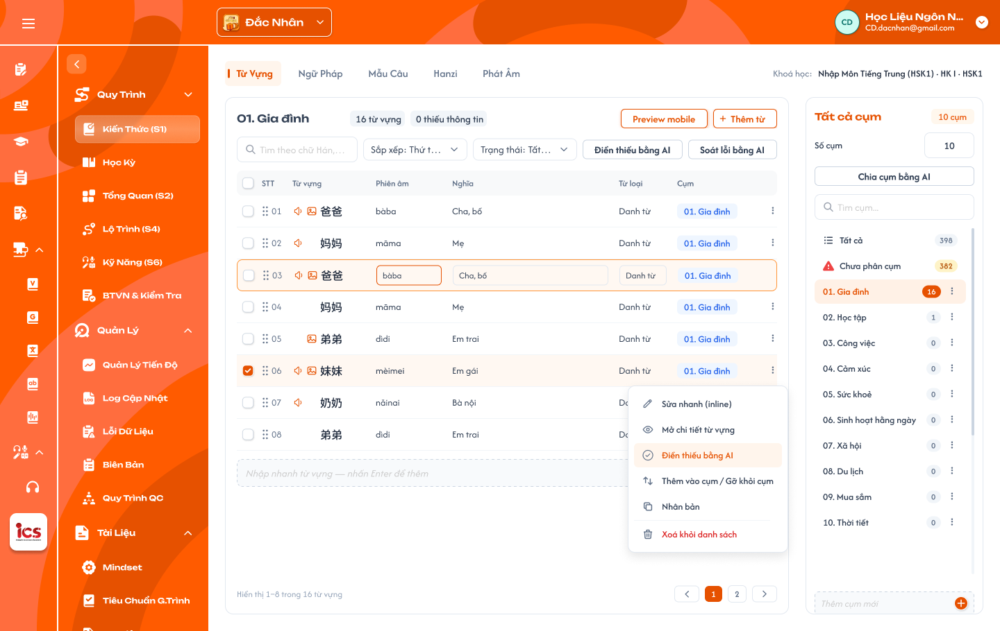

**Mô tả:**
- Trạng thái đang xem một cụm (`01. Gia đình`, 16 từ vựng, 0 thiếu thông tin) và đã chọn 1 dòng.

**Điểm cần lưu ý:**
- Khi chọn 1 cụm thì Sắp xếp đổi sang `Thứ tự trong cụm` và bảng có tay nắm kéo thả; tiêu đề và badge thiếu thông tin tính trong cụm.
- Tick dòng thì thanh công cụ đổi thành thanh thao tác hàng loạt (Trang 3).

### Trang 3: CD-KH-040120 — Kiến thức (S1) / Từ vựng / Chọn nhiều · Thao tác hàng loạt

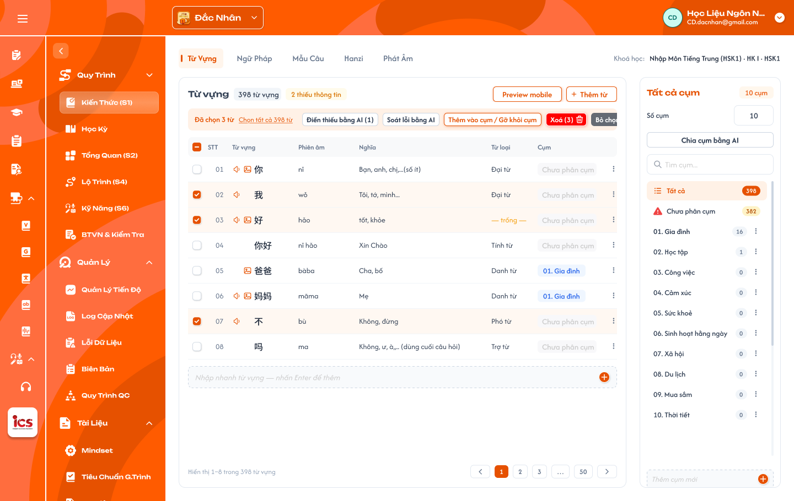

**Mô tả:**
- Tick ít nhất 1 dòng thì thanh công cụ đổi thành thanh thao tác hàng loạt.

**Điểm cần lưu ý:**
- `A09.01` `Đã chọn N từ`: số mục đang chọn. Checkbox header ở trạng thái chọn một phần khi chỉ một số dòng của trang được chọn.
- `A09.02` `Chọn tất cả N từ` chọn toàn bộ mục thoả bộ lọc hiện tại (mọi trang); đã chọn hết thì không hiện nút này.
- `A09.03` `Điền thiếu bằng AI (k)`: k = số mục đang chọn **đang thiếu** thông tin và **có field chính**; k = 0 hoặc đang chọn quá 50 mục thì không bấm được (tooltip `Chọn tối đa 50 mục để điền thiếu`).
- `A09.04` `Thêm vào cụm / Gỡ khỏi cụm` mở popup chọn cụm cho các mục đang chọn (Trang 4).
- `A09.05` `Xoá (N)` gỡ N mục khỏi khoá (Trang 7).
- `A09.06` `Bỏ chọn` bỏ chọn toàn bộ.
- Khi AI đang xử lý các mục đang chọn, thanh hàng loạt chỉ còn `Đang điền x/N · Dừng` và `Bỏ chọn`; `Thêm vào cụm / Gỡ khỏi cụm`, `Xoá (N)` mờ. `Soát lỗi bằng AI` không nằm ở thanh hàng loạt; nút ở thanh công cụ luôn chạy cho toàn bộ mục của tab.

### Trang 4: CD-KH-040125 — Kiến thức (S1) / Từ vựng / Thêm vào cụm · Gỡ khỏi cụm

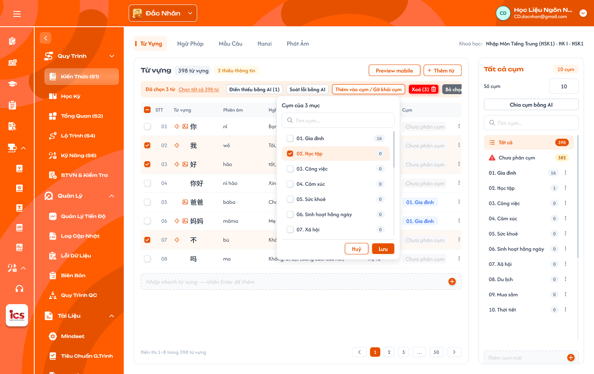

**Mô tả:**
- Popup `Cụm của N mục`: gán các mục đang chọn vào **một** cụm (chuyển cụm nếu đã có) hoặc gỡ khỏi cụm. Mỗi mục thuộc tối đa 1 cụm.

**Điểm cần lưu ý:**
- `A10.01` Tiêu đề `Cụm của N mục` (N mục đang chọn).
- `A10.02` Tìm cụm theo tên cụm.
- `A10.03` Danh sách cụm là **radio** từng cụm + số mục, thêm lựa chọn `Chưa phân cụm` (= gỡ khỏi cụm). Mọi mục đang chọn cùng cụm thì chọn sẵn cụm đó; khác cụm thì không chọn sẵn.
- `A10.04` `Lưu`: mọi mục đang chọn chuyển vào cụm đã chọn (rời cụm cũ); chọn `Chưa phân cụm` thì gỡ khỏi cụm. `Huỷ` đóng popup.
- Popup không tạo cụm mới (cụm tạo bằng `Số cụm` / `Thêm cụm mới`). Mục bị gỡ khỏi cụm về `Chưa phân cụm`; mục `Chưa phân cụm` không thêm được vào bài học.
- Mục đang dùng ở bài học mà bị gỡ khỏi cụm / chuyển sang cụm khác thì popup phải hiện **cảnh báo** liệt kê bài học; xác nhận thì mục tự gỡ khỏi các bài đó. Thêm mục vào cụm không ảnh hưởng bài học.

### Trang 5: CD-KH-040140 — Kiến thức (S1) / Từ vựng / Preview mobile theo từ đang chọn

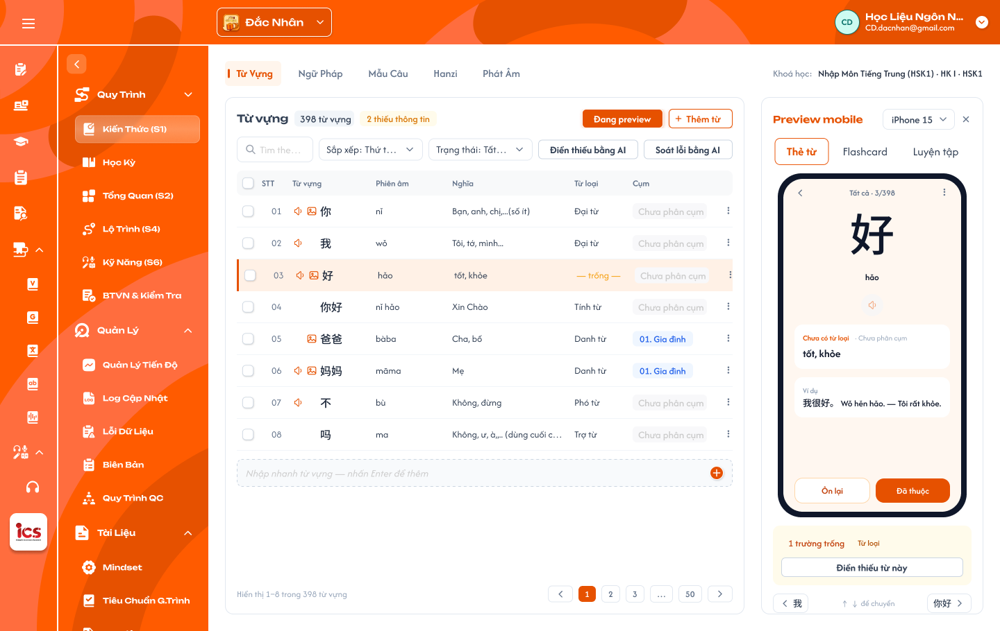

**Mô tả:**
- Panel Preview thay chỗ panel Cụm, xem trước mục đang chọn như trên app học viên. Mọi loại kiến thức đều có Preview, mỗi loại 1 dạng thẻ riêng.

**Điểm cần lưu ý:**
- `A14.01` Nút `Preview mobile` đổi thành `Đang preview` khi panel mở; `×` đóng panel.
- `A14.02` Chọn kích thước máy (vd `iPhone 15`).
- `A14.03` Tab dạng thẻ: Từ vựng có `Thẻ từ`, `Flashcard`, `Luyện tập`; loại khác tái hiện đúng màn học thật của app học viên cho loại đó.
- `A14.04` Thẻ: vị trí `Tất cả · 3/398`; nội dung theo field của mục; icon loa phát Audio (không có file thì TTS).
- `A14.05` Thông tin thiếu: `N trường trống` + tên field (vd `1 trường trống · Từ loại`) + `Điền thiếu từ này`.
- `A14.06` Chuyển mục bằng nút trước / sau hoặc phím ↑ ↓; dòng tương ứng trên bảng được chọn theo.
- Preview chỉ hiển thị, nút học viên trên thẻ (`Ôn lại`, `Đã thuộc`) không ghi dữ liệu học. Giá trị do Điền thiếu bằng AI điền đã lưu như giá trị chính thức; đề xuất của Soát lỗi chưa duyệt không hiển thị.

### Trang 6: CD-KH-040150 — Kiến thức (S1) / Từ vựng / Popup thêm từ thư viện

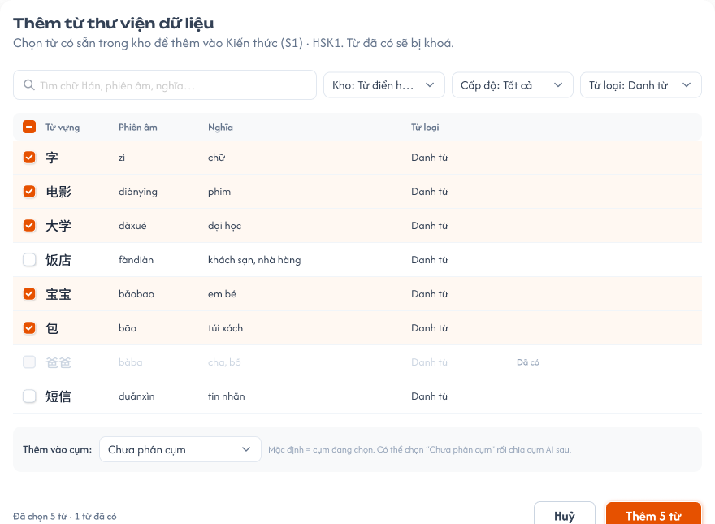

**Mô tả:**
- Popup `Thêm từ thư viện dữ liệu`: CD chọn nhiều mục có sẵn trong Thư viện dữ liệu để gắn vào S1 của khoá. Khoá **tham chiếu** bản ghi thư viện, không sao chép.

**Điểm cần lưu ý:**
- `A04.01` Mô tả ghi khoá đang thêm (vd `Kiến thức (S1) · HSK1`).
- `A04.02` Tìm theo chữ, phiên âm, nghĩa.
- `A04.03` Kho chọn 1: `Tất cả` (mặc định), `Từ điển` (dữ liệu import sẵn theo ngôn ngữ, vd sheet `relation` của HSK1 / N5), `Khoá học` (bản ghi tạo từ S1 các khoá trong trung tâm; dòng hiện tên khoá gốc).
- `A04.04` Cấp độ, Từ loại dùng để lọc danh sách thư viện.
- `A04.05` Danh sách có checkbox và các field chính; mọi bản ghi đều chọn được, kể cả bản ghi đã gắn vào khoá (không khoá, không nhãn `Đã có`).
- `A04.06` `Thêm vào cụm` mặc định là cụm đang chọn ở panel Cụm; chọn được `Chưa phân cụm`.
- `A04.07` Chân popup: `Đã chọn N từ`, `Huỷ`, `Thêm N từ` (chỉ bấm được khi N ≥ 1).
- **Không có rule bắt trùng:** cùng một bản ghi thư viện gắn được nhiều lần vào cùng khoá (mỗi lần là 1 dòng S1); bản ghi khác có nội dung giống cũng thêm bình thường, hệ thống không cảnh báo, không chặn. Thư viện chỉ chứa bản ghi cùng ngôn ngữ với trung tâm đang chọn.
- Sửa mục sau khi thêm là sửa bản ghi thư viện, mọi khoá đang dùng thấy thay đổi. Màn quản lý Thư viện (menu CD `Thư Viện Kiến Thức`) thuộc requirement riêng, ngoài phạm vi tài liệu này.

### Trang 7: CD-KH-040155 — Kiến thức (S1) / Từ vựng / Popup gỡ mục khỏi khoá

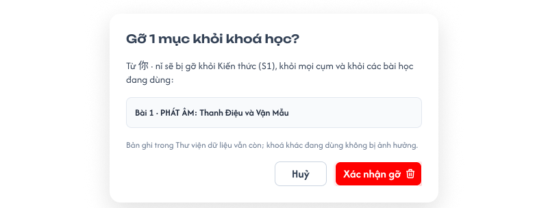

**Mô tả:**
- `Xoá khỏi danh sách` (1 mục) hoặc `Xoá (N)` (hàng loạt) **gỡ mục khỏi khoá học**; bản ghi thư viện vẫn còn.

**Điểm cần lưu ý:**
- `A15.01` Tiêu đề `Gỡ N mục khỏi khoá học?`.
- `A15.02` Nội dung vd `Từ 你 · nǐ sẽ bị gỡ khỏi Kiến thức (S1), khỏi mọi cụm và khỏi các bài học đang dùng:` + danh sách các bài đang dùng (vd `Bài 1 · PHÁT ÂM: Thanh Điệu và Vận Mẫu`).
- `A15.03` Ghi chú `Bản ghi trong Thư viện dữ liệu vẫn còn; khoá khác đang dùng không bị ảnh hưởng.`
- `A15.04` `Huỷ` đóng popup, không thay đổi.
- `A15.05` `Xác nhận gỡ`: gỡ mục khỏi khoá, khỏi mọi cụm của khoá và **gỡ luôn khỏi các bài học** đã liệt kê.
- `A15.06` Mục không dùng ở bài học nào thì không hiện danh sách bài, chỉ hiện nội dung gỡ khỏi S1 và cụm.

### Trang 8: CD-KH-040160 — Kiến thức (S1) / Từ vựng / Popup thêm theo list

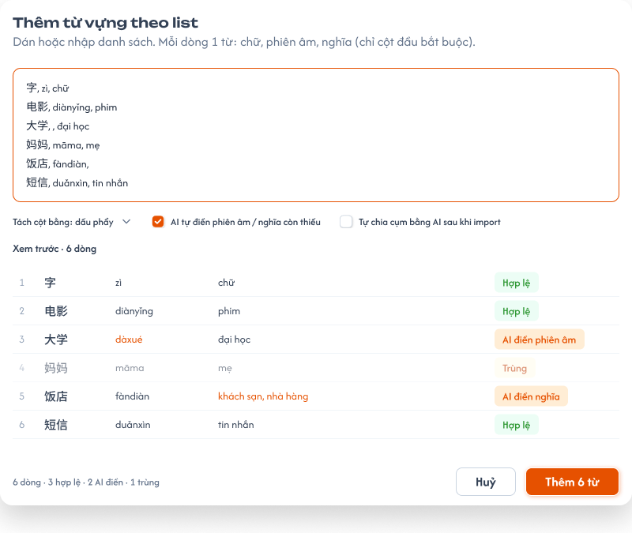

**Mô tả:**
- CD dán hoặc gõ danh sách, **mỗi dòng 1 mục**; hệ thống tách cột, xem trước rồi tạo mới bản ghi thư viện và gắn vào khoá.

**Điểm cần lưu ý:**
- `A05.01` Mô tả: `Dán hoặc nhập danh sách. Mỗi dòng 1 từ: chữ, phiên âm, nghĩa (chỉ cột đầu bắt buộc).` Không có tải file Excel / CSV.
- `A05.02` Mỗi dòng = các field chính theo thứ tự cố định của loại, tách bằng dấu phẩy; chỉ cột đầu bắt buộc, cột sau được để trống. Field nhiều giá trị (Nghĩa Hán tự, Âm On / Kun) tách bằng `;` trong cùng cột. Dòng trống không tạo mục.
- `A05.03` Tách cột bằng: mặc định `dấu phẩy`.
- `A05.04` Tick `AI tự điền … còn thiếu` thì sau khi thêm AI điền các field trống của các dòng vừa thêm theo rule Điền thiếu bằng AI (lưu luôn, tối đa 50 dòng / lần).
- `A05.05` Tick `Tự chia cụm bằng AI sau khi import` thì sau khi thêm mở luồng Chia cụm bằng AI cho các mục vừa thêm.
- `A05.06` Xem trước: bảng các dòng đã tách, nhãn từng dòng `Hợp lệ`, `AI điền …` hoặc lỗi `Thiếu cột đầu`; CD bỏ được từng dòng trước khi thêm.
- `A05.07` Mục mới vào cụm đang chọn ở panel Cụm (nếu đang chọn cụm).
- `A05.08` Chân popup: tổng `N dòng · a hợp lệ · b AI điền · c lỗi`, `Huỷ`, `Thêm N từ`.
- Không kiểm tra trùng: dòng giống mục đã có trong khoá (hoặc giống dòng khác trong list) vẫn `Hợp lệ` và tạo bản ghi mới. Field dài (Cách dùng, Ví dụ, Thành phần, Thứ tự nét…) không nhập qua list, để AI điền hoặc nhập ở Chi tiết mục.
- Thứ tự cột trên mỗi dòng theo loại (chỉ cột 1 bắt buộc):
- `A05.09` Từ vựng: `chữ, phiên âm, nghĩa`.
- `A05.10` Ngữ pháp: `tên điểm ngữ pháp, ý nghĩa, cấu trúc`.
- `A05.11` Mẫu câu: `câu, phiên âm, nghĩa`.
- `A05.12` Hán tự: `chữ, phiên âm, âm Hán Việt, nghĩa` (nhiều nghĩa tách `;`).
- `A05.13` Kanji: `chữ, âm On, âm Kun, âm Hán Việt, nghĩa` (nhiều âm tách `;`).
- `A05.14` Phát âm (tiếng Trung): `âm, loại âm` (`Thanh mẫu` / `Vận mẫu` / `Âm tiết`; Âm tiết tự tách Thanh mẫu + Vận mẫu nếu khớp).
- `A05.15` Bảng chữ tiếng Nhật: `hiragana, katakana, romaji, loại, hàng`.
- `A05.16` Bảng chữ tiếng Hàn: `chữ, tên gọi, phiên âm, loại`.

### Trang 9: CD-KH-040170 — Kiến thức (S1) / Từ vựng / Popup chia cụm bằng AI

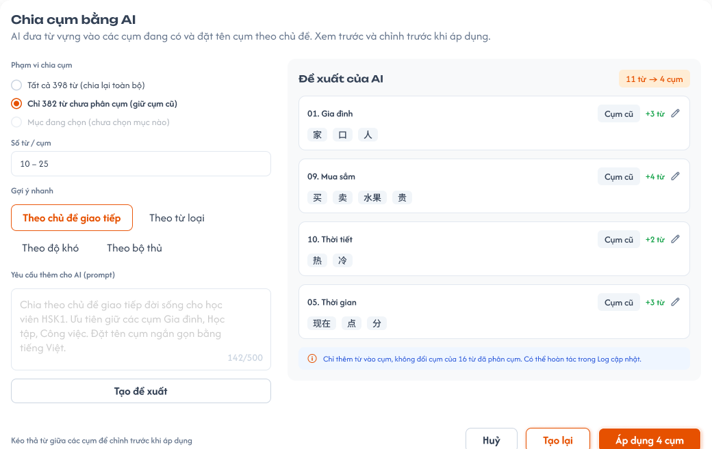

**Mô tả:**
- AI đề xuất cách đưa các mục vào **các cụm đang có** của loại theo chủ đề và prompt của CD; CD xem trước, chỉnh rồi áp dụng. Ví dụ 500 từ vựng, 24 cụm: AI chia 500 từ vào 24 cụm và đặt tên cụm theo chủ đề.

**Điểm cần lưu ý:**
- `A12.01` Mô tả: `AI đưa từ vựng vào các cụm đang có và đặt tên cụm theo chủ đề. Xem trước và chỉnh trước khi áp dụng.`
- `A12.02` Phạm vi chọn 1: `Tất cả N từ (chia lại toàn bộ)`, `Chỉ M từ chưa phân cụm (giữ cụm cũ)`, `Mục đang chọn` (mờ, ghi `chưa chọn mục nào` khi chưa chọn). Phạm vi `Chỉ M mục chưa phân cụm` chỉ **thêm** mục vào cụm, không đổi cụm của mục đã phân cụm.
- `A12.03` `Số từ / cụm`: khoảng số mục mỗi cụm để AI tham khảo (vd `10 – 25`), không bắt buộc, trống thì AI tự cân đối.
- `A12.04` Gợi ý nhanh điền vào prompt: `Theo chủ đề giao tiếp`, `Theo từ loại`, `Theo độ khó`, `Theo bộ thủ`. Không có gợi ý theo bài học (cụm không gắn bài học).
- `A12.05` Prompt tối đa 500 ký tự (bộ đếm `x/500`).
- `A12.06` `Tạo đề xuất` gửi yêu cầu cho AI.
- `A12.07` Đề xuất: badge `N mục → M cụm`; mỗi cụm 1 thẻ gồm tên cụm (AI đặt theo chủ đề, sửa bằng icon bút), nhãn `Cụm cũ`, `+k từ`, danh sách mục. Kéo thả mục giữa các cụm là chuyển cụm; mỗi mục chỉ thuộc đúng 1 cụm.
- `A12.08` Ghi chú phạm vi, vd `Chỉ thêm từ vào cụm, không đổi cụm của 16 từ đã phân cụm`.
- `A12.09` `Huỷ` không đổi gì; `Tạo lại` để AI đề xuất lại; `Áp dụng M cụm` lưu phân bổ và tên cụm, ghi 1 dòng `Chia cụm bằng AI: N mục → M cụm` vào Log cập nhật.
- AI **không tạo cụm mới, không tạo cụm con**, chỉ dùng các cụm đang có; mọi thẻ đề xuất mang nhãn `Cụm cũ`. Chưa có cụm (Số cụm = 0) thì chưa chia được (EX05).
- Hoàn tác sau khi áp dụng là chức năng của `Log cập nhật` (requirement riêng), không nằm trong S1; dòng `Có thể hoàn tác trong Log cập nhật` trên popup chỉ dẫn sang đó.

### Trang 10: CD-KH-040190 — Kiến thức (S1) / Từ vựng / Soát lỗi bằng AI

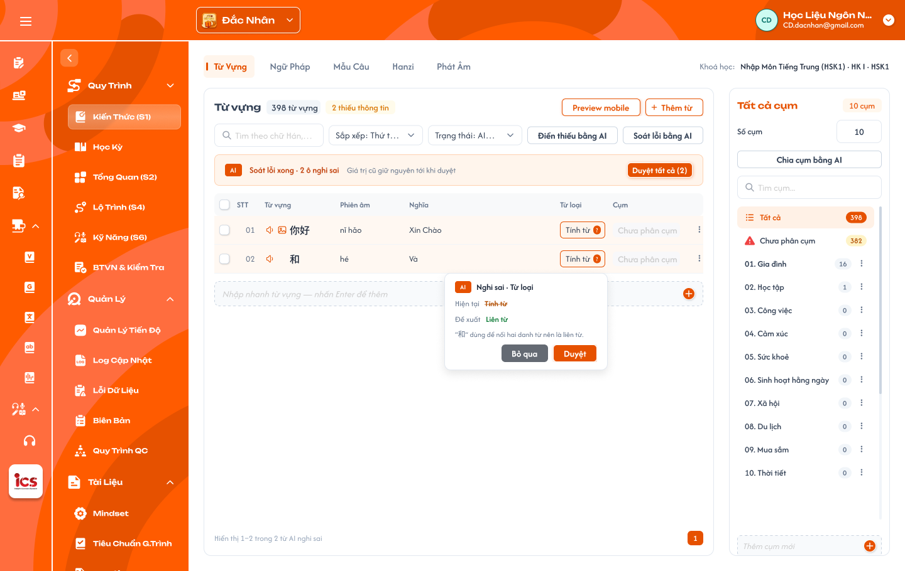

**Mô tả:**
- Trạng thái sau khi `Soát lỗi bằng AI` (bảng đang lọc `AI nghi sai`, thanh `Soát lỗi xong · 2 ô nghi sai`). S1 có 4 chức năng AI, mỗi chức năng một nút riêng: Thêm bằng AI, Điền thiếu bằng AI, Soát lỗi bằng AI, `↻ Tạo lại`.

**Điểm cần lưu ý:**
- `A13.01` Popup `Thêm bằng AI`: ô yêu cầu (prompt, tối đa 500 ký tự), `Số lượng` (số nguyên 1–50, mặc định 10; nhập > 50 báo `Tối đa 50 mục mỗi lần`), `Thêm vào cụm` (mặc định cụm đang chọn), `Tạo`. AI trả bảng xem trước N dòng đủ field; CD bỏ được từng dòng; `Thêm N …` tạo N bản ghi thư viện mới, gắn vào khoá.
- `A13.02` Điểm gọi Điền thiếu: thanh hàng loạt `Điền thiếu bằng AI (k)` (mục đang chọn, tối đa 50); menu dòng (1 mục); Preview mobile `Điền thiếu từ này`. Điền thiếu chỉ điền field **đang trống**, không sửa field đã có dữ liệu; media (ảnh, audio) không tự điền, tạo bằng `↻ Tạo lại`.
- `A13.03` Mục phải có field chính thì AI mới điền: Từ vựng → `Từ`; Ngữ pháp → `Tên điểm ngữ pháp`; Mẫu câu → `Câu`; Hanzi, Kanji → `Chữ`; Phát âm → `Âm`; Bảng chữ Nhật → `Hiragana`; Bảng chữ Hàn → `Chữ`. Mục thiếu field chính không được tính vào k và bị bỏ qua.
- `A13.04` Thanh tiến độ: `Đang điền thông tin còn thiếu cho N từ · Chỉ điền ô trống · dữ liệu cũ giữ nguyên`, thanh `x/N từ`; nút `Đang điền x/N · Dừng`; Toast `Thông Báo` — `AI đang điền thông tin cho N từ.` `Dừng`: mục chưa xử lý giữ nguyên, mục đã điền giữ giá trị AI đã lưu.
- `A13.05` Giá trị AI điền **lưu ngay** như CD tự nhập: không nhãn / tag AI, không trạng thái chờ duyệt, không `Duyệt` / `Hoàn tác`; mục đủ field bắt buộc thì hết `Thiếu thông tin`.
- `A13.06` `Soát lỗi bằng AI` ở thanh công cụ luôn chạy cho toàn bộ mục của tab (không phụ thuộc mục đang chọn, không giới hạn 50); AI kiểm tra field đã có dữ liệu (vd phiên âm sai thanh điệu, nghĩa không khớp, từ loại sai).
- `A13.07` Thanh kết quả `Soát lỗi xong · N ô nghi sai · Giá trị cũ giữ nguyên tới khi duyệt`, `Duyệt tất cả (N)`; bảng lọc `AI nghi sai`. Đề xuất **không ghi đè** giá trị cũ cho tới khi CD duyệt.
- `A13.08` Ô AI nghi sai viền nét đứt; bấm ô hiện popover `Nghi sai · <tên field>` gồm `Hiện tại` (gạch ngang), `Đề xuất`, lý do (vd `"和" dùng để nối hai danh từ nên là liên từ.`) và `Bỏ qua` / `Duyệt` (thay bằng đề xuất).
- `A13.09` `↻ Tạo lại` ở Chi tiết mục (Trang 11): xác nhận `Tạo lại <tên field>? Giá trị hiện tại sẽ bị thay.` rồi AI sinh giá trị mới, ghi đè, Toast `Thành Công`.
- Khoá mục AI đang xử lý: trong lúc Điền thiếu / Soát lỗi / Tạo lại chạy, các mục đang xử lý không sửa inline, không mở Chi tiết mục để sửa, `Xoá`, `Thêm vào cụm / Gỡ khỏi cụm` mờ; mục khác và Nhập nhanh vẫn thao tác bình thường. API thay đổi mục đang xử lý bị từ chối (EX10). Không còn lọc `AI chờ duyệt`.

### Trang 11: CD-KH-040195 — Kiến thức (S1) / Từ vựng / Chi tiết mục (drawer)

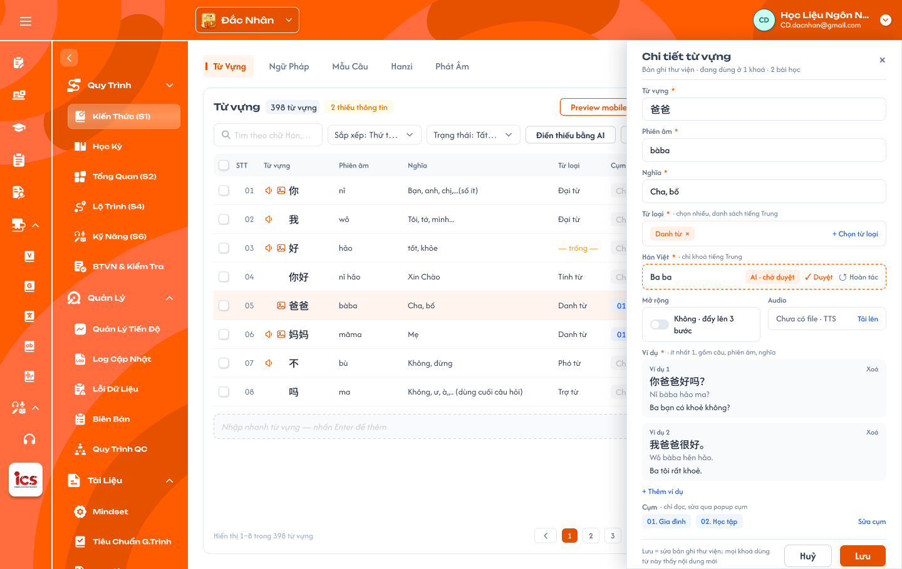

**Mô tả:**
- Drawer trượt từ phải, phủ lên panel Cụm; mở từ ⋮ → `Mở chi tiết …` (hoặc bấm tên mục). Bảng bên trái vẫn hiện, dòng đang mở được tô sáng. Mỗi loại có form riêng theo bảng Field (Phụ lục A).

**Điểm cần lưu ý:**
- `A08.01` Tiêu đề `Chi tiết <loại>` + dòng phụ `Bản ghi thư viện · đang dùng ở N khoá · M bài học`; `×` đóng (hỏi xác nhận nếu có thay đổi chưa lưu).
- `A08.02` Field bắt buộc đánh dấu `*`; trống thì viền đỏ khi Lưu và mục vẫn tính thiếu thông tin.
- `A08.03` Từ loại chọn nhiều chip từ danh sách theo ngôn ngữ; `×` trên chip để bỏ; `+ Chọn từ loại`.
- `A08.04` Hán Việt chỉ hiện ở trung tâm tiếng Trung.
- `A08.05` `↻ Tạo lại` cạnh **từng field** (mọi field văn bản và media, trừ field hệ thống tự sinh): AI sinh lại giá trị field đó và ghi đè giá trị cũ sau khi CD xác nhận.
- `A08.06` Mở rộng là toggle `Không · đẩy lên 3 bước học` (mặc định) / `Có · không đẩy lên 3 bước`.
- `A08.07` Audio: `Chưa có file · TTS` + `Tải lên`; có file thì hiện tên file, nút nghe, `Thay`, `Xoá`.
- `A08.08` Ví dụ là danh sách thẻ `Ví dụ n` gồm câu, phiên âm, nghĩa; `Xoá` từng ví dụ (không xoá được khi chỉ còn 1); `+ Thêm ví dụ`.
- `A08.09` Cụm chỉ đọc: chip cụm đang thuộc (hoặc `Chưa phân cụm`); `Sửa cụm` mở popup Thêm vào cụm / Gỡ khỏi cụm.
- `A08.10` Chân drawer: ghi chú `Lưu = sửa bản ghi thư viện; mọi khoá dùng từ này thấy nội dung mới`, `Huỷ`, `Lưu`.
- Field theo loại: Ngữ pháp có Cấu trúc, Cách dùng, Lưu ý (ô nhiều dòng), Video, Mở rộng; Hán tự có Thành phần, Thứ tự nét, Mẹo nhớ, Chữ giống, Từ liên quan (chọn từ S1), Nét viết SVG; Kanji có Âm On, Âm Kun, Bộ thủ, Thành phần, Mẹo nhớ, Từ liên quan, Nét viết SVG; Phát âm tiếng Trung có Loại âm, Nhóm, Thanh mẫu, Vận mẫu, Cách đọc, Hướng dẫn phát âm, Âm dễ nhầm, Audio theo 4 thanh, Video hướng dẫn; Bảng chữ Nhật có Hiragana, Katakana, Romaji, Loại, Hàng, Chữ dễ nhầm, Mẹo nhớ, Từ ví dụ (từ, romaji, nghĩa), Audio, Thứ tự nét; Bảng chữ Hàn có Chữ, Tên gọi, Phiên âm, Loại, Từ ví dụ, Audio, Thứ tự nét.
- Field hệ thống tự sinh (Phiên âm từng chữ, Chuỗi tìm kiếm Kanji) không hiện để sửa. Mục đang được AI xử lý thì drawer chỉ đọc.

### Trang 12: CD-KH-040200 — Kiến thức (S1) / Ngữ pháp

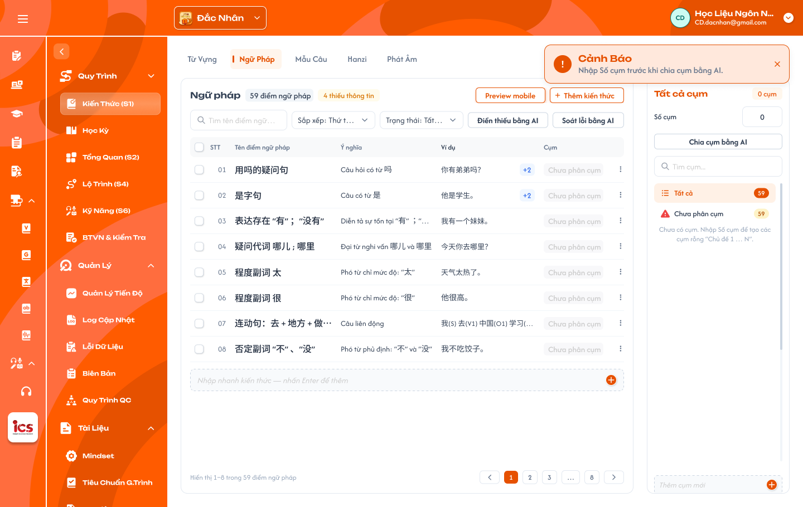

**Mô tả:**
- Tab Ngữ pháp (59 điểm ngữ pháp, 4 thiếu thông tin): bảng dùng cột Tên điểm ngữ pháp, Ý nghĩa, Ví dụ, Cụm; cấu trúc toolbar, thanh hàng loạt, Nhập nhanh, phân trang và panel Cụm giống mọi tab.

**Điểm cần lưu ý:**
- `A02.02` Ngữ pháp: bắt buộc Tên điểm ngữ pháp, Ý nghĩa, Cấu trúc, Cách dùng, Ví dụ (≥ 1; mỗi ví dụ gồm câu, phiên âm, nghĩa); không bắt buộc Lưu ý, Video, Mở rộng. Bảng hiện ví dụ đầu, nhiều hơn thì thêm nhãn `+N`.
- `A02.15` Cách dùng / Lưu ý: nội dung nhiều đoạn, có ví dụ kèm phiên âm và nghĩa theo định dạng dữ liệu hiện có.
- `A02.22` Video: link video (vd YouTube), không bắt buộc.
- Chưa có cụm thì panel Cụm gợi ý nhập `Số cụm`; mỗi loại có bộ cụm riêng, không lẫn với cụm của Từ vựng.

### Trang 13: CD-KH-030270 — Thêm / gỡ kiến thức trong Chi tiết bài học (chưa có frame Figma)

**Mô tả:**
- Tại Chi tiết bài học (Học kỳ → bài học) của khoá, tab `Kiến thức` → `+ Thêm` để thêm kiến thức đã có trong S1 của **chính khoá đó** vào bài; không sửa nội dung kiến thức tại đây. Kỹ năng là tab riêng (xem [Kỹ năng (S6)](../skill-s6/skill-s6.md)). Đặc tả UI chi tiết xem [Học kỳ — Bài học](../semester/lesson/lesson.md) tab Kiến thức.

**Điểm cần lưu ý:**
- `A16.01` Popup `+ Thêm` là 1 màn 3 cột: Loại kiến thức (cùng bộ tab của S1) | Cụm | Mục (checkbox, `Chọn tất cả`, ô tìm kiếm). Giữ lựa chọn khi đổi cụm / loại. Chân popup `Huỷ`, `Thêm ({n})`.
- `A16.02` Thêm cả cụm: chọn cụm → `Chọn tất cả` thêm **một lần** các mục đủ thông tin đang có trong cụm (theo thứ tự trong cụm). Không liên kết cụm với bài; mục thêm vào cụm sau này không tự vào bài. Một cụm dùng được cho nhiều bài.
- `A16.03` Tick Mục: thêm từng mục. Mục đã có trong bài mờ, tick sẵn, nhãn `Đã có trong bài`. Mục **thiếu thông tin** mờ, không chọn được (tooltip lý do). Mục `Chưa phân cụm` không hiện trong popup, không thêm được.
- `A16.04` Danh sách trong bài nhóm theo loại; mỗi mục có `×` chỉ xoá liên kết mục ↔ bài (mục vẫn còn trong S1), không có nút sửa. Nội dung mục trong bài luôn là nội dung hiện tại của bản ghi thư viện.
- Gỡ mục khỏi cụm / xoá cụm ở S1: mục tự gỡ khỏi các bài đã thêm nó từ cụm đó (có cảnh báo).

---

## 2. Yêu cầu

### 2.1. Flow chính

**Flow 1: Mở Kiến thức (S1) và xem danh sách**

```
CD chọn trung tâm ở header → vào khoá học → Kiến thức (S1)
      → Hệ thống hiện 6 tab loại kiến thức; trung tâm có hệ chữ riêng có thêm tab Bảng chữ
      → Mở tab đầu (Từ vựng): bảng mục của khoá + panel Cụm của Từ vựng
      → CD tìm kiếm / sắp xếp / lọc Trạng thái / chọn cụm → bảng, badge, phân trang cập nhật
```

**Flow 2: Thêm từ thư viện dữ liệu**

```
CD bấm + Thêm → Thêm từ thư viện → popup thư viện
      → Lọc Kho (Tất cả / Từ điển / Khoá học), Cấp độ, Từ loại, tìm kiếm → tick các mục (không khoá mục đã có trong khoá)
      → Chọn Thêm vào cụm (mặc định cụm đang chọn) → Thêm N
      → Thành công: gắn tham chiếu bản ghi thư viện vào khoá, thêm vào cụm đã chọn, Toast Thành Công
      → Thất bại: không gắn mục nào, Toast Có Lỗi Xảy Ra
```

**Flow 3: Thêm theo list**

```
CD bấm + Thêm → Thêm theo list → dán / nhập mỗi dòng 1 mục, các field tách dấu phẩy
      → Hệ thống tách cột, xem trước: Hợp lệ / AI điền … / lỗi thiếu cột đầu (không kiểm tra trùng)
      → (Tuỳ chọn) AI tự điền field trống sau khi thêm — lưu luôn, theo rule Điền thiếu
      → Thêm N → tạo N bản ghi thư viện mới, gắn vào khoá (và cụm đang chọn)
      → (Tuỳ chọn) Tự chia cụm bằng AI → mở Flow 10 cho các mục vừa thêm
```

**Flow 4: Nhập nhanh**

```
CD gõ field đầu vào ô Nhập nhanh → Enter / +
      → Tạo bản ghi thư viện mới, gắn vào khoá, thêm dòng cuối bảng (vào cụm đang chọn nếu có)
      → Mục tính là Thiếu thông tin cho tới khi đủ field bắt buộc
```

**Flow 5: Sửa và nhân bản mục**

```
CD chọn Sửa nhanh (inline) hoặc Mở chi tiết (drawer đủ field, danh sách ví dụ, audio) → sửa field → lưu
      → Lưu vào bản ghi thư viện → mọi khoá / bài học dùng bản ghi thấy nội dung mới
CD chọn Nhân bản → tạo bản ghi thư viện mới cùng nội dung, gắn vào khoá, cùng cụm
```

**Flow 6a: Thêm bằng AI**

```
CD bấm Thêm bằng AI → nhập yêu cầu, Số lượng (1–50), Thêm vào cụm → Tạo
      → AI trả bảng xem trước N mục đủ field → CD bỏ dòng không dùng → Thêm N
      → Tạo N bản ghi thư viện mới, gắn vào khoá (và cụm đã chọn), Toast Thành Công
```

**Flow 6: Điền thiếu bằng AI**

```
CD chọn mục (tối đa 50) → Điền thiếu bằng AI (k)   (hoặc menu dòng / Preview: 1 mục)
      → Bỏ qua mục thiếu field chính (vd Từ vựng chưa có Từ)
      → AI điền mọi field đang trống; thanh tiến độ x/N, có Dừng; mục đang xử lý bị khoá thao tác
      → Giá trị lưu luôn, không nhãn AI, không chờ duyệt
```

**Flow 6b: Tạo lại một field**

```
CD mở Chi tiết mục → bấm ↻ Tạo lại cạnh field → xác nhận
      → AI sinh giá trị mới cho field đó → ghi đè giá trị cũ, Toast Thành Công (Huỷ: không đổi)
```

**Flow 7: Soát lỗi bằng AI**

```
CD bấm Soát lỗi bằng AI ở thanh công cụ (toàn bộ mục của tab, không giới hạn số lượng)
      → AI kiểm tra field đã có dữ liệu → đánh dấu ô nghi sai + giá trị đề xuất
      → CD Duyệt (thay bằng đề xuất) hoặc Bỏ qua; giá trị cũ giữ nguyên tới khi duyệt
```

**Flow 8: Số cụm, thêm và xoá cụm**

```
Loại kiến thức có Số cụm = 0 → CD nhập N → tạo N cụm rỗng Chủ đề 1 … Chủ đề N (đã có cụm thì Số cụm chỉ đọc)
CD Thêm cụm mới → thêm 1 cụm rỗng cuối danh sách
CD Đổi tên cụm → lưu tên mới
CD Xoá cụm → (cảnh báo nếu mục đang dùng ở bài học) → cụm bị xoá; các mục về Chưa phân cụm và tự gỡ khỏi bài học
```

**Flow 9: Thêm vào cụm / Gỡ khỏi cụm**

```
CD chọn 1 hoặc nhiều mục → Thêm vào cụm / Gỡ khỏi cụm
      → Chọn 1 cụm hoặc Chưa phân cụm → Lưu (cảnh báo nếu mục đang dùng ở bài học bị rời cụm)
      → Mục chuyển vào cụm / về Chưa phân cụm; mục rời cụm thì tự gỡ khỏi bài học
```

**Flow 10: Chia cụm bằng AI**

```
CD bấm Chia cụm bằng AI (loại đã có ≥ 1 cụm)
      → Chọn phạm vi, Số từ / cụm (tuỳ chọn), gợi ý nhanh, nhập prompt → Tạo đề xuất
      → AI đưa mục vào các cụm đang có, đặt tên cụm theo chủ đề (không tạo cụm mới / cụm con)
      → CD kéo thả mục giữa cụm, sửa tên cụm; Tạo lại nếu cần
      → Áp dụng: lưu phân bổ + tên cụm, ghi Log cập nhật, Toast Thành Công; Huỷ: không đổi
```

**Flow 11: Gỡ mục khỏi khoá**

```
CD chọn Xoá khỏi danh sách (1 mục) hoặc Xoá (N)
      → Popup xác nhận: số mục + các bài học đang dùng mục
      → Xác nhận: gỡ mục khỏi khoá, khỏi các cụm và khỏi các bài học; bản ghi thư viện vẫn còn
      → Huỷ: không thay đổi
```

**Flow 12: Thêm / gỡ kiến thức trong Chi tiết bài học**

```
CD mở Chi tiết bài học → tab Kiến thức → + Thêm
      → Popup 3 cột Loại | Cụm | Mục → Chọn tất cả (thêm cả cụm) và / hoặc tick Mục (bỏ qua mục thiếu thông tin) → Thêm
      → Bài có thêm các mục (mục trùng giữa các cụm chỉ thêm 1 lần); thêm mục mới vào cụm sau không tự vào bài
CD gỡ mục khỏi cụm / xoá cụm ở S1 → cảnh báo liệt kê bài → xác nhận → mục (mọi mục của cụm) tự gỡ khỏi các bài học đó
CD bấm × ở một mục trong bài → gỡ mục khỏi bài; mục vẫn còn trong S1
```

**Flow 13: Preview mobile**

```
CD chọn mục → Preview mobile → panel hiện thẻ theo màn học của app học viên cho loại đó
      → Chuyển mục bằng nút / ↑ ↓; mục thiếu thì hiện field trống + Điền thiếu từ này
```

### 2.2. Ngoại lệ

- **EX01:** Dòng Thêm theo list thiếu cột đầu → dòng báo lỗi, không tạo; các dòng hợp lệ khác vẫn thêm được.
- **EX02:** Nhập nhanh rỗng hoặc chỉ khoảng trắng → không tạo mục.
- **EX03:** Điền thiếu bằng AI quá 50 mục / lần hoặc Thêm bằng AI số lượng > 50 → UI chặn (nút mờ / báo `Tối đa 50 mục mỗi lần`); API từ chối, không chạy AI.
- **EX04:** AI lỗi hoặc CD bấm `Dừng` → mục chưa xử lý giữ nguyên; mục đã điền giữ giá trị AI đã lưu; báo lỗi nếu AI lỗi.
- **EX05:** Chia cụm bằng AI khi loại chưa có cụm (Số cụm = 0) → không gửi yêu cầu, Toast `Cảnh Báo` `Nhập Số cụm trước khi chia cụm bằng AI.`
- **EX06:** Role khác CD truy cập S1 hoặc gọi API thay đổi kiến thức → từ chối, không thay đổi dữ liệu.
- **EX07:** Truy cập tab Bảng chữ ở trung tâm không có hệ chữ riêng (qua URL / API) → từ chối.
- **EX08:** Truy cập khoá học / kiến thức của trung tâm khác trung tâm đang chọn → từ chối.
- **EX09:** Lưu thất bại (sửa, cụm, áp dụng AI, thêm / gỡ ở bài học) → giữ dữ liệu cũ, Toast `Có Lỗi Xảy Ra`.
- **EX10:** Sửa / xoá / đổi cụm mục đang được AI xử lý → UI mờ thao tác; API từ chối, dữ liệu không đổi.
- **EX11:** Đổi `Số cụm` khi loại đã có cụm → ô chỉ đọc; API từ chối.
- **EX12:** Lưu Chi tiết mục với Ví dụ rỗng (0 ví dụ) hoặc Từ loại ngoài danh sách → báo lỗi tại field, không lưu.

### 2.3. Yêu cầu khác

| Mã | Tên yêu cầu | Mô tả |
|---|---|---|
| REQ01 | Phạm vi | Mỗi khoá học có danh sách Kiến thức (S1) riêng; dữ liệu theo trung tâm CD đang chọn ở header. |
| REQ02 | Tab theo loại | Mỗi loại kiến thức 1 tab; mọi trung tâm có đủ Từ vựng, Ngữ pháp, Mẫu câu, Hanzi, Kanji, Phát âm; tab Bảng chữ chỉ ở trung tâm có hệ chữ riêng (Sakumi, Saechang); khoá học không có field ngôn ngữ. Ngôn ngữ của trung tâm chỉ quyết định danh sách Từ loại và nội dung Bảng chữ. |
| REQ03 | Field và thiếu thông tin | Mỗi loại có bộ field theo bảng Field và Phụ lục A; mục thiếu thông tin khi trống bất kỳ field bắt buộc; Từ loại chọn 1 hoặc nhiều giá trị từ danh sách cố định theo ngôn ngữ; Bộ thủ chọn 1 trong 214 bộ Khang Hy; Ví dụ của Từ vựng / Ngữ pháp là danh sách ≥ 1 (câu, phiên âm, nghĩa); furigana và chuỗi tìm kiếm Kanji do hệ thống sinh. |
| REQ04 | Thư viện dữ liệu | Mục của S1 là tham chiếu bản ghi thư viện; không có rule bắt trùng, một bản ghi gắn được nhiều lần vào cùng khoá. Thêm mới tại S1 tạo bản ghi thư viện; sửa tại S1 sửa bản ghi thư viện (mọi khoá dùng bản ghi đổi theo). Thư viện theo ngôn ngữ, có 2 kho `Từ điển` (import sẵn) và `Khoá học` (tạo từ S1); màn quản lý thư viện là requirement riêng. |
| REQ05 | Thêm mục | Thêm từ thư viện, Thêm theo list (mỗi dòng 1 mục theo thứ tự cột của loại, tách dấu phẩy, chỉ cột đầu bắt buộc, nhiều giá trị trong 1 cột tách `;`), Nhập nhanh. Không kiểm tra trùng ở bất kỳ cách thêm nào (thư viện, list, nhập nhanh, AI, import). Thêm bằng AI tối đa 50 mục / lần. |
| REQ06 | Sửa và nhân bản | Sửa nhanh inline và drawer Chi tiết mục (đủ field, danh sách ví dụ, audio, `↻ Tạo lại` từng field); Nhân bản tạo bản ghi thư viện mới cùng nội dung, cùng cụm. |
| REQ07 | Gỡ khỏi khoá | Xoá ở S1 là gỡ mục khỏi khoá (bản ghi thư viện còn); có xác nhận, liệt kê bài đang dùng; xác nhận thì gỡ luôn khỏi các bài đó. |
| REQ08 | Cụm | Mỗi loại có bộ cụm riêng; Số cụm mặc định 0, chỉ nhập khi chưa có cụm, nhập N tạo `Chủ đề 1…N` rỗng; đã có cụm thì Số cụm chỉ đọc, thêm cụm rỗng, đổi tên, xoá cụm (mục về Chưa phân cụm) bằng panel. **Mỗi mục thuộc tối đa 1 cụm**; cột Cụm hiện 1 nhãn, bấm mở popup cụm (chọn 1). Cụm không gắn bài học; mục rời cụm / cụm bị xoá thì tự gỡ khỏi bài học (có cảnh báo). |
| REQ09 | Chia cụm bằng AI | AI chia mục vào các cụm đang có theo chủ đề và prompt, đặt tên cụm theo chủ đề; không tạo cụm mới / cụm con; `Số từ / cụm` là gợi ý không bắt buộc; có xem trước, chỉnh, tạo lại, áp dụng; phạm vi `Chỉ … chưa phân cụm` giữ cụm cũ; áp dụng ghi Log cập nhật (hoàn tác thuộc Log cập nhật). |
| REQ10 | AI | 4 nút riêng. (1) `Thêm bằng AI`: tạo mục mới theo prompt, số lượng 1–50 / lần. (2) `Điền thiếu bằng AI`: chạy cho mục đang chọn, tối đa 50 / lần; mục phải có field chính (Từ vựng → Từ, Ngữ pháp → Tên điểm ngữ pháp, Mẫu câu → Câu, Hanzi / Kanji → Chữ, Phát âm → Âm, Bảng chữ → Hiragana / Chữ); AI điền mọi field trống (trừ media) và lưu luôn, không nhãn AI, không chờ duyệt; có Dừng. (3) `Soát lỗi bằng AI`: toàn bộ mục của tab, không giới hạn; đề xuất sửa field đã có, không ghi đè tới khi CD duyệt (Duyệt, Duyệt tất cả, Bỏ qua). (4) `↻ Tạo lại` cạnh từng field trong Chi tiết mục (mọi field, kể cả media): AI sinh lại và ghi đè sau khi CD xác nhận. Mục đang được AI xử lý bị khoá sửa / xoá / đổi cụm tới khi xong hoặc Dừng. |
| REQ11 | Tìm kiếm, lọc, sắp xếp, kéo thả | Tìm theo field chính; Trạng thái `Tất cả / Đủ thông tin / Thiếu thông tin / AI nghi sai`; Sắp xếp `Thứ tự thêm / A–Z / Mới cập nhật / Thứ tự trong cụm`; kéo thả chỉ đổi thứ tự trong cụm; điều kiện kết hợp, đổi điều kiện về trang 1. |
| REQ12 | Preview và âm thanh | Mọi loại có Preview mobile tái hiện màn học của app học viên cho loại đó; Audio không bắt buộc, không có file thì TTS; Preview không ghi dữ liệu học. |
| REQ13 | Kiến thức trong bài học | Chi tiết bài học chỉ thêm / gỡ kiến thức từ S1 của chính khoá qua popup `Thêm kiến thức vào bài học` (1 màn 3 cột Loại / Cụm / Mục); thêm cả cụm là chọn tất cả một lần, không tự gắn mục mới; mục thiếu thông tin không gắn được; gỡ mục khỏi khoá / khỏi cụm, xoá cụm đang dùng ở bài học → cảnh báo liệt kê bài, xác nhận thì tự gỡ khỏi bài; không sửa nội dung tại bài. |
| REQ14 | Quyền | Chỉ CD được truy cập và thao tác S1 trong trung tâm đang chọn; kiểm tra cả UI và API. |
| REQ15 | Phản hồi | Thao tác thay đổi dữ liệu có đúng một Toast theo kết quả; không báo thành công trước khi lưu xong. |

### 2.4. Ràng buộc

#### Quyền

| Role | Xem S1 | Thêm / Sửa / Nhân bản | Gỡ khỏi khoá | Quản lý cụm | Dùng AI | Thêm / gỡ kiến thức trong bài học |
|---|:---:|:---:|:---:|:---:|:---:|:---:|
| CD | ✅ | ✅ | ✅ | ✅ | ✅ | ✅ |
| Các role khác | ❌ | ❌ | ❌ | ❌ | ❌ | ❌ |

#### Ràng buộc khác

- Chỉ sửa được khi khoá học `Nháp`; khoá `Công Khai` / `Vô hiệu` chỉ đọc (tìm kiếm, lọc, Preview vẫn dùng được), backend từ chối request ghi.
- CD chỉ thao tác trên khoá học thuộc trung tâm đang chọn ở header; đổi trung tâm thì dữ liệu tải lại.
- Mục S1 tham chiếu bản ghi thư viện; sửa ở S1 ảnh hưởng mọi khoá đang dùng bản ghi. Dùng định danh bản ghi, không dùng nội dung (chữ / nghĩa) làm khoá liên kết.
- Bài học chỉ chọn được mục trong S1 của chính khoá học đó.
- Không cho phép truy cập hoặc thực hiện hành động bị đánh dấu `❌`, kể cả khi gọi trực tiếp bằng URL hoặc request.


---

## 3. Testcase

### Feature: Kiến thức (S1)

| Tên testcase | Priority | Scenario | Role | Pre-condition | Given/When/Then | Expected Result |
|---|---|---|---|---|---|---|
| Case 1: Mở S1, đủ tab, đổi trung tâm | High | Flow 1 / REQ01 / REQ02 | CD | CD được gán Đắc Nhân và Sakumi; khoá có dữ liệu | **Given:** CD đang ở khoá học<br>**When:** chọn `Kiến thức (S1)`, xem thanh tab rồi đổi trung tâm ở header, đổi tab sang Ngữ pháp<br>**Then:** hiện tab Từ vựng với danh sách đúng khoá; bảng và panel Cụm đổi theo tab | - Mọi trung tâm có Từ vựng, Ngữ pháp, Mẫu câu, Hanzi, Kanji, Phát âm; Sakumi có thêm Bảng chữ trước Phát âm, Đắc Nhân không có<br>- Dữ liệu tải lại theo trung tâm mới, không còn dữ liệu trung tâm cũ<br>- Cột bảng và cụm đúng loại |
| Case 2: Danh sách, tìm kiếm, lọc, kéo thả, thiếu thông tin | High | Flow 1 / REQ03 / REQ11 / EX12 | CD | Cụm `Gia đình` có 16 từ; từ `好` thiếu Từ loại; từ khác đủ field bắt buộc nhưng không có Audio | **Given:** tab Từ vựng<br>**When:** chọn cụm `Gia đình`; nhập từ khoá + lọc `Thiếu thông tin`; kéo dòng 3 lên vị trí 1 khi Sắp xếp = `Thứ tự trong cụm`, rồi đổi sang `A–Z` thử kéo<br>**Then:** bảng chỉ hiện dữ liệu khớp, thứ tự trong cụm được lưu | - Tiêu đề `Gia đình` + `16 từ vựng`; về trang 1 khi đổi điều kiện<br>- `好` có ô Từ loại `— trống —`, được đếm vào `N thiếu thông tin`; từ thiếu Audio vẫn tính đủ<br>- Từ loại chỉ chọn trong danh sách theo ngôn ngữ, chọn được nhiều giá trị; ví dụ nhiều mục hiện ví dụ đầu kèm `+N`; Kanji chỉ thiếu khi trống cả Âm On và Âm Kun<br>- Tải lại vẫn giữ thứ tự; `A–Z` không cho kéo |
| Case 3: Thêm từ thư viện dữ liệu | High | Flow 2 / REQ04 / REQ05 | CD | Thư viện có từ chưa gắn khoá; từ `爸爸` đã gắn khoá; đang chọn cụm `Gia đình` | **Given:** popup thư viện đang mở<br>**When:** lọc Kho `Khoá học` rồi `Từ điển`, tick 5 từ trong đó có `爸爸`, kiểm tra ô Thêm vào cụm, bấm `Thêm 5 từ`<br>**Then:** 5 từ xuất hiện trong S1 | - Ô Thêm vào cụm mặc định `Gia đình`<br>- `爸爸` không mờ, không nhãn `Đã có`, thêm thành công thành dòng thứ 2, không cảnh báo trùng<br>- Là tham chiếu bản ghi thư viện; Toast `Thành Công` |
| Case 4: Thêm theo list và Nhập nhanh | High | Flow 3 / Flow 4 / REQ05 / EX01 / EX02 | CD | Tab Từ vựng; khoá đã có `妈妈, māma, mẹ` | **Given:** popup Thêm theo list: dán `妈妈, māma, mẹ`, `大学, , đại học` (tick `AI tự điền …`) và `, māma, mẹ`; sau đó gõ `电影` ở Nhập nhanh, thử Enter với ô trống<br>**When:** xem trước rồi bấm `Thêm`; nhấn Enter<br>**Then:** các dòng hợp lệ được tạo | - `妈妈` là `Hợp lệ`, tạo bản ghi mới (có 2 bản ghi `妈妈`); `大学` có nhãn `AI điền phiên âm` và được AI điền, lưu luôn không nhãn AI; dòng thiếu cột đầu báo lỗi, không tạo<br>- Nhập nhanh: `电影` thêm cuối bảng, thuộc `Chưa phân cụm` (hoặc cụm đang chọn), tính thiếu thông tin, Toast `Đã thêm 1 từ vào Chưa phân cụm.`<br>- Ô trống / khoảng trắng không tạo mục, không Toast thành công; thứ tự cột của Hán tự `好, hǎo; hào, HẢO, Tốt; Thích` tách đúng 4 cột |
| Case 5: Sửa inline, Chi tiết mục, Nhân bản, Tạo lại | High | Flow 5 / Flow 6b / REQ06 / EX09 / EX12 | CD | Có từ `爸爸` thiếu Ví dụ, Nghĩa `bố`, thuộc cụm `Gia đình` | **Given:** menu ⋮ của `爸爸`<br>**When:** sửa nhanh Nghĩa rồi Enter (và thử Esc); mở chi tiết thêm 1 ví dụ rồi `Lưu`; bấm `↻ Tạo lại` cạnh Nghĩa và xác nhận; chọn `Nhân bản`; thử đóng `×` khi chưa lưu; giả lập mất mạng khi Lưu<br>**Then:** bản ghi thư viện cập nhật | - Khoá khác dùng `爸爸` thấy giá trị mới; Esc / Huỷ xác nhận thì giữ giá trị cũ, không Toast CRUD<br>- Mục hết thiếu thông tin; không xoá được ví dụ cuối cùng; API lưu 0 ví dụ hoặc Từ loại ngoài danh sách bị từ chối<br>- `↻ Tạo lại` chỉ ghi đè field đó, field nào cũng có (trừ field hệ thống tự sinh)<br>- Nhân bản tạo bản ghi mới cùng cụm; mất mạng thì Toast `Có Lỗi Xảy Ra`, giữ dữ liệu cũ |
| Case 6: Thêm bằng AI | High | Flow 6a / REQ10 / EX03 | CD | Tab Từ vựng, đang chọn một cụm | **Given:** popup `Thêm bằng AI`, prompt `từ vựng chủ đề gia đình`, Số lượng `10`; sau đó thử `60`<br>**When:** bấm `Tạo` rồi `Thêm 10 từ`<br>**Then:** 10 từ mới đủ field vào S1 | - Tạo bản ghi thư viện mới, vào cụm đang chọn; Toast `Thành Công`<br>- Số lượng `60` báo `Tối đa 50 mục mỗi lần`, không gửi yêu cầu; API > 50 bị từ chối |
| Case 7: Điền thiếu bằng AI | High | Flow 6 / REQ10 / EX03 / EX04 / EX10 | CD | Chọn 3 từ, 1 từ thiếu Phiên âm (đã có Nghĩa); 1 mục trống `Từ`; tab có 120 từ thiếu | **Given:** thanh hàng loạt hiện `Điền thiếu bằng AI (1)`<br>**When:** chạy Điền thiếu, bấm `Dừng` giữa chừng ở lần khác; `Chọn tất cả 120 từ`<br>**Then:** chỉ ô trống được điền và lưu ngay | - Nghĩa giữ nguyên, không nhãn AI, không chờ duyệt; mục thiếu `Từ` bị bỏ qua<br>- `Dừng`: mục chưa xử lý giữ nguyên, mục đã điền giữ giá trị AI; Toast `Thông Báo` khi đang chạy<br>- Đang xử lý: `Xoá (N)`, `Thêm vào cụm` mờ, không sửa được mục đang xử lý (mục khác và Nhập nhanh vẫn dùng được), API xoá bị từ chối<br>- 120 mục: nút mờ, tooltip `Chọn tối đa 50 mục để điền thiếu`; API > 50 bị từ chối |
| Case 8: Soát lỗi bằng AI | Medium | Flow 7 / REQ10 | CD | Tab có 120 từ, 1 từ phiên âm sai thanh điệu, không chọn mục nào | **Given:** thanh công cụ<br>**When:** bấm `Soát lỗi bằng AI`<br>**Then:** AI soát cả 120 từ, đánh dấu ô phiên âm sai kèm đề xuất | - Không giới hạn 50; giá trị cũ giữ nguyên tới khi `Duyệt` / `Duyệt tất cả`; `Bỏ qua` giữ nguyên<br>- Có trong lọc `AI nghi sai` |
| Case 9: Số cụm, thêm / xoá cụm, thêm / gỡ khỏi cụm | High | Flow 8 / Flow 9 / REQ08 / EX11 | CD | Tab Từ vựng Số cụm = 0; Ngữ pháp đã có cụm; từ `爸爸` thuộc `Gia đình`, đang dùng ở Bài 1 | **Given:** panel Cụm<br>**When:** nhập Số cụm `24`; thêm cụm mới; xoá cụm `Chủ đề 24` có 20 từ; chọn 3 từ chưa phân cụm → `Gia đình`; chuyển `爸爸` sang `Học tập` và xác nhận cảnh báo; chọn `Chưa phân cụm`<br>**Then:** cụm và mục cập nhật đúng | - Tạo `Chủ đề 1` … `Chủ đề 24` rỗng; cụm mới ở cuối; 20 từ về `Chưa phân cụm`, không mục nào bị gỡ khỏi khoá<br>- Popup cụm chỉ chọn được 1 cụm; cảnh báo liệt kê Bài 1, `爸爸` mất khỏi Bài 1<br>- Có cụm thì ô `Số cụm` chỉ đọc, API đổi bị từ chối; xoá hết cụm thì nhập lại được; cụm riêng theo loại |
| Case 10: Chia cụm bằng AI | High | Flow 10 / REQ09 / EX05 | CD | 500 từ chưa phân cụm, 24 cụm rỗng; 16 từ đã ở `Gia đình`; một loại khác Số cụm = 0 | **Given:** popup, phạm vi `Chỉ … chưa phân cụm`, nhập prompt<br>**When:** `Tạo đề xuất`, kéo 1 từ sang cụm khác và sửa tên cụm, `Áp dụng 24 cụm`; thử `Huỷ`; thử bấm `Chia cụm bằng AI` khi Số cụm = 0<br>**Then:** 500 từ vào 24 cụm theo bản đã chỉnh | - Tên cụm theo bản sửa, không có cụm mới, 16 từ giữ cụm cũ; Toast `Thành Công`, ghi Log cập nhật<br>- `Huỷ` không đổi gì, không Toast CRUD<br>- Số cụm = 0: Toast `Cảnh Báo` `Nhập Số cụm trước khi chia cụm bằng AI.`, không gửi yêu cầu AI |
| Case 11: Gỡ mục khỏi khoá | High | Flow 11 / REQ07 | CD | Từ `你` đang dùng ở Bài 1, Bài 2 | **Given:** menu ⋮ `Xoá khỏi danh sách`<br>**When:** popup `Gỡ 1 mục khỏi khoá học?` liệt kê Bài 1, Bài 2; bấm `Huỷ` rồi làm lại và bấm `Xác nhận gỡ`<br>**Then:** từ bị gỡ khỏi khoá và 2 bài | - Bản ghi thư viện vẫn còn; Toast `Thành Công`<br>- `Huỷ` không thay đổi, không Toast CRUD |
| Case 12: Thêm / gỡ kiến thức trong bài học | High | Flow 12 / REQ13 / EX09 | CD | Cụm `Gia đình` 16 từ; có mục thiếu thông tin; Bài 1, Bài 2 đã thêm từ của cụm | **Given:** popup `+ Thêm`, tab Từ vựng<br>**When:** tick cụm `Gia đình` xác nhận; bấm `×` ở 1 từ; thêm 1 từ mới vào cụm ở S1; gỡ 1 từ khỏi cụm rồi xoá cụm và xác nhận cảnh báo<br>**Then:** bài học cập nhật đúng | - Bài có 16 từ đúng thứ tự trong cụm; `×` chỉ gỡ khỏi bài, từ còn trong S1<br>- Từ mới thêm vào cụm không tự vào bài<br>- Mục thiếu thông tin mờ, không tick được, API gắn bị từ chối; bài chỉ có `+ Thêm` và `×`, không sửa<br>- Gỡ khỏi cụm: từ đó mất khỏi 2 bài; xoá cụm: mọi từ của cụm mất khỏi 2 bài, vẫn còn trong khoá |
| Case 13: Preview mobile | Medium | Flow 13 / REQ12 | CD | Đang chọn từ `好` thiếu Từ loại | **Given:** bấm `Preview mobile`<br>**When:** panel mở, nhấn ↓<br>**Then:** hiện thẻ của `好`, rồi chuyển mục kế | - Vị trí `3/398`, hiện `1 trường trống · Từ loại` và `Điền thiếu từ này`<br>- Dòng tương ứng trên bảng được chọn theo; không ghi dữ liệu học |
| Case 14: Quyền, trung tâm, trạng thái khoá | High | REQ14 / EX06 / EX07 / EX08 | CD; Role khác CD | Khoá `Công Khai` có dữ liệu S1; URL khoá của trung tâm B khi đang ở trung tâm A; trung tâm Đắc Nhân | **Given:** mở S1 bằng từng tài khoản; mở URL khoá trung tâm B; gọi API lấy tab Bảng chữ ở Đắc Nhân; gửi request ghi trực tiếp<br>**When:** hệ thống xử lý<br>**Then:** thao tác bị từ chối | - Role khác CD bị từ chối cả UI và API, dữ liệu không đổi<br>- Khoá `Công Khai` / `Vô hiệu`: thao tác ghi bị ẩn / disable, tìm kiếm, lọc, Preview vẫn dùng được, backend từ chối request ghi<br>- Không hiển thị dữ liệu khoá trung tâm khác; không trả dữ liệu Bảng chữ ở trung tâm không có hệ chữ |
| Case 15: Toast phản hồi | Medium | REQ15 / EX09 | CD | Dữ liệu hợp lệ; một lần giả lập backend lỗi | **Given:** CD xác nhận thao tác thay đổi dữ liệu<br>**When:** backend xử lý thành công / thất bại; AI đang chạy cho nhiều mục<br>**Then:** hiển thị đúng một Toast | - Chỉ báo `Thành Công` sau khi backend xác nhận<br>- Thất bại: `Có Lỗi Xảy Ra`, dữ liệu không cập nhật một phần<br>- AI đang chạy: `Thông Báo`, không báo thành công sớm |

---

## 4. Câu hỏi cần xác nhận

- **Q01:** Bảng chữ tiếng Hàn chưa có sheet dữ liệu; field lấy theo Figma Thư viện (Phụ lục A.7.2), cần sheet để chốt cột dữ liệu và Từ ví dụ. Alphabet (Anh / Đức / Pháp) hiện không có tab Bảng chữ; có cần thêm sau không?
- **Q02:** Phát âm tiếng Nhật / Anh / Đức / Pháp / Hàn: tab Phát âm có ở mọi trung tâm nhưng cấu trúc dữ liệu mới có cho tiếng Trung (Phụ lục A.6); các ngôn ngữ khác cần sheet dữ liệu (vd phiên âm IPA).
- **Q03:** Dạng thẻ Preview của Ngữ pháp, Mẫu câu, Hán tự, Kanji, Bảng chữ, Phát âm: tái hiện màn học của app học viên, chưa có frame Figma (hiện chỉ có Preview Từ vựng); chờ ảnh / mô tả màn app để ghi nội dung thẻ và vẽ Figma.
- **Q04:** Danh sách Từ loại tiếng Hàn, Anh, Đức, Pháp chưa có dữ liệu mẫu (Phụ lục A mới có tiếng Trung và tiếng Nhật).
- **Q05:** Chưa có frame Figma cho bảng của tab Bảng chữ tiếng Nhật và tiếng Hàn (cột theo bảng Cột field, dạng danh sách như [Thư viện kiến thức](../library/library.md), không có dạng lưới) và dạng lưới thanh mẫu / vận mẫu theo Nhóm cho tab Phát âm (tham khảo sheet `mẫu UI pinyin`, Phụ lục A.6); cần bổ sung thiết kế.
- **Q06:** Chưa có frame Figma cho cảnh báo liệt kê bài học khi gỡ khỏi cụm / chuyển cụm (Trang 4) và khi xoá cụm (panel Cụm); cần bổ sung thiết kế.
- **Q07:** Bảng Phát âm tiếng Trung hiện thiết kế mới có cột Phiên âm, Audio; cần đủ cột theo bảng pinyin (Loại âm, Nhóm, Thanh mẫu, Vận mẫu, Âm dễ nhầm). Badge `1052 phát âm` là số dòng sheet HSK1, dữ liệu gộp mỗi âm 1 mục (Phụ lục A.6).


---

## Phụ lục A — Bản đồ field ↔ cột dữ liệu

Nguồn: `HSK1 - DATA (3_2026_2)` (khoá tiếng Trung, HSK1), `KHOÁ N5 THƯỜNG (2.3)` (khoá tiếng Nhật, N5),
`BẢNG CHỮ - N5 (ver 2.2)` (bảng chữ Nhật) và `Phát Âm Final` (Phát âm tiếng Trung — bảng pinyin). Cột `Nhập ở đâu`:
**Bảng** = cột trên bảng và sửa inline · **List n** = cột thứ n khi Thêm theo list · **Nhanh** = ô Nhập nhanh ·
**Chi tiết** = drawer Chi tiết mục · **AI** = Điền thiếu bằng AI điền được · **Hệ thống** = tự sinh, CD không nhập.

**Kiến thức không có cột bài học:** khi import dữ liệu kiến thức vào khoá, cột `lesson_id` (và `*.lesson_id`) trong
file bị **bỏ qua**, không dùng để tìm hoặc tính mã bài học và không gắn mục vào bài học. Mục import vào cụm đang chọn ở
panel Cụm (đang ở `Tất cả` thì `Chưa phân cụm`). Gắn kiến thức vào bài học chỉ làm tại Chi tiết bài học (theo cụm hoặc
từng mục). Mục lặp ở nhiều dòng (cùng nội dung) vẫn gộp thành 1 bản ghi thư viện.

### A.1. Từ vựng (`vocabulary`)

| Field | Cột sheet HSK1 / N5 | Kiểu | Định dạng / ví dụ dữ liệu | Bắt buộc | Nhập ở đâu |
|---|---|---|---|:---:|---|
| Từ | `word` / `word` | text | `你`; N5 `はじめまして。` | ✅ | Bảng, List 1, Nhanh, Chi tiết |
| Phiên âm | `phonetic` / `phonetic` | text | TQ pinyin `nǐ`; Nhật romaji `hajimemashite` | ✅ | Bảng, List 2, Chi tiết, AI |
| Nghĩa | `mean` / `mean` | text | `Bạn, anh, chị,...(số ít)` | ✅ | Bảng, List 3, Chi tiết, AI |
| Từ loại | `type` / `type` | 1..n giá trị danh sách theo ngôn ngữ | `Đại từ`; N5 `Câu` cho mục dạng câu | ✅ | Bảng, Chi tiết, AI |
| Hán Việt | `sino_vietnamese` / — | text | `Nhĩ`; chỉ có ở tiếng Trung. File dữ liệu cũ ghi tiêu đề `Hán việt` | ✅ (TQ) | Chi tiết, AI |
| Phiên âm từng chữ | `furigana` / `furigana` | markup `{chữ\|âm}` | `{你\|nǐ}`; N5 `お{名前\|なまえ}は？` (182/723 có) | — | Hệ thống |
| Ví dụ · câu (danh sách ≥ 1) | `example` / `example` | text markup `<…>` | `<{你\|nǐ}>{好\|hǎo}{吗\|ma}？`; N5 `<はじめまして>。` | ✅ | Chi tiết, AI |
| Ví dụ · phiên âm | `example_pinyin` / — | text | `<Nǐ> hǎo ma?`; N5 không có cột → AI / hệ thống sinh | ✅ (TQ) | Chi tiết, AI |
| Ví dụ · nghĩa | `example_mean` / `example_mean` | text | `<Bạn> khỏe không?` | ✅ | Chi tiết, AI |
| Mở rộng | `advanced` / `advanced` | boolean | `0` = Không (đẩy lên 3 bước học), `1` = Có; HSK1 27/398 = 1, N5 trống | ❌ | Chi tiết |
| Audio | — / — | file | mp3; không có thì app đọc TTS | ❌ | Chi tiết |

Cột không thành field: `id`, `lesson_id` (bỏ qua khi import, không gắn bài học), `QT`, `note lỗi`, `status` (cột làm việc nội bộ), `sentence`
(cờ `x` của N5 → map sang Từ loại `Câu`). Dữ liệu HSK1 có 398 dòng nhưng 279 từ khác nhau (1 từ lặp ở nhiều bài) →
import gộp thành 1 bản ghi thư viện (không gắn bài học).

### A.2. Ngữ pháp (`grammar`)

| Field | Cột sheet HSK1 / N5 | Kiểu | Định dạng / ví dụ dữ liệu | Bắt buộc | Nhập ở đâu |
|---|---|---|---|:---:|---|
| Tên điểm ngữ pháp | `title` / `title` | text markup | `{用<吗> 的疑问句}`; N5 `N1はN2です` | ✅ | Bảng, List 1, Nhanh, Chi tiết |
| Ý nghĩa | `mean` / `mean` | text | `{Câu hỏi có từ <吗>}`; N5 `N1 là N2` | ✅ | Bảng, List 2, Chi tiết, AI |
| Cấu trúc | `structures` / cột không tên (sau `mean`) | text nhiều dòng, markup `<>` | `Chủ ngữ + Động từ + Tân ngữ + <吗>？` | ✅ | List 3, Chi tiết, AI |
| Cách dùng | `uses` / `uses` | rich text nhiều đoạn, markup `[[ … >>`, `{Ví dụ:}`, `<<< … >>>` | đoạn giải thích + ví dụ kèm phiên âm, nghĩa | ✅ | Chi tiết, AI |
| Lưu ý | `note` / `note` | rich text | HSK1 6/59, N5 43/107 có | ❌ | Chi tiết |
| Ví dụ · câu + phiên âm (danh sách ≥ 1) | `example` / `example` | text; nhiều ví dụ cách nhau **dòng trống**; HSK1 mỗi ví dụ 2 dòng (câu, pinyin), N5 1 dòng câu có furigana | `你有弟弟吗？⏎Nǐ yǒu dìdi ma?⏎⏎她是老师吗？…` | ✅ | Chi tiết, AI; import tách theo dòng trống |
| Ví dụ · nghĩa | `example_mean` / `example_mean` | text, cùng thứ tự ví dụ | `Bạn có em trai không?⏎⏎Cô ấy là giáo viên phải không?` | ✅ | Chi tiết, AI |
| Video | `video` / `video` | URL | N5 `https://youtu.be/…` (102/107); HSK1 trống | ❌ | Chi tiết |
| Mở rộng | `advanced` / — | boolean | HSK1 toàn `0`; N5 không có cột | ❌ | Chi tiết |

Cột không thành field: `signal`, `order2` (trống ở cả 2 file), `id`, `lesson_id`, `QT`, `note lỗi`.

### A.3. Mẫu câu (`sentence`)

| Field | Cột sheet HSK1 / N5 | Kiểu | Định dạng / ví dụ dữ liệu | Bắt buộc | Nhập ở đâu |
|---|---|---|---|:---:|---|
| Câu | `sentence` / `sentence` | text | `你好！`; N5 `おはようございます。` | ✅ | Bảng, List 1, Nhanh, Chi tiết |
| Phiên âm | `phonetic` / `phonetic` | text | trống ở cả 2 file → AI điền hoặc sinh từ furigana (`Nǐ hǎo!`) | ✅ | Bảng, List 2, Chi tiết, AI |
| Nghĩa | `mean` / `mean` | text | `Xin chào!` | ✅ | Bảng, List 3, Chi tiết, AI |
| Phiên âm từng chữ | `furigana` / `furigana` | markup `{chữ\|âm}` | `{你\|Nǐ}{好\|hǎo}！` | — | Hệ thống |
| Audio | — / — | file | mp3; không có thì TTS | ❌ | Chi tiết |

Cột không thành field: `id`, `id_`, `lesson_id`.

### A.4. Hán tự (`hanzi` + `hanzi_mean`, khoá tiếng Trung)

| Field | Cột sheet HSK1 | Kiểu | Định dạng / ví dụ dữ liệu | Bắt buộc | Nhập ở đâu |
|---|---|---|---|:---:|---|
| Chữ | `hanzi` | text | `你` | ✅ | Bảng, List 1, Nhanh, Chi tiết |
| Phiên âm | `pinyin` | text, nhiều âm tách `, ` | `hǎo, hào` | ✅ | Bảng, List 2, Chi tiết, AI |
| Âm Hán Việt | `mean` (không phải Nghĩa) | text in hoa | `NHĨ` | ✅ | Bảng, List 3, Chi tiết, AI |
| Nghĩa (danh sách ≥ 1) | `meanings` | danh sách text; trong Excel nhiều nghĩa tách `;`. File dữ liệu cũ để ở sheet riêng `hanzi_mean.mean` (nhiều dòng / chữ, 534 dòng) | `Bạn, anh, chị, em… (ngôi thứ hai số ít)` | ✅ | Bảng (nghĩa đầu), List 4 tách `;`, Chi tiết, AI |
| Bộ thủ | `radicals` | 1 giá trị trong 214 bộ Khang Hy | `亻` (119 giá trị trong dữ liệu; `竹 （⺮）` map về bộ 118 竹) | ✅ | Bảng, Chi tiết |
| Thành phần | `parts` | text, tách khoảng trắng | `亻 ⺈ 小` | ✅ | Chi tiết, AI |
| Thứ tự nét | `graphical` | text | `ノ丨ノフ丨ノ丶` | ✅ | Chi tiết, AI |
| Mẹo nhớ | `tips` | text | `BẠN 尔 là người nhỏ bé 小 cần được che chở 冖` (446/458) | ❌ | Chi tiết |
| Chữ giống | `similar` | danh sách chữ tách `;` | `您; 尔` | ❌ | Chi tiết |
| Từ liên quan | `vocabularies` | danh sách id Từ vựng tách `;` | `1; 4` → chọn từ S1 Từ vựng | ❌ | Chi tiết |
| Nét viết (SVG) | `path` | SVG | `<svg width="200" height="200">…` | ❌ | Chi tiết (tải / dán) |
| Mở rộng | `advanced` | boolean | 182/458 = `1` | ❌ | Chi tiết |

Cột không thành field: `level` (= cấp độ khoá), `explanation`, `search` (trống), `id`, `lesson_id`.

### A.5. Kanji (`kanji`, khoá tiếng Nhật)

| Field | Cột sheet N5 | Kiểu | Định dạng / ví dụ dữ liệu | Bắt buộc | Nhập ở đâu |
|---|---|---|---|:---:|---|
| Chữ | cột A (tiêu đề `年`) | text | `一` | ✅ | Bảng, List 1, Nhanh, Chi tiết |
| Âm On | `onyomi` | text, nhiều âm tách `/` | `イチ/イツ` | ✅ ít nhất 1 trong On / Kun | Bảng, List 2, Chi tiết, AI |
| Âm Kun | `kunyomi` | text, nhiều âm tách `/`, dấu `.` ngăn okurigana | `ふた.つ/ふた` | (cùng trên) | Bảng, List 3, Chi tiết, AI |
| Âm Hán Việt | `mean` (không phải Nghĩa) | text | `Nhất` | ✅ | Bảng, List 4, Chi tiết, AI |
| Nghĩa | `explanation` | text | `Một` | ✅ | Bảng, List 5, Chi tiết, AI |
| Bộ thủ | `radical_id` + `radical` | số thứ tự Khang Hy + chữ | `1 / 一`, `9 / 人 (亻)`, `88 / 水 (氵, 氺)` | ✅ | Chi tiết |
| Thành phần | `parts` | text, tách khoảng trắng | `一 二` | ✅ | Chi tiết, AI |
| Mẹo nhớ | `look_and_learn` (+ `look_and_learn_id`) | text | `Một được biểu hiện bằng một ngón tay.` | ❌ | Chi tiết |
| Từ liên quan | `vocabularies` | danh sách id Từ vựng tách `;` | `7420; 14207; …` → chọn từ S1 Từ vựng | ❌ | Chi tiết |
| Nét viết (SVG) | `path` | SVG path | `<path d="M11,54.25c…">` | ❌ | Chi tiết (tải / dán) |
| Chuỗi tìm kiếm | `search` | text | `hito - tsu\|ヒト - ツ\|ichi\|いち` | — | Hệ thống (sinh từ On / Kun) |

Cột không thành field: `QT`, `lesson_id`, `id`, `note lỗi`, `status`.

### A.6. Phát âm (`pronunciation`, chỉ tiếng Trung — file `Phát Âm Final`)

Dữ liệu: bảng âm (`pinyin`, 431 dòng + 3 dạng `iou`, `uei`, `uen` bổ sung), nhóm (`group`), thanh điệu (`tone`).

| Field | Cột sheet | Kiểu | Định dạng / ví dụ dữ liệu | Bắt buộc | Nhập ở đâu |
|---|---|---|---|:---:|---|
| Âm | `pinyin.pinyin` | text không dấu thanh | `b`, `a`, `ai`, `mao`, `ü` | ✅ | Bảng, List 1, Nhanh, Chi tiết |
| Loại âm | (suy từ dữ liệu) | danh sách cố định | `Thanh mẫu` (21: id 2–22), `Vận mẫu` (36), `Âm tiết` (còn lại) | ✅ | Bảng, List 2, Chi tiết |
| Nhóm | `pinyin.group` → `group` | danh sách cố định | Thanh mẫu: `Âm Môi`, `Âm Đầu Lưỡi`, `Nhóm âm cuống lưỡi`, `Âm mặt lưỡi`, `Nhóm âm đầu lưỡi trước`, `Nhóm âm đầu lưỡi sau`; Vận mẫu: `Vận mẫu đơn`, `Vận mẫu kép`, `Vận mẫu mũi`, `Vận mẫu kép có i`, `Vận mẫu có u`, `Vận mẫu có ü` | ✅ khi Thanh mẫu / Vận mẫu | Bảng, Chi tiết |
| Thanh mẫu thành phần | `pinyin.initial ( thanh mẫu )` | chọn 1 Thanh mẫu | `mao` → `m` | ✅ khi Âm tiết | Bảng, Chi tiết, AI |
| Vận mẫu thành phần | `pinyin.final (vận mẫu)` | chọn 1 Vận mẫu | `mao` → `ao` | ✅ khi Âm tiết | Bảng, Chi tiết, AI |
| Hướng dẫn phát âm | `pinyin.guide` | text | `Hai môi dính lại rồi tách ra, luồng không khí thoát ra không bật hơi.` (73 dòng có) | ✅ khi Thanh mẫu / Vận mẫu | Chi tiết, AI |
| Cách đọc | `pinyin.sound` | text | `ü` đọc `uu`, `nü` đọc `nuu` (20 dòng; dạng hiện trên văn bản đặt trước, cách đọc trong ngoặc) | ❌ | Chi tiết |
| Âm dễ nhầm | `pinyin.similar` | text | `b` ↔ `p`; `mao` ↔ `mou` (271 dòng có) | ❌ | Bảng, Chi tiết |
| Thanh điệu / Audio | `tone` + quy ước tên file | 4 thanh `ˉ ˊ ˇ ˋ`; mỗi thanh 1 file | `ba_1.mp3` … `ba_4.mp3`; thanh mẫu không có thanh điệu, 1 file `b.mp3`. Hệ thống sinh 4 dạng có dấu (`bā bá bǎ bà`) để hiển thị | ❌ | Chi tiết (tải 1–4 file) |
| Video hướng dẫn | — | URL | Chưa có video (ghi chú trong file) | ❌ | Chi tiết |

Cột không thành field: `pinyin.id`, sheet `Note` (ghi chú quy ước), sheet ẩn `mẫu UI pinyin` (mẫu lưới thanh mẫu ×
vận mẫu cho UI — tham khảo khi vẽ bảng Phát âm dạng lưới).

Sheet `pronunciation` của HSK1 (1052 dòng, 434 âm khác nhau, cột `pinyin`, `lesson_id`) chỉ cho biết âm nào học
ở bài nào → không thành field; import gộp mỗi âm 1 mục (không gắn bài học). 431/434 âm có sẵn trong
bảng pinyin; 3 dạng viết đầy đủ `iou`, `uei`, `uen` (dạng rút gọn `iu`, `ui`, `un`) bổ sung vào bảng. Tab Phát âm
có ở mọi trung tâm; dữ liệu các ngôn ngữ khác chưa có sheet (mục 3).

Dữ liệu BE hiện có (`PronunciationDetail`): `guild` (Hướng dẫn phát âm), `audio` (1 file), `col`, `row`,
`similar_words`, `vocabularies` — chưa có Loại âm, Nhóm, Thanh mẫu / Vận mẫu thành phần, Cách đọc, Video, audio
theo từng thanh. Requirement giữ theo sheet; BE cần bổ sung field.

### A.7. Bảng chữ

Giữ đúng cấu trúc dữ liệu app học viên đang dùng.

#### A.7.1. Tiếng Nhật — Hiragana / Katakana (file `BẢNG CHỮ - N5 (ver 2.2)`)

Dữ liệu sheet 4 tầng: Bộ chữ (`level`) → Bảng con (`type`) → Chữ (`character`) → Từ ví dụ (`chara_voca`), 225 chữ.
Requirement gộp mỗi **cặp Hiragana / Katakana cùng romaji** thành 1 mục (104 mục, trừ `Ảo âm - hiếm gặp` chỉ có ở
Katakana thì mục chỉ có Katakana); import ghép 2 dòng sheet theo `romaji` + `table`.

| Field | Cột sheet | Kiểu | Định dạng / ví dụ dữ liệu | Bắt buộc | Nhập ở đâu |
|---|---|---|---|:---:|---|
| Hiragana | `character` cột A (dòng `level` = Hiragana) | text | `あ`, `か`, `きゃ` | ✅ | Bảng, List 1, Nhanh, Chi tiết |
| Katakana | `character` cột A (dòng `level` = Katakana) | text | `ア`, `カ`, `キャ` | ✅ | Bảng, List 2, Nhanh, Chi tiết |
| Romaji | `character.romaji` | text | `a`, `ka`, `kya` | ✅ | Bảng, List 3, Chi tiết, AI |
| Loại | `character.table_id` → `type` | danh sách cố định | Ánh xạ Bảng con: `Bảng Chữ Chính` → `Âm cơ bản` (46), `Tenten` → `Âm đục` (20), `Maru` → `Âm bán đục` (5), `Ảo âm` + `Ảo âm - hiếm gặp` → `Âm ghép` (33 + 17). Nhóm bài `Cơ bản` / `Biến âm` / `Kết hợp` (`lesson_vi`) suy từ Loại | ✅ | Bảng, List 4, Chi tiết |
| Hàng | `character.position` (phần hàng) | danh sách cố định | `_k_a` → `か行`, `___a` → `あ行`, `_kya` → `か行`; cột nguyên âm (`a/i/u/e/o`) suy từ phần cột hoặc romaji | ✅ | Bảng, List 5, Chi tiết |
| Chữ dễ nhầm | `character.similar` | danh sách chữ tách `;` | `お; め` (135/225 có) | ❌ | Bảng, Chi tiết |
| Mẹo nhớ | `character.vi` | text, markup `<…>` tô âm | `Có một con rắn cuốn vào người, sợ quá nên la <A>aa` (92/225 có) | ❌ | Chi tiết |
| Từ ví dụ (danh sách) | `chara_voca`: `word`, `romaji`, `mean` | danh sách: từ + romaji + nghĩa | `あお · ao · Màu xanh` (1001 từ, 1–10 từ / chữ); Thư viện hiện từ đầu tiên ở cột Ví dụ | ❌ | Chi tiết, AI |
| Audio | — | file | mp3; không có thì TTS | ❌ | Chi tiết |
| Thứ tự nét | — | text / ảnh | Chưa có trong sheet | ❌ | Chi tiết |

Cột không thành field: `character.id`, `character.lesson_id` (bỏ qua khi import, không gắn bài học), `type.id`, `type.table` (mã nội bộ, vd
`hira_basic`), `type.type` / `level` (đã thành 2 cột Hiragana / Katakana), `chara_voca.id`, `chara_voca.character_id`,
`chara_voca.lesson`, `chara_voca.note` (trống).

#### A.7.2. Tiếng Hàn — Hangul (theo Figma Thư viện, chưa có sheet dữ liệu)

Mỗi mục là một **jamo** (40 mục); âm tiết trong lưới `phụ âm × nguyên âm` của Thư viện được ghép tự động, không
phải bản ghi.

| Field | Kiểu | Định dạng / ví dụ dữ liệu | Bắt buộc | Nhập ở đâu |
|---|---|---|:---:|---|
| Chữ | text | `ㄱ`, `ㅏ` | ✅ | Bảng, List 1, Nhanh, Chi tiết |
| Tên gọi | text | `기역`, `아` | ✅ | Bảng, List 2, Chi tiết |
| Phiên âm | text `đầu / cuối` | `g / k`; nguyên âm `a` | ✅ | Bảng, List 3, Chi tiết |
| Loại | danh sách cố định | `Phụ âm thường` (9), `Phụ âm bật hơi` (5), `Phụ âm căng` (5), `Nguyên âm đơn` (10), `Nguyên âm ghép` (11) | ✅ | Bảng, List 4, Chi tiết |
| Từ ví dụ (danh sách) | từ + nghĩa | `가방 · cái cặp` | ❌ | Chi tiết, AI |
| Audio | file | mp3; không có thì TTS | ❌ | Chi tiết |
| Thứ tự nét | text / ảnh | — | ❌ | Chi tiết |

Alphabet (Anh / Đức / Pháp): không có tab Bảng chữ (mục 3).

### A.8. Danh sách Từ loại cố định theo ngôn ngữ

| Ngôn ngữ | Danh sách cố định | Map dữ liệu cũ |
|---|---|---|
| Tiếng Trung (Đắc Nhân) | Danh từ, Danh từ riêng, Động từ, Động từ năng nguyện, Tính từ, Đại từ, Đại từ nghi vấn, Đại từ chỉ thị, Số từ, Lượng từ, Phó từ, Giới từ, Liên từ, Trợ từ, Hậu tố, Cụm từ (16) | `Liên Từ` → Liên từ; `Danh từ ` (thừa khoảng trắng) → Danh từ; `Danh từ / Số từ`, `Danh từ; động từ`, `Động từ / Danh từ`, `Lượng từ / Danh từ`, `Danh từ / Giới từ`, `Đại từ chỉ thị + Động từ` → chọn **2 từ loại**; `Cụm động từ`, `Cụm tính từ`, `Câu chào`, `Cụm từ kính ngữ`, `Cụm từ hỏi` → Cụm từ; trống (`好`, `件`) → thiếu thông tin |
| Tiếng Nhật (Sakumi) | Danh từ, Động từ, Tính từ, Phó từ, Trạng từ, Số đếm, Trợ từ đếm, Trợ từ, Liên từ, Câu, Mẫu câu, Cụm từ (12) | `Tính từ/Danh từ` → 2 từ loại; cờ `sentence = x` → Câu; sheet `relation` dùng mã `N`, `V`, `A`, `adv`, `Conj` → Danh từ, Động từ, Tính từ, Phó từ, Liên từ |
| Tiếng Hàn, Anh, Đức, Pháp | Chưa có dữ liệu — mục 3 | — |

### A.9. Bộ thủ

- Danh sách cố định **214 bộ thủ Khang Hy**: số thứ tự 1–214, chữ bộ, tên Hán Việt, số nét, các biến thể viết (vd
  `9 人 (亻)`, `61 心 (忄, ⺗)`, `85 水 (氵, 氺)`, `118 竹 (⺮)`, `149 言 (讠, 訁)`, `162 辵 (辶, ⻌, ⻍)`, `170 阜 (阝)`).
- Dùng chung cho Hán tự (tiếng Trung) và Kanji (tiếng Nhật); mỗi chữ chọn **1 bộ**. Hiển thị trên bảng bằng chữ bộ
  hoặc biến thể đúng với chữ (vd `你` → `亻`).
- Import: HSK1 `radicals` (119 giá trị, gồm biến thể và dạng `竹 （⺮）`) và N5 `radical_id` / `radical` map về số thứ
  tự Khang Hy; giá trị không map được → thiếu thông tin để CD chọn lại.
