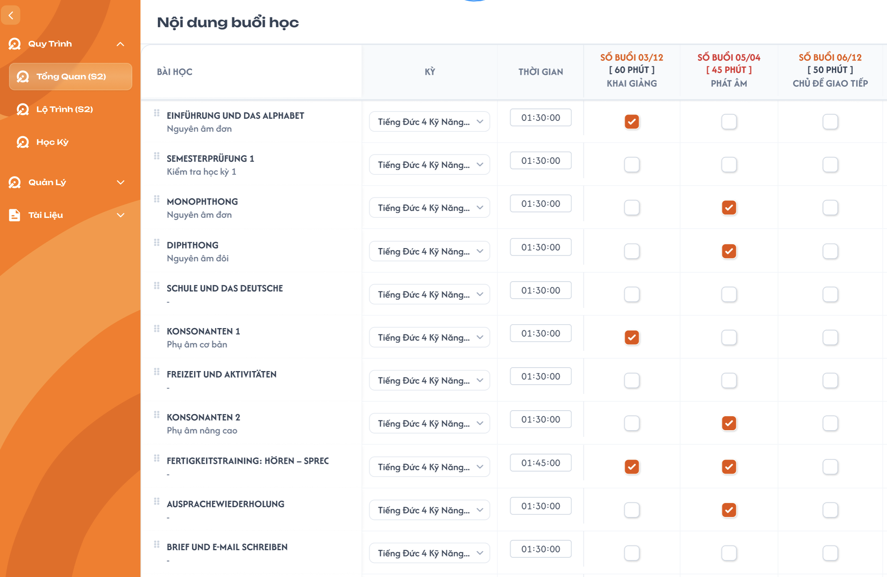

# Lộ Trình (S2)

## 1. UI

### Trang 1: Nội dung buổi học (Lộ Trình S2)


**Mô tả:**
- Role CD xếp lộ trình học bằng cách tick chọn bài học (hàng) sẽ học ở buổi học nào (cột).
- Các cột buổi học (tên, số buổi, thời gian mỗi buổi) được define ở màn Tổng Quan (S1), màn này chỉ đọc lại để hiển thị.

**Điểm cần lưu ý:**
- **Freeze layout:** cố định 3 cột đầu (Bài học, Kỳ, Thời gian) và cố định hàng đầu (tiêu đề + header các buổi học). Cuộn ngang thì chỉ các cột buổi học cuộn; cuộn dọc thì header luôn hiển thị.
- **Header mỗi cột buổi học** gồm 3 dòng:
  - Dòng 1: `SỐ BUỔI {đã tick}/{tổng số buổi ở S1}`
  - Dòng 2: `[{tổng phút} PHÚT]` (tổng phút đã xếp = số tick × phút/buổi)
  - Dòng 3: tên buổi học (lấy từ S1)
- **Màu header:** bình thường màu cam; khi lố buổi (số tick > tổng số buổi) thì **cả số buổi và số phút** chuyển đỏ (ví dụ `05/04 [225 PHÚT]`).
- **Ô tick** nằm tại giao điểm (bài học × buổi học). 1 tick = 1 buổi. Tick vượt số buổi vẫn được, không chặn.
- **Cột Thời gian** của mỗi hàng: tự tính, chỉ đọc, định dạng `HH:mm:ss`. Bằng tổng phút các buổi đã tick ở hàng đó; chưa tick ô nào thì `00:00:00`. Không có màu đỏ, không giới hạn.
- **Cột Kỳ:** dropdown chọn kỳ cho từng bài học. Danh sách lấy từ các kỳ của khoá học hiện tại; giá trị mặc định là kỳ của bài học đó. Text dài bị cắt bằng "...".
- **Cột Bài học:** tên bài học (in đậm) + mô tả phụ bên dưới; không có mô tả thì hiển thị "-". Icon kéo thả ở đầu hàng để sắp xếp thứ tự bài học.
- **Tự động lưu:** không có nút Lưu; mọi thay đổi (tick, đổi Kỳ, kéo thả) được cập nhật ngay.

---

---

## 2. Yêu cầu

### 2.1. Flow chính

**Flow 1: Vào màn Lộ Trình (S2)**

```
Role CD mở Lộ Trình (S2) 
→ FE gọi API lấy [danh sách bài học + cột buổi học từ S1 + trạng thái tick + kỳ của từng bài học + danh sách kỳ của khoá học]
→ FE render bảng → FE tính header từng cột (số đã tick, tổng phút, màu) và cột Thời gian từng hàng
```

**Flow 2: Tick / bỏ tick 1 ô**

```
User click ô (bài học X, buổi học Y) → FE đảo trạng thái tick
→ FE tính lại:
     - Header cột Y: số đã tick, tổng phút
     - Cột Thời gian của hàng X
                 ↓
     số tick cột Y > tổng buổi ở S1 ?
        ├─ Có  → số buổi và số phút ở header cột Y hiển thị đỏ
        └─ Không → header cột Y hiển thị màu cam thường
→ FE gọi API cập nhật tick (tự động, không cần bấm Lưu)
                 ↓ (nếu API lỗi)
     FE hoàn tác ô vừa tick (về trạng thái trước đó) → tính lại header/Thời gian → hiện thông báo lỗi
```

**Flow 3: Ví dụ tính toán** (cột "Chủ đề giao tiếp": tổng 5 buổi, 50 phút/buổi)

```
Tick hàng A → header 01/05 [50 phút]  | Thời gian hàng A = 00:50:00
Tick hàng B → header 02/05 [100 phút] | Thời gian hàng B = 00:50:00
... tick đến buổi thứ 6 → header 06/05 [300 phút] (đỏ) | vẫn tick được
Bỏ tick buổi thứ 6 → header 05/05 [250 phút] (cam thường)
```

**Flow 4: Đổi Kỳ của bài học**

```
User chọn kỳ khác ở dropdown Kỳ của hàng X 
→ FE gọi API cập nhật kỳ cho bài học X → FE hiển thị kỳ mới
```

**Flow 5: Kéo thả sắp xếp bài học**

```
User kéo icon ở đầu hàng X thả vào vị trí mới 
→ FE cập nhật thứ tự hiển thị → FE gọi API cập nhật thứ tự
```

### 2.2. Ngoại lệ

- **EX01:** Số ô đã tick của 1 cột > tổng số buổi ở S1 → vẫn cho tick, số buổi và số phút ở header hiển thị đỏ (ví dụ 05/04). Không hiện popup chặn.
- **EX02:** Bỏ tick làm số buổi về ≤ tổng số buổi → header trở lại màu cam thường.
- **EX03:** Hàng bài học chưa tick ô nào → cột Thời gian hiển thị `00:00:00`.
- **EX04:** S1 đổi số buổi hoặc thời gian mỗi buổi → các ô đã tick giữ nguyên, header tính lại theo giá trị mới của S1; lố thì đỏ, không lố thì màu thường.
- **EX05:** S1 xoá buổi học → xoá toàn bộ tick của cột đó; cột Thời gian của các hàng liên quan tính lại.
- **EX06:** S1 thêm buổi học → S2 hiển thị thêm cột mới, chưa có tick (`00/{tổng} [0 PHÚT]`).
- **EX07:** API tự động lưu bị lỗi (mất mạng, server lỗi) → hoàn tác thao tác vừa thực hiện (ô vừa tick/bỏ tick trở về trạng thái cũ, header và cột Thời gian tính lại theo trạng thái cũ) và hiện thông báo lỗi.

### 2.3. Yêu cầu khác

| Mã | Tên yêu cầu | Mô tả |
|---|---|---|
| REQ01 | Nguồn dữ liệu cột | Danh sách cột buổi học, số buổi, thời gian mỗi buổi lấy từ S1. Thứ tự cột theo thứ tự ở S1. |
| REQ02 | Tính toán realtime | Header cột và cột Thời gian của hàng được tính lại ngay sau mỗi lần tick/bỏ tick, không cần reload. |
| REQ03 | Công thức | Tổng phút cột = số ô đã tick × phút/buổi. Thời gian hàng = tổng phút/buổi của các ô đã tick trong hàng đó, hiển thị `HH:mm:ss`. |
| REQ04 | Freeze | Cố định 3 cột đầu và hàng đầu khi cuộn ngang/dọc. Khi cuộn ngang, cột buổi học không đè lên 3 cột cố định. |
| REQ05 | Màu đỏ | Chỉ áp dụng cho header khi lố buổi (cả số buổi và số phút). Cột Thời gian không có trạng thái đỏ. |
| REQ06 | Tự động lưu | Mỗi thao tác tick/bỏ tick, đổi Kỳ, kéo thả gọi API cập nhật ngay, không có nút Lưu. Nếu API lỗi thì hoàn tác thao tác vừa làm và báo lỗi (EX07). |
| REQ07 | Kéo thả bài học | Thứ tự bài học được lưu; thứ tự này chỉ dùng cho màn này, không ảnh hưởng chỗ khác. |
| REQ08 | Dropdown Kỳ | Danh sách kỳ lấy từ khoá học hiện tại; mặc định chọn sẵn kỳ của bài học đó. |

### 2.4. Ràng buộc

#### Quyền

Màn hình này chỉ dành cho role CD. Các role khác không có màn hình này (không có menu, không truy cập được).

| Role | Xem lộ trình | Tick / bỏ tick | Đổi Kỳ | Kéo thả sắp xếp |
|---|:---:|:---:|:---:|:---:|
| CD | ✅ | ✅ | ✅ | ✅ |
| Các role khác | ❌ | ❌ | ❌ | ❌ |

#### Ràng buộc khác

- Không giới hạn số tick vượt quá số buổi (chỉ cảnh báo bằng màu đỏ ở header).
- Cột Thời gian không giới hạn giá trị, không cảnh báo.
- 1 ô chỉ có 2 trạng thái: đã tick / chưa tick.
- Một bài học có thể tick ở nhiều cột; một cột có thể tick ở nhiều bài học.
- Tổng số buổi và thời gian mỗi buổi chỉ đọc ở màn này, chỉnh sửa ở S1.

---

---

## 3. Testcase

### Feature: Lộ Trình (S2)

| Tên testcase | Priority | Scenario | Role | Pre-condition | Given/When/Then | Expected Result |
|---|---|---|---|---|---|---|
| Case 1: Hiển thị ban đầu và freeze | High · Smoke | Flow 1, REQ01, REQ04, EX03 | CD | Đã có dữ liệu S1, chưa tick ô nào, bảng vượt kích thước màn hình | **Given:** Mở Lộ Trình (S2)<br>**When:** Màn hình load xong, sau đó cuộn ngang và cuộn dọc<br>**Then:** Xem header, cột Thời gian, 3 cột đầu và hàng đầu | - Cột và thứ tự cột khớp S1; header dạng 00/05 [0 PHÚT]<br>- Cột Thời gian mọi hàng = 00:00:00<br>- 3 cột Bài học/Kỳ/Thời gian luôn hiển thị khi cuộn ngang<br>- Hàng header luôn hiển thị khi cuộn dọc |
| Case 2: Tick, bỏ tick và tự động lưu | High · Smoke | Flow 2, Flow 3, REQ02, REQ03, REQ06 | CD | Cột Chủ đề giao tiếp (5 buổi, 50'/buổi) chưa tick | **Given:** Đang ở màn S2<br>**When:** Tick hàng A, tick hàng B, bỏ tick hàng B, rồi thoát và mở lại màn<br>**Then:** Xem header và cột Thời gian sau mỗi bước | - Tick A: header 01/05 [50 PHÚT], Thời gian hàng A = 00:50:00<br>- Tick B: header 02/05 [100 PHÚT], Thời gian hàng B = 00:50:00, hàng A không đổi<br>- Bỏ tick B: header 01/05 [50 PHÚT], hàng B = 00:00:00<br>- Không có nút Lưu, mở lại vẫn giữ đúng trạng thái tick |
| Case 3: Tick nhiều cột trong 1 hàng | High | REQ03, EX03 | CD | Hàng A chưa tick; S1: Khai giảng 60', Phát âm 45' | **Given:** Hàng A<br>**When:** Tick cột Khai giảng và cột Phát âm, sau đó bỏ tick cả hai<br>**Then:** Xem cột Thời gian hàng A | - Sau khi tick: Thời gian = 01:45:00, không có màu đỏ<br>- Sau khi bỏ tick hết: Thời gian = 00:00:00 |
| Case 4: Lố buổi và về lại bình thường | High | EX01, EX02, REQ05 | CD | Cột Phát âm (4 buổi, 45'/buổi) đã tick 4 ô | **Given:** Header 04/04 màu cam<br>**When:** Tick ô thứ 5, sau đó bỏ tick 1 ô<br>**Then:** Xem header | - Tick ô thứ 5 thành công, không bị chặn; header 05/04 [225 PHÚT], cả số buổi và số phút màu đỏ<br>- Sau khi bỏ tick: header 04/04 [180 PHÚT], trở lại màu cam |
| Case 5: S1 đổi số buổi hoặc thời gian mỗi buổi | Medium | EX04 | CD | Cột Phát âm (4 buổi, 45'/buổi) đã tick 4 ô | **Given:** Sửa S1<br>**When:** (a) đổi số buổi từ 4 thành 3, mở lại S2; (b) đổi lại 4 buổi và đổi thời gian từ 45' thành 60', mở lại S2<br>**Then:** Xem header và cột Thời gian các hàng đã tick | - (a) Các ô tick giữ nguyên; header 04/03 [180 PHÚT], màu đỏ<br>- (b) Header 04/04 [240 PHÚT], màu cam; cột Thời gian các hàng liên quan tính lại theo 60' |
| Case 6: S1 xoá hoặc thêm buổi học | High | EX05, EX06 | CD | Cột Phát âm đã có tick | **Given:** Đã có dữ liệu S2<br>**When:** Xoá buổi Phát âm ở S1, sau đó thêm 1 buổi học mới ở S1, mở lại S2<br>**Then:** Xem bảng | - Cột Phát âm không còn, tick của cột đó bị xoá, cột Thời gian các hàng liên quan tính lại<br>- Cột mới xuất hiện, chưa tick, header 00/{tổng} [0 PHÚT] |
| Case 7: Đổi Kỳ của bài học | Medium | Flow 4, REQ08 | CD | Khoá học có nhiều kỳ | **Given:** Dropdown Kỳ của hàng X đang ở giá trị mặc định<br>**When:** Mở dropdown, chọn kỳ khác, thoát và mở lại màn<br>**Then:** Xem dropdown Kỳ | - Danh sách kỳ = các kỳ của khoá học hiện tại<br>- Mặc định là kỳ của bài học đó<br>- Kỳ mới được lưu tự động, mở lại vẫn giữ |
| Case 8: Kéo thả sắp xếp bài học | Medium | Flow 5, REQ07 | CD | Có từ 2 bài học trở lên | **Given:** Đang ở màn S2<br>**When:** Kéo hàng C lên trên hàng A, thoát và mở lại màn<br>**Then:** Xem thứ tự, tick, kỳ | - Thứ tự mới được giữ sau khi mở lại<br>- Tick và kỳ của các hàng không đổi<br>- Thứ tự không ảnh hưởng màn khác |
| Case 9: API lưu lỗi | High | EX07 | CD | Cột Chủ đề giao tiếp đang 01/05 | **Given:** Mất mạng hoặc API trả lỗi<br>**When:** Tick thêm 1 ô ở cột Chủ đề giao tiếp<br>**Then:** Quan sát ô, header, cột Thời gian | - Ô vừa tick trở về chưa tick<br>- Header về lại 01/05 [50 PHÚT], cột Thời gian hàng đó về giá trị cũ<br>- Hiện thông báo lỗi |
| Case 10: Phân quyền | High | Ràng buộc quyền | Role khác CD | Đã có dữ liệu lộ trình | **Given:** Đăng nhập bằng role không phải CD<br>**When:** Xem menu và truy cập trực tiếp đường dẫn màn Lộ Trình (S2)<br>**Then:** Quan sát | - Không có menu Lộ Trình (S2)<br>- Truy cập trực tiếp không được (không vào được màn hình) |

### Feature: Lộ Trình (S2)

Dữ liệu giả định: S1 có cột "Chủ đề giao tiếp" = 5 buổi, 50 phút/buổi; cột "Khai giảng" = 12 buổi, 60 phút/buổi; cột "Phát âm" = 4 buổi, 45 phút/buổi.
