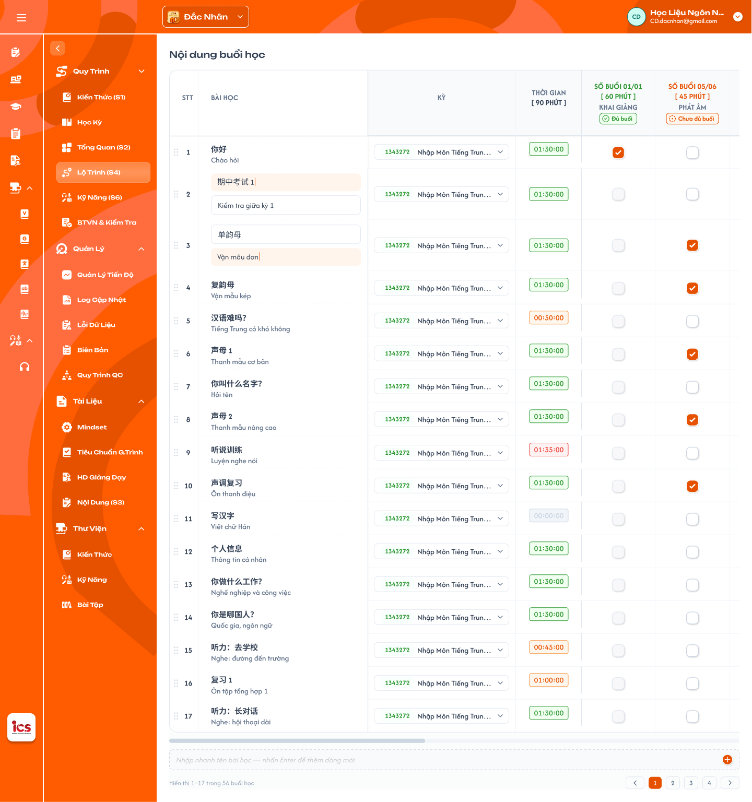

# Lộ Trình (S4)

## 1. UI

### Trang 1: CD-KH-020200 — Chi tiết khoá học / Lộ trình



**Mô tả:**
- Role CD xếp lộ trình học bằng cách tick chọn bài học (hàng) sẽ học ở buổi học nào (cột).
- Các cột buổi học (tên, số buổi, phút mỗi buổi) và **phút chuẩn 1 buổi** được define ở màn Tổng Quan (S2); màn này chỉ đọc lại để hiển thị. Phút chuẩn 1 buổi = card `Thời gian mỗi buổi` ở S2 (đơn vị phút, mặc định 90).

**Điểm cần lưu ý:**
- Quyền sửa theo trạng thái khoá học: chỉ sửa được khi khoá học `Nháp`. Khoá học `Công Khai` / `Vô hiệu`: màn chỉ đọc (ẩn / disable mọi thao tác thêm, sửa, xoá, kéo thả), backend từ chối mọi request ghi. Muốn thay đổi thì nhân bản khoá học rồi sửa trên bản sao `Nháp`; nhân bản sao chép toàn bộ dữ liệu của màn này (xem [Quản lý khoá học](../course_management.md) REQ10, REQ11).
- Freeze layout: cố định 4 cột đầu (STT, Bài học, Kỳ, Thời gian) và hàng header; cuộn ngang chỉ các cột buổi học cuộn, cuộn dọc header luôn hiển thị.
- Header cột Thời gian: dòng 1 `THỜI GIAN`, dòng 2 `[ {phút chuẩn 1 buổi} PHÚT ]` lấy từ Tổng Quan (S2), ví dụ `[ 90 PHÚT ]`.
- Header mỗi cột buổi học gồm 4 dòng: (1) `SỐ BUỔI {đã tick}/{tổng số buổi ở S2}`; (2) `[ {tổng phút đã xếp} PHÚT ]` = số tick của cột × phút/buổi của cột (lấy từ S2), chưa tick thì `[ 0 PHÚT ]`, mỗi lần tick cộng thêm phút/buổi, bỏ tick thì trừ đi (ví dụ cột "Ngữ pháp" 6 buổi, 80'/buổi: `00/06 [ 0 PHÚT ]`, tick 1 ô `01/06 [ 80 PHÚT ]`, tick đủ 6 ô `06/06 [ 480 PHÚT ]`); (3) tên buổi học (từ S2); (4) badge trạng thái theo số tick so với tổng buổi. Màu chữ dòng 1–2 theo màu badge.
- `A01.01` tick < tổng buổi: badge `Chưa đủ buổi`, màu cam.
- `A01.02` tick = tổng buổi: badge `Đủ buổi`, màu xanh.
- `A01.03` tick > tổng buổi: badge `Quá buổi`, màu đỏ; tick vượt số buổi vẫn được, không chặn. Cột có tổng buổi = 0: chưa tick (`00/00`) hiển thị `Đủ buổi`, tick thêm thì `Quá buổi`.
- Ô tick ở giao điểm (bài học × buổi học): 1 tick = 1 buổi, chỉ 2 trạng thái đã tick / chưa tick.
- Cột Thời gian (mỗi hàng): tự tính, chỉ đọc, định dạng `HH:mm:ss` = tổng phút/buổi của các cột đã tick trong hàng; chưa tick = `00:00:00`. Màu theo % so với phút chuẩn 1 buổi (S2), cùng rule với tab Bài học của Học kỳ; chỉ cảnh báo bằng màu, không chặn khi vượt.
- `A01.04` Thời gian 90% – 100% phút chuẩn: màu xanh.
- `A01.05` Thời gian 80% – <90%: màu vàng.
- `A01.06` Thời gian >0 và <80%: màu cam.
- `A01.07` Thời gian `00:00:00`: màu xám.
- `A01.08` Thời gian >100%: màu đỏ (ví dụ phút chuẩn 90: 90' xanh, 75' vàng, 45' cam, 0 xám, 105' đỏ).
- Cột STT: số thứ tự hàng theo thứ tự hiện tại; icon kéo thả nằm bên trái STT để sắp xếp bài học (thứ tự lưu, STT cập nhật theo, chỉ dùng cho màn này).
- Cột Bài học: tên (in đậm) + mô tả phụ bên dưới, không có mô tả hiển thị "-"; sửa trực tiếp tại ô (click vào tên / mô tả để chuyển sang ô nhập), dữ liệu dùng chung với tab Bài học của Học kỳ.
- Cột Kỳ: dropdown chọn kỳ cho từng bài học, hiển thị mã kỳ (màu xanh) + tên kỳ, text dài cắt bằng "..."; danh sách lấy từ các kỳ của khoá học hiện tại, mặc định là kỳ của bài học. Đổi Kỳ chuyển bài học sang học kỳ mới: bài học không còn ở tab Bài học của học kỳ cũ và xuất hiện ở tab Bài học của học kỳ mới (bài học trong học kỳ tự động theo lộ trình S4).

---

## 2. Yêu cầu

### 2.1. Flow chính

**Flow 1: Vào màn**

```
CD mở Lộ Trình (S4)
  → FE gọi API lấy [bài học + cột buổi học & phút chuẩn 1 buổi từ S2 + trạng thái tick + kỳ từng bài học + danh sách kỳ khoá học]
  → FE render bảng, tính header từng cột (số tick, badge, màu) và cột Thời gian từng hàng (số phút, màu)
```

**Flow 2: Tick / bỏ tick**

```
CD click ô (bài học X, buổi học Y) → FE đảo trạng thái tick
  → FE tính lại: header cột Y (số tick, tổng phút đã xếp, badge, màu) + cột Thời gian hàng X (giá trị, màu)
  → FE gọi API cập nhật tick
        ↓ (API lỗi)
  FE hoàn tác ô vừa tick → tính lại header / Thời gian → hiện thông báo lỗi
```

**Flow 3: Ví dụ** (cột "Chủ đề giao tiếp": 5 buổi, 50'/buổi; phút chuẩn 90)

```
Chưa tick  → 00/05 [ 0 PHÚT ] + badge Chưa đủ buổi (cam)
Tick 1     → 01/05 [ 50 PHÚT ] + badge Chưa đủ buổi (cam)
Tick đủ 5  → 05/05 [ 250 PHÚT ] + badge Đủ buổi (xanh)
Tick thêm  → 06/05 [ 300 PHÚT ] + badge Quá buổi (đỏ), vẫn tick được
Bỏ 1 tick  → 05/05 [ 250 PHÚT ], badge Đủ buổi
Hàng tick Khai giảng (60') + Phát âm (45') → Thời gian 01:45:00 (117%, đỏ)
```

**Flow 4: Đổi Kỳ**

```
CD chọn kỳ khác ở dropdown hàng X → FE gọi API cập nhật kỳ → hiển thị kỳ mới
  → bài học được chuyển sang học kỳ mới ở tab Bài học của Học kỳ
```

**Flow 5: Kéo thả**

```
CD kéo icon đầu hàng, thả vị trí mới → FE cập nhật thứ tự và STT → gọi API lưu thứ tự
```

**Flow 6: Sửa tên / mô tả bài học**

```
CD click ô tên / mô tả → nhập → rời ô hoặc Enter → FE gọi API cập nhật
  → lỗi: hoàn tác về giá trị cũ + thông báo lỗi
```

### 2.2. Ngoại lệ

- **EX01:** Số tick của cột > tổng buổi → vẫn cho tick, badge `Quá buổi` (đỏ), không popup chặn.
- **EX02:** Bỏ tick / đổi S2 làm số tick về = tổng buổi → badge `Đủ buổi`; < tổng buổi → `Chưa đủ buổi`. Tổng buổi = 0 và chưa tick (`00/00`) → `Đủ buổi`.
- **EX03:** Hàng chưa tick ô nào → Thời gian `00:00:00`, màu xám.
- **EX04:** S2 đổi số buổi / phút mỗi buổi / phút chuẩn 1 buổi → giữ nguyên tick; tính lại header cột (tổng phút đã xếp = số tick × phút/buổi mới), badge, Thời gian và màu từng hàng theo giá trị mới.
- **EX05:** S2 xoá buổi học → xoá toàn bộ tick của cột đó, tính lại Thời gian các hàng liên quan.
- **EX06:** S2 thêm buổi học → hiển thị thêm cột mới chưa tick (`00/{tổng}`, `[ 0 PHÚT ]`, badge `Chưa đủ buổi`).
- **EX07:** API lưu lỗi (tick, đổi Kỳ, kéo thả, sửa tên / mô tả) → hoàn tác thao tác vừa làm, tính lại hiển thị, hiện thông báo lỗi.
- **EX08:** Tên bài học để trống / chỉ khoảng trắng → không lưu, trả về tên cũ.
- **EX09:** Phút chuẩn 1 buổi luôn có giá trị (S2 mặc định 90 phút, chỉ nhận số nguyên dương) nên cột Thời gian luôn tính được % màu; hàng chưa tick hiển thị màu xám theo EX03.

### 2.3. Yêu cầu khác

| Mã | Tên yêu cầu | Mô tả |
|---|---|---|
| REQ01 | Nguồn dữ liệu | Cột buổi học, số buổi, phút/buổi từng cột, phút chuẩn 1 buổi lấy từ S2; thứ tự cột theo S2. |
| REQ02 | Tính toán realtime | Header cột, badge và cột Thời gian (giá trị + màu) tính lại ngay sau mỗi thao tác, không reload. |
| REQ03 | Công thức | Thời gian hàng = Σ phút/buổi của các cột đã tick trong hàng (`HH:mm:ss`). % màu = Thời gian hàng / phút chuẩn 1 buổi (S2). |
| REQ04 | Badge cột | Theo số tick so với tổng buổi: `Chưa đủ buổi` (cam) / `Đủ buổi` (xanh) / `Quá buổi` (đỏ). `00/00` hiển thị `Đủ buổi`. |
| REQ05 | Màu cột Thời gian | 90–100% xanh, 80–<90% vàng, >0 và <80% cam, 0 xám, >100% đỏ (giống tab Bài học của Học kỳ). Chỉ cảnh báo bằng màu, không chặn. |
| REQ06 | Freeze | Cố định 4 cột đầu và hàng header; cột buổi học không đè lên cột cố định khi cuộn ngang. |
| REQ07 | Header cột buổi học | Dòng 1 `SỐ BUỔI {đã tick}/{tổng số buổi}`; dòng 2 `[ {tổng phút đã xếp} PHÚT ]` = số tick × phút/buổi của cột, bắt đầu từ `0` và cộng / trừ theo từng lần tick / bỏ tick. |
| REQ08 | Kéo thả | Thứ tự bài học được lưu, STT cập nhật theo; chỉ dùng cho màn này. |
| REQ09 | Dropdown Kỳ | Danh sách kỳ của khoá học hiện tại; mặc định kỳ của bài học; hiển thị mã kỳ + tên kỳ. Đổi Kỳ chuyển bài học sang học kỳ mới (đồng bộ tab Bài học của Học kỳ). |
| REQ10 | Sửa inline | Tên (bắt buộc) và mô tả (không bắt buộc) bài học sửa trực tiếp tại ô; dữ liệu dùng chung với tab Bài học của Học kỳ. |

### 2.4. Ràng buộc

#### Quyền

| Role | Xem | Tick / bỏ tick | Đổi Kỳ | Kéo thả | Sửa tên / mô tả |
|---|:---:|:---:|:---:|:---:|:---:|
| CD | ✅ | ✅ | ✅ | ✅ | ✅ |
| Role khác | ❌ | ❌ | ❌ | ❌ | ❌ |

#### Ràng buộc khác

- Màn chỉ dành cho CD; role khác không có menu, không truy cập được.
- Các thao tác ghi chỉ làm được khi khoá học `Nháp`; `Công Khai` / `Vô hiệu` chỉ đọc, backend từ chối mọi request ghi.
- Một bài học tick được nhiều cột; một cột tick được nhiều bài học; tick vượt số buổi không bị chặn.
- Số buổi, phút/buổi, phút chuẩn 1 buổi chỉ đọc ở màn này, sửa ở Tổng Quan (S2).

---

## 3. Testcase

Dữ liệu giả định: phút chuẩn 1 buổi = 90. Cột "Khai giảng" 12 buổi 60'; "Phát âm" 4 buổi 45'; "Chủ đề giao tiếp" 5 buổi 50'; "Ngữ pháp" 6 buổi 80'; "Ôn tập" 3 buổi 90'.

### Feature: Lộ Trình (S4)

| Tên testcase | Priority | Scenario | Role | Pre-condition | Given/When/Then | Expected Result |
|---|---|---|---|---|---|---|
| Case 1: Hiển thị ban đầu và freeze | High | Flow 1 / REQ01 / REQ06 | CD | Có dữ liệu S2, chưa tick, bảng vượt màn hình | **Given:** mở S4<br>**When:** load xong, cuộn ngang / dọc<br>**Then:** xem header, Thời gian, cột cố định | - Cột và thứ tự khớp S2; header `THỜI GIAN [ 90 PHÚT ]`<br>- Mỗi cột `00/{tổng}`, `[ 0 PHÚT ]`, badge `Chưa đủ buổi` (ví dụ Ngữ pháp `00/06 [ 0 PHÚT ]`)<br>- Mọi hàng `00:00:00` (xám)<br>- 4 cột STT / Bài học / Kỳ / Thời gian và header luôn hiển thị khi cuộn |
| Case 2: Tick / bỏ tick, header và badge | High | Flow 2 / Flow 3 / REQ02 / REQ04 / REQ07 / EX01 | CD | Cột Phát âm 4 buổi 45' chưa tick | **Given:** ở S4<br>**When:** tick lần lượt 1 → 4 → 5 ô, rồi bỏ 1 ô; thoát mở lại<br>**Then:** xem header, badge | - 01/04 `[ 45 PHÚT ]` Chưa đủ buổi (cam); 04/04 `[ 180 PHÚT ]` Đủ buổi (xanh); 05/04 `[ 225 PHÚT ]` Quá buổi (đỏ), tick không bị chặn<br>- Bỏ 1 ô: 04/04 `[ 180 PHÚT ]` Đủ buổi<br>- Mở lại giữ đúng trạng thái tick |
| Case 3: Cột Thời gian: công thức và màu | High | Flow 3 / REQ03 / REQ05 / EX03 | CD | Các hàng chưa tick | **Given:** hàng tick các cột khác nhau<br>**When:** tick: Ôn tập (90'); Ngữ pháp (80'); Phát âm (45'); Khai giảng + Phát âm (105'); bỏ hết<br>**Then:** xem cột Thời gian | - `01:30:00` xanh (100%); `01:20:00` vàng (89%); `00:45:00` cam (50%); `01:45:00` đỏ (117%); `00:00:00` xám<br>- Header cột Thời gian vẫn `[ 90 PHÚT ]`, tick hàng khác không ảnh hưởng |
| Case 4: S2 đổi số buổi / phút | Medium | EX02 / EX04 / EX09 | CD | Phát âm 4 buổi 45', đã tick 4 ô | **Given:** sửa S2<br>**When:** (a) đổi số buổi 4 → 3; (b) đổi lại 4 và phút/buổi 45 → 60; (c) đổi phút chuẩn 90 → 120; mở lại S4<br>**Then:** xem header, badge, Thời gian | - (a) Tick giữ nguyên, 04/03 Quá buổi (đỏ)<br>- (b) 04/04 Đủ buổi, `[ 240 PHÚT ]` (4 × 60), Thời gian các hàng tính lại<br>- (c) Header Thời gian `[ 120 PHÚT ]`, màu từng hàng tính lại theo 120 |
| Case 5: S2 xoá / thêm buổi học | High | EX05 / EX06 | CD | Cột Phát âm đã có tick | **Given:** đã có dữ liệu S4<br>**When:** xoá buổi Phát âm ở S2, rồi thêm buổi mới, mở lại S4<br>**Then:** xem bảng | - Cột Phát âm mất, tick bị xoá, Thời gian hàng liên quan và màu tính lại<br>- Cột mới xuất hiện, chưa tick, `00/{tổng}`, `[ 0 PHÚT ]`, Chưa đủ buổi |
| Case 6: Đổi Kỳ | Medium | Flow 4 / REQ09 | CD | Khoá học có nhiều kỳ | **Given:** dropdown Kỳ hàng X mặc định<br>**When:** chọn kỳ khác, thoát mở lại; mở tab Bài học của kỳ cũ và kỳ mới<br>**Then:** xem dropdown và tab Bài học | - Danh sách = kỳ của khoá học; mặc định đúng kỳ của bài học<br>- Hiển thị mã kỳ + tên cắt "..."<br>- Kỳ mới được lưu<br>- Bài X không còn ở tab Bài học của kỳ cũ, xuất hiện ở kỳ mới |
| Case 7: Kéo thả | Medium | Flow 5 / REQ08 | CD | ≥ 2 bài học | **Given:** ở S4<br>**When:** kéo hàng C lên trên hàng A, thoát mở lại<br>**Then:** xem thứ tự, STT, tick, kỳ | - Thứ tự mới được giữ, STT cập nhật theo<br>- Tick và kỳ các hàng không đổi |
| Case 8: Sửa tên / mô tả inline | Medium | Flow 6 / REQ10 / EX08 | CD | Hàng X có tên và mô tả | **Given:** click ô tên / mô tả<br>**When:** sửa tên, sửa mô tả, thử để tên trống, thử xoá hết mô tả<br>**Then:** xem hiển thị và dữ liệu | - Tên / mô tả mới được lưu, đồng bộ với tab Bài học của Học kỳ<br>- Tên trống: không lưu, trả về tên cũ<br>- Mô tả trống hiển thị "-" |
| Case 9: API lưu lỗi | High | Flow 2 / EX07 | CD | Cột Chủ đề giao tiếp 04/05 | **Given:** mất mạng / API lỗi<br>**When:** tick thêm 1 ô (thử tương tự với đổi Kỳ, kéo thả, sửa tên)<br>**Then:** quan sát | - Thao tác được hoàn tác về trạng thái cũ<br>- Header (`04/05 [ 200 PHÚT ]`), badge (Chưa đủ buổi), Thời gian và màu về giá trị cũ<br>- Hiện thông báo lỗi |
| Case 10: Phân quyền | High | Ràng buộc quyền | Role khác CD | Đăng nhập role không phải CD | **Given:** đăng nhập role không phải CD<br>**When:** xem menu và truy cập trực tiếp đường dẫn S4<br>**Then:** quan sát | - Không có menu Lộ Trình (S4)<br>- Truy cập trực tiếp không được, không xem / sửa được dữ liệu |
| Case 11: Cột có tổng buổi = 0 | Low | EX02 / REQ04 | CD | S2 có buổi học Số buổi = 0 | **Given:** mở S4<br>**When:** quan sát cột, tick 1 ô; sửa S2 thành 1 buổi và bỏ tick<br>**Then:** xem badge | - `00/00`: `Đủ buổi` (xanh)<br>- `01/00`: `Quá buổi` (đỏ)<br>- `00/01`: `Chưa đủ buổi` (cam) |
| Case 12: Khoá học không ở Nháp chỉ đọc | High | Ràng buộc trạng thái khoá học | CD | Khoá học `Công Khai` hoặc `Vô hiệu` | **Given:** mở S4<br>**When:** thử tick, đổi Kỳ, kéo thả, sửa tên / mô tả, hoặc gửi request ghi trực tiếp<br>**Then:** hệ thống từ chối | - Mọi thao tác ghi bị ẩn / disable<br>- Backend từ chối request ghi, dữ liệu không đổi<br>- Muốn đổi thì nhân bản khoá học rồi sửa trên bản sao `Nháp` |
