# [CD] Thư viện

Menu **Thư viện** của role **CD** gồm 3 mục **Kiến thức**, **Kỹ năng**, **Bài tập**: kho dữ liệu dùng chung của các khoá học thuộc **trung tâm** CD đang chọn ở header. Thư viện dùng để xem tập trung, tìm kiếm, lọc theo `Cấp độ`, đổi trạng thái và xoá mục chưa Công khai; riêng câu hỏi ở Thư viện bài tập được mở chi tiết và sửa khi câu `Chưa dùng` hoặc mọi khoá học chứa câu đều đang `Nháp`. Thêm và sửa kiến thức, kỹ năng không làm tại Thư viện: Kiến thức sửa ở [Kiến thức (S1)](../knowledge-s1/knowledge-s1.md), Kỹ năng sửa ở Kỹ năng (S6); soạn bộ câu hỏi ở [Bài tập về nhà và Kiểm tra](../homework-test/homework-test.md).

## 1. UI

### Trang 1: CD-KH-070160 — Thư viện / Kiến thức / Bảng chữ (tiếng Nhật)

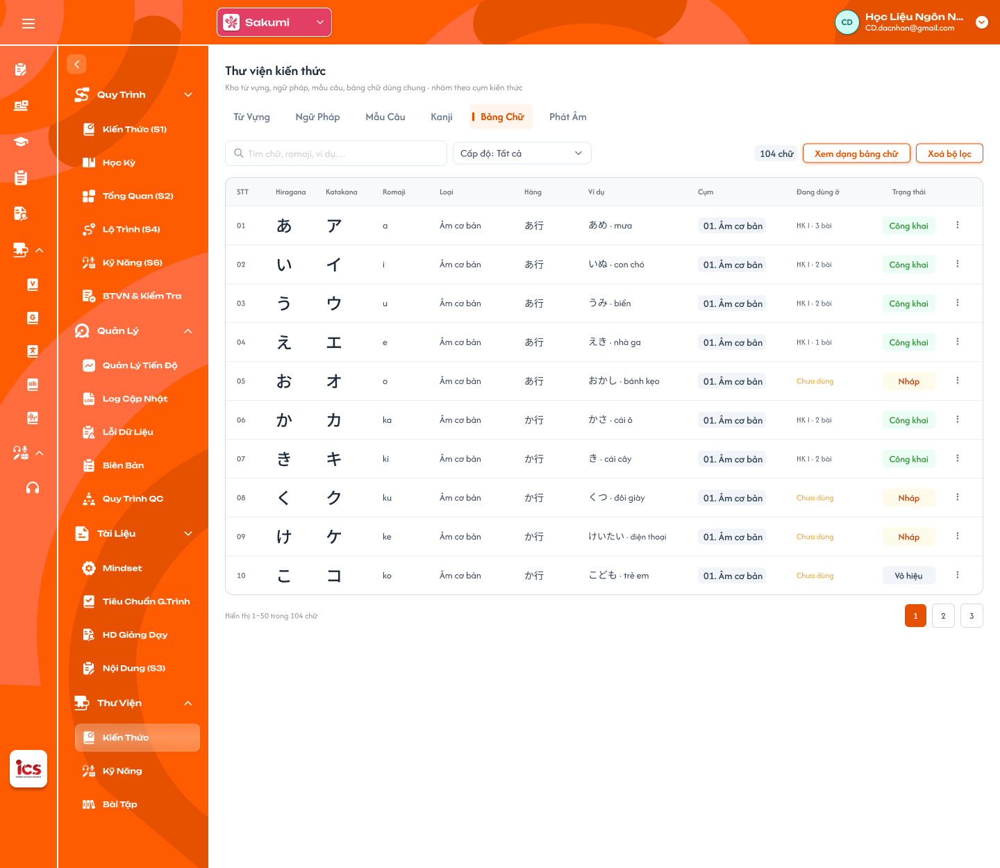

**Mô tả:**
- Màn Thư viện kiến thức, tab `Bảng chữ` của trung tâm có hệ chữ Nhật, dạng danh sách (mặc định); mỗi dòng là một cặp chữ Hiragana / Katakana. Khung chung (tiêu đề, tab, tìm kiếm, lọc, bảng, phân trang) dùng cho cả 3 thư viện.

**Điểm cần lưu ý:**
- `A01.01` Tiêu đề / mô tả: `Thư viện kiến thức`, `Thư viện kỹ năng`, `Thư viện bài tập` kèm một dòng mô tả; dữ liệu chỉ thuộc trung tâm CD đang chọn ở header, đổi trung tâm thì tải lại cả 3 thư viện.
- `A01.02` Thanh tab: loại dữ liệu của từng thư viện, mặc định tab đầu tiên; đổi tab giữ nguyên Cấp độ, xoá ô tìm kiếm.
- `A01.03` Ô tìm kiếm: tìm theo các cột chính của tab, không phân biệt hoa thường, bỏ khoảng trắng thừa; kết hợp với lọc Cấp độ, đổi điều kiện về trang 1.
- `A01.04` Lọc Cấp độ: một lựa chọn `Tất cả` hoặc một cấp độ trong [Quản lý cấp độ](../../curriculum_management_requirement/level_management/level_management_requirements.md) của trung tâm; mặc định `Tất cả`.
- `A01.05` Badge tổng số: tổng số mục khớp tìm kiếm và lọc của tab đang mở (vd `1.240 từ vựng`, `96 bài nghe`, `248 câu hỏi`).
- `A01.06` Xoá bộ lọc: đưa ô tìm kiếm về trống và Cấp độ về `Tất cả`.
- `A01.07` Cột `Cụm`: chip cụm kiến thức chứa mục (vd `01. Chào hỏi`), nhiều cụm thì hiện cụm đầu kèm `+N`; chỉ có ở Thư viện kiến thức.
- `A01.08` Cột `Đang dùng ở`: một bài hiện tên bài (`HK I · Bài 1`), nhiều bài hiện số bài (`HK I · 3 bài`), chưa gắn bài nào hiện `Chưa dùng` màu cam; chỉ có ở Thư viện kiến thức, kỹ năng (Ngân hàng câu hỏi không có).
- `A01.09` Cột `Trạng thái`: badge `Nháp` (cam), `Công khai` (xanh lá), `Vô hiệu` (xám); quy tắc đổi / xoá ở nhóm `A02`.
- `A01.10` Menu `⋮` cuối dòng: Kiến thức, Kỹ năng có `Đổi trạng thái`, `Xoá`; Bài tập không có. Bấm dòng kiến thức / kỹ năng không mở form sửa; thao tác duy nhất là menu `⋮`.
- `A01.11` Ô trống: field bắt buộc đang trống hiện `— trống —` màu cam; nội dung đặc thù hiện `— chưa có file âm thanh —`, `— chưa có đoạn văn —`, `— chưa có đề bài —`, `— chưa có file —`; `0 câu` màu cam.
- `A01.12` Phân trang: 50 dòng / trang, chú thích `Hiển thị 1–50 trong N …`.
- `A02.01` Đổi trạng thái: mở menu con chỉ gồm trạng thái được phép: `Nháp` → `Công khai` hoặc `Vô hiệu`; `Công khai` → `Vô hiệu`; `Vô hiệu` → `Công khai`; không cho về `Nháp`. Chọn xong lưu ngay, badge cập nhật, Toast `Thành Công`.
- `A02.02` Xoá: chỉ bấm được với mục `Nháp` hoặc `Vô hiệu` **và** `Chưa dùng`; mở popup `Xoá mục khỏi thư viện?` (`Mục sẽ bị xoá khỏi thư viện và không còn tìm thấy.`, `Huỷ` / `Xoá`); xoá mềm, mục không còn thấy ở Thư viện, S1, S6 và popup thêm từ thư viện.
- `A02.03` Mục `Công khai`: `Xoá` hiện mờ, hover tooltip `Mục đang Công khai không thể xoá, chuyển Vô hiệu nếu muốn ngừng dùng`. Quy tắc chung role CD: mục đang `Công khai` không được xoá, chỉ chuyển `Vô hiệu`; mục `Vô hiệu` không được thêm mới vào bài học hay S1, bài đã gắn trước đó vẫn dùng bình thường.
- `A02.04` Mục đang dùng: mục `Nháp` / `Vô hiệu` đang gắn bài thì `Xoá` mờ, tooltip `Mục đang được dùng ở bài học, gỡ khỏi bài trước khi xoá`. Backend kiểm tra lại trạng thái và việc đang dùng, request không hợp lệ bị từ chối kèm Toast `Cảnh Báo`.
- `A03.01` Thanh tab Thư viện kiến thức: mọi trung tâm có đủ 6 tab `Từ Vựng`, `Ngữ Pháp`, `Mẫu Câu`, `Hanzi`, `Kanji`, `Phát Âm` (thứ tự giống S1); trung tâm có hệ chữ riêng có thêm tab `Bảng chữ` đứng trước `Phát Âm`. Tab không có dữ liệu vẫn hiện, bảng báo `Bảng dữ liệu này đang trống`.
- `A03.02` Cột tab Từ vựng: `STT`, `Từ`, `Phiên âm`, `Nghĩa`, `Cụm`, `Đang dùng ở`, `Trạng thái`; tìm theo Từ, Phiên âm, Nghĩa.
- `A03.03` Cột tab Ngữ pháp: `STT`, `Cấu trúc` (dòng phụ là một ví dụ), `Ý nghĩa`, `Cụm`, `Đang dùng ở`, `Trạng thái`; tìm theo Cấu trúc, Ý nghĩa.
- `A03.04` Cột tab Mẫu câu: `STT`, `Câu`, `Phiên âm`, `Nghĩa`, `Cụm`, `Đang dùng ở`, `Trạng thái`; tìm theo Câu, Phiên âm, Nghĩa.
- `A03.05` Cột tab Hanzi: `STT`, `Chữ`, `Phiên âm`, `Hán Việt`, `Nghĩa`, `Bộ thủ` (ký tự + tên, vd `亻 nhân`), `Cụm`, `Đang dùng ở`, `Trạng thái`; tìm theo Chữ, Phiên âm, Hán Việt, Nghĩa.
- `A03.06` Cột tab Kanji: `STT`, `Chữ`, `Âm On`, `Âm Kun`, `Hán Việt`, `Nghĩa`, `Cụm`, `Đang dùng ở`, `Trạng thái`; tìm theo Chữ, Âm On / Kun, Hán Việt, Nghĩa.
- `A03.07` Cột tab Phát âm: `STT`, `Âm`, `Loại` (badge `Thanh mẫu` / `Vận mẫu` / `Âm tiết` theo S1), `Ví dụ`, `Âm thanh` (nút phát + `mm:ss`, chưa có file hiện `— chưa có file —`), `Cụm`, `Đang dùng ở`, `Trạng thái`; tìm theo Âm, Ví dụ.
- `A03.08` Badge tổng số: `N từ vựng`, `N ngữ pháp`, `N mẫu câu`, `N chữ Hán`, `N chữ Kanji`, `N mục phát âm`. Thêm / sửa kiến thức làm tại S1, S1 ghi thẳng vào bản ghi thư viện nên Thư viện luôn hiển thị dữ liệu mới nhất.
- `A04.01` Danh sách tiếng Nhật: mỗi dòng một cặp chữ: `STT`, `Hiragana`, `Katakana`, `Romaji`, `Loại`, `Hàng`, `Ví dụ` (từ · nghĩa), `Cụm`, `Đang dùng ở`, `Trạng thái`, `⋮`; tổng 104 mục, badge `N chữ`; tìm theo Hiragana, Katakana, Romaji, Ví dụ.
- `A04.02` Loại (Nhật): `Âm cơ bản` (46), `Âm đục` (20), `Âm bán đục` (5), `Âm ghép` (33). Ánh xạ Bảng con của S1: Bảng Chữ Chính → Âm cơ bản, Tenten → Âm đục, Maru → Âm bán đục, Ảo âm / Ảo âm - hiếm gặp → Âm ghép. Âm ngắt `っ` và trường âm ghi trong Ví dụ / ghi chú, không là mục riêng.
- `A04.03` Hàng (Nhật): hàng trong bảng 50 âm `あ行`, `か行`, `さ行`, `た行`, `な行`, `は行`, `ま行`, `や行`, `ら行`, `わ行`, `ん`.
- `A04.10` Menu `⋮`: như các tab khác (`Đổi trạng thái`, `Xoá`); ở dạng lưới thao tác qua panel Chi tiết chữ (xem Q01).
- Tab `Bảng chữ` chỉ hiện ở trung tâm có hệ chữ riêng: **Sakumi** (Hiragana / Katakana) và **Saechang** (Hangul); Đắc Nhân, Betreux, Creative English, Créatis không có tab này. Nút trên thanh công cụ đổi `Xem dạng bảng chữ` ↔ `Xem dạng danh sách`, mặc định dạng danh sách. Audio và Thứ tự nét là field ẩn, chỉ xem ở S1; cấu trúc field theo [Kiến thức (S1)](../knowledge-s1/knowledge-s1.md) Phụ lục A.7.
- `A05.01` Cột tab Nghe: `STT`, `Bài nghe` (tiêu đề + mô tả), `Âm thanh` (nút phát, thanh tiến độ, `mm:ss`; chưa có file hiện `— chưa có file âm thanh —`), `Số câu hỏi`, `Đang dùng ở`, `Trạng thái`.
- `A05.02` Cột tab Đọc: `STT`, `Bài đọc`, `Đoạn văn` (một dòng, dài thì cắt `…`; chưa có hiện `— chưa có đoạn văn —`), `Số câu hỏi`, `Đang dùng ở`, `Trạng thái`.
- `A05.03` Cột tab Viết: `STT`, `Bài viết`, `Đề bài` (một dòng; chưa có hiện `— chưa có đề bài —`), `Số câu hỏi`, `Đang dùng ở`, `Trạng thái`.
- `A05.04` Cột tab Nói: `STT`, `Bài nói`, `Đề bài` (như tab Viết), `Số câu hỏi`, `Đang dùng ở`, `Trạng thái`.
- `A05.05` Số câu hỏi: số câu của bài kỹ năng, `0 câu` màu cam. Bài kỹ năng không có cột `Cụm`; thêm / sửa tại Kỹ năng (S6); kỹ năng theo source ICS cũ gồm Nghe, Đọc, Viết, Nói (`SkillLibraryType`).
- `A05.06` Phát âm thanh: bấm nút phát nghe ngay trong bảng, thanh tiến độ chạy theo; chỉ phát một bài tại một thời điểm.
- `A05.07` Badge tổng số: `N bài nghe`, `N bài đọc`, `N bài viết`, `N bài nói`.
- `A05.08` Tìm kiếm: theo tiêu đề, mô tả và nội dung (đoạn văn, đề bài).
- `A06.01` Tab `Ngân Hàng Câu Hỏi`: mọi câu hỏi của các bộ câu hỏi BTVN và Kiểm tra thuộc trung tâm; cột `STT`, `Câu hỏi` (nội dung + hướng dẫn), `Loại câu`, `Đáp án đúng`, `Kiến thức / Kỹ năng`, `Trạng thái`; badge `N câu hỏi`; không có cột `Đang dùng ở`. Thư viện bài tập không có menu `⋮`, không đổi trạng thái, không xoá câu (thêm / xoá câu làm tại menu Bài tập về nhà).
- `A06.02` Loại câu: badge một trong 8 loại `Trắc nghiệm`, `Sắp xếp`, `Nối từ`, `Nói`, `Đọc`, `Viết`, `Hình ảnh`, `Câu hỏi con`.
- `A06.03` Đáp án đúng: theo loại câu; `Đọc`, `Viết`, `Hình ảnh`, `Nói` hiển thị `Giáo viên chấm`; chưa có đáp án hiển thị `— chưa có đáp án —` màu cam; `Câu hỏi con` hiển thị `N câu con`.
- `A06.04` Kiến thức / Kỹ năng: chỉ ghi nhóm câu thuộc về `Kiến thức` hoặc `Kỹ năng` (đã chọn khi soạn câu), không ghi loại, cụm hay tên kỹ năng.
- `A06.05` Câu hỏi con: dòng cha có mũi tên mở / thu các câu con `7.1`, `7.2`…; câu con có loại câu và đáp án riêng, không có cột Kiến thức / Kỹ năng, Trạng thái.
- `A06.06` Trạng thái: câu hỏi không có trạng thái riêng, hiển thị trạng thái **khoá học** chứa câu (`Nháp`, `Công khai`, `Vô hiệu`); câu chưa thuộc bài nào hiển thị badge `Chưa dùng`.
- `A06.07` Tag `AI`: câu do Generate bằng AI tạo có tag `AI` cạnh nội dung; mất khi CD sửa và lưu câu.
- `A06.08` Bấm dòng câu hỏi: mở Chi tiết câu hỏi của câu đó (Trang 5 trở đi).
- `A06.09` Tab `BTVN Mẫu`: danh sách bộ câu hỏi BTVN: `STT`, `Bài` (`BTVN · Bài n: tên bài`, dòng phụ `Khoá học · Cấp độ · Kỳ`), `Số câu`, `Trạng thái` (theo khoá học); badge `N bộ BTVN`.
- `A06.10` Tab `Kiểm Tra Mẫu`: `STT`, `Bài kiểm tra` (dòng phụ `Khoá học · Cấp độ · Kỳ`), `Số câu`, `Trạng thái` (theo khoá học); badge `N bài kiểm tra`. Hai tab mẫu không có cột `Tổng điểm` (mọi câu chấm thang 10, điểm bài là trung bình các câu).
- `A06.11` Bấm dòng tab mẫu: mở bộ câu hỏi chỉ đọc (xem Q02).
- `A06.12` Tìm kiếm: Ngân hàng câu hỏi theo nội dung và hướng dẫn câu hỏi; hai tab mẫu theo tên bài, tên khoá học.
- `A08.01` Toast `Thành Công`: `Đã đổi trạng thái.`; `Đã xoá mục khỏi thư viện.`; `Đã lưu câu hỏi.`
- `A08.02` Toast `Cảnh Báo`: `Mục đang Công khai không thể xoá.`; `Mục đang được dùng ở bài học, gỡ khỏi bài trước khi xoá.`; `Câu thuộc khoá Công khai / Vô hiệu, không sửa được.` (khi request bị từ chối).
- `A08.03` Toast `Có Lỗi Xảy Ra`: `Đổi trạng thái hoặc xoá thất bại, vui lòng thử lại.`; `Lưu câu hỏi thất bại, vui lòng thử lại.` Mỗi thao tác một Toast; tìm kiếm, lọc, phát âm thanh, đổi dạng xem, `Huỷ` không có Toast CRUD.

### Trang 2: CD-KH-070161 — Thư viện / Kiến thức / Bảng chữ (tiếng Nhật) · Xem dạng bảng chữ

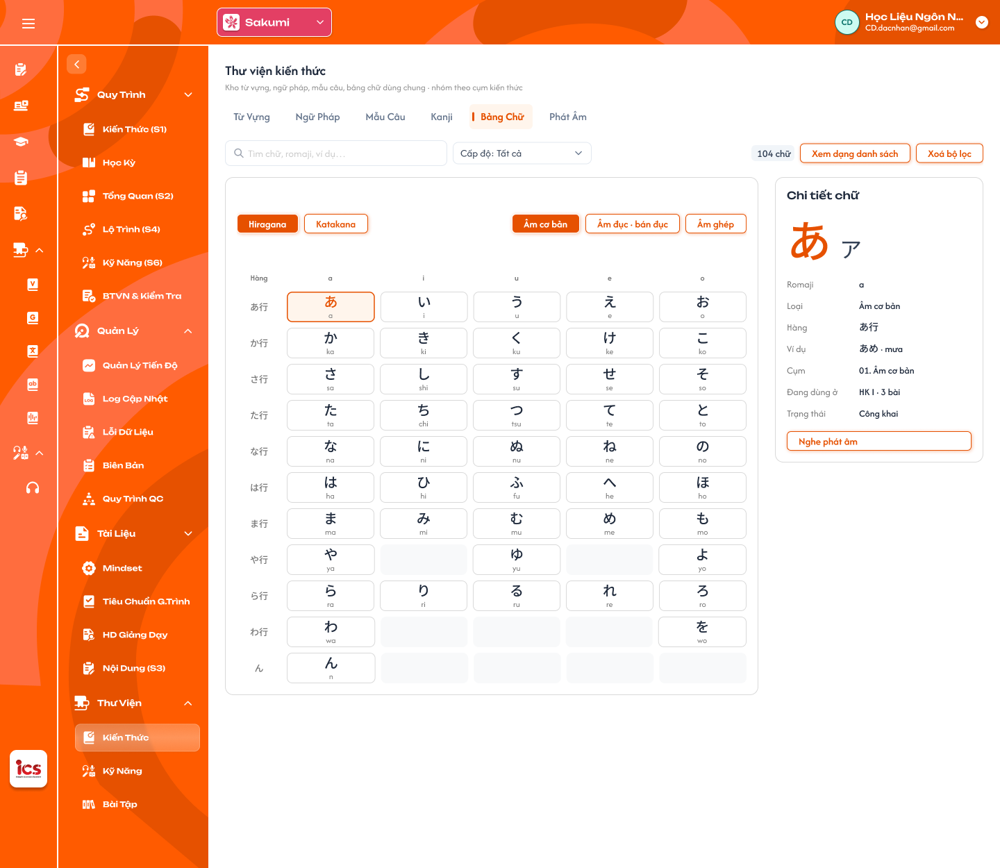

**Mô tả:**
- Bảng chữ tiếng Nhật ở dạng lưới 50 âm kèm panel Chi tiết chữ; nút đổi thành `Xem dạng danh sách`.

**Điểm cần lưu ý:**
- `A04.04` Lưới tiếng Nhật: nút chuyển `Hiragana` / `Katakana`; nhóm `Âm cơ bản` / `Âm đục · bán đục` / `Âm ghép`; lưới 5 cột `a · i · u · e · o` × 11 hàng, mỗi ô gồm chữ + romaji; ô xám là vị trí không có chữ, không bấm được.
- `A04.08` Panel `Chi tiết chữ`: hiện chữ đang chọn (ô viền cam, mặc định ô đầu tiên). Nhật: chữ Hiragana lớn + Katakana nhỏ, Romaji, Loại, Hàng, Ví dụ, Cụm, Đang dùng ở, Trạng thái. Hàn: âm tiết lớn + phân tích `ㄱ + ㅏ`, Phiên âm, Phụ âm (chữ · tên gọi · romaja), Nguyên âm, Ví dụ, Cụm, Đang dùng ở, Trạng thái. Nút `Nghe phát âm` phát audio của chữ, chưa có file thì nút mờ và không phát, không Toast.
- `A04.09` Tìm kiếm, Cấp độ ở dạng lưới: vẫn áp dụng, ô không khớp bị mờ, ô khớp giữ nguyên, badge tổng số theo số ô khớp.
- Dạng lưới chỉ có ở Thư viện, S1 không có nút `Xem dạng bảng chữ`; chuyển lại dạng danh sách giữ tìm kiếm và Cấp độ.

### Trang 3: CD-KH-070170 — Thư viện / Kiến thức / Bảng chữ (tiếng Hàn)


**Mô tả:**
- Tab `Bảng chữ` của trung tâm Saechang (Hangul), dạng danh sách; mỗi dòng là một jamo.

**Điểm cần lưu ý:**
- `A04.05` Danh sách tiếng Hàn: `STT`, `Chữ`, `Tên gọi` (vd `기역`), `Phiên âm` (Romaja đầu / cuối, vd `g / k`), `Loại`, `Ví dụ` (từ · nghĩa), `Cụm`, `Đang dùng ở`, `Trạng thái`, `⋮`; tổng 40 mục, badge `N chữ`; tìm theo Chữ, Tên gọi, Phiên âm, Ví dụ.
- `A04.06` Loại (Hàn): `Phụ âm thường` (9), `Phụ âm bật hơi` (5), `Phụ âm căng` (5), `Nguyên âm đơn` (10), `Nguyên âm ghép` (11).

### Trang 4: CD-KH-070171 — Thư viện / Kiến thức / Bảng chữ (tiếng Hàn) · Xem dạng bảng chữ


**Mô tả:**
- Bảng chữ tiếng Hàn dạng lưới phụ âm × nguyên âm kèm panel Chi tiết chữ.

**Điểm cần lưu ý:**
- `A04.07` Lưới tiếng Hàn: nhãn `Phụ âm × Nguyên âm`; nhóm `Bảng ghép cơ bản` / `Phụ âm căng` / `Nguyên âm ghép` / `Patchim`; lưới 14 phụ âm (hàng) × 10 nguyên âm (cột) = 140 âm tiết, mỗi ô gồm âm tiết + romaja. Mỗi ô là âm tiết ghép từ dữ liệu jamo, không phải bản ghi riêng; Cụm, Đang dùng ở, Trạng thái ở panel lấy theo **phụ âm** của âm tiết.

### Trang 5: CD-KH-070301 — Thư viện / Bài tập / Chi tiết câu hỏi · Listening

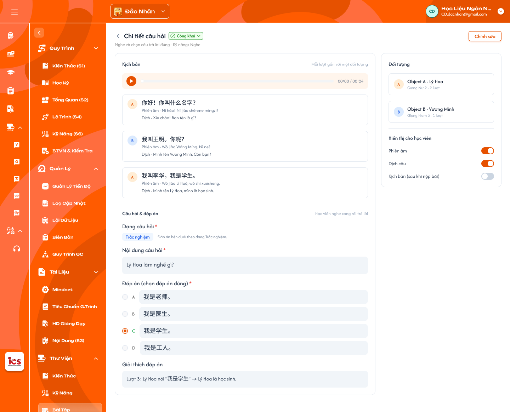

**Mô tả:**
- Chi tiết câu Nghe mở từ Ngân hàng câu hỏi, đang ở trạng thái `Công khai` (chỉ xem), có kịch bản theo lượt thoại, panel Đối tượng và các nút bật / tắt hiển thị cho học viên.
- Sửa tại đây là sửa **câu gốc**: mọi bộ BTVN / bài kiểm tra dùng câu này đều thấy nội dung mới. Figma có chi tiết câu **Nghe** và **Đọc**; loại câu khác mở Chi tiết câu hỏi với field theo form soạn câu của [Bài tập về nhà và Kiểm tra](../homework-test/homework-test.md) (xem Q03).

**Điểm cần lưu ý:**
- `A07.01` Nút `‹`: về Thư viện bài tập, giữ tab, tìm kiếm, Cấp độ và trang đang xem.
- `A07.02` Tiêu đề: `Chi tiết câu hỏi`, dòng phụ `<hướng dẫn câu> · Kỹ năng: <tên kỹ năng>` (vd `Nghe và chọn câu trả lời đúng · Kỹ năng: Nghe`).
- `A07.06` Chế độ chỉ xem: câu thuộc ít nhất một khoá `Công khai` / `Vô hiệu` mở ở chế độ chỉ xem (học viên có thể đã làm câu; khoá không quay về `Nháp`; khoá `Vô hiệu` có thể đã từng `Công khai`); ẩn `Lưu câu hỏi`, `+ Thêm câu`, `+ Thêm lượt thoại`, `+ Thêm đối tượng mới`, menu `⋮` của câu / lượt / từ khoá / đối tượng và bôi đen đặt từ khoá; khoá các nút bật / tắt; `Huỷ` đổi thành `Đóng`, có banner `Câu thuộc khoá Công khai / Vô hiệu, chỉ xem.`. Sửa được khi câu `Chưa dùng` hoặc **mọi** khoá học chứa câu đều `Nháp`.
- `A07.07` Kịch bản: thanh audio (nút phát, tiến độ, `mm:ss / mm:ss`) và danh sách **lượt thoại**, chú thích `Mỗi lượt gắn với một đối tượng`.
- `A07.08` Audio theo kịch bản: thêm / sửa / xoá lượt thoại hoặc đổi giọng đối tượng làm audio cũ lệch kịch bản: thanh audio hiện `Audio cần tạo lại`; CD bấm `Tạo lại audio` (hệ thống đọc từng lượt bằng TTS theo giọng của đối tượng, ghép theo thứ tự lượt) hoặc tải file mới; lưu câu khi audio chưa tạo lại thì hỏi xác nhận (xem Q04).
- `A07.09` Lựa chọn / đáp án: phần câu hỏi của bài nghe (lựa chọn, đáp án đúng) theo form soạn câu của BTVN (xem Q03).
- `A07.10` Lượt thoại: avatar chữ cái đối tượng (`A`, `B`), câu, `Phiên âm · …`, `Dịch · …`, menu `⋮` (`Sửa`, `Xoá lượt`).
- `A07.11` Thêm lượt: `+ Thêm lượt thoại` mở khung nhập gồm ô chọn đối tượng, câu, phiên âm và dịch (mỗi ô có `✦ Tự tạo`), `Huỷ` / `Thêm lượt`; mặc định chọn đối tượng khác lượt trước (A ↔ B).
- `A07.12` Ô chọn đối tượng: danh sách đối tượng (tên · giọng), dấu `✓` ở đối tượng đang chọn, `+ Thêm đối tượng mới`.
- `A07.13` Panel `Đối tượng`: mỗi đối tượng `Object A · Lý Hoa`, `Giọng Nữ 2 · 2 lượt`, menu `⋮`.
- `A07.14` Hiển thị cho học viên: bật / tắt `Phiên âm`, `Dịch nghĩa`, `Kịch bản (sau khi nộp bài)`.

### Trang 6: CD-KH-070306 — Thư viện / Bài tập / Chi tiết câu hỏi · Listening / Sửa · Xoá

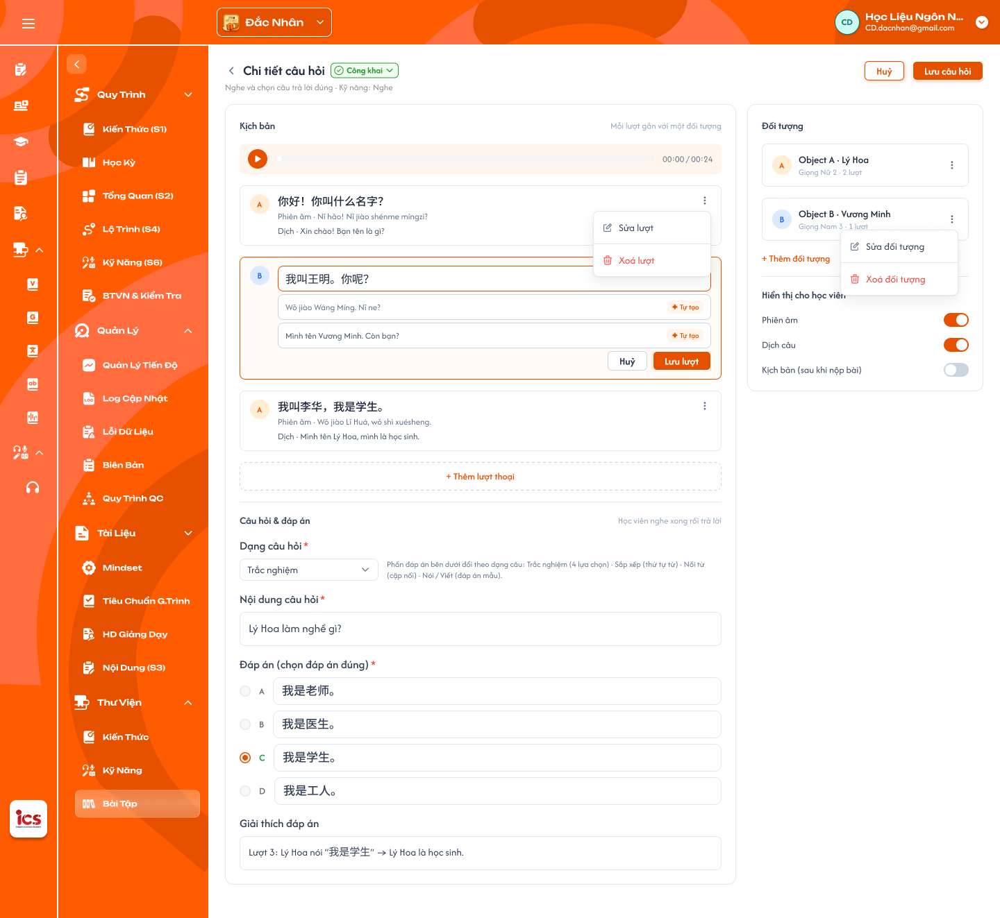

**Mô tả:**
- Câu Nghe ở trạng thái đang sửa: lượt thoại đang mở khung sửa (`✦ Tự tạo`, `Lưu lượt`) và thanh công cụ `Huỷ` / `Lưu câu hỏi`; có menu `⋮` để sửa / xoá lượt hoặc đối tượng.

**Điểm cần lưu ý:**
- Bấm `Tự tạo` chỉ điền gợi ý vào ô, CD sửa lại được; chưa lưu cho đến khi bấm `Lưu câu hỏi`.

### Trang 7: CD-KH-070307 — Thư viện / Bài tập / Chi tiết câu hỏi · Listening / Xác nhận xoá đối tượng

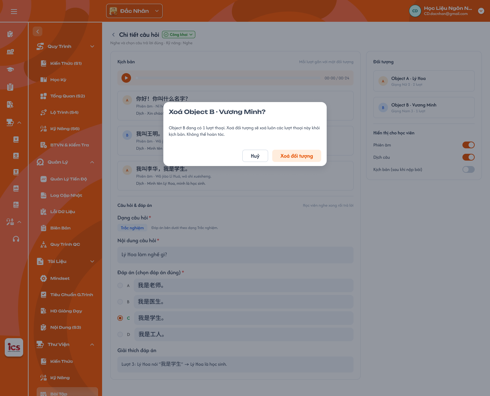

**Mô tả:**
- Popup xác nhận xoá đối tượng, mở từ menu `⋮` của panel Đối tượng ở câu Nghe.

**Điểm cần lưu ý:**
- Requirement chưa mô tả nội dung xác nhận và xử lý lượt thoại đang gắn đối tượng bị xoá (xem Q05).

### Trang 8: CD-KH-070302 — Thư viện / Bài tập / Chi tiết câu hỏi · Reading

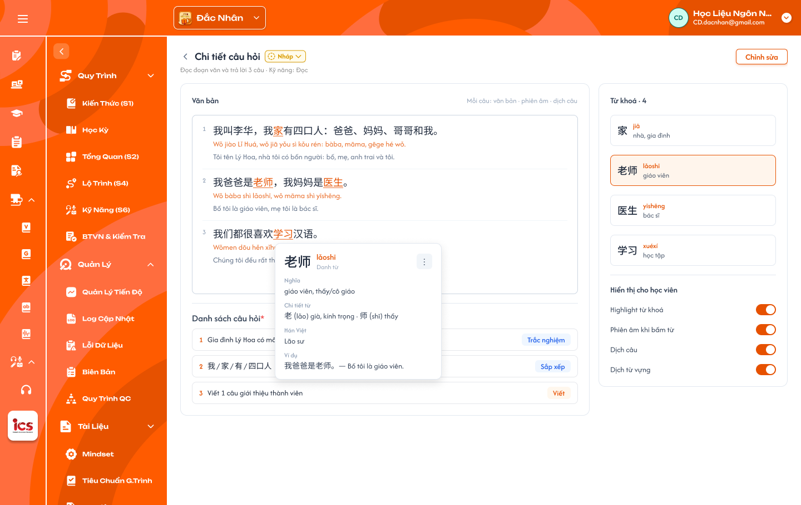

**Mô tả:**
- Chi tiết câu Đọc (trạng thái `Nháp`, sửa được): văn bản theo câu, danh sách `Từ khoá`, popup chi tiết từ khoá và menu `⋮`.

**Điểm cần lưu ý:**
- `A07.15` Văn bản: danh sách câu đánh số, mỗi câu gồm văn bản, phiên âm (tiếng Nhật: romaji), dịch câu; từ khoá trong câu gạch chân màu cam; `+ Thêm câu` ở cuối.
- `A07.17` `Từ khoá · N`: danh sách từ khoá gồm chữ, phiên âm (tiếng Nhật: `Hiragana · Katakana`), nghĩa, menu `⋮`; từ khoá đang chọn viền cam.
- `A07.18` Popup chi tiết từ khoá: bấm từ khoá (trong văn bản hoặc danh sách) hiện chữ, phiên âm, từ loại, `Nghĩa`, `Chi tiết từ`, `Ví dụ`; tiếng Nhật thêm ô `Hiragana`, `Katakana`.
- `A07.21` Sửa từ khoá: menu `⋮` → `Sửa từ khoá` dùng chung popup `Thêm từ khoá`, các ô điền sẵn dữ liệu của từ, thêm `Xoá từ khoá` bên trái, nút chính đổi thành `Lưu`.
- `A07.22` Bỏ từ khoá: bỏ đánh dấu từ khoá khỏi câu hỏi, văn bản giữ nguyên.
- `A07.24` Câu con / đáp án: các câu hỏi của bài đọc (vd `trả lời 3 câu`: câu con, loại câu, đáp án) theo form soạn câu của BTVN (xem Q03).
- `A07.25` Hiển thị cho học viên: bật / tắt `Highlight từ khoá`, `Phiên âm khi bấm từ` (tiếng Nhật: `Hiragana / Katakana khi bấm từ`), `Dịch câu`, `Dịch từ vựng`.
- Từ khoá chỉ thuộc câu hỏi, không tự tạo mục Từ vựng trong Thư viện kiến thức.

### Trang 9: CD-KH-070304 — Thư viện / Bài tập / Chi tiết câu hỏi · Reading / Sửa câu

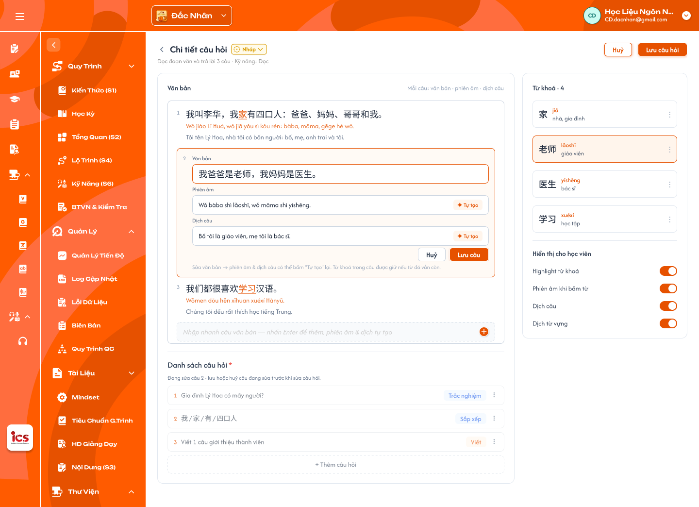

**Mô tả:**
- Bấm vào một câu của văn bản (vd câu 2) để mở khung sửa văn bản, phiên âm, dịch câu.

**Điểm cần lưu ý:**
- `A07.04` `Huỷ`: bỏ mọi thay đổi chưa lưu và về Thư viện bài tập; có thay đổi chưa lưu thì hỏi xác nhận trước khi rời.
- `A07.05` `Lưu câu hỏi`: lưu toàn bộ câu; thành công Toast `Thành Công` `Đã lưu câu hỏi.`, câu AI mất tag `AI`.
- `A07.16` Sửa câu: khung sửa gồm `Văn bản`, `Phiên âm`, `Dịch câu` (hai ô sau có `✦ Tự tạo`), `Huỷ` / `Lưu câu`; sửa văn bản thì bấm `Tự tạo` để sinh lại phiên âm, dịch; từ khoá trong câu được giữ nếu từ đó vẫn còn.

### Trang 10: CD-KH-070305 — Thư viện / Bài tập / Chi tiết câu hỏi · Reading / Thêm · Sửa từ khoá

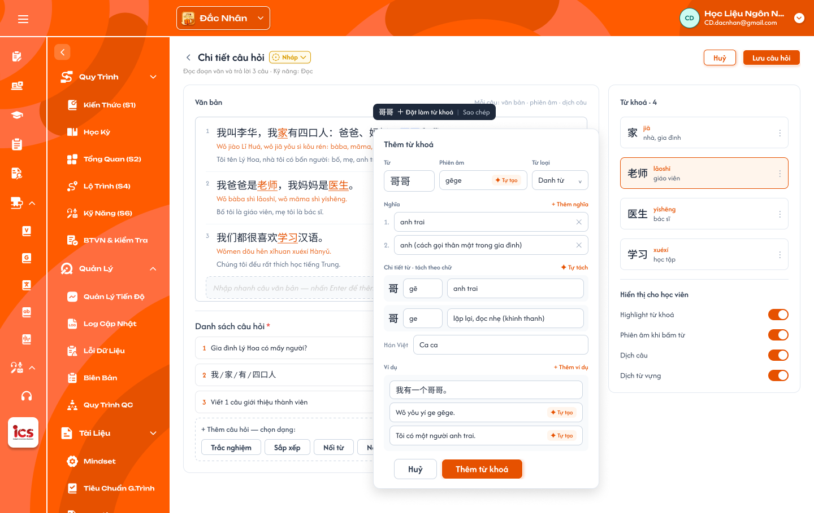

**Mô tả:**
- Bôi đen một từ (vd `哥哥`) trong văn bản để đặt làm từ khoá, mở popup `Thêm từ khoá`.

**Điểm cần lưu ý:**
- `A07.19` Đặt làm từ khoá: bôi đen một từ → thanh nổi `<từ> ＋ Đặt làm từ khoá | Sao chép` → popup `Thêm từ khoá`.
- `A07.20` Popup `Thêm từ khoá`: `Từ` (điền sẵn từ đã bôi đen), `Phiên âm` (`✦ Tự tạo`), `Từ loại` (danh sách Từ loại của S1), `Nghĩa` (nhiều nghĩa, `+ Thêm nghĩa`, `✕` xoá), `Chi tiết từ · tách theo chữ` (mỗi chữ: phiên âm + nghĩa, `✦ Tự tách`), `Hán Việt`, `Ví dụ` (câu, phiên âm, dịch; `+ Thêm ví dụ`), `Huỷ` / `Thêm từ khoá`.
- `A07.23` Chọn từ có sẵn: ô tìm từ trong Kiến thức (S1) của khoá học (Từ vựng, Hanzi / Kanji); chọn từ thì tự điền Phiên âm, Từ loại, Nghĩa, Chi tiết từ, Hán Việt, Ví dụ và CD sửa lại được; không tìm thấy thì nhập mới (xem Q04).

### Trang 11: CD-KH-070309 — Thư viện / Bài tập / Chi tiết câu hỏi · Reading / Thêm · Sửa câu hỏi

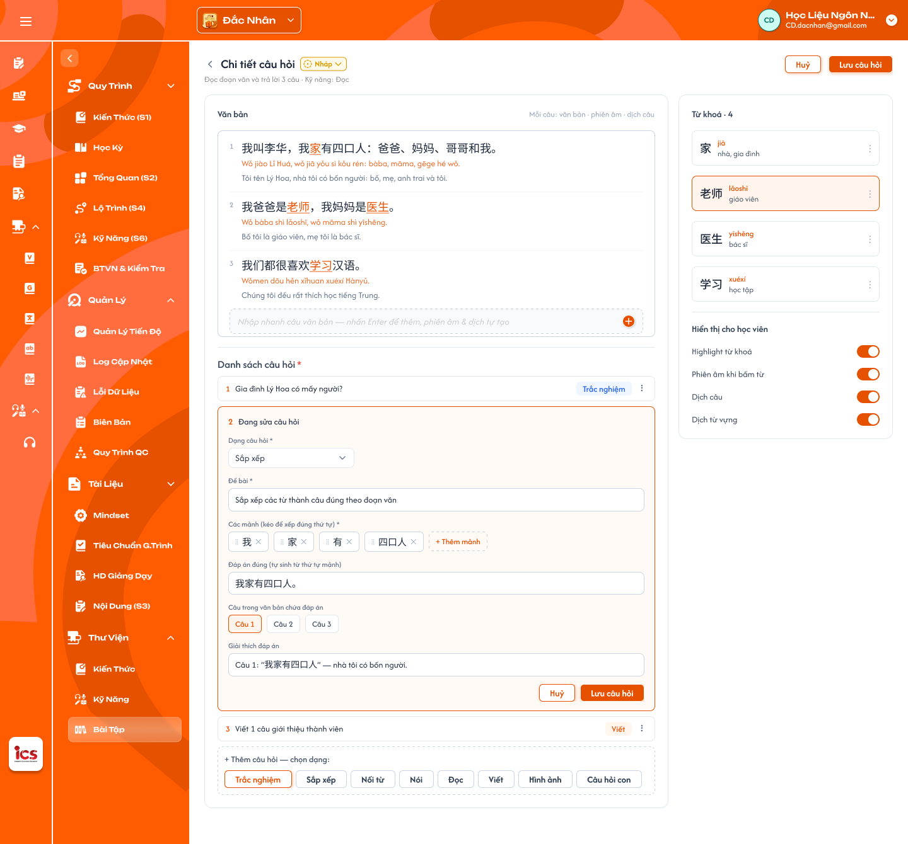

**Mô tả:**
- Chi tiết câu Đọc ở trạng thái đang sửa với `Huỷ` / `Lưu câu hỏi`, phần thêm / sửa câu hỏi của bài đọc.

**Điểm cần lưu ý:**
- Requirement chưa mô tả riêng phần thêm / sửa câu hỏi của bài đọc ở frame này (xem Q05).

### Trang 12: CD-KH-070313 — Thư viện / Bài tập / Chi tiết câu hỏi · Reading / Xem trước phía học viên

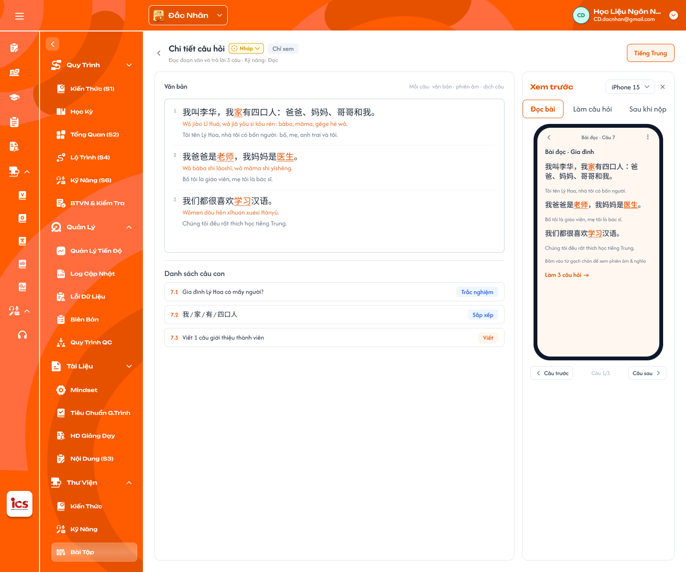

**Mô tả:**
- Chi tiết câu Đọc ở chế độ `Chỉ xem` (chip ngôn ngữ `Tiếng Trung`): xem nội dung như phía học viên, không có nút sửa.

**Điểm cần lưu ý:**
- Hiển thị theo các nút bật / tắt `Hiển thị cho học viên` đã cấu hình; không thay đổi dữ liệu.

### Trang 13: CD-KH-070303 — Thư viện / Bài tập / Chi tiết câu hỏi · Reading (Tiếng Nhật)

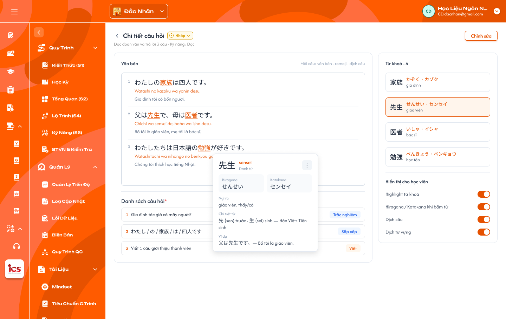

**Mô tả:**
- Chi tiết câu Đọc của trung tâm tiếng Nhật: cột phiên âm là romaji, từ khoá có Hiragana / Katakana.

**Điểm cần lưu ý:**
- `A07.03` Chip ngôn ngữ: ngôn ngữ theo trung tâm (`Tiếng Trung`, `Tiếng Nhật`…), chỉ hiển thị, quyết định cột phiên âm (pinyin / romaji).

---

## 2. Yêu cầu

### 2.1. Flow chính

**Flow 1: Xem, tìm kiếm và lọc Thư viện**

```
CD chọn Thư Viện → Kiến Thức / Kỹ Năng / Bài Tập
  → tải dữ liệu thư viện của trung tâm đang chọn, tab đầu tiên, trang 1
  → đổi tab / nhập tìm kiếm / chọn Cấp độ → bảng và badge tổng số cập nhật, về trang 1
  → Xoá bộ lọc: tìm kiếm trống, Cấp độ Tất cả
```

**Flow 2: Đổi trạng thái mục kiến thức, kỹ năng**

```
⋮ → Đổi trạng thái → menu con chỉ gồm trạng thái được phép → chọn
  → BE kiểm tra chuyển trạng thái hợp lệ
  → Hợp lệ: lưu, badge cập nhật, Toast "Đã đổi trạng thái."
  → Không hợp lệ: từ chối, trạng thái giữ nguyên
```

**Flow 3: Xoá mục kiến thức, kỹ năng**

```
⋮ → Xoá (chỉ bấm được với mục Nháp / Vô hiệu và Chưa dùng; mục khác Xoá mờ + tooltip)
  → Popup "Xoá mục khỏi thư viện?"
        ↓ (Huỷ)                         ↓ (Xoá)
   đóng, giữ nguyên      BE kiểm tra lại trạng thái + việc đang dùng
                           → hợp lệ: xoá mềm → Toast "Đã xoá mục khỏi thư viện."
                           → từ chối: Toast "Cảnh Báo" theo lý do, mục giữ nguyên
```

**Flow 4: Xem Bảng chữ dạng lưới**

```
Tab Bảng chữ (Sakumi / Saechang) → "Xem dạng bảng chữ" (Trang 2 / 4)
  → lưới theo hệ chữ của trung tâm, nhóm đầu tiên, ô đầu tiên được chọn, panel Chi tiết chữ
  → đổi bộ chữ / nhóm, bấm ô → panel cập nhật; "Nghe phát âm" → phát audio của chữ
  → Tìm kiếm / Cấp độ: ô không khớp mờ
  → "Xem dạng danh sách" → về bảng (Trang 1 / 3), giữ tìm kiếm và Cấp độ
```

**Flow 5: Xem và sửa câu hỏi ở Thư viện bài tập**

```
Thư Viện → Bài Tập → Ngân Hàng Câu Hỏi → bấm một câu → Chi tiết câu hỏi theo loại câu (Trang 5–13)
  → Chưa dùng hoặc mọi khoá chứa câu đều Nháp: sửa câu, lượt thoại, đối tượng, từ khoá, nút bật/tắt → Lưu câu hỏi
        → sửa kịch bản / giọng câu Nghe: Tạo lại audio (TTS theo giọng) hoặc tải file mới
        → BE kiểm tra lại điều kiện sửa → lưu câu gốc → Toast "Đã lưu câu hỏi."
  → Thuộc khoá Công khai / Vô hiệu: chế độ chỉ xem (banner, ẩn nút sửa) → Đóng
  → Huỷ / ‹: về Thư viện bài tập (có thay đổi chưa lưu thì hỏi xác nhận)
```

### 2.2. Ngoại lệ

- **EX01:** Request chuyển trạng thái không hợp lệ (`Công khai` → `Nháp`, `Vô hiệu` → `Nháp`) → backend từ chối; trạng thái giữ nguyên.
- **EX02:** Request xoá mục `Công khai` → backend từ chối; Toast `Cảnh Báo` `Mục đang Công khai không thể xoá.`
- **EX03:** Request xoá mục đang dùng ở bài học → backend từ chối; Toast `Cảnh Báo` `Mục đang được dùng ở bài học, gỡ khỏi bài trước khi xoá.`
- **EX04:** Request xoá / đổi trạng thái câu hỏi từ Thư viện bài tập → backend từ chối.
- **EX05:** Lỗi tải dữ liệu → vùng bảng báo lỗi và `Thử lại`; không hiển thị bảng rỗng giả.
- **EX06:** Truy cập tab `Bảng chữ` ở trung tâm không có hệ chữ riêng (qua URL / API) → từ chối, về tab đầu tiên.
- **EX07:** Chữ chưa có audio → nút `Nghe phát âm` mờ, không phát; không Toast.
- **EX08:** Request lưu câu hỏi thuộc khoá `Công khai` / `Vô hiệu` → backend từ chối; Toast `Cảnh Báo` `Câu thuộc khoá Công khai / Vô hiệu, không sửa được.`; câu giữ nguyên.

### 2.3. Yêu cầu khác

| Mã | Tên yêu cầu | Mô tả |
|---|---|---|
| REQ01 | Phạm vi dữ liệu | Thư viện chỉ hiển thị dữ liệu của trung tâm CD đang chọn ở header; đổi trung tâm thì tải lại theo trung tâm mới. |
| REQ02 | Tìm kiếm và lọc | Chỉ có ô tìm kiếm (theo cột chính của tab) và lọc `Cấp độ` (một lựa chọn, mặc định `Tất cả`), kết hợp với nhau; `Xoá bộ lọc` đưa về mặc định; phân trang 50 dòng / trang; badge tổng số theo kết quả; ô trống hiện `— trống —` / `— chưa có … —` màu cam. |
| REQ03 | Đang dùng ở | Hiển thị kỳ và bài đang dùng mục: một bài hiện tên bài, nhiều bài hiện số bài; chưa gắn bài nào hiển thị `Chưa dùng`. |
| REQ04 | Trạng thái mục kiến thức, kỹ năng | `Nháp` → `Công khai` / `Vô hiệu`; `Công khai` → `Vô hiệu`; `Vô hiệu` → `Công khai`; không về `Nháp`; menu con chỉ hiện trạng thái được phép. Mục `Vô hiệu` không được thêm mới vào bài; bài đã gắn trước đó vẫn dùng. |
| REQ05 | Xoá | Chỉ xoá mềm mục `Nháp` / `Vô hiệu` chưa dùng ở bài nào, qua popup xác nhận; mục `Công khai` hoặc đang dùng thì `Xoá` mờ kèm tooltip, backend từ chối request. |
| REQ06 | Thư viện kiến thức | Mọi trung tâm có đủ 6 tab Từ vựng, Ngữ pháp, Mẫu câu, Hanzi, Kanji, Phát âm (cộng Bảng chữ theo REQ07); cột theo từng tab kèm `Cụm`, `Đang dùng ở`, `Trạng thái`; Loại của Phát âm theo S1; thêm / sửa tại S1. |
| REQ07 | Bảng chữ | Tab chỉ ở trung tâm có hệ chữ riêng (Sakumi: Hiragana / Katakana, 104 mục, 1 dòng = cặp chữ; Saechang: Hangul, 40 jamo); hai dạng xem danh sách và lưới; lưới có panel Chi tiết chữ và `Nghe phát âm`; tìm kiếm / Cấp độ áp dụng cả hai dạng; dạng lưới chỉ có ở Thư viện. |
| REQ08 | Thư viện kỹ năng | Tab Nghe, Đọc, Viết, Nói; cột nội dung (âm thanh, đoạn văn, đề bài), số câu hỏi, đang dùng ở, trạng thái; phát âm thanh trong bảng, một bài tại một thời điểm; thêm / sửa tại S6. |
| REQ09 | Thư viện bài tập | 3 tab Ngân hàng câu hỏi, BTVN Mẫu, Kiểm Tra Mẫu; không đổi trạng thái, không xoá câu; Ngân hàng câu hỏi không có cột `Đang dùng ở`, cột `Kiến thức / Kỹ năng` chỉ ghi `Kiến thức` hoặc `Kỹ năng`; trạng thái câu hỏi lấy theo khoá học chứa câu (`Chưa dùng` khi chưa thuộc bài nào); tag `AI` cho câu AI chưa được sửa; hai tab mẫu không có cột Tổng điểm. |
| REQ10 | Chi tiết câu hỏi | Bấm câu ở Ngân hàng câu hỏi mở Chi tiết câu hỏi; sửa được khi câu `Chưa dùng` hoặc mọi khoá học chứa câu đều `Nháp`, khác thì chỉ xem (banner, ẩn nút sửa, `Đóng`); sửa là sửa câu gốc, mọi bộ BTVN / bài kiểm tra dùng câu thấy nội dung mới; câu Nghe có kịch bản theo lượt và đối tượng, câu Đọc có văn bản theo câu và từ khoá (chọn được từ có sẵn ở S1); sửa kịch bản / giọng câu Nghe thì tạo lại audio; backend kiểm tra lại điều kiện sửa. |

### 2.4. Ràng buộc

#### Quyền

| Role | Xem Thư viện | Đổi trạng thái kiến thức / kỹ năng | Xoá kiến thức / kỹ năng chưa Công khai | Sửa câu hỏi (Chưa dùng / mọi khoá Nháp) | Xoá câu hỏi tại Thư viện bài tập |
|---|:---:|:---:|:---:|:---:|:---:|
| CD | ✅ | ✅ | ✅ | ✅ | ❌ |
| Các role khác | ❌ | ❌ | ❌ | ❌ | ❌ |

#### Ràng buộc khác

- Dữ liệu theo trung tâm CD đang chọn; không trả dữ liệu trung tâm khác.
- Mọi request đổi trạng thái, xoá, lưu câu hỏi được backend kiểm tra quyền, trạng thái và việc đang dùng; không dựa vào việc ẩn hay làm mờ nút.
- Quy tắc chung role CD: mục đang `Công khai` không được xoá, chỉ chuyển `Vô hiệu`; áp dụng cho kiến thức, kỹ năng, khoá học ([Quản lý khoá học](../course_management.md)).
- Từ khoá chỉ thuộc câu hỏi, không tạo mục Từ vựng; `Tự tạo` / `Tự tách` chỉ điền gợi ý, chưa lưu cho đến khi bấm `Lưu câu hỏi`.
- Mỗi thao tác một Toast: `Thành Công`, `Cảnh Báo` hoặc `Có Lỗi Xảy Ra`; tìm kiếm, lọc, phát âm thanh, đổi dạng xem, `Huỷ` không có Toast CRUD.


---

## 3. Testcase

### Feature: [CD] Thư viện

| Tên testcase | Priority | Scenario | Role | Pre-condition | Given/When/Then | Expected Result |
|---|---|---|---|---|---|---|
| Case 1: Mở Thư viện, tìm kiếm, lọc Cấp độ, đổi trung tâm | High | Flow 1 / REQ01 / REQ02 / EX05 | CD | CD phụ trách Đắc Nhân và Sakumi; có mục cấp độ HSK1, HSK2 cùng chứa chữ `你` | **Given:** bấm `Thư Viện` → `Kiến Thức`<br>**When:** chọn Cấp độ `HSK1`, nhập `你`, bấm `Xoá bộ lọc`, rồi đổi trung tâm ở header<br>**Then:** bảng và badge cập nhật | - Mặc định tab đầu, trang 1, Cấp độ `Tất cả`<br>- Tìm + Cấp độ kết hợp, chỉ còn mục HSK1 chứa `你`, về trang 1<br>- `Xoá bộ lọc` trả về mặc định<br>- Đổi trung tâm thì không còn dữ liệu trung tâm cũ<br>- Lỗi tải: báo lỗi + `Thử lại`, không hiện bảng rỗng giả |
| Case 2: Cột chung, ô trống và phân trang | Medium | REQ02 / REQ03 | CD | Mục dùng ở 1 bài, ở 3 bài, chưa dùng; từ vựng thiếu Nghĩa; bài nghe chưa có file; hơn 50 mục | **Given:** xem bảng<br>**When:** render<br>**Then:** hiển thị cột Đang dùng ở, ô trống, phân trang | - `HK I · Bài 1`, `HK I · 3 bài`, `Chưa dùng` màu cam<br>- Ô Nghĩa `— trống —`, ô Âm thanh `— chưa có file âm thanh —` màu cam, không có nút phát<br>- 50 dòng / trang, `Hiển thị 1–50 trong N …` |
| Case 3: Đổi trạng thái mục kiến thức, kỹ năng | High | Flow 2 / REQ04 / EX01 | CD | Mục `Nháp`, mục `Công khai`, mục `Vô hiệu` | **Given:** mở `⋮` → `Đổi trạng thái` của từng mục<br>**When:** chọn trạng thái; gửi request chuyển về `Nháp`<br>**Then:** hệ thống đổi hoặc từ chối | - `Nháp` → `Công khai` thành công, Toast `Thành Công` `Đã đổi trạng thái.`<br>- `Công khai` chỉ có `Vô hiệu`, `Vô hiệu` chỉ có `Công khai`<br>- Backend từ chối về `Nháp`, trạng thái giữ nguyên |
| Case 4: Xoá mục | High | Flow 3 / REQ05 / EX02 / EX03 | CD | Mục `Nháp` chưa dùng; mục `Công khai`; mục `Vô hiệu` đang dùng ở 2 bài | **Given:** mở `⋮` từng mục; hover `Xoá`; gửi request xoá trực tiếp với mục không hợp lệ<br>**When:** xoá mục `Nháp` chưa dùng (thử `Huỷ` trước)<br>**Then:** hệ thống xử lý | - `Huỷ` đóng popup, mục giữ nguyên, không Toast<br>- Xoá thành công: mục biến mất, Toast `Đã xoá mục khỏi thư viện.`, không còn ở S1 / S6 / popup thư viện<br>- Mục `Công khai` và mục đang dùng: `Xoá` mờ, tooltip đúng; request bị từ chối, Toast `Cảnh Báo` đúng nội dung |
| Case 5: Tab và cột Thư viện kiến thức | High | REQ06 | CD | Đắc Nhân, Sakumi, Saechang, Creative English; Đắc Nhân chưa có mục Kanji; từ `你好` dùng ở khoá HSK1 | **Given:** mở Thư viện kiến thức ở từng trung tâm; sửa Nghĩa `你好` ở S1<br>**When:** xem thanh tab, các cột và tab Kanji<br>**Then:** hiển thị đúng | - Đủ 6 tab ở cả 4 trung tâm; chỉ Sakumi, Saechang có thêm `Bảng chữ` trước `Phát Âm`<br>- Cột đúng từng tab (Hanzi có Bộ thủ; Phát âm có Loại, Âm thanh)<br>- Tab Kanji rỗng: `Bảng dữ liệu này đang trống`, badge `0 chữ Kanji`, tab vẫn bấm được<br>- Thư viện hiện Nghĩa mới, không có form sửa |
| Case 6: Bảng chữ theo trung tâm và truy cập trái phép | High | REQ07 / EX06 | CD | CD phụ trách Sakumi, Saechang, Đắc Nhân | **Given:** mở Thư viện kiến thức ở từng trung tâm<br>**When:** xem tab; truy cập tab `Bảng chữ` của Đắc Nhân qua URL / API<br>**Then:** hệ thống hiển thị hoặc từ chối | - Sakumi, Saechang có `Bảng chữ` đúng hệ chữ<br>- Đắc Nhân bị từ chối, về tab đầu tiên |
| Case 7: Bảng chữ Nhật: danh sách, lưới, nghe phát âm | High | Flow 4 / REQ07 / EX07 | CD | Sakumi có 104 mục; `か` có audio, `ぬ` chưa có | **Given:** mở `Bảng chữ`<br>**When:** tìm `ka`; bấm `Xem dạng bảng chữ`, đổi `Katakana`, bấm ô `か` → `Nghe phát âm`, bấm ô `ぬ`, bấm ô xám hàng `や行`<br>**Then:** lưới và panel cập nhật | - Danh sách đủ cột, badge `104 chữ`, tìm `ka` ra `か カ`<br>- Lưới 5 × 11, ô đầu `あ` được chọn, panel đủ field; nút đổi thành `Xem dạng danh sách`<br>- Phát audio `か`; `ぬ` nút `Nghe phát âm` mờ, không Toast<br>- Ô xám không bấm được, không có panel<br>- Tìm `ka` ở lưới: ô không khớp mờ; `Xoá bộ lọc` bỏ mờ |
| Case 8: Bảng chữ Hàn | High | Flow 4 / REQ07 | CD | Saechang có 40 jamo | **Given:** mở `Bảng chữ`<br>**When:** xem danh sách rồi bấm `Xem dạng bảng chữ`<br>**Then:** lưới và panel hiện | - Danh sách 40 dòng, Loại đúng 5 nhóm<br>- Lưới 14 × 10 âm tiết, ô `가` được chọn; panel `ㄱ + ㅏ`, Phụ âm `ㄱ (기역) · g / k`, Nguyên âm `ㅏ · a` |
| Case 9: Thư viện kỹ năng | Medium | REQ08 | CD | Có bài nghe có file và chưa có file; bài đọc chưa có đoạn văn; bài viết chưa có đề | **Given:** mở các tab Nghe, Đọc, Viết, Nói<br>**When:** render bảng; phát bài 01 rồi bài 02; tìm theo nội dung<br>**Then:** hiển thị đúng | - Bài có file có nút phát và thời lượng, bài chưa có hiện `— chưa có file âm thanh —`<br>- Đoạn văn dài cắt `…`; `— chưa có đoạn văn —`, `— chưa có đề bài —`; `0 câu` màu cam<br>- Chỉ phát một bài tại một thời điểm<br>- Tìm theo đoạn văn / đề bài ra đúng bài |
| Case 10: Ngân hàng câu hỏi | High | Flow 1 / REQ09 / EX04 | CD | Có câu thuộc khoá Công khai, câu chưa dùng, câu thiếu đáp án, câu 07 có 3 câu con, câu có tag `AI` | **Given:** mở Thư viện bài tập<br>**When:** xem bảng, mở câu 07, tìm `pinyin`, gửi request xoá / đổi trạng thái câu<br>**Then:** hiển thị và xử lý | - Đủ 6 cột, không có `Đang dùng ở`; câu chưa dùng `Chưa dùng`; thiếu đáp án `— chưa có đáp án —`; Kiến thức / Kỹ năng chỉ `Kiến thức` / `Kỹ năng`<br>- Mở 7.1–7.3 với loại câu, đáp án riêng; bấm lại thu gọn<br>- Chỉ câu AI chưa sửa có tag `AI`<br>- Tìm theo nội dung / hướng dẫn, không theo tên bài<br>- Không có `⋮`; request bị từ chối, dữ liệu giữ nguyên |
| Case 11: Trạng thái theo khoá học và tab mẫu | Medium | REQ09 | CD | Câu thuộc khoá HSK1 `Công khai`; bộ BTVN 0 câu; bài kiểm tra thuộc khoá `Nháp` | **Given:** chuyển khoá HSK1 sang `Vô hiệu`<br>**When:** mở lại Ngân hàng câu hỏi, BTVN Mẫu, Kiểm Tra Mẫu<br>**Then:** hiển thị trạng thái và cột | - Câu hiển thị `Vô hiệu`; không đổi được trạng thái tại Thư viện<br>- Tab mẫu có STT, Bài / Bài kiểm tra, Số câu, Trạng thái; không có Tổng điểm<br>- `0 câu` màu cam, trạng thái `Nháp` theo khoá |
| Case 12: Chi tiết câu Nghe: lượt thoại, đối tượng, audio | High | Flow 5 / REQ10 | CD | Câu Nghe `Chưa dùng` có 3 lượt, 2 đối tượng, có audio; lượt cuối là Object A | **Given:** bấm câu ở Ngân hàng câu hỏi<br>**When:** `+ Thêm lượt thoại` nhập câu, `Tự tạo`, `Thêm lượt`; sửa lượt 2, `Lưu câu`; lưu câu khi chưa tạo lại audio<br>**Then:** màn cập nhật | - Hiện Kịch bản 3 lượt, panel Đối tượng, 3 nút bật / tắt, `Lưu câu hỏi`<br>- Lượt mới gắn Object B, có phiên âm và dịch, số lượt Object B tăng 1<br>- Thanh audio hiện `Audio cần tạo lại`; `Tạo lại audio` sinh audio theo giọng từng đối tượng; lưu khi chưa tạo lại thì hỏi xác nhận |
| Case 13: Chi tiết câu Đọc: sửa câu, từ khoá, tiếng Nhật | High | Flow 5 / REQ10 | CD | Câu Đọc thuộc khoá `Nháp`, câu 2 có từ khoá `老师`, `医生`; câu Đọc tiếng Nhật ở Sakumi có từ khoá `先生`; khoá có từ vựng `老师` ở S1 | **Given:** mở chi tiết câu Đọc<br>**When:** sửa câu 2 bỏ `医生` rồi `Lưu câu`; bôi đen `哥哥` → `Đặt làm từ khoá` → `Thêm từ khoá` (thử tìm `老师` từ S1); `⋮` → `Sửa từ khoá`, rồi `Bỏ từ khoá`; mở câu tiếng Nhật, bấm `先生`<br>**Then:** màn cập nhật | - Câu 2 cập nhật, `老师` vẫn là từ khoá, `医生` hết gạch chân; `Tự tạo` sinh lại phiên âm, dịch<br>- `哥哥` gạch chân, `Từ khoá · 5`; chọn từ S1 thì điền sẵn dữ liệu; không tạo mục Từ vựng ở Thư viện kiến thức<br>- Nghĩa mới hiện ở popup; sau `Bỏ từ khoá` hết gạch chân, văn bản giữ nguyên<br>- Câu Nhật: chip `Tiếng Nhật`, cột romaji, popup có Hiragana `せんせい`, Katakana `センセイ` |
| Case 14: Chế độ chỉ xem, lưu câu AI và huỷ | High | Flow 5 / REQ10 / EX08 | CD | Câu thuộc khoá `Công khai` (hoặc một khoá Nháp và một khoá Vô hiệu); câu AI `Chưa dùng` có tag `AI`; câu Đọc đã sửa chưa lưu | **Given:** mở câu thuộc khoá Công khai; gửi request lưu trực tiếp; sửa câu AI rồi `Lưu câu hỏi`; sửa câu rồi bấm `Huỷ`<br>**When:** hệ thống xử lý<br>**Then:** hiển thị và lưu | - Banner `Câu thuộc khoá Công khai / Vô hiệu, chỉ xem.`; không có `Lưu câu hỏi`, `+ Thêm câu`, menu `⋮`; nút bật / tắt khoá; `Huỷ` đổi thành `Đóng`<br>- Backend từ chối lưu, Toast `Cảnh Báo`, câu giữ nguyên<br>- Câu AI: Toast `Đã lưu câu hỏi.`, mất tag `AI`<br>- `Huỷ` có thay đổi thì hỏi xác nhận rồi về Thư viện bài tập, câu giữ nội dung cũ, không Toast |
| Case 15: Role khác bị chặn và Toast lỗi | High | Ràng buộc quyền / Toast | Các role khác; CD | Backend / network lỗi | **Given:** role khác mở URL Thư viện hoặc gửi request đổi trạng thái / xoá / lưu câu; CD đổi trạng thái hoặc xoá khi backend lỗi<br>**When:** hệ thống xử lý<br>**Then:** từ chối hoặc báo lỗi | - Role khác bị từ chối, dữ liệu không đổi<br>- CD: Toast `Có Lỗi Xảy Ra`, trạng thái / dữ liệu giữ nguyên, đúng một Toast |

---

## 4. Câu hỏi cần xác nhận

- **Q01:** Dạng lưới Bảng chữ cần bổ sung nút `⋮` (Đổi trạng thái, Xoá) trong panel Chi tiết chữ; chưa có frame thiết kế.
- **Q02:** Bấm dòng ở tab BTVN Mẫu / Kiểm Tra Mẫu mở bộ câu hỏi chỉ đọc; chưa có frame thiết kế.
- **Q03:** Chi tiết câu hỏi chưa có thiết kế cho phần lựa chọn, đáp án câu Nghe, câu con và đáp án câu Đọc, và cho các loại câu Trắc nghiệm, Sắp xếp, Nối từ, Viết, Nói, Hình ảnh, Câu hỏi con.
- **Q04:** Chưa có thiết kế cho nhãn `Audio cần tạo lại` / nút `Tạo lại audio` và ô tìm từ S1 trên popup `Thêm từ khoá`. Tạo lại audio dùng TTS ghép từng lượt theo giọng đối tượng hay dịch vụ tạo hội thoại; có cho giữ audio cũ khi chỉ sửa phiên âm / dịch (không đổi câu đọc) không?
- **Q05:** Frame `CD-KH-070307` (xác nhận xoá đối tượng) và `CD-KH-070309` chưa có mô tả trong requirement: nội dung xác nhận, xử lý lượt thoại đang gắn đối tượng bị xoá, và hành vi thêm / sửa câu hỏi của bài đọc.
- **Q06:** Bảng chữ cho Betreux, Creative English, Créatis (Alphabet) hiện không có tab; có cần thêm sau không?
