# [CD] Thư viện

Menu **Thư viện** của role **CD** gồm 3 mục **Kiến thức**, **Kỹ năng**, **Bài tập**: kho dữ liệu dùng chung của các khoá học thuộc **trung tâm** CD đang chọn ở header. Thư viện dùng để **xem tập trung**, tìm kiếm, lọc theo **Cấp độ**, **đổi trạng thái** và **xoá mục chưa Công khai**; riêng câu hỏi ở Thư viện bài tập được **mở chi tiết và sửa khi câu Chưa dùng hoặc mọi khoá học chứa câu đều đang Nháp**. Thêm và sửa kiến thức, kỹ năng không làm tại Thư viện: Kiến thức sửa ở [Kiến thức (S1)](../knowledge-s1/knowledge-s1.md), Kỹ năng sửa ở Kỹ năng (S6); soạn bộ câu hỏi ở [Bài tập về nhà và Kiểm tra](../homework-test/homework-test.md).

Ảnh lấy từ Figma section Thư viện (26 frame, gồm `CD-KH-070160`, `070161`, `070170`, `070171` cho Bảng chữ và `CD-KH-070301`–`070305` cho Chi tiết câu hỏi). Điểm khác Figma được ghi ngay dưới ảnh. Từ, câu, số liệu trong ảnh là dữ liệu mẫu.

## 1. UI

### Trang 1: Khung chung của Thư viện


*Thư viện kiến thức, tab Từ vựng (trung tâm Đắc Nhân) — nhấn để xem ảnh gốc*

**Mô tả:**

- Sidebar CD có nhóm `Thư Viện` với 3 mục `Kiến Thức`, `Kỹ Năng`, `Bài Tập`. Ba màn dùng chung bố cục: tiêu đề, mô tả ngắn, thanh tab loại dữ liệu, ô tìm kiếm, lọc `Cấp độ`, badge tổng số, `Xoá bộ lọc`, bảng danh sách, phân trang.

**Điểm cần lưu ý:**

- `A01.01` **Tiêu đề / mô tả**: `Thư viện kiến thức`, `Thư viện kỹ năng`, `Thư viện bài tập` kèm một dòng mô tả như ảnh.
- `A01.02` **Thanh tab**: Loại dữ liệu của từng thư viện (chi tiết ở khu vực tương ứng). Mặc định tab đầu tiên.
- `A01.03` **Ô tìm kiếm**: Tìm theo các cột chính của tab (placeholder nêu rõ, vd `Tìm từ, phiên âm, nghĩa…`), không phân biệt hoa thường, bỏ khoảng trắng thừa.
- `A01.04` **Lọc `Cấp độ`**: Một lựa chọn: `Tất cả` hoặc một cấp độ trong danh sách [Quản lý cấp độ](../../curriculum_management_requirement/level_management/level_management_requirements.md) của trung tâm. Mặc định `Tất cả`.
- `A01.05` **Badge tổng số**: Tổng số mục khớp tìm kiếm và lọc của tab đang mở (vd `1.240 từ vựng`, `96 bài nghe`, `248 câu hỏi`).
- `A01.06` **`Xoá bộ lọc`**: Đưa ô tìm kiếm về trống và Cấp độ về `Tất cả`.
- `A01.07` **Cột `Cụm`**: Chip cụm kiến thức chứa mục (vd `01. Chào hỏi`); nhiều cụm thì hiện cụm đầu kèm `+N`. Chỉ có ở Thư viện kiến thức.
- `A01.08` **Cột `Đang dùng ở`**: Kỳ và bài đang dùng mục: một bài hiện tên bài (`HK I · Bài 1`), nhiều bài hiện số bài (`HK I · 3 bài`); chưa gắn bài nào hiện `Chưa dùng` màu cam. Chỉ có ở Thư viện kiến thức, kỹ năng; Ngân hàng câu hỏi không có cột này.
- `A01.09` **Cột `Trạng thái`**: Badge `Nháp` (cam), `Công khai` (xanh lá), `Vô hiệu` (xám). Quy tắc ở khu vực Trạng thái và xoá mục.
- `A01.10` **Menu `⋮` cuối dòng**: Kiến thức, Kỹ năng: `Đổi trạng thái`, `Xoá`. Bài tập: không có.
- `A01.11` **Ô trống**: Field bắt buộc đang trống hiện `— trống —` màu cam (vd Nghĩa, Phiên âm); nội dung đặc thù hiện `— chưa có file âm thanh —`, `— chưa có đoạn văn —`, `— chưa có đề bài —`, `— chưa có file —`. `0 câu` màu cam.
- `A01.12` **Phân trang**: 50 dòng/trang; dòng chú thích `Hiển thị 1–50 trong N …`; nút số trang, `…`, trang cuối.

- Dữ liệu chỉ thuộc trung tâm CD đang chọn ở header; đổi trung tâm thì tải lại cả 3 thư viện theo trung tâm mới.
- Tìm kiếm và lọc Cấp độ kết hợp với nhau; đổi tab giữ nguyên Cấp độ, xoá ô tìm kiếm; đổi điều kiện thì về trang 1.
- Kiến thức, Kỹ năng: bấm dòng không mở form sửa; thao tác duy nhất là menu `⋮`. Bài tập: bấm dòng câu hỏi mở Chi
  tiết câu hỏi (xem khu vực Thư viện bài tập — Chi tiết câu hỏi).

### Trang 2: Trạng thái và xoá mục
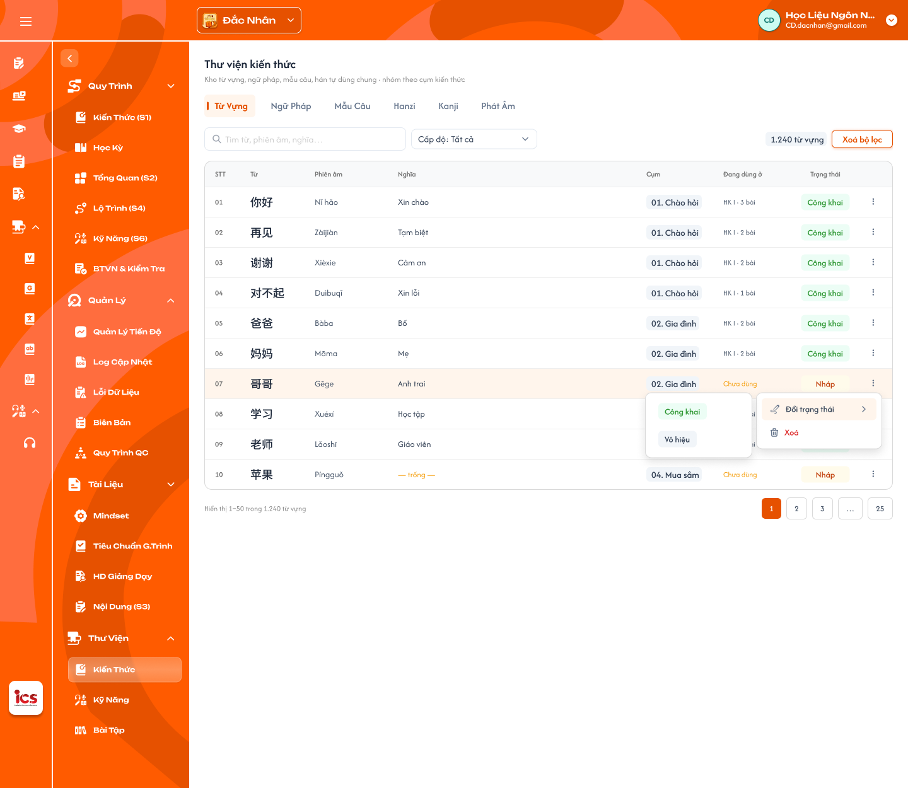

*Menu ⋮ của mục Nháp, chưa dùng: Đổi trạng thái (Công khai / Vô hiệu) và Xoá — nhấn để xem ảnh gốc*

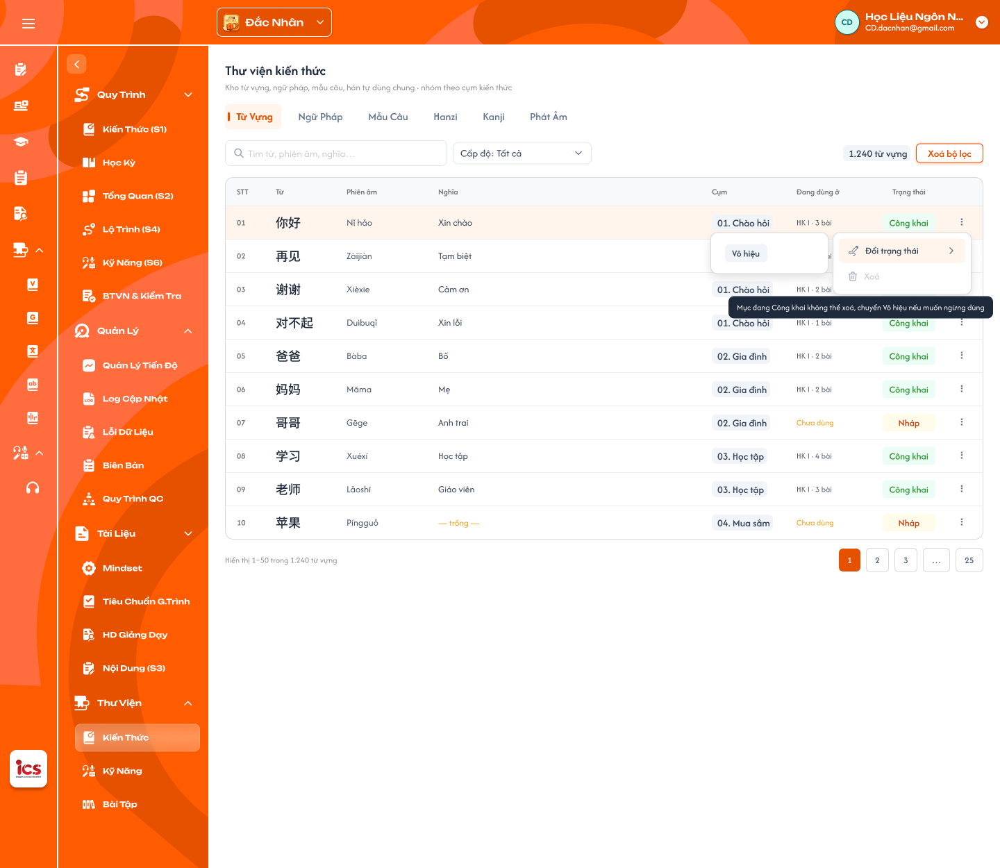

*Menu ⋮ của mục Công khai: Đổi trạng thái chỉ còn Vô hiệu; Xoá mờ kèm tooltip — nhấn để xem ảnh gốc*

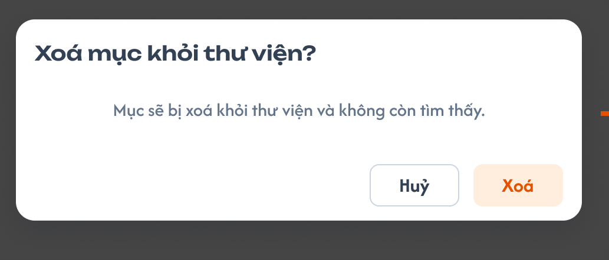

*Popup xác nhận xoá — nhấn để xem ảnh gốc*

**Mô tả:**

- Mỗi mục kiến thức, kỹ năng có trạng thái riêng `Nháp`, `Công khai`, `Vô hiệu`. CD đổi trạng thái và xoá mục chưa Công khai bằng menu `⋮`. Câu hỏi ở Thư viện bài tập không có trạng thái riêng (xem khu vực Thư viện bài tập).

**Điểm cần lưu ý:**

- `A02.01` **`Đổi trạng thái`**: Mục có mũi tên `>` mở menu con chỉ gồm trạng thái được phép: `Nháp` → `Công khai` hoặc `Vô hiệu`; `Công khai` → `Vô hiệu`; `Vô hiệu` → `Công khai`. Không cho về `Nháp`. Chọn xong lưu ngay, badge cập nhật, Toast `Thành Công`.
- `A02.02` **`Xoá`**: Chỉ bấm được với mục `Nháp` hoặc `Vô hiệu` **và** `Chưa dùng`. Mở popup `Xoá mục khỏi thư viện?` (`Mục sẽ bị xoá khỏi thư viện và không còn tìm thấy.`, nút `Huỷ` / `Xoá`). Xoá mềm.
- `A02.03` **Mục `Công khai`**: `Xoá` hiện mờ, không bấm được; hover hiện tooltip `Mục đang Công khai không thể xoá, chuyển Vô hiệu nếu muốn ngừng dùng`.
- `A02.04` **Mục đang dùng**: Mục `Nháp` / `Vô hiệu` đang gắn bài: `Xoá` mờ, tooltip `Mục đang được dùng ở bài học, gỡ khỏi bài trước khi xoá`.

- Quy tắc chung của role CD: **mục đang `Công khai` không được xoá, chỉ chuyển `Vô hiệu`**; áp dụng cho kiến thức, kỹ năng, khoá học ([Quản lý khoá học](../course_management.md)).
- Mục `Vô hiệu` không được thêm mới vào bài học hay S1; bài đã gắn mục trước khi vô hiệu vẫn dùng bình thường.
- Backend kiểm tra lại trạng thái và việc đang dùng khi nhận request đổi trạng thái hoặc xoá; request không hợp lệ bị từ chối kèm Toast `Cảnh Báo`.
- Xoá mềm: mục không còn hiển thị, không tìm thấy ở Thư viện, S1, S6 và popup thêm từ thư viện.

### Trang 3: Thư viện kiến thức
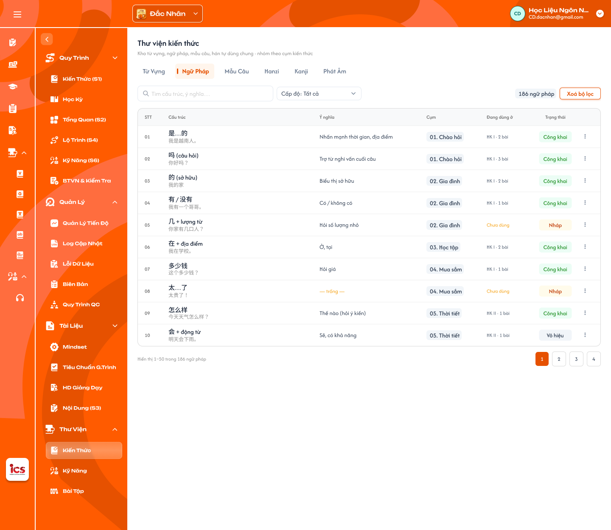

*Tab Ngữ pháp: cột Cấu trúc (kèm ví dụ), Ý nghĩa — nhấn để xem ảnh gốc*

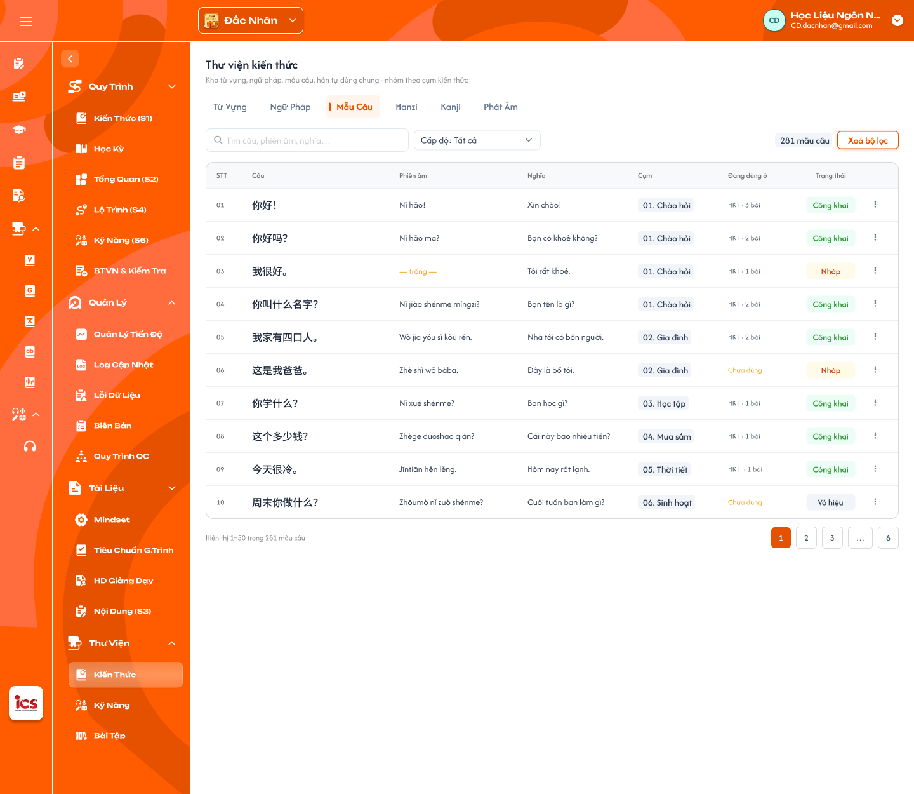

*Tab Mẫu câu: cột Câu, Phiên âm, Nghĩa — nhấn để xem ảnh gốc*

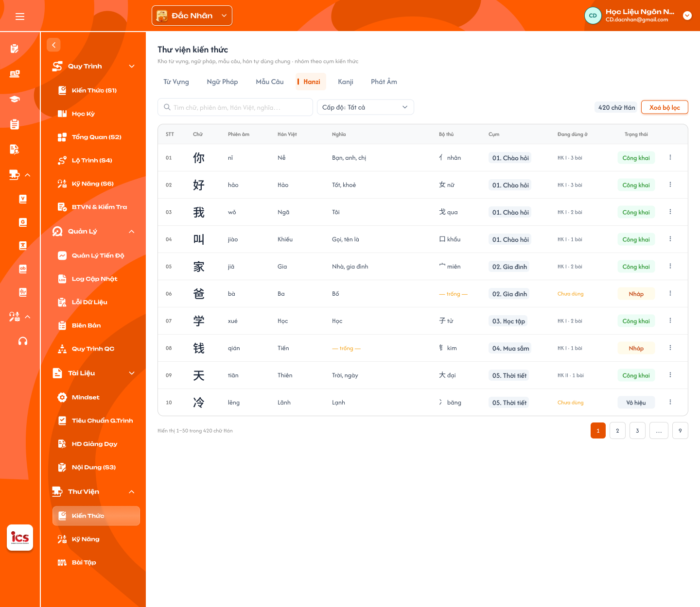

*Tab Hanzi: cột Chữ, Phiên âm, Hán Việt, Nghĩa, Bộ thủ — nhấn để xem ảnh gốc*

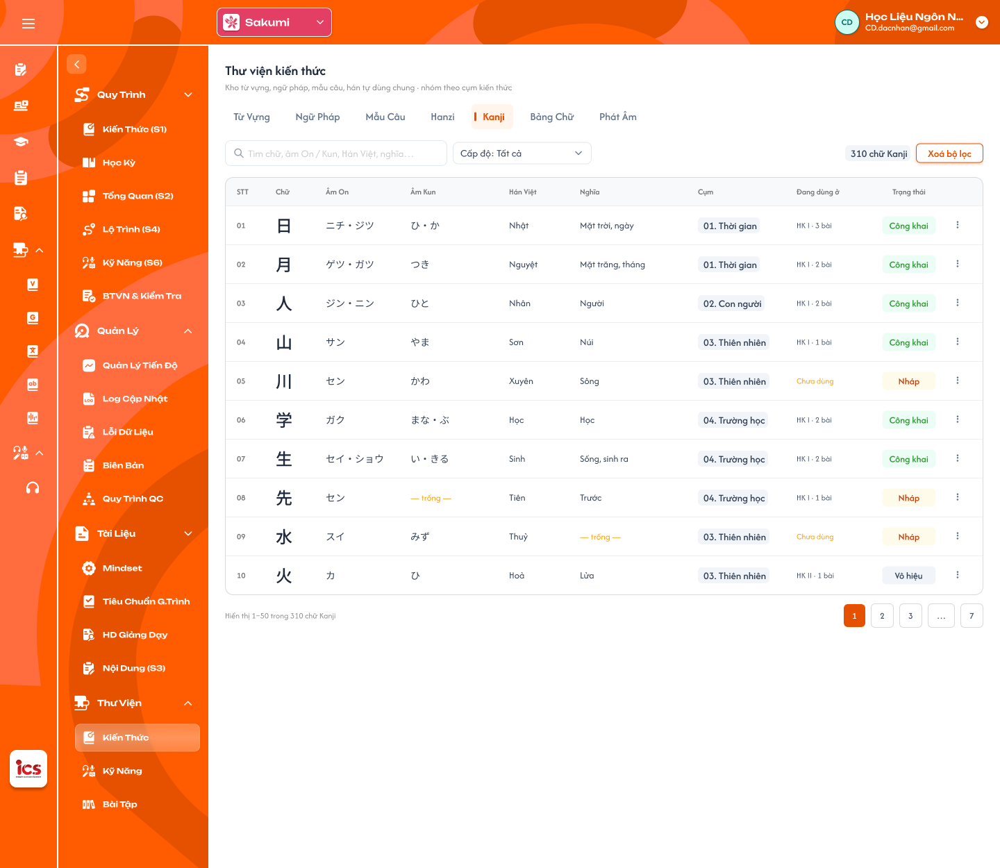

*Tab Kanji (trung tâm Sakumi): cột Chữ, Âm On, Âm Kun, Hán Việt, Nghĩa — nhấn để xem ảnh gốc*


*Tab Phát âm: cột Âm, Loại, Ví dụ, Âm thanh — nhấn để xem ảnh gốc*

**Mô tả:**

- Kho kiến thức dùng chung: từ vựng, ngữ pháp, mẫu câu, chữ, phát âm, bảng chữ. Một mục là một bản ghi thư viện, được S1 của nhiều khoá học tham chiếu ([Kiến thức (S1)](../knowledge-s1/knowledge-s1.md)).

**Điểm cần lưu ý:**

- `A03.01` **Thanh tab**: **Mọi trung tâm** có đủ 6 tab theo thứ tự `Từ Vựng`, `Ngữ Pháp`, `Mẫu Câu`, `Hanzi`, `Kanji`, `Phát Âm`. Trung tâm có hệ chữ riêng có thêm tab `Bảng chữ` đứng trước `Phát Âm` (xem khu vực Bảng chữ). Thứ tự tab giống S1.
- `A03.02` **Cột tab Từ vựng**: `STT`, `Từ`, `Phiên âm`, `Nghĩa`, `Cụm`, `Đang dùng ở`, `Trạng thái`. Tìm theo Từ, Phiên âm, Nghĩa.
- `A03.03` **Cột tab Ngữ pháp**: `STT`, `Cấu trúc` (tên điểm ngữ pháp, dòng phụ là một ví dụ), `Ý nghĩa`, `Cụm`, `Đang dùng ở`, `Trạng thái`. Tìm theo Cấu trúc, Ý nghĩa.
- `A03.04` **Cột tab Mẫu câu**: `STT`, `Câu`, `Phiên âm`, `Nghĩa`, `Cụm`, `Đang dùng ở`, `Trạng thái`. Tìm theo Câu, Phiên âm, Nghĩa.
- `A03.05` **Cột tab Hanzi**: `STT`, `Chữ`, `Phiên âm`, `Hán Việt`, `Nghĩa`, `Bộ thủ` (ký tự + tên, vd `亻 nhân`), `Cụm`, `Đang dùng ở`, `Trạng thái`. Tìm theo Chữ, Phiên âm, Hán Việt, Nghĩa.
- `A03.06` **Cột tab Kanji**: `STT`, `Chữ`, `Âm On`, `Âm Kun`, `Hán Việt`, `Nghĩa`, `Cụm`, `Đang dùng ở`, `Trạng thái`. Tìm theo Chữ, Âm On / Kun, Hán Việt, Nghĩa.
- `A03.07` **Cột tab Phát âm**: `STT`, `Âm`, `Loại` (badge `Thanh mẫu` / `Vận mẫu` / `Âm tiết` theo S1), `Ví dụ` (chữ + phiên âm), `Âm thanh` (nút phát + thời lượng `mm:ss`; chưa có file hiện `— chưa có file —`), `Cụm`, `Đang dùng ở`, `Trạng thái`. Tìm theo Âm, Ví dụ.
- `A03.08` **Badge tổng số**: `N từ vựng`, `N ngữ pháp`, `N mẫu câu`, `N chữ Hán`, `N chữ Kanji`, `N mục phát âm`.

- Thêm và sửa kiến thức làm tại S1 của khoá học; S1 ghi thẳng vào bản ghi thư viện nên Thư viện luôn hiển thị dữ liệu mới nhất.
- Tab không có dữ liệu ở trung tâm (vd Kanji ở Đắc Nhân) vẫn hiện, bảng hiện trạng thái rỗng `Bảng dữ liệu này đang trống`.

### Trang 4: CD-KH-070160, CD-KH-070161, CD-KH-070170, CD-KH-070171 — Thư viện kiến thức — tab Bảng chữ
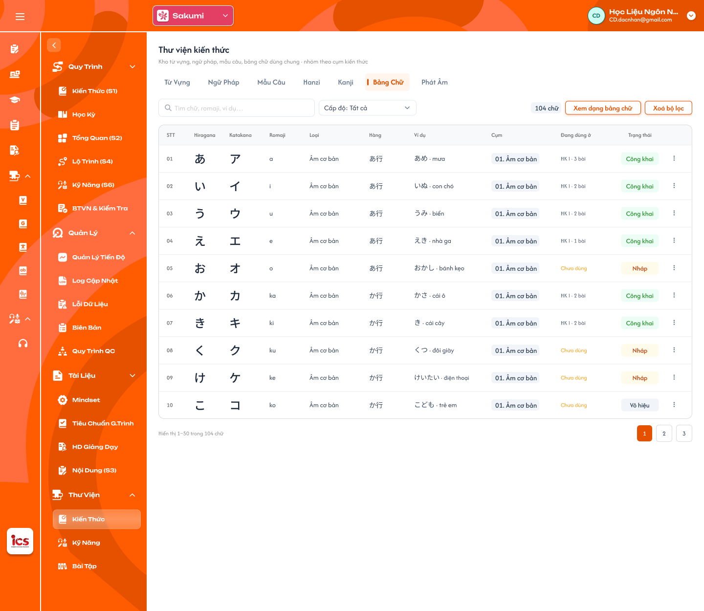

*Bảng chữ tiếng Nhật, dạng danh sách (Figma CD-KH-070160) — nhấn để xem ảnh gốc*


*Bảng chữ tiếng Nhật, dạng bảng chữ 50 âm và panel Chi tiết chữ (Figma CD-KH-070161) — nhấn để xem ảnh gốc*


*Bảng chữ tiếng Hàn, dạng danh sách (Figma CD-KH-070170) — nhấn để xem ảnh gốc*

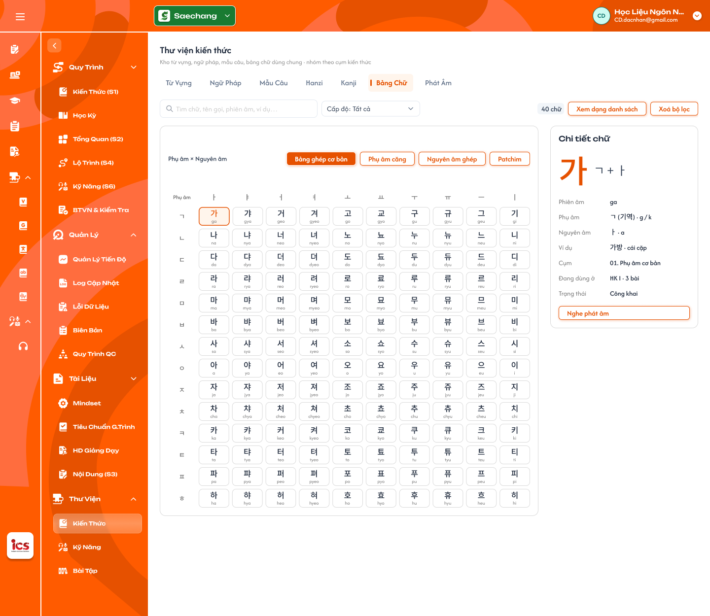

*Bảng chữ tiếng Hàn, dạng bảng ghép phụ âm × nguyên âm và panel Chi tiết chữ (Figma CD-KH-070171) — nhấn để xem ảnh gốc*

**Mô tả:**

- Tab `Bảng chữ` chỉ hiện ở trung tâm có hệ chữ riêng: **Sakumi** (Hiragana / Katakana) và **Saechang** (Hangul); nội dung theo trung tâm đang chọn. Đắc Nhân, Betreux, Creative English, Créatis không có tab này.
- Có hai cách xem: dạng danh sách (bảng như các tab khác) và dạng bảng chữ (lưới + panel Chi tiết chữ). Nút trên thanh công cụ đổi qua lại: `Xem dạng bảng chữ` ↔ `Xem dạng danh sách`. Mặc định dạng danh sách.

**Giải thích field/thành phần:**

- `A04.01` **Danh sách tiếng Nhật**: Một dòng là một cặp chữ: `STT`, `Hiragana`, `Katakana`, `Romaji`, `Loại`, `Hàng`, `Ví dụ` (từ · nghĩa), `Cụm`, `Đang dùng ở`, `Trạng thái`, `⋮`. Tổng 104 mục; badge `N chữ`. Tìm theo Hiragana, Katakana, Romaji, Ví dụ.
- `A04.02` **`Loại` (Nhật)**: `Âm cơ bản` (46), `Âm đục` (20), `Âm bán đục` (5), `Âm ghép` (33). Ánh xạ Bảng con của S1: Bảng Chữ Chính → Âm cơ bản, Tenten → Âm đục, Maru → Âm bán đục, Ảo âm / Ảo âm - hiếm gặp → Âm ghép. Âm ngắt `っ` và trường âm ghi trong Ví dụ / ghi chú, không là mục riêng.
- `A04.03` **`Hàng` (Nhật)**: Hàng trong bảng 50 âm: `あ行`, `か行`, `さ行`, `た行`, `な行`, `は行`, `ま行`, `や行`, `ら行`, `わ行`, `ん`.
- `A04.04` **Lưới tiếng Nhật**: Nút chuyển `Hiragana` / `Katakana`; nhóm `Âm cơ bản` / `Âm đục · bán đục` / `Âm ghép`; lưới 5 cột `a · i · u · e · o` × 11 hàng; mỗi ô gồm chữ + romaji. Ô xám là vị trí không có chữ.
- `A04.05` **Danh sách tiếng Hàn**: Một dòng là một jamo: `STT`, `Chữ`, `Tên gọi` (vd `기역`), `Phiên âm` (Romaja đầu / cuối, vd `g / k`), `Loại`, `Ví dụ` (từ · nghĩa), `Cụm`, `Đang dùng ở`, `Trạng thái`, `⋮`. Tổng 40 mục; badge `N chữ`. Tìm theo Chữ, Tên gọi, Phiên âm, Ví dụ.
- `A04.06` **`Loại` (Hàn)**: `Phụ âm thường` (9), `Phụ âm bật hơi` (5), `Phụ âm căng` (5), `Nguyên âm đơn` (10), `Nguyên âm ghép` (11).
- `A04.07` **Lưới tiếng Hàn**: Nhãn `Phụ âm × Nguyên âm`; nhóm `Bảng ghép cơ bản` / `Phụ âm căng` / `Nguyên âm ghép` / `Patchim`; lưới 14 phụ âm (hàng) × 10 nguyên âm (cột) = 140 âm tiết, mỗi ô gồm âm tiết + romaja.
- `A04.08` **Panel `Chi tiết chữ`**: Bên phải lưới, hiện chữ đang chọn (ô viền cam). Nhật: chữ Hiragana lớn + Katakana nhỏ, Romaji, Loại, Hàng, Ví dụ, Cụm, Đang dùng ở, Trạng thái. Hàn: âm tiết lớn + phân tích `ㄱ + ㅏ`, Phiên âm, Phụ âm (chữ · tên gọi · romaja), Nguyên âm, Ví dụ, Cụm, Đang dùng ở, Trạng thái. Nút `Nghe phát âm` phát audio của chữ (chưa có file thì nút mờ). Mặc định chọn ô đầu tiên.
- `A04.09` **Tìm kiếm, Cấp độ ở dạng lưới**: Vẫn áp dụng: ô không khớp bị mờ, ô khớp giữ nguyên; badge tổng số theo số ô khớp.
- `A04.10` **Menu `⋮`**: Như các tab khác (Đổi trạng thái, Xoá). Ở dạng lưới thao tác qua panel Chi tiết chữ (**UI cần bổ sung**: nút `⋮` trong panel).

**Điểm cần lưu ý:**

- Mỗi ô lưới tiếng Hàn là âm tiết ghép từ dữ liệu jamo, không phải bản ghi riêng; Cụm, Đang dùng ở, Trạng thái ở panel lấy theo **phụ âm** của âm tiết.
- Audio và Thứ tự nét là field ẩn, chỉ xem ở S1 (drawer Chi tiết mục); Thư viện chỉ phát audio.
- Thêm và sửa Bảng chữ làm tại S1; cấu trúc field theo [Kiến thức (S1)](../knowledge-s1/knowledge-s1.md) Phụ lục A.7.
- Dạng lưới chỉ có ở Thư viện; S1 không có nút `Xem dạng bảng chữ`.

### Trang 5: Thư viện kỹ năng
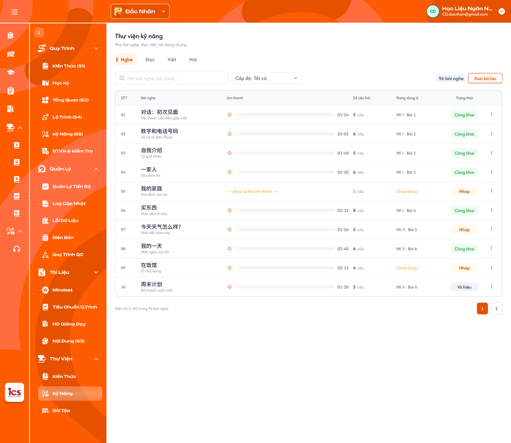

*Thư viện kỹ năng, tab Nghe — nhấn để xem ảnh gốc*

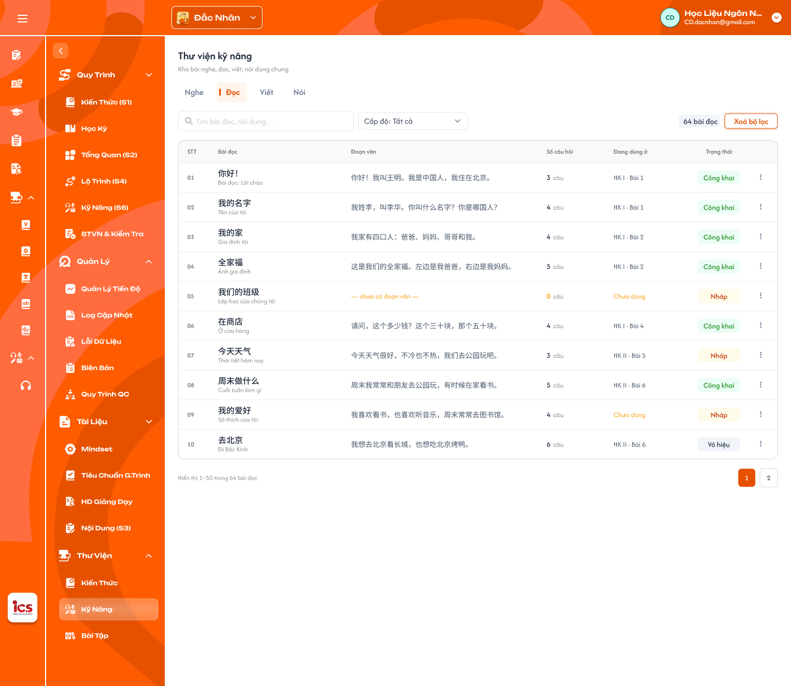

*Thư viện kỹ năng, tab Đọc — nhấn để xem ảnh gốc*

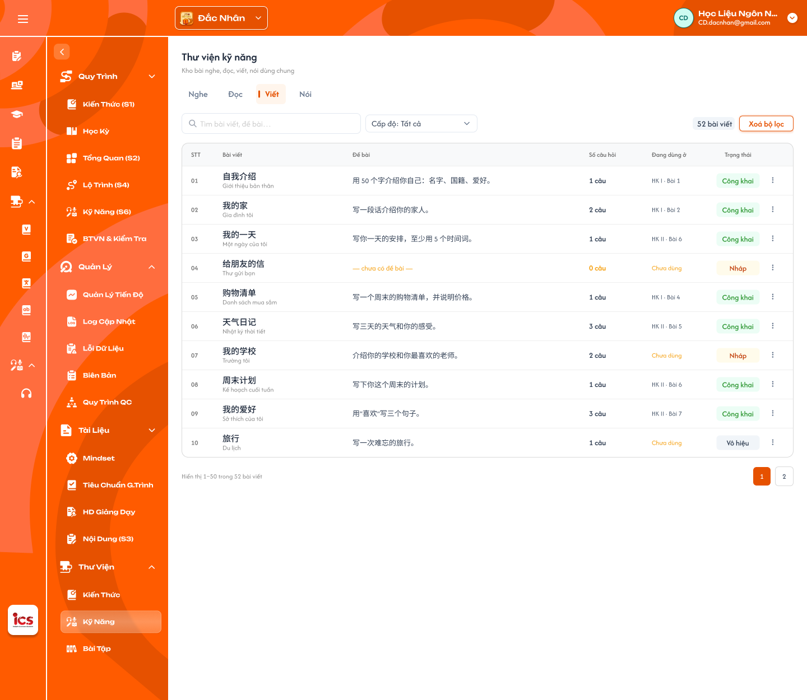

*Thư viện kỹ năng, tab Viết — nhấn để xem ảnh gốc*


*Thư viện kỹ năng, tab Nói — nhấn để xem ảnh gốc*

**Mô tả:**

- Kho bài kỹ năng dùng chung theo 4 tab `Nghe`, `Đọc`, `Viết`, `Nói`. Mỗi bài kỹ năng có nội dung và bộ câu hỏi đi kèm.

**Điểm cần lưu ý:**

- `A05.01` **Cột tab Nghe**: `STT`, `Bài nghe` (tiêu đề + mô tả), `Âm thanh` (nút phát, thanh tiến độ, thời lượng `mm:ss`; chưa có file hiện `— chưa có file âm thanh —`), `Số câu hỏi`, `Đang dùng ở`, `Trạng thái`.
- `A05.02` **Cột tab Đọc**: `STT`, `Bài đọc` (tiêu đề + mô tả), `Đoạn văn` (một dòng, dài thì cắt `…`; chưa có hiện `— chưa có đoạn văn —`), `Số câu hỏi`, `Đang dùng ở`, `Trạng thái`.
- `A05.03` **Cột tab Viết**: `STT`, `Bài viết` (tiêu đề + mô tả), `Đề bài` (một dòng; chưa có hiện `— chưa có đề bài —`), `Số câu hỏi`, `Đang dùng ở`, `Trạng thái`.
- `A05.04` **Cột tab Nói**: `STT`, `Bài nói` (tiêu đề + mô tả), `Đề bài` (như tab Viết), `Số câu hỏi`, `Đang dùng ở`, `Trạng thái`.
- `A05.05` **`Số câu hỏi`**: Số câu của bài kỹ năng; `0 câu` hiển thị màu cam.
- `A05.06` **Phát âm thanh**: Bấm nút phát nghe ngay trong bảng, thanh tiến độ chạy theo; chỉ phát một bài tại một thời điểm.
- `A05.07` **Badge tổng số**: `N bài nghe`, `N bài đọc`, `N bài viết`, `N bài nói`.
- `A05.08` **Tìm kiếm**: Theo tiêu đề, mô tả và nội dung (đoạn văn, đề bài).

- Thêm và sửa bài kỹ năng làm tại Kỹ năng (S6) của khoá học.
- Kỹ năng theo source ICS cũ gồm Nghe, Đọc, Viết, Nói (`SkillLibraryType`).
- Bài kỹ năng không có cột `Cụm`.

### Trang 6: Thư viện bài tập
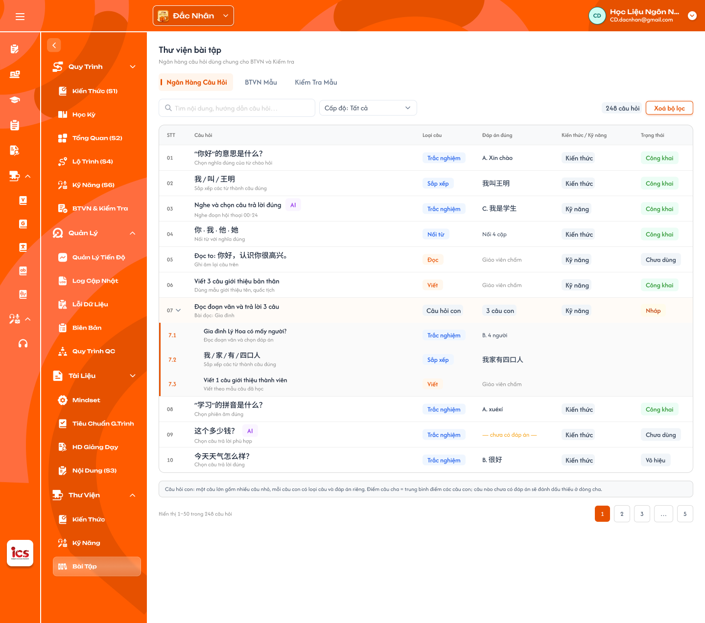

*Thư viện bài tập, tab Ngân hàng câu hỏi (câu 07 đang mở câu hỏi con) — nhấn để xem ảnh gốc*

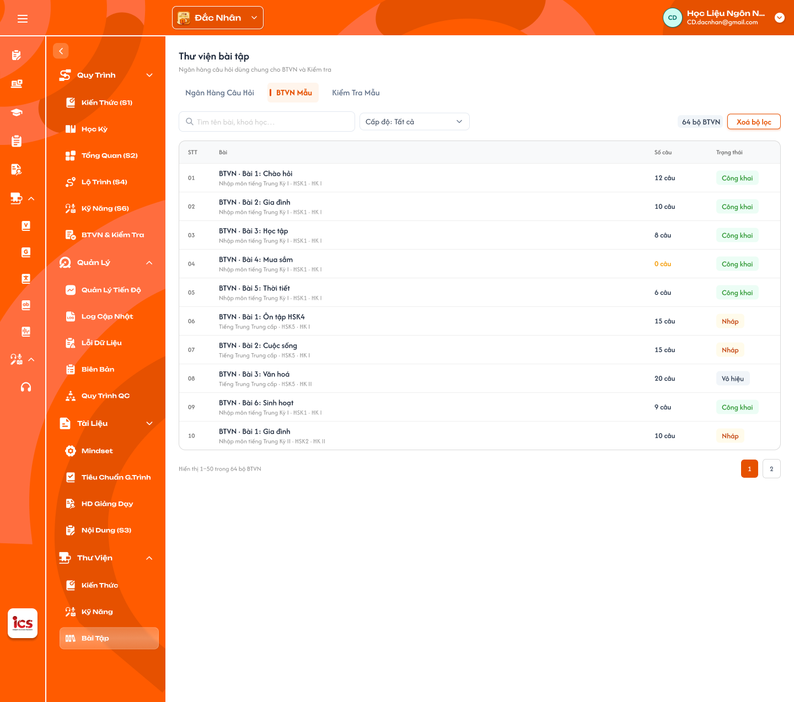

*Thư viện bài tập, tab BTVN Mẫu — nhấn để xem ảnh gốc*

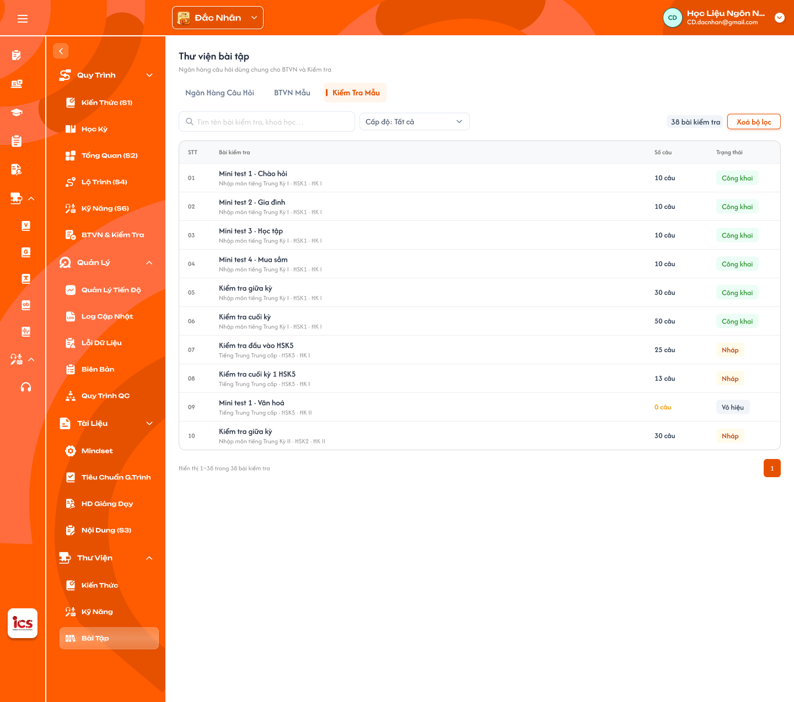

*Thư viện bài tập, tab Kiểm Tra Mẫu — nhấn để xem ảnh gốc*

**Mô tả:**

- Kho câu hỏi dùng chung cho BTVN và Kiểm tra, gồm 3 tab `Ngân Hàng Câu Hỏi`, `BTVN Mẫu`, `Kiểm Tra Mẫu`. Bấm một câu ở Ngân hàng câu hỏi mở **Chi tiết câu hỏi**; câu **Chưa dùng** hoặc mọi khoá học chứa câu đều đang **Nháp** thì sửa được, câu khác chỉ xem. Soạn bộ câu hỏi, thêm câu mới, xoá câu làm tại [Bài tập về nhà và Kiểm tra](../homework-test/homework-test.md).

**Điểm cần lưu ý:**

- `A06.01` **Tab `Ngân Hàng Câu Hỏi`**: Mọi câu hỏi của các bộ câu hỏi BTVN và Kiểm tra thuộc trung tâm. Cột `STT`, `Câu hỏi` (nội dung + hướng dẫn), `Loại câu`, `Đáp án đúng`, `Kiến thức / Kỹ năng`, `Trạng thái`. Badge `N câu hỏi`. Không có cột `Đang dùng ở`.
- `A06.02` **`Loại câu`**: Badge một trong 8 loại: `Trắc nghiệm`, `Sắp xếp`, `Nối từ`, `Nói`, `Đọc`, `Viết`, `Hình ảnh`, `Câu hỏi con`.
- `A06.03` **`Đáp án đúng`**: Theo loại câu; `Đọc`, `Viết`, `Hình ảnh`, `Nói` hiển thị `Giáo viên chấm`; câu chưa có đáp án hiển thị `— chưa có đáp án —` màu cam; `Câu hỏi con` hiển thị `N câu con`.
- `A06.04` **`Kiến thức / Kỹ năng`**: Chỉ ghi nhóm câu thuộc về: `Kiến thức` hoặc `Kỹ năng` (đã chọn khi soạn câu); không ghi loại, cụm hay tên kỹ năng.
- `A06.05` **Câu hỏi con**: Dòng cha có mũi tên mở / thu các câu con đánh số `7.1`, `7.2`…; câu con có loại câu và đáp án riêng, không có cột Kiến thức / Kỹ năng, Trạng thái; chú thích dưới bảng như ảnh.
- `A06.06` **`Trạng thái`**: Câu hỏi không có trạng thái riêng: hiển thị trạng thái **khoá học** chứa câu (`Nháp`, `Công khai`, `Vô hiệu`); câu chưa thuộc bài nào hiển thị badge `Chưa dùng`.
- `A06.07` **Tag `AI`**: Câu do Generate bằng AI tạo có tag `AI` cạnh nội dung; mất khi CD sửa và lưu câu.
- `A06.08` **Bấm dòng câu hỏi**: Mở Chi tiết câu hỏi của câu đó (khu vực bên dưới).
- `A06.09` **Tab `BTVN Mẫu`**: Danh sách bộ câu hỏi BTVN: `STT`, `Bài` (`BTVN · Bài n: tên bài`, dòng phụ `Khoá học · Cấp độ · Kỳ`), `Số câu`, `Trạng thái` (theo khoá học). Badge `N bộ BTVN`.
- `A06.10` **Tab `Kiểm Tra Mẫu`**: Danh sách bài kiểm tra: `STT`, `Bài kiểm tra` (tên bài, dòng phụ `Khoá học · Cấp độ · Kỳ`), `Số câu`, `Trạng thái` (theo khoá học). Badge `N bài kiểm tra`.
- `A06.11` **Bấm dòng tab mẫu**: Mở bộ câu hỏi chỉ đọc (**UI cần bổ sung**).
- `A06.12` **Tìm kiếm**: Ngân hàng câu hỏi: theo nội dung và hướng dẫn câu hỏi; hai tab mẫu: theo tên bài, tên khoá học.

- Thư viện bài tập không có menu `⋮`, không đổi trạng thái, không xoá câu; muốn thêm hoặc xoá câu thì mở bộ câu hỏi ở menu Bài tập về nhà.
- BTVN Mẫu / Kiểm Tra Mẫu không có cột `Tổng điểm` (mọi câu chấm thang 10, điểm bài là trung bình các câu).

### Trang 7: CD-KH-070301, CD-KH-070302, CD-KH-070304, CD-KH-070305, CD-KH-070303 — Thư viện bài tập — Chi tiết câu hỏi
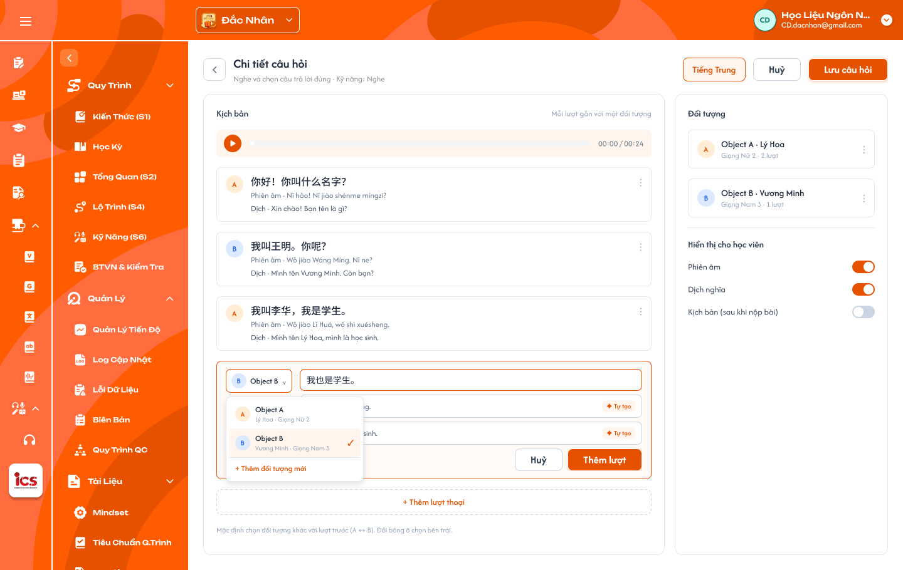

*Câu Nghe: kịch bản theo lượt, đang thêm lượt và mở ô chọn đối tượng (Figma CD-KH-070301) — nhấn để xem ảnh gốc*

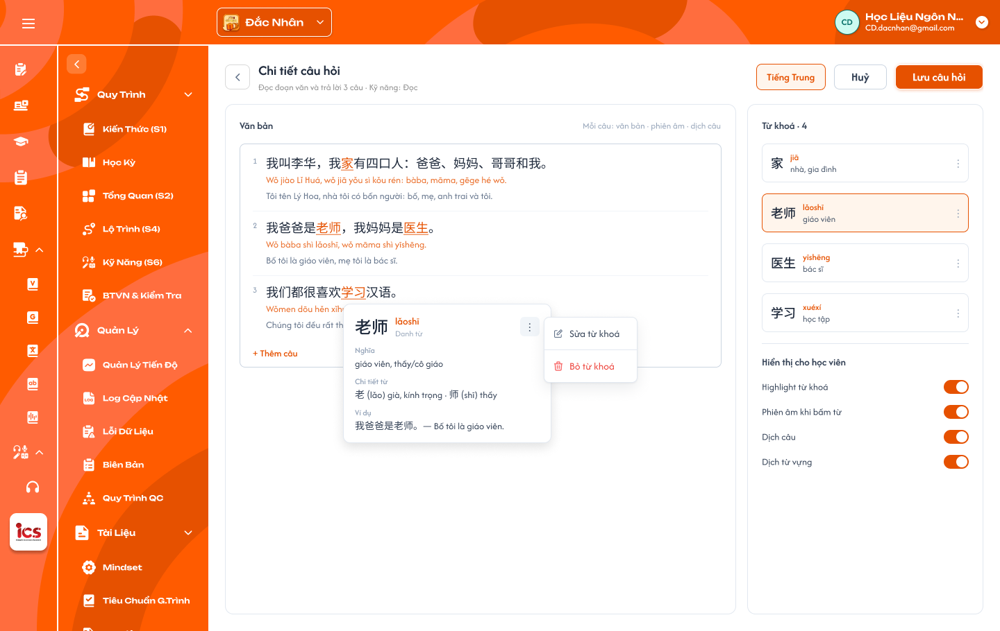

*Câu Đọc: văn bản theo câu, danh sách Từ khoá, popup chi tiết từ khoá và menu ⋮ (Figma CD-KH-070302) — nhấn để xem ảnh gốc*

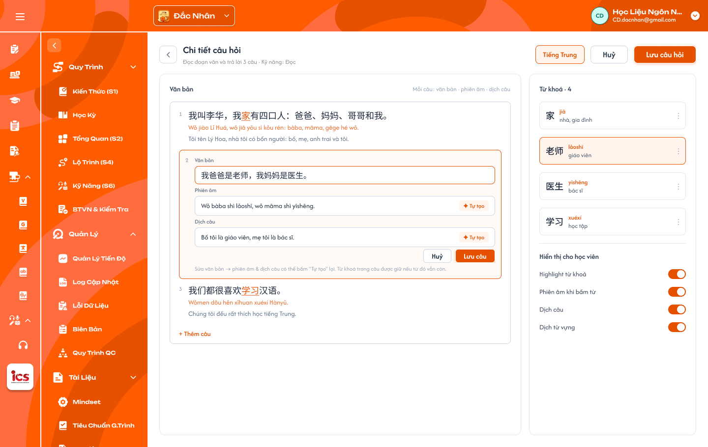

*Câu Đọc: bấm vào câu 2 để sửa văn bản, phiên âm, dịch câu (Figma CD-KH-070304) — nhấn để xem ảnh gốc*

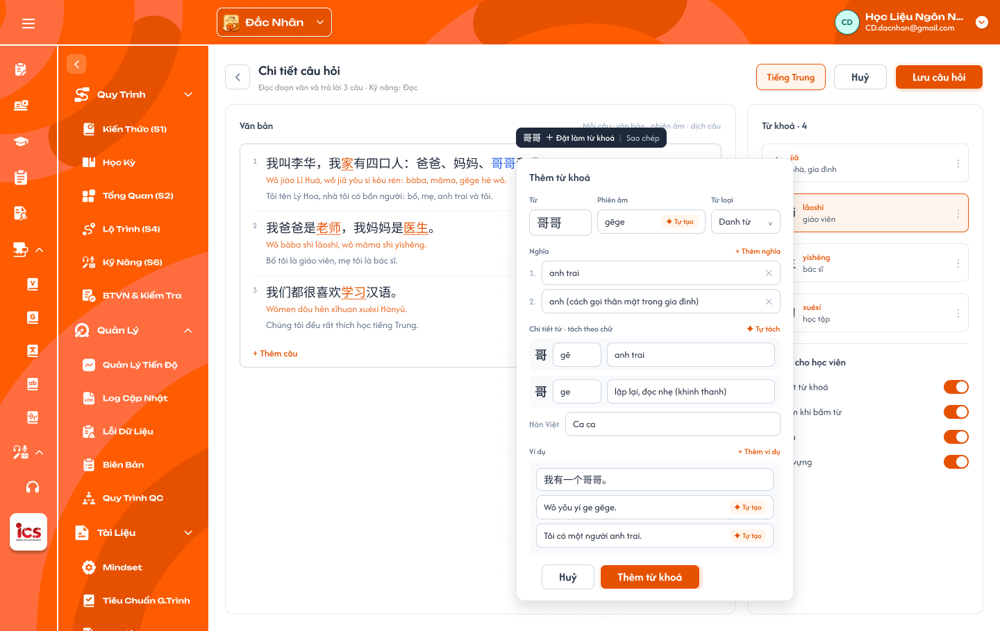

*Câu Đọc: bôi đen `哥哥` → Đặt làm từ khoá → popup Thêm từ khoá (Figma CD-KH-070305) — nhấn để xem ảnh gốc*

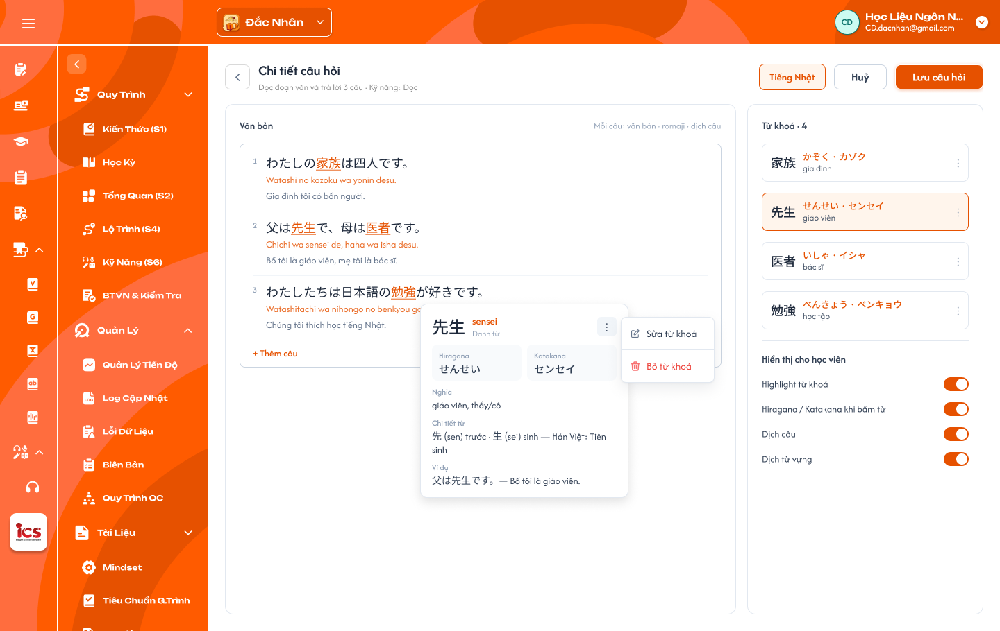

*Câu Đọc tiếng Nhật: romaji, từ khoá có Hiragana / Katakana (Figma CD-KH-070303) — nhấn để xem ảnh gốc*

**Mô tả:**

- Màn mở khi bấm một câu ở tab Ngân hàng câu hỏi. Figma có chi tiết câu **Nghe** và câu **Đọc**; các loại câu khác mở Chi tiết câu hỏi với field theo form soạn câu của [Bài tập về nhà và Kiểm tra](../homework-test/homework-test.md) (**UI cần bổ sung**).
- **Sửa được** khi câu **Chưa dùng** hoặc **mọi** khoá học chứa câu đều đang **Nháp**. Câu thuộc ít nhất một khoá `Công khai` / `Vô hiệu` mở ở **chế độ chỉ xem**: học viên có thể đã làm câu, sửa sẽ làm sai kết quả đã chấm; khoá không quay về `Nháp` và khoá `Vô hiệu` có thể đã từng `Công khai` nên cũng bị khoá. Quy tắc giống [Bài tập về nhà và Kiểm tra](../homework-test/homework-test.md).
- Sửa tại đây là sửa **câu gốc**: mọi bộ BTVN / bài kiểm tra dùng câu này đều thấy nội dung mới.

**Giải thích thành phần — khung chung:**

- `A07.01` **Nút `‹`**: Về Thư viện bài tập, giữ tab, tìm kiếm, Cấp độ và trang đang xem.
- `A07.02` **Tiêu đề**: `Chi tiết câu hỏi`, dòng phụ `<hướng dẫn câu> · Kỹ năng: <tên kỹ năng>` (vd `Nghe và chọn câu trả lời đúng · Kỹ năng: Nghe`).
- `A07.03` **Chip ngôn ngữ**: Ngôn ngữ theo trung tâm (`Tiếng Trung`, `Tiếng Nhật`…), chỉ hiển thị; quyết định cột phiên âm (pinyin / romaji).
- `A07.04` **`Huỷ`**: Bỏ mọi thay đổi chưa lưu, về Thư viện bài tập. Có thay đổi chưa lưu thì hỏi xác nhận trước khi rời.
- `A07.05` **`Lưu câu hỏi`**: Lưu toàn bộ câu; thành công Toast `Thành Công` `Đã lưu câu hỏi.`, câu AI mất tag `AI`.
- `A07.06` **Chế độ chỉ xem**: Ẩn `Lưu câu hỏi`, `+ Thêm câu`, `+ Thêm lượt thoại`, `+ Thêm đối tượng mới`, menu `⋮` của câu / lượt / từ khoá / đối tượng, bôi đen đặt từ khoá; khoá các nút bật/tắt; `Huỷ` đổi thành `Đóng`. Đầu màn có banner `Câu thuộc khoá Công khai / Vô hiệu, chỉ xem.`. **UI cần bổ sung.**

**Giải thích thành phần — câu Nghe (`070301`):**

- `A07.07` **`Kịch bản`**: Thanh audio (nút phát, tiến độ, `mm:ss / mm:ss`) và danh sách **lượt thoại**; chú thích `Mỗi lượt gắn với một đối tượng`.
- `A07.08` **Audio theo kịch bản**: Thêm / sửa / xoá lượt thoại hoặc đổi giọng đối tượng làm audio cũ lệch kịch bản: thanh audio hiện nhãn `Audio cần tạo lại`; CD bấm `Tạo lại audio` (hệ thống đọc từng lượt bằng TTS theo giọng của đối tượng, ghép theo thứ tự lượt) hoặc tải file mới. Lưu câu khi audio chưa tạo lại thì hỏi xác nhận. **UI cần bổ sung.**
- `A07.09` **Lựa chọn / đáp án**: Phần câu hỏi của bài nghe (lựa chọn, đáp án đúng) theo form soạn câu của BTVN; Figma chưa vẽ (**UI cần bổ sung**).
- `A07.10` **Lượt thoại**: Avatar chữ cái đối tượng (`A`, `B`), câu, `Phiên âm · …`, `Dịch · …`, menu `⋮` (Sửa, Xoá lượt).
- `A07.11` **Thêm lượt**: `+ Thêm lượt thoại` mở khung nhập: ô chọn đối tượng, câu, phiên âm và dịch (mỗi ô có `✦ Tự tạo`), `Huỷ` / `Thêm lượt`. Mặc định chọn đối tượng khác lượt trước (A ↔ B); đổi bằng ô chọn bên trái.
- `A07.12` **Ô chọn đối tượng**: Danh sách đối tượng (tên · giọng), dấu `✓` ở đối tượng đang chọn, `+ Thêm đối tượng mới`.
- `A07.13` **Panel `Đối tượng`**: Mỗi đối tượng: `Object A · Lý Hoa`, `Giọng Nữ 2 · 2 lượt`, menu `⋮`.
- `A07.14` **`Hiển thị cho học viên`**: Bật/tắt `Phiên âm`, `Dịch nghĩa`, `Kịch bản (sau khi nộp bài)`.

**Giải thích thành phần — câu Đọc (`070302`, `070304`, `070305`, `070303`):**

- `A07.15` **`Văn bản`**: Danh sách câu đánh số; mỗi câu gồm văn bản, phiên âm (tiếng Nhật: romaji), dịch câu. Từ khoá trong câu được gạch chân màu cam. `+ Thêm câu` ở cuối.
- `A07.16` **Sửa câu**: Bấm vào câu mở khung sửa: `Văn bản`, `Phiên âm`, `Dịch câu` (hai ô sau có `✦ Tự tạo`), `Huỷ` / `Lưu câu`. Sửa văn bản thì bấm `Tự tạo` để sinh lại phiên âm, dịch; từ khoá trong câu được giữ nếu từ đó vẫn còn.
- `A07.17` **`Từ khoá · N`**: Danh sách từ khoá: chữ, phiên âm (tiếng Nhật: `Hiragana · Katakana`), nghĩa, menu `⋮`. Từ khoá đang chọn viền cam.
- `A07.18` **Popup chi tiết từ khoá**: Bấm từ khoá (trong văn bản hoặc danh sách): chữ, phiên âm, từ loại, `Nghĩa`, `Chi tiết từ`, `Ví dụ`; tiếng Nhật thêm ô `Hiragana`, `Katakana`. Menu `⋮`: `Sửa từ khoá`, `Bỏ từ khoá`.
- `A07.19` **Đặt làm từ khoá**: Bôi đen một từ trong văn bản → thanh nổi `<từ> ＋ Đặt làm từ khoá; Sao chép` → popup `Thêm từ khoá`.
- `A07.20` **Popup `Thêm từ khoá`**: `Từ` (điền sẵn từ đã bôi đen), `Phiên âm` (`✦ Tự tạo`), `Từ loại` (danh sách Từ loại của S1), `Nghĩa` (nhiều nghĩa, `+ Thêm nghĩa`, `✕` xoá), `Chi tiết từ · tách theo chữ` (mỗi chữ: phiên âm + nghĩa, `✦ Tự tách`), `Hán Việt`, `Ví dụ` (câu, phiên âm, dịch; `+ Thêm ví dụ`), `Huỷ` / `Thêm từ khoá`.
- `A07.21` **`Sửa từ khoá`**: Dùng chung popup trên: các ô điền sẵn dữ liệu của từ, thêm `Xoá từ khoá` bên trái, nút chính đổi thành `Lưu`.
- `A07.22` **`Bỏ từ khoá`**: Bỏ đánh dấu từ khoá khỏi câu hỏi, văn bản giữ nguyên.
- `A07.23` **Chọn từ có sẵn**: Trên popup `Thêm từ khoá` có ô tìm từ trong Kiến thức (S1) của khoá học (Từ vựng, Hanzi / Kanji); chọn từ thì tự điền Phiên âm, Từ loại, Nghĩa, Chi tiết từ, Hán Việt, Ví dụ, CD sửa lại được. Không tìm thấy thì nhập mới như Figma. **UI cần bổ sung.**
- `A07.24` **Câu con / đáp án**: Các câu hỏi của bài đọc (vd `trả lời 3 câu`: câu con, loại câu, đáp án) theo form soạn câu của BTVN; Figma chưa vẽ (**UI cần bổ sung**).
- `A07.25` **`Hiển thị cho học viên`**: Bật/tắt `Highlight từ khoá`, `Phiên âm khi bấm từ` (tiếng Nhật: `Hiragana / Katakana khi bấm từ`), `Dịch câu`, `Dịch từ vựng`.

**Điểm cần lưu ý:**

- Backend kiểm tra lại điều kiện sửa khi nhận request lưu: câu đang dùng ở khoá `Công khai` / `Vô hiệu` bị từ chối, Toast `Cảnh Báo` `Câu thuộc khoá Công khai / Vô hiệu, không sửa được.`
- Từ khoá chỉ thuộc câu hỏi, không tự tạo mục Từ vựng trong Thư viện kiến thức; chọn từ có sẵn ở S1 chỉ để điền sẵn dữ liệu.
- `Tự tạo` / `Tự tách` chỉ điền gợi ý vào ô, CD sửa lại được; chưa lưu cho đến khi bấm `Lưu câu hỏi`.
- Figma đang ở trạng thái `Chờ review`.

### Trang 8: Toast phản hồi CRUD
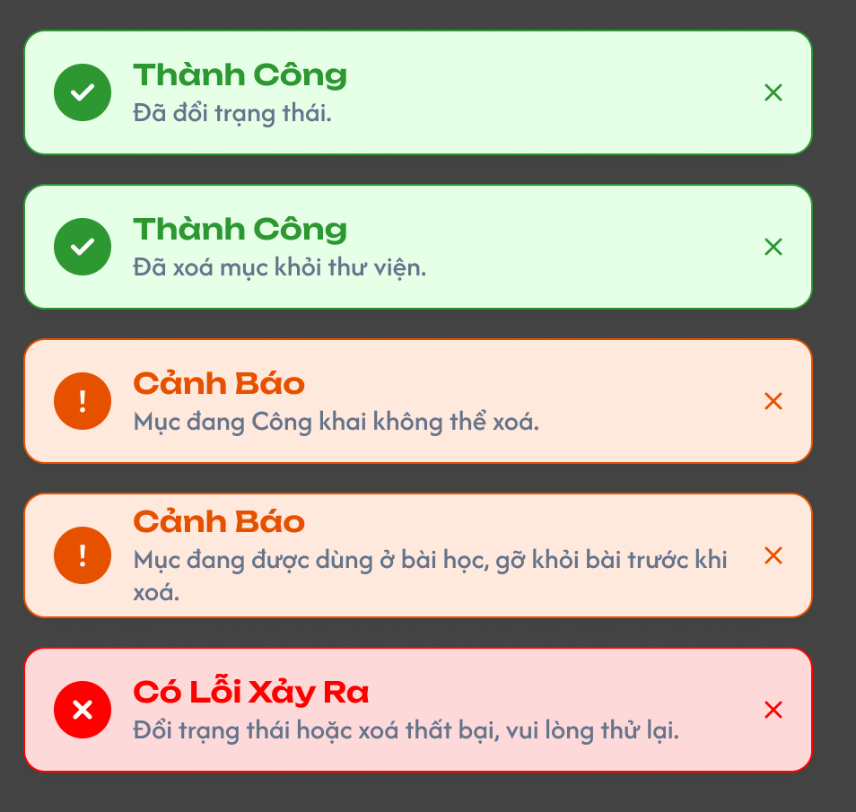

*Toast Thành Công, Cảnh Báo và Có Lỗi Xảy Ra của Thư viện — nhấn để xem ảnh gốc*

**Mô tả:**

- Phản hồi sau khi đổi trạng thái hoặc xoá mục kiến thức, kỹ năng, và sau khi lưu câu hỏi ở Chi tiết câu hỏi.

**Điểm cần lưu ý:**

- `A08.01` **Thành công**: Tiêu đề cố định: `Thành Công`; Khi sử dụng: `Đã đổi trạng thái.`; `Đã xoá mục khỏi thư viện.`; `Đã lưu câu hỏi.`
- `A08.02` **Cảnh báo**: Tiêu đề cố định: `Cảnh Báo`; Khi sử dụng: `Mục đang Công khai không thể xoá.`; `Mục đang được dùng ở bài học, gỡ khỏi bài trước khi xoá.`; `Câu thuộc khoá Công khai / Vô hiệu, không sửa được.` (khi request bị từ chối)
- `A08.03` **Lỗi**: Tiêu đề cố định: `Có Lỗi Xảy Ra`; Khi sử dụng: `Đổi trạng thái hoặc xoá thất bại, vui lòng thử lại.`; `Lưu câu hỏi thất bại, vui lòng thử lại.`

- Mỗi thao tác một Toast; tìm kiếm, lọc, phát âm thanh, đổi dạng xem, `Huỷ` không có Toast CRUD.

---

## 2. Yêu cầu

### 2.1. Flow chính

**Flow 1 / REQ01 / REQ02: Xem, tìm kiếm và lọc Thư viện**

```text
CD chọn Thư Viện → Kiến Thức / Kỹ Năng / Bài Tập
      → Hệ thống tải dữ liệu thư viện của trung tâm đang chọn, tab đầu tiên, trang 1
      → CD đổi tab / nhập tìm kiếm / chọn Cấp độ → bảng và badge tổng số cập nhật, về trang 1
      → Xoá bộ lọc: tìm kiếm trống, Cấp độ Tất cả
```

**Flow 2 / REQ04: Đổi trạng thái mục kiến thức, kỹ năng**

```text
CD bấm ⋮ → Đổi trạng thái → menu con chỉ gồm trạng thái được phép → chọn
      → Backend kiểm tra chuyển trạng thái hợp lệ
      → Hợp lệ: lưu, badge cập nhật, Toast "Đã đổi trạng thái."
      → Không hợp lệ: từ chối, trạng thái giữ nguyên
```

**Flow 3 / REQ05: Xoá mục kiến thức, kỹ năng**

```text
CD bấm ⋮ → Xoá (chỉ bấm được với mục Nháp / Vô hiệu và Chưa dùng; mục khác Xoá mờ + tooltip)
      → Popup "Xoá mục khỏi thư viện?" → Huỷ: đóng, giữ nguyên
      → Xoá: backend kiểm tra lại trạng thái và việc đang dùng → xoá mềm → Toast "Đã xoá mục khỏi thư viện."
      → Backend từ chối: Toast "Cảnh Báo" theo lý do, mục giữ nguyên
```

**Flow 4 / REQ07: Xem Bảng chữ dạng lưới**

```text
CD mở tab Bảng chữ (Sakumi / Saechang) → bấm "Xem dạng bảng chữ"
      → Lưới theo hệ chữ của trung tâm, nhóm đầu tiên, ô đầu tiên được chọn, panel Chi tiết chữ
      → CD đổi bộ chữ / nhóm, bấm ô → panel cập nhật; bấm "Nghe phát âm" → phát audio của chữ
      → Tìm kiếm / Cấp độ: ô không khớp mờ
      → "Xem dạng danh sách" → về bảng, giữ tìm kiếm và Cấp độ
```

**Flow 5 / REQ10: Xem và sửa câu hỏi ở Thư viện bài tập**

```text
CD mở Thư Viện → Bài Tập → tab Ngân Hàng Câu Hỏi → bấm một câu
      → Chi tiết câu hỏi theo loại câu (Nghe / Đọc theo Figma; loại khác theo form soạn câu của BTVN)
      → Câu Chưa dùng hoặc mọi khoá chứa câu đều Nháp: sửa câu, lượt thoại, đối tượng, từ khoá, nút bật/tắt → Lưu câu hỏi
            → Sửa kịch bản / giọng câu Nghe: Tạo lại audio (TTS theo giọng) hoặc tải file mới
            → Backend kiểm tra lại điều kiện sửa → lưu câu gốc → Toast "Đã lưu câu hỏi."
      → Câu thuộc khoá Công khai / Vô hiệu: chế độ chỉ xem (banner, ẩn nút sửa) → Đóng
      → Huỷ / ‹: về Thư viện bài tập (có thay đổi chưa lưu thì hỏi xác nhận)
```

### 2.2. Ngoại lệ

- **EX01:** Request chuyển trạng thái không hợp lệ (`Công khai` → `Nháp`, `Vô hiệu` → `Nháp`) → backend từ chối; trạng thái giữ nguyên.
- **EX02:** Request xoá mục `Công khai` → backend từ chối; Toast `Cảnh Báo` `Mục đang Công khai không thể xoá.`
- **EX03:** Request xoá mục đang dùng ở bài học → backend từ chối; Toast `Cảnh Báo` `Mục đang được dùng ở bài học, gỡ khỏi bài trước khi xoá.`
- **EX04:** Request xoá / đổi trạng thái câu hỏi từ Thư viện bài tập → backend từ chối.
- **EX05:** Lỗi tải dữ liệu → vùng bảng báo lỗi và `Thử lại`; không hiển thị bảng rỗng giả.
- **EX06:** Truy cập tab `Bảng chữ` ở trung tâm không có hệ chữ riêng (qua URL / API) → từ chối, về tab đầu tiên.
- **EX07:** Chữ chưa có audio → nút `Nghe phát âm` mờ, không phát; không Toast.
- **EX08:** Request lưu câu hỏi thuộc khoá `Công khai` / `Vô hiệu` → backend từ chối; Toast `Cảnh Báo` `Câu thuộc khoá Công khai / Vô hiệu, không sửa được.`; câu giữ nguyên.

### 2.3. Yêu cầu khác

| Mã | Tên yêu cầu | Mô tả |
|---|---|---|
| REQ01 | Phạm vi dữ liệu | Thư viện chỉ hiển thị dữ liệu của trung tâm CD đang chọn ở header; đổi trung tâm thì tải lại theo trung tâm mới. |
| REQ02 | Tìm kiếm và lọc | Chỉ có ô tìm kiếm (theo cột chính của tab) và lọc `Cấp độ` (một lựa chọn, mặc định `Tất cả`), kết hợp với nhau; `Xoá bộ lọc` đưa về mặc định; phân trang 50 dòng/trang; badge tổng số theo kết quả; ô trống hiện `— trống —` / `— chưa có … —` màu cam. |
| REQ03 | Đang dùng ở | Hiển thị kỳ và bài đang dùng mục: một bài hiện tên bài, nhiều bài hiện số bài; chưa gắn bài nào hiển thị `Chưa dùng`. |
| REQ04 | Trạng thái mục kiến thức, kỹ năng | `Nháp` → `Công khai` / `Vô hiệu`; `Công khai` → `Vô hiệu`; `Vô hiệu` → `Công khai`; không về `Nháp`; menu con chỉ hiện trạng thái được phép. Mục `Vô hiệu` không được thêm mới vào bài; bài đã gắn trước đó vẫn dùng. |
| REQ05 | Xoá | Chỉ xoá mềm mục `Nháp` / `Vô hiệu` chưa dùng ở bài nào, qua popup xác nhận; mục `Công khai` hoặc đang dùng thì `Xoá` mờ kèm tooltip, backend từ chối request. |
| REQ06 | Thư viện kiến thức | Mọi trung tâm có đủ 6 tab Từ vựng, Ngữ pháp, Mẫu câu, Hanzi, Kanji, Phát âm (cộng Bảng chữ theo REQ07); cột theo bảng Giải thích thành phần kèm `Cụm`, `Đang dùng ở`, `Trạng thái`; Loại của Phát âm theo S1; thêm / sửa tại S1. |
| REQ07 | Bảng chữ | Tab chỉ ở trung tâm có hệ chữ riêng (Sakumi: Hiragana / Katakana, 104 mục, 1 dòng = cặp chữ; Saechang: Hangul, 40 jamo); hai dạng xem danh sách và lưới; lưới có panel Chi tiết chữ và `Nghe phát âm`; tìm kiếm / Cấp độ áp dụng cả hai dạng; dạng lưới chỉ có ở Thư viện. |
| REQ08 | Thư viện kỹ năng | Tab Nghe, Đọc, Viết, Nói; cột nội dung (âm thanh, đoạn văn, đề bài), số câu hỏi, đang dùng ở, trạng thái; phát âm thanh trong bảng, một bài tại một thời điểm; thêm / sửa tại S6. |
| REQ09 | Thư viện bài tập | 3 tab Ngân hàng câu hỏi, BTVN Mẫu, Kiểm Tra Mẫu; không đổi trạng thái, không xoá câu; Ngân hàng câu hỏi không có cột `Đang dùng ở`, cột `Kiến thức / Kỹ năng` chỉ ghi `Kiến thức` hoặc `Kỹ năng`; trạng thái câu hỏi lấy theo khoá học chứa câu (`Chưa dùng` khi chưa thuộc bài nào); tag `AI` cho câu AI chưa được sửa; hai tab mẫu không có cột Tổng điểm. |
| REQ10 | Chi tiết câu hỏi | Bấm câu ở Ngân hàng câu hỏi mở Chi tiết câu hỏi; sửa được khi câu `Chưa dùng` hoặc mọi khoá học chứa câu đều đang `Nháp`, khác thì chỉ xem (học viên có thể đã làm câu) (banner, ẩn nút sửa, `Đóng`); sửa là sửa câu gốc, mọi bộ BTVN / bài kiểm tra dùng câu thấy nội dung mới; câu Nghe có kịch bản theo lượt và đối tượng, câu Đọc có văn bản theo câu và từ khoá (chọn được từ có sẵn ở S1); sửa kịch bản / giọng câu Nghe thì tạo lại audio; backend kiểm tra lại điều kiện sửa. |

### 2.4. Ràng buộc

#### Quyền

| Role | Xem Thư viện | Đổi trạng thái kiến thức / kỹ năng | Xoá kiến thức / kỹ năng chưa Công khai | Sửa câu hỏi (Chưa dùng / mọi khoá Nháp) | Xoá câu hỏi tại Thư viện bài tập |
|---|:---:|:---:|:---:|:---:|:---:|
| CD | ✅ | ✅ | ✅ | ✅ | ❌ |
| Các role khác | ❌ | ❌ | ❌ | ❌ | ❌ |

#### Ràng buộc khác

**Phạm vi dữ liệu**

- Dữ liệu theo trung tâm CD đang chọn; không trả dữ liệu trung tâm khác.
- Mọi request đổi trạng thái, xoá, lưu câu hỏi được backend kiểm tra quyền, trạng thái và việc đang dùng; không dựa vào việc ẩn hay làm mờ nút.

---

---

## 3. Testcase

### Feature: [CD] Thư viện

| Tên testcase | Priority | Scenario | Role | Pre-condition | Given/When/Then | Expected Result |
|---|---|---|---|---|---|---|
| Case 1: Mở Thư viện | High · Smoke | Flow 1 / REQ01 | CD | Trung tâm có dữ liệu kiến thức, kỹ năng, câu hỏi | **Given** CD bấm `Thư Viện` → `Kiến Thức`<br>**When** màn tải xong<br>**Then** hiển thị tab đầu tiên, bảng trang 1 và badge tổng số | - Chỉ dữ liệu trung tâm đang chọn<br>- Lọc Cấp độ mặc định `Tất cả` |
| Case 2: Tìm kiếm kết hợp Cấp độ | High | Flow 1 / REQ02 | CD | Có mục cấp độ HSK1 và HSK2 cùng chứa chữ `你` | **Given** chọn Cấp độ `HSK1`<br>**When** nhập `你`<br>**Then** chỉ còn mục HSK1 chứa `你` | - Badge tổng số cập nhật<br>- Về trang 1 |
| Case 3: Xoá bộ lọc | Medium | REQ02 | CD | Đang tìm `你`, Cấp độ HSK1 | **Given** bấm `Xoá bộ lọc`<br>**When** bảng tải lại<br>**Then** ô tìm kiếm trống, Cấp độ `Tất cả` | - Về trang 1 |
| Case 4: Đổi trung tâm | High | REQ01 | CD | CD phụ trách Đắc Nhân và Sakumi | **Given** đổi trung tâm ở header<br>**When** Thư viện tải lại<br>**Then** dữ liệu theo trung tâm mới; thanh tab Kiến thức theo REQ06 | - Không còn dữ liệu trung tâm cũ |
| Case 5: Cột Đang dùng ở | Medium | REQ03 | CD | Mục dùng ở 1 bài, mục dùng ở 3 bài, mục chưa dùng | **Given** xem bảng<br>**When** render cột Đang dùng ở<br>**Then** lần lượt `HK I · Bài 1`, `HK I · 3 bài`, `Chưa dùng` màu cam | - Đúng kỳ của bài |
| Case 5a: Ô trống | Medium | REQ02 | CD | Từ vựng thiếu Nghĩa; bài nghe chưa có file | **Given** xem bảng<br>**When** render<br>**Then** ô Nghĩa hiện `— trống —`; ô Âm thanh hiện `— chưa có file âm thanh —` | - Màu cam, không có nút phát |
| Case 6: Đổi Nháp sang Công khai | High · Smoke | Flow 2 / REQ04 | CD | Mục `Nháp` | **Given** mở menu `⋮` → `Đổi trạng thái`<br>**When** chọn `Công khai`<br>**Then** badge chuyển `Công khai` | - Một Toast `Thành Công` `Đã đổi trạng thái.` |
| Case 7: Menu con theo trạng thái | High | EX01 / REQ04 | CD | Mục `Công khai`, mục `Vô hiệu` | **Given** mở `Đổi trạng thái` của từng mục<br>**When** xem lựa chọn hoặc gửi request chuyển `Nháp`<br>**Then** Công khai chỉ có `Vô hiệu`; Vô hiệu chỉ có `Công khai`; backend từ chối `Nháp` | - Trạng thái giữ nguyên |
| Case 8: Không xoá mục Công khai | High | EX02 / REQ05 | CD | Mục `Công khai` | **Given** mở menu `⋮`<br>**When** hover `Xoá` hoặc gửi request xoá<br>**Then** `Xoá` mờ, tooltip đúng nội dung; backend từ chối | - Toast `Cảnh Báo` `Mục đang Công khai không thể xoá.` khi request bị từ chối |
| Case 9: Xoá mục Nháp chưa dùng | High · Smoke | Flow 3 / REQ05 | CD | Mục `Nháp`, `Chưa dùng` | **Given** chọn `Xoá`<br>**When** bấm `Xoá` ở popup<br>**Then** mục biến mất khỏi bảng | - Toast `Thành Công` `Đã xoá mục khỏi thư viện.`<br>- Không tìm thấy ở S1 / S6 / popup thư viện |
| Case 10: Không xoá mục đang dùng | Medium | EX03 / REQ05 | CD | Mục `Vô hiệu`, đang dùng ở 2 bài | **Given** mở menu `⋮`<br>**When** hover `Xoá`<br>**Then** `Xoá` mờ, tooltip gỡ khỏi bài trước | - Request xoá trực tiếp bị từ chối, Toast `Cảnh Báo` |
| Case 11: Huỷ xoá | Medium | Flow 3 | CD | Popup xoá đang mở | **Given** bấm `Huỷ`<br>**When** popup đóng<br>**Then** mục giữ nguyên | - Không Toast |
| Case 12: Đủ tab ở mọi trung tâm | High | REQ06 | CD | Trung tâm Đắc Nhân, Sakumi, Saechang, Creative English | **Given** mở Thư viện kiến thức ở từng trung tâm<br>**When** xem thanh tab<br>**Then** cả 4 trung tâm đều có Từ Vựng, Ngữ Pháp, Mẫu Câu, Hanzi, Kanji, Phát Âm | - Sakumi, Saechang có thêm `Bảng chữ`; Đắc Nhân, Creative English không có |
| Case 13: Cột theo tab | Medium | REQ06 | CD | Trung tâm Đắc Nhân có dữ liệu đủ 5 tab | **Given** lần lượt mở Ngữ Pháp, Hanzi, Phát Âm<br>**When** render bảng<br>**Then** cột đúng bảng Giải thích thành phần | - Hanzi có Bộ thủ; Phát âm có Loại, Âm thanh |
| Case 14: Sửa ở S1 hiển thị ở Thư viện | High | REQ06 | CD | Từ `你好` dùng ở khoá HSK1 | **Given** sửa Nghĩa của `你好` ở S1<br>**When** mở Thư viện kiến thức<br>**Then** dòng `你好` hiện Nghĩa mới | - Thư viện không có form sửa |
| Case 14a: Tab rỗng | Low | REQ06 | CD | Đắc Nhân chưa có mục Kanji | **Given** mở tab Kanji<br>**When** bảng tải xong<br>**Then** hiện `Bảng dữ liệu này đang trống`, badge `0 chữ Kanji` | - Tab vẫn bấm được |
| Case 15: Tab Bảng chữ theo trung tâm | High | REQ07 | CD | CD phụ trách Sakumi, Saechang, Đắc Nhân | **Given** mở Thư viện kiến thức ở từng trung tâm<br>**When** xem thanh tab<br>**Then** Sakumi và Saechang có `Bảng chữ` trước `Phát Âm`; Đắc Nhân không có | - Nội dung Bảng chữ đúng hệ chữ của trung tâm |
| Case 16: Danh sách Bảng chữ Nhật | High · Smoke | Flow 1 / REQ07 | CD | Sakumi có 104 mục | **Given** mở tab `Bảng chữ`<br>**When** bảng tải xong<br>**Then** mỗi dòng có Hiragana, Katakana, Romaji, Loại, Hàng, Ví dụ | - Badge `104 chữ`<br>- Tìm `ka` ra dòng `か カ` |
| Case 17: Chuyển dạng bảng chữ (Nhật) | High | Flow 4 / REQ07 | CD | Đang ở dạng danh sách | **Given** bấm `Xem dạng bảng chữ`<br>**When** lưới hiện<br>**Then** lưới 5 × 11 của Hiragana, nhóm Âm cơ bản, ô đầu `あ` được chọn, panel Chi tiết chữ hiện đủ field | - Nút đổi thành `Xem dạng danh sách`<br>- Bấm `Katakana` thì lưới đổi sang katakana cùng romaji |
| Case 18: Chọn ô và nghe phát âm | Medium | Flow 4 / REQ07 | CD | Dạng lưới, chữ `か` có audio, chữ `ぬ` chưa có | **Given** bấm ô `か` → `Nghe phát âm`<br>**When** audio chạy; bấm ô `ぬ`<br>**Then** phát audio của `か`; ở `ぬ` nút `Nghe phát âm` mờ | - Panel đổi theo ô đang chọn |
| Case 19: Ô trống trong lưới | Low | REQ07 | CD | Dạng lưới Hiragana | **Given** xem hàng `や行`<br>**When** render<br>**Then** cột `i`, `e` là ô xám không bấm được | - Không có panel cho ô xám |
| Case 20: Danh sách và lưới Bảng chữ Hàn | High | Flow 4 / REQ07 | CD | Saechang có 40 jamo | **Given** mở tab `Bảng chữ` → `Xem dạng bảng chữ`<br>**When** lưới hiện<br>**Then** lưới 14 × 10 âm tiết, ô `가` được chọn, panel hiện `ㄱ + ㅏ`, Phụ âm `ㄱ (기역) · g / k`, Nguyên âm `ㅏ · a` | - Danh sách có 40 dòng, Loại đúng 5 nhóm |
| Case 21: Tìm kiếm ở dạng lưới | Medium | REQ07 | CD | Dạng lưới Nhật | **Given** nhập `ka`<br>**When** lưới cập nhật<br>**Then** chỉ các ô hàng `か行` cột `a` và âm ghép có `ka` giữ nguyên, ô khác mờ | - Badge theo số ô khớp<br>- `Xoá bộ lọc` bỏ mờ |
| Case 22: Bảng tab Nghe | High | REQ08 | CD | Có bài nghe có file và bài chưa có file | **Given** mở tab Nghe<br>**When** render bảng<br>**Then** bài có file có nút phát và thời lượng; bài chưa có file hiện `— chưa có file âm thanh —` | - `0 câu` màu cam |
| Case 23: Phát một bài tại một thời điểm | Medium | REQ08 | CD | Đang phát bài 01 | **Given** bấm phát bài 02<br>**When** âm thanh chạy<br>**Then** bài 01 dừng, bài 02 phát | - Không đổi dữ liệu |
| Case 24: Bảng tab Đọc | Medium | REQ08 | CD | Có bài đọc chưa có đoạn văn | **Given** mở tab Đọc<br>**When** render bảng<br>**Then** đoạn văn dài bị cắt `…`; bài chưa có đoạn văn hiện `— chưa có đoạn văn —` | - Tìm theo nội dung đoạn văn ra đúng bài |
| Case 25: Bảng tab Viết, Nói | Medium | REQ08 | CD | Có bài viết chưa có đề bài | **Given** mở tab Viết rồi tab Nói<br>**When** render bảng<br>**Then** cột `Đề bài`; bài chưa có đề hiện `— chưa có đề bài —` | - Tìm theo đề bài ra đúng bài |
| Case 26: Ngân hàng câu hỏi đủ cột | High · Smoke | Flow 1 / REQ09 | CD | Có câu thuộc khoá Công khai, câu chưa dùng, câu thiếu đáp án | **Given** mở Thư viện bài tập<br>**When** tab Ngân hàng câu hỏi tải xong<br>**Then** đủ 6 cột, không có `Đang dùng ở`; trạng thái theo khoá học | - Câu chưa dùng hiện `Chưa dùng`<br>- Câu thiếu đáp án hiện `— chưa có đáp án —`<br>- Cột Kiến thức / Kỹ năng chỉ có `Kiến thức` / `Kỹ năng` |
| Case 27: Mở câu hỏi con | Medium | REQ09 | CD | Câu 07 có 3 câu con | **Given** bấm mũi tên dòng 07<br>**When** dòng mở<br>**Then** hiện 7.1, 7.2, 7.3 với loại câu và đáp án riêng | - Bấm lại thì thu gọn |
| Case 28: Trạng thái theo khoá học | High | REQ09 | CD | Câu thuộc khoá HSK1 đang `Công khai` | **Given** chuyển khoá HSK1 sang `Vô hiệu`<br>**When** mở lại Ngân hàng câu hỏi<br>**Then** câu hiển thị `Vô hiệu` | - Không đổi trạng thái tại Thư viện được |
| Case 29: Không đổi trạng thái, không xoá câu | High | EX04 / REQ09 | CD | Đang ở Thư viện bài tập | **Given** xem dòng câu hỏi hoặc gửi request xoá / đổi trạng thái câu từ Thư viện<br>**When** hệ thống xử lý<br>**Then** không có menu `⋮`; request bị từ chối | - Dữ liệu giữ nguyên |
| Case 30: Tag AI | Medium | REQ09 | CD | Câu tạo bằng AI chưa sửa và câu AI đã sửa | **Given** xem bảng<br>**When** render<br>**Then** chỉ câu AI chưa sửa có tag `AI` | - |
| Case 31: Tab mẫu | Medium | REQ09 | CD | Có bộ BTVN 0 câu, bài KT thuộc khoá Nháp | **Given** mở BTVN Mẫu rồi Kiểm Tra Mẫu<br>**When** render bảng<br>**Then** cột STT, Bài / Bài kiểm tra, Số câu, Trạng thái; không có Tổng điểm | - `0 câu` màu cam<br>- Trạng thái `Nháp` theo khoá |
| Case 32: Tìm ở Ngân hàng câu hỏi | Medium | REQ02 / REQ09 | CD | Câu có hướng dẫn chứa `pinyin` | **Given** nhập `pinyin`<br>**When** bảng cập nhật<br>**Then** ra câu có nội dung hoặc hướng dẫn chứa `pinyin` | - Không tìm theo tên bài |
| Case 33: Mở chi tiết câu Nghe | High · Smoke | Flow 5 / REQ10 | CD | Câu Nghe `Chưa dùng` có 3 lượt, 2 đối tượng | **Given** bấm câu ở Ngân hàng câu hỏi<br>**When** màn tải xong<br>**Then** hiện Kịch bản 3 lượt, panel Đối tượng, 3 nút bật/tắt | - Có `Lưu câu hỏi` |
| Case 34: Thêm lượt thoại | High | Flow 5 / REQ10 | CD | Lượt cuối là Object A | **Given** bấm `+ Thêm lượt thoại`<br>**When** nhập câu, bấm `Tự tạo`, `Thêm lượt`<br>**Then** lượt mới gắn Object B, có phiên âm và dịch | - Số lượt của Object B tăng 1 |
| Case 35: Sửa câu trong văn bản Đọc | High | Flow 5 / REQ10 | CD | Câu Đọc thuộc khoá `Nháp`; câu 2 có từ khoá `老师`, `医生` | **Given** bấm câu 2, sửa văn bản bỏ `医生`<br>**When** bấm `Lưu câu`<br>**Then** câu 2 cập nhật; `老师` vẫn là từ khoá, `医生` không còn gạch chân ở câu 2 | - `Tự tạo` sinh lại phiên âm, dịch |
| Case 36: Đặt làm từ khoá | High | Flow 5 / REQ10 | CD | Câu Đọc sửa được | **Given** bôi đen `哥哥` → `Đặt làm từ khoá`<br>**When** điền popup, bấm `Thêm từ khoá`<br>**Then** `哥哥` gạch chân trong văn bản, danh sách `Từ khoá · 5` | - Không tạo mục Từ vựng ở Thư viện kiến thức |
| Case 37: Sửa / bỏ từ khoá | Medium | Flow 5 / REQ10 | CD | Từ khoá `老师` | **Given** `⋮` → `Sửa từ khoá`<br>**When** đổi nghĩa, `Lưu`; rồi `⋮` → `Bỏ từ khoá`<br>**Then** nghĩa mới hiện ở popup; sau khi bỏ, `老师` hết gạch chân | - Văn bản giữ nguyên |
| Case 38: Câu Đọc tiếng Nhật | Medium | REQ10 | CD | Trung tâm Sakumi, câu Đọc có từ khoá `先生` | **Given** mở chi tiết<br>**When** bấm `先生`<br>**Then** chip `Tiếng Nhật`, cột romaji, popup có ô Hiragana `せんせい`, Katakana `センセイ` | - Nút bật/tắt `Hiragana / Katakana khi bấm từ` |
| Case 39: Chế độ chỉ xem | High | EX08 / REQ10 | CD | Câu thuộc khoá `Công khai` (hoặc một khoá Nháp và một khoá Vô hiệu) | **Given** bấm câu ở Ngân hàng câu hỏi<br>**When** màn tải xong<br>**Then** banner `Câu thuộc khoá Công khai / Vô hiệu, chỉ xem.`; không có `Lưu câu hỏi`, `+ Thêm câu`, menu `⋮`; nút bật/tắt bị khoá | - `Huỷ` đổi thành `Đóng` |
| Case 40: Backend từ chối sửa câu đang dùng | High | EX08 / REQ10 | CD | Câu thuộc khoá `Công khai` | **Given** gửi request lưu câu trực tiếp<br>**When** backend xử lý<br>**Then** từ chối, Toast `Cảnh Báo` | - Câu giữ nguyên |
| Case 41: Lưu câu AI | Medium | REQ09 / REQ10 | CD | Câu AI `Chưa dùng`, có tag `AI` | **Given** sửa nội dung<br>**When** `Lưu câu hỏi`<br>**Then** Toast `Đã lưu câu hỏi.`; về Ngân hàng câu hỏi thì câu mất tag `AI` | - |
| Case 42a: Audio cần tạo lại | High | REQ10 | CD | Câu Nghe khoá `Nháp` có audio | **Given** sửa câu ở lượt 2<br>**When** bấm `Lưu câu` của lượt<br>**Then** thanh audio hiện `Audio cần tạo lại`; bấm `Tạo lại audio` thì sinh audio mới theo giọng từng đối tượng | - Lưu câu khi chưa tạo lại thì hỏi xác nhận |
| Case 42b: Chọn từ khoá từ S1 | Medium | REQ10 | CD | Khoá có từ vựng `老师` ở S1 | **Given** mở `Thêm từ khoá`, tìm `老师`<br>**When** chọn từ<br>**Then** Phiên âm, Từ loại, Nghĩa, Ví dụ điền sẵn | - Không tạo mục Từ vựng mới |
| Case 42: Huỷ khi có thay đổi | Medium | Flow 5 | CD | Đã sửa câu 2, chưa lưu | **Given** bấm `Huỷ`<br>**When** xác nhận rời<br>**Then** về Thư viện bài tập, câu giữ nội dung cũ | - Không Toast |
| Toast Case 1: Thành công | High | Ràng buộc Toast CRUD | CD | Mục `Nháp` | **Given** đổi trạng thái hoặc xoá<br>**When** backend thành công<br>**Then** Toast `Thành Công` đúng nội dung | - Một Toast |
| Toast Case 2: Cảnh báo | High | Ràng buộc Toast CRUD | CD | Request xoá mục Công khai / đang dùng | **Given** backend từ chối<br>**When** UI nhận phản hồi<br>**Then** Toast `Cảnh Báo` đúng nội dung | - Dữ liệu giữ nguyên |
| Toast Case 3: Lỗi | High | Ràng buộc Toast CRUD | CD | Backend / network lỗi | **Given** đổi trạng thái hoặc xoá<br>**When** thất bại<br>**Then** Toast `Có Lỗi Xảy Ra` | - Trạng thái / dữ liệu giữ nguyên |

---

---

## 4. Câu hỏi cần xác nhận

- **Q01:** UI cần design bổ sung: nút `⋮` (Đổi trạng thái, Xoá) trong panel Chi tiết chữ ở dạng lưới; màn bộ câu hỏi chỉ đọc khi bấm dòng ở tab BTVN Mẫu / Kiểm Tra Mẫu; chế độ chỉ xem của Chi tiết câu hỏi (banner, ẩn nút sửa); nhãn `Audio cần tạo lại` / nút `Tạo lại audio`; phần lựa chọn, đáp án câu Nghe và câu con, đáp án câu Đọc; ô tìm từ S1 trên popup Thêm từ khoá; Chi tiết câu hỏi cho các loại câu Trắc nghiệm, Sắp xếp, Nối từ, Viết, Nói, Hình ảnh, Câu hỏi con.
- **Q02:** Figma Chi tiết câu hỏi (`CD-KH-070301`–`070305`) đang `Chờ review`.
- **Q03:** Bảng chữ cho Betreux, Creative English, Créatis (Alphabet): hiện không có tab; xác nhận có cần thêm sau không.
- **Q04:** Tạo lại audio câu Nghe: TTS ghép từng lượt theo giọng đối tượng hay dịch vụ tạo hội thoại; có cho giữ audio cũ khi chỉ sửa phiên âm / dịch (không đổi câu đọc) không.
