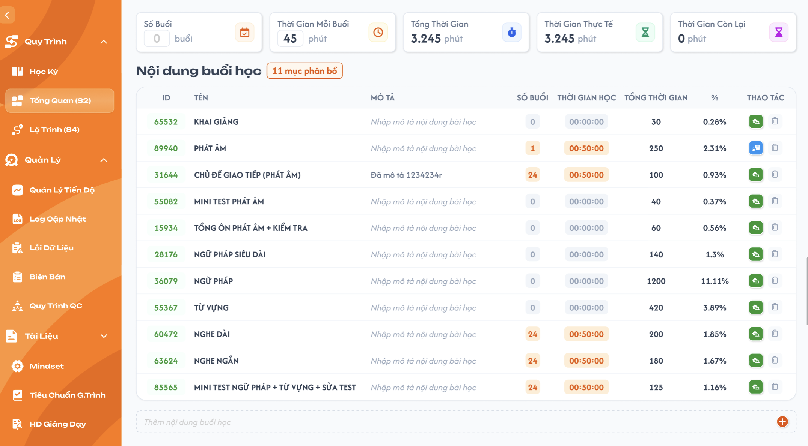

# Tổng quan (S2)

**Quyền sửa theo trạng thái khoá học:** chỉ sửa được khi khoá học đang `Nháp`. Khoá học `Công Khai` / `Vô hiệu`: màn hình này chỉ đọc (ẩn / disable mọi thao tác thêm, sửa, xoá, kéo thả); backend từ chối mọi request ghi. Muốn thay đổi thì nhân bản khoá học rồi sửa trên bản sao `Nháp` — nhân bản sao chép toàn bộ dữ liệu của màn hình này (xem [Quản lý khoá học](../course_management.md) REQ10, REQ11).

## 1. UI

### Trang 1: Trang 1: Tổng quan (S2)


**Mô tả:**
- CD dùng màn hình này để định nghĩa các **nội dung cần dạy** của khoá học và xem tổng quan phân bổ thời gian của toàn khoá học dựa trên các nội dung đó.

**Điểm cần lưu ý:**
- `A01.01` **Số buổi**: Ý nghĩa: Tổng số buổi học của khoá học; Cách xác định giá trị: Ban đầu là **0**, do CD tự nhập tay; chỉ nhận số nguyên **≥ 0**, không giới hạn tối đa. Xoá trống ô thì giá trị về **0**
- `A01.02` **Thời gian mỗi buổi**: Ý nghĩa: Thời lượng chuẩn của 1 buổi học, đơn vị **phút**; Cách xác định giá trị: Ban đầu mặc định là **90** phút, CD có thể sửa tay (số phút); chỉ nhận số nguyên dương, không giới hạn tối đa
- `A01.03` **Tổng thời gian**: Ý nghĩa: Tổng thời gian toàn khoá học; Cách xác định giá trị: Tự tính = Số buổi × Thời gian mỗi buổi
- `A01.04` **Thời gian thực tế**: Ý nghĩa: Tổng thời gian đã được phân bổ vào các nội dung bên dưới; Cách xác định giá trị: Tự tính = tổng cột "Tổng thời gian" của bảng nội dung
- `A01.05` **Thời gian còn lại**: Ý nghĩa: Phần thời gian chưa phân bổ; Cách xác định giá trị: Tự tính = Tổng thời gian − Thời gian thực tế. Màu: **đỏ** khi âm, **xanh lá** khi dương, **đen** (màu mặc định) khi bằng 0

---

### Trang 2: Khu vực: Bảng "Nội dung buổi học"
**Mô tả:**
- Liệt kê toàn bộ nội dung cần dạy đã được định nghĩa, mỗi dòng là 1 nội dung với thông tin phân bổ số buổi và thời gian tương ứng.

**Điểm cần lưu ý:**
- Tiêu đề "Nội dung buổi học" kèm badge số lượng nội dung hiện có (ví dụ "11 mục phân bổ").

- `A02.01` **ID**: Nhập được?: ❌; Mã tự sinh, hiển thị dạng badge
- `A02.02` **Tên**: Nhập được?: ✅; Tên nội dung, hiển thị in đậm. Bắt buộc: để trống/chỉ khoảng trắng thì không lưu, trả về tên cũ
- `A02.03` **Mô tả**: Nhập được?: ✅; Hiển thị placeholder xám "Nhập mô tả nội dung bài học" khi chưa có dữ liệu
- `A02.04` **Số buổi**: Nhập được?: ✅; Hiển thị dạng badge số. Chỉ nhận số nguyên **≥ 0**; mặc định **0**, xoá trống ô thì giá trị về **0**
- `A02.05` **Thời gian học**: Nhập được?: ✅; Badge định dạng giờ:phút:giây; là thời lượng của riêng nội dung đó trong 1 buổi, khác với "Thời gian mỗi buổi" ở card tổng quan. Nhập phút hoặc giây vượt 59 thì hệ thống tự quy đổi cho đúng (ví dụ `00:00:120` → `00:02:00`, `1:70:00` → `02:10:00`)
- `A02.06` **Tổng thời gian**: Nhập được?: ❌; Tự tính = Số buổi × Thời gian học
- `A02.07` **%**: Nhập được?: ❌; Tự tính = Tổng thời gian dòng ÷ Tổng thời gian (card) × 100, làm tròn 2 chữ số thập phân. Tổng thời gian (card) = 0 thì hiển thị `0%`
- `A02.08` **Thao tác**: Nhập được?: —; Gồm icon chuyển loại thao tác (Tự chọn/Giảng dạy) và icon thùng rác để xoá. Nội dung mới tạo mặc định là **Giảng dạy**

- Icon trong cột "Thao tác" (trước icon xoá) là nút để **chuyển đổi loại thao tác của nội dung** giữa 2 giá trị: **Tự chọn** và **Giảng dạy** (nhấn vào để đổi qua lại giữa 2 trạng thái này), hover vào hiển thị thao tác hiện tại.
- Cột "Tổng thời gian" và "%" của từng dòng, cùng 2 card "Thời gian thực tế" và "Thời gian còn lại", đều tự động tính lại ngay khi CD thay đổi Số buổi hoặc Thời gian học của bất kỳ dòng nào (xem công thức ở mục 2.3).

---

### Trang 3: Khu vực: Thêm nội dung buổi học mới
**Mô tả:**
- Cho phép CD tạo nhanh một nội dung buổi học mới chỉ với thao tác nhập tên và nhấn Enter.

**Điểm cần lưu ý:**
- Ô "Thêm nội dung buổi học mới" ở cuối bảng: CD chỉ cần **nhập Tên nội dung và nhấn Enter** để tạo nhanh, các field còn lại (Mô tả, Số buổi, Thời gian học) sẽ để trống/mặc định 0 và CD bổ sung sau trực tiếp trên dòng vừa tạo. Tên bắt buộc: để trống hoặc chỉ khoảng trắng thì không tạo. Loại thao tác mặc định là **Giảng dạy**.
- Nút "+" ở cuối dòng có cùng chức năng thêm mới.

---

## 2. Yêu cầu

### 2.1. Flow chính

**Flow 1: Nhập Số buổi / Thời gian mỗi buổi ở card tổng quan**

```
CD nhập giá trị "Số buổi" và "Thời gian mỗi buổi" ở 2 card đầu tiên (Số buổi mặc định 0, nhận số nguyên ≥ 0, xoá trống thì về 0; Thời gian mỗi buổi mặc định 90 phút, nhận số nguyên dương)
→ FE lưu giá trị → FE tính lại "Tổng thời gian" (card) = Số buổi × Thời gian mỗi buổi
→ FE tính lại % của toàn bộ các dòng trong bảng (vì mẫu số % đã thay đổi)
```

**Flow 2: Thêm nhanh nội dung buổi học mới**

```
CD nhấn vào ô "Thêm nội dung buổi học mới" → CD nhập Tên nội dung → CD nhấn Enter (Tên trống/chỉ khoảng trắng: không tạo)
→ FE gửi yêu cầu tạo mới với Tên vừa nhập → BE tạo nội dung (ID tự sinh, loại thao tác = Giảng dạy, các field còn lại để trống/mặc định)
→ FE thêm dòng mới vào bảng, cập nhật badge "x mục phân bổ"
```

**Flow 3: Chỉnh sửa thông tin một nội dung**

```
CD sửa trực tiếp Tên / Mô tả / Số buổi / Thời gian học trên 1 dòng (Tên để trống: không lưu, trả về tên cũ; Số buổi xoá trống: về 0; Thời gian học vượt 59 phút/giây: tự quy đổi) 
→ FE gửi dữ liệu lên BE theo từng field → BE cập nhật 
→ FE tính lại Tổng thời gian và % của dòng đó, đồng thời tính lại các card tổng quan liên quan
```

**Flow 4: Đổi loại thao tác (Tự chọn / Giảng dạy)**

```
CD nhấn icon chuyển loại thao tác trên 1 dòng 
→ FE đổi giá trị loại thao tác của dòng đó giữa Tự chọn và Giảng dạy → BE lưu lại giá trị mới
```

**Flow 5: Tự động tính toán**

```
CD cập nhật Số buổi hoặc Thời gian học của 1 dòng
→ FE tính lại Tổng thời gian (dòng) = Số buổi (dòng) × Thời gian học (dòng)
→ FE tính lại % (dòng) = Tổng thời gian (dòng) ÷ Tổng thời gian (card tổng quan) × 100 (làm tròn 2 chữ số thập phân; Tổng thời gian card = 0 thì % = 0%)
→ FE tính lại Thời gian thực tế (card) = tổng cột "Tổng thời gian" của tất cả các dòng trong bảng
→ FE tính lại Thời gian còn lại (card) = Tổng thời gian (card) − Thời gian thực tế (card)
    
    ↓ (nếu Thời gian còn lại < 0)
FE hiển thị Thời gian còn lại màu đỏ để cảnh báo CD (dương: xanh lá, bằng 0: đen)
```

**Flow 6: Xoá một nội dung**

```
CD nhấn icon thùng rác trên 1 dòng → FE hiển thị popup xác nhận
    
    ↓ (CD xác nhận)
BE xoá mềm nội dung → FE loại dòng khỏi bảng, cập nhật badge số lượng và tính lại các card tổng quan
    
    ↓ (CD huỷ)
Đóng popup, giữ nguyên dữ liệu
```

### 2.2. Ngoại lệ

- **EX01:** Tổng thời gian các nội dung trong bảng vượt quá "Tổng thời gian" ở card tổng quan (khiến "Thời gian còn lại" âm) → card "Thời gian còn lại" hiển thị giá trị âm màu **đỏ** để cảnh báo CD (không chặn thao tác).
- **EX02:** Nhập Số buổi (card hoặc dòng) là số âm, số thập phân hoặc chữ → không lưu, giữ giá trị cũ; xoá trống ô Số buổi → giá trị về `0`. Nhập Thời gian mỗi buổi không phải số nguyên dương (0, số âm, số thập phân, chữ, để trống) → không lưu, giữ giá trị cũ.
- **EX03:** Tên nội dung để trống hoặc chỉ khoảng trắng: khi thêm mới thì không tạo; khi sửa thì không lưu, trả về tên cũ.
- **EX04:** Thời gian học nhập phút hoặc giây vượt 59 (ví dụ `00:00:120`, `1:70:00`) → hệ thống tự quy đổi phần vượt lên đơn vị lớn hơn cho đúng (`00:02:00`, `02:10:00`), rồi lưu và tính lại.

### 2.3. Yêu cầu khác

| Mã | Tên yêu cầu | Mô tả |
|---|---|---|
| REQ01 | Công thức Tổng thời gian (dòng) | Tổng thời gian (dòng) = Số buổi (dòng) × Thời gian học (dòng). |
| REQ02 | Công thức % (dòng) | % (dòng) = Tổng thời gian (dòng) ÷ Tổng thời gian (card tổng quan) × 100, làm tròn 2 chữ số thập phân. Tổng thời gian (card) = 0 thì % = 0%. |
| REQ03 | Công thức Tổng thời gian (card) | Tổng thời gian (card tổng quan) = Số buổi (card) × Thời gian mỗi buổi (card). |
| REQ04 | Công thức Thời gian thực tế (card) | Thời gian thực tế (card) = tổng cột "Tổng thời gian" của toàn bộ các dòng trong bảng. |
| REQ05 | Công thức Thời gian còn lại (card) | Thời gian còn lại (card) = Tổng thời gian (card) − Thời gian thực tế (card). |
| REQ06 | Nhập Số buổi / Thời gian mỗi buổi (card) | Do CD tự nhập tay, không tự động lấy từ nguồn dữ liệu khác, không giới hạn tối đa. Số buổi: số nguyên ≥ 0, mặc định 0, xoá trống thì về 0. Thời gian mỗi buổi: số nguyên dương, đơn vị phút, mặc định 90. |
| REQ07 | Thêm nhanh bằng Tên + Enter | Chỉ cần nhập Tên và nhấn Enter là tạo được nội dung mới; các field khác để trống/mặc định, bổ sung sau. Tên bắt buộc, khi sửa để trống thì trả về tên cũ. |
| REQ08 | Loại thao tác của nội dung | Mỗi nội dung có loại thao tác là Tự chọn hoặc Giảng dạy, đổi qua lại bằng icon cạnh nút xoá trong cột "Thao tác". Nội dung mới tạo mặc định là Giảng dạy. |
| REQ09 | Màu Thời gian còn lại | Âm: màu đỏ (cảnh báo, không chặn thao tác); dương: màu xanh lá; bằng 0: màu đen mặc định. |
| REQ10 | Xoá mềm nội dung | Xoá một nội dung buổi học là xoá mềm, có popup xác nhận trước khi xoá. |
| REQ11 | Định dạng Thời gian học | Thời gian học lưu và hiển thị theo `HH:mm:ss`. Giá trị nhập có phút hoặc giây vượt 59 được tự quy đổi lên đơn vị lớn hơn (ví dụ `00:00:120` → `00:02:00`). |

### 2.4. Ràng buộc

#### Quyền

| Role | Xem | Thêm nội dung | Chỉnh sửa | Xoá |
|---|:---:|:---:|:---:|:---:|
| CD | ✅ | ✅ | ✅ | ✅ |
| Các role khác | ❌ | ❌ | ❌ | ❌ |

#### Ràng buộc khác

- Cột "ID", "Tổng thời gian", "%" không cho CD chỉnh sửa trực tiếp, luôn do hệ thống tự sinh/tự tính.
- Ở card tổng quan, chỉ `Số buổi` và `Thời gian mỗi buổi` được nhập; `Tổng thời gian`, `Thời gian thực tế`, `Thời gian còn lại` do hệ thống tự tính, không cho nhập hay sửa.
- Không cho phép xem/thao tác nếu không có quyền, kể cả khi gọi trực tiếp bằng URL hoặc request.

---

---

## 3. Testcase

### Feature: Tổng quan (S2)

| Tên testcase | Priority | Scenario | Role | Pre-condition | Given/When/Then | Expected Result |
|---|---|---|---|---|---|---|
| Case 1: Xem tổng quan | High · Smoke | Flow chính | CD | Khoá học đã có sẵn nội dung buổi học | **Given:** CD mở màn hình Tổng quan (S2)<br>**When:** trang tải xong<br>**Then:** hệ thống hiển thị đầy đủ 5 card và bảng nội dung | - 5 card hiển thị đúng giá trị<br>- Bảng hiển thị đầy đủ các nội dung, badge số lượng đúng |
| Case 2: Giá trị mặc định và nhập Số buổi / Thời gian mỗi buổi lần đầu | High | Flow 1 / REQ06 | CD | Khoá học mới, chưa nhập card | **Given:** CD mở S2 lần đầu<br>**When:** quan sát card, rồi nhập Số buổi và sửa Thời gian mỗi buổi<br>**Then:** hệ thống tính lại Tổng thời gian (card) và % của các dòng | - Mặc định: Số buổi = 0, Thời gian mỗi buổi = 90 phút, Tổng thời gian = 0<br>- Sau khi nhập: Tổng thời gian (card) = Số buổi × Thời gian mỗi buổi; % các dòng cập nhật theo mẫu số mới |
| Case 3: Thêm nhanh nội dung mới | High · Smoke | Flow 2 / REQ07 | CD | Đang ở màn hình Tổng quan (S2) | **Given:** CD nhấn vào ô "Thêm nội dung buổi học mới"<br>**When:** CD nhập Tên và nhấn Enter<br>**Then:** hệ thống tạo nội dung mới | - Dòng mới xuất hiện trong bảng với Tên vừa nhập<br>- Các field còn lại để trống/mặc định<br>- Badge số lượng tăng lên |
| Case 4: Sửa Số buổi/Thời gian học → tự tính Tổng thời gian và % | High | Flow 5 / REQ01 / REQ02 | CD | Bảng đã có ít nhất 1 nội dung | **Given:** dòng nội dung đang hiển thị Số buổi và Thời gian học hiện tại<br>**When:** CD sửa Số buổi hoặc Thời gian học<br>**Then:** hệ thống tính lại Tổng thời gian và % của dòng đó | - Tổng thời gian = Số buổi × Thời gian học mới<br>- % = Tổng thời gian dòng ÷ Tổng thời gian card × 100, hiển thị đúng |
| Case 5: Tự động cập nhật Thời gian thực tế và Thời gian còn lại | High | Flow 5 / REQ04 / REQ05 | CD | Bảng đã có nhiều nội dung | **Given:** card "Thời gian thực tế" và "Thời gian còn lại" đang hiển thị giá trị hiện tại<br>**When:** CD thêm/sửa/xoá 1 nội dung làm thay đổi Tổng thời gian<br>**Then:** hệ thống cập nhật lại 2 card này | - "Thời gian thực tế" = tổng Tổng thời gian mới của bảng<br>- "Thời gian còn lại" = Tổng thời gian (card) − Thời gian thực tế (card) mới |
| Case 6: Đổi loại thao tác Tự chọn/Giảng dạy | Medium | Flow 4 / REQ08 | CD | Bảng đã có ít nhất 1 nội dung | **Given:** 1 dòng đang ở loại thao tác "Tự chọn"<br>**When:** CD nhấn icon chuyển loại thao tác<br>**Then:** hệ thống đổi loại thao tác của dòng đó sang "Giảng dạy" | - Giá trị loại thao tác của dòng được cập nhật và lưu lại đúng |
| Case 7: Thời gian còn lại bị âm | Medium | EX01 / REQ09 | CD | Tổng thời gian các nội dung sắp vượt "Tổng thời gian" card | **Given:** CD tăng Số buổi hoặc Thời gian học của 1 dòng<br>**When:** tổng Tổng thời gian các dòng vượt quá "Tổng thời gian" card<br>**Then:** card Thời gian còn lại chuyển đỏ | - "Thời gian còn lại" hiển thị giá trị âm, màu đỏ<br>- Không chặn thao tác |
| Case 8: Xoá một nội dung | High | Flow 6 / REQ10 | CD | Bảng đã có ít nhất 1 nội dung | **Given:** CD nhấn icon thùng rác trên 1 dòng<br>**When:** popup xác nhận hiển thị và CD xác nhận xoá<br>**Then:** hệ thống xoá mềm nội dung | - Dòng bị xoá (mềm) khỏi bảng<br>- Badge số lượng và các card tổng quan liên quan được cập nhật lại |
| Case 9: Huỷ xoá nội dung | Medium | Flow 6 | CD | Bảng đã có ít nhất 1 nội dung | **Given:** popup xác nhận xoá đang hiển thị<br>**When:** CD nhấn huỷ<br>**Then:** hệ thống không xoá nội dung | - Dòng vẫn còn nguyên trong bảng<br>- Dữ liệu không thay đổi |
| Case 10: Kiểm tra quyền truy cập | High | Ràng buộc quyền | Role không phải CD | User đã đăng nhập | **Given:** user không có role CD<br>**When:** mở URL màn hình Tổng quan (S2) trực tiếp<br>**Then:** hệ thống từ chối truy cập | - Không xem hoặc thao tác được dữ liệu<br>- Dữ liệu không thay đổi |
| Case 11: Màu Thời gian còn lại dương / bằng 0 | Medium | REQ09 | CD | Bảng đã có nội dung | **Given:** CD điều chỉnh Số buổi / Thời gian học<br>**When:** Thời gian còn lại dương, rồi đúng bằng 0<br>**Then:** màu card đổi tương ứng | - Dương: xanh lá<br>- Bằng 0: đen mặc định |
| Case 12: Ràng buộc nhập Số buổi / Thời gian mỗi buổi | Medium | EX02 / REQ06 | CD | Card đang có giá trị | **Given:** CD nhập Số buổi / Thời gian mỗi buổi<br>**When:** nhập số âm, thập phân, chữ; xoá trống; nhập 0; nhập số rất lớn<br>**Then:** hệ thống xử lý tương ứng | - Số âm, thập phân, chữ: không lưu, giữ giá trị cũ<br>- Số buổi xoá trống: về 0; Số buổi = 0: lưu được<br>- Thời gian mỗi buổi = 0 hoặc xoá trống: không lưu, giữ giá trị cũ<br>- Số rất lớn: lưu được, tính đúng |
| Case 13: % làm tròn 2 chữ số và bằng 0% khi Tổng = 0 | Medium | REQ02 | CD | Có dòng Tổng thời gian = 1/3 Tổng thời gian card | **Given:** CD xem cột %<br>**When:** quan sát, rồi đưa Tổng thời gian card về 0<br>**Then:** % hiển thị đúng | - Hiển thị `33.33%`<br>- Tổng thời gian card = 0: mọi dòng `0%`, không lỗi |
| Case 14: Tên nội dung để trống | High | EX03 / REQ07 | CD | Bảng đã có nội dung | **Given:** CD thêm mới hoặc sửa Tên<br>**When:** để trống / chỉ khoảng trắng<br>**Then:** hệ thống không lưu | - Thêm mới: không tạo dòng<br>- Sửa: trả về tên cũ |
| Case 15: Loại thao tác mặc định | Low | REQ08 | CD | - | **Given:** CD thêm nội dung mới<br>**When:** hover icon loại thao tác<br>**Then:** hiển thị loại hiện tại | - Mặc định là Giảng dạy |
| Case 16: Thời gian học nhập vượt 59 tự quy đổi | Medium | EX04 / REQ11 | CD | Bảng đã có ít nhất 1 nội dung | **Given:** CD sửa Thời gian học của 1 dòng<br>**When:** nhập `00:00:120`, `00:90:00`, `1:70:00`<br>**Then:** hệ thống tự quy đổi | - Lần lượt thành `00:02:00`, `01:30:00`, `02:10:00`<br>- Tổng thời gian dòng, %, các card tính theo giá trị đã quy đổi |
| Case 17: Số buổi của dòng xoá trống về 0 | Low | EX02 | CD | Dòng có Số buổi = 4 | **Given:** CD xoá trống ô Số buổi của dòng<br>**When:** rời ô<br>**Then:** hệ thống lưu giá trị 0 | - Số buổi = 0, Tổng thời gian dòng = `00:00:00`, % = 0%<br>- Card Thời gian thực tế, Thời gian còn lại tính lại |

### Feature: Tổng quan (S2)
