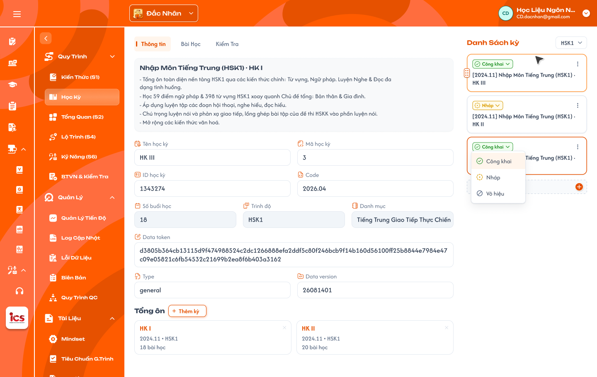
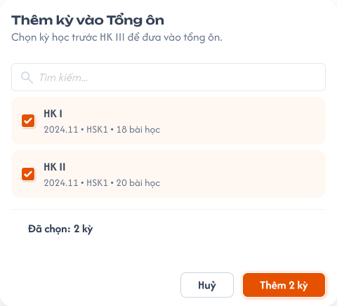
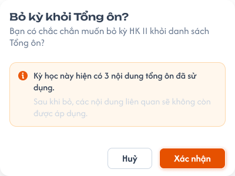
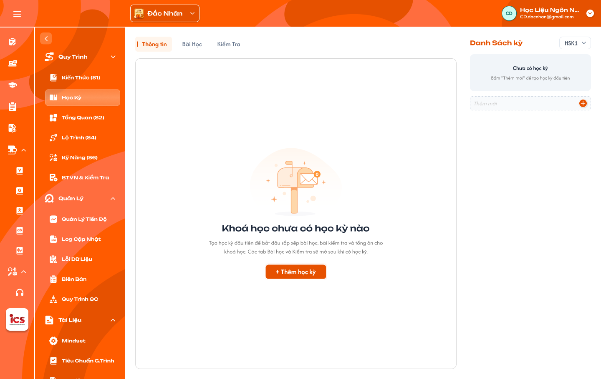

# Học Kỳ

## 1. UI

### Trang 1: CD-KH-030100 — Học kỳ / Thông tin



**Mô tả:**
- CD xem các học kỳ của khoá học (danh sách kỳ bên phải), chọn **một** học kỳ để xem / chỉnh sửa tab `Thông tin` (bên trái), thêm mới, nhân bản, đổi trạng thái, kéo thả sắp xếp hoặc xoá.

**Điểm cần lưu ý:**
- Danh sách kỳ: tên hiển thị trên card `[Code] Tên đầu tab - Tên học kỳ` (ví dụ `[2024.11] Tiếng Trung Trung Cấp (HSK5) (new) - HKI`); "Tên đầu tab" là tên của chính học kỳ (tiêu đề phía trên mô tả).
- Chỉ chọn 1 học kỳ tại một thời điểm (card highlight viền cam). Mở màn hình: chọn học kỳ đầu tiên; thêm mới / nhân bản: chọn học kỳ vừa tạo; đổi trạng thái: giữ nguyên học kỳ đang chọn.
- Thứ tự mặc định theo ngày tạo, học kỳ mới / bản nhân bản nằm **cuối danh sách**. CD kéo thả icon bên trái card để sắp xếp (học kỳ ở mọi trạng thái), thứ tự lưu lên BE.
- Theo trạng thái khoá học (xem `course_management.md` REQ10): Thêm mới, Nhân bản, Xoá, kéo thả học kỳ **chỉ làm được khi khoá học đang `Nháp`**. Khoá học `Công khai` / `Vô hiệu`: ẩn ô "Thêm mới", icon kéo thả, `Nhân bản` / `Xoá` trong menu "⋮"; toàn bộ học kỳ chỉ đọc (kể cả Tên, Mô tả học kỳ); **vẫn đổi được trạng thái học kỳ**.
- Trạng thái (bấm badge để đổi): `Nháp` (mặc định khi tạo / nhân bản), `Công khai`, `Vô hiệu`. **Chỉ học kỳ `Công khai` mới được dùng ở các màn hình / chức năng khác.**
- Rule đổi trạng thái (như Danh mục): `Nháp → Công khai / Vô hiệu` (một chiều); `Công khai ↔ Vô hiệu` (hai chiều); **không về `Nháp`**. Dropdown học kỳ `Công khai` / `Vô hiệu` ẩn `Nháp`; học kỳ `Nháp` hiện đủ 3 (`Nháp` là mục đang chọn).
- Menu "⋮": **Nhân bản**, **Xoá** (xoá mềm, có popup xác nhận). **Chỉ học kỳ `Nháp` có `Xoá`**; học kỳ `Công khai` / `Vô hiệu` không có `Xoá` (muốn ngừng dùng thì để / chuyển `Vô hiệu`). Học kỳ `Nháp` **chỉ xoá được khi chưa được sử dụng**; đang được sử dụng thì chỉ chuyển sang `Vô hiệu` (REQ01, Flow 4). `Nhân bản` có ở mọi trạng thái học kỳ (khi khoá học `Nháp`). Ô "Thêm mới" ở cuối danh sách là điểm thêm học kỳ duy nhất.
- Quyền sửa theo trạng thái (REQ05): điều kiện chung khoá học phải `Nháp`. Học kỳ `Nháp` sửa được toàn bộ tab Thông tin (gồm Tổng ôn, ID học kỳ), tab Bài Học, tab Kiểm Tra (kể cả bộ câu hỏi). Học kỳ `Công khai` / `Vô hiệu` **chỉ sửa được Tên, Mô tả (đầu tab) và Tên học kỳ**; mọi field còn lại, tab Bài Học, tab Kiểm Tra (kể cả bộ câu hỏi) và BTVN đều chỉ đọc; muốn đổi nội dung thì **Nhân bản** học kỳ (hoặc nhân bản khoá học) rồi sửa trên bản sao `Nháp`. Tất cả field tab Thông tin tự động lưu theo từng field.
- `A02.01` Tên, Mô tả (đầu tab): sửa được ở mọi trạng thái học kỳ (khi khoá `Nháp`), double click để sửa, lưu khi rời ô.
- `A02.02` Tên học kỳ: bắt buộc, sửa được ở mọi trạng thái học kỳ (khi khoá `Nháp`).
- `A02.03` Mã học kỳ: mã hiển thị, cho phép trùng; chỉ sửa khi học kỳ `Nháp`.
- `A02.04` ID học kỳ: 12 chữ số `CCAALLMMMBBB` = ID khoá học + `BBB`; chỉ sửa 3 số cuối `BBB` khi `Nháp` (rule xem REQ02), `BBB` khoá vĩnh viễn khi rời `Nháp`; phần đầu `CCAALLMMM` luôn theo ID khoá học.
- `A02.05` Code: không bắt buộc, cho phép trùng, dùng làm `[Code]` ở tên hiển thị; chỉ sửa khi `Nháp`.
- `A02.06` Số buổi học: tự tính = số bài học ở tab Bài Học (buổi học = bài học); luôn chỉ đọc.
- `A02.07` Trình độ, Danh mục: lấy từ khoá học; luôn chỉ đọc.
- `A02.08` Data token, Type (text), Data version (số): CD nhập tay; chỉ sửa khi `Nháp`.
- `A02.09` Tổng ôn: nút "+ Thêm kỳ" mở popup chọn học kỳ từ **cùng khoá và khoá khác** (Trang 2); không chọn chính học kỳ đang xem, không chọn trùng, không giới hạn số lượng / trạng thái. Card hiển thị tên, `Code • Trình độ`, số bài học, nút `×` để gỡ (Trang 3). Chỉ thêm / gỡ được khi học kỳ đang xem `Nháp` và khoá học `Nháp`; ngược lại ẩn "+ Thêm kỳ" và nút `×`.
- Popup xoá học kỳ (chỉ mở với học kỳ `Nháp`): học kỳ **đang được sử dụng** khi nằm trong **Tổng ôn** của học kỳ khác (cùng khoá hoặc khoá khác) hoặc đang được **lớp học** sử dụng (chỉ tính bản ghi chưa xoá mềm); bài học, bài kiểm tra, Tổng ôn **của chính** học kỳ là dữ liệu con, không tính. Không có lựa chọn "xoá bắt buộc"; muốn xoá học kỳ đang nằm trong Tổng ôn thì CD tự gỡ khỏi Tổng ôn của học kỳ kia trước (nếu còn sửa được).
- Chưa được sử dụng → popup xác nhận: tiêu đề `Xoá học kỳ`; nội dung `Bạn có chắc chắn muốn xoá học kỳ "[Code] Tên - Tên học kỳ"? Toàn bộ dữ liệu của học kỳ (bài học, bài kiểm tra, Tổng ôn) cũng sẽ bị xoá.`; nút `Huỷ`, `Xoá`.
- Đang được sử dụng → popup không thể xoá: tiêu đề `Không thể xoá học kỳ`; nội dung `Học kỳ "[Code] Tên - Tên học kỳ" đang được sử dụng nên không thể xoá. Bạn có thể chuyển học kỳ sang Vô hiệu để ngừng sử dụng.`; liệt kê theo nhóm `Tổng ôn của học kỳ (N)` (`[Code] Tên - Tên học kỳ`, kèm tên khoá nếu khác khoá) và `Lớp học (N)`; nút `Đóng` và `Vô hiệu` (chỉ hiển thị khi học kỳ đang `Nháp` hoặc `Công khai`; đang `Vô hiệu` thì chỉ còn `Đóng`).
- `A05.01` Tiêu đề popup Nhân bản: `Nhân bản học kỳ`; mở khi chọn "⋮" → `Nhân bản` (chỉ khi khoá học `Nháp`, học kỳ nguồn ở trạng thái nào cũng được).
- `A05.02` Nội dung: `Tạo bản sao của học kỳ "[Code] Tên - Tên học kỳ"? Bản sao ở trạng thái Nháp, sao chép toàn bộ Thông tin, Tổng ôn, Bài học, Bài tập về nhà, Bài kiểm tra và bộ câu hỏi.`
- `A05.03` Nút: `Huỷ` — `Nhân bản` (disable + loading trong lúc BE xử lý).
- `A05.04` Toast: thành công `Đã nhân bản học kỳ.`; lỗi `Có Lỗi Xảy Ra` với nội dung BE trả về (EX10).

### Trang 2: CD-KH-030110 — Học kỳ / Thông tin / Popup thêm kỳ vào Tổng ôn



**Mô tả:**
- Popup `Thêm kỳ vào Tổng ôn` mở từ nút "+ Thêm kỳ" ở Tổng ôn: ô `Tìm kiếm...`, danh sách kỳ (tên, `Code • Trình độ • N bài học`), chọn nhiều kỳ, dòng `Đã chọn: N kỳ`, nút `Huỷ` / `Thêm N kỳ`.

**Điểm cần lưu ý:**
- Phạm vi kỳ được chọn, các ràng buộc (không chọn chính nó, không trùng) và điều kiện thêm theo `A02.09`.

### Trang 3: CD-KH-030120 — Học kỳ / Thông tin / Popup bỏ kỳ khỏi Tổng ôn



**Mô tả:**
- Popup xác nhận `Bỏ kỳ khỏi Tổng ôn?` mở từ nút `×` trên card Tổng ôn, nêu kỳ sắp bỏ, cảnh báo kỳ đó hiện có nội dung tổng ôn đã sử dụng; nút `Huỷ` / `Xác nhận`.

**Điểm cần lưu ý:**
- Gỡ khỏi Tổng ôn không xoá học kỳ khỏi danh sách; chỉ gỡ được khi học kỳ đang xem `Nháp` và khoá học `Nháp`.

### Trang 4: CD-KH-030104 — Học kỳ / Chưa có học kỳ



**Mô tả:**
- Trạng thái khoá học chưa có học kỳ nào (kể cả sau khi xoá học kỳ cuối cùng): vùng nội dung báo `Khoá học chưa có học kỳ nào`, nút `+ Thêm học kỳ`; danh sách kỳ hiện `Chưa có học kỳ` và ô `Thêm mới` vẫn hiển thị.

**Điểm cần lưu ý:**
- Popup Kích hoạt công khai học kỳ (bắt buộc hiển thị khi chuyển `Nháp → Công khai`; registry gắn vào frame này, xem Q01):
- `A03.01` Tiêu đề: `Kích hoạt công khai học kỳ`.
- `A03.02` Hiển thị: tên học kỳ (dạng `[Code] Tên - Tên học kỳ`) và trạng thái hiện tại `Nháp`.
- `A03.03` Ô ID học kỳ: phần `CCAALLMMM` chỉ đọc (theo ID khoá học); ô `BBB` mặc định giá trị hiện tại, sửa tay được; icon làm mới sinh `BBB` nhỏ nhất chưa dùng trong khoá.
- `A03.04` Thông báo dưới ô ID: `ID có thể sử dụng` / `ID học kỳ không đúng định dạng` / `ID học kỳ đã được sử dụng`.
- `A03.05` Lưu ý: `Sau khi công khai, học kỳ chỉ còn sửa được Tên và Mô tả. ID, thông tin khác, Tổng ôn, bài học, bài kiểm tra sẽ bị khoá và học kỳ không thể chuyển về Nháp.`
- `A03.06` Nút: `Huỷ` — `Công khai học kỳ` (chỉ bật khi ID hợp lệ, chưa trùng).

---

## 2. Yêu cầu

### 2.1. Flow chính

**Flow 1: Thêm mới / Nhân bản**

```
Thêm mới: CD nhập tên vào ô "Thêm mới" → Enter hoặc "+" → BE tạo học kỳ (ID sinh theo REQ02, trạng thái Nháp)
Nhân bản (chỉ khi khoá học Nháp): "⋮" → "Nhân bản" → popup Nhân bản học kỳ → "Nhân bản"
  → BE sao chép toàn bộ trong một giao dịch (REQ06): Thông tin, Tổng ôn, Bài Học, BTVN + bộ câu hỏi, Kiểm Tra + bộ câu hỏi
  → Tên học kỳ thêm hậu tố " (Bản sao)", ID sinh mới, trạng thái Nháp; học kỳ nguồn giữ nguyên
  → Lỗi ở bất kỳ bước nào: rollback toàn bộ, không có bản sao dở dang (EX10)
→ FE thêm học kỳ vào cuối danh sách, chọn học kỳ đó, hiển thị tab Thông tin
```

**Flow 2: Nháp → Công khai (có popup)**

```
CD chọn "Công khai" tại học kỳ Nháp → popup Kích hoạt công khai học kỳ
  → giữ nguyên / sửa tay / làm mới ID → kiểm tra lại định dạng + tính duy nhất mỗi khi ID đổi
  → ID hợp lệ: bật "Công khai học kỳ"; ID sai/trùng: báo lỗi, tắt nút
  → bấm "Công khai học kỳ" → BE kiểm tra lại ID lần cuối
        ↓ (hợp lệ)                                   ↓ (không hợp lệ)
  lưu ID + chuyển Công khai trong một giao dịch     không lưu, giữ Nháp, giữ popup mở, báo lỗi
  ID khoá vĩnh viễn
  → "Huỷ" / đóng popup: không lưu ID, không đổi trạng thái
```

**Flow 3: Đổi trạng thái còn lại**

```
Nháp → Vô hiệu: đổi trực tiếp, không popup, ID giữ nguyên và bị khoá
Công khai ↔ Vô hiệu: đổi trực tiếp, giữ nguyên ID
Về Nháp: UI ẩn lựa chọn; gọi API trực tiếp thì BE từ chối
```

**Flow 4: Xoá học kỳ**

```
"Xoá" (chỉ với học kỳ Nháp khi khoá học Nháp; Công khai / Vô hiệu không có Xoá, BE từ chối — EX08)
  → FE gọi API kiểm tra học kỳ đang được sử dụng (Tổng ôn của học kỳ khác, lớp học)
        ↓ (đang được sử dụng)                           ↓ (chưa được sử dụng)
  popup "Không thể xoá học kỳ" + danh sách nơi dùng      popup xác nhận xoá → "Xoá" → BE kiểm tra lại tham chiếu
    → "Vô hiệu": chuyển Vô hiệu (Flow 3)                   → vẫn chưa dùng: xoá mềm (và dữ liệu con); FE loại khỏi danh sách,
    → "Đóng": không đổi dữ liệu                              học kỳ đang chọn bị xoá thì chọn học kỳ đầu tiên còn lại
                                                           → vừa phát sinh tham chiếu: từ chối, giữ dữ liệu, popup "Không thể xoá" (EX07)
                                                         → "Huỷ": không xoá
```

### 2.2. Ngoại lệ

- **EX01:** Xoá học kỳ cuối cùng → khu vực nội dung (3 tab) hiển thị trạng thái không có dữ liệu (Trang 4), ô "Thêm mới" vẫn hiển thị.
- **EX02:** Lưu tự động thất bại (lỗi mạng / server) → Toast lỗi, giá trị field giữ nguyên theo input CD đã nhập (không rollback), reload lại vẫn là giá trị cũ.
- **EX03:** Sửa ID học kỳ khi không phải `Nháp` hoặc sửa field chỉ đọc (kể cả gọi API trực tiếp) → backend từ chối, dữ liệu không đổi.
- **EX04:** `BBB` sai định dạng (không đúng 3 chữ số `001`–`999`) hoặc trùng `BBB` của học kỳ khác trong cùng khoá học (kể cả đã xoá mềm), khi sửa ở tab Thông tin hoặc trong popup → từ chối lưu, báo lỗi tại field / popup, giữ nguyên ID cũ; riêng popup tắt nút `Công khai học kỳ`.
- **EX05:** ID hợp lệ lúc nhập nhưng bị dùng ngay trước lúc BE lưu (race condition) → BE từ chối ở bước kiểm tra cuối, giữ `Nháp`, giữ popup mở.
- **EX06:** Tên học kỳ trống hoặc chỉ có khoảng trắng → chặn tạo / lưu.
- **EX07:** Xoá học kỳ đang được sử dụng (gọi API trực tiếp, hoặc vừa được thêm vào Tổng ôn / lớp học ngay trước lúc BE xoá) → BE từ chối, trả lỗi `Học kỳ đang được sử dụng, không thể xoá. Vui lòng chuyển sang Vô hiệu.`, dữ liệu không đổi.
- **EX08:** Xoá học kỳ `Công khai` / `Vô hiệu` (kể cả gọi API trực tiếp) → BE từ chối, trả lỗi `Chỉ xoá được học kỳ ở trạng thái Nháp.`, dữ liệu không đổi.
- **EX09:** Sửa field ngoài Tên / Mô tả / Tên học kỳ khi học kỳ `Công khai` / `Vô hiệu`; hoặc thêm, xoá, nhân bản, kéo thả, sửa bất kỳ dữ liệu học kỳ nào khi khoá học không ở `Nháp` (kể cả gọi API trực tiếp) → UI chỉ đọc; BE từ chối, trả lỗi `Học kỳ / khoá học không ở trạng thái Nháp, không thể chỉnh sửa.`, dữ liệu không đổi.
- **EX10:** Nhân bản học kỳ thất bại (lỗi mạng / server ở bất kỳ bước sao chép nào) → BE rollback toàn bộ, không tạo học kỳ / bài học / bài kiểm tra bản sao dở dang; Toast `Có Lỗi Xảy Ra`, học kỳ nguồn không đổi.

### 2.3. Yêu cầu khác

| Mã | Tên yêu cầu | Mô tả |
|---|---|---|
| REQ01 | Xoá mềm & ràng buộc đang sử dụng | Không xoá vật lý; dữ liệu con cũng xoá mềm. **Chỉ học kỳ `Nháp` được xoá**; học kỳ `Công khai` / `Vô hiệu` không được xoá (quy tắc chung: chỉ `Nháp` được xoá; EX08). Chỉ xoá được khi khoá học đang `Nháp`. Học kỳ `Nháp` chỉ được xoá khi **chưa được sử dụng** (không nằm trong Tổng ôn của học kỳ khác, không được lớp học sử dụng). Học kỳ **đang được sử dụng thì không được xoá, chỉ được chuyển sang `Vô hiệu`**; nơi đang dùng giữ nguyên. BE kiểm tra tham chiếu và xoá mềm trong cùng một giao dịch (EX07). Khi xoá cả khoá học, ràng buộc tương tự áp dụng ở cấp khoá học (xem `course_management.md` REQ08). |
| REQ02 | ID học kỳ | 12 chữ số `CCAALLMMMBBB`: 9 số đầu = ID khoá học (`course_management.md` REQ06), `BBB` = số thứ tự học kỳ trong khoá (`001`–`999`), duy nhất trong khoá học (tính cả học kỳ đã xoá mềm) nên ID 12 số duy nhất toàn hệ thống. **Rule mặc định khi hệ thống tạo (Thêm mới / Nhân bản):** `BBB` = `BBB` lớn nhất đã dùng trong khoá + 1 (ví dụ khoá `100302001` → kỳ đầu `100302001001`, tiếp theo `100302001002`...). Nút làm mới trong popup lấy `BBB` nhỏ nhất chưa dùng. **CD nhập tay:** chỉ sửa `BBB`, đúng 3 chữ số và chưa dùng trong khoá. `BBB` sửa được khi `Nháp`, khoá vĩnh viễn khi rời `Nháp`. **Phần đầu `CCAALLMMM` luôn theo ID khoá học hiện tại:** khi khoá học còn `Nháp` và ID khoá đổi (đổi Danh mục / Cấp độ / `MMM`), ID mọi học kỳ của khoá (kể cả học kỳ đã `Công khai` / `Vô hiệu`) tự đồng bộ phần đầu, `BBB` giữ nguyên; Tổng ôn và lớp học tham chiếu theo bản ghi nên không bị ảnh hưởng. Hết `BBB` (đã dùng tới `999`) thì từ chối tạo / nhân bản, Toast `Đã hết ID học kỳ khả dụng trong khoá học.`. BE luôn kiểm tra lại tính duy nhất ngay lúc lưu. |
| REQ03 | Nguyên tử khi công khai | Lưu ID và chuyển sang `Công khai` phải nằm trong cùng một giao dịch. |
| REQ04 | Phạm vi dùng theo trạng thái | Chỉ học kỳ `Công khai` được dùng ở nơi khác; `Nháp` / `Vô hiệu` không hiển thị để chọn mới ở nơi khác. Học kỳ chuyển sang `Vô hiệu` khi đang được dùng (Tổng ôn đã gắn, lớp học đã sinh dữ liệu) thì các liên kết đã có vẫn giữ nguyên. |
| REQ05 | Quyền sửa theo trạng thái | Chỉ sửa được khi khoá học `Nháp`. Học kỳ `Nháp`: sửa toàn bộ (Thông tin, Tổng ôn, Bài học, Kiểm tra, BTVN, bộ câu hỏi). Học kỳ `Công khai` / `Vô hiệu`: **chỉ sửa Tên, Mô tả (đầu tab), Tên học kỳ**; còn lại chỉ đọc, kể cả chi tiết bên trong (bài học, bài kiểm tra, bộ câu hỏi, BTVN). Đổi trạng thái học kỳ vẫn được ở mọi trạng thái khoá học. BE kiểm tra trạng thái học kỳ và khoá học với mọi request ghi (EX09). |
| REQ06 | Nhân bản học kỳ (deep clone) | Chỉ khi khoá học `Nháp`; học kỳ nguồn ở mọi trạng thái. Bản sao: Tên học kỳ + ` (Bản sao)`, `BBB` mới theo REQ02, trạng thái `Nháp`, nằm cuối danh sách, được chọn. Sao chép **toàn bộ**: mọi field tab Thông tin; Tổng ôn (giữ nguyên các học kỳ được tham chiếu); bài học (thông tin, nhóm + nội dung, tài nguyên — file sao chép thành file mới, link giữ URL —, liên kết kiến thức / kỹ năng, Mã bài học sinh lại theo `BBB` học kỳ mới (`semester/lesson/lesson.md` REQ05), 3 số cuối giữ nguyên); BTVN và bộ câu hỏi của từng bài học (tạo bản ghi câu hỏi mới); bài kiểm tra (thông tin, thứ tự, ID 10 số mới) và bộ câu hỏi; tick Lộ trình (S4) của các bài học. Không sao chép: lớp học / lịch / kết quả làm bài, tham chiếu từ học kỳ khác vào học kỳ nguồn (Tổng ôn nơi khác vẫn trỏ học kỳ nguồn). Một giao dịch, lỗi thì rollback (EX10). Nhân bản cả khoá học xem `course_management.md` REQ11. |

### 2.4. Ràng buộc

#### Quyền

| Role | Xem | Tạo / Nhân bản | Sửa | Đổi trạng thái | Sắp xếp | Xoá |
|---|:---:|:---:|:---:|:---:|:---:|:---:|
| CD | ✅ | ✅ Khi khoá học `Nháp` | ✅ Khi khoá học `Nháp`, theo REQ05 | ✅ | ✅ Khi khoá học `Nháp` | ✅ Khi khoá học và học kỳ `Nháp`, chưa được sử dụng |
| Các role khác | ❌ | ❌ | ❌ | ❌ | ❌ | ❌ |

#### Ràng buộc khác

- Role khác CD bị từ chối kể cả gọi trực tiếp bằng URL hoặc request.
- Mọi request ghi được BE kiểm tra trạng thái học kỳ và khoá học, không dựa vào việc ẩn nút.

---

## 3. Testcase

### Feature: Học Kỳ

| Tên testcase | Priority | Scenario | Role | Pre-condition | Given/When/Then | Expected Result |
|---|---|---|---|---|---|---|
| Case 1: Chọn học kỳ và thêm mới | High | Flow 1 / EX06 / REQ02 | CD | Khoá có ≥ 2 học kỳ | **Given:** CD mở màn hình Học Kỳ<br>**When:** click học kỳ khác; nhập tên vào ô "Thêm mới" rồi Enter hoặc "+" (thử cả tên trống)<br>**Then:** hệ thống chọn / tạo học kỳ | - Mặc định chọn học kỳ đầu tiên, chỉ 1 card highlight, tên card đúng `[Code] Tên - Tên học kỳ`<br>- Học kỳ mới `Nháp`, nằm cuối danh sách, được chọn; ID = ID khoá học + `BBB` (`BBB` lớn nhất + 1), ví dụ `100302001002`<br>- Tên trống / chỉ khoảng trắng: không tạo, báo `Tên học kỳ không được bỏ trống.` |
| Case 2: Nhân bản và nhân bản thất bại | High | Flow 1 / REQ06 / EX10 | CD | Khoá học `Nháp`; học kỳ `Công khai` có bài học đủ nội dung / tài nguyên / kiến thức, BTVN, bài kiểm tra có câu hỏi, Tổng ôn; giả lập lỗi BE khi sao chép bộ câu hỏi | **Given:** "⋮" → "Nhân bản" → bấm `Nhân bản` ở popup<br>**When:** hệ thống xử lý thành công; lần khác BE lỗi giữa chừng<br>**Then:** tạo bản sao hoặc rollback | - Bản sao `Nháp`, ID mới, hậu tố " (Bản sao)", cuối danh sách, được chọn; sao chép đủ Thông tin, Tổng ôn, Bài Học, BTVN + câu hỏi, Kiểm Tra + câu hỏi; Mã bài học theo `BBB` mới<br>- Sửa / xoá ở bản sao không ảnh hưởng nguồn; nguồn `Nháp` / `Vô hiệu` cũng nhân bản được; Toast `Đã nhân bản học kỳ.`<br>- Lỗi: Toast `Có Lỗi Xảy Ra`, không có dữ liệu bản sao dở dang, nguồn không đổi |
| Case 3: Quyền sửa theo trạng thái | High | REQ05 / EX02 / EX03 / EX09 | CD | Khoá học `Nháp`; học kỳ `Nháp`, `Công khai`, `Vô hiệu` | **Given:** mở từng học kỳ<br>**When:** sửa field tab Thông tin, Tổng ôn, nội dung tab Bài Học / Kiểm Tra, bộ câu hỏi; giả lập lỗi lưu<br>**Then:** chỉ sửa phần được phép | - `Nháp`: sửa toàn bộ, tự lưu, Toast `Đã lưu thay đổi.`<br>- `Công khai` / `Vô hiệu`: chỉ sửa Tên, Mô tả, Tên học kỳ; còn lại chỉ đọc, API trực tiếp bị từ chối<br>- Số buổi học, Trình độ, Danh mục luôn chỉ đọc; Số buổi học = số bài học<br>- Lưu thất bại: Toast lỗi, giữ input, không rollback |
| Case 4: Sửa ID học kỳ và đồng bộ theo ID khoá học | High | REQ02 / EX04 | CD | Học kỳ `Nháp`; khoá học `Nháp` ID `100302001`, HK I `Công khai` ID `100302001001`, HK II `Nháp` ID `100302001002` | **Given:** sửa `BBB` hợp lệ, sai định dạng, trùng; đổi Cấp độ khoá học sang cấp độ có ID `05`<br>**When:** hệ thống lưu / cấp lại ID khoá (ví dụ `100305001`)<br>**Then:** lưu, từ chối hoặc đồng bộ | - `CCAALLMMM` chỉ đọc; `BBB` đúng 3 chữ số, chưa dùng (kể cả không liền mạch) thì lưu, Mã bài học đồng bộ<br>- `BBB` sai / trùng: báo lỗi, giữ ID cũ<br>- HK I = `100305001001`, HK II = `100305001002`, `BBB` giữ nguyên kể cả HK I đã công khai; Tổng ôn ở khoá khác vẫn trỏ đúng HK I |
| Case 5: Nháp → Công khai (popup) | High | Flow 2 / REQ03 / EX04 / EX05 | CD | Học kỳ `Nháp` | **Given:** chọn "Công khai"<br>**When:** giữ nguyên ID / sửa tay / làm mới / nhập ID sai hoặc trùng / ID bị dùng ngay lúc lưu / Huỷ<br>**Then:** hệ thống xử lý theo từng nhánh | - Hợp lệ: bật nút, công khai thành công, ID khoá, Toast `Đã công khai học kỳ. ID học kỳ đã được khoá.`<br>- ID sai / trùng: báo lỗi trong popup, tắt nút, vẫn `Nháp`<br>- Race condition: BE từ chối, giữ `Nháp`, giữ popup<br>- Huỷ: không lưu ID, không đổi trạng thái |
| Case 6: Rule đổi trạng thái | High | Flow 3 | CD | Có học kỳ ở 3 trạng thái | **Given:** bấm badge trạng thái<br>**When:** Nháp → Vô hiệu; Công khai ↔ Vô hiệu; thử về Nháp (UI và API)<br>**Then:** hệ thống áp dụng rule | - Nháp → Vô hiệu: không popup, ID khoá<br>- Công khai ↔ Vô hiệu: 2 chiều, giữ ID, giữ học kỳ đang chọn<br>- `Công khai` / `Vô hiệu` không có lựa chọn `Nháp`; API về Nháp bị từ chối `Không thể chuyển trạng thái này về Nháp.` |
| Case 7: Xoá học kỳ chưa được sử dụng | High | Flow 4 / REQ01 / EX01 | CD | Học kỳ B `Nháp`, không nằm trong Tổng ôn nào và không được lớp học sử dụng; khoá học `Nháp` | **Given:** chọn "Xoá" học kỳ B<br>**When:** xác nhận (hoặc Huỷ); xoá học kỳ cuối cùng<br>**Then:** hệ thống xoá mềm hoặc giữ nguyên | - Xác nhận: B xoá mềm; nếu đang chọn thì chọn học kỳ đầu tiên còn lại<br>- Huỷ: dữ liệu không đổi<br>- Học kỳ cuối: hiển thị trạng thái không có dữ liệu (Trang 4), ô "Thêm mới" vẫn hiển thị |
| Case 8: Chặn xoá học kỳ đang được sử dụng | High | Flow 4 / REQ01 / EX07 | CD | Học kỳ B nằm trong Tổng ôn của học kỳ A; hoặc vừa phát sinh tham chiếu ngay trước lúc xoá | **Given:** chọn "Xoá" B; hoặc gửi API xoá trực tiếp<br>**When:** hệ thống kiểm tra tham chiếu<br>**Then:** không cho xoá | - Popup `Không thể xoá học kỳ` liệt kê học kỳ A, không có popup xác nhận xoá; B và Tổng ôn của A giữ nguyên<br>- API trả `Học kỳ đang được sử dụng, không thể xoá. Vui lòng chuyển sang Vô hiệu.`, dữ liệu không đổi<br>- Gỡ B khỏi Tổng ôn của A rồi xoá lại thì xoá được |
| Case 9: Không xoá học kỳ Công khai / Vô hiệu | High | Flow 4 / REQ01 / EX08 | CD | Học kỳ `Công khai` và học kỳ `Vô hiệu`, chưa được sử dụng | **Given:** mở menu "⋮"<br>**When:** xem lựa chọn hoặc gọi API xoá trực tiếp<br>**Then:** không có `Xoá`; BE từ chối | - Menu chỉ có `Nhân bản`<br>- API trả `Chỉ xoá được học kỳ ở trạng thái Nháp.`, dữ liệu không đổi<br>- Vẫn chuyển sang `Vô hiệu` được |
| Case 10: Khoá học Công khai khoá toàn bộ học kỳ | High | REQ05 / EX09 | CD | Khoá học `Công khai` có học kỳ `Nháp` và `Công khai` | **Given:** mở màn Học kỳ<br>**When:** thử thêm, nhân bản, xoá, kéo thả; sửa Tên / Mô tả; sửa bài học / bài kiểm tra; đổi trạng thái học kỳ<br>**Then:** chỉ đổi trạng thái được | - Ẩn ô Thêm mới, icon kéo thả, `Nhân bản` / `Xoá`; mọi field chỉ đọc<br>- API ghi trực tiếp bị từ chối `Học kỳ / khoá học không ở trạng thái Nháp, không thể chỉnh sửa.`<br>- Đổi trạng thái học kỳ vẫn thành công |
| Case 11: Tổng ôn và kéo thả | Medium | REQ05 / REQ04 | CD | Khoá học `Nháp`; ≥ 2 học kỳ, có kỳ khác khoá | **Given:** thêm / gỡ Tổng ôn qua popup (Trang 2, 3) và kéo thả sắp xếp<br>**When:** thao tác ở học kỳ `Nháp`, rồi ở học kỳ `Công khai`<br>**Then:** hệ thống lưu hoặc chặn | - Chọn được kỳ cùng khoá và khoá khác; không chọn chính nó, không chọn trùng; gỡ không xoá học kỳ khỏi danh sách<br>- Học kỳ `Công khai`: ẩn "+ Thêm kỳ" và nút `×`<br>- Kéo thả dùng được với học kỳ ở mọi trạng thái khi khoá `Nháp`, thứ tự giữ sau khi tải lại |
| Case 12: Quyền và phạm vi dùng | High | REQ04 / Ràng buộc quyền | CD và role khác | User đã đăng nhập; học kỳ Nháp / Công khai / Vô hiệu | **Given:** user mở màn hình / URL Học Kỳ hoặc màn hình khác dùng học kỳ<br>**When:** thao tác hoặc chọn học kỳ<br>**Then:** hệ thống kiểm tra quyền và trạng thái | - Role khác CD bị từ chối xem / thao tác (kể cả gọi trực tiếp)<br>- Ở nơi khác chỉ học kỳ `Công khai` được dùng; `Nháp` / `Vô hiệu` không hiển thị để chọn mới |

---

## 4. Câu hỏi cần xác nhận

- **Q01:** Chưa có frame riêng cho popup `Kích hoạt công khai học kỳ`, popup xoá học kỳ (xác nhận / không thể xoá) và popup `Nhân bản học kỳ` (cần bổ sung thiết kế trên Figma); các mã `A03.xx` hiện được registry gắn vào frame `CD-KH-030104`.
