# Học Kỳ - Tab Bài học

## 1. UI

### Trang 1: CD-KH-030200 — Học kỳ / Bài học

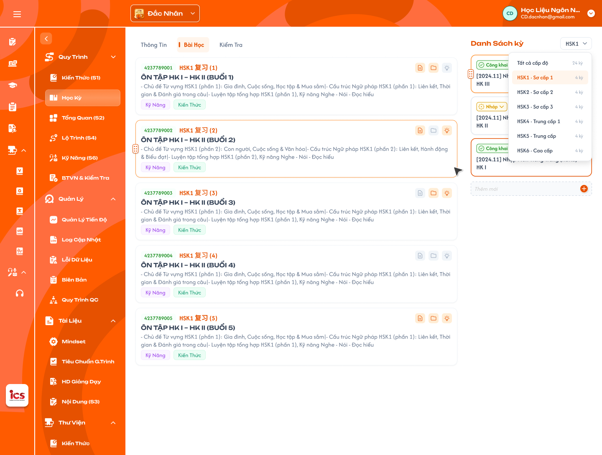

**Mô tả:**
- CD **chỉ xem** danh sách bài học của học kỳ đang chọn; nhấn card để mở popup "Chi tiết bài học".

**Điểm cần lưu ý:**
- Card gồm: mã bài học, tên, mô tả, tag Kỹ năng / Kiến thức (nếu có, = các **loại** đã gắn ở tab Kiến thức / Kỹ năng) và **3 icon góc trên phải** (Nội dung / Tài nguyên / Kiến thức): **sáng** khi phần đó có dữ liệu, **tối** khi chưa có (icon Kiến thức sáng khi có ít nhất 1 kiến thức **hoặc** 1 bài kỹ năng). Icon cập nhật sau khi lưu ở popup.
- Không có nút thêm / xoá bài học, không kéo-thả; bài học tạo / xoá tự động theo "Số buổi" ở Tổng quan (S2) (Flow 4). Tên bài học trên Figma chỉ là dữ liệu mẫu.
- Chỉ sửa được khi học kỳ `Nháp` **và** khoá học `Nháp`; học kỳ hoặc khoá học `Công khai` / `Vô hiệu` → popup chỉ đọc (ẩn nút "Lưu thay đổi", ẩn thêm / xoá tài nguyên), kể cả Tên / Mô tả bài học (quy tắc chung xem `course_management.md` REQ10). Muốn sửa thì nhân bản học kỳ / khoá học.
- Popup Chi tiết bài học — tab `Nội dung` (thiết kế ở Trang 14) có 2 cột. **Cột trái - Nội dung** (2 cấp: Nhóm nội dung → Nội dung; chỉ 1 loại nội dung nhập text):
- `A03.01` Thêm nhóm: nhập **tên** ở ô "Nhập nhóm nội dung mới" → "+"; mô tả nhóm sửa sau trực tiếp trên nhóm.
- `A03.02` Thêm nội dung: nhập tên ở ô "Nhập nội dung mới" trong nhóm → "+", rồi nhập Mô tả.
- `A03.03` Giới hạn: tên nhóm / nội dung bắt buộc, chưa giới hạn độ dài; mô tả nhóm không giới hạn; mô tả nội dung tối đa 500 ký tự (bộ đếm `58/500`).
- `A03.04` Xoá: nội dung có thùng rác; nhóm có thùng rác → popup xác nhận → xoá kèm toàn bộ nội dung bên trong. Popup xóa nhóm: tiêu đề `Xoá nhóm nội dung`; nội dung `Nhóm "{tên nhóm}" và {k} nội dung bên trong sẽ bị xoá. Bạn có chắc chắn muốn tiếp tục?`; nút `Huỷ`, `Xoá nhóm`. Xoá chỉ có hiệu lực khi "Lưu thay đổi".
- `A03.05` Kéo-thả: chỉ trong cùng cấp (nhóm với nhóm, nội dung trong cùng nhóm); **không** kéo nội dung sang nhóm khác.
- `A03.06` Badge tab = tổng số **nội dung** (không tính nhóm).
- **Cột phải - Danh sách buổi học (N):** lấy từ các buổi học được **tick ở Lộ trình (S4)**, **chỉ xem**, bấm vào chỉ mở rộng / thu gọn, không chuyển màn; cập nhật khi đổi tick ở S4. Mỗi mục: số thứ tự, tên, mô tả ngắn, tổng thời lượng (`01:30:00`); mở rộng hiện thành phần + thời lượng, thu gọn hiện `n thành phần`. Chưa tick buổi nào: hiển thị `Chưa có buổi học nào được chọn ở Lộ trình`, (0).
- Màu tổng thời lượng theo % so với thời lượng chuẩn 1 buổi ở Tổng quan (S2): `A03.07` 90% – 100%: xanh; `A03.08` 80% – <90%: vàng; `A03.09` >0 và <80%: cam; `A03.10` `00:00:00`: xám; `A03.11` >100%: đỏ.

### Trang 2: CD-KH-030210 — Học kỳ / Bài học / Popup chi tiết bài học (1)

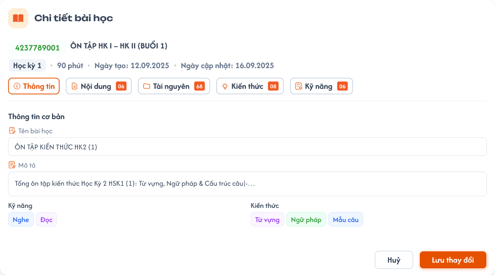

**Mô tả:**
- Popup Chi tiết bài học, tab `Thông tin`. Đầu popup: mã bài học, tên, học kỳ, thời lượng, ngày tạo, ngày cập nhật, **5 tab** (Thông tin, Nội dung, Tài nguyên, Kiến thức, **Kỹ năng**) kèm badge số lượng. Mặc định mở tab Thông tin.

**Điểm cần lưu ý:**
- `Kỹ năng` / `Kiến thức` ở tab Thông tin **read-only, tự hiển thị** theo các **loại** đang có ở tab Kiến thức / Kỹ năng, không chọn tay, không có nút "+". Kiến thức: tag các loại có ≥ 1 mục đã gắn (vd `Từ vựng`, `Ngữ pháp`), không lặp, thứ tự theo tab loại ở S1. Kỹ năng: tag các loại có ≥ 1 bài đã gắn (`Nghe`, `Đọc`, `Viết`, `Nói`), thứ tự theo tab ở S6. Cập nhật ngay khi thêm / gỡ ở tab Kiến thức / Kỹ năng (kể cả trước khi "Lưu thay đổi"); gỡ hết mục của một loại thì tag loại đó biến mất.
- **Mã bài học** (read-only): 12 số `CCAALLBBBEEE` = `CCAALL` của ID khoá học + `BBB` của ID học kỳ + `EEE` số thứ tự bài học (vd khoá `100302001`, học kỳ `100302001002`, bài 5 → `100302002005`). Tự sinh (REQ05).
- Footer chỉ có `Hủy` và `Lưu thay đổi`.
- **Cơ chế lưu:** Thông tin, Nội dung, Kiến thức, Kỹ năng giữ tạm trên FE, chuyển tab không mất; "Lưu thay đổi" lưu tất cả các tab một lần. **Tab Tài nguyên lưu / xoá ngay khi thao tác**, không qua "Lưu thay đổi", không bị "Hủy" hoàn tác.
- "Hủy" / nút X / click ra ngoài khi còn thay đổi chưa lưu → popup xác nhận bên dưới; không có thay đổi thì đóng luôn.
- `A02.01` Tiêu đề popup xác nhận: `Bỏ thay đổi`.
- `A02.02` Nội dung: `Các thay đổi chưa lưu sẽ bị mất. Bạn có chắc chắn muốn đóng?`
- `A02.03` Nút: `Ở lại`, `Bỏ thay đổi`.

### Trang 3: CD-KH-030211 — Học kỳ / Bài học / Popup chi tiết bài học (1) / Chưa gắn kiến thức, kỹ năng

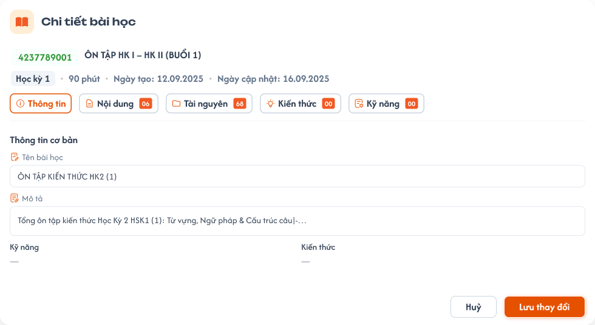

**Mô tả:**
- Trạng thái tab Thông tin khi bài chưa gắn kiến thức / kỹ năng: badge Kiến thức `00`, các field Kỹ năng / Kiến thức hiển thị `—`.

### Trang 4: CD-KH-030230 — Học kỳ / Bài học / Popup chi tiết bài học (3)

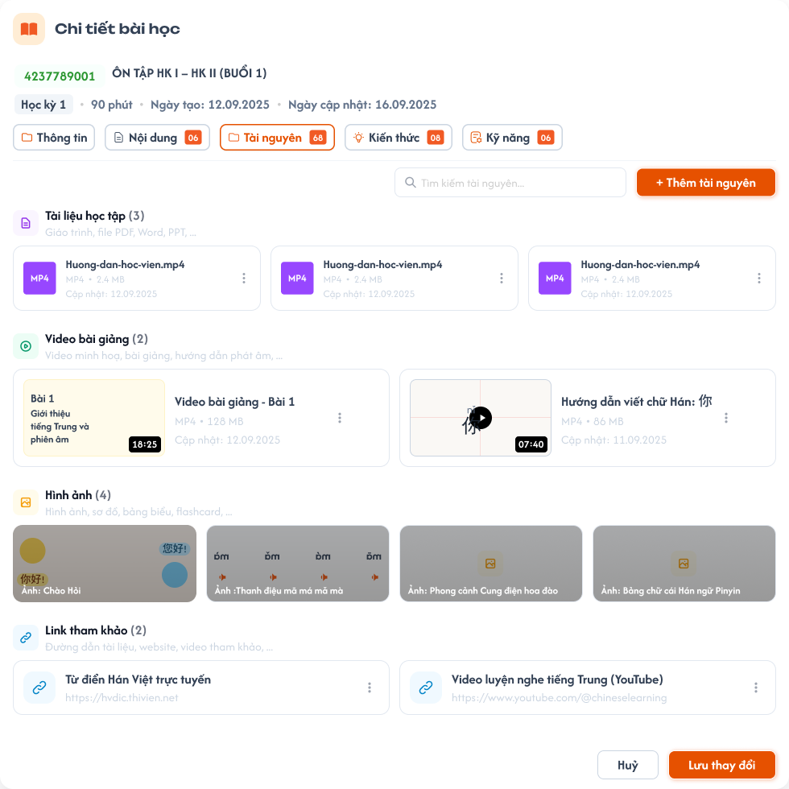

**Mô tả:**
- Tab `Tài nguyên`: ô `Tìm kiếm tài nguyên...` và nút `+ Thêm tài nguyên`, chia 4 nhóm.

**Điểm cần lưu ý:**
- "+ Thêm tài nguyên" mở popup 2 phần: **Thêm file** (chọn từ máy, tự phân loại theo định dạng) và **Thêm link** (nhập URL → nhóm Link tham khảo).
- 4 nhóm: Tài liệu học tập, Video bài giảng, Hình ảnh, Link tham khảo (icon, tiêu đề, mô tả, số lượng). File: icon loại, tên, định dạng, dung lượng, ngày cập nhật; video có thumbnail + thời lượng; menu 3 chấm: **Xem trước, Tải xuống, Xoá**. Link: tên + URL; menu 3 chấm: Xem trước / mở link, Copy link, Xoá.
- Badge tab = tổng tài nguyên các nhóm.
- Upload / xoá có hiệu lực ngay (không qua "Lưu thay đổi"); badge và icon Tài nguyên ở card cập nhật ngay.

### Trang 5: CD-KH-030231 — Học kỳ / Bài học / Popup chi tiết bài học (3) / Tài nguyên / Từng mục trống

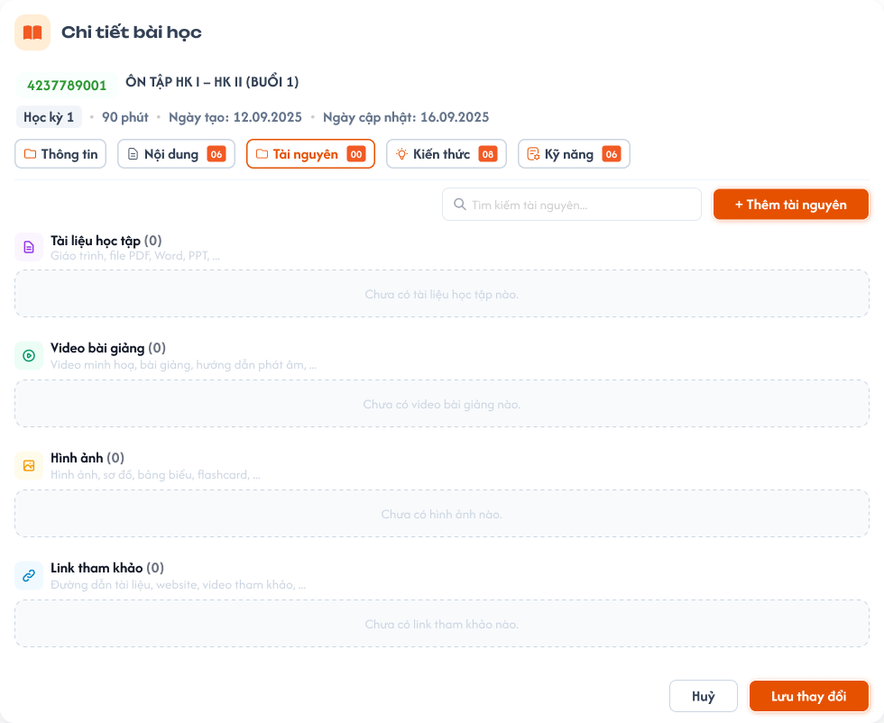

**Mô tả:**
- Trạng thái tab Tài nguyên khi một nhóm chưa có tài nguyên: badge Tài nguyên `00`, nhóm hiển thị `Chưa có tài liệu học tập nào.` (số lượng nhóm `(0)`).

### Trang 6: CD-KH-030240 — Học kỳ / Bài học / Popup chi tiết bài học (4)

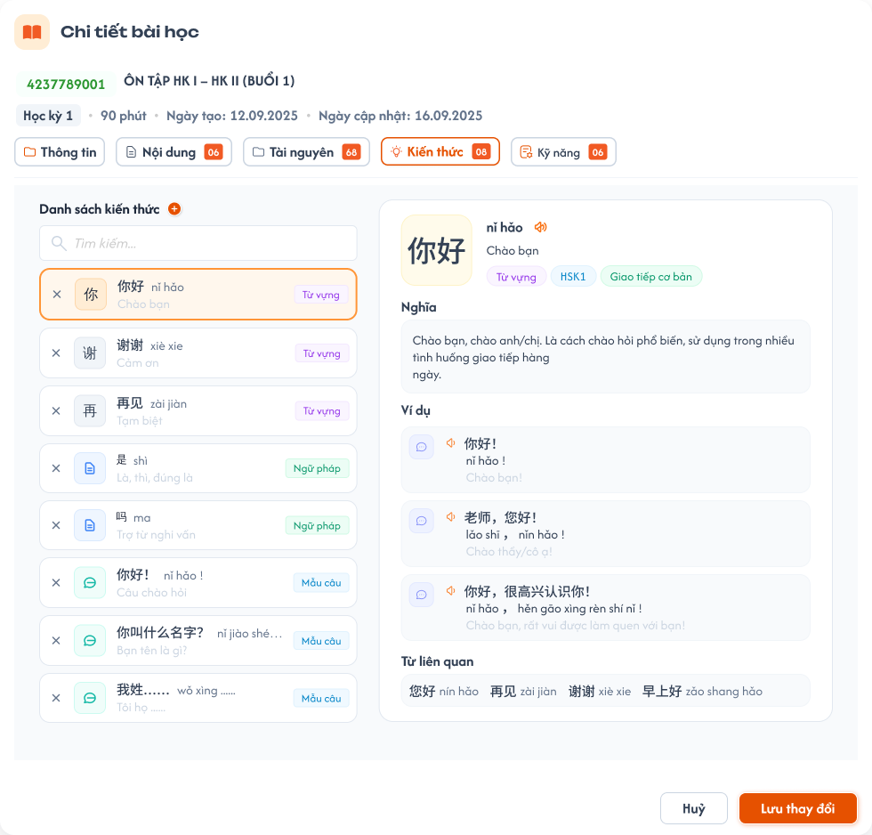

**Mô tả:**
- Tab `Kiến thức`: danh sách kiến thức đã gắn vào bài, chia 2 khung (chỉ xem).

**Điểm cần lưu ý:**
- Dữ liệu lấy từ **Kiến thức (S1)** của khoá học đang mở (bản ghi Thư viện dữ liệu); **không tạo / sửa nội dung kiến thức tại đây**, chỉ thêm / gỡ.
- **Khung trái - danh sách đã gắn:** mỗi dòng có nút **x** bên trái (gỡ khỏi bài), nội dung chính (từ / mẫu ngữ pháp / chữ…) và **nghĩa ở dòng dưới**, bên phải là tag loại (`Từ vựng`, `Ngữ pháp`…). Nhóm theo loại, thứ tự loại theo S1, trong loại theo thứ tự thêm. Không kéo-thả; có ô `Tìm kiếm...`.
- **Khung phải - chi tiết:** bấm một dòng ở khung trái thì hiện đầy đủ thông tin mục đó (field theo loại như ở S1), chỉ xem, không có nút sửa / menu 3 chấm. Mặc định chọn dòng đầu tiên.
- Gỡ: nhấn **x** bên trái dòng (chỉ gỡ liên kết, không xoá dữ liệu S1). Badge tab = số kiến thức đã gắn. Nút "+" mở popup Thêm kiến thức (Trang 8).

### Trang 7: CD-KH-030241 — Học kỳ / Bài học / Popup chi tiết bài học / Tab Kiến thức / Trống

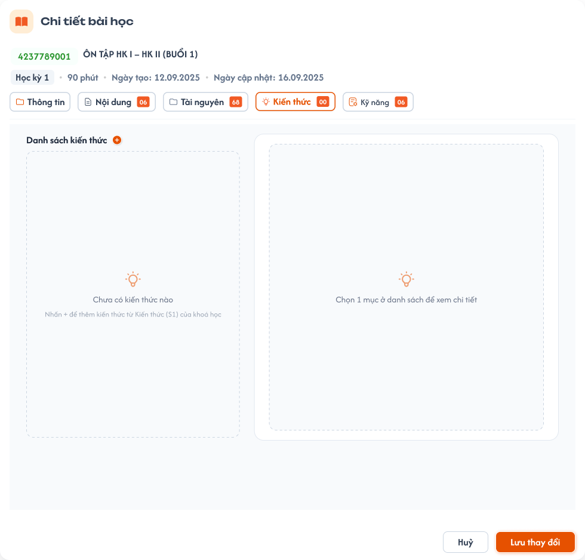

**Mô tả:**
- Trạng thái trống của tab Kiến thức: badge `00`, danh sách hiển thị `Chưa có kiến thức nào`, gợi ý `Nhấn + để thêm kiến thức từ Kiến thức (S1) của kho`, khung phải `Chọn 1 mục ở danh sách để xem chi tiết`.

### Trang 8: CD-KH-030244 — Học kỳ / Bài học / Popup chi tiết bài học / Tab Kiến thức / Popup Thêm kiến thức

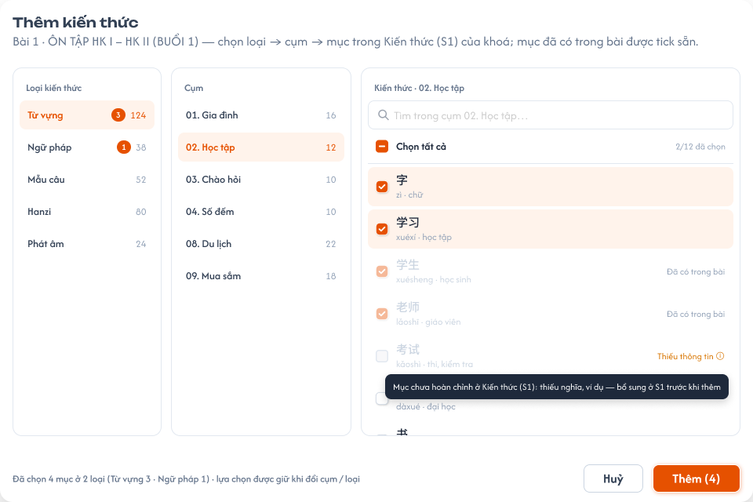

**Mô tả:**
- Popup `Thêm kiến thức` (dòng phụ là tên bài), **1 màn 3 cột**: Loại kiến thức → Cụm → Kiến thức.

**Điểm cần lưu ý:**
- **Cột Loại kiến thức:** các loại có ở S1 của trung tâm (Từ vựng, Ngữ pháp, Mẫu câu, Hanzi, Kanji, Phát âm; Bảng chữ nếu trung tâm có).
- **Cột Cụm:** các cụm của loại đang chọn (kèm số mục). Không gắn cụm vào bài; không có mục `Chưa phân cụm`.
- **Cột Kiến thức:** mục thuộc loại + cụm đang chọn, chọn nhiều (checkbox), có ô tìm kiếm theo nội dung mục. Checkbox `Chọn tất cả` đầu cột = chọn mọi mục hợp lệ của cụm (thêm cả cụm); hiển thị `n/N đã chọn`.
- **Giữ lựa chọn khi đổi cụm / loại:** chọn mục ở nhiều cụm, nhiều loại trong một lần mở popup; nút `Thêm ({n})` đếm tổng. Nút `Huỷ`, `Thêm ({n})`; thêm xong đóng popup, mục mới hiện vào danh sách, tag loại ở tab Thông tin cập nhật.
- Mục đã gắn vào bài: tick sẵn + disable (EX02). Mục thiếu thông tin / chưa hoàn chỉnh ở S1: hiển thị nhưng disable, có tooltip lý do (EX08).
- "Thêm cả cụm" = `Chọn tất cả` trong cụm: chỉ là chọn nhanh, thêm **một lần** các mục đang có, không liên kết cụm với bài; mục thêm vào cụm sau này không tự vào bài, CD phải mở popup chọn thủ công.
- Một mục chỉ thuộc một cụm. Mục `Chưa phân cụm` không hiển thị trong popup, không thêm được vào bài; CD phải gán cụm ở S1 / S6 trước.

### Trang 9: CD-KH-030247 — Học kỳ / Bài học / Popup chi tiết bài học / Tab Kiến thức / Popup Thêm kiến thức / Cụm chưa có kiến thức

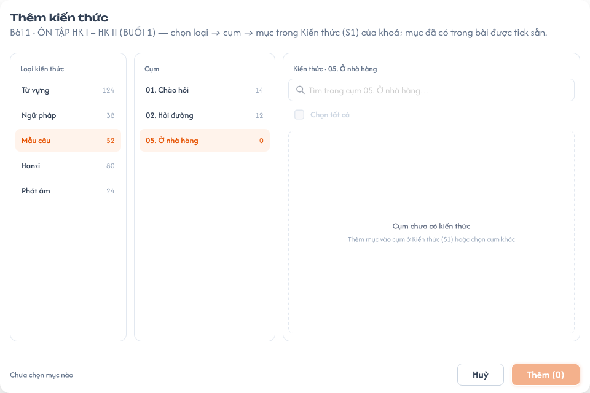

**Mô tả:**
- Trạng thái popup Thêm kiến thức khi cụm đang chọn chưa có mục (số mục `0`): hiển thị `Cụm chưa có kiến thức`, gợi ý `Thêm mục vào cụm ở Kiến thức (S1) hoặc chọn cụm khác`, `Chưa chọn mục nào`; nút `Thêm` disable (EX06).

### Trang 10: CD-KH-030242 — Học kỳ / Bài học / Popup chi tiết bài học / Tab Kỹ năng

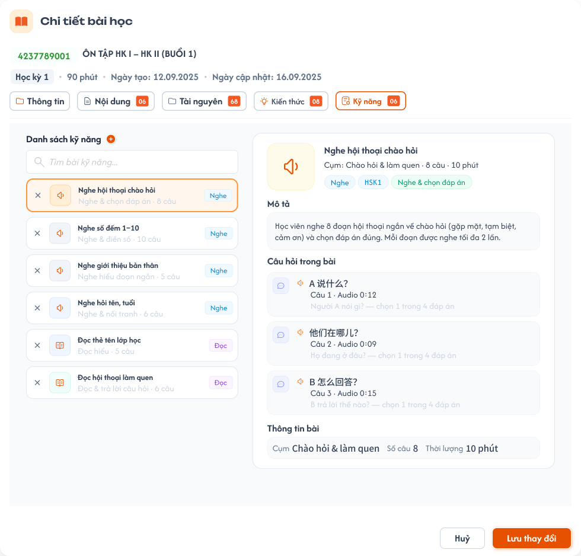

**Mô tả:**
- Tab `Kỹ năng` (tab riêng): tương tự tab Kiến thức; dữ liệu lấy từ **Kỹ năng (S6)** của khoá học đang mở (bản ghi Thư viện kỹ năng), không tạo / sửa bài kỹ năng tại đây.

**Điểm cần lưu ý:**
- Bố cục 2 khung giống tab Kiến thức: khung trái danh sách bài đã gắn (nút **x** bên trái, tên bài + mô tả ngắn bên dưới, số câu, tag loại `Nghe` / `Đọc` / `Viết` / `Nói` bên phải); khung phải chi tiết bài đang chọn, chỉ xem. Ô tìm kiếm `Tìm bài kỹ năng...`.
- Badge tab = số bài kỹ năng đã gắn. Nút "+" mở popup Thêm kỹ năng (Trang 12).

### Trang 11: CD-KH-030243 — Học kỳ / Bài học / Popup chi tiết bài học / Tab Kỹ năng / Trống

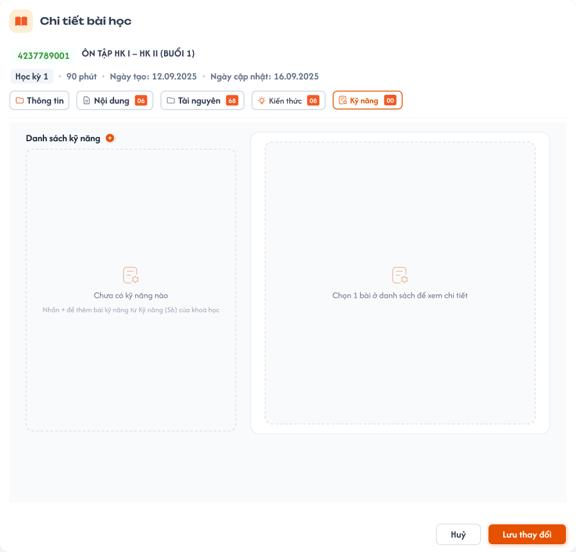

**Mô tả:**
- Trạng thái trống của tab Kỹ năng: badge `00`, danh sách hiển thị `Chưa có kỹ năng nào`, gợi ý `Nhấn + để thêm bài kỹ năng từ Kỹ năng (S6) của kho`, khung phải `Chọn 1 bài ở danh sách để xem chi tiết`.

### Trang 12: CD-KH-030245 — Học kỳ / Bài học / Popup chi tiết bài học / Tab Kỹ năng / Popup Thêm kỹ năng

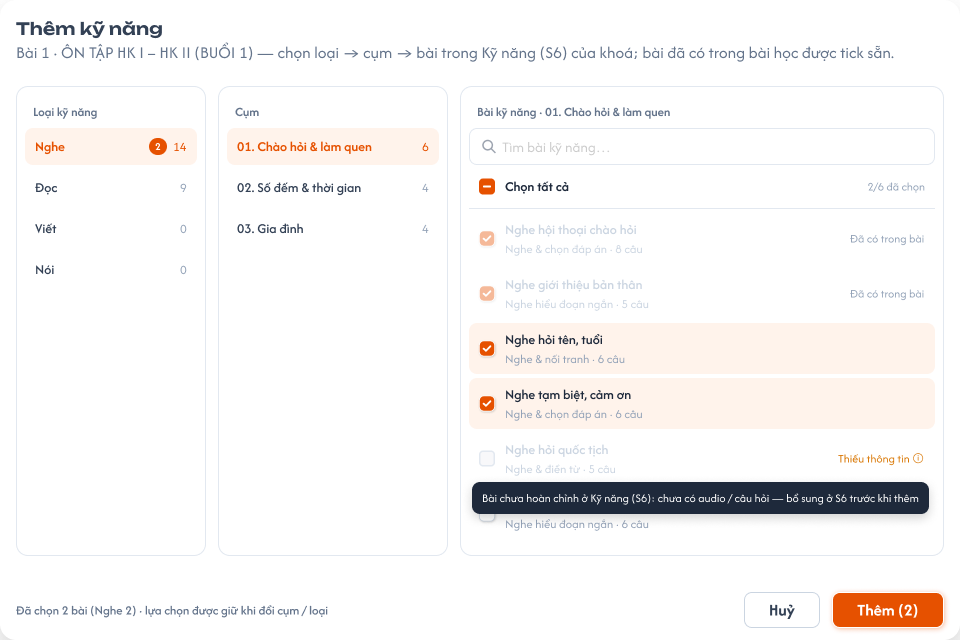

**Mô tả:**
- Popup `Thêm kỹ năng` 1 màn 3 cột: Loại kỹ năng | Cụm (có "Thêm cả cụm") | Bài kỹ năng (chọn nhiều, `Chọn tất cả`, tìm kiếm).

**Điểm cần lưu ý:**
- Luôn hiện đủ 4 loại `Nghe`, `Đọc`, `Viết`, `Nói` (kèm số liệu); loại chưa có dữ liệu hiển thị trạng thái trống.
- Quy tắc giữ lựa chọn khi đổi cụm / loại, mục đã gắn (tick sẵn + disable, nhãn `Đã có trong bài`), mục thiếu thông tin, thêm cả cụm giống popup Thêm kiến thức.

### Trang 13: CD-KH-030246 — Học kỳ / Bài học / Popup chi tiết bài học / Tab Kỹ năng / Popup Thêm kỹ năng / Loại chưa có dữ liệu

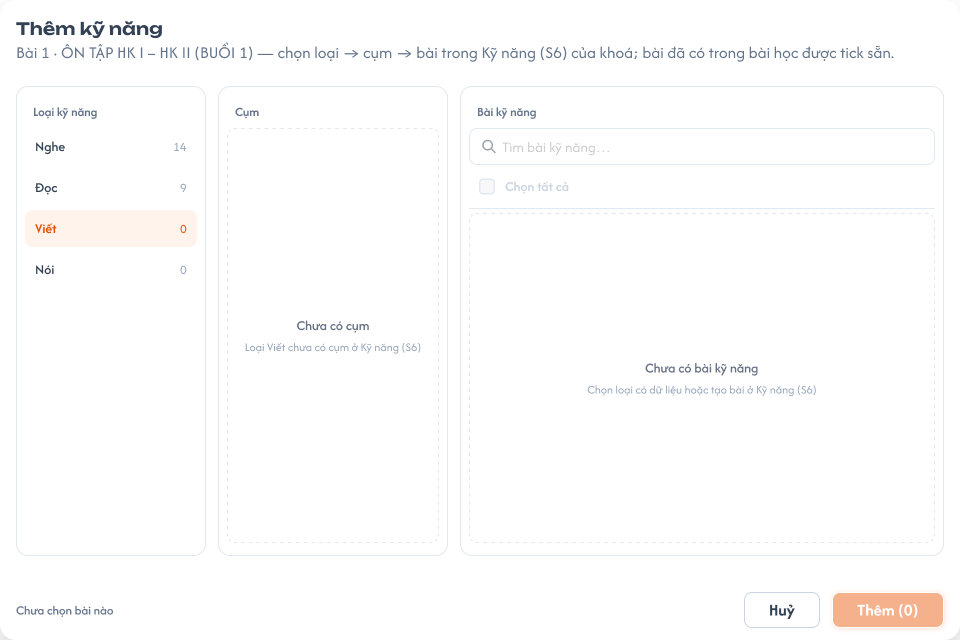

**Mô tả:**
- Trạng thái popup Thêm kỹ năng khi loại chưa có dữ liệu (hiện `Viết`, `Nói`): cột Cụm hiển thị `Chưa có cụm` (`Loại Viết chưa có cụm ở Kỹ năng (S6)`), cột Bài kỹ năng hiển thị `Chưa có bài kỹ năng`, gợi ý `Chọn loại có dữ liệu hoặc tạo bài ở Kỹ năng (S6)`, `Chưa chọn bài nào`; nút `Thêm (0)` disable (EX06).

### Trang 14: CD-KH-030250 — Học kỳ / Bài học / Popup chi tiết bài học (bản đầy đủ)

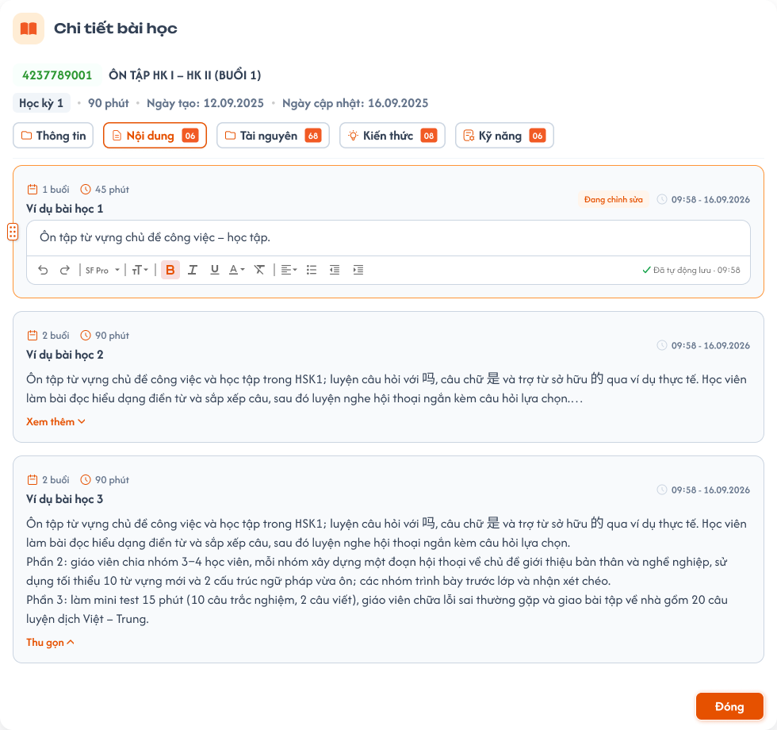

**Mô tả:**
- Popup Chi tiết bài học ở tab `Nội dung`: cột trái là các nhóm nội dung và nội dung (mỗi mục kèm mô tả), cột phải là danh sách buổi học (vd `1 buổi`, `45 phút`) lấy từ Lộ trình (S4). Quy tắc từng thành phần xem các mã `A03.01`–`A03.11` ở Trang 1.

---

## 2. Yêu cầu

### 2.1. Flow chính

**Flow 1: Mở chi tiết**

```
CD nhấn card → FE mở popup, mặc định tab Thông tin
```

**Flow 2: Chỉnh sửa và lưu gộp**

```
CD sửa ở các tab Thông tin / Nội dung / Kiến thức / Kỹ năng (giữ tạm ở FE)
  → nhấn "Lưu thay đổi" → FE gửi gộp thay đổi các tab → BE validate & cập nhật
  → FE đóng popup, cập nhật card (kể cả 3 icon) và badge
```

**Flow 3: Tài nguyên** (lưu ngay, độc lập với "Lưu thay đổi")

```
CD nhấn "+ Thêm tài nguyên" → chọn file (BE lưu, tự phân loại) hoặc nhập URL (BE lưu vào Link tham khảo)
  → FE thêm vào đúng nhóm, cập nhật badge/icon
Xoá tài nguyên: menu 3 chấm → Xoá → BE xoá ngay
```

**Flow 4: Tự tạo / xoá bài học theo "Số buổi" ở Tổng quan (S2)** (chỉ khi học kỳ `Nháp` và khoá học `Nháp`; số buổi cũ = N, mới = M)

```
M > N: BE tự tạo (M − N) bài học ở cuối, tên mặc định `Bài học {số thứ tự}`, dữ liệu con rỗng, Mã bài học theo REQ05

M < N: FE hiển thị popup xác nhận
   ├─ Xác nhận: BE xoá mềm (N − M) bài cuối (số thứ tự lớn nhất) + xoá mềm toàn bộ nội dung/tài nguyên/liên kết kiến thức bên trong
   └─ Huỷ: giữ nguyên số buổi cũ và toàn bộ bài học
```

Ví dụ: 30 → 20 thì xoá bài 21 đến 30. Popup giảm số buổi (màn S2): tiêu đề `Xoá bài học`; nội dung `Số buổi giảm từ {N} xuống {M}. {N − M} bài học cuối (bài {M + 1} đến bài {N}) sẽ bị xoá cùng toàn bộ nội dung, tài nguyên và kiến thức bên trong. Bạn có chắc chắn muốn tiếp tục?`; nút `Huỷ`, `Xoá bài học`.

**Flow 5: Thêm kiến thức / kỹ năng vào bài**

```
Mở tab Kiến thức (hoặc Kỹ năng) → nhấn "+" → FE mở popup 3 cột
  → chọn loại → FE tải cụm của loại (S1 / S6)
  → chọn cụm → FE tải mục thuộc loại + cụm (đánh dấu mục đã gắn / thiếu thông tin)
  → tick mục lẻ hoặc "Chọn tất cả" của cụm; đổi cụm/loại vẫn giữ lựa chọn
  → "Thêm" → FE thêm vào danh sách của bài (giữ tạm), cập nhật badge + tag loại ở tab Thông tin
Gỡ: nhấn x → FE bỏ khỏi danh sách, cập nhật badge + tag
Lưu khi nhấn "Lưu thay đổi" (Flow 2)
```

### 2.2. Ngoại lệ

- **EX01:** Tên nhóm / nội dung trống hoặc chỉ khoảng trắng → chặn thêm / lưu.
- **EX02:** Kiến thức / kỹ năng đã gắn → không gắn trùng (popup: mục đã gắn tick sẵn + disable; BE bỏ qua bản ghi trùng).
- **EX03:** `BBB` của ID học kỳ đổi (chỉ khi học kỳ `Nháp`) hoặc `CCAALL` của ID khoá học đổi (chỉ khi khoá học `Nháp`, xem `course_management.md` REQ06) → đồng bộ 9 số đầu Mã bài học của **tất cả** bài học bị ảnh hưởng, `EEE` giữ nguyên.
- **EX04:** Học kỳ hoặc khoá học `Công khai` / `Vô hiệu` → popup chỉ đọc (gồm cả tab Tài nguyên), không cho đổi "Số buổi" ở S2; gọi API ghi trực tiếp → BE từ chối, dữ liệu không đổi.
- **EX05:** "Lưu thay đổi" thất bại → không ghi một phần, popup giữ nguyên thay đổi chưa lưu để thử lại.
- **EX06:** Loại chưa có cụm / cụm chưa có mục ở S1 hoặc S6 → popup hiển thị trạng thái trống (`Chưa có cụm` / `Cụm chưa có kiến thức`), nút `Thêm` disable.
- **EX07:** Xoá (gỡ khỏi khoá) mục kiến thức / bài kỹ năng ở S1 / S6 khi đang gắn vào bài học → popup cảnh báo liệt kê bài học đang dùng; xác nhận → BE tự gỡ khỏi mọi bài học liên quan.
- **EX08:** Mục thiếu thông tin / chưa hoàn chỉnh ở S1 / S6 → không được gắn vào bài (popup disable, "Chọn tất cả" bỏ qua; BE từ chối).
- **EX09:** Ở S1 / S6, mục bị **gỡ khỏi cụm** hoặc cụm bị **xoá** → mục đó (mọi mục của cụm khi xoá cụm) **tự gỡ khỏi các bài học** đã thêm nó từ cụm đó, có cảnh báo liệt kê bài học. Thêm mục mới vào cụm **không** tự gắn vào bài. Gỡ ở bài học (nút x) chỉ xoá liên kết, mục vẫn ở S1 / S6 và cụm.
- **EX10:** Mục `Chưa phân cụm` → không thêm được vào bài (popup không hiển thị; BE từ chối).

### 2.3. Yêu cầu khác

| Mã | Tên yêu cầu | Mô tả |
|---|---|---|
| REQ01 | Danh sách chỉ xem | Không kéo-thả, không thêm / xoá thủ công. Thứ tự cố định theo 3 số cuối Mã bài học. Card không có nhãn cam, mũi tên. |
| REQ02 | Icon 3 phần | Sáng khi số lượng phần đó > 0 (icon Kiến thức = số kiến thức + số bài kỹ năng), tối khi = 0. |
| REQ03 | Nội dung dạng text | 1 loại nội dung text, nhóm → nội dung; tên bắt buộc; mô tả nội dung ≤ 500 ký tự; kéo-thả / xoá / badge theo mục 1. |
| REQ04 | Không sửa kiến thức / kỹ năng từ bài học | Chỉ tạo / sửa ở S1 / S6; bài học chỉ thêm / gỡ; không gắn trùng một mục vào cùng bài học. |
| REQ05 | Mã bài học | 12 số `CCAALLBBBEEE`: `CC` = mã trung tâm, `AA` = ID danh mục, `LL` = ID cấp độ (lấy từ ID khoá học `CCAALLMMM`), `BBB` = 3 số cuối ID học kỳ (`CCAALLMMMBBB`), `EEE` = số thứ tự bài học (`001`–`999`). Mã không chứa `MMM` của khoá học. Tự sinh, không sửa thủ công; đồng bộ khi ID học kỳ / ID khoá học đổi (EX03). |
| REQ06 | Tự tạo / xoá bài học | Số bài học = "Số buổi" ở S2. Tên mặc định `Bài học {số thứ tự}`. Xoá = xoá mềm bài + dữ liệu con (nội dung, tài nguyên, liên kết kiến thức / kỹ năng). |
| REQ07 | Cột buổi học | Lấy từ tick ở Lộ trình (S4), chỉ xem; màu thời lượng và trạng thái trống theo mục 1. |
| REQ08 | Lưu và Hủy | Thông tin / Nội dung / Kiến thức / Kỹ năng lưu gộp khi "Lưu thay đổi"; Tài nguyên lưu / xoá ngay; Hủy / X / click ngoài có popup xác nhận khi còn thay đổi chưa lưu. |
| REQ09 | Quyền theo trạng thái | Chỉ sửa bài học (thông tin, nội dung, tài nguyên, kiến thức / kỹ năng) và đổi "Số buổi" khi học kỳ `Nháp` **và** khoá học `Nháp`. Bài học không có trạng thái riêng, đi theo trạng thái học kỳ / khoá học. Nhân bản học kỳ / khoá học sao chép toàn bộ bài học (xem `information.md` REQ06, `course_management.md` REQ11). |
| REQ10 | Tab Kiến thức / Kỹ năng | Hai tab riêng, mỗi tab là danh sách mục đã gắn + nút "+" mở popup 3 bước: loại → cụm → mục (chọn nhiều). Kiến thức lấy từ S1, Kỹ năng lấy từ S6 của khoá đang mở. |
| REQ11 | Kỹ năng / Kiến thức ở tab Thông tin | Read-only, tự sinh = tập **loại** có ≥ 1 mục ở tab Kiến thức / Kỹ năng; không lưu riêng, không chọn tay. |
| REQ12 | Thêm cả cụm và đồng bộ khi đổi cụm | "Chọn tất cả" trong cụm thêm một lần mọi mục hợp lệ, không tự gắn mục mới. Gỡ mục khỏi cụm / xoá cụm ở S1 / S6 thì gỡ mục tương ứng khỏi bài học (có cảnh báo). |

### 2.4. Ràng buộc

#### Quyền

| Role | Xem | Sửa thông tin | Sửa nội dung/tài nguyên | Gắn kiến thức/kỹ năng |
|---|:---:|:---:|:---:|:---:|
| CD | ✅ | ✅ | ✅ | ✅ |
| Role khác | ❌ | ❌ | ❌ | ❌ |

#### Ràng buộc khác

- Sửa bài học và đổi "Số buổi" chỉ khi học kỳ `Nháp` và khoá học `Nháp`; ngược lại popup chỉ đọc, BE từ chối request ghi trực tiếp.
- Tab Tài nguyên lưu / xoá ngay, các tab còn lại lưu gộp.

---

## 3. Testcase

### Feature: Học Kỳ - Tab Bài học

| Tên testcase | Priority | Scenario | Role | Pre-condition | Given/When/Then | Expected Result |
|---|---|---|---|---|---|---|
| Case 1: Danh sách bài học và icon | High | Flow 1 / REQ01 / REQ02 | CD | Học kỳ có bài đủ 3 phần, thiếu 1 phần, trống | **Given:** CD ở tab Bài học<br>**When:** trang tải xong<br>**Then:** hiển thị danh sách | - Đúng bài theo học kỳ, card đúng mã / tên / mô tả<br>- Icon sáng / tối đúng dữ liệu (bài trống: 3 icon tối)<br>- Không có kéo-thả, nhãn cam, mũi tên, nút thêm / xoá bài |
| Case 2: Mở popup, sửa thông tin và Mã bài học | High | Flow 1 / Flow 2 / REQ05 / REQ11 / EX03 | CD | Học kỳ `Nháp`, khoá `Nháp` | **Given:** nhấn card<br>**When:** sửa Tên / Mô tả, "Lưu thay đổi"; đổi `BBB` học kỳ hoặc Danh mục / Cấp độ khoá học<br>**Then:** cập nhật | - Mở đúng bài, mặc định tab Thông tin, footer chỉ có "Hủy" / "Lưu thay đổi", 5 tab kèm badge<br>- Card cập nhật theo<br>- Mã bài học read-only 12 số `CCAALLBBBEEE`; đổi ID thì 9 số đầu mọi bài cập nhật, `EEE` giữ nguyên<br>- Kỹ năng / Kiến thức ở tab Thông tin read-only |
| Case 3: Nhóm / nội dung: thêm và validation | High | REQ03 / EX01 | CD | Học kỳ `Nháp`, khoá `Nháp`; tab Nội dung | **Given:** nhập tên vào ô thêm nhóm / thêm nội dung rồi "+"<br>**When:** nhập mô tả, thử tên trống / chỉ khoảng trắng, mô tả nội dung > 500 ký tự, rồi lưu<br>**Then:** hệ thống lưu hoặc chặn | - Nhóm / nội dung hiển thị đúng vị trí, bộ đếm đúng<br>- Tên trống: không thêm<br>- Mô tả nội dung không quá 500 ký tự; mô tả nhóm sửa trực tiếp, không giới hạn<br>- Badge "Nội dung" = số nội dung |
| Case 4: Xoá và kéo-thả nội dung | High | REQ03 | CD | `Nháp`; ≥ 2 nhóm, mỗi nhóm có nội dung | **Given:** tab Nội dung<br>**When:** xoá nội dung; xoá nhóm (popup xác nhận); kéo-thả nhóm / nội dung; thử kéo nội dung sang nhóm khác; lưu<br>**Then:** hệ thống cập nhật | - Xoá nhóm: popup nêu đúng tên + số nội dung, xoá kèm nội dung; `Huỷ` giữ nguyên<br>- Xoá chỉ có hiệu lực khi "Lưu thay đổi"<br>- Kéo-thả cùng cấp lưu đúng thứ tự; kéo sang nhóm khác bị chặn<br>- Badge cập nhật |
| Case 5: Cột buổi học theo S4 | High | REQ07 | CD | Có buổi đã tick và chưa tick ở S4; thời lượng chuẩn 01:30:00 | **Given:** mở tab Nội dung<br>**When:** xem cột phải, mở rộng một mục, bấm vào mục<br>**Then:** hiển thị | - Chỉ các mục đã tick, số (N) đúng; mở rộng đúng thành phần / thời lượng; không chuyển màn, không sửa được<br>- Chưa tick: `Chưa có buổi học nào được chọn ở Lộ trình`<br>- Màu: 100% xanh, 83% vàng, 50% cam, `00:00:00` xám, 117% đỏ<br>- Đổi tick ở S4 thì cập nhật |
| Case 6: Tài nguyên (file, link, menu 3 chấm) | High | Flow 3 / REQ08 | CD | Học kỳ `Nháp`, khoá `Nháp`; tab Tài nguyên | **Given:** nhấn "+ Thêm tài nguyên"<br>**When:** thêm file hợp lệ, thêm URL, dùng menu 3 chấm (Xem trước, Tải xuống, Xoá, Copy link), nhấn "Hủy" popup thêm, rồi "Hủy" popup chi tiết<br>**Then:** hệ thống xử lý | - File vào đúng nhóm theo định dạng, link vào "Link tham khảo"<br>- Lưu / xoá có hiệu lực ngay, badge và icon card cập nhật ngay<br>- "Hủy" không hoàn tác tài nguyên đã upload / xoá<br>- Nhóm trống hiển thị trạng thái trống, badge `00` |
| Case 7: Thêm / gỡ kiến thức | High | Flow 5 / REQ04 / REQ10 / EX02 | CD | Học kỳ `Nháp`, khoá `Nháp`; bài đã gắn 1 từ vựng cụm 1; S1 có Ngữ pháp cụm 2 | **Given:** tab Kiến thức<br>**When:** "+" → `Ngữ pháp` → `Cụm 2` → tick 2 mục → `Thêm`; mở lại popup `Từ vựng` → `Cụm 1`; bấm một dòng xem chi tiết; nhấn x 1 mục; lưu<br>**Then:** hệ thống cập nhật | - Popup đi đúng 3 cột, chỉ hiện cụm / mục của loại đã chọn, có tìm kiếm<br>- 2 mục ngữ pháp hiện trong danh sách (x bên trái, nghĩa dưới, tag loại bên phải), badge đúng<br>- Mục đã gắn tick sẵn + disable, không tạo trùng<br>- Khung phải chi tiết chỉ xem; gỡ không xoá dữ liệu S1; không có nút sửa nội dung kiến thức |
| Case 8: Thêm / gỡ kỹ năng | High | Flow 5 / REQ10 / EX02 | CD | Học kỳ `Nháp`, khoá `Nháp`; S6 có bài Nghe, Đọc; `Viết`, `Nói` chưa có dữ liệu | **Given:** tab Kỹ năng<br>**When:** "+" → `Nghe` → chọn cụm → tick bài → `Thêm`; nhấn x; lưu; mở loại `Viết`<br>**Then:** hệ thống cập nhật | - Luôn đủ 4 loại `Nghe`, `Đọc`, `Viết`, `Nói`; `Viết` hiện trạng thái trống<br>- Bài kỹ năng hiện trong danh sách, badge đúng; không gắn trùng<br>- Gỡ không xoá dữ liệu S6 |
| Case 9: Tag tự động ở tab Thông tin | High | REQ11 | CD | Học kỳ `Nháp`, khoá `Nháp` | **Given:** bài chưa gắn gì<br>**When:** thêm Từ vựng + Ngữ pháp, thêm Nghe; rồi gỡ hết Ngữ pháp<br>**Then:** tab Thông tin cập nhật | - Chưa gắn: `—`; sau khi thêm Kiến thức `Từ vựng`, `Ngữ pháp`, Kỹ năng `Nghe`; gỡ hết Ngữ pháp thì còn `Từ vựng`<br>- Không có nút "+" ở tab Thông tin<br>- Card và icon Kiến thức cập nhật sau khi lưu |
| Case 10: Thêm cả cụm, mục thiếu thông tin, Chưa phân cụm, popup trống | High | REQ12 / EX06 / EX08 / EX10 | CD | Cụm 1 Từ vựng có 5 mục (1 mục thiếu thông tin); có mục `Chưa phân cụm`; loại / cụm rỗng | **Given:** popup Thêm kiến thức<br>**When:** chọn cụm 1 → "Chọn tất cả", chọn thêm 2 mục Ngữ pháp cụm 2, `Thêm`, lưu; sau đó thêm mục mới vào cụm 1 ở S1; mở loại / cụm rỗng<br>**Then:** hệ thống cập nhật | - Gắn 4 mục hợp lệ + 2 mục ngữ pháp (lựa chọn giữ khi đổi loại)<br>- Mục thiếu thông tin disable có tooltip, không gắn; mục `Chưa phân cụm` không hiển thị / không thêm được<br>- Mục mới của cụm 1 **không** tự vào bài<br>- Loại / cụm rỗng: `Chưa có cụm` / `Cụm chưa có kiến thức`, `Thêm` disable |
| Case 11: Đồng bộ khi gỡ khỏi cụm, xoá cụm hoặc xoá mục ở S1 / S6 | High | EX07 / EX09 | CD | Bài 1 đã thêm 4 mục từ cụm 1; một mục đang gắn vào 2 bài học | **Given:** ở S1 gỡ 1 mục khỏi cụm 1; xoá cụm 1; xoá mục đang gắn vào 2 bài<br>**When:** xác nhận cảnh báo<br>**Then:** bài học cập nhật | - Cảnh báo liệt kê đúng bài học đang dùng<br>- Gỡ mục khỏi cụm: Bài 1 mất mục đó; xoá cụm: Bài 1 mất toàn bộ mục còn lại của cụm 1<br>- Xoá mục ở S1: mục biến mất khỏi cả 2 bài, badge / tag cập nhật<br>- Gỡ ở bài học (x) chỉ xoá liên kết, mục vẫn ở S1 / S6 và cụm |
| Case 12: Lưu gộp, Hủy và lỗi | High | Flow 2 / REQ08 / EX05 | CD | Học kỳ `Nháp`, khoá `Nháp`; sửa ở nhiều tab | **Given:** đã sửa Thông tin, Nội dung, Kiến thức, chuyển tab qua lại<br>**When:** (a) "Lưu thay đổi"; (b) "Hủy" / X / click ngoài rồi `Bỏ thay đổi` hoặc `Ở lại`; (c) lưu khi backend lỗi<br>**Then:** hệ thống xử lý | - Chuyển tab không mất thay đổi<br>- (a) Lưu tất cả tab một lần, Toast `Thành Công`<br>- (b) Popup `Bỏ thay đổi`; `Bỏ thay đổi` bỏ toàn bộ thay đổi mọi tab; `Ở lại` giữ nguyên; không có thay đổi thì đóng luôn<br>- (c) Toast `Có Lỗi Xảy Ra`, không ghi một phần, giữ thay đổi để thử lại |
| Case 13: Tăng / giảm số buổi | High | Flow 4 / REQ06 | CD | Học kỳ `Nháp`, khoá `Nháp` có 20 bài; bài cuối có nội dung / tài nguyên / kiến thức | **Given:** đổi "Số buổi" ở S2<br>**When:** tăng 20→30; giảm 30→20 rồi `Xoá bài học`; giảm rồi `Huỷ`<br>**Then:** hệ thống xử lý | - Tăng: thêm bài 21–30, tên `Bài học 21`…`Bài học 30`, dữ liệu rỗng (3 icon tối), Mã 3 số cuối 021–030<br>- Giảm: popup nêu đúng bài 21–30; xác nhận → xoá mềm 10 bài cuối cùng dữ liệu con, bài 1–20 giữ nguyên<br>- Huỷ: số buổi và bài học không đổi |
| Case 14: Chỉ đọc và phân quyền | High | REQ09 / EX04 / Ràng buộc quyền | CD, role khác | Học kỳ `Công khai` / `Vô hiệu`, hoặc học kỳ `Nháp` thuộc khoá `Công khai` / `Vô hiệu` | **Given:** CD mở popup bài học / S2; hoặc user khác CD mở URL tab Bài học<br>**When:** thử sửa thông tin / nội dung / tài nguyên / kiến thức, đổi "Số buổi" (kể cả gọi API trực tiếp)<br>**Then:** hệ thống từ chối | - Popup chỉ đọc (cả tab Tài nguyên), ẩn "Lưu thay đổi"; không đổi được "Số buổi"<br>- Backend từ chối, dữ liệu không đổi<br>- Role khác CD không xem / thao tác được |

---

## 4. Câu hỏi cần xác nhận

- **Q01:** Popup cảnh báo ở S1 / S6 (khi gỡ mục khỏi khoá, gỡ mục khỏi cụm, xoá cụm mà mục đang gắn bài học — EX07, EX09) chưa có thiết kế trên Figma. Khi nào bổ sung frame?
- **Q02:** Việc tự gỡ mục khỏi bài khi gỡ khỏi cụm / xoá cụm ở S1 / S6 (EX09) có áp dụng cho bài thuộc học kỳ / khoá `Công khai` không? Tạm: chỉ bài thuộc học kỳ + khoá `Nháp`.
