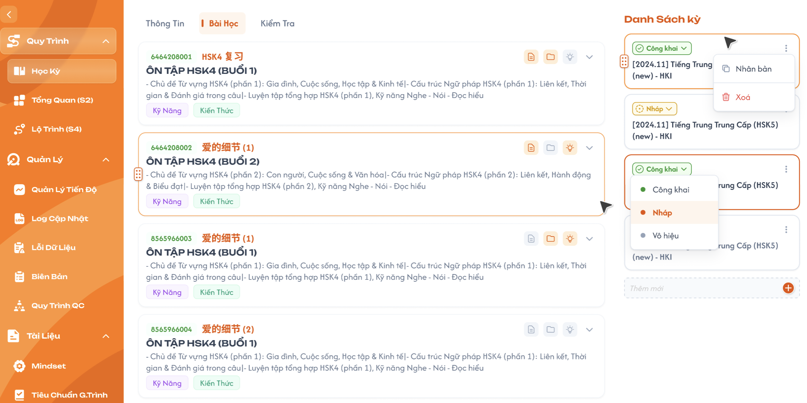
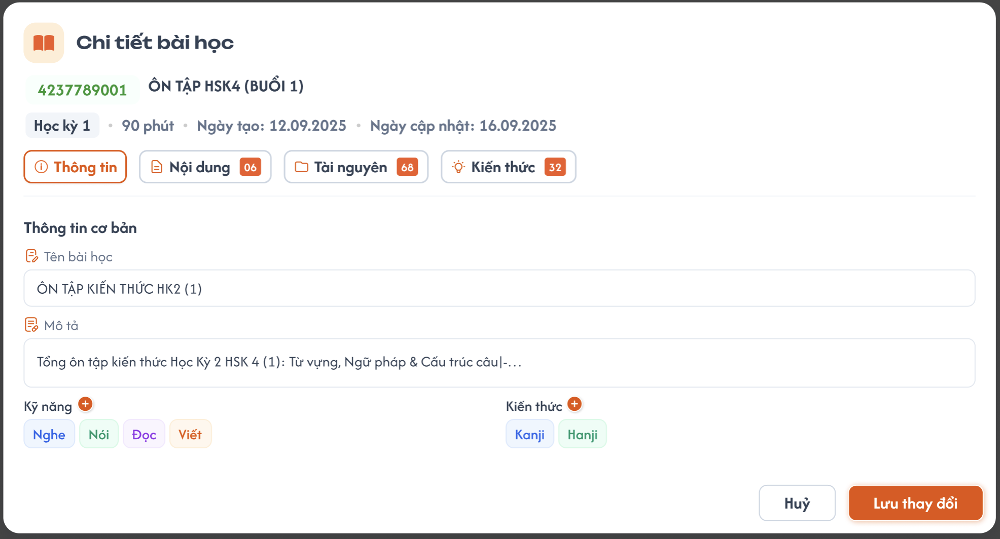
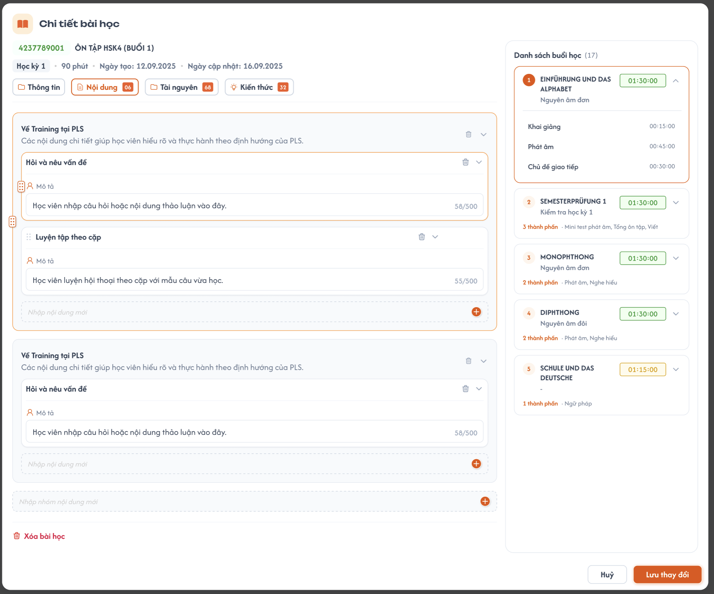
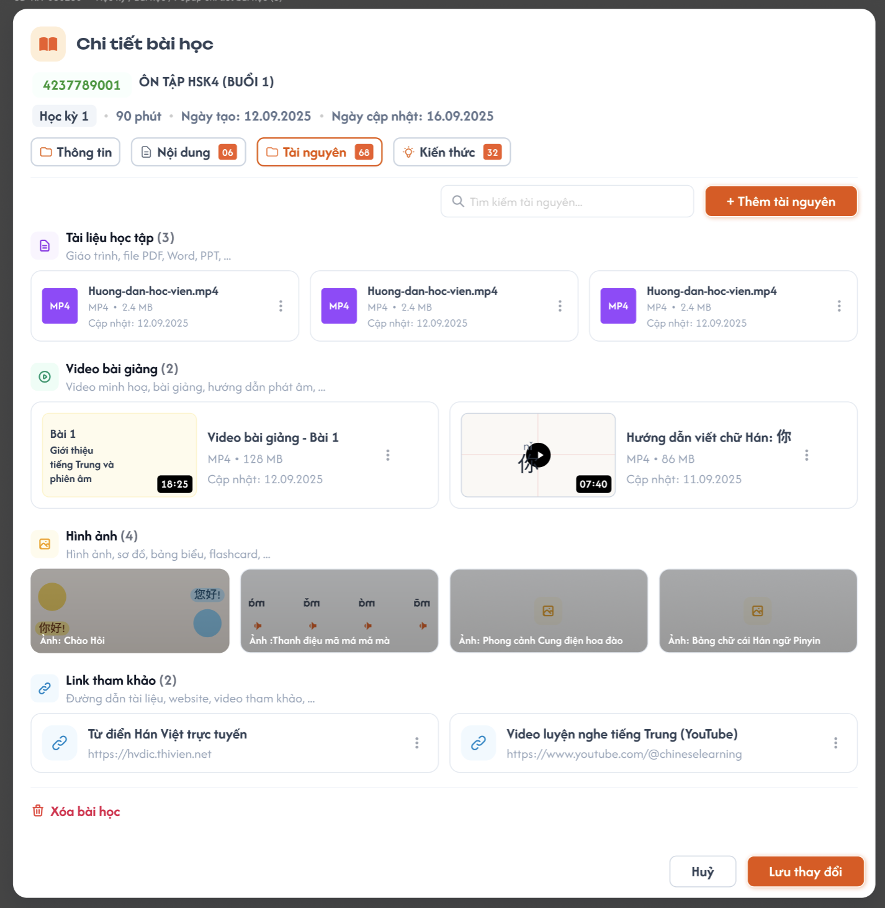
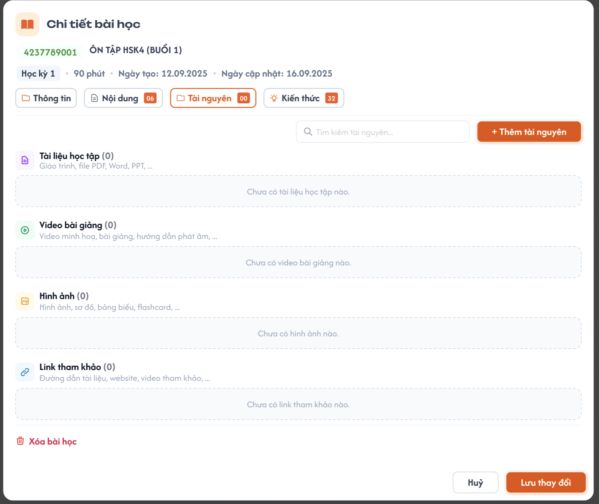
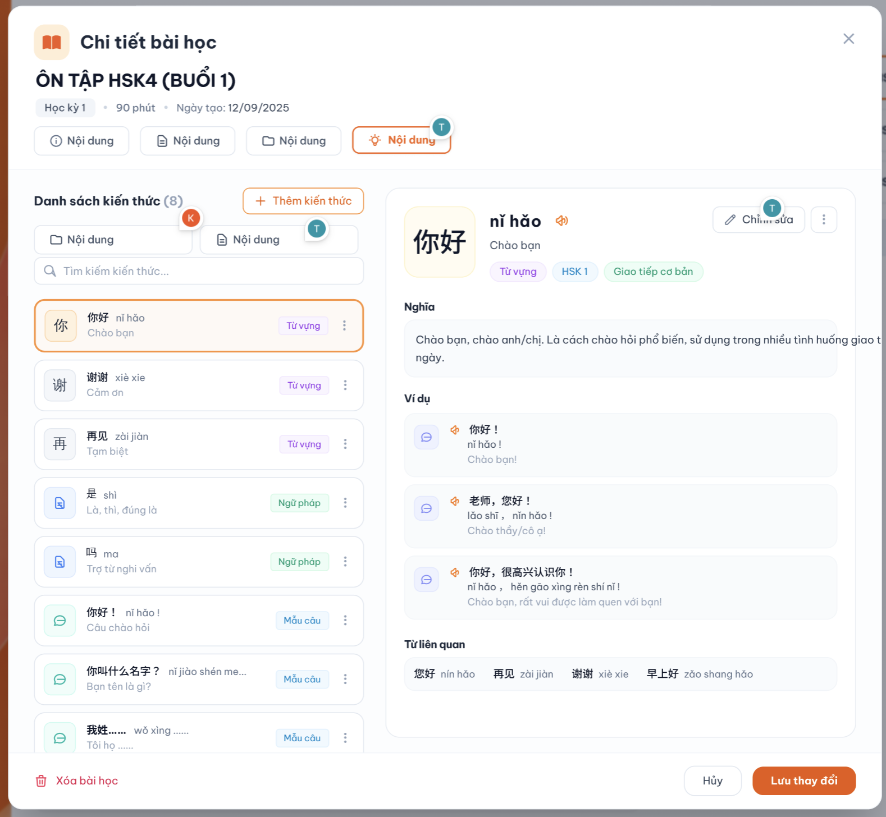

# Học Kỳ - Tab Bài học

## 1. UI

### Trang 1: CD-KH-030200 — Danh sách bài học (Tab Bài học)




- CD **chỉ xem** danh sách bài học của học kỳ đang chọn; nhấn card để mở popup "Chi tiết bài học".
- Card gồm: mã bài học, tên, mô tả, tag Kỹ năng/Kiến thức (nếu có, = các **loại** đã gắn ở tab Kiến thức / Kỹ năng), **3 icon góc trên phải** (Nội dung / Tài nguyên / Kiến thức): **sáng** khi phần đó có dữ liệu, **tối** khi chưa có (icon Kiến thức sáng khi có ít nhất 1 kiến thức **hoặc** 1 bài kỹ năng). Icon cập nhật sau khi lưu ở popup.
- **Bỏ trên Figma:** icon kéo-thả, nhãn cam cạnh mã (`HSK4 复习`...), mũi tên mở rộng/thu gọn.
- Không có nút thêm/xoá bài học, không kéo-thả. Bài học tạo/xoá tự động theo "Số buổi" ở Tổng quan (S2) (Flow 4).
- Tên bài học trên Figma chỉ là dữ liệu mẫu.
- Chỉ sửa được khi học kỳ `Nháp` **và** khoá học `Nháp`; học kỳ hoặc khoá học `Công khai`/`Vô hiệu` → popup chỉ đọc (ẩn nút "Lưu thay đổi", ẩn thêm/xoá tài nguyên), kể cả Tên/Mô tả bài học (quy tắc chung: dữ liệu đã công khai chỉ sửa Tên, Mô tả của chính học kỳ / khoá học, chi tiết bên trong không sửa — xem `course_management.md` REQ10). Muốn sửa thì nhân bản học kỳ / khoá học.

---

### Trang 2: CD-KH-030210 — Popup: Chi tiết bài học - Tab Thông tin




- Đầu popup: mã bài học, tên, học kỳ, thời lượng, ngày tạo, ngày cập nhật, **5 tab** (Thông tin, Nội dung, Tài nguyên, Kiến thức, **Kỹ năng**) kèm badge số lượng.
- **"Kỹ năng" / "Kiến thức" ở tab Thông tin: read-only, tự hiển thị** theo các **loại có cụm liên kết với bài** (bỏ nút "+" trên Figma, không chọn tay):
  - Kiến thức: tag các loại kiến thức có cụm liên kết với bài (vd. `Từ vựng`, `Ngữ pháp`), không lặp, thứ tự theo tab loại ở S1.
  - Kỹ năng: tag các loại kỹ năng có cụm liên kết (`Nghe`, `Đọc`, `Viết`, `Nói`), thứ tự theo tab ở S6.
  - Cập nhật ngay khi CD liên kết / bỏ liên kết cụm ở S1 / S6. Chưa có loại nào: hiển thị `—` (**UI cần bổ sung**: trạng thái trống).
- **Mã bài học** (read-only): 12 số `CCAALLBBBEEE` = **`CCAALL` của ID khoá học** (mã trung tâm + ID danh mục + ID cấp độ) + **`BBB` của ID học kỳ** + **`EEE` số thứ tự bài học** (ví dụ khoá `100302001`, học kỳ `100302001002`, bài 5 → `100302002005`). Tự sinh (xem REQ05).
- Footer chỉ có **"Hủy"** và **"Lưu thay đổi"** (bỏ nút "Xóa bài học" trên Figma).
- **Cơ chế lưu:**
  - Thông tin, Nội dung: giữ tạm trên FE, chuyển tab không mất; **"Lưu thay đổi" lưu tất cả các tab một lần**. Kiến thức, Kỹ năng chỉ xem, không có gì để lưu.
  - **Tab Tài nguyên: lưu/xoá ngay khi thao tác**, không qua "Lưu thay đổi", không bị "Hủy" hoàn tác.
  - **"Hủy"/nút X/click ra ngoài** khi còn thay đổi chưa lưu → popup xác nhận (bảng dưới); không có thay đổi thì đóng luôn.

- `A02.01` **Tiêu đề**: `Bỏ thay đổi`
- `A02.02` **Nội dung**: `Các thay đổi chưa lưu sẽ bị mất. Bạn có chắc chắn muốn đóng?`
- `A02.03` **Nút**: `Ở lại`, `Bỏ thay đổi`

---

### Trang 3: CD-KH-030200 — Popup: Chi tiết bài học - Tab Nội dung




**Cột trái - Nội dung** (2 cấp: Nhóm nội dung → Nội dung, chỉ có 1 loại nội dung nhập text; bỏ popup 9 loại action cũ):

- `A03.01` **Thêm nhóm**: Quy tắc: Nhập **tên** ở ô "Nhập nhóm nội dung mới" → "+". Mô tả nhóm sửa sau trực tiếp trên nhóm.
- `A03.02` **Thêm nội dung**: Quy tắc: Nhập tên ở ô "Nhập nội dung mới" trong nhóm → "+", rồi nhập Mô tả.
- `A03.03` **Giới hạn**: Quy tắc: Tên nhóm/nội dung: bắt buộc, chưa giới hạn độ dài. Mô tả nhóm: không giới hạn. Mô tả nội dung: tối đa 500 ký tự (bộ đếm `58/500`).
- `A03.04` **Xoá**: Quy tắc: Nội dung: thùng rác. Nhóm: thùng rác → popup xác nhận → xoá kèm toàn bộ nội dung bên trong.
- `A03.05` **Kéo-thả**: Quy tắc: Chỉ trong cùng cấp (nhóm với nhóm, nội dung trong cùng nhóm). **Không** kéo nội dung sang nhóm khác.
- `A03.06` **Badge tab**: Quy tắc: = tổng số **nội dung** (không tính nhóm).

Popup xóa nhóm: tiêu đề `Xoá nhóm nội dung`; nội dung `Nhóm "{tên nhóm}" và {k} nội dung bên trong sẽ bị xoá. Bạn có chắc chắn muốn tiếp tục?`; nút `Huỷ`, `Xoá nhóm`. Xoá chỉ có hiệu lực khi "Lưu thay đổi".

**Cột phải - Danh sách buổi học (N):**
- Lấy từ các buổi học được **tick ở Lộ trình (S4)**, **chỉ xem**, bấm vào chỉ mở rộng/thu gọn, không chuyển màn. Cập nhật khi đổi tick ở S4.
- Mỗi mục: số thứ tự, tên, mô tả ngắn, tổng thời lượng (`01:30:00`); mở rộng hiện thành phần + thời lượng, thu gọn hiện `n thành phần`.
- Chưa tick buổi nào: hiển thị `Chưa có buổi học nào được chọn ở Lộ trình`, (0).
- **Màu tổng thời lượng** theo % so với thời lượng chuẩn 1 buổi ở Tổng quan (S2):

- `A03.07` **90% – 100%**: Màu: Xanh
- `A03.08` **80% – <90%**: Màu: Vàng
- `A03.09` **>0 và <80%**: Màu: Cam
- `A03.10` **`00:00:00`**: Màu: Xám
- `A03.11` **>100%**: Màu: Đỏ

---

### Trang 4: CD-KH-030200 — Popup: Chi tiết bài học - Tab Tài nguyên





- "+ Thêm tài nguyên" mở popup 2 phần: **Thêm file** (chọn từ máy, tự phân loại theo định dạng) và **Thêm link** (nhập URL → nhóm Link tham khảo).
- 4 nhóm: Tài liệu học tập, Video bài giảng, Hình ảnh, Link tham khảo (icon, tiêu đề, mô tả, số lượng).
- File: icon loại, tên, định dạng, dung lượng, ngày cập nhật; video có thumbnail + thời lượng. Menu 3 chấm: **Xem trước, Tải xuống, Xoá**. Link: tên + URL; menu 3 chấm: Xem trước/mở link, Copy link, Xoá.
- Badge tab = tổng tài nguyên các nhóm.
- **Upload/xoá có hiệu lực ngay** (không qua "Lưu thay đổi"); badge và icon Tài nguyên ở card cập nhật ngay.

---

### Trang 5: CD-KH-030241, CD-KH-030244 — Popup: Chi tiết bài học - Tab Kiến thức




> Figma hiện vẽ tab Kiến thức gộp 2 tab nhỏ Kiến thức / Kỹ năng, panel chi tiết bên phải và nút "+". Requirement mới **tách Kỹ năng thành tab riêng**, tab **chỉ xem theo cụm đã liên kết**, bỏ nút "+" → **UI cần cập nhật Figma**.

- Dữ liệu lấy từ **Kiến thức (S1)** của khoá học đang mở: với mỗi loại kiến thức, bài học có **tối đa 1 cụm** đã liên kết (lập tại S1 › panel Cụm › ⋮ › `Liên kết bài học`); tab hiển thị **mục hiện có của cụm đó**. **Không tạo / sửa / thêm / gỡ mục tại đây.**
- **Bộ lọc Loại** ở đầu tab: dropdown hoặc chip `Từ vựng` (mặc định), `Ngữ pháp`, `Mẫu câu`, `Hanzi`, `Kanji`, `Phát âm`, `Bảng chữ` (trung tâm có hệ chữ riêng). Chọn 1 loại tại một thời điểm; loại có cụm liên kết hiện dấu chấm / số mục trên chip.
- **Bố cục 2 khung (chỉ xem)** (**UI cần bổ sung**):
  - **Tiêu đề khung trái = tên cụm đã liên kết**, dạng `Cụm từ vựng: <tên cụm> · N mục` (thay cho chữ "Danh sách kiến thức"). Chưa liên kết: khung trái hiện `Chưa có cụm <loại> liên kết với bài này` + dòng hướng dẫn `Liên kết tại Kiến thức (S1) › panel Cụm › ⋮ › Liên kết bài học`.
  - **Khung trái – danh sách mục của cụm:** mỗi dòng nội dung chính (từ / mẫu ngữ pháp / chữ...) và **nghĩa ở dòng dưới**, mục thiếu thông tin có chấm cam, mục Nâng cao = Có có tag `Nâng cao`. Thứ tự = `Thứ tự trong cụm` ở S1. Không có nút x, không kéo-thả.
  - **Khung phải – chi tiết:** bấm 1 dòng thì hiện đầy đủ field của mục (theo loại như S1), chỉ xem, không nút sửa / menu 3 chấm. Mặc định chọn dòng đầu.
- **Đồng bộ:** thêm / gỡ / chuyển mục trong cụm, đổi tên cụm, đổi hoặc bỏ liên kết ở S1 → tab cập nhật ngay khi mở lại; không cần "Lưu thay đổi".
- **Badge tab = số loại kiến thức có cụm liên kết với bài** (vd bài có cụm Từ vựng, Ngữ pháp, Mẫu câu → `3`), không phải số mục.

### Trang 6: CD-KH-030242, CD-KH-030245 — Popup: Chi tiết bài học - Tab Kỹ năng (mới — **UI cần bổ sung Figma**)


- Tương tự tab Kiến thức; dữ liệu lấy từ **Kỹ năng (S6)**: với mỗi loại kỹ năng, bài học có tối đa 1 cụm liên kết (lập tại S6 › panel Cụm); tab hiển thị bài kỹ năng của cụm đó, chỉ xem.
- **Bộ lọc Loại:** `Nghe` (mặc định), `Đọc`, `Viết`, `Nói`, luôn hiện đủ 4; loại chưa liên kết hiện `Chưa có cụm <loại> liên kết với bài này` + hướng dẫn liên kết tại S6.
- Tiêu đề khung trái `Cụm nghe: <tên cụm> · N bài`; dòng = tên bài + mô tả ngắn, chấm cam khi thiếu thông tin, tag `Nâng cao` khi Có; khung phải chi tiết bài (field theo drawer S6), chỉ xem.
- **Badge tab = số loại kỹ năng có cụm liên kết** (vd Nghe + Đọc → `2`).

---

## 2. Yêu cầu

### 2.1. Flow chính

**Flow 1: Mở chi tiết** — CD nhấn card → FE mở popup, mặc định tab Thông tin.

**Flow 2: Chỉnh sửa & lưu gộp**

```
CD sửa ở các tab Thông tin / Nội dung (giữ tạm ở FE; tab Kiến thức / Kỹ năng chỉ xem)
→ CD nhấn "Lưu thay đổi"
→ FE gửi gộp thay đổi các tab → BE validate & cập nhật
→ FE đóng popup, cập nhật card (kể cả 3 icon) và badge
```

**Flow 3: Tài nguyên** (lưu ngay, độc lập với "Lưu thay đổi")

```
CD nhấn "+ Thêm tài nguyên" → chọn file (BE lưu, tự phân loại) hoặc nhập URL (BE lưu vào Link tham khảo)
→ FE thêm vào đúng nhóm, cập nhật badge/icon
Xoá tài nguyên: menu 3 chấm → Xoá → BE xoá ngay
```

**Flow 5: Xem kiến thức / kỹ năng của bài theo cụm liên kết**

```
CD mở tab Kiến thức (hoặc Kỹ năng) → mặc định Loại = Từ vựng (Nghe)
→ FE gọi BE lấy cụm của loại đó đã liên kết với bài (S1 / S6) + mục của cụm theo Thứ tự trong cụm
→ Có cụm: tiêu đề = tên cụm, danh sách mục, khung phải chi tiết mục đầu
→ Chưa có: thông báo chưa liên kết + hướng dẫn liên kết tại S1 / S6
→ Đổi Loại → tải lại theo loại mới
→ Badge tab = số loại có cụm liên kết; tag ở tab Thông tin = các loại đó
Liên kết / đổi / bỏ liên kết làm tại S1 / S6 (⋮ cụm › Liên kết bài học); BE chặn 2 cụm cùng loại vào 1 bài (EX02)
```

**Flow 4: Tự tạo/xoá bài học theo "Số buổi" ở Tổng quan (S2)** (chỉ khi học kỳ `Nháp` và khoá học `Nháp`; số buổi cũ = N, mới = M)

```
M > N: BE tự tạo (M − N) bài học ở cuối, tên mặc định `Bài học {số thứ tự}`, dữ liệu con rỗng, Mã bài học theo REQ05

M < N: FE hiển thị popup xác nhận
   → Xác nhận: BE xoá mềm (N − M) bài cuối (số thứ tự lớn nhất) + xoá mềm toàn bộ nội dung/tài nguyên/liên kết kiến thức bên trong
   → Huỷ: giữ nguyên số buổi cũ và toàn bộ bài học
```

Ví dụ: 30 → 20 thì xoá bài 21 đến 30.

| Popup giảm số buổi (màn S2) | Nội dung |
|---|---|
| Tiêu đề | `Xoá bài học` |
| Nội dung | `Số buổi giảm từ {N} xuống {M}. {N − M} bài học cuối (bài {M + 1} đến bài {N}) sẽ bị xoá cùng toàn bộ nội dung, tài nguyên và kiến thức bên trong. Bạn có chắc chắn muốn tiếp tục?` |
| Nút | `Huỷ`, `Xoá bài học` |

### 2.2. Ngoại lệ

- **EX01:** Tên nhóm/nội dung trống hoặc chỉ khoảng trắng → chặn thêm/lưu.
- **EX02:** Liên kết cụm thứ hai cùng loại vào một bài học (từ S1 / S6 hoặc API) → BE từ chối, bài giữ cụm cũ; popup liên kết mờ bài đã có cụm cùng loại.
- **EX06:** Loại chưa có cụm liên kết, hoặc cụm liên kết chưa có mục → tab hiển thị trạng thái trống (`Chưa có cụm <loại> liên kết với bài này` / `Cụm <tên> chưa có mục`), badge không đếm loại đó.
- **EX07:** Gỡ mục / bài khỏi khoá ở S1 / S6 khi thuộc cụm đã liên kết bài học → popup gỡ nêu cụm và bài học; xác nhận → mục mất khỏi cụm và khỏi bài học.
- **EX10:** Mục `Chưa phân cụm` → không xuất hiện ở bài học nào; gửi API gắn mục trực tiếp vào bài học → BE từ chối (không còn liên kết mục ↔ bài).
- **EX08:** Mục thiếu thông tin trong cụm liên kết → vẫn hiện ở tab với chấm cam (bài học phản ánh cụm); app học viên chỉ dùng mục đủ thông tin.
- **EX09:** Ở S1 / S6, mục được thêm vào / gỡ khỏi / chuyển cụm → bài học liên kết cụm phản ánh ngay, không cảnh báo. Giảm Số buổi ở S2 làm mất cụm đang liên kết → BE chặn (xem Tổng quan (S2) EX05).
- **EX03:** `BBB` của ID học kỳ đổi (chỉ khi học kỳ `Nháp`) hoặc `CCAALL` của ID khoá học đổi (chỉ khi khoá học `Nháp`, xem `course_management.md` REQ06) → đồng bộ 9 số đầu Mã bài học của **tất cả** bài học bị ảnh hưởng, `EEE` giữ nguyên.
- **EX04:** Học kỳ hoặc khoá học `Công khai`/`Vô hiệu` → popup chỉ đọc (gồm cả tab Tài nguyên), không cho đổi "Số buổi" ở S2; gọi API ghi trực tiếp → BE từ chối, dữ liệu không đổi.
- **EX05:** "Lưu thay đổi" thất bại → không ghi một phần, popup giữ nguyên thay đổi chưa lưu để thử lại.

### 2.3. Yêu cầu khác

| Mã | Tên | Mô tả |
|---|---|---|
| REQ01 | Danh sách chỉ xem | Không kéo-thả, không thêm/xoá thủ công. Thứ tự cố định theo 3 số cuối Mã bài học. Card không có nhãn cam, mũi tên. |
| REQ02 | Icon 3 phần | Sáng khi số lượng phần đó > 0 (icon Kiến thức = số loại kiến thức + số loại kỹ năng có cụm liên kết), tối khi = 0. |
| REQ03 | Nội dung dạng text | 1 loại nội dung text, nhóm → nội dung; tên bắt buộc; mô tả nội dung ≤ 500 ký tự; kéo-thả/xoá/badge theo mục 1. |
| REQ04 | Không sửa kiến thức/kỹ năng từ bài học | Chỉ tạo / sửa / chia cụm / liên kết ở S1 / S6; bài học chỉ xem. |
| REQ10 | Tab Kiến thức / Kỹ năng | 2 tab riêng, chỉ xem: bộ lọc Loại (mặc định Từ vựng / Nghe), tiêu đề = tên cụm đã liên kết với bài cho loại đó, danh sách mục của cụm theo thứ tự trong cụm, khung phải chi tiết. Kiến thức lấy từ S1, Kỹ năng lấy từ S6 của khoá đang mở. Badge tab = số loại có cụm liên kết. |
| REQ12 | Liên kết cụm ↔ bài học | Một cụm liên kết đúng 1 bài học; một bài học tối đa 1 cụm mỗi loại; BE bắt trùng (EX02). Liên kết lập / đổi / bỏ tại S1 / S6; mọi thay đổi trong cụm phản ánh ngay ở bài học. Nhân bản khoá sao chép liên kết. |
| REQ11 | Kỹ năng/Kiến thức ở tab Thông tin | Read-only, tự sinh = tập **loại** có cụm liên kết với bài; không lưu riêng, không chọn tay. |
| REQ05 | Mã bài học | 12 số `CCAALLBBBEEE`: `CC` = mã trung tâm, `AA` = ID danh mục, `LL` = ID cấp độ (lấy từ ID khoá học `CCAALLMMM`), `BBB` = 3 số cuối ID học kỳ (`CCAALLMMMBBB`), `EEE` = số thứ tự bài học (`001`–`999`). Mã không chứa `MMM` của khoá học. Tự sinh, không sửa thủ công; đồng bộ khi ID học kỳ / ID khoá học đổi (EX03). |
| REQ06 | Tự tạo/xoá bài học | Số bài học = "Số buổi" ở S2. Tên mặc định `Bài học {số thứ tự}`. Xoá = xoá mềm bài + dữ liệu con (nội dung, tài nguyên, liên kết kiến thức/kỹ năng). |
| REQ07 | Cột buổi học | Lấy từ tick ở Lộ trình (S4), chỉ xem; màu thời lượng và trạng thái trống theo mục 1. |
| REQ08 | Lưu & Hủy | Thông tin / Nội dung lưu gộp khi "Lưu thay đổi" (Kiến thức / Kỹ năng chỉ xem); Tài nguyên lưu/xoá ngay; Hủy/X/click ngoài có popup xác nhận khi còn thay đổi chưa lưu. |
| REQ09 | Quyền theo trạng thái | Chỉ sửa bài học (thông tin, nội dung, tài nguyên, kiến thức/kỹ năng) và đổi "Số buổi" khi học kỳ `Nháp` **và** khoá học `Nháp`. Bài học không có trạng thái riêng, đi theo trạng thái học kỳ / khoá học. Nhân bản học kỳ / khoá học sao chép toàn bộ bài học (xem `information.md` REQ06, `course_management.md` REQ11). |

### 2.4. Ràng buộc quyền

#### Quyền

| Role | Xem | Sửa thông tin | Sửa nội dung/tài nguyên | Gắn kiến thức/kỹ năng |
|---|:---:|:---:|:---:|:---:|
| CD | ✅ | ✅ | ✅ | ✅ |
| Role khác | ❌ | ❌ | ❌ | ❌ |

#### Ràng buộc khác

---

---

## 3. Testcase

### Feature: Học Kỳ - Tab Bài học

| Tên testcase | Priority | Scenario | Role | Pre-condition | Given/When/Then | Expected Result |
|---|---|---|---|---|---|---|
| Case 1: Danh sách bài học & icon | High · Smoke |  | CD; học kỳ có bài đủ 3 phần, thiếu 1 phần, trống |  | **Given** CD ở tab Bài học<br>**When** trang tải xong<br>**Then** hiển thị danh sách | - Đúng bài theo học kỳ, card đúng mã/tên/mô tả<br>- Icon sáng/tối đúng dữ liệu (bài trống: 3 icon tối)<br>- Không có kéo-thả, nhãn cam, mũi tên, nút thêm/xoá bài |
| Case 2: Mở & sửa thông tin, Mã bài học | High · Smoke |  | CD; học kỳ `Nháp` |  | **Given** nhấn card<br>**When** sửa Tên/Mô tả, "Lưu thay đổi"<br>**Then** cập nhật | - Mở đúng bài, mặc định tab Thông tin, footer chỉ có "Hủy"/"Lưu thay đổi"<br>- Card cập nhật theo<br>- Mã bài học read-only, 12 số `CCAALLBBBEEE`; đổi `BBB` học kỳ hoặc Danh mục / Cấp độ khoá học thì 9 số đầu của mọi bài cập nhật, `EEE` giữ nguyên |
| Case 3: Thêm nhóm/nội dung & validation | High · Smoke |  | CD; `Nháp`; tab Nội dung |  | **Given** nhập tên vào ô thêm nhóm / thêm nội dung rồi "+"<br>**When** nhập mô tả, thử tên trống và mô tả nội dung >500 ký tự, rồi lưu<br>**Then** hệ thống lưu | - Nhóm/nội dung hiển thị đúng vị trí, bộ đếm đúng<br>- Tên trống: không thêm<br>- Không nhập quá 500 ký tự (mô tả nội dung)<br>- Sửa mô tả nhóm trực tiếp, không giới hạn<br>- Badge "Nội dung" = số nội dung |
| Case 4: Xoá & kéo-thả nội dung | High |  | CD; `Nháp`; ≥ 2 nhóm, mỗi nhóm có nội dung |  | **Given** tab Nội dung<br>**When** xoá nội dung; xoá nhóm (popup xác nhận); kéo-thả nhóm/nội dung; thử kéo nội dung sang nhóm khác; lưu<br>**Then** hệ thống cập nhật | - Xoá nhóm: popup nêu đúng tên + số nội dung, xoá kèm nội dung; `Huỷ` giữ nguyên<br>- Kéo-thả cùng cấp lưu đúng thứ tự; kéo sang nhóm khác bị chặn<br>- Badge cập nhật |
| Case 5: Cột buổi học theo S4 | High |  | CD; có bài đã tick và bài chưa tick ở S4; thời lượng chuẩn 01:30:00 |  | **Given** mở tab Nội dung<br>**When** xem cột phải, mở rộng 1 mục, bấm vào mục<br>**Then** hiển thị | - Chỉ các mục đã tick, số (N) đúng; mở rộng đúng thành phần/thời lượng; không chuyển màn, không sửa được<br>- Chưa tick: `Chưa có buổi học nào được chọn ở Lộ trình`<br>- Màu: 100% xanh, 83% vàng, 50% cam, 00:00:00 xám, 117% đỏ<br>- Đổi tick ở S4 thì cập nhật |
| Case 6: Tài nguyên (file, link, menu 3 chấm) | High |  | CD; `Nháp`; tab Tài nguyên |  | **Given** nhấn "+ Thêm tài nguyên"<br>**When** thêm file hợp lệ / thêm URL / dùng menu 3 chấm (Xem trước, Tải xuống, Xoá) / nhấn "Hủy" popup<br>**Then** hệ thống xử lý | - File vào đúng nhóm theo định dạng, link vào "Link tham khảo"<br>- Lưu/xoá có hiệu lực ngay, badge và icon card cập nhật ngay<br>- "Hủy" không hoàn tác tài nguyên đã upload/xoá<br>- Xem trước/Tải xuống/Xoá đúng |
| Case 7: Tab Kiến thức hiện mục của cụm liên kết | High · Smoke |  | CD; cụm Từ vựng `Gia đình` (16 mục) liên kết Bài 1; cụm Ngữ pháp `Chủ đề 2` liên kết Bài 1 |  | **Given** mở Chi tiết Bài 1, tab Kiến thức<br>**When** xem với Loại mặc định; đổi Loại `Ngữ pháp`; đổi `Mẫu câu`<br>**Then** hiển thị theo cụm | - Mặc định `Từ vựng`: tiêu đề `Cụm từ vựng: Gia đình · 16 mục`, 16 mục đúng thứ tự trong cụm<br>- `Ngữ pháp`: tiêu đề `Cụm ngữ pháp: Chủ đề 2`<br>- `Mẫu câu`: `Chưa có cụm Mẫu câu liên kết với bài này` + hướng dẫn<br>- Không có nút +, x, sửa |
| Case 7b: Tab Kỹ năng hiện bài của cụm liên kết | High · Smoke |  | CD; cụm Nghe `Chào hỏi` (3 bài) liên kết Bài 1 |  | **Given** tab Kỹ năng<br>**When** xem với Loại mặc định `Nghe`; đổi `Đọc`<br>**Then** hiển thị theo cụm | - `Nghe`: `Cụm nghe: Chào hỏi · 3 bài`, 3 bài<br>- `Đọc`: trạng thái chưa liên kết<br>- Luôn hiện đủ 4 chip loại |
| Case 7c: Tag tự động và badge theo số loại | High |  | CD; Bài 1 có cụm Từ vựng, Ngữ pháp, Mẫu câu và cụm Nghe liên kết |  | **Given** mở Chi tiết Bài 1<br>**When** xem badge tab và tab Thông tin; ở S1 bỏ liên kết cụm Ngữ pháp; mở lại<br>**Then** cập nhật | - Badge Kiến thức `3`, Kỹ năng `1` (đếm loại, không đếm mục)<br>- Tag Kiến thức `Từ vựng`, `Ngữ pháp`, `Mẫu câu`; Kỹ năng `Nghe`<br>- Sau khi bỏ liên kết: badge `2`, tag còn `Từ vựng`, `Mẫu câu`<br>- Không có nút "+" ở tab Thông tin |
| Case 7e: Cụm thay đổi, bài học phản ánh ngay | High |  | CD; cụm `Gia đình` liên kết Bài 1 |  | **Given** ở S1 thêm 1 mục vào `Gia đình`, gỡ 1 mục khác, đổi tên cụm thành `Gia đình tôi`<br>**When** mở lại Bài 1<br>**Then** tab cập nhật | - 16 mục (±1), tiêu đề `Cụm từ vựng: Gia đình tôi`<br>- Không cần "Lưu thay đổi" |
| Case 7h: BE bắt trùng cụm cùng loại | High |  | CD; Bài 1 đã có cụm Từ vựng `Gia đình` |  | **Given** ở S1 cụm `Học tập` › Liên kết bài học<br>**When** xem Bài 1; gửi request liên kết trực tiếp<br>**Then** từ chối | - Bài 1 mờ, nhãn `Đã liên kết: Gia đình`<br>- API 409, Bài 1 giữ cụm `Gia đình`<br>- Liên kết cụm Ngữ pháp vào Bài 1 vẫn được |
| Case 7f: Gỡ mục khỏi khoá ở S1 khi thuộc cụm liên kết | High |  | Mục `爸爸` thuộc cụm `Gia đình` liên kết Bài 1 |  | **Given** CD gỡ `爸爸` khỏi khoá ở S1<br>**When** popup gỡ nêu `Cụm Gia đình · HK I · Bài 1`, xác nhận<br>**Then** mục biến mất | - Bài 1 còn 15 mục; badge tab không đổi (vẫn 1 loại) |
| Case 7g: Xem chi tiết 2 khung | Medium |  | Bài có cụm liên kết |  | **Given** tab Kiến thức<br>**When** bấm 1 dòng<br>**Then** khung phải hiện chi tiết | - Dòng: từ + nghĩa dưới, chấm cam khi thiếu thông tin, tag `Nâng cao` khi Có<br>- Chi tiết đầy đủ field theo loại, chỉ xem |
| Case 7d: Mục Chưa phân cụm và API gắn trực tiếp | Medium |  | CD; mục `你好` ở `Chưa phân cụm` |  | **Given** mở Bài 1 tab Kiến thức; gửi API gắn `你好` vào Bài 1<br>**When** xem; BE xử lý<br>**Then** không hiện; API từ chối | - Chỉ liên kết qua cụm ở S1 / S6 |
| Case 8: Lưu gộp, Hủy & lỗi | High |  | CD; `Nháp`; sửa ở nhiều tab |  | **Given** đã sửa Thông tin, Nội dung, chuyển tab qua lại (tab Kiến thức / Kỹ năng chỉ xem)<br>**When** (a) "Lưu thay đổi"; (b) "Hủy"/X/click ngoài rồi `Bỏ thay đổi` hoặc `Ở lại`; (c) lưu khi backend lỗi<br>**Then** hệ thống xử lý | - Chuyển tab không mất thay đổi<br>- (a) Lưu tất cả tab một lần, 1 Toast `Thành Công`<br>- (b) Hiện popup `Bỏ thay đổi`; `Bỏ thay đổi` bỏ toàn bộ thay đổi mọi tab; `Ở lại` giữ nguyên; không có thay đổi thì đóng luôn<br>- (c) Toast `Có Lỗi Xảy Ra`, không ghi một phần, giữ thay đổi để thử lại |
| Case 9: Tăng/giảm số buổi | High |  | CD; học kỳ `Nháp` có 20 bài; bài cuối có nội dung/tài nguyên/cụm liên kết |  | **Given** đổi "Số buổi" ở S2<br>**When** tăng 20→30; giảm 30→20 rồi `Xoá bài học`; giảm rồi `Huỷ`<br>**Then** hệ thống xử lý | - Tăng: thêm bài 21–30, tên `Bài học 21`...`Bài học 30`, dữ liệu rỗng (3 icon tối), Mã 3 số cuối 021–030<br>- Giảm: popup nêu đúng bài 21–30; xác nhận → xoá mềm 10 bài cuối cùng dữ liệu con, bài 1–20 giữ nguyên<br>- Huỷ: số buổi và bài học không đổi |
| Case 10: Chỉ đọc & phân quyền | High |  | CD với học kỳ `Công khai`/`Vô hiệu`, hoặc học kỳ `Nháp` thuộc khoá học `Công khai`/`Vô hiệu`; role không phải CD |  | **Given** CD mở popup bài học / S2; hoặc user khác CD mở URL tab Bài học<br>**When** thử sửa thông tin/nội dung/tài nguyên/kiến thức, đổi "Số buổi" (kể cả gọi API trực tiếp)<br>**Then** hệ thống từ chối | - Popup chỉ đọc, ẩn "Lưu thay đổi"; không đổi được "Số buổi"<br>- Backend từ chối, dữ liệu không đổi<br>- Role khác CD không xem/thao tác được |

---

---

## 4. Câu hỏi cần xác nhận

| # | Câu hỏi | Trả lời |
|---|---|---|
| Q1 | **UI Figma cần bổ sung:** (a) tab Kiến thức / Kỹ năng chỉ xem: bộ lọc Loại, tiêu đề = tên cụm liên kết, 2 khung (danh sách trái + chi tiết phải), trạng thái chưa liên kết; (b) field Kỹ năng / Kiến thức read-only ở tab Thông tin (bỏ "+"); (c) badge tab theo số loại. | Chờ Figma (03/11) |
| Q2 | Popup wizard hay 1 màn 3 cột? | **Bỏ popup** (03/11): bài học không chọn mục, chỉ xem theo cụm liên kết |
| Q3 | Có "Thêm cả cụm"? Mục thêm vào cụm sau có tự gắn? | Liên kết là **cụm ↔ bài học** lập tại S1 / S6; mục thêm vào cụm **tự hiện** ở bài học (03/11) |
| Q4 | Xoá mục ở S1/S6 khi thuộc cụm liên kết? | Popup gỡ nêu cụm và bài học; xoá thì mục mất khỏi bài học (EX07) |
| Q5 | Field hiển thị trong danh sách? Xem chi tiết? | Trái: từ / ngữ pháp, nghĩa bên dưới, chấm cam thiếu thông tin, tag Nâng cao; bấm thì khung phải hiện chi tiết, chỉ xem |
| Q6 | Kéo-thả, tìm kiếm, nút x? | Không kéo-thả, không nút x (chỉ xem); thứ tự theo Thứ tự trong cụm |
| Q7 | Tab Kỹ năng hiện `Viết`, `Nói`? | Hiện đủ 4 loại, loại chưa liên kết hiện trạng thái trống |
| Q8 | Mục thiếu thông tin có hiện ở bài học? | Có, kèm chấm cam (bài học phản ánh cụm); app chỉ dùng mục đủ thông tin (EX08) |
| Q9 | Một bài học nhận được mấy cụm? | Tối đa 1 cụm mỗi loại; BE bắt trùng (EX02, REQ12) |
| Q11 | Gỡ mục khỏi cụm / chuyển cụm ở S1 / S6 thì bài học? | Bài học phản ánh ngay, không cảnh báo (EX09); xoá cụm không còn ở S1 / S6, giảm cụm qua S2 |
| Q12 | Mục thuộc nhiều cụm? | 1 mục chỉ thuộc 1 cụm |
| Q13 | Mục `Chưa phân cụm` có hiện ở bài học? | Không (EX10) |
| Q14 | Bài thuộc học kỳ / khoá `Công khai` có phản ánh thay đổi cụm không? | Khoá Công khai không sửa được S1 / S6 nên cụm không đổi; nhân bản khoá sao chép cụm và liên kết |
