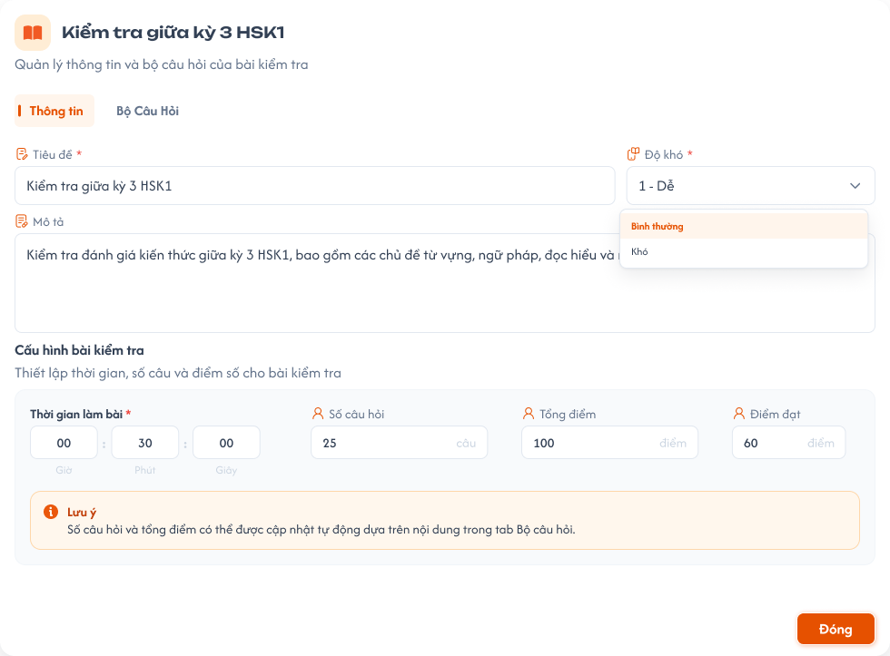

# Học Kỳ - Tab Kiểm tra

## 1. UI

### Trang 1: CD-KH-030300 — Học kỳ / Kiểm tra


**Mô tả:**
- Tab **Kiểm tra** trong màn Học kỳ của khoá học (role **CD**): chọn một học kỳ ở Danh sách kỳ bên phải, tab `Kiểm tra` hiện danh sách bài kiểm tra của học kỳ đó, ô thêm bài mới ở cuối. Danh sách học kỳ, trạng thái học kỳ và tab Thông tin xem [Học Kỳ](../information/information.md); tab Bài học xem [Học Kỳ - Tab Bài học](../lesson/lesson.md). Quy tắc bộ câu hỏi (bảng câu hỏi, thêm / sửa câu, Import / Export Excel, Generate và Soát lỗi bằng AI) dùng chung với [Bài tập về nhà và Kiểm tra](../../homework-test/homework-test.md).

**Điểm cần lưu ý:**
- Tên bài, ID, số liệu trong ảnh là dữ liệu mẫu.
- Thêm, kéo thả, xoá bài, sửa thông tin bài và **sửa bộ câu hỏi** chỉ làm được khi học kỳ đang **`Nháp`** và khoá học đang **`Nháp`**. Học kỳ hoặc khoá học `Công khai` / `Vô hiệu`: danh sách chỉ đọc (ẩn ô thêm, icon kéo thả, menu `⋮`), vẫn mở popup để **xem** thông tin và bộ câu hỏi, không sửa được (xem `course_management.md` REQ10).
- `A01.01` Card bài kiểm tra: icon kéo thả bên trái; `ID` bài (10 chữ số, hệ thống tự sinh, màu xanh); tên bài; chip thời gian; chip số câu; nút `>` mở popup bài kiểm tra.
- `A01.02` Chip thời gian: thời gian làm bài rút gọn (`30m`, `1h30m`); chưa cấu hình hiển thị `—`.
- `A01.03` Chip số câu: số câu của bộ câu hỏi (tự tính); `0` khi chưa có câu.
- `A01.04` `Thêm bài kiểm tra mới`: ô nhập cuối danh sách; nhập tên và Enter (hoặc bấm `+`) tạo bài mới ở cuối, rồi mở popup bài vừa tạo ở tab Thông tin.
- `A01.05` Kéo thả: kéo icon bên trái để đổi thứ tự bài; thứ tự lưu lên backend và dùng ở menu Bài Tập Về Nhà, lớp học.
- `A01.06` Xoá bài: menu `⋮` trên card có `Xoá`; popup xác nhận `Xoá bài kiểm tra "<tên>"? Bộ câu hỏi của bài cũng sẽ bị xoá.`, nút `Huỷ` / `Xoá`; xoá mềm.
- `A01.07` Thứ tự mặc định: theo thứ tự đã sắp; bài mới ở cuối.
- Popup bài kiểm tra — tab `Bộ Câu Hỏi` cho soạn bộ câu hỏi ngay trong popup, cùng thành phần và quy tắc với [Bài tập về nhà và Kiểm tra](../../homework-test/homework-test.md). Bộ câu hỏi này cũng là bộ hiển thị ở menu Bài Tập Về Nhà → tab Kiểm tra; sửa ở một nơi thì nơi kia thấy ngay.
- `A03.01` Nút thao tác của tab Bộ Câu Hỏi: `Import Excel`, `Export Excel`, `+ Thêm câu hỏi`, `Generate` (Tạo câu hỏi bằng AI), `Soát lỗi bằng AI`.
- `A03.02` Thẻ tổng quan: `Tổng số câu`, `Thời gian làm bài` (lấy từ tab Thông tin), `Cơ cấu theo dạng câu`; tag `Thang 10`.
- `A03.03` Bảng câu hỏi: cột `STT`, `Bài tập (câu hỏi)`, `Loại câu`, `Đáp án đúng`, `Kiến thức / Kỹ năng`, `Điểm`, `⋮`; tìm kiếm, lọc `Loại câu`, `Kiến thức / Kỹ năng`; câu hỏi con mở / thu.
- `A03.04` Thêm / sửa câu, Import / Export, Generate, Soát lỗi: theo `homework-test.md` — soạn câu bắt buộc Số câu, Loại câu, Kiến thức / Kỹ năng; Excel cùng cột bảng; Generate không giới hạn số câu, chọn dòng rồi thêm; câu AI có tag `AI`. Bộ câu hỏi **chỉ thêm / sửa / xoá / import / generate được khi học kỳ `Nháp` và khoá học `Nháp`**; ngược lại bộ câu hỏi chỉ đọc (ẩn `+ Thêm câu hỏi`, `Import Excel`, `Generate`, menu `⋮` Sửa / Xoá, ô nhập nhanh); vẫn xem, `Export Excel` và `Soát lỗi bằng AI` (chỉ đọc) được.
- `A04.01` Toast `Thành Công`: `Đã thêm bài kiểm tra.`; `Đã xoá bài kiểm tra.` Toast của bộ câu hỏi theo `homework-test.md`.
- `A04.02` Toast `Cảnh Báo`: `Học kỳ hoặc khoá học không ở trạng thái Nháp, không thể chỉnh sửa bài kiểm tra.` (request bị từ chối).
- `A04.03` Toast `Có Lỗi Xảy Ra`: thêm, xoá, sắp xếp, lưu tự động thất bại do backend / network. Lưu tự động từng field và kéo thả thành công không hiển thị Toast; chỉ báo khi lỗi.

### Trang 2: CD-KH-030310 — Học kỳ / Kiểm tra / Popup cấu hình bài kiểm tra



**Mô tả:**
- Bấm `>` trên card mở popup tên bài, dòng phụ `Quản lý thông tin và bộ câu hỏi của bài kiểm tra`, 2 tab `Thông tin` / `Bộ Câu Hỏi` và nút `Đóng`. Tab Thông tin lưu tự động theo từng field (khi rời ô / chọn xong).

**Điểm cần lưu ý:**
- `A02.01` `Tiêu đề` *: bắt buộc, không để trống hoặc chỉ khoảng trắng; tên trên card cập nhật theo.
- `A02.02` `Độ khó` *: bắt buộc; một trong `1 - Dễ`, `Bình thường`, `Khó`.
- `A02.03` `Mô tả`: không bắt buộc, nhiều dòng.
- `A02.04` `Thời gian làm bài` *: bắt buộc; 3 ô `Giờ` : `Phút` : `Giây`, tổng > 0; phút và giây 0–59.
- `A02.05` `Số câu hỏi`: **tự tính** từ bộ câu hỏi (số câu cha), chỉ đọc.
- `A02.06` `Điểm đạt`: không bắt buộc; số từ 0 đến 10 (điểm bài của học viên tính trên thang 10, là trung bình điểm các câu). Không có ô `Tổng điểm`: mọi câu chấm trên thang 10, điểm bài tối đa 10 theo requirement chấm bài của Giáo viên.
- `A02.07` Hộp `Lưu ý`: `Số câu hỏi được cập nhật tự động dựa trên nội dung trong tab Bộ câu hỏi.`
- `A02.08` `Đóng`: đóng popup; dữ liệu đã lưu tự động.
- Học kỳ hoặc khoá học không ở `Nháp`: mọi field tab Thông tin chỉ đọc; backend từ chối request sửa. Field sai: báo lỗi đỏ dưới field, không lưu field đó, giữ giá trị đã nhập để sửa.

---

## 2. Yêu cầu

### 2.1. Flow chính

**Flow 1: Xem danh sách bài kiểm tra**

```
CD mở khoá học → Học Kỳ → chọn học kỳ ở Danh sách kỳ → tab Kiểm tra
  → hệ thống tải bài kiểm tra của học kỳ theo thứ tự đã sắp
```

**Flow 2: Thêm bài kiểm tra**

```
Học kỳ Nháp → CD nhập tên ở "Thêm bài kiểm tra mới" → Enter
  ├─ tên trống: không tạo
  └─ hợp lệ: tạo bài ở cuối, ID 10 số tự sinh → mở popup bài, tab Thông tin
```

**Flow 3: Sắp xếp bài kiểm tra**

```
Học kỳ Nháp → CD kéo thả card → backend lưu thứ tự mới
```

**Flow 4: Xoá bài kiểm tra**

```
Học kỳ Nháp → ⋮ → Xoá → popup xác nhận
  ├─ Huỷ: giữ nguyên
  └─ Xoá: backend kiểm tra học kỳ Nháp → xoá mềm bài và bộ câu hỏi → Toast "Đã xoá bài kiểm tra."
```

**Flow 5: Sửa thông tin bài kiểm tra**

```
CD bấm > → popup, tab Thông tin
  → học kỳ Nháp: sửa Tiêu đề / Độ khó / Mô tả / Thời gian / Điểm đạt → lưu tự động từng field
  → Số câu hỏi tự tính từ bộ câu hỏi
  → học kỳ không Nháp: chỉ đọc
```

**Flow 6: Soạn bộ câu hỏi**

```
CD mở tab Bộ Câu Hỏi (sửa được khi học kỳ Nháp và khoá học Nháp; ngược lại chỉ xem / Export)
  → thêm / sửa / xoá câu, Import / Export Excel, Generate, Soát lỗi bằng AI theo homework-test.md
  → Số câu hỏi ở tab Thông tin và chip trên card cập nhật
```

### 2.2. Ngoại lệ

- **EX01:** Tên bài kiểm tra mới trống hoặc chỉ có khoảng trắng → không tạo bài.
- **EX02:** Thêm, sắp xếp, xoá bài, sửa tab Thông tin hoặc thêm / sửa / xoá / import câu hỏi khi học kỳ hoặc khoá học không ở `Nháp` (kể cả gọi API trực tiếp) → backend từ chối; dữ liệu không đổi.
- **EX03:** Field tab Thông tin sai (Tiêu đề trống, Thời gian = 0, phút / giây > 59, Điểm đạt < 0 hoặc > 10) → báo lỗi dưới field, không lưu field đó.
- **EX04:** Lưu tự động, thêm, xoá, sắp xếp thất bại do backend / network → Toast `Có Lỗi Xảy Ra`; dữ liệu trên server giữ giá trị cũ.

### 2.3. Yêu cầu khác

| Mã | Tên yêu cầu | Mô tả |
|---|---|---|
| REQ01 | Danh sách | Bài kiểm tra của học kỳ đang chọn theo thứ tự đã sắp; card có ID 10 số, tên, chip thời gian, chip số câu, nút `>`. |
| REQ02 | Thêm bài | Chỉ khi học kỳ `Nháp`; nhập tên ở ô cuối danh sách; ID 10 số hệ thống tự sinh, duy nhất; bài mới ở cuối. |
| REQ03 | Sắp xếp | Kéo thả khi học kỳ `Nháp`; thứ tự dùng ở menu Bài Tập Về Nhà và lớp học. |
| REQ04 | Quyền sửa theo trạng thái học kỳ / khoá học | Danh sách bài (thêm, sắp xếp, xoá), tab Thông tin và bộ câu hỏi chỉ sửa khi học kỳ `Nháp` **và** khoá học `Nháp`; học kỳ hoặc khoá học `Công khai` / `Vô hiệu` chỉ đọc toàn bộ (xem `course_management.md` REQ10). Nhân bản học kỳ / khoá học sao chép toàn bộ bài kiểm tra và bộ câu hỏi. |
| REQ05 | Xoá bài | Xoá mềm bài và bộ câu hỏi, qua popup xác nhận, chỉ khi học kỳ `Nháp` và khoá học `Nháp`. |
| REQ06 | Thông tin bài | Tiêu đề, Độ khó (1 - Dễ / Bình thường / Khó), Thời gian làm bài (giờ : phút : giây, > 0) bắt buộc; Mô tả, Điểm đạt (0 ≤ Điểm đạt ≤ 10, thang 10) không bắt buộc; Số câu hỏi tự tính, chỉ đọc; không có Tổng điểm; lưu tự động từng field. |
| REQ07 | Bộ câu hỏi | Soạn trong tab Bộ Câu Hỏi của popup, cùng quy tắc `homework-test.md`; dùng chung dữ liệu với menu Bài Tập Về Nhà → tab Kiểm tra. |

### 2.4. Ràng buộc

#### Quyền

| Role | Xem | Thêm / sắp xếp / xoá bài, sửa Thông tin (học kỳ + khoá Nháp) | Soạn bộ câu hỏi (học kỳ + khoá Nháp) |
|---|:---:|:---:|:---:|
| CD | ✅ | ✅ | ✅ |
| Các role khác | ❌ | ❌ | ❌ |

#### Ràng buộc khác

- Dữ liệu theo khoá học và học kỳ đang chọn, thuộc trung tâm CD đang chọn ở header.
- Mọi request được backend kiểm tra quyền, trạng thái học kỳ và trạng thái khoá học; không dựa vào việc ẩn nút.
- Mỗi thao tác một Toast: `Thành Công`, `Cảnh Báo` hoặc `Có Lỗi Xảy Ra`.


---

## 3. Testcase

### Feature: Học Kỳ - Tab Kiểm tra

| Tên testcase | Priority | Scenario | Role | Pre-condition | Given/When/Then | Expected Result |
|---|---|---|---|---|---|---|
| Case 1: Xem danh sách bài kiểm tra | High | Flow 1 / REQ01 | CD | Học kỳ HK I có 2 bài kiểm tra | **Given:** chọn HK I<br>**When:** mở tab Kiểm tra<br>**Then:** hiện 2 card với ID, tên, chip thời gian, chip số câu | - Thứ tự đúng thứ tự đã sắp<br>- Chip thời gian `30m` / `1h30m`, chưa cấu hình hiện `—`; chip số câu `0` khi chưa có câu |
| Case 2: Thêm bài kiểm tra | High | Flow 2 / REQ02 / EX01 | CD | HK I đang `Nháp` | **Given:** nhập `Kiểm tra giữa kỳ` vào ô thêm mới; lần khác chỉ nhập khoảng trắng<br>**When:** nhấn Enter<br>**Then:** tạo bài hoặc không tạo | - Hợp lệ: bài mới ở cuối, ID 10 số, mở popup tab Thông tin, Toast `Đã thêm bài kiểm tra.`<br>- Tên trống: không tạo, không Toast |
| Case 3: Kéo thả đổi thứ tự | Medium | Flow 3 / REQ03 | CD | HK I `Nháp`, có 3 bài | **Given:** kéo bài 3 lên đầu<br>**When:** thả<br>**Then:** thứ tự mới được lưu | - Tải lại vẫn giữ thứ tự<br>- Menu Bài Tập Về Nhà theo thứ tự mới<br>- Kéo thả thành công không có Toast |
| Case 4: Xoá bài kiểm tra | Medium | Flow 4 / REQ05 | CD | HK I `Nháp`, bài có 10 câu | **Given:** `⋮` → `Xoá`<br>**When:** bấm `Huỷ`; lần khác bấm `Xoá` ở popup<br>**Then:** hệ thống xử lý | - Huỷ giữ nguyên<br>- Xoá: bài và bộ câu hỏi bị xoá mềm, biến mất khỏi danh sách, Toast `Đã xoá bài kiểm tra.` |
| Case 5: Học kỳ hoặc khoá học không Nháp chỉ đọc | High | EX02 / REQ04 | CD | HK I `Công khai` (hoặc HK I `Nháp` thuộc khoá `Công khai`) | **Given:** mở tab Kiểm tra và popup bài<br>**When:** xem danh sách, tìm thao tác Thêm / Sửa / Xoá / Import / Generate hoặc gửi request trực tiếp<br>**Then:** không có thao tác; backend từ chối | - Không có ô thêm, kéo thả, menu xoá; field tab Thông tin và bộ câu hỏi chỉ đọc<br>- Vẫn mở popup xem, Export Excel và Soát lỗi bằng AI được<br>- Toast `Cảnh Báo` `Học kỳ hoặc khoá học không ở trạng thái Nháp, không thể chỉnh sửa bài kiểm tra.` |
| Case 6: Sửa thông tin bài tự động lưu | High | Flow 5 / REQ06 | CD | HK I `Nháp` | **Given:** bấm `>` trên bài<br>**When:** đổi Độ khó sang `Khó`, Thời gian `00:45:00`, nhập Điểm đạt `7.5`<br>**Then:** lưu tự động từng field | - Không cần bấm lưu; chip thời gian trên card thành `45m`; tên card theo Tiêu đề<br>- Không có ô Tổng điểm |
| Case 7: Validate tab Thông tin và Số câu hỏi tự tính | High | EX03 / REQ06 | CD | Bộ câu hỏi 25 câu | **Given:** mở tab Thông tin<br>**When:** nhập Điểm đạt `12`, Thời gian `00:00:00`, phút / giây > 59, Tiêu đề trống; thêm câu ở tab Bộ Câu Hỏi<br>**Then:** báo lỗi từng field | - Báo lỗi đỏ dưới field, không lưu field đó, giữ giá trị đã nhập<br>- `7.5` hợp lệ<br>- Số câu hỏi 25, chỉ đọc, thêm câu thì tự tăng |
| Case 8: Soạn bộ câu hỏi trong popup | High | Flow 6 / REQ07 | CD | Khoá học và HK I `Nháp`, popup bài đang mở | **Given:** chọn tab Bộ Câu Hỏi, `+ Thêm câu hỏi`<br>**When:** soạn và lưu câu; thêm 1 câu rồi mở menu Bài Tập Về Nhà → Kiểm tra → bài đó<br>**Then:** câu thêm vào bảng | - Tab Thông tin Số câu hỏi tăng, chip số câu trên card cập nhật<br>- Menu Bài Tập Về Nhà thấy cùng bộ câu hỏi (vd 10 câu thành 11 câu)<br>- Có đủ nút thao tác, thẻ tổng quan, bảng câu hỏi theo `homework-test.md` |
| Case 9: Toast phản hồi CRUD | High | EX04 / Ràng buộc Toast CRUD | CD | HK I `Nháp`; mất kết nối ở lần thứ hai | **Given:** thêm hoặc xoá bài thành công; sau đó sửa Tiêu đề khi mất kết nối<br>**When:** backend phản hồi<br>**Then:** hiển thị Toast tương ứng | - Thành công: một Toast `Thành Công` đúng nội dung<br>- Lưu tự động thất bại: Toast `Có Lỗi Xảy Ra`, giữ giá trị đã nhập, tải lại vẫn là giá trị cũ |
| Case 10: Role khác CD bị chặn | High | Ràng buộc quyền | Role khác CD | - | **Given:** mở URL tab Kiểm tra; gửi request xem / thêm / sắp xếp / xoá / sửa<br>**When:** hệ thống xử lý<br>**Then:** bị từ chối | - Không xem, không thao tác được; dữ liệu không đổi |

---

## 4. Câu hỏi cần xác nhận

- **Q01:** Menu `⋮` xoá bài kiểm tra trên card và popup xác nhận `Xoá bài kiểm tra "<tên>"? ...` chưa có thiết kế trên Figma. Khi nào bổ sung?
- **Q02:** Trạng thái rỗng `Học kỳ này chưa có bài kiểm tra` (kèm ô thêm mới khi `Nháp`) chưa có thiết kế trên Figma. Khi nào bổ sung?
- **Q03:** Tab `Bộ Câu Hỏi` bên trong popup bài kiểm tra chưa có thiết kế riêng trong cụm này (bộ câu hỏi đang được vẽ ở màn `CD-KH-030340` thuộc Bài tập về nhà và Kiểm tra). Xác nhận cách hiển thị bộ câu hỏi trong popup.
