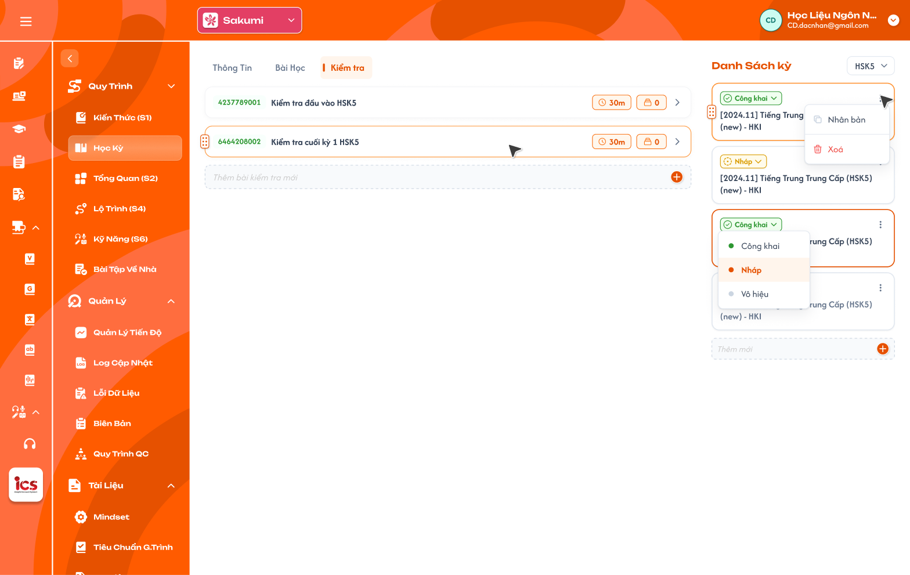
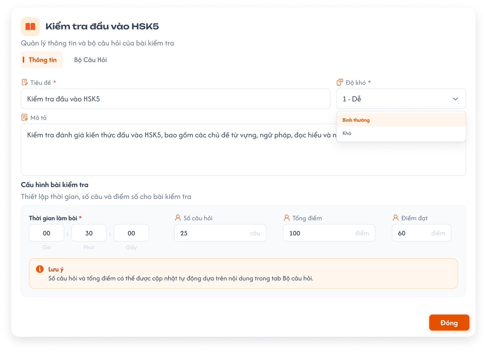

# Học Kỳ - Tab Kiểm tra

Tab **Kiểm tra** trong màn **Học kỳ** của khoá học (role **CD**): định nghĩa danh sách **bài kiểm tra** của học kỳ đang chọn, cấu hình thông tin từng bài và soạn **bộ câu hỏi** của bài. Danh sách học kỳ bên phải, trạng thái học kỳ và tab Thông tin xem [Học Kỳ](../information/information.md); tab Bài học xem [Học Kỳ - Tab Bài học](../lesson/lesson.md). Quy tắc bộ câu hỏi (bảng câu hỏi, thêm / sửa câu, Import / Export Excel, Generate và Soát lỗi bằng AI) dùng chung với [Bài tập về nhà và Kiểm tra](../../homework-test/homework-test.md).

Ảnh lấy từ Figma `CD-KH-030300`, `CD-KH-030310`, `CD-KH-030340`. Điểm khác Figma ghi ngay dưới ảnh; phần chưa có thiết kế ghi rõ là **UI cần bổ sung**. Tên bài, ID, số liệu trong ảnh là dữ liệu mẫu.

## 1. UI

### Trang 1: CD-KH-030300 — Danh sách bài kiểm tra


*Tab Kiểm tra của học kỳ đang chọn và Danh sách kỳ bên phải (Figma CD-KH-030300) — nhấn để xem ảnh gốc*

**Mô tả:**

- Chọn một học kỳ ở Danh sách kỳ bên phải, mở tab `Kiểm tra`: danh sách bài kiểm tra của học kỳ đó, ô thêm bài mới ở cuối.

**Điểm cần lưu ý:**

- `A01.01` **Card bài kiểm tra**: Icon kéo thả bên trái; `ID` bài (10 chữ số, hệ thống tự sinh, màu xanh); tên bài; chip thời gian làm bài (vd `30m`); chip số câu hỏi; nút `>` mở popup bài kiểm tra.
- `A01.02` **Chip thời gian**: Thời gian làm bài rút gọn: `30m`, `1h30m`; chưa cấu hình hiển thị `—`.
- `A01.03` **Chip số câu**: Số câu của bộ câu hỏi (tự tính); `0` khi chưa có câu.
- `A01.04` **`Thêm bài kiểm tra mới`**: Ô nhập cuối danh sách; nhập tên và Enter (hoặc bấm `+`) tạo bài mới ở cuối, rồi mở popup bài vừa tạo ở tab Thông tin.
- `A01.05` **Kéo thả**: Kéo icon bên trái để đổi thứ tự bài; thứ tự lưu lên backend và dùng ở menu Bài Tập Về Nhà, lớp học.
- `A01.06` **Xoá bài**: Menu `⋮` trên card có `Xoá` (popup xác nhận `Xoá bài kiểm tra "<tên>"? Bộ câu hỏi của bài cũng sẽ bị xoá.`, nút `Huỷ` / `Xoá`); xoá mềm (**UI cần bổ sung**).
- `A01.07` **Thứ tự mặc định**: Theo thứ tự đã sắp; bài mới ở cuối.

- Thêm, kéo thả, xoá bài, sửa thông tin bài và **sửa bộ câu hỏi** chỉ làm được khi học kỳ đang **`Nháp`** và khoá học đang **`Nháp`**. Học kỳ hoặc khoá học `Công khai` / `Vô hiệu`: danh sách chỉ đọc (ẩn ô thêm, icon kéo thả, menu `⋮`), vẫn mở popup để **xem** thông tin và bộ câu hỏi, không sửa được (xem `course_management.md` REQ10).
- Học kỳ chưa có bài kiểm tra: hiển thị trạng thái rỗng `Học kỳ này chưa có bài kiểm tra` và ô thêm mới (khi `Nháp`).
- Khác Figma CD-KH-030300: card chưa có menu `⋮` để xoá bài.

### Trang 2: CD-KH-030310 — Popup bài kiểm tra — Tab Thông tin


*Popup bài kiểm tra, tab Thông tin (Figma CD-KH-030310) — nhấn để xem ảnh gốc*

**Mô tả:**

- Bấm `>` trên card mở popup tên bài, dòng phụ `Quản lý thông tin và bộ câu hỏi của bài kiểm tra`, 2 tab `Thông tin` / `Bộ Câu Hỏi` và nút `Đóng`. Tab Thông tin lưu tự động theo từng field (khi rời ô / chọn xong).

**Điểm cần lưu ý:**

- `A02.01` **`Tiêu đề` ***: Bắt buộc; không để trống hoặc chỉ khoảng trắng. Tên trên card cập nhật theo.
- `A02.02` **`Độ khó` ***: Bắt buộc; một trong `1 - Dễ`, `Bình thường`, `Khó`.
- `A02.03` **`Mô tả`**: Không bắt buộc; nhiều dòng.
- `A02.04` **`Thời gian làm bài` ***: Bắt buộc; 3 ô `Giờ` : `Phút` : `Giây`, tổng > 0; phút và giây 0–59.
- `A02.05` **`Số câu hỏi`**: **Tự tính** từ bộ câu hỏi (số câu cha), chỉ đọc.
- `A02.06` **`Điểm đạt`**: Không bắt buộc; số từ 0 đến 10 (điểm bài của học viên tính trên thang 10, là trung bình điểm các câu).
- `A02.07` **Hộp `Lưu ý`**: `Số câu hỏi được cập nhật tự động dựa trên nội dung trong tab Bộ câu hỏi.`
- `A02.08` **`Đóng`**: Đóng popup; dữ liệu đã lưu tự động.

- Học kỳ hoặc khoá học không ở `Nháp`: mọi field tab Thông tin chỉ đọc; backend từ chối request sửa.
- Field sai: báo lỗi đỏ dưới field, không lưu field đó, giữ giá trị đã nhập để sửa.
- Không có ô `Tổng điểm`: mọi câu chấm trên thang 10, điểm bài tối đa 10 theo requirement chấm bài của Giáo viên.
- Khác Figma CD-KH-030310: ô `Số câu hỏi` đang vẽ như ô nhập, requirement là chỉ đọc; ô `Tổng điểm` trên Figma cần bỏ. Dòng Lưu ý ghi `Số câu hỏi và tổng điểm có thể được cập nhật`.

### Trang 3: CD-KH-030340 — Popup bài kiểm tra — Tab Bộ Câu Hỏi


*Bộ câu hỏi của bài kiểm tra (Figma CD-KH-030340, đang vẽ thành màn riêng) — nhấn để xem ảnh gốc*

**Mô tả:**

- Tab `Bộ Câu Hỏi` của popup cho soạn bộ câu hỏi ngay trong popup, cùng thành phần và quy tắc với [Bài tập về nhà và Kiểm tra](../../homework-test/homework-test.md).

**Điểm cần lưu ý:**

- `A03.01` **Nút thao tác**: `Import Excel`, `Export Excel`, `+ Thêm câu hỏi`, `Generate` (Tạo câu hỏi bằng AI), `Soát lỗi bằng AI`.
- `A03.02` **Thẻ tổng quan**: `Tổng số câu`, `Thời gian làm bài` (từ tab Thông tin), `Cơ cấu theo dạng câu`; tag `Thang 10`.
- `A03.03` **Bảng câu hỏi**: Cột `STT`, `Bài tập (câu hỏi)`, `Loại câu`, `Đáp án đúng`, `Kiến thức / Kỹ năng`, `Điểm`, `⋮`; tìm kiếm, lọc `Loại câu`, `Kiến thức / Kỹ năng`; câu hỏi con mở / thu.
- `A03.04` **Thêm / sửa câu, Import / Export, Generate, Soát lỗi**: Theo `homework-test.md`: soạn câu bắt buộc Số câu, Loại câu, Kiến thức / Kỹ năng; Excel cùng cột bảng; Generate không giới hạn số câu, chọn dòng rồi thêm; câu AI có tag `AI`.

- Bộ câu hỏi **chỉ thêm / sửa / xoá / import / generate được khi học kỳ `Nháp` và khoá học `Nháp`**. Học kỳ hoặc khoá học `Công khai` / `Vô hiệu`: bộ câu hỏi chỉ đọc (ẩn `+ Thêm câu hỏi`, `Import Excel`, `Generate`, menu `⋮` Sửa / Xoá, ô nhập nhanh); vẫn xem, `Export Excel` và `Soát lỗi bằng AI` (chỉ đọc) được.
- Bộ câu hỏi này cũng là bộ câu hỏi hiển thị ở menu Bài Tập Về Nhà → tab Kiểm tra; sửa ở một nơi thì nơi kia thấy ngay.
- Khác Figma: bộ câu hỏi đang vẽ thành màn riêng `CD-KH-030340` (mở từ `>`); requirement đặt trong tab `Bộ Câu Hỏi` của popup (**UI cần bổ sung**).

### Trang 4: Toast phản hồi CRUD


*Toast Thành Công, Thông Báo, Cảnh Báo và Có Lỗi Xảy Ra — nhấn để xem ảnh gốc*

**Mô tả:**

- Phản hồi sau khi thêm, xoá, sắp xếp bài kiểm tra và lưu thông tin bài. Toast của bộ câu hỏi theo `homework-test.md`.

**Điểm cần lưu ý:**

- `A04.01` **Thành công**: Tiêu đề cố định: `Thành Công`; Khi sử dụng: `Đã thêm bài kiểm tra.`; `Đã xoá bài kiểm tra.`
- `A04.02` **Cảnh báo**: Tiêu đề cố định: `Cảnh Báo`; Khi sử dụng: `Học kỳ hoặc khoá học không ở trạng thái Nháp, không thể chỉnh sửa bài kiểm tra.` (request bị từ chối)
- `A04.03` **Lỗi**: Tiêu đề cố định: `Có Lỗi Xảy Ra`; Khi sử dụng: Thêm, xoá, sắp xếp, lưu tự động thất bại do backend / network.

- Lưu tự động từng field và kéo thả thành công không hiển thị Toast; chỉ báo khi lỗi.

---

## 2. Yêu cầu

### 2.1. Flow chính

**Flow 1 / REQ01: Xem danh sách bài kiểm tra**

```text
CD mở khoá học → Học Kỳ → chọn học kỳ ở Danh sách kỳ → tab Kiểm tra
      → Hệ thống tải bài kiểm tra của học kỳ theo thứ tự đã sắp
```

**Flow 2 / REQ02: Thêm bài kiểm tra**

```text
Học kỳ Nháp → CD nhập tên ở "Thêm bài kiểm tra mới" → Enter
      → Tên trống: không tạo
      → Hợp lệ: tạo bài ở cuối, ID 10 số tự sinh → mở popup bài, tab Thông tin
```

**Flow 3 / REQ03: Sắp xếp bài kiểm tra**

```text
Học kỳ Nháp → CD kéo thả card → backend lưu thứ tự mới
```

**Flow 4 / REQ05: Xoá bài kiểm tra**

```text
Học kỳ Nháp → ⋮ → Xoá → popup xác nhận
      → Huỷ: giữ nguyên
      → Xoá: backend kiểm tra học kỳ Nháp → xoá mềm bài và bộ câu hỏi → Toast "Đã xoá bài kiểm tra."
```

**Flow 5 / REQ06: Sửa thông tin bài kiểm tra**

```text
CD bấm > → popup, tab Thông tin
      → Học kỳ Nháp: sửa Tiêu đề / Độ khó / Mô tả / Thời gian / Điểm đạt → lưu tự động từng field
      → Số câu hỏi tự tính từ bộ câu hỏi
      → Học kỳ không Nháp: chỉ đọc
```

**Flow 6 / REQ07: Soạn bộ câu hỏi**

```text
CD mở tab Bộ Câu Hỏi (sửa được khi học kỳ Nháp và khoá học Nháp; ngược lại chỉ xem / Export)
      → Thêm / sửa / xoá câu, Import / Export Excel, Generate, Soát lỗi bằng AI theo homework-test.md
      → Số câu hỏi ở tab Thông tin và chip trên card cập nhật
```

### 2.2. Ngoại lệ

- **EX01:** Tên bài kiểm tra mới trống hoặc chỉ có khoảng trắng → không tạo bài.
- **EX02:** Thêm, sắp xếp, xoá bài, sửa tab Thông tin hoặc thêm / sửa / xoá / import câu hỏi khi học kỳ hoặc khoá học không ở `Nháp` (kể cả gọi API trực tiếp) → backend từ chối; dữ liệu không đổi.
- **EX03:** Field tab Thông tin sai (Tiêu đề trống, Thời gian = 0, phút / giây > 59, Điểm đạt < 0 hoặc > 10) → báo lỗi dưới field, không lưu field đó.
- **EX04:** Lưu tự động, thêm, xoá, sắp xếp thất bại do backend / network → Toast `Có Lỗi Xảy Ra`; dữ liệu trên server giữ giá trị cũ.

### 2.3. Yêu cầu khác

| Mã | Tên yêu cầu | Mô tả |
|---|---|---|
| REQ01 | Danh sách | Bài kiểm tra của học kỳ đang chọn theo thứ tự đã sắp; card có ID 10 số, tên, chip thời gian, chip số câu, nút `>`. |
| REQ02 | Thêm bài | Chỉ khi học kỳ `Nháp`; nhập tên ở ô cuối danh sách; ID 10 số hệ thống tự sinh, duy nhất; bài mới ở cuối. |
| REQ03 | Sắp xếp | Kéo thả khi học kỳ `Nháp`; thứ tự dùng ở menu Bài Tập Về Nhà và lớp học. |
| REQ04 | Quyền sửa theo trạng thái học kỳ / khoá học | Danh sách bài (thêm, sắp xếp, xoá), tab Thông tin và bộ câu hỏi chỉ sửa khi học kỳ `Nháp` **và** khoá học `Nháp`; học kỳ hoặc khoá học `Công khai` / `Vô hiệu` chỉ đọc toàn bộ (xem `course_management.md` REQ10). Nhân bản học kỳ / khoá học sao chép toàn bộ bài kiểm tra và bộ câu hỏi. |
| REQ05 | Xoá bài | Xoá mềm bài và bộ câu hỏi, qua popup xác nhận, chỉ khi học kỳ `Nháp` và khoá học `Nháp`. |
| REQ06 | Thông tin bài | Tiêu đề, Độ khó (1 - Dễ / Bình thường / Khó), Thời gian làm bài (giờ : phút : giây, > 0) bắt buộc; Mô tả, Điểm đạt (0 ≤ Điểm đạt ≤ 10, thang 10) không bắt buộc; Số câu hỏi tự tính, chỉ đọc; không có Tổng điểm; lưu tự động từng field. |
| REQ07 | Bộ câu hỏi | Soạn trong tab Bộ Câu Hỏi của popup, cùng quy tắc `homework-test.md`; dùng chung dữ liệu với menu Bài Tập Về Nhà → tab Kiểm tra. |

### 2.4. Ràng buộc

#### Quyền

| Role | Xem | Thêm / sắp xếp / xoá bài, sửa Thông tin (học kỳ + khoá Nháp) | Soạn bộ câu hỏi (học kỳ + khoá Nháp) |
|---|:---:|:---:|:---:|
| CD | ✅ | ✅ | ✅ |
| Các role khác | ❌ | ❌ | ❌ |

#### Ràng buộc khác

**Phạm vi dữ liệu**

- Dữ liệu theo khoá học và học kỳ đang chọn, thuộc trung tâm CD đang chọn ở header.
- Mọi request được backend kiểm tra quyền, trạng thái học kỳ và trạng thái khoá học; không dựa vào việc ẩn nút.

---

---

## 3. Testcase

### Feature: Học Kỳ - Tab Kiểm tra

| Tên testcase | Priority | Scenario | Role | Pre-condition | Given/When/Then | Expected Result |
|---|---|---|---|---|---|---|
| Case 1: Xem danh sách bài kiểm tra | High · Smoke | Flow 1 / REQ01 | CD | Học kỳ HK I có 2 bài kiểm tra | **Given** chọn HK I<br>**When** mở tab Kiểm tra<br>**Then** hiện 2 card với ID, tên, chip thời gian, chip số câu | - Thứ tự đúng thứ tự đã sắp |
| Case 2: Thêm bài kiểm tra | High · Smoke | Flow 2 / REQ02 | CD | HK I đang `Nháp` | **Given** nhập `Kiểm tra giữa kỳ` vào ô thêm mới<br>**When** nhấn Enter<br>**Then** bài mới ở cuối, có ID 10 số, mở popup tab Thông tin | - Toast `Thành Công` |
| Case 3: Tên trống | Medium | EX01 / REQ02 | CD | HK I đang `Nháp` | **Given** ô thêm mới chỉ có khoảng trắng<br>**When** nhấn Enter<br>**Then** không tạo bài | - Không Toast |
| Case 4: Kéo thả đổi thứ tự | Medium | Flow 3 / REQ03 | CD | HK I `Nháp`, có 3 bài | **Given** kéo bài 3 lên đầu<br>**When** thả<br>**Then** thứ tự mới được lưu, tải lại vẫn giữ | - Menu Bài Tập Về Nhà theo thứ tự mới |
| Case 5: Học kỳ Công khai chỉ đọc danh sách | High | EX02 / REQ04 | CD | HK I `Công khai` | **Given** mở tab Kiểm tra<br>**When** xem danh sách hoặc gửi request thêm / sắp xếp / xoá bài<br>**Then** không có ô thêm, kéo thả, menu xoá; backend từ chối | - Vẫn mở được popup bài |
| Case 6: Xoá bài kiểm tra | Medium | Flow 4 / REQ05 | CD | HK I `Nháp`, bài có 10 câu | **Given** `⋮` → `Xoá`<br>**When** bấm `Xoá` ở popup<br>**Then** bài và bộ câu hỏi bị xoá mềm, biến mất khỏi danh sách | - Toast `Thành Công`<br>- `Huỷ` giữ nguyên |
| Case 7: Mở và sửa thông tin | High · Smoke | Flow 5 / REQ06 | CD | HK I `Nháp` | **Given** bấm `>` trên bài<br>**When** đổi Độ khó sang `Khó`, Thời gian `00:45:00`<br>**Then** lưu tự động, chip thời gian trên card thành `45m` | - Không cần bấm lưu |
| Case 8: Số câu hỏi tự tính | High | REQ06 | CD | Bộ câu hỏi 25 câu | **Given** mở tab Thông tin<br>**When** xem<br>**Then** Số câu hỏi 25, không sửa được; không có ô Tổng điểm | - Thêm câu ở tab Bộ Câu Hỏi thì số tự tăng |
| Case 9: Điểm đạt vượt thang 10 | Medium | EX03 / REQ06 | CD | Popup tab Thông tin | **Given** nhập Điểm đạt `12`<br>**When** rời ô<br>**Then** báo lỗi, không lưu | - Nhập `7.5` hợp lệ |
| Case 10: Thời gian bằng 0 | Medium | EX03 / REQ06 | CD | HK I `Nháp` | **Given** nhập `00:00:00`<br>**When** rời ô<br>**Then** báo lỗi, không lưu | - |
| Case 11: Thông tin chỉ đọc khi học kỳ Công khai | High | EX02 / REQ04 | CD | HK I `Công khai` | **Given** mở popup<br>**When** thử sửa hoặc gửi request<br>**Then** field chỉ đọc; backend từ chối | - Tab Bộ Câu Hỏi cũng chỉ đọc |
| Case 12: Soạn câu trong popup | High · Smoke | Flow 6 / REQ07 | CD | Khoá học và HK I `Nháp`, popup bài đang mở | **Given** chọn tab Bộ Câu Hỏi, `+ Thêm câu hỏi`<br>**When** soạn và lưu câu<br>**Then** câu thêm vào bảng; tab Thông tin Số câu tăng | - Chip số câu trên card cập nhật |
| Case 13: Không sửa câu khi học kỳ Công khai | High | REQ04 / REQ07 | CD | HK I `Công khai` (hoặc HK I `Nháp` thuộc khoá `Công khai`) | **Given** mở tab Bộ Câu Hỏi<br>**When** tìm thao tác Thêm / Sửa / Xoá / Import / Generate, hoặc gửi request trực tiếp<br>**Then** không có thao tác; backend từ chối | - Toast `Cảnh Báo` `Học kỳ hoặc khoá học không ở trạng thái Nháp, không thể chỉnh sửa bài kiểm tra.`<br>- Vẫn xem và Export Excel được |
| Case 14: Đồng bộ với menu Bài Tập Về Nhà | Medium | REQ07 | CD | Bài `Kiểm tra cuối kỳ` có 10 câu | **Given** thêm 1 câu ở tab Bộ Câu Hỏi<br>**When** mở menu Bài Tập Về Nhà → Kiểm tra → bài đó<br>**Then** thấy 11 câu | - |
| Toast Case 1: Thành công | Medium | Ràng buộc Toast CRUD | CD | HK I `Nháp` | **Given** thêm hoặc xoá bài<br>**When** backend thành công<br>**Then** Toast `Thành Công` đúng nội dung | - Một Toast |
| Toast Case 2: Lỗi lưu tự động | High | EX04 / Ràng buộc Toast CRUD | CD | Mất kết nối | **Given** sửa Tiêu đề<br>**When** lưu thất bại<br>**Then** Toast `Có Lỗi Xảy Ra`, giữ giá trị đã nhập | - Tải lại vẫn là giá trị cũ |

---

---

## 4. Câu hỏi cần xác nhận

- **Q01:** UI cần design bổ sung: menu `⋮` xoá bài kiểm tra trên card và popup xác nhận; tab `Bộ Câu Hỏi` bên trong popup (Figma đang là màn riêng CD-KH-030340); ô Số câu hỏi dạng chỉ đọc và bỏ ô Tổng điểm; trạng thái rỗng khi học kỳ chưa có bài kiểm tra.
