# Kỹ năng (S6) — Nghe / Đọc

## 1. UI

### Trang 1: CD-KH-050100 — Kỹ năng (S6) / Nghe


**Mô tả:**
- Màn **Kỹ năng (S6)** nằm trong từng khoá học của role CD, định nghĩa bài luyện kỹ năng của khoá theo 4 tab `Nghe`, `Đọc`, `Viết`, `Nói`. Tài liệu này viết cho **Nghe** và **Đọc**; `Viết`, `Nói` viết sau.
- CD vào khoá học → menu `Kỹ Năng (S6)`: thanh tab, dòng `Khoá học: <tên khoá>`, bảng bài nghe bên trái, panel Cụm bên phải.

**Điểm cần lưu ý:**
- Dữ liệu theo trung tâm CD đang chọn ở header. Mỗi bài kỹ năng là **bản ghi của Thư viện kỹ năng**: S6 tham chiếu bản ghi thư viện; thêm mới hoặc sửa tại S6 ghi thẳng vào thư viện, mọi khoá đang dùng bản ghi đó thấy nội dung mới.
- Tổ chức theo **cụm, không theo bài học** (giống Kiến thức S1): màn S6 không hiển thị, không lọc, không gán bài học; bài kỹ năng chỉ được thêm vào bài học tại Chi tiết bài học (xem `A20.01`).
- Chỉ sửa được khi khoá học `Nháp`. Khoá `Công Khai` / `Vô hiệu`: ẩn / mờ mọi nút thêm, menu dòng, nhập nhanh, AI, kéo thả, thao tác cụm; vẫn tìm, lọc, xem chi tiết, Preview, Export; backend từ chối mọi request ghi.
- `A01.01` Tab kỹ năng: 4 tab cố định, mọi trung tâm giống nhau, mặc định mở `Nghe`. Mỗi tab có bộ cụm riêng; đổi tab thì panel Cụm đổi theo tab và về `Tất cả cụm`. Tab `Viết`, `Nói` bấm được, cùng mô hình panel Cụm (bảng và field theo requirement riêng, chưa viết).
- `A01.02` `Khoá học:` hiện tên khoá (vd `Nhập Môn Tiếng Trung (HSK1)`); không gắn học kỳ / bài học.
- `A01.03` Toolbar tiêu đề: tên tab (hoặc tên cụm đang chọn) + badge `N bài nghe` + badge cam `N thiếu thông tin` (ẩn khi 0); đang chọn cụm thì hai badge tính trong cụm. Nút tab Nghe: `Transcript AI`, `Soát lỗi AI`, `Preview mobile`, `+ Thêm bài nghe`.
- `A01.04` Hàng tìm kiếm: ô `Tìm bài nghe, nội dung…`, `Sắp xếp`, `Trạng thái`. Lọc theo cụm bằng panel Cụm, không có lọc `Bài học`.
- `A01.05` Nhập nhanh: dòng cuối bảng `Nhập nhanh bài nghe — nhấn Enter để thêm`.
- `A01.06` Footer `Hiển thị a–b trong N bài nghe`, phân trang 50 dòng / trang, số trang, `…`, Trước / Sau.
- `A01.07` / `A01.12` `+ Thêm bài nghe` là menu 3 lựa chọn: `Thêm từ thư viện`, `Tạo bài nghe mới`, `Import Excel`; kèm `Export Excel` (xem Q02).
- `A01.11` Thanh tiến độ chung hiện khi AI đang chạy (xem Trang 9, Trang 10).
- `A01.14` `Duyệt tất cả` hiện ở thanh AI khi có bài chờ duyệt.
- `A01.15` Thanh nhập nhanh (Add New Bar) ở cuối bảng, dùng chung cho Nhập nhanh `A09.01`.
- `A02.01` Checkbox chọn dòng cho thao tác hàng loạt; checkbox đầu bảng chọn cả trang.
- `A02.02` `STT` theo sắp xếp hiện tại, 2 chữ số; tay nắm kéo thả chỉ hiện khi đang xem 1 cụm và Sắp xếp = `Thứ tự trong cụm`.
- `A02.03` `Bài nghe`: dòng 1 tên bài (ngôn ngữ đích), dòng 2 mô tả tiếng Việt, cắt `…` khi dài, hover hiện đủ. Bấm tên mở drawer Chi tiết (Trang 2).
- `A02.04` `Âm thanh`: nút phát, thanh tiến độ, thời lượng `mm:ss` (từ 1 giờ hiện `h:mm:ss`, không giới hạn độ dài, đọc từ file lúc tải lên). Chưa có file hiện `— chưa có file —` màu cam. Chỉ phát một bài tại một thời điểm, phát bài khác thì bài đang phát dừng.
- `A02.05` `Cụm`: nhãn cụm duy nhất của bài; bấm nhãn mở popup Thêm vào cụm / Gỡ khỏi cụm. Không thuộc cụm nào hiện `Chưa phân cụm`; không có nhãn `+N`.
- `A02.06` Menu `⋮`: `Mở chi tiết`, `Thêm vào cụm / Gỡ khỏi cụm`, `Transcript AI`, `Gỡ khỏi khoá`.
- `A02.07` Nhãn AI dưới tên: `AI · đang tạo transcript`, `AI · đã tạo, chờ duyệt`, `? <lý do nghi sai>`.
- Bài **thiếu thông tin** khi thiếu bất kỳ: file âm thanh, mô tả, hoặc chưa có câu hỏi nào; tên dòng có chấm cam và được đếm vào badge `N thiếu thông tin`. Bảng không có cột `Bài học`.
- `A04.01` Panel Cụm: tiêu đề `Tất cả cụm` + badge `N cụm`; chọn để xem mọi bài của tab (mặc định).
- `A04.02` `Số cụm` mặc định `0`, **chỉ nhập được khi chưa có cụm**: nhập N thì tạo N cụm rỗng `Chủ đề 1` … `Chủ đề N`. Chưa có cụm hiện `Chưa có cụm. Nhập Số cụm để tạo các cụm rỗng "Chủ đề 1 … N".`. Đã có cụm thì ô chỉ đọc, hiện số cụm hiện tại; thêm / bớt bằng `Thêm cụm mới` và menu ⋮ của cụm.
- `A04.03` `Chia cụm bằng AI`: AI đề xuất chia các bài của tab vào cụm theo chủ đề nội dung; kết quả chờ duyệt, CD áp dụng hoặc bỏ, theo quy tắc popup Chia cụm bằng AI của S1.
- `A04.04` Dòng cụm `NN. <tên cụm>` + badge số bài (0 hiện xám); chọn để lọc bảng, tiêu đề bảng đổi thành tên cụm. Menu ⋮: `Đổi tên`, `Xoá cụm`.
- `A04.05` `Chưa phân cụm`: badge cam = số bài chưa thuộc cụm nào; chọn để lọc.
- `A04.06` `Thêm cụm mới`: thêm 1 cụm rỗng ở cuối, đặt tên ngay tại dòng.
- Một bài thuộc **tối đa 1 cụm** của tab (hoặc `Chưa phân cụm`); số đếm cập nhật ngay sau thêm / gỡ bài, thêm / gỡ cụm. Cụm đang chọn là giá trị mặc định cho `Thêm vào cụm` ở popup thêm / tạo, Nhập nhanh và Import; đang ở `Tất cả cụm` / `Chưa phân cụm` thì bài mới vào `Chưa phân cụm`.
- Xoá cụm chỉ xoá cụm, không gỡ bài khỏi khoá; bài của cụm về `Chưa phân cụm`. Popup xác nhận nêu số bài của cụm; bài đang dùng ở bài học thì thêm cảnh báo `N bài đang dùng ở các bài học:` + danh sách bài học, xác nhận → các bài đó **tự gỡ khỏi các bài học** liên quan. Thêm bài vào cụm **không** tự vào bài học.
- `A05.01` Ô tìm: khớp một phần, không phân biệt hoa thường, theo tên bài, mô tả, nội dung (kịch bản với Nghe, đoạn văn với Đọc); tìm sau khi ngừng gõ 2 giây hoặc Enter.
- `A05.02` Lọc `Cụm` chọn ở panel Cụm (`Tất cả cụm`, một cụm, `Chưa phân cụm`); không có dropdown riêng trên toolbar.
- `A05.03` `Sắp xếp`: `Thứ tự thêm` (mặc định), `Tên A–Z`, `Mới cập nhật`, `Thứ tự trong cụm` (chỉ khi xem 1 cụm). Kéo thả chỉ đổi thứ tự bài trong cụm; các kiểu sắp xếp khác chỉ để xem.
- `A05.04` `Trạng thái`: `Tất cả` (mặc định), `Nháp`, `Công khai`, `Vô hiệu` của bản ghi thư viện.
- Đổi điều kiện đưa về trang 1; badge tiêu đề tính theo cụm đang chọn, không đổi theo tìm / Trạng thái. Không có kết quả hiện `Không tìm thấy bài nghe phù hợp` kèm nút `Xoá bộ lọc`.
- `A08.01` Menu dòng `Mở chi tiết` mở drawer.
- `A08.02` `Thêm vào cụm / Gỡ khỏi cụm` mở popup `Cụm của N bài` (N bài đang chọn, 1 khi mở từ dòng).
- `A08.03` `Transcript AI` (Nghe) / `Tạo câu hỏi bằng AI` (Đọc) chạy AI cho riêng bài đó.
- `A08.04` `Gỡ khỏi khoá` mở popup Gỡ khỏi khoá (Trang 7).
- `A08.05` Popup cụm — ô tìm theo tên cụm của tab.
- `A08.06` Popup cụm — danh sách cụm dạng **radio** + số bài của cụm, thêm `Chưa phân cụm` (= gỡ khỏi cụm). Mọi bài đang chọn cùng cụm thì chọn sẵn cụm đó. Popup không tạo cụm mới.
- `A08.07` Popup cụm — `Huỷ` / `Lưu`: Lưu chuyển các bài vào cụm đã chọn (rời cụm cũ); chọn `Chưa phân cụm` thì gỡ khỏi cụm. Bài đang dùng ở bài học mà rời cụm → cảnh báo liệt kê bài học, xác nhận thì tự gỡ khỏi bài học. Sau khi lưu, bài có thể biến mất khỏi bảng nếu đang lọc theo cụm vừa gỡ.
- `A09.01` Nhập nhanh — ô nhập: placeholder `Nhập nhanh bài nghe — nhấn Enter để thêm` / `… bài đọc …`; Enter hoặc nút `+` tạo bài. Cho phép trùng tên; không tạo khi rỗng hoặc chỉ khoảng trắng.
- `A09.02` Nhập nhanh — kết quả: tạo bản ghi thư viện mới `Nháp`, gắn vào khoá, thuộc cụm đang chọn, thêm vào cuối danh sách, ô nhập trống và giữ focus; Toast `Đã thêm 1 bài nghe vào <tên cụm>.`. Bài vừa tạo tính thiếu thông tin.
- `A15.01` Sheet `listening_lesson` (bắt buộc), mỗi dòng 1 bài nghe: `id` → mã dòng trong file (chỉ để nối sheet, không lưu làm mã bài); `title` → `Tên bài`; `mean` → `Mô tả`; bỏ qua `lesson_id`.
- `A15.02` Sheet `listening` = kịch bản, mỗi dòng 1 lượt thoại theo thứ tự dòng: `listening_lesson_id` → bài nghe; `character` → người nói (`A`, `B`…); `sentence` → câu gốc; `phonetic` → `Phiên âm`; `furigana`; `mean` → `Dịch`; `start` / `end` → mốc thời gian. Bỏ qua `id`, `_start`, `_end`.
- `A15.03` Sheet `listening_question`: `listening_lesson_id` → bài nghe; `question`, `a`–`d`, `answer` (số thứ tự đáp án đúng 1–4), `explain` → câu hỏi trắc nghiệm, lưu vào bộ câu hỏi Listening của Thư viện bài tập.
- `A15.04` Sheet `reading_lesson` (bắt buộc), mỗi dòng 1 bài đọc: `id` → mã dòng trong file; `title` → `Tên bài`; `mean` → `Mô tả`; `source` → nguồn (ghi chú); bỏ qua `lesson_id`.
- `A15.05` Sheet `reading` = đoạn văn, mỗi dòng 1 câu theo thứ tự dòng: `reading_lesson_id` → bài đọc; `sentence`; `phonetic` → `Phiên âm`; `furigana`; `mean` → `Dịch`. Bỏ qua `id`, `note`.
- `A15.06` Sheet `reading_question`: `reading_lesson_id`, `question`, `image`, `question_type`, `a`–`d`, `answer`, `explain` → câu hỏi (bộ câu hỏi Reading của Thư viện bài tập).
- `A15.07` Sheet `reading_vocabulary`: **bắt buộc có cột `reading_lesson_id`**; `word`, `phonetic`, `type`, `furigana`, `mean`, `example`, `example_phonetic`, `example_mean` → từ vựng liên quan. Từ trùng với Từ vựng S1 của khoá thì nối vào từ đó; chưa có thì tạo từ mới trong S1 của khoá rồi nối.
- `A15.08` Import — sheet: thiếu sheet bắt buộc (`listening_lesson` / `reading_lesson`) → báo `Không tìm thấy sheet listening_lesson`, không import. Sheet phụ trống / không có thì bài thiếu phần đó (tính thiếu thông tin), vẫn import. Mỗi tab chỉ đọc đúng sheet của kỹ năng đó (Nghe 3 sheet, Đọc 4 sheet), bỏ qua mọi sheet khác (`vocabulary`, `grammar`, `btvn`, `lesson`…).
- `A15.09` Import — dòng bắt buộc: sheet bài gốc cần `title`; sheet phụ cần cột nối `listening_lesson_id` / `reading_lesson_id` trùng một `id` của sheet bài gốc trong cùng file. Nghe cho phép trống file âm thanh (bài tính thiếu thông tin).
- `A15.10` Import — lỗi dữ liệu: có dòng lỗi → **chặn cả file**, không thêm bài nào; danh sách lỗi theo **sheet + số dòng** (vd `reading_vocabulary dòng 12: thiếu reading_lesson_id`, `listening dòng 40: listening_lesson_id 999 không có trong listening_lesson`).
- `A15.11` Import — thành công: mỗi dòng sheet bài gốc tạo 1 bản ghi thư viện mới `Nháp` (kèm kịch bản / đoạn văn, câu hỏi, từ vựng liên quan), gắn vào khoá theo thứ tự dòng, vào cụm đang chọn; Toast `Thành Công` `Đã import N bài nghe.`; gợi ý Soát lỗi AI. Không tự dò trùng bài. Chỉ nhận `.xlsx`; không có cột bài học, cột `lesson_id` bị bỏ qua.
- `A15.12` Export: toàn bộ bài của tab trong khoá (không theo bộ lọc); tên file `<Khoá học>_<Kỹ năng>.xlsx`; cùng các sheet và cột như trên, `id` đánh lại theo thứ tự trong file; thêm cột `cluster` (tên các cụm, cách nhau `;`) ở sheet bài gốc để tham khảo. File export import lại được (cột `cluster` bị bỏ qua, bài vào cụm đang chọn).
- `id` / `*_lesson_id` chỉ dùng để nối sheet trong cùng một file, không lưu và không đối chiếu dữ liệu hệ thống. Một file có thể chứa cả sheet Nghe và Đọc.
- `A20.01` Tại Chi tiết bài học, tab `Kỹ năng` → popup `+ Thêm`: tiêu đề `Thêm kỹ năng vào bài học` + tên bài; 3 cột Loại (`Nghe` / `Đọc` / `Viết` / `Nói`, luôn hiện đủ 4) | Cụm | Bài (checkbox, `Chọn tất cả`, ô tìm). Giữ lựa chọn khi đổi cụm / loại. Bài đã có trong bài mờ, tick sẵn; bài **thiếu thông tin** mờ, không chọn được. `Huỷ`, `Thêm ({n})`. Chi tiết UI xem [Học kỳ — Bài học](../semester/lesson/lesson.md) tab Kỹ năng.
- `A20.02` Thêm cả cụm: chọn cụm → `Chọn tất cả` thêm **một lần** mọi bài đủ thông tin hiện có của cụm theo `Thứ tự trong cụm`; bài thêm sau vào cụm không tự vào bài học. Một bài kỹ năng có thể thêm vào **nhiều** bài học của khoá.
- `A20.03` Danh sách trong bài: mỗi bài có `×` gỡ khỏi bài học này (bài vẫn ở S6 và ở cụm), không có nút sửa. Đây là nơi duy nhất liên kết bài kỹ năng với bài học.
- `A21.01` Toast Thành công `Thành Công` khi backend xác nhận (vd `Đã thêm 3 bài nghe.`, `Đã gỡ 1 bài nghe khỏi khoá.`).
- `A21.02` Toast Thông tin `Thông Báo` khi AI đang chạy (vd `AI đang tạo transcript cho 2 bài nghe.`).
- `A21.03` Toast Cảnh báo `Cảnh Báo` khi file sai loại / quá dung lượng, import sai cột, khoá học không Nháp.
- `A21.04` Toast Lỗi `Có Lỗi Xảy Ra` khi backend / network / AI không hoàn tất. Mỗi thao tác logic một Toast; Huỷ, tìm, lọc, đổi tab, Preview không có Toast.

### Trang 2: CD-KH-050110 — Kỹ năng (S6) / Nghe / Chi tiết bài nghe (drawer)

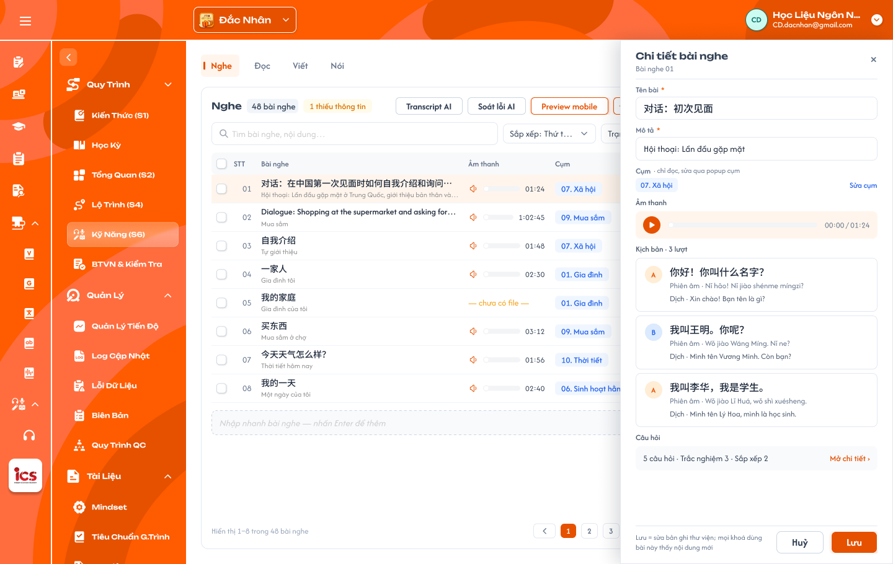

**Mô tả:**
- Mở từ tên bài hoặc `⋮ › Mở chi tiết`. Drawer trượt từ phải phủ panel Cụm; dòng đang mở tô sáng.
- Lưu = sửa **bản ghi thư viện**; mọi khoá dùng bài này thấy nội dung mới.

**Điểm cần lưu ý:**
- `A06.01` Tiêu đề `Chi tiết bài nghe` + dòng phụ `Bài nghe NN`; `×` đóng, hỏi xác nhận nếu có thay đổi chưa lưu (`Huỷ` giữ drawer, `Bỏ thay đổi` đóng).
- `A06.02` `Tên bài` *: bắt buộc, ngôn ngữ đích, tối đa 200 ký tự.
- `A06.03` `Mô tả` *: tiếng Việt, tối đa 500 ký tự. Trống vẫn lưu được nhưng bài tính thiếu thông tin.
- `A06.04` `Cụm`: chỉ đọc, chip cụm bài đang thuộc (hoặc `Chưa phân cụm`); `Sửa cụm` mở popup Thêm vào cụm / Gỡ khỏi cụm. Drawer không có field `Bài học`.
- `A06.05` `Âm thanh`: trình phát `00:00 / mm:ss`; `Tải lên` / `Thay` / `Xoá`; chỉ `.mp3`, tối đa 50MB (theo `file_limits.json`).
- `A06.06` `Kịch bản · N lượt`: danh sách lượt thoại theo thứ tự: nhãn người nói (`A`, `B`…), câu gốc, `Phiên âm ·`, `Dịch ·`, mốc `start – end` theo audio (`mm:ss.s`, xem Q04). Thêm / sửa / xoá / kéo thả lượt; lượt có giá trị AI chờ duyệt viền nét đứt cam với `✓ Duyệt` / `↺ Hoàn tác`. Mốc thời gian để app học viên tô sáng câu đang phát; AI điền sẵn, CD sửa tay được; lượt không có mốc vẫn lưu được.
- `A06.07` `Câu hỏi`: tóm tắt `N câu hỏi · <loại> k · …` và `Mở chi tiết ›` dẫn sang màn Chi tiết câu hỏi của Thư viện bài tập (Trang 15); chưa có câu hiện `0 câu hỏi` màu cam.
- `A06.08` Footer: ghi chú `Lưu = sửa bản ghi thư viện; mọi khoá dùng bài này thấy nội dung mới`; `Huỷ`, `Lưu`. Lưu thất bại giữ dữ liệu cũ, Toast `Có Lỗi Xảy Ra`.
- Phiên âm theo ngôn ngữ trung tâm (pinyin, furigana / romaji, romanization…); trung tâm tiếng Anh / Đức / Pháp để trống (xem Q05).

### Trang 3: CD-KH-050120 — Kỹ năng (S6) / Nghe / Chọn nhiều · Thao tác hàng loạt

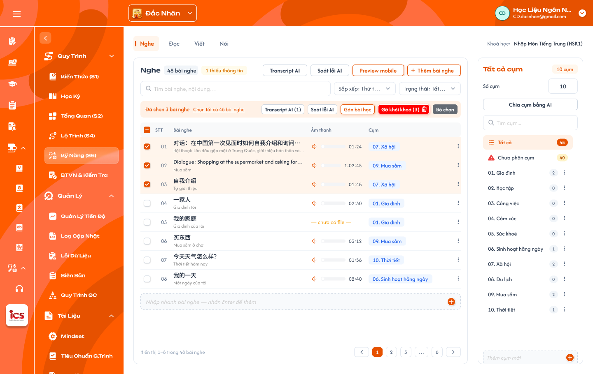

**Mô tả:**
- Tick ít nhất 1 dòng thì hàng tìm kiếm đổi thành thanh thao tác hàng loạt.

**Điểm cần lưu ý:**
- `A10.01` `Đã chọn N bài nghe`: số bài đang chọn, kể cả ở trang khác.
- `A10.02` `Chọn tất cả N bài nghe`: chọn toàn bộ bài thoả bộ lọc hiện tại (mọi trang).
- `A10.03` `Transcript AI (k)` (Nghe) / `Tạo câu hỏi bằng AI (k)` (Đọc): k = số bài đang chọn đủ điều kiện (Nghe: có file âm thanh; Đọc: có đoạn văn); k = 0 thì mờ.
- `A10.04` `Soát lỗi AI` soát các bài đang chọn.
- `A10.05` `Thêm vào cụm / Gỡ khỏi cụm` mở popup `Cụm của N bài` cho mọi bài đang chọn.
- `A10.06` `Gỡ khỏi khoá (N)` mở popup Gỡ khỏi khoá cho N bài.
- `A10.07` `Bỏ chọn` bỏ hết lựa chọn, trở về hàng tìm kiếm. Đổi tab hoặc đổi bộ lọc thì bỏ chọn.

### Trang 4: CD-KH-050130 — Kỹ năng (S6) / Nghe / Khoá chưa có bài nghe

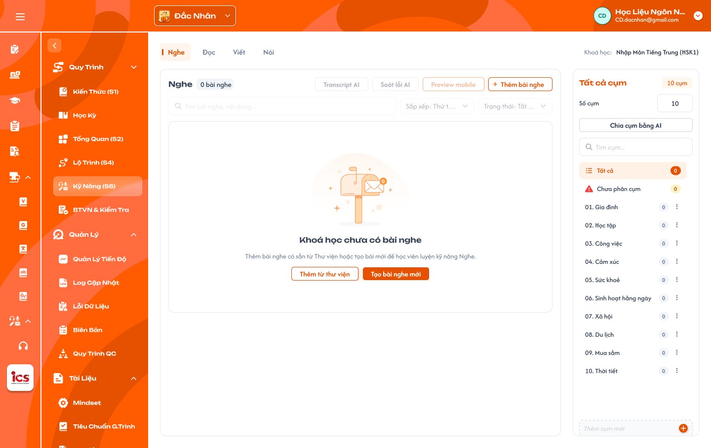

**Mô tả:**
- Khoá chưa có bài kỹ năng của tab: thay bảng bằng hình minh hoạ, tiêu đề `Khoá học chưa có bài nghe`, mô tả `Thêm bài nghe có sẵn từ Thư viện hoặc tạo bài mới để học viên luyện kỹ năng Nghe.`, nút `Thêm từ thư viện`, `Tạo bài nghe mới`.

**Điểm cần lưu ý:**
- `A14.01` Toolbar: badge `0 bài nghe`; nút AI, `Preview mobile`, ô tìm, bộ lọc mờ; `+ Thêm bài nghe` vẫn bật.
- `A14.02` Panel Cụm: mọi badge 0; vẫn tạo cụm được bằng `Số cụm`.
- `A14.06` Thanh nhập nhanh vẫn hiện ở cuối vùng trống.
- Có bài nhưng bộ lọc không ra kết quả thì dùng màn `Không tìm thấy…`, không dùng màn trống này.

### Trang 5: CD-KH-050140 — Kỹ năng (S6) / Nghe / Preview mobile theo bài đang chọn

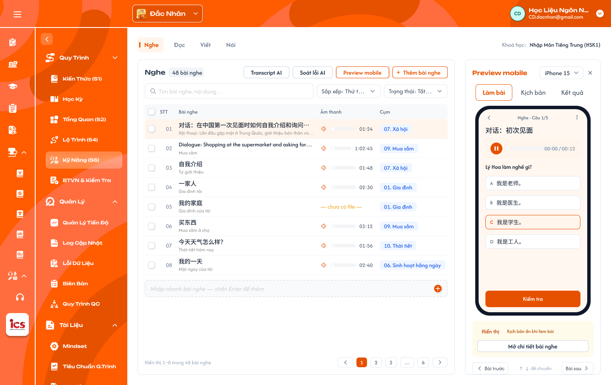

**Mô tả:**
- Bấm `Preview mobile` mở panel phải thay panel Cụm, tái hiện màn học của app học viên cho bài đang chọn.

**Điểm cần lưu ý:**
- `A19.01` Tiêu đề `Preview mobile`, dropdown thiết bị (`iPhone 15`…), `×` đóng về panel Cụm.
- `A19.02` Tab `Làm bài` (phát audio / hiện đoạn văn, câu hỏi từng câu `Nghe · Câu 1/5`, chọn đáp án, `Kiểm tra`), `Kịch bản` (lượt thoại, tô sáng theo mốc thời gian khi phát), `Kết quả` (điểm và đáp án đúng sau khi làm hết). Bài đọc: tab `Kịch bản` thay bằng `Đoạn văn` (tô sáng Từ vựng liên quan, phát audio đọc mẫu nếu có).
- `A19.03` `Hiển thị`: toggle `Kịch bản ẩn khi làm bài` / `Kịch bản hiện khi làm bài`, **lưu theo bài** (cấu hình của bản ghi thư viện).
- `A19.04` `Mở chi tiết bài nghe` mở drawer (Trang 2).
- `A19.05` `Bài trước` / `Bài sau` chuyển bài theo thứ tự bảng; phím `↑ ↓`.
- Preview không ghi dữ liệu học; bài thiếu file / đoạn văn hoặc 0 câu hỏi hiện thông báo trong khung điện thoại (vd `Bài chưa có câu hỏi`).

### Trang 6: CD-KH-050150 — Kỹ năng (S6) / Nghe / Popup thêm bài từ thư viện

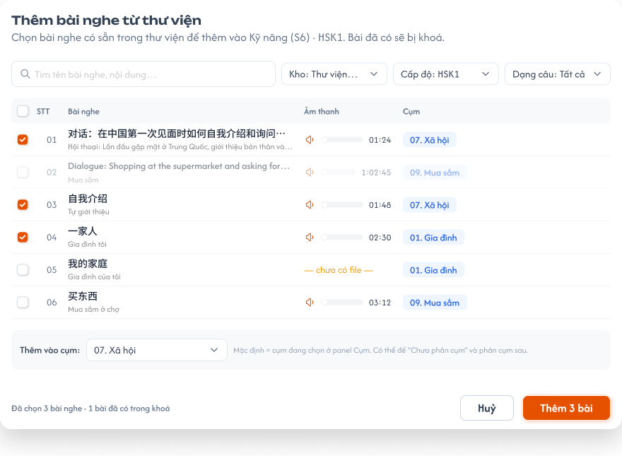

**Mô tả:**
- `+ Thêm bài nghe › Thêm từ thư viện` (hoặc nút ở màn trống): chọn bài có sẵn trong Thư viện kỹ năng của trung tâm để gắn vào khoá. Tab Đọc tương tự với bài đọc (xem Q01).

**Điểm cần lưu ý:**
- `A11.01` Tiêu đề `Thêm bài nghe từ thư viện` + mô tả `Chọn bài nghe có sẵn trong thư viện để thêm vào Kỹ năng (S6) · <cấp độ khoá>. Bài đã có sẽ bị khoá.`
- `A11.02` Ô tìm `Tìm tên bài nghe, nội dung…`.
- `A11.03` `Kho`: `Thư viện kỹ năng` (mặc định, mọi bài của trung tâm), `Khoá học` (bài tạo từ S6 của các khoá).
- `A11.04` `Cấp độ`: mặc định = cấp độ của khoá đang mở; chọn cấp độ khác hoặc `Tất cả`.
- `A11.05` `Dạng câu`: `Tất cả` (mặc định) hoặc một loại câu hỏi mà bài có.
- `A11.06` Bảng: checkbox, `STT`, `Bài nghe`, `Âm thanh` (phát được). Bài đã có trong khoá mờ, tick sẵn, không bỏ tick được. Không có cột `Bài học`. Bài `Vô hiệu` trong thư viện không hiện.
- `A11.07` `Thêm vào cụm`: dropdown cụm của tab, mặc định cụm đang chọn ở panel Cụm; chọn được `Chưa phân cụm`.
- `A11.08` Footer `Đã chọn N bài nghe · M bài đã có trong khoá`; `Huỷ`; `Thêm N bài` (N không tính bài đã có; N = 0 thì mờ). Thêm là gắn **tham chiếu** bản ghi thư viện, không sao chép; một bản ghi gắn vào một khoá tối đa 1 lần.

### Trang 7: CD-KH-050155 — Kỹ năng (S6) / Nghe / Popup gỡ bài khỏi khoá

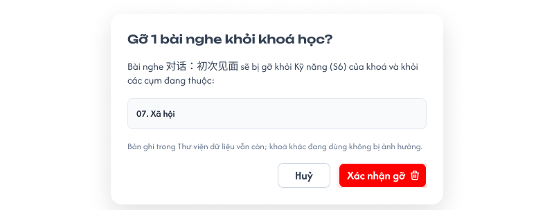

**Mô tả:**
- Xoá ở S6 là **gỡ** bài khỏi khoá; bản ghi thư viện vẫn còn.

**Điểm cần lưu ý:**
- `A13.01` Tiêu đề `Gỡ N bài nghe khỏi khoá học?`.
- `A13.02` Nội dung `Bài nghe <tên> sẽ bị gỡ khỏi Kỹ năng (S6) của khoá, khỏi các cụm và khỏi các bài học đang dùng:` + danh sách bài học đang dùng (nhiều bài thì liệt kê tên từng bài); không dùng ở bài học nào thì bỏ phần danh sách (xem Q03).
- `A13.03` Ghi chú `Bản ghi trong Thư viện dữ liệu vẫn còn; khoá khác đang dùng không bị ảnh hưởng.`
- `A13.04` Nút `Huỷ`; `Xác nhận gỡ` (đỏ).
- Gỡ cũng gỡ bài khỏi mọi cụm của tab và khỏi các bài học của khoá đã thêm bài này; kết quả học viên đã làm trên bài vẫn giữ.

### Trang 8: CD-KH-050160 — Kỹ năng (S6) / Nghe / Popup tạo bài nghe mới

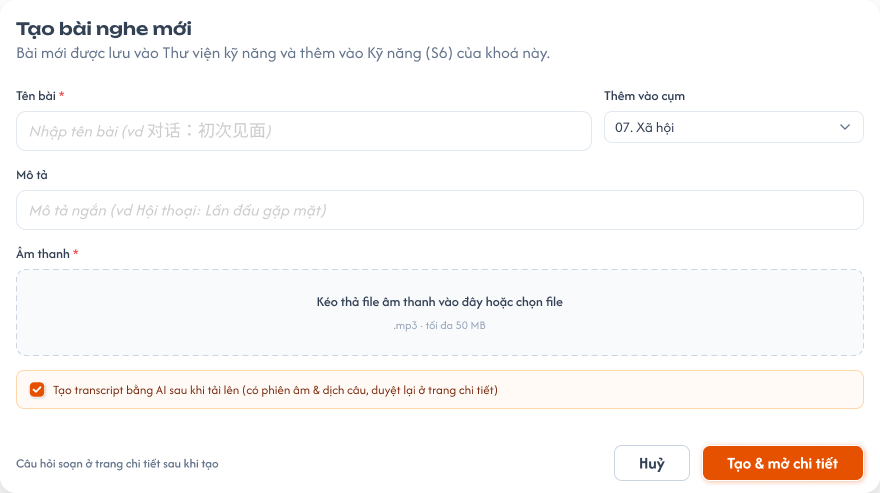

**Mô tả:**
- `+ Thêm bài nghe › Tạo bài nghe mới`: tạo bản ghi thư viện mới rồi gắn vào khoá. Tab Đọc: `Tạo bài đọc mới` với `Đoạn văn *` thay cho `Âm thanh` (xem Q01).

**Điểm cần lưu ý:**
- `A12.01` Tiêu đề `Tạo bài nghe mới` + `Bài mới được lưu vào Thư viện kỹ năng và thêm vào Kỹ năng (S6) của khoá này.`
- `A12.02` `Tên bài` *: bắt buộc, placeholder `Nhập tên bài (vd 对话：初次见面)`.
- `A12.03` `Thêm vào cụm`: mặc định cụm đang chọn ở panel Cụm; có `Chưa phân cụm`.
- `A12.04` `Mô tả`: không bắt buộc lúc tạo.
- `A12.05` `Âm thanh` * (Nghe): kéo thả hoặc chọn file `.mp3` ≤ 50MB; bắt buộc khi tạo bằng popup này.
- `A12.06` `Đoạn văn` * (Đọc): nhiều dòng, bắt buộc.
- `A12.07` `Tạo transcript bằng AI sau khi tải lên` (Nghe): checkbox, mặc định tick; tick thì sau khi tạo chạy Transcript AI cho bài. Đọc: `Tạo câu hỏi bằng AI sau khi tạo`, mặc định không tick.
- `A12.08` Footer: ghi chú `Câu hỏi soạn ở trang chi tiết sau khi tạo`; `Huỷ`; `Tạo & mở chi tiết` (tạo xong mở drawer).
- Bản ghi mới ở trạng thái `Nháp` trong thư viện; cấp độ lấy theo khoá. Tải file thất bại thì không tạo bài, Toast `Có Lỗi Xảy Ra`.

### Trang 9: CD-KH-050180 — Kỹ năng (S6) / Nghe / Transcript bằng AI (inline)


**Mô tả:**
- Chỉ tab Nghe. AI tạo kịch bản (lượt thoại, phiên âm, dịch, mốc thời gian) từ file âm thanh. Chạy từ nút toolbar (mọi bài có file nhưng chưa có kịch bản), menu dòng, thanh hàng loạt, hoặc tick khi tạo bài.

**Điểm cần lưu ý:**
- `A16.01` Thanh AI: `AI · Đang tạo transcript cho N bài nghe · Tạo từ file âm thanh · có phiên âm & dịch câu`, tiến độ `k/N bài`, nút `Duyệt tất cả (m)` (m = bài đã tạo chờ duyệt), nút `Dừng` khi đang chạy.
- `A16.02` Bảng tự lọc còn các bài trong đợt, footer `Hiển thị … trong N bài đang tạo transcript`; nhãn dưới tên `AI · đang tạo transcript` → `AI · đã tạo, chờ duyệt`.
- `A16.03` Duyệt: mở drawer thấy từng lượt viền cam `✓ Duyệt` / `↺ Hoàn tác`; `Duyệt tất cả` áp dụng cho mọi bài chờ duyệt.
- Kịch bản AI lưu nháp chờ duyệt, **không ghi đè** kịch bản cũ cho tới khi duyệt; chưa duyệt thì app học viên dùng kịch bản cũ (hoặc không có).
- Bài đang được AI xử lý bị khoá sửa / gỡ tới khi xong hoặc `Dừng`; AI lỗi thì bài giữ nguyên, Toast `Có Lỗi Xảy Ra`.

### Trang 10: CD-KH-050190 — Kỹ năng (S6) / Nghe / Soát lỗi bằng AI

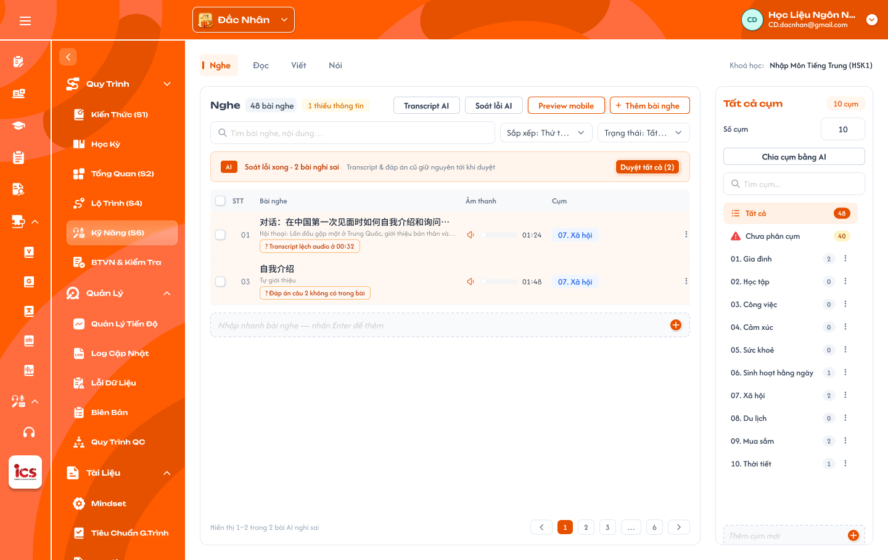

**Mô tả:**
- AI kiểm tra kịch bản / đoạn văn và câu hỏi của bài (lệch audio, đáp án không có trong bài, lỗi chính tả, dịch sai). Chạy từ nút toolbar (toàn bộ bài của tab) hoặc thanh hàng loạt.

**Điểm cần lưu ý:**
- `A18.01` Thanh AI: `AI · Soát lỗi xong · N bài nghi sai · Transcript & đáp án cũ giữ nguyên tới khi duyệt`, `Duyệt tất cả (N)`. Không có bài nghi sai: `Soát lỗi xong · không phát hiện lỗi`.
- `A18.02` Bảng lọc còn bài nghi sai, footer `Hiển thị … trong N bài AI nghi sai`; nhãn `? <lý do>` dưới tên (vd `Transcript lệch audio ở 00:32`, `Đáp án câu 2 không có trong bài`).
- `A18.03` Duyệt: `Duyệt tất cả` **áp dụng sửa của AI** cho mọi bài nghi sai; từng bài duyệt / hoàn tác trong drawer hoặc Chi tiết câu hỏi. Có `↺ Hoàn tác` sau khi áp dụng (giữ bản cũ tới lần soát kế tiếp).
- Đề xuất của AI lưu nháp, dữ liệu cũ giữ nguyên tới khi duyệt; nhãn nghi sai mất khi duyệt, hoàn tác hoặc CD sửa tay.

### Trang 11: CD-KH-050200 — Kỹ năng (S6) / Đọc

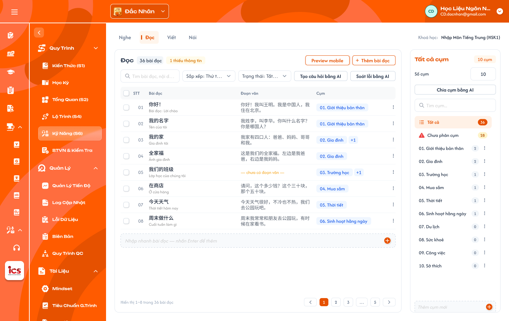

**Mô tả:**
- Tab `Đọc`: danh sách bài đọc của khoá, mỗi dòng một bản ghi thư viện kỹ năng loại Đọc.

**Điểm cần lưu ý:**
- `A03.01` `STT`, checkbox, `Cụm`, menu `⋮` như bảng Nghe; menu `⋮` thay `Transcript AI` bằng `Tạo câu hỏi bằng AI`.
- `A03.02` `Bài đọc`: tên bài (ngôn ngữ đích) + mô tả tiếng Việt, như cột `Bài nghe`.
- `A03.03` `Đoạn văn`: tối đa 2 dòng, dài thì cắt `…`; chưa có hiện `— chưa có đoạn văn —` màu cam.
- Toolbar tab Đọc: `Preview mobile`, `+ Thêm bài đọc`; `Tạo câu hỏi bằng AI`, `Soát lỗi bằng AI` nằm ở hàng tìm kiếm. Lọc theo cụm bằng panel Cụm như tab Nghe.
- Bài đọc **thiếu thông tin** khi thiếu bất kỳ: đoạn văn, mô tả, hoặc chưa có câu hỏi. Audio đọc mẫu không bắt buộc, không tính thiếu.
- `A17.01` Tạo câu hỏi bằng AI (nút toolbar / menu dòng / hàng loạt): chỉ bài có đoạn văn; popup nhập số câu (mặc định 5) và loại câu cho phép. AI sinh câu hỏi từ đoạn văn theo loại câu của Thư viện bài tập; kết quả vào bộ câu hỏi của bài ở trạng thái chờ duyệt, duyệt tại màn Chi tiết câu hỏi Reading (Trang 16). Quy tắc duyệt, dừng, khoá bài như Transcript AI.
- `A17.02` Thanh AI: `AI · Đang tạo câu hỏi cho N bài đọc`, tiến độ, `Duyệt tất cả (m)`, `Dừng`. Câu hỏi AI chưa duyệt không tính vào `Số câu hỏi` và không xuất hiện cho học viên.

### Trang 12: CD-KH-050210 — Kỹ năng (S6) / Đọc / Chi tiết bài đọc (drawer)

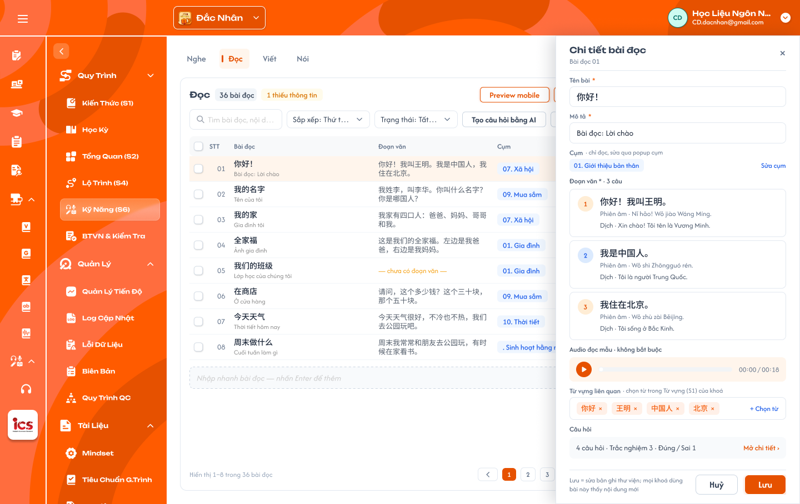

**Mô tả:**
- Giống drawer bài nghe, thay khối Âm thanh + Kịch bản bằng khối Đoạn văn.

**Điểm cần lưu ý:**
- `A07.01` `Tên bài` *, `Mô tả` *, `Cụm`, `Câu hỏi`, Footer như drawer bài nghe; `Mở chi tiết ›` dẫn sang Chi tiết câu hỏi Reading (Trang 16).
- `A07.02` `Đoạn văn` *: nhiều dòng, ngôn ngữ đích; trống thì bài tính thiếu thông tin. Có thể tách câu: mỗi câu có `Phiên âm ·`, `Dịch ·` (tuỳ chọn, AI điền được).
- `A07.03` `Audio đọc mẫu`: không bắt buộc; `.mp3` ≤ 50MB; có file thì app học viên phát kèm đoạn văn.
- `A07.04` `Từ vựng liên quan`: chọn nhiều từ trong Kiến thức (S1) Từ vựng của chính khoá; chip có `×`; dùng để app tô sáng và tra nhanh trong đoạn văn. Chỉ là tham chiếu: sửa từ ở S1 thì đoạn văn thấy nội dung mới; gỡ từ khỏi khoá ở S1 thì tự mất khỏi danh sách này.

### Trang 13: CD-KH-050300 — Kỹ năng (S6) / Viết


**Mô tả:**
- Tab `Viết`: bảng `Bài viết`, `Đề bài`, `Cụm` (vd bài `介绍你自己`, đề `Viết 5–6 câu giới thiệu bản thân`), có `Tạo câu hỏi bằng AI`, `Soát lỗi bằng AI`, `Preview mobile`, `+ Thêm bài viết`.

**Điểm cần lưu ý:**
- Dùng cùng mô hình panel Cụm với Nghe / Đọc; bảng và field theo requirement riêng (chưa viết).

### Trang 14: CD-KH-050400 — Kỹ năng (S6) / Nói

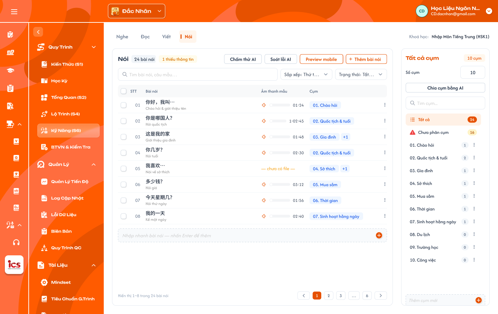

**Mô tả:**
- Tab `Nói`: bảng `Bài nói`, `Âm thanh mẫu`, `Cụm` (vd bài `你好，我叫…`), có `Chấm thử AI`, `Soát lỗi AI`, `Preview mobile`, `+ Thêm bài nói`.

**Điểm cần lưu ý:**
- Dùng cùng mô hình panel Cụm với Nghe / Đọc; bảng và field theo requirement riêng (chưa viết).

### Trang 15: CD-KH-070301 — Thư viện / Bài tập / Chi tiết câu hỏi · Listening

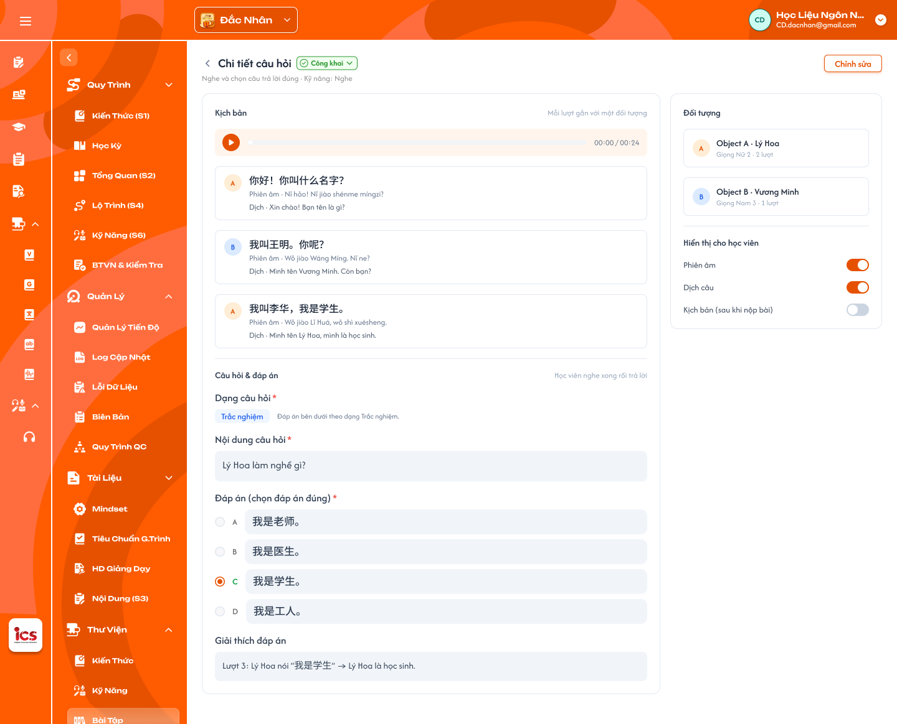

**Mô tả:**
- Màn Chi tiết câu hỏi Listening của Thư viện bài tập, đích của `A06.07` `Mở chi tiết ›` từ drawer bài nghe. Hiện kịch bản theo lượt (người nói A / B, phiên âm, dịch) và trình phát `00:00 / 00:24`; nút `Chỉnh sửa`.

**Điểm cần lưu ý:**
- Câu hỏi soạn và duyệt tại đây, đủ loại câu của BTVN & Kiểm tra; drawer S6 chỉ tóm tắt số câu theo loại và dẫn link. Quay lại giữ drawer.

### Trang 16: CD-KH-070302 — Thư viện / Bài tập / Chi tiết câu hỏi · Reading

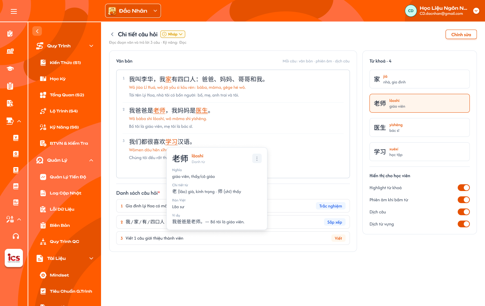

**Mô tả:**
- Màn Chi tiết câu hỏi Reading, đích của `A07.01` `Mở chi tiết ›` từ drawer bài đọc. Hiện đoạn văn theo từng câu (văn bản · phiên âm · dịch câu); nút `Chỉnh sửa`.

### Trang 17: CD-KH-070305 — Thư viện / Bài tập / Chi tiết câu hỏi · Reading / Thêm · Sửa từ khoá

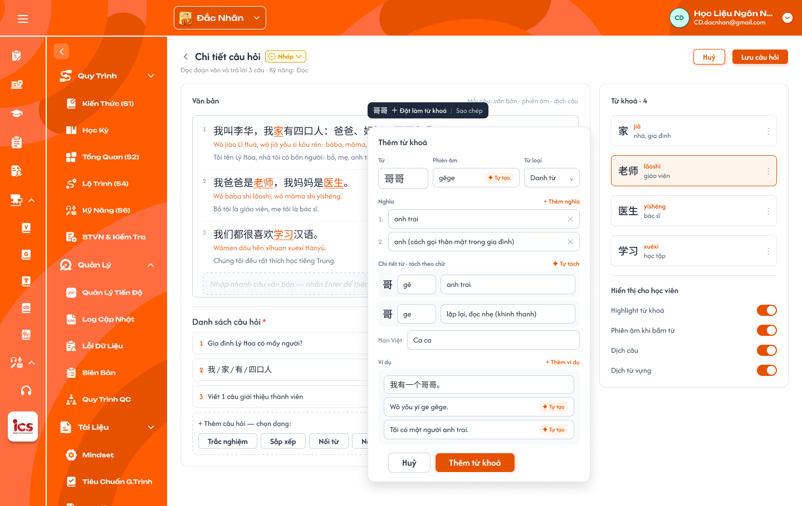

**Mô tả:**
- Chế độ chỉnh sửa của Chi tiết câu hỏi Reading, khu vực từ khoá; có `Huỷ`, `Lưu câu hỏi`.

### Trang 18: CD-KH-070306 — Thư viện / Bài tập / Chi tiết câu hỏi · Listening / Sửa · Xoá

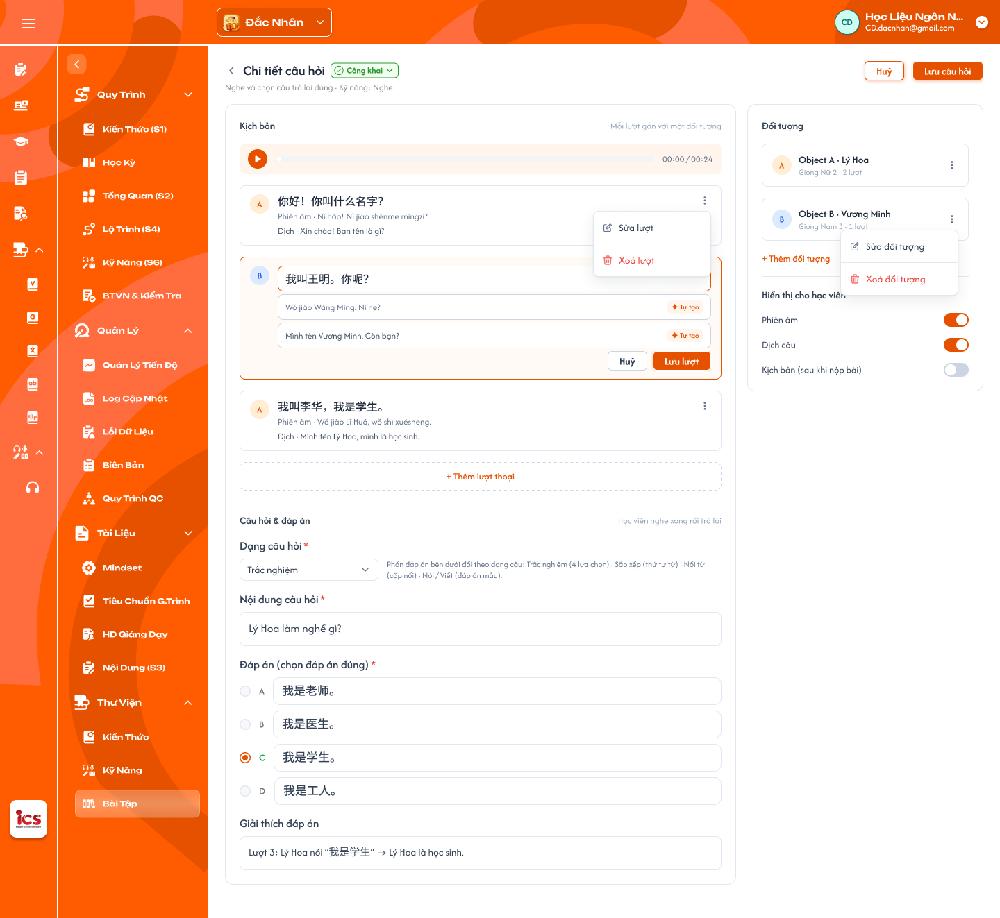

**Mô tả:**
- Chế độ chỉnh sửa Listening: sửa / xoá lượt thoại của kịch bản; lượt do AI tạo gắn nhãn `✦ Tự tạo`, có `Lưu lượt`; `Huỷ`, `Lưu câu hỏi`.

### Trang 19: CD-KH-070307 — Thư viện / Bài tập / Chi tiết câu hỏi · Listening / Xác nhận xoá đối tượng

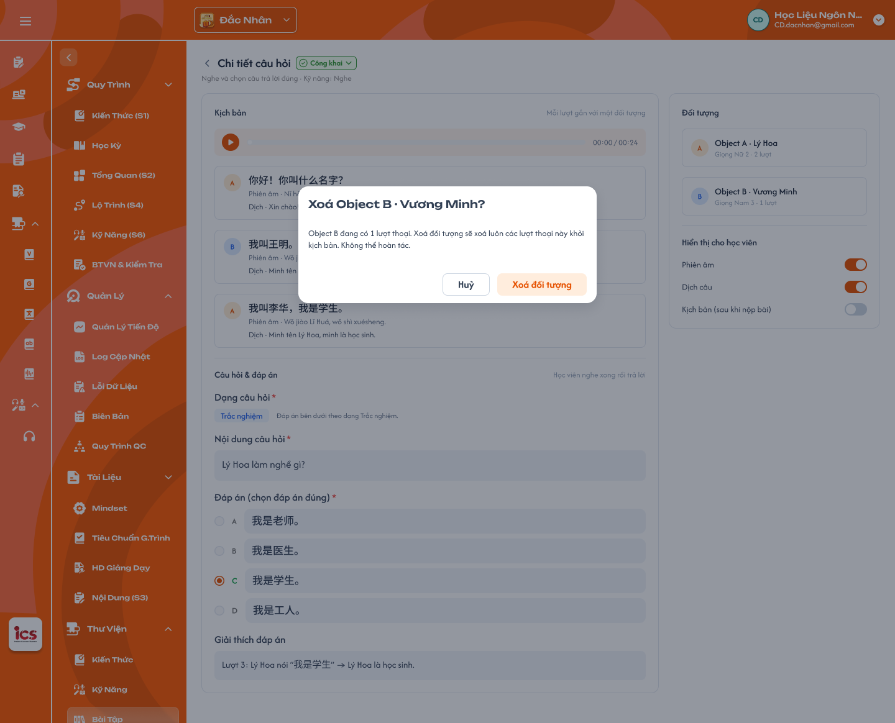

**Mô tả:**
- Popup xác nhận xoá đối tượng (lượt thoại) trong Chi tiết câu hỏi Listening.

### Trang 20: CD-KH-070309 — Thư viện / Bài tập / Chi tiết câu hỏi · Reading / Thêm · Sửa câu hỏi

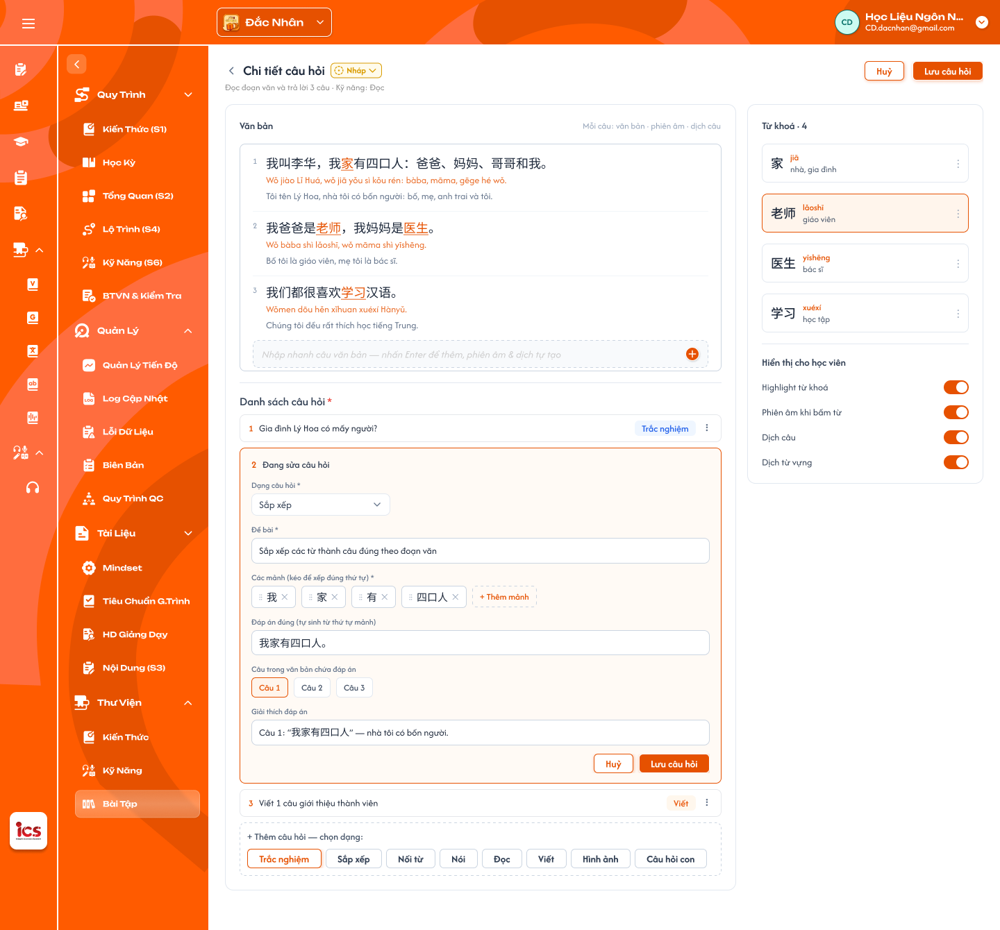

**Mô tả:**
- Chế độ thêm / sửa câu hỏi của bài đọc; có `Huỷ`, `Lưu câu hỏi`.

### Trang 21: CD-KH-070313 — Thư viện / Bài tập / Chi tiết câu hỏi · Reading / Xem trước phía học viên

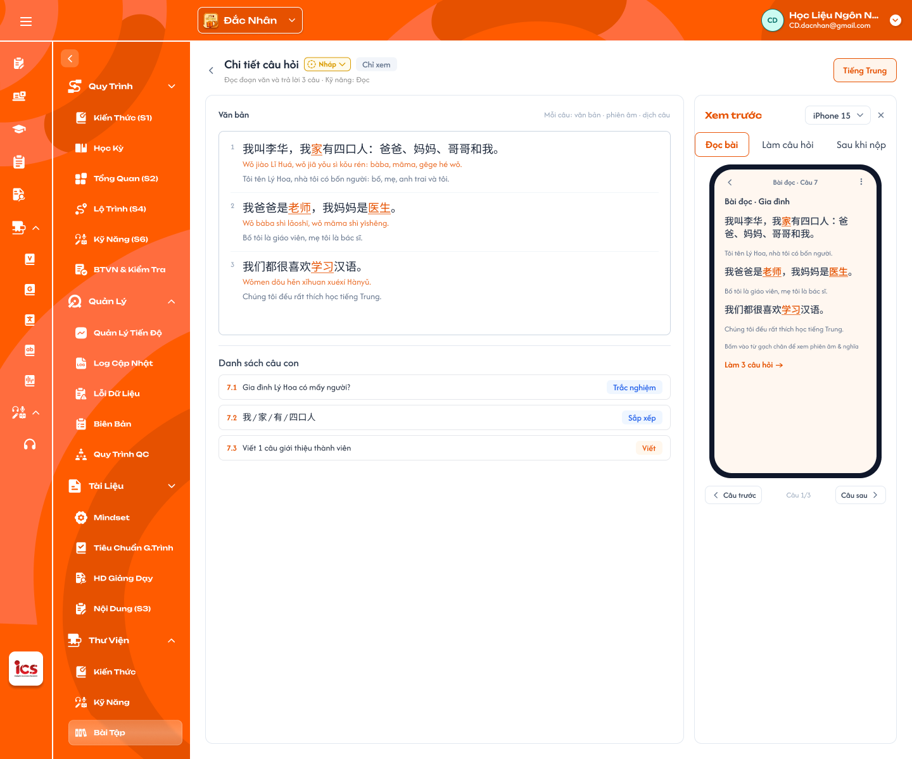

**Mô tả:**
- Chế độ `Chỉ xem` của Chi tiết câu hỏi Reading, xem trước phía học viên (có chuyển ngôn ngữ `Tiếng Trung`).

---

## 2. Yêu cầu

### 2.1. Flow chính

**Flow 1: Mở Kỹ năng (S6) và xem danh sách**

```
CD chọn trung tâm ở header → vào khoá học → Kỹ Năng (S6)
      → 4 tab Nghe / Đọc / Viết / Nói, mặc định Nghe; panel Cụm của tab chọn Tất cả cụm
      → CD tìm / lọc Trạng thái / sắp xếp / chọn cụm ở panel → bảng, footer, STT cập nhật
                    ↓ (khoá có 0 bài)
              Màn trống (Trang 4)
```

**Flow 2: Thêm bài từ thư viện**

```
CD bấm + Thêm bài nghe → Thêm từ thư viện → popup (Trang 6)
      → Lọc Kho / Cấp độ (mặc định cấp độ khoá) / Dạng câu, tìm → tick bài (bài đã có bị khoá)
      → Chọn Thêm vào cụm (mặc định cụm đang chọn) → Thêm N bài
      → Thành công: gắn tham chiếu vào khoá, vào cụm đã chọn, Toast Thành Công
                    ↓ (thất bại)
              Không gắn bài nào
```

**Flow 3: Tạo bài mới**

```
CD bấm + Thêm bài nghe → Tạo bài nghe mới (Trang 8) → nhập Tên, Mô tả, chọn file mp3 ≤ 50MB, Thêm vào cụm
      → (tick) Tạo transcript bằng AI → Tạo & mở chi tiết
      → Tạo bản ghi thư viện Nháp, gắn khoá, vào cụm, mở drawer; AI chạy nền nếu tick
Tab Đọc: nhập Đoạn văn thay file; (tick) Tạo câu hỏi bằng AI
```

**Flow 4: Nhập nhanh**

```
CD gõ tên ở dòng cuối bảng → Enter
      → Tạo bản ghi thư viện Nháp chỉ có tên, gắn khoá, vào cụm đang chọn (Tất cả cụm → Chưa phân cụm)
      → bài tính thiếu thông tin
```

**Flow 5: Xem và sửa chi tiết**

```
CD bấm tên bài hoặc ⋮ › Mở chi tiết → drawer (Trang 2 / Trang 12)
      → Sửa Tên / Mô tả / file / kịch bản (lượt, phiên âm, dịch, mốc thời gian) hoặc đoạn văn / audio mẫu / từ vựng liên quan
      → Sửa cụm → popup Thêm vào cụm / Gỡ khỏi cụm
      → Lưu → sửa bản ghi thư viện, mọi khoá dùng bài thấy nội dung mới
      → Câu hỏi: Mở chi tiết › → màn Chi tiết câu hỏi của Thư viện bài tập (Trang 15 / 16)
```

**Flow 6: Thêm vào cụm / Gỡ khỏi cụm**

```
CD ⋮ › Thêm vào cụm / Gỡ khỏi cụm (1 bài) hoặc thanh hàng loạt (N bài), hoặc bấm nhãn ở cột Cụm
      → popup Cụm của N bài: chọn 1 cụm hoặc Chưa phân cụm → Lưu
                    ↓ (bài đang dùng ở bài học mà rời cụm)
              Cảnh báo liệt kê bài học → xác nhận
      → bài chuyển cụm / về Chưa phân cụm, bài rời cụm tự gỡ khỏi bài học; số đếm panel Cụm cập nhật
```

**Flow 7: Gỡ khỏi khoá**

```
CD ⋮ › Gỡ khỏi khoá hoặc Gỡ khỏi khoá (N) → popup xác nhận (Trang 7) → Xác nhận gỡ
      → Gỡ bài khỏi khoá, khỏi mọi cụm và khỏi các bài học của khoá; bản ghi thư viện và khoá khác không đổi
```

**Flow 8: Quản lý cụm**

```
Tab chưa có cụm: CD nhập Số cụm N → tạo Chủ đề 1 … N (rỗng) → ô Số cụm chỉ đọc
Đã có cụm: Thêm cụm mới / ⋮ cụm › Đổi tên / Xoá cụm (xác nhận; bài của cụm về Chưa phân cụm và tự gỡ khỏi bài học)
Chia cụm bằng AI → AI đề xuất bài vào cụm → CD áp dụng hoặc bỏ
```

**Flow 9: Import / Export Excel**

```
Export: tải toàn bộ bài của tab ra .xlsx (Nghe 3 sheet, Đọc 4 sheet, không cột bài học)
Import tab Nghe: chọn .xlsx → chỉ đọc listening_lesson, listening, listening_question
Import tab Đọc: chọn .xlsx → chỉ đọc reading_lesson, reading, reading_question, reading_vocabulary
      → bỏ qua sheet khác và cột lesson_id → kiểm tra từng dòng, nối sheet phụ qua *_lesson_id
                    ↓ (có lỗi)
              Chặn cả file, liệt kê lỗi theo sheet + dòng
      → hợp lệ: tạo bản ghi thư viện Nháp, gắn khoá theo thứ tự dòng, vào cụm đang chọn, Toast Thành Công, gợi ý Soát lỗi AI
```

**Flow 10: Transcript AI (Nghe) / Tạo câu hỏi AI (Đọc)**

```
CD bấm nút toolbar / ⋮ / hàng loạt / tick khi tạo → AI chạy nền, thanh AI hiện tiến độ, bài bị khoá sửa (Trang 9)
      → Xong: nhãn AI · đã tạo, chờ duyệt → CD Duyệt từng lượt / câu hoặc Duyệt tất cả → thành chính thức
      → Hoàn tác trả giá trị cũ; Dừng giữ bài chưa xử lý nguyên
```

**Flow 11: Soát lỗi AI**

```
CD bấm Soát lỗi AI → AI kiểm tra kịch bản / đoạn văn / câu hỏi (Trang 10) → bảng lọc còn bài nghi sai kèm lý do
      → Duyệt tất cả: áp dụng sửa của AI (có Hoàn tác); hoặc sửa tay → nhãn mất
```

**Flow 12: Preview mobile**

```
CD chọn bài → Preview mobile (Trang 5) → panel phải hiện khung điện thoại: Làm bài / Kịch bản (Đoạn văn) / Kết quả
      → Đổi toggle Kịch bản ẩn / hiện → lưu theo bài → Bài trước / sau → × đóng về panel Cụm
```

**Flow 13: Thêm / gỡ bài kỹ năng trong Chi tiết bài học**

```
CD mở Chi tiết bài học → tab Kỹ năng → + Thêm → popup 3 cột: Chọn tất cả (thêm cả cụm) hoặc tick từng bài trong S6 của khoá → xác nhận
      → Bài được thêm vào bài học này (bài có thể ở nhiều bài học) → × gỡ khỏi bài học này (chỉ xoá liên kết)
CD gỡ bài khỏi cụm / xoá cụm ở S6 → cảnh báo → bài tự gỡ khỏi các bài học đã thêm nó từ cụm đó
```

### 2.2. Ngoại lệ

- **EX01:** Khoá học không `Nháp` → ẩn / mờ mọi thao tác ghi (gồm thao tác cụm); API thêm / sửa / gỡ / cụm / AI bị từ chối.
- **EX02:** Tên bài trống, Nhập nhanh rỗng, Tạo bài mới thiếu file (Nghe) hoặc đoạn văn (Đọc) → báo lỗi tại field, không tạo / lưu.
- **EX03:** File âm thanh không phải `.mp3` hoặc lớn hơn 50MB → từ chối, Toast `Cảnh Báo`, giữ file cũ.
- **EX04:** Gắn bản ghi thư viện đã có trong khoá → popup khoá lựa chọn; API từ chối gắn trùng.
- **EX05:** Import không phải `.xlsx`, thiếu sheet bài gốc, `reading_vocabulary` thiếu cột `reading_lesson_id`, dòng thiếu field bắt buộc hoặc `*_lesson_id` không có trong sheet bài gốc → chặn cả file, báo theo sheet + dòng, không thêm bài nào.
- **EX06:** AI lỗi hoặc CD bấm `Dừng` → bài chưa xử lý giữ nguyên; bài đã xử lý giữ trạng thái chờ duyệt; AI lỗi thì Toast `Có Lỗi Xảy Ra`.
- **EX07:** Sửa / gỡ bài đang được AI xử lý → UI mờ; API từ chối.
- **EX08:** Role khác CD hoặc trung tâm khác trung tâm đang chọn truy cập S6 / gọi API → từ chối.
- **EX09:** Lưu drawer, thêm / gỡ cụm, gỡ bài, duyệt AI thất bại → giữ dữ liệu cũ, Toast `Có Lỗi Xảy Ra`.
- **EX10:** Thêm bài vào cụm của tab khác / khoá khác, hoặc thêm vào bài học không thuộc khoá đang mở (qua API) → từ chối.
- **EX11:** Nhập `Số cụm` khi tab đã có cụm (qua API) → từ chối; số cụm âm / không phải số → báo lỗi tại ô.

### 2.3. Yêu cầu khác

| Mã | Tên yêu cầu | Mô tả |
|---|---|---|
| REQ01 | Phạm vi | Mỗi khoá học có danh sách Kỹ năng (S6) riêng; dữ liệu theo trung tâm CD đang chọn ở header. |
| REQ02 | Tab kỹ năng | 4 tab `Nghe`, `Đọc`, `Viết`, `Nói` ở mọi trung tâm, mỗi tab có panel Cụm riêng; bảng và field của tài liệu này áp dụng Nghe và Đọc, Viết / Nói viết sau. |
| REQ03 | Cột và nội dung | Nghe: tên, mô tả, âm thanh (mp3 ≤ 50MB, thời lượng không giới hạn, `h:mm:ss` khi ≥ 1 giờ, chỉ phát một bài tại một thời điểm), cụm. Đọc: tên, mô tả, đoạn văn, cụm; audio đọc mẫu không bắt buộc. Không có cột bài học. |
| REQ04 | Thư viện kỹ năng | Bài của S6 là tham chiếu bản ghi Thư viện kỹ năng; một bản ghi gắn vào một khoá tối đa 1 lần. Thêm mới (popup tạo, nhập nhanh, import) tạo bản ghi `Nháp`; sửa tại S6 sửa bản ghi thư viện. Field: Tên *, Mô tả, Âm thanh + Kịch bản (lượt, người nói, phiên âm, dịch, mốc start / end) với Nghe; Đoạn văn + audio đọc mẫu + Từ vựng liên quan (từ S1 của khoá) với Đọc. **Thiếu thông tin** khi thiếu file / đoạn văn, mô tả, hoặc 0 câu hỏi đã duyệt. |
| REQ05 | Cụm | Mỗi tab có bộ cụm riêng của khoá; một bài thuộc **tối đa 1 cụm** của tab. `Số cụm` chỉ nhập khi chưa có cụm (tạo `Chủ đề 1…N`), sau đó thêm / đổi tên / xoá cụm, Chia cụm bằng AI. Thêm vào / gỡ khỏi cụm qua popup thêm / tạo, nhập nhanh, import (cụm đang chọn), menu dòng, hàng loạt, nhãn cột Cụm, drawer (chọn 1 cụm). Xoá cụm không gỡ bài khỏi khoá. Số đếm panel Cụm cập nhật ngay. Thứ tự bài trong cụm kéo thả được. |
| REQ06 | Tìm kiếm, lọc, sắp xếp | Tìm theo tên, mô tả, nội dung; lọc theo cụm (panel Cụm) và Trạng thái `Tất cả / Nháp / Công khai / Vô hiệu`; sắp xếp `Thứ tự thêm / Tên A–Z / Mới cập nhật / Thứ tự trong cụm`; phân trang 50 dòng; đổi điều kiện về trang 1. |
| REQ07 | Drawer chi tiết | Đủ field theo REQ04, cụm chỉ đọc + `Sửa cụm`, duyệt / hoàn tác giá trị AI, hỏi xác nhận khi đóng có thay đổi; lưu ảnh hưởng mọi khoá dùng bản ghi. |
| REQ08 | Câu hỏi | Soạn và duyệt ở màn Chi tiết câu hỏi của Thư viện bài tập (Listening / Reading), đủ loại câu của BTVN & Kiểm tra; drawer chỉ tóm tắt số câu theo loại và dẫn link. |
| REQ09 | Gỡ khỏi khoá | Xoá ở S6 là gỡ khỏi khoá, khỏi mọi cụm và khỏi các bài học của khoá, có xác nhận; bản ghi thư viện còn; kết quả học viên giữ. |
| REQ10 | Trạng thái khoá học | Chỉ thao tác ghi khi khoá `Nháp`; khoá khác chỉ xem, tìm, lọc, Preview, Export. |
| REQ11 | AI | Transcript AI (Nghe, từ file âm thanh, có phiên âm, dịch, mốc thời gian), Tạo câu hỏi AI (Đọc, từ đoạn văn), Soát lỗi AI (cả hai), Chia cụm bằng AI. Kết quả lưu nháp chờ duyệt, không ghi đè; `Duyệt tất cả` của Soát lỗi áp dụng sửa của AI, có Hoàn tác; `Dừng` được; bài đang xử lý bị khoá sửa / gỡ. |
| REQ12 | Import / Export Excel | Chỉ `.xlsx`. Tab Nghe chỉ đọc 3 sheet `listening_lesson`, `listening`, `listening_question`; tab Đọc chỉ đọc 4 sheet `reading_lesson`, `reading`, `reading_question`, `reading_vocabulary` (bắt buộc cột `reading_lesson_id`); bỏ qua sheet khác. **Không có cột bài học**: bỏ qua `lesson_id`, bài vào cụm đang chọn. Export toàn bộ bài của tab cùng cấu trúc sheet; import tạo bản ghi `Nháp` thêm vào cuối, có dòng lỗi thì chặn cả file, không tự dò trùng. |
| REQ13 | Preview mobile | Tái hiện màn học của app học viên cho bài đang chọn (Làm bài / Kịch bản hoặc Đoạn văn / Kết quả); toggle `Kịch bản ẩn khi làm bài` lưu theo bài; không ghi dữ liệu học. |
| REQ14 | Bài kỹ năng trong bài học | Chỉ Chi tiết bài học liên kết bài kỹ năng với bài học: thêm cả cụm (chọn tất cả, một lần, không tự gắn bài mới) hoặc từng bài từ S6 của chính khoá; bài thiếu thông tin không gắn được; gỡ khỏi khoá / gỡ khỏi cụm / xoá cụm đang dùng ở bài học có cảnh báo liệt kê bài học, xác nhận thì tự gỡ khỏi bài học; một bài có thể ở nhiều bài học; không sửa nội dung tại bài; S6 không hiển thị bài học. |
| REQ15 | Phản hồi | Mỗi thao tác thay đổi dữ liệu đúng một Toast theo kết quả; không báo thành công trước khi lưu xong. |

### 2.4. Ràng buộc

#### Quyền

| Role | Xem S6 | Thêm / Tạo / Sửa | Thêm / gỡ / quản lý cụm | Gỡ khỏi khoá | Import / Export | Dùng AI | Thêm / gỡ trong bài học |
|---|:---:|:---:|:---:|:---:|:---:|:---:|:---:|
| CD (khoá `Nháp`) | ✅ | ✅ | ✅ | ✅ | ✅ | ✅ | ✅ |
| CD (khoá `Công Khai` / `Vô hiệu`) | ✅ | ❌ | ❌ | ❌ | ✅ chỉ Export | ❌ | ❌ |
| Các role khác | ❌ | ❌ | ❌ | ❌ | ❌ | ❌ | ❌ |

#### Ràng buộc khác

- CD chỉ thao tác trên khoá học thuộc trung tâm đang chọn ở header; đổi trung tâm thì dữ liệu tải lại.
- Bài S6 tham chiếu bản ghi thư viện bằng định danh, không dùng tên làm khoá liên kết; sửa ở S6 ảnh hưởng mọi khoá dùng bản ghi.
- Cụm thuộc khoá + tab kỹ năng; bài chỉ vào được cụm cùng khoá, cùng tab. Bài học chỉ thêm được bài kỹ năng trong S6 của chính khoá; Từ vựng liên quan của bài đọc chỉ chọn trong S1 của chính khoá.
- Không cho phép truy cập hoặc thực hiện hành động `❌`, kể cả gọi trực tiếp bằng URL hoặc request.


---

## 3. Testcase

### Feature: Kỹ năng (S6) — Nghe / Đọc

| Tên testcase | Priority | Scenario | Role | Pre-condition | Given/When/Then | Expected Result |
|---|---|---|---|---|---|---|
| Case 1: Mở S6 và hiển thị bảng | High | Flow 1 / REQ01 / REQ02 / REQ03 | CD | Khoá `Nháp` có 48 bài nghe, 36 bài đọc; bài nghe 05 chưa có file; bài đọc 05 chưa có đoạn văn | **Given:** vào khoá học, bấm `Kỹ Năng (S6)`<br>**When:** màn tải, bấm phát bài 01 (01:24) rồi bài 02, mở tab `Đọc`<br>**Then:** tab `Nghe` mở, badge `48 bài nghe`, panel Cụm `Tất cả cụm`; bài 05 `— chưa có file —`; bài 01 dừng khi phát bài 02; tab Đọc hiện bộ cụm riêng và badge `36 bài đọc` | - Footer `Hiển thị 1–48 trong 48 bài nghe`<br>- Không có panel / cột / lọc Bài học<br>- Bài 05 tính thiếu thông tin<br>- Tab Đọc: đoạn văn cắt `…`, bài 05 `— chưa có đoạn văn —`<br>- Thời lượng 1:02:45 hiện đủ `1:02:45` |
| Case 2: Tìm, lọc, sắp xếp, kéo thả | High | Flow 1 / REQ06 | CD | Cụm `Gia đình` có 3 bài, 1 bài tên chứa `家`; 2 bài `Vô hiệu`; 40 bài chưa phân cụm | **Given:** chọn cụm `Gia đình`, gõ `家`; chọn `Chưa phân cụm`; `Trạng thái: Vô hiệu`; `Sắp xếp: Thứ tự trong cụm` rồi kéo dòng 3 lên 1<br>**When:** lọc<br>**Then:** kết quả đúng từng điều kiện, về trang 1 | - Tìm không phân biệt hoa thường, cả theo nội dung<br>- `Chưa phân cụm` 40 bài, badge cam<br>- Thứ tự trong cụm được lưu, cụm khác không đổi<br>- Không kết quả: `Không tìm thấy bài nghe phù hợp` + `Xoá bộ lọc` |
| Case 3: Quản lý cụm | High | Flow 8 / REQ05 / EX11 | CD | Tab Nghe chưa có cụm; sau đó cụm `Chủ đề 2` có 4 bài | **Given:** nhập Số cụm `5`; thêm cụm mới, đổi tên; `Xoá cụm` `Chủ đề 2`; `Chia cụm bằng AI`<br>**When:** xác nhận từng thao tác<br>**Then:** tạo `Chủ đề 1…5` rỗng; Số cụm chỉ đọc; xoá cụm đưa bài về `Chưa phân cụm`; AI đề xuất rồi áp dụng hoặc bỏ | - Tab Đọc không bị tạo cụm<br>- 4 bài vẫn còn trong khoá<br>- Số âm / không phải số báo lỗi tại ô; gọi API nhập Số cụm khi đã có cụm bị từ chối<br>- Bỏ đề xuất AI thì cụm không đổi |
| Case 4: Thêm vào cụm / Gỡ khỏi cụm | High | Flow 6 / REQ05 / EX10 | CD | Bài 05 chưa phân cụm; bài 01 thuộc `Chào hỏi` và dùng ở Bài 2; chọn 3 bài chưa phân cụm | **Given:** `⋮ › Thêm vào cụm`, chọn `Chào hỏi`; chuyển bài 01 sang `Gia đình`; chọn 3 bài thêm vào `Gia đình`; gọi API thêm vào cụm của tab / khoá khác<br>**When:** Lưu, xác nhận cảnh báo<br>**Then:** bài chuyển cụm, số đếm panel cập nhật | - Chỉ chọn được 1 cụm<br>- Cảnh báo liệt kê Bài 2; bài 01 mất khỏi Bài 2<br>- Toast `Đã thêm 3 bài nghe vào cụm Gia đình.`<br>- API cụm tab / khoá khác bị từ chối |
| Case 5: Thêm bài từ thư viện | High | Flow 2 / REQ04 / EX04 | CD | Khoá HSK1; bài 02 đã có trong khoá | **Given:** `+ Thêm bài nghe › Thêm từ thư viện`, tick 3 bài, `Thêm vào cụm` = `Chào hỏi`<br>**When:** bấm `Thêm 3 bài`<br>**Then:** 3 bài vào bảng thuộc cụm `Chào hỏi`, badge tổng +3 | - Toast `Đã thêm 3 bài nghe.`<br>- Bài 02 mờ, tick sẵn, không bỏ được; footer `1 bài đã có trong khoá`<br>- `Cấp độ` mặc định HSK1; bài `Vô hiệu` không hiện<br>- API gắn trùng bị từ chối |
| Case 6: Tạo bài mới và Nhập nhanh | High | Flow 3 / Flow 4 / REQ04 / EX02 / EX03 | CD | Đang chọn cụm `Chào hỏi`; file mp3 5MB, `.wav` 10MB, `.mp3` 60MB | **Given:** `Tạo bài nghe mới` nhập tên, chọn file, tick AI; thử thiếu file, thử file `.wav` / 60MB; gõ `我的一天` ở Nhập nhanh, rồi nhập rỗng<br>**When:** tạo / Enter<br>**Then:** bài tạo `Nháp`, vào cụm đang chọn, drawer mở, nhãn `AI · đang tạo transcript` | - Thiếu file: viền đỏ Âm thanh, không tạo<br>- File sai loại / quá dung lượng bị từ chối, Toast `Cảnh Báo`<br>- Nhập nhanh: bài cuối bảng, thiếu thông tin +1, ô trống giữ focus; ở `Tất cả cụm` vào `Chưa phân cụm`<br>- Nhập rỗng không tạo, không Toast<br>- Tab Đọc: tạo bài đọc với đoạn văn, không tạo câu hỏi AI khi không tick |
| Case 7: Drawer sửa bài nghe / bài đọc | High | Flow 5 / REQ04 / REQ07 / REQ08 / EX02 / EX09 | CD | Bài nghe 01 đang dùng ở 2 khoá, có 5 câu hỏi; bài đọc 05 chưa có đoạn văn | **Given:** mở chi tiết, sửa Mô tả, thêm lượt B, lưu; xoá Tên bài rồi lưu; sửa rồi bấm `×`; bài đọc nhập đoạn văn và gắn từ vựng `爸爸`; bấm `Mở chi tiết ›`; giả lập mất mạng khi lưu<br>**When:** thao tác<br>**Then:** lưu thành công, khoá kia thấy nội dung mới | - Toast `Đã lưu bài nghe.`<br>- Tên trống: viền đỏ, không lưu<br>- `×` khi có thay đổi: `Huỷ` giữ drawer, `Bỏ thay đổi` đóng<br>- Bài đọc 05 hết thiếu thông tin; gỡ `爸爸` ở S1 thì chip biến mất<br>- Mở màn Chi tiết câu hỏi Listening / Reading<br>- Lưu lỗi: Toast `Có Lỗi Xảy Ra`, dữ liệu cũ |
| Case 8: Gỡ khỏi khoá và thao tác hàng loạt | High | Flow 7 / REQ09 / REQ15 | CD | Bài 01 thuộc `Chào hỏi`, dùng ở Bài 1 và khoá khác; 48 bài, lọc còn 60 > 50 | **Given:** `⋮ › Gỡ khỏi khoá` bài 01, xác nhận; chọn 3 bài `Gỡ khỏi khoá (3)`; `Chọn tất cả` qua nhiều trang<br>**When:** xác nhận<br>**Then:** bài biến mất khỏi bảng, cụm và bài học | - Popup liệt kê Bài 1<br>- Thư viện và khoá khác không đổi<br>- Toast `Đã gỡ 1 bài nghe khỏi khoá.` / `Đã gỡ 3 bài nghe khỏi khoá.`<br>- `Đã chọn 60 bài nghe`; đổi tab / bộ lọc thì bỏ chọn |
| Case 9: Export và Import thành công | High | Flow 9 / REQ12 | CD | File `HSK1_DATA` có sheet Nghe, Đọc, Kiến thức; `listening_lesson` 113 dòng; `reading_lesson` 107 dòng; đang lọc cụm `Chào hỏi` | **Given:** Export tab Nghe; Import tab Nghe; Import tab Đọc<br>**When:** xử lý<br>**Then:** export đủ bài; import tab Nghe tạo 113 bài nghe, tab Đọc tạo 107 bài đọc kèm từ vựng liên quan | - Export không theo bộ lọc, 3 sheet Nghe, không cột bài học, có `cluster`<br>- Chỉ đọc sheet của tab; `lesson_id` bị bỏ qua, bài vào cụm đang chọn<br>- Toast `Đã import 113 bài nghe.`<br>- Không tự dò bài trùng |
| Case 10: Import lỗi | High | Flow 9 / EX05 / REQ12 | CD | `listening_lesson` dòng 4 trống `title`; file `.csv`; `.xlsx` không có `listening_lesson`; `reading_vocabulary` không có `reading_lesson_id`; `listening` có `listening_lesson_id` 999 | **Given:** import từng file<br>**When:** hệ thống kiểm tra<br>**Then:** chặn cả file, báo lỗi theo sheet + dòng | - `listening_lesson dòng 4: thiếu title`<br>- `Không tìm thấy sheet listening_lesson`<br>- `listening dòng N: listening_lesson_id 999 không có trong listening_lesson`<br>- Không thêm bài nào |
| Case 11: Transcript AI, Tạo câu hỏi AI và Soát lỗi AI | High | Flow 10 / Flow 11 / REQ11 / EX06 / EX07 | CD | Chọn 3 bài, 1 bài chưa có file; bài đọc có đoạn văn, 0 câu; 48 bài có 2 bài lỗi | **Given:** `Transcript AI (2)`; `Duyệt tất cả`; `Hoàn tác` một lượt; `Dừng` giữa chừng; thử sửa / gỡ bài đang xử lý; `⋮ › Tạo câu hỏi bằng AI` số câu 5; `Soát lỗi AI`<br>**When:** AI chạy xong<br>**Then:** nhãn `AI · đã tạo, chờ duyệt`, sau duyệt thành chính thức; soát lỗi còn 2 bài nhãn `?` + lý do | - Toast `Thông Báo` lúc bắt đầu; AI lỗi `Có Lỗi Xảy Ra`, bài giữ nguyên<br>- Nút `Transcript AI (2)` đếm đúng, toàn bài chưa file thì mờ<br>- Bài đang xử lý mờ, API từ chối<br>- Kịch bản cũ không bị ghi đè tới khi duyệt<br>- Câu hỏi AI chưa duyệt không tính vào `Số câu hỏi`<br>- `Duyệt tất cả` của Soát lỗi áp dụng sửa, có `Hoàn tác`; dữ liệu sạch hiện `không phát hiện lỗi` |
| Case 12: Preview mobile | Medium | Flow 12 / REQ13 | CD | Bài 01 có 5 câu, kịch bản đang `ẩn`; bài khác 0 câu | **Given:** chọn bài 01, bấm `Preview mobile`; đổi toggle sang `hiện`, tải lại trang, mở lại; `Bài sau`<br>**When:** panel mở<br>**Then:** tab `Làm bài`, `Nghe · Câu 1/5`, phát được audio | - Toggle lưu theo bài, bài khác không đổi<br>- Bài 0 câu: `Bài chưa có câu hỏi`<br>- `×` đóng về panel Cụm<br>- Không ghi dữ liệu học |
| Case 13: Thêm / gỡ bài kỹ năng trong bài học | High | Flow 13 / REQ14 / EX10 | CD | Cụm `Chào hỏi` có 3 bài nghe; bài nghe 01 đã ở Bài 1 | **Given:** Chi tiết Bài 2, tab Kỹ năng, `+ Thêm`, tick cụm `Chào hỏi` `Chọn tất cả`; thêm bài 01 vào Bài 3; bấm `×`; gỡ 1 bài khỏi cụm rồi xoá cụm; thêm bài vào bài học không thuộc khoá qua API<br>**When:** xác nhận<br>**Then:** Bài 2 có 3 bài theo thứ tự trong cụm | - S6 không hiển thị bài học<br>- Thêm bài thứ 4 vào cụm sau đó không tự vào Bài 2<br>- Bài 01 ở cả Bài 1 và Bài 3, không nhân đôi<br>- `×` chỉ xoá liên kết<br>- Gỡ khỏi cụm / xoá cụm: cảnh báo, bài tự mất khỏi bài học<br>- Bài thiếu thông tin không chọn được; API bị từ chối |
| Case 14: Khoá không Nháp chỉ đọc | High | EX01 / REQ10 | CD | Khoá `Công Khai` có 48 bài nghe | **Given:** mở S6; gửi request ghi trực tiếp<br>**When:** xem màn và bấm `Export Excel`<br>**Then:** không có nút Thêm, menu dòng, nhập nhanh, AI, kéo thả, thao tác cụm, `Import Excel` | - Tìm / lọc / Preview / Export (đủ 48 bài) vẫn dùng<br>- Request ghi bị từ chối, Toast `Cảnh Báo` |
| Case 15: Role khác, trung tâm khác, Toast | High | EX08 / EX09 / REQ15 / Ràng buộc quyền | Role khác CD; CD chọn trung tâm khác | - | **Given:** mở URL S6 của khoá; gửi request thêm / gỡ bài; thao tác thất bại (AI lỗi, mất mạng)<br>**When:** hệ thống xử lý<br>**Then:** bị từ chối; thất bại hiện Toast lỗi | - Dữ liệu không thay đổi<br>- Mỗi thao tác đúng một Toast (`Thành Công` / `Thông Báo` / `Cảnh Báo` / `Có Lỗi Xảy Ra`)<br>- Huỷ, tìm, lọc, đổi tab, Preview không có Toast |

---

## 4. Câu hỏi cần xác nhận

- **Q01:** Tab Đọc chưa có frame Figma cho popup thêm từ thư viện / tạo bài đọc / gỡ khỏi khoá, chọn nhiều, màn trống, Preview (hiện viết theo Nghe). Cần vẽ bổ sung, gồm khối Đoạn văn, Audio đọc mẫu, Từ vựng liên quan?
- **Q02:** Import / Export Excel chưa có UI menu và popup kết quả (`A15.08`–`A15.12`). Cần vẽ bổ sung?
- **Q03:** Chưa có UI popup `Cụm của N bài` (`A08.05`–`A08.07`), cảnh báo `N bài đang dùng ở các bài học:` khi xoá cụm / gỡ khỏi cụm, và danh sách bài học trong popup Gỡ khỏi khoá (`A13.02`); tab Kỹ năng trong Chi tiết bài học (`A20.01`–`A20.03`) cũng chưa có frame trong cụm này. Cần vẽ bổ sung?
- **Q04:** Kịch bản (`A06.06`) chưa vẽ mốc thời gian `start / end` của từng lượt. Cần bổ sung vào thiết kế?
- **Q05:** Phiên âm theo ngôn ngữ: tiếng Trung pinyin, tiếng Nhật furigana / romaji, tiếng Hàn romanization; tiếng Anh / Đức / Pháp để trống hay dùng IPA?
- **Q06:** Preview app học viên (`A19.02`): màn Làm bài / Kết quả cần ảnh app để khớp chi tiết (cách tô sáng câu theo mốc thời gian, hiển thị Từ vựng liên quan).
- **Q07:** File dữ liệu khoá học hiện tại chưa có cột `reading_lesson_id` ở sheet `reading_vocabulary` (`A15.07`); cần bổ sung trước khi import tab Đọc.
