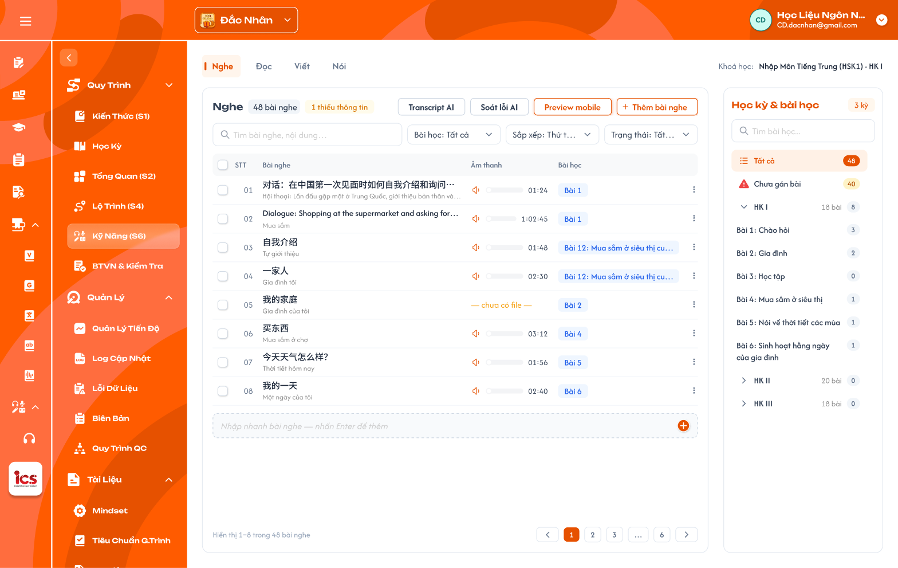
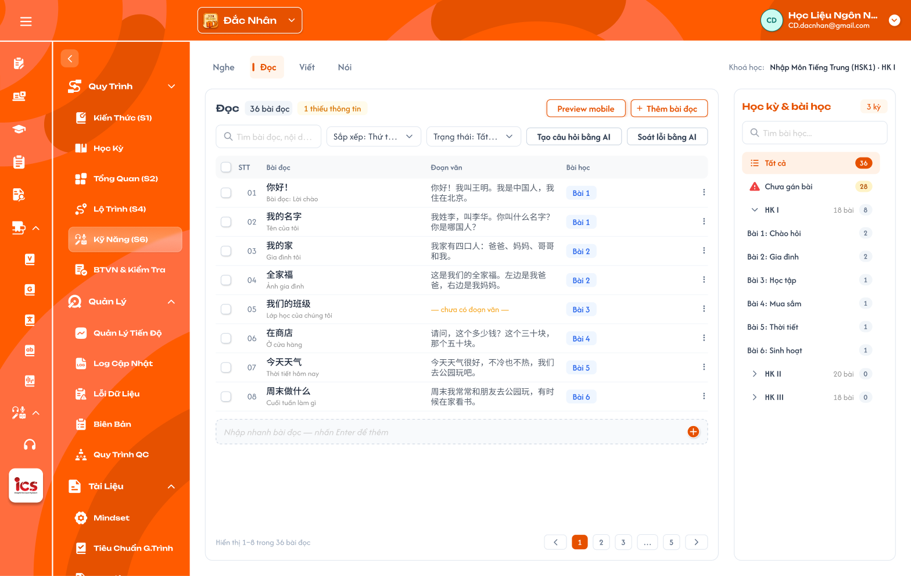
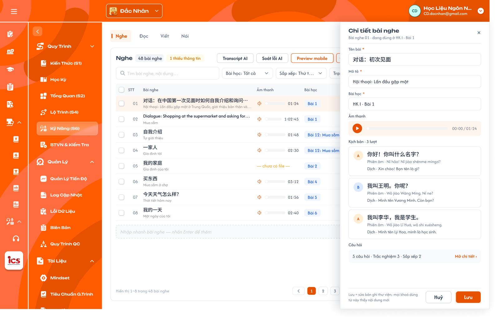
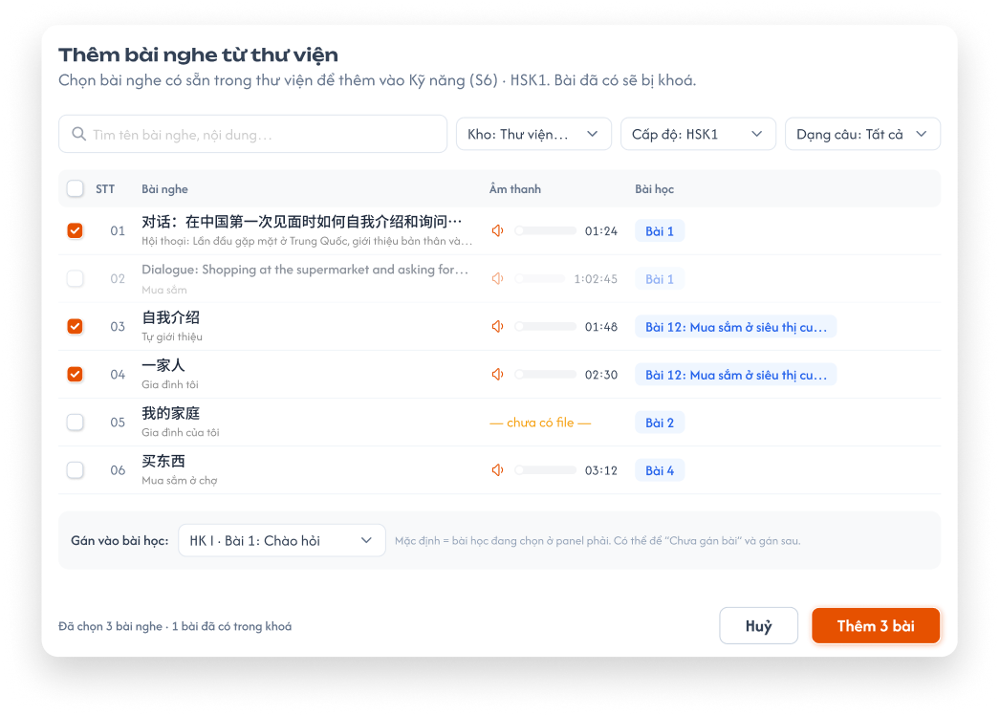
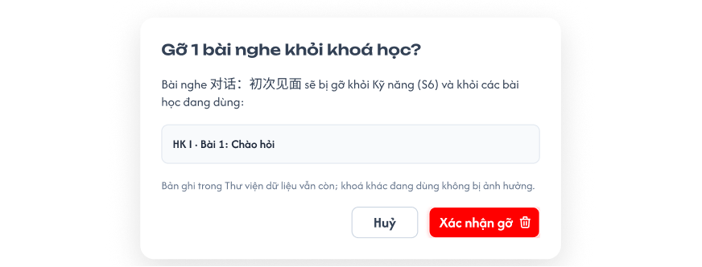
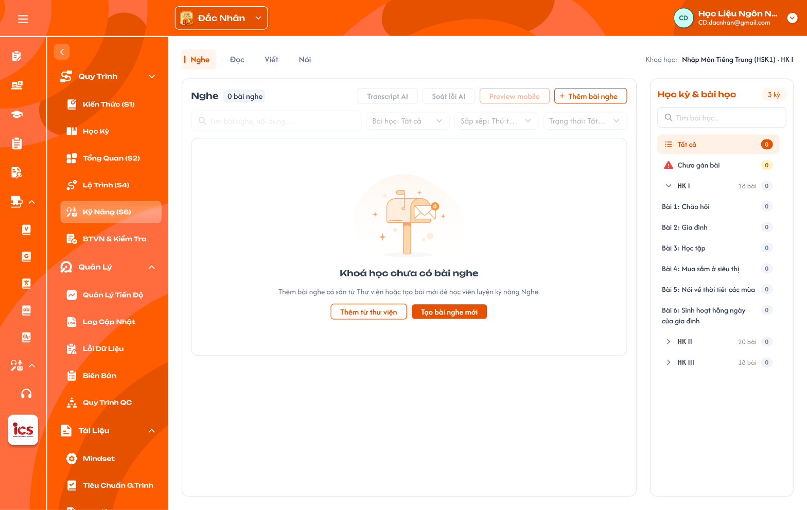
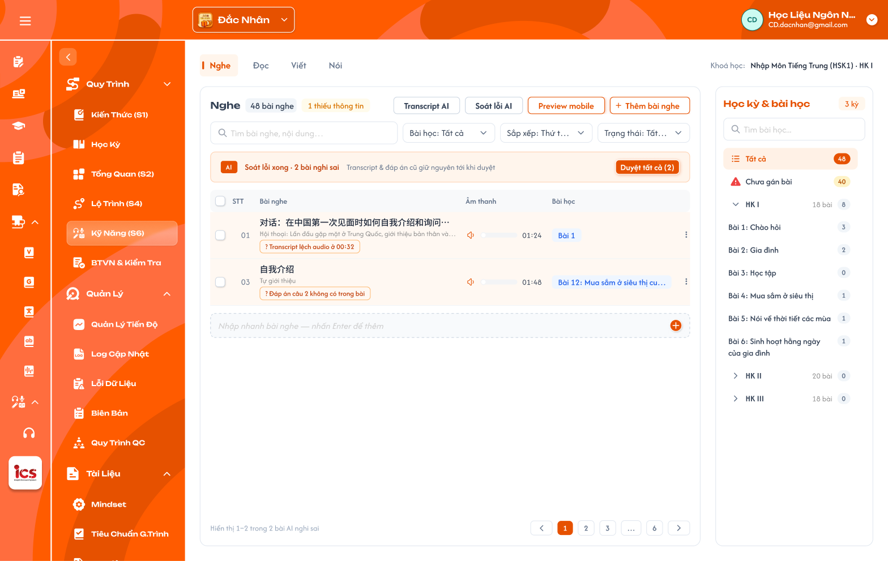

# Kỹ năng (S6) — Nghe / Đọc

Màn **Kỹ năng (S6)** nằm trong từng **khoá học** của role **CD**, dùng để định nghĩa bài luyện kỹ năng của khoá theo
4 tab `Nghe`, `Đọc`, `Viết`, `Nói`. Tài liệu này viết cho **Nghe** và **Đọc**; `Viết`, `Nói` viết sau.
Dữ liệu theo trung tâm CD đang chọn ở header.
Mỗi bài kỹ năng là **bản ghi của Thư viện kỹ năng**: S6 tham chiếu bản ghi thư viện; thêm mới hoặc sửa tại S6 ghi
thẳng vào thư viện, mọi khoá đang dùng bản ghi đó thấy nội dung mới.

**Tổ chức theo cụm, không theo bài học:** giống Kiến thức (S1), mỗi tab chia bài kỹ năng theo **cụm** (panel Cụm bên
phải). Màn S6 không hiển thị, không lọc và không gán **bài học**; bài kỹ năng chỉ được thêm vào bài học tại màn Chi tiết
bài học, theo cụm hoặc theo từng bài (xem khu vực Thêm / gỡ bài kỹ năng trong Chi tiết bài học).

**Quyền sửa theo trạng thái khoá học:** chỉ sửa được khi khoá học đang `Nháp`. Khoá học `Công Khai` / `Vô hiệu`: màn
này chỉ đọc (ẩn / disable mọi thao tác thêm, sửa, gỡ, AI); backend từ chối mọi request ghi.

Ảnh là Figma `CD-KH-050100` → `CD-KH-050190` (section `Quy trình › 5 · Kỹ năng (S6)`). Tab Đọc mới có màn danh sách
`CD-KH-050200`; các màn chi tiết của Đọc viết theo Nghe và ghi **UI cần bổ sung** tại chỗ. Ảnh Figma hiện còn vẽ
panel `Học kỳ & bài học`, cột / ô `Bài học`: **UI cần cập nhật theo cụm** như requirement này. Đối chiếu ICS cũ xem mục 4.

## 1. UI

### Trang 1: CD-KH-050100 — Khung màn hình và tab kỹ năng


*Kỹ năng (S6), tab Nghe: bảng bài nghe bên trái; panel phải trên Figma còn là Học kỳ & bài học, cần đổi thành panel Cụm (Figma CD-KH-050100) — nhấn để xem ảnh gốc*

**Mô tả:**

- CD vào khoá học → menu `Kỹ Năng (S6)`. Màn gồm thanh tab `Nghe` / `Đọc` / `Viết` / `Nói`, dòng `Khoá học: <tên khoá>`,
  panel trái **Danh sách bài** và panel phải **Cụm** của tab đang mở.

**Điểm cần lưu ý:**

- `A01.01` **Tab kỹ năng**: 4 tab cố định `Nghe`, `Đọc`, `Viết`, `Nói`, mọi trung tâm giống nhau; mặc định mở `Nghe`. Mỗi tab có bộ cụm riêng; đổi tab thì panel Cụm đổi theo tab và về `Tất cả cụm`.
- `A01.02` **`Khoá học:`**: Tên khoá học (vd `Nhập Môn Tiếng Trung (HSK1)`); không gắn học kỳ / bài học.
- `A01.03` **Toolbar tiêu đề**: Tên tab (hoặc tên cụm đang chọn) + badge `N bài nghe` / `N bài đọc` + badge cam `N thiếu thông tin` (ẩn khi 0); đang chọn cụm thì hai badge tính trong cụm. Nút tab Nghe: `Transcript AI`, `Soát lỗi AI`, `Preview mobile`, `+ Thêm bài nghe`. Nút tab Đọc: `Preview mobile`, `+ Thêm bài đọc`; `Tạo câu hỏi bằng AI`, `Soát lỗi bằng AI` nằm ở hàng tìm kiếm.
- `A01.04` **Hàng tìm kiếm**: Ô `Tìm bài nghe, nội dung…` / `Tìm bài đọc, nội dung…`; `Sắp xếp`, `Trạng thái`. Lọc theo cụm bằng panel Cụm (không có lọc `Bài học`).
- `A01.05` **Nhập nhanh**: Dòng cuối bảng `Nhập nhanh bài nghe — nhấn Enter để thêm` (xem khu vực Nhập nhanh).
- `A01.06` **Footer**: `Hiển thị a–b trong N bài nghe`, phân trang 50 dòng / trang, số trang, `…`, Trước / Sau.
- `A01.07` **`+ Thêm bài nghe`**: Menu 3 lựa chọn: `Thêm từ thư viện`, `Tạo bài nghe mới`, `Import Excel`. Kèm `Export Excel` (xem khu vực Import / Export Excel, **UI menu cần bổ sung**).

- Danh sách luôn là bài của **khoá đang mở**; chọn cụm ở panel Cụm là lọc, không đổi tập dữ liệu.
- Khoá học không `Nháp`: mọi nút thêm, menu dòng, nhập nhanh, AI, kéo thả, thao tác cụm bị ẩn / mờ; vẫn tìm, lọc, xem
  chi tiết, Preview.
- Tab `Viết`, `Nói` bấm được, dùng cùng mô hình panel Cụm; bảng và field theo requirement riêng (chưa viết).

### Trang 2: Bảng bài nghe
**Mô tả:**

- Danh sách bài nghe của khoá, mỗi dòng một bản ghi thư viện kỹ năng loại Nghe.

**Điểm cần lưu ý:**

- `A02.01` **Checkbox**: Chọn dòng cho thao tác hàng loạt; checkbox đầu bảng chọn cả trang.
- `A02.02` **`STT` + tay nắm kéo thả**: Số thứ tự theo sắp xếp hiện tại, 2 chữ số; tay nắm chỉ hiện khi đang xem 1 cụm và Sắp xếp = `Thứ tự trong cụm`.
- `A02.03` **`Bài nghe`**: Dòng 1 **Tên bài** (ngôn ngữ đích, vd `对话：初次见面`), dòng 2 **Mô tả** tiếng Việt, cắt `…` khi dài; hover hiện đủ. Bấm tên mở drawer Chi tiết.
- `A02.04` **`Âm thanh`**: Nút phát, thanh tiến độ, thời lượng `mm:ss` (≥ 1 giờ hiện `h:mm:ss`). Chưa có file hiện `— chưa có file —` màu cam. Chỉ phát một bài tại một thời điểm, phát bài khác thì bài đang phát dừng.
- `A02.05` **`Cụm`**: Nhãn cụm duy nhất của bài; bấm nhãn mở popup Thêm vào cụm / Gỡ khỏi cụm của bài đó. Không thuộc cụm nào hiện `Chưa phân cụm`. Không có nhãn `+N`.
- `A02.06` **Menu `⋮`**: `Mở chi tiết`, `Thêm vào cụm / Gỡ khỏi cụm`, `Transcript AI`, `Gỡ khỏi khoá`.
- `A02.07` **Nhãn AI dưới tên**: `AI · đang tạo transcript`, `AI · đã tạo, chờ duyệt`, `? <lý do nghi sai>` (xem khu vực AI).

- Bài **thiếu thông tin** khi thiếu bất kỳ: file âm thanh, mô tả, hoặc chưa có câu hỏi nào; tên dòng có chấm cam và
  được đếm vào badge `N thiếu thông tin`.
- Thời lượng đọc từ file lúc tải lên, không giới hạn độ dài.
- Bảng không có cột `Bài học` (Figma còn vẽ cột này, **UI cần cập nhật** thành cột `Cụm`).

### Trang 3: CD-KH-050200 — Bảng bài đọc


*Kỹ năng (S6), tab Đọc (Figma CD-KH-050200) — nhấn để xem ảnh gốc*

**Mô tả:**

- Danh sách bài đọc của khoá, mỗi dòng một bản ghi thư viện kỹ năng loại Đọc.

**Điểm cần lưu ý:**

- `A03.01` **`STT`, checkbox, `Cụm`, menu `⋮`**: Như bảng Nghe; menu `⋮` thay `Transcript AI` bằng `Tạo câu hỏi bằng AI`.
- `A03.02` **`Bài đọc`**: Tên bài (ngôn ngữ đích) + mô tả tiếng Việt, như cột `Bài nghe`.
- `A03.03` **`Đoạn văn`**: Tối đa 2 dòng, dài thì cắt `…`; chưa có hiện `— chưa có đoạn văn —` màu cam.

- Bài đọc **thiếu thông tin** khi thiếu bất kỳ: đoạn văn, mô tả, hoặc chưa có câu hỏi. Audio đọc mẫu không bắt buộc,
  không tính thiếu.
- Tab Đọc lọc theo cụm bằng panel Cụm như tab Nghe.

### Trang 4: Panel Cụm và Số cụm
**Mô tả:**

- Panel bên phải của mỗi tab quản lý cụm của **kỹ năng đó** (Nghe, Đọc, Viết, Nói mỗi tab một bộ cụm riêng), giống
  Panel Cụm của Kiến thức (S1): xem số bài mỗi cụm, chọn cụm để lọc bảng, tạo cụm theo Số cụm, thêm / đổi tên / xoá cụm,
  Chia cụm bằng AI. **UI cần bổ sung** (Figma đang vẽ panel `Học kỳ & bài học`).

**Điểm cần lưu ý:**

- `A04.01` **`Tất cả cụm` + badge `N cụm`**: Tiêu đề panel và số cụm hiện có; chọn để xem mọi bài của tab (mặc định).
- `A04.02` **`Số cụm`**: Mặc định `0`. **Chỉ nhập được khi chưa có cụm**: CD nhập N thì hệ thống tạo N cụm rỗng tên `Chủ đề 1` … `Chủ đề N`. Chưa có cụm thì panel hiện `Chưa có cụm. Nhập Số cụm để tạo các cụm rỗng "Chủ đề 1 … N".`. Đã có cụm thì ô chỉ đọc, hiện số cụm hiện tại; thêm / bớt cụm bằng `Thêm cụm mới` và menu ⋮ của cụm.
- `A04.03` **`Chia cụm bằng AI`**: AI đề xuất chia các bài của tab vào cụm theo chủ đề nội dung; kết quả chờ duyệt, CD áp dụng hoặc bỏ, theo cùng quy tắc popup Chia cụm bằng AI của S1.
- `A04.04` **Dòng cụm**: `NN. <tên cụm>` + badge số bài của cụm (0 hiện xám); chọn để lọc bảng trái, tiêu đề bảng đổi thành tên cụm. Menu ⋮: `Đổi tên`, `Xoá cụm`.
- `A04.05` **`Chưa phân cụm`**: Badge cam = số bài chưa thuộc cụm nào; chọn để lọc.
- `A04.06` **`Thêm cụm mới`**: Thêm 1 cụm rỗng ở cuối, đặt tên ngay tại dòng.

- Một bài kỹ năng thuộc **tối đa 1 cụm** của tab đó (hoặc `Chưa phân cụm`); số đếm cập nhật ngay sau thêm / gỡ bài, thêm / gỡ cụm.
- Xoá cụm chỉ xoá cụm, không gỡ bài khỏi khoá; các bài của cụm về `Chưa phân cụm`. Có popup xác nhận nêu số bài
  của cụm; bài của cụm đang dùng ở bài học thì popup Xoá cụm / Gỡ khỏi cụm thêm cảnh báo `N bài đang dùng ở các bài học:`
  + danh sách bài học (**UI cần bổ sung**); xác nhận → các bài kỹ năng đó **tự gỡ khỏi các bài học** liên quan (xoá cụm: mọi bài của cụm).
- Cụm đang chọn là giá trị mặc định cho `Thêm vào cụm` ở popup thêm / tạo, Nhập nhanh và Import; đang ở `Tất cả cụm` /
  `Chưa phân cụm` thì bài mới vào `Chưa phân cụm`.
- Màn S6 không hiển thị bài học; cụm không liên kết bài học. Thêm bài vào cụm **không** tự vào bài học (CD thêm thủ
  công ở Chi tiết bài học). Gỡ bài khỏi cụm / xoá cụm → gỡ khỏi bài học (có cảnh báo, xem trên).

### Trang 5: Tìm kiếm, lọc và sắp xếp
**Mô tả:**

- Thu hẹp bảng trái; các điều kiện kết hợp với nhau và với cụm đang chọn ở panel Cụm.

**Điểm cần lưu ý:**

- `A05.01` **Ô tìm**: Khớp một phần, không phân biệt hoa thường, theo tên bài, mô tả, nội dung (kịch bản với Nghe, đoạn văn với Đọc). Tìm sau khi ngừng gõ 2 giây hoặc Enter.
- `A05.02` **Cụm**: Chọn ở panel Cụm (`Tất cả cụm`, một cụm, hoặc `Chưa phân cụm`); không có dropdown lọc riêng trên toolbar.
- `A05.03` **`Sắp xếp`**: `Thứ tự thêm` (mặc định), `Tên A–Z`, `Mới cập nhật`, `Thứ tự trong cụm` (chỉ khi đang xem 1 cụm).
- `A05.04` **`Trạng thái`**: `Tất cả` (mặc định), `Nháp`, `Công khai`, `Vô hiệu` của bản ghi thư viện.

- Đổi điều kiện đưa về trang 1; badge trên tiêu đề tính theo cụm đang chọn, không đổi theo tìm / Trạng thái.
- Kéo thả chỉ đổi **thứ tự bài trong cụm** (dùng khi thêm cụm vào bài học); các kiểu sắp xếp khác chỉ để xem.
- Không có kết quả hiện `Không tìm thấy bài nghe phù hợp` kèm nút `Xoá bộ lọc`.

### Trang 6: CD-KH-050110, CD-KH-070301 — Drawer Chi tiết bài nghe


*Drawer Chi tiết bài nghe: tên, mô tả, âm thanh, kịch bản 3 lượt, câu hỏi; ô Bài học trên Figma đổi thành Cụm (Figma CD-KH-050110) — nhấn để xem ảnh gốc*

**Mô tả:**

- Mở từ tên bài hoặc menu `⋮ › Mở chi tiết`. Drawer trượt từ phải phủ panel Cụm; dòng đang mở tô sáng.
- Lưu = sửa **bản ghi thư viện**; mọi khoá dùng bài này thấy nội dung mới.

**Giải thích field:**

- `A06.01` **Tiêu đề**: `Chi tiết bài nghe` + dòng phụ `Bài nghe NN`; `×` đóng, hỏi xác nhận nếu có thay đổi chưa lưu.
- `A06.02` **`Tên bài` ***: Bắt buộc, ngôn ngữ đích, tối đa 200 ký tự.
- `A06.03` **`Mô tả` ***: Bắt buộc để đủ thông tin, tiếng Việt, tối đa 500 ký tự. Trống vẫn lưu được nhưng bài tính thiếu thông tin.
- `A06.04` **`Cụm`**: Chỉ đọc: chip cụm bài đang thuộc (hoặc `Chưa phân cụm`); `Sửa cụm` mở popup Thêm vào cụm / Gỡ khỏi cụm. Drawer không có field `Bài học`.
- `A06.05` **`Âm thanh`**: Trình phát `00:00 / mm:ss`; `Tải lên` / `Thay` / `Xoá`; chỉ `.mp3`, tối đa 50MB (theo `file_limits.json`, **khác Figma** ghi `MP3 / WAV · 25 MB`).
- `A06.06` **`Kịch bản · N lượt`**: Danh sách lượt thoại theo thứ tự: nhãn người nói (`A`, `B`…), câu gốc, `Phiên âm ·`, `Dịch ·`, mốc `start – end` theo audio (`mm:ss.s`, **UI cần bổ sung**). Thêm / sửa / xoá / kéo thả lượt; lượt có giá trị AI chờ duyệt viền nét đứt cam với `✓ Duyệt` / `↺ Hoàn tác`.
- `A06.07` **`Câu hỏi`**: Tóm tắt `N câu hỏi · <loại> k · …` và `Mở chi tiết ›` dẫn sang màn Chi tiết câu hỏi của Thư viện bài tập (`CD-KH-070301` Listening); chưa có câu hiện `0 câu hỏi` màu cam.
- `A06.08` **Footer**: Ghi chú `Lưu = sửa bản ghi thư viện; mọi khoá dùng bài này thấy nội dung mới`; `Huỷ`, `Lưu`.

**Điểm cần lưu ý:**

- Mốc thời gian lượt dùng để app học viên tô sáng câu đang phát; AI transcript điền sẵn, CD sửa tay được; lượt không
  có mốc vẫn lưu được.
- Phiên âm theo ngôn ngữ trung tâm (pinyin, furigana / romaji, romanization…); trung tâm tiếng Anh / Đức / Pháp để trống.
- Lưu thất bại giữ dữ liệu cũ, Toast `Có Lỗi Xảy Ra`.

### Trang 7: CD-KH-070302 — Drawer Chi tiết bài đọc
**Mô tả:**

- Giống drawer bài nghe, thay khối Âm thanh + Kịch bản bằng khối Đoạn văn (**UI cần bổ sung**, Figma chưa vẽ).

**Giải thích field:**

- `A07.01` **`Tên bài` *, `Mô tả` *, `Cụm`, `Câu hỏi`, Footer**: Như drawer bài nghe; `Mở chi tiết ›` dẫn sang `CD-KH-070302` Reading.
- `A07.02` **`Đoạn văn` ***: Nhiều dòng, ngôn ngữ đích; trống thì bài tính thiếu thông tin. Có thể tách câu: mỗi câu có `Phiên âm ·`, `Dịch ·` (tuỳ chọn, AI điền được).
- `A07.03` **`Audio đọc mẫu`**: Không bắt buộc; `.mp3` ≤ 50MB; có file thì app học viên phát kèm đoạn văn.
- `A07.04` **`Từ vựng liên quan`**: Chọn nhiều từ trong Kiến thức (S1) Từ vựng của chính khoá; chip có `×`; dùng để app tô sáng và tra nhanh trong đoạn văn.

**Điểm cần lưu ý:**

- Từ vựng liên quan chỉ là tham chiếu, sửa từ ở S1 thì đoạn văn thấy nội dung mới; gỡ từ khỏi khoá ở S1 thì tự mất
  khỏi danh sách này.

### Trang 8: Menu thao tác dòng và Popup Thêm vào cụm / Gỡ khỏi cụm
**Mô tả:**

- Menu `⋮` cuối dòng; popup gán bài vào **một** cụm (chuyển cụm nếu đã có), hoặc gỡ khỏi cụm (giống popup cụm của S1, **UI cần bổ sung**).

**Điểm cần lưu ý:**

- `A08.01` **`Mở chi tiết`**: Mở drawer.
- `A08.02` **`Thêm vào cụm / Gỡ khỏi cụm`**: Mở popup `Cụm của N bài` (N bài đang chọn: 1 khi mở từ dòng).
- `A08.03` **`Transcript AI` (Nghe) / `Tạo câu hỏi bằng AI` (Đọc)**: Chạy AI cho riêng bài đó (xem khu vực AI).
- `A08.04` **`Gỡ khỏi khoá`**: Mở popup Gỡ khỏi khoá.
- `A08.05` **Popup — Tìm cụm**: Tìm theo tên cụm của tab.
- `A08.06` **Popup — Danh sách cụm**: **Radio** từng cụm + số bài của cụm, thêm `Chưa phân cụm` (= gỡ khỏi cụm). Mọi bài đang chọn cùng cụm thì chọn sẵn cụm đó.
- `A08.07` **Popup — `Huỷ` / `Lưu`**: Lưu: các bài chuyển vào cụm đã chọn (rời cụm cũ); chọn `Chưa phân cụm` thì gỡ khỏi cụm. Bài đang dùng ở bài học mà rời cụm → cảnh báo liệt kê bài học, xác nhận thì tự gỡ khỏi bài học.

- Popup không tạo cụm mới (cụm tạo bằng `Số cụm` / `Thêm cụm mới` ở panel Cụm).
- Bài bị gỡ khỏi cụm thì về `Chưa phân cụm`, vẫn còn trong khoá, không thêm được vào bài học.
- Sau khi lưu, bài có thể biến mất khỏi bảng nếu đang lọc theo cụm vừa gỡ; Toast nêu rõ kết quả.

### Trang 9: Nhập nhanh
**Mô tả:**

- Dòng cuối bảng tạo nhanh bài chỉ với tên, các field khác bổ sung sau ở drawer.

**Điểm cần lưu ý:**

- `A09.01` **Ô nhập**: Placeholder `Nhập nhanh bài nghe — nhấn Enter để thêm` / `… bài đọc …`; Enter hoặc nút `+` tạo bài.
- `A09.02` **Kết quả**: Tạo bản ghi thư viện mới (trạng thái `Nháp`), gắn vào khoá, thuộc cụm đang chọn ở panel Cụm (đang ở `Tất cả cụm` / `Chưa phân cụm` thì vào `Chưa phân cụm`), thêm vào cuối danh sách, ô nhập trống và giữ focus; Toast `Đã thêm 1 bài nghe vào <tên cụm>.`.

- Bài vừa tạo tính thiếu thông tin (chưa có file / đoạn văn, mô tả, câu hỏi).
- Cho phép trùng tên; không tạo khi rỗng hoặc chỉ khoảng trắng.

### Trang 10: CD-KH-050120 — Chọn nhiều và thao tác hàng loạt


*Thanh thao tác khi chọn 3 bài nghe (Figma CD-KH-050120) — nhấn để xem ảnh gốc*

**Mô tả:**

- Tick ít nhất 1 dòng thì hàng tìm kiếm đổi thành thanh thao tác hàng loạt.

**Điểm cần lưu ý:**

- `A10.01` **`Đã chọn N bài nghe`**: Số bài đang chọn, kể cả ở trang khác.
- `A10.02` **`Chọn tất cả N bài nghe`**: Chọn toàn bộ bài thoả bộ lọc hiện tại (mọi trang).
- `A10.03` **`Transcript AI (k)` (Nghe) / `Tạo câu hỏi bằng AI (k)` (Đọc)**: k = số bài đang chọn đủ điều kiện (Nghe: có file âm thanh; Đọc: có đoạn văn); k = 0 thì mờ.
- `A10.04` **`Soát lỗi AI`**: AI soát các bài đang chọn.
- `A10.05` **`Thêm vào cụm / Gỡ khỏi cụm`**: Mở popup `Cụm của N bài` cho mọi bài đang chọn.
- `A10.06` **`Gỡ khỏi khoá (N)`**: Mở popup Gỡ khỏi khoá cho N bài.
- `A10.07` **`Bỏ chọn`**: Bỏ hết lựa chọn, trở về hàng tìm kiếm.

- Đổi tab hoặc đổi bộ lọc thì bỏ chọn.

### Trang 11: CD-KH-050150 — Popup Thêm bài từ thư viện


*Popup Thêm bài nghe từ thư viện: lọc Kho / Cấp độ / Dạng câu, bài đã có bị khoá; ô Gán vào bài học trên Figma đổi thành Thêm vào cụm (Figma CD-KH-050150) — nhấn để xem ảnh gốc*

**Mô tả:**

- `+ Thêm bài nghe › Thêm từ thư viện` (hoặc nút ở màn trống): chọn bài có sẵn trong Thư viện kỹ năng của trung tâm để
  gắn vào khoá. Tab Đọc tương tự với bài đọc (**UI cần bổ sung**).

**Điểm cần lưu ý:**

- `A11.01` **Tiêu đề**: `Thêm bài nghe từ thư viện` + mô tả `Chọn bài nghe có sẵn trong thư viện để thêm vào Kỹ năng (S6) · <cấp độ khoá>. Bài đã có sẽ bị khoá.`
- `A11.02` **Ô tìm**: `Tìm tên bài nghe, nội dung…`.
- `A11.03` **`Kho`**: `Thư viện kỹ năng` (mặc định, mọi bài của trung tâm), `Khoá học` (bài tạo từ S6 của các khoá).
- `A11.04` **`Cấp độ`**: Mặc định = cấp độ của khoá đang mở; chọn cấp độ khác hoặc `Tất cả`.
- `A11.05` **`Dạng câu`**: `Tất cả` (mặc định) hoặc một loại câu hỏi mà bài có.
- `A11.06` **Bảng**: Checkbox, `STT`, `Bài nghe`, `Âm thanh` (phát được). Bài đã có trong khoá mờ, tick sẵn, không bỏ tick được. Không có cột `Bài học`.
- `A11.07` **`Thêm vào cụm`**: Dropdown cụm của tab, mặc định cụm đang chọn ở panel Cụm; chọn được `Chưa phân cụm`.
- `A11.08` **Footer**: `Đã chọn N bài nghe · M bài đã có trong khoá`; `Huỷ`; `Thêm N bài` (N không tính bài đã có; N = 0 thì mờ).

- Thêm là gắn **tham chiếu** bản ghi thư viện, không sao chép; một bản ghi gắn vào một khoá tối đa 1 lần.
- Bài `Vô hiệu` trong thư viện không hiện trong popup.

### Trang 12: CD-KH-050160 — Popup Tạo bài mới


*Popup Tạo bài nghe mới (Figma CD-KH-050160) — nhấn để xem ảnh gốc*

**Mô tả:**

- `+ Thêm bài nghe › Tạo bài nghe mới`: tạo bản ghi thư viện mới rồi gắn vào khoá. Tab Đọc: `Tạo bài đọc mới` với
  `Đoạn văn *` thay cho `Âm thanh` (**UI cần bổ sung**).

**Giải thích field:**

- `A12.01` **Tiêu đề**: `Tạo bài nghe mới` + `Bài mới được lưu vào Thư viện kỹ năng và thêm vào Kỹ năng (S6) của khoá này.`
- `A12.02` **`Tên bài` ***: Bắt buộc, placeholder `Nhập tên bài (vd 对话：初次见面)`.
- `A12.03` **`Thêm vào cụm`**: Mặc định cụm đang chọn ở panel Cụm; có `Chưa phân cụm`.
- `A12.04` **`Mô tả`**: Không bắt buộc lúc tạo.
- `A12.05` **`Âm thanh` * (Nghe)**: Kéo thả hoặc chọn file `.mp3` ≤ 50MB (**khác Figma** `MP3 / WAV · 25 MB`); bắt buộc khi tạo bằng popup này.
- `A12.06` **`Đoạn văn` * (Đọc)**: Nhiều dòng, bắt buộc.
- `A12.07` **`Tạo transcript bằng AI sau khi tải lên` (Nghe)**: Checkbox, mặc định tick; tick thì sau khi tạo chạy Transcript AI cho bài. Đọc: `Tạo câu hỏi bằng AI sau khi tạo`, mặc định không tick.
- `A12.08` **Footer**: Ghi chú `Câu hỏi soạn ở trang chi tiết sau khi tạo`; `Huỷ`; `Tạo & mở chi tiết` (tạo xong mở drawer).

**Điểm cần lưu ý:**

- Bản ghi mới ở trạng thái `Nháp` trong thư viện; cấp độ lấy theo khoá.
- Tải file thất bại thì không tạo bài, Toast `Có Lỗi Xảy Ra`.

### Trang 13: CD-KH-050155 — Popup Gỡ khỏi khoá


*Popup Gỡ 1 bài nghe khỏi khoá học (Figma CD-KH-050155) — nhấn để xem ảnh gốc*

**Mô tả:**

- Xoá ở S6 là **gỡ** bài khỏi khoá; bản ghi thư viện vẫn còn.

**Điểm cần lưu ý:**

- `A13.01` **Tiêu đề**: `Gỡ N bài nghe khỏi khoá học?`
- `A13.02` **Nội dung**: `Bài nghe <tên> sẽ bị gỡ khỏi Kỹ năng (S6) của khoá, khỏi các cụm và khỏi các bài học đang dùng:` + **danh sách bài học đang dùng** (cảnh báo, **UI cần bổ sung** trên Figma `CD-KH-050155`); nhiều bài thì liệt kê tên từng bài. Không dùng ở bài học nào thì bỏ phần danh sách.
- `A13.03` **Ghi chú**: `Bản ghi trong Thư viện dữ liệu vẫn còn; khoá khác đang dùng không bị ảnh hưởng.`
- `A13.04` **Nút**: `Huỷ`; `Xác nhận gỡ` (đỏ).

- Gỡ cũng gỡ bài khỏi mọi cụm của tab và khỏi các bài học của khoá đã thêm bài này (tại Chi tiết bài học); kết quả học
  viên đã làm trên bài vẫn giữ.

### Trang 14: CD-KH-050130 — Màn trống


*Khoá chưa có bài nghe (Figma CD-KH-050130) — nhấn để xem ảnh gốc*

**Mô tả:**

- Khoá chưa có bài kỹ năng của tab: thay bảng bằng hình minh hoạ, tiêu đề `Khoá học chưa có bài nghe`, mô tả `Thêm bài
  nghe có sẵn từ Thư viện hoặc tạo bài mới để học viên luyện kỹ năng Nghe.`, nút `Thêm từ thư viện`, `Tạo bài nghe mới`.

**Điểm cần lưu ý:**

- `A14.01` **Toolbar**: Badge `0 bài nghe`; nút AI, `Preview mobile`, ô tìm, bộ lọc mờ; `+ Thêm bài nghe` vẫn bật.
- `A14.02` **Panel Cụm**: Mọi badge 0; vẫn tạo cụm được bằng `Số cụm`.

- Có bài nhưng bộ lọc không ra kết quả thì dùng màn `Không tìm thấy…`, không dùng màn trống này.

### Trang 15: Import / Export Excel
**Mô tả:**

- `Export Excel` tải bài của tab ra `.xlsx`; `Import Excel` thêm bài từ `.xlsx` vào khoá (**UI cần bổ sung**: menu, popup
  kết quả). File theo cấu trúc file dữ liệu khoá học (vd `HSK1_DATA_v261028.xlsx`): một file chứa nhiều sheet, **mỗi tab
  kỹ năng chỉ đọc đúng các sheet của kỹ năng đó**, bỏ qua mọi sheet khác (`vocabulary`, `grammar`, `btvn`, `lesson`…).
- **Không có cột bài học:** cột `lesson_id` (nếu có trong file) bị bỏ qua, không gắn bài kỹ năng vào bài học. Bài import
  vào cụm đang chọn ở panel Cụm; đang ở `Tất cả cụm` / `Chưa phân cụm` thì vào `Chưa phân cụm`.

**Sheet đọc khi Import tab Nghe (3 sheet):**

- `A15.01` **`listening_lesson` (bắt buộc)**: Vai trò: Mỗi dòng = 1 bài nghe; Cột → field: `id` → mã dòng trong file (chỉ để nối sheet, không lưu làm mã bài); `title` → `Tên bài`; `mean` → `Mô tả`. Bỏ qua `lesson_id`.
- `A15.02` **`listening`**: Vai trò: Kịch bản, mỗi dòng = 1 lượt thoại, theo thứ tự dòng; Cột → field: `listening_lesson_id` → bài nghe; `character` → người nói (`A`, `B`…); `sentence` → câu gốc; `phonetic` → `Phiên âm`; `furigana` → phiên âm có chú thích (tiếng Nhật); `mean` → `Dịch`; `start` / `end` → mốc thời gian. Bỏ qua `id`, `_start`, `_end`.
- `A15.03` **`listening_question`**: Vai trò: Câu hỏi của bài nghe; Cột → field: `listening_lesson_id` → bài nghe; `question`, `a`–`d`, `answer` (số thứ tự đáp án đúng 1–4), `explain` → câu hỏi trắc nghiệm của bài (lưu vào bộ câu hỏi Listening của Thư viện bài tập).

**Sheet đọc khi Import tab Đọc (4 sheet):**

- `A15.04` **`reading_lesson` (bắt buộc)**: Vai trò: Mỗi dòng = 1 bài đọc; Cột → field: `id` → mã dòng trong file; `title` → `Tên bài`; `mean` → `Mô tả`; `source` → nguồn (ghi chú). Bỏ qua `lesson_id`.
- `A15.05` **`reading`**: Vai trò: Đoạn văn, mỗi dòng = 1 câu, theo thứ tự dòng; Cột → field: `reading_lesson_id` → bài đọc; `sentence` → câu của đoạn văn; `phonetic` → `Phiên âm`; `furigana` → phiên âm có chú thích; `mean` → `Dịch`. Bỏ qua `id`, `note`.
- `A15.06` **`reading_question`**: Vai trò: Câu hỏi của bài đọc; Cột → field: `reading_lesson_id` → bài đọc; `question`, `image`, `question_type`, `a`–`d`, `answer`, `explain` → câu hỏi (bộ câu hỏi Reading của Thư viện bài tập).
- `A15.07` **`reading_vocabulary`**: Vai trò: Từ vựng liên quan của bài đọc; Cột → field: **Bắt buộc có cột `reading_lesson_id`** → bài đọc; `word`, `phonetic`, `type`, `furigana`, `mean`, `example`, `example_phonetic`, `example_mean` → từ vựng. Từ trùng với Từ vựng S1 của khoá thì nối vào từ đó; chưa có thì tạo từ mới trong S1 của khoá rồi nối.

**Điểm cần lưu ý:**

- `A15.08` **Import — sheet**: Thiếu sheet bắt buộc (`listening_lesson` / `reading_lesson`) → báo `Không tìm thấy sheet listening_lesson`, không import. Sheet phụ trống / không có thì bài thiếu phần đó (tính thiếu thông tin), vẫn import.
- `A15.09` **Import — dòng bắt buộc**: Sheet bài gốc: `title`. Sheet phụ: cột nối `listening_lesson_id` / `reading_lesson_id` phải trùng một `id` của sheet bài gốc trong cùng file. Nghe cho phép trống file âm thanh (bài tính thiếu thông tin).
- `A15.10` **Import — lỗi dữ liệu**: Có dòng lỗi → **chặn cả file**, không thêm bài nào; danh sách lỗi theo **sheet + số dòng** (vd `reading_vocabulary dòng 12: thiếu reading_lesson_id`, `listening dòng 40: listening_lesson_id 999 không có trong listening_lesson`).
- `A15.11` **Import — thành công**: Mỗi dòng sheet bài gốc tạo 1 bản ghi thư viện mới `Nháp` (kèm kịch bản / đoạn văn, câu hỏi, từ vựng liên quan), gắn vào khoá theo thứ tự dòng, vào cụm đang chọn; Toast `Thành Công` `Đã import N bài nghe.`; gợi ý Soát lỗi AI. Không tự dò trùng bài.
- `A15.12` **Export**: Toàn bộ bài của tab trong khoá (không theo bộ lọc); tên file `<Khoá học>_<Kỹ năng>.xlsx`; cùng các sheet và cột như bảng trên (Nghe 3 sheet, Đọc 4 sheet, `reading_vocabulary` có `reading_lesson_id`), `id` đánh lại theo thứ tự trong file; thêm cột `cluster` (tên các cụm, cách nhau `;`) ở sheet bài gốc để tham khảo. Không có cột bài học.

- Chỉ nhận `.xlsx`; File export dùng lại được để import (cột `cluster` khi import được bỏ qua, bài vào cụm đang chọn).
- `id` / `*_lesson_id` chỉ dùng để nối các sheet trong cùng một file, không lưu và không đối chiếu với dữ liệu hệ thống.
- Một file có thể chứa cả sheet Nghe và Đọc: import ở tab Nghe chỉ lấy 3 sheet Nghe, import ở tab Đọc chỉ lấy 4 sheet Đọc.

### Trang 16: CD-KH-050180 — Transcript bằng AI


*Transcript AI inline: thanh tiến độ, bài đang tạo và bài chờ duyệt (Figma CD-KH-050180) — nhấn để xem ảnh gốc*

**Mô tả:**

- Chỉ tab Nghe. AI tạo kịch bản (lượt thoại, phiên âm, dịch, mốc thời gian) từ file âm thanh. Chạy từ nút toolbar
  (mọi bài có file nhưng chưa có kịch bản), menu dòng, thanh hàng loạt, hoặc tick khi tạo bài.

**Điểm cần lưu ý:**

- `A16.01` **Thanh AI**: `AI · Đang tạo transcript cho N bài nghe · Tạo từ file âm thanh · có phiên âm & dịch câu`, tiến độ `k/N bài`, nút `Duyệt tất cả (m)` (m = bài đã tạo chờ duyệt), nút `Dừng` khi đang chạy.
- `A16.02` **Bảng**: Tự lọc còn các bài trong đợt, footer `Hiển thị … trong N bài đang tạo transcript`; nhãn dưới tên `AI · đang tạo transcript` → `AI · đã tạo, chờ duyệt`.
- `A16.03` **Duyệt**: Mở drawer thấy từng lượt viền cam `✓ Duyệt` / `↺ Hoàn tác`; `Duyệt tất cả` áp dụng cho mọi bài chờ duyệt.

- Kịch bản AI lưu nháp chờ duyệt, **không ghi đè** kịch bản cũ cho tới khi duyệt; chưa duyệt thì app học viên dùng
  kịch bản cũ (hoặc không có).
- Bài đang được AI xử lý bị khoá sửa / gỡ tới khi xong hoặc `Dừng`; AI lỗi thì bài giữ nguyên, Toast `Có Lỗi Xảy Ra`.

### Trang 17: Tạo câu hỏi bằng AI (tab Đọc)
**Mô tả:**

- AI sinh câu hỏi cho bài đọc từ đoạn văn, theo loại câu của Thư viện bài tập; kết quả vào bộ câu hỏi của bài ở trạng
  thái chờ duyệt, duyệt tại màn Chi tiết câu hỏi Reading. Quy tắc duyệt, dừng, khoá bài như Transcript AI.

**Điểm cần lưu ý:**

- `A17.01` **Nút toolbar / menu dòng / hàng loạt**: Chỉ bài có đoạn văn; popup nhập số câu (mặc định 5) và loại câu cho phép.
- `A17.02` **Thanh AI**: `AI · Đang tạo câu hỏi cho N bài đọc`, tiến độ, `Duyệt tất cả (m)`, `Dừng`.

- Câu hỏi AI chưa duyệt không tính vào `Số câu hỏi` và không xuất hiện cho học viên.

### Trang 18: CD-KH-050190 — Soát lỗi bằng AI


*Soát lỗi AI: 2 bài nghi sai kèm lý do (Figma CD-KH-050190) — nhấn để xem ảnh gốc*

**Mô tả:**

- AI kiểm tra kịch bản / đoạn văn và câu hỏi của bài (lệch audio, đáp án không có trong bài, lỗi chính tả, dịch sai).
  Chạy từ nút toolbar (toàn bộ bài của tab) hoặc thanh hàng loạt.

**Điểm cần lưu ý:**

- `A18.01` **Thanh AI**: `AI · Soát lỗi xong · N bài nghi sai · Transcript & đáp án cũ giữ nguyên tới khi duyệt`, `Duyệt tất cả (N)`. Không có bài nghi sai: `Soát lỗi xong · không phát hiện lỗi`.
- `A18.02` **Bảng**: Lọc còn bài nghi sai, footer `Hiển thị … trong N bài AI nghi sai`; nhãn `? <lý do>` dưới tên (vd `Transcript lệch audio ở 00:32`, `Đáp án câu 2 không có trong bài`).
- `A18.03` **Duyệt**: `Duyệt tất cả` **áp dụng sửa của AI** cho mọi bài nghi sai; từng bài duyệt / hoàn tác trong drawer hoặc Chi tiết câu hỏi. Có `↺ Hoàn tác` sau khi áp dụng (giữ bản cũ tới lần soát kế tiếp).

- Đề xuất của AI lưu nháp, dữ liệu cũ giữ nguyên tới khi duyệt; nhãn nghi sai mất khi duyệt, hoàn tác hoặc CD sửa tay.

### Trang 19: CD-KH-050140 — Preview mobile


*Preview mobile bài nghe đang chọn: tab Làm bài, câu 1/5 (Figma CD-KH-050140) — nhấn để xem ảnh gốc*

**Mô tả:**

- Bấm `Preview mobile` mở panel phải thay panel Cụm, tái hiện màn học của app học viên cho bài đang chọn.

**Điểm cần lưu ý:**

- `A19.01` **Tiêu đề**: `Preview mobile`, dropdown thiết bị (`iPhone 15`…), `×` đóng về panel Cụm.
- `A19.02` **Tab**: `Làm bài` (phát audio / hiện đoạn văn, câu hỏi từng câu `Nghe · Câu 1/5`, chọn đáp án, `Kiểm tra`), `Kịch bản` (lượt thoại, tô sáng theo mốc thời gian khi phát), `Kết quả` (điểm và đáp án đúng sau khi làm hết).
- `A19.03` **`Hiển thị`**: Toggle `Kịch bản ẩn khi làm bài` / `Kịch bản hiện khi làm bài`, **lưu theo bài** (cấu hình của bản ghi thư viện).
- `A19.04` **`Mở chi tiết bài nghe`**: Mở drawer.
- `A19.05` **`Bài trước` / `Bài sau`**: Chuyển bài theo thứ tự bảng; phím `↑ ↓`.

- Preview không ghi dữ liệu học; bài thiếu file / đoạn văn hoặc 0 câu hỏi hiện thông báo trong khung điện thoại.
- Bài đọc: tab `Kịch bản` thay bằng `Đoạn văn` (tô sáng Từ vựng liên quan, phát audio đọc mẫu nếu có).

### Trang 20: Thêm / gỡ bài kỹ năng trong Chi tiết bài học
**Mô tả:**

- Tại Chi tiết bài học, tab `Kỹ năng` → `+ Thêm` để thêm bài nghe / đọc / viết / nói đã có trong S6 của **chính khoá**
  vào bài, **theo cụm** hoặc theo từng bài; không sửa nội dung tại đây (**UI cần bổ sung**, viết theo popup Thêm kiến
  thức vào bài học của S1). Đây là nơi duy nhất liên kết bài kỹ năng với bài học; màn S6 không hiển thị liên kết này.
- Đặc tả UI chi tiết (danh sách 2 khung, popup 3 cột, giữ lựa chọn) xem [Học kỳ — Bài học](../semester/lesson/lesson.md) tab Kỹ năng.

**Điểm cần lưu ý:**

- `A20.01` **Popup `+ Thêm`**: Tiêu đề `Thêm kỹ năng vào bài học` + tên bài; 1 màn 3 cột: Loại (`Nghe` / `Đọc` / `Viết` / `Nói`, luôn hiện đủ 4, loại chưa có dữ liệu hiện trống) \| Cụm \| Bài (checkbox, `Chọn tất cả`, ô tìm). Giữ lựa chọn khi đổi cụm / loại. Bài đã có trong bài mờ, tick sẵn; bài **thiếu thông tin** mờ, không chọn được. `Huỷ`, `Thêm ({n})`.
- `A20.02` **Thêm cả cụm**: Chọn cụm → `Chọn tất cả`: thêm **một lần** mọi bài đủ thông tin hiện có của cụm theo `Thứ tự trong cụm`; bài thêm sau vào cụm **không** tự vào bài học.
- `A20.03` **Danh sách trong bài**: Mỗi bài có `×` gỡ khỏi bài học này (bài vẫn ở S6 và ở cụm), không có nút sửa.

- Một bài kỹ năng có thể được thêm vào **nhiều** bài học của khoá; thêm vào bài này không gỡ khỏi bài khác.
- Thêm bài vào cụm → bài học không đổi; gỡ bài khỏi cụm / xoá cụm → cảnh báo, bài kỹ năng tự gỡ khỏi các bài học đã thêm nó từ cụm đó.
- Gỡ bài khỏi khoá ở S6 thì có cảnh báo liệt kê bài học đang dùng; xác nhận thì bài tự mất khỏi mọi bài học của khoá.

### Trang 21: Toast phản hồi CRUD


*Toast Thành Công, Thông Báo, Cảnh Báo và Có Lỗi Xảy Ra — nhấn để xem ảnh gốc*

**Mô tả:**

- Phản hồi sau thêm / tạo / sửa / gỡ bài, thêm / gỡ / tạo / xoá cụm, import, áp dụng AI và thêm / gỡ trong bài học.

**Điểm cần lưu ý:**

- `A21.01` **Thành công**: Tiêu đề cố định: `Thành Công`; Khi sử dụng: Backend xác nhận (vd `Đã thêm 3 bài nghe.`, `Đã gỡ 1 bài nghe khỏi khoá.`).
- `A21.02` **Thông tin**: Tiêu đề cố định: `Thông Báo`; Khi sử dụng: AI đang chạy (vd `AI đang tạo transcript cho 2 bài nghe.`).
- `A21.03` **Cảnh báo**: Tiêu đề cố định: `Cảnh Báo`; Khi sử dụng: File sai loại / quá dung lượng, import sai cột, khoá học không Nháp.
- `A21.04` **Lỗi**: Tiêu đề cố định: `Có Lỗi Xảy Ra`; Khi sử dụng: Backend / network / AI không hoàn tất.

- Mỗi thao tác logic một Toast; Huỷ, tìm, lọc, đổi tab, Preview không có Toast.

---

## 2. Yêu cầu

### 2.1. Flow chính

**Flow 1 / REQ01 / REQ02 / REQ06: Mở Kỹ năng (S6) và xem danh sách**

```text
CD chọn trung tâm ở header → vào khoá học → Kỹ Năng (S6)
      → 4 tab Nghe / Đọc / Viết / Nói, mặc định Nghe; panel Cụm của tab chọn Tất cả cụm
      → CD tìm / lọc Trạng thái / sắp xếp / chọn cụm ở panel → bảng, footer, STT cập nhật
      → Khoá có 0 bài → màn trống
```

**Flow 2 / REQ04 / REQ05: Thêm bài từ thư viện**

```text
CD bấm + Thêm bài nghe → Thêm từ thư viện → popup
      → Lọc Kho / Cấp độ (mặc định cấp độ khoá) / Dạng câu, tìm → tick bài (bài đã có bị khoá)
      → Chọn Thêm vào cụm (mặc định cụm đang chọn) → Thêm N bài
      → Thành công: gắn tham chiếu vào khoá, vào cụm đã chọn, Toast Thành Công; thất bại: không gắn bài nào
```

**Flow 3 / REQ04 / REQ11: Tạo bài mới**

```text
CD bấm + Thêm bài nghe → Tạo bài nghe mới → nhập Tên, Mô tả, chọn file mp3 ≤ 50MB, Thêm vào cụm
      → (tick) Tạo transcript bằng AI → Tạo & mở chi tiết
      → Tạo bản ghi thư viện Nháp, gắn khoá, vào cụm, mở drawer; AI chạy nền nếu tick
Tab Đọc: nhập Đoạn văn thay file; (tick) Tạo câu hỏi bằng AI
```

**Flow 4 / REQ04: Nhập nhanh**

```text
CD gõ tên ở dòng cuối bảng → Enter
      → Tạo bản ghi thư viện Nháp chỉ có tên, gắn khoá, vào cụm đang chọn (Tất cả cụm → Chưa phân cụm)
      → bài tính thiếu thông tin
```

**Flow 5 / REQ04 / REQ07 / REQ08: Xem và sửa chi tiết**

```text
CD bấm tên bài hoặc ⋮ › Mở chi tiết → drawer
      → Sửa Tên / Mô tả / file / kịch bản (lượt, phiên âm, dịch, mốc thời gian) hoặc đoạn văn / audio mẫu / từ vựng liên quan
      → Sửa cụm → popup Thêm vào cụm / Gỡ khỏi cụm
      → Lưu → sửa bản ghi thư viện, mọi khoá dùng bài thấy nội dung mới
      → Câu hỏi: Mở chi tiết › → màn Chi tiết câu hỏi của Thư viện bài tập
```

**Flow 6 / REQ05: Thêm vào cụm / Gỡ khỏi cụm**

```text
CD ⋮ › Thêm vào cụm / Gỡ khỏi cụm (1 bài) hoặc thanh hàng loạt (N bài), hoặc bấm nhãn ở cột Cụm
      → popup Cụm của N bài: chọn 1 cụm hoặc Chưa phân cụm → Lưu (cảnh báo nếu bài đang dùng ở bài học rời cụm)
      → bài chuyển cụm / về Chưa phân cụm, bài rời cụm tự gỡ khỏi bài học; số đếm panel Cụm cập nhật
```

**Flow 7 / REQ09: Gỡ khỏi khoá**

```text
CD ⋮ › Gỡ khỏi khoá hoặc Gỡ khỏi khoá (N) → popup xác nhận → Xác nhận gỡ
      → Gỡ bài khỏi khoá, khỏi mọi cụm và khỏi các bài học của khoá; bản ghi thư viện và khoá khác không đổi
```

**Flow 8 / REQ05 / REQ11: Quản lý cụm**

```text
Tab chưa có cụm: CD nhập Số cụm N → tạo Chủ đề 1 … N (rỗng) → ô Số cụm chỉ đọc
Đã có cụm: Thêm cụm mới / ⋮ cụm › Đổi tên / Xoá cụm (xác nhận; bài của cụm về Chưa phân cụm và tự gỡ khỏi bài học)
Chia cụm bằng AI → AI đề xuất bài vào cụm → CD áp dụng hoặc bỏ
```

**Flow 9 / REQ12: Import / Export Excel**

```text
Export: tải toàn bộ bài của tab ra .xlsx (Nghe 3 sheet, Đọc 4 sheet, không cột bài học)
Import tab Nghe: chọn .xlsx → chỉ đọc listening_lesson, listening, listening_question
Import tab Đọc: chọn .xlsx → chỉ đọc reading_lesson, reading, reading_question, reading_vocabulary
      → bỏ qua sheet khác và cột lesson_id → kiểm tra từng dòng, nối sheet phụ qua *_lesson_id
      → có lỗi: chặn cả file, liệt kê lỗi theo sheet + dòng
      → hợp lệ: tạo bản ghi thư viện Nháp, gắn khoá theo thứ tự dòng, vào cụm đang chọn, Toast Thành Công, gợi ý Soát lỗi AI
```

**Flow 10 / REQ11: Transcript AI (Nghe) / Tạo câu hỏi AI (Đọc)**

```text
CD bấm nút toolbar / ⋮ / hàng loạt / tick khi tạo → AI chạy nền, thanh AI hiện tiến độ, bài bị khoá sửa
      → Xong: nhãn AI · đã tạo, chờ duyệt → CD Duyệt từng lượt / câu hoặc Duyệt tất cả → thành chính thức
      → Hoàn tác trả giá trị cũ; Dừng giữ bài chưa xử lý nguyên
```

**Flow 11 / REQ11: Soát lỗi AI**

```text
CD bấm Soát lỗi AI → AI kiểm tra kịch bản / đoạn văn / câu hỏi → bảng lọc còn bài nghi sai kèm lý do
      → Duyệt tất cả: áp dụng sửa của AI (có Hoàn tác); hoặc sửa tay → nhãn mất
```

**Flow 12 / REQ13: Preview mobile**

```text
CD chọn bài → Preview mobile → panel phải hiện khung điện thoại: Làm bài / Kịch bản (Đoạn văn) / Kết quả
      → Đổi toggle Kịch bản ẩn / hiện → lưu theo bài → Bài trước / sau → × đóng về panel Cụm
```

**Flow 13 / REQ14: Thêm / gỡ bài kỹ năng trong Chi tiết bài học**

```text
CD mở Chi tiết bài học → tab Kỹ năng → + Thêm → popup 3 cột: Chọn tất cả (thêm cả cụm) hoặc tick từng bài trong S6 của khoá → xác nhận
      → Bài được thêm vào bài học này (bài có thể ở nhiều bài học) → × gỡ khỏi bài học này (chỉ xoá liên kết)
CD gỡ bài khỏi cụm / xoá cụm ở S6 → cảnh báo → bài tự gỡ khỏi các bài học đã thêm nó từ cụm đó
```

### 2.2. Ngoại lệ

- **EX01:** Khoá học không `Nháp` → ẩn / mờ mọi thao tác ghi (gồm thao tác cụm); API thêm / sửa / gỡ / cụm / AI bị từ chối.
- **EX02:** Tên bài trống, Nhập nhanh rỗng, Tạo bài mới thiếu file (Nghe) hoặc đoạn văn (Đọc) → báo lỗi tại field, không tạo / lưu.
- **EX03:** File âm thanh không phải `.mp3` hoặc lớn hơn 50MB → từ chối, Toast `Cảnh Báo`, giữ file cũ.
- **EX04:** Gắn bản ghi thư viện đã có trong khoá → popup khoá lựa chọn; API từ chối gắn trùng.
- **EX05:** Import không phải `.xlsx`, thiếu sheet bài gốc, `reading_vocabulary` thiếu cột `reading_lesson_id`, dòng thiếu
  field bắt buộc hoặc `*_lesson_id` không có trong sheet bài gốc → chặn cả file, báo theo sheet + dòng, không thêm bài nào.
- **EX06:** AI lỗi hoặc CD bấm `Dừng` → bài chưa xử lý giữ nguyên; bài đã xử lý giữ trạng thái chờ duyệt; AI lỗi thì Toast `Có Lỗi Xảy Ra`.
- **EX07:** Sửa / gỡ bài đang được AI xử lý → UI mờ; API từ chối.
- **EX08:** Role khác CD hoặc trung tâm khác trung tâm đang chọn truy cập S6 / gọi API → từ chối.
- **EX09:** Lưu drawer, thêm / gỡ cụm, gỡ bài, duyệt AI thất bại → giữ dữ liệu cũ, Toast `Có Lỗi Xảy Ra`.
- **EX10:** Thêm bài vào cụm của tab khác / khoá khác, hoặc thêm vào bài học không thuộc khoá đang mở (qua API) → từ chối.
- **EX11:** Nhập `Số cụm` khi tab đã có cụm (qua API) → từ chối; số cụm âm / không phải số → báo lỗi tại ô.

### 2.3. Yêu cầu khác

| Mã | Tên yêu cầu | Mô tả |
|---|---|---|
| REQ01 | Phạm vi | Mỗi khoá học có danh sách Kỹ năng (S6) riêng; dữ liệu theo trung tâm CD đang chọn ở header. |
| REQ02 | Tab kỹ năng | 4 tab `Nghe`, `Đọc`, `Viết`, `Nói` ở mọi trung tâm, mỗi tab có panel Cụm riêng; bảng và field |
  của tài liệu này áp dụng Nghe và Đọc, Viết / Nói viết sau.
| Mã | Tên yêu cầu | Mô tả |
|---|---|---|
| REQ03 | Cột và nội dung | Nghe: tên, mô tả, âm thanh (mp3 ≤ 50MB, thời lượng không giới hạn, `h:mm:ss` khi ≥ 1 giờ, chỉ phát một bài tại một thời điểm), cụm. Đọc: tên, mô tả, đoạn văn, cụm; audio đọc mẫu không bắt buộc. Không có cột bài học. |
| REQ04 | Thư viện kỹ năng | Bài của S6 là tham chiếu bản ghi Thư viện kỹ năng; một bản ghi gắn vào một khoá tối đa 1 lần. Thêm mới (popup tạo, nhập nhanh, import) tạo bản ghi `Nháp`; sửa tại S6 sửa bản ghi thư viện. Field: Tên *, Mô tả, Âm thanh + Kịch bản (lượt, người nói, phiên âm, dịch, mốc start / end) với Nghe; Đoạn văn + audio đọc mẫu + Từ vựng liên quan (từ S1 của khoá) với Đọc. **Thiếu thông tin** khi thiếu file / đoạn văn, mô tả, hoặc 0 câu hỏi đã duyệt. |
| REQ05 | Cụm | Mỗi tab có bộ cụm riêng của khoá; một bài thuộc **tối đa 1 cụm** của tab. `Số cụm` chỉ nhập khi chưa có cụm (tạo `Chủ đề 1…N`), sau đó thêm / đổi tên / xoá cụm, Chia cụm bằng AI. Thêm vào / gỡ khỏi cụm qua popup thêm / tạo, nhập nhanh, import (cụm đang chọn), menu dòng, hàng loạt, nhãn cột Cụm, drawer (chọn 1 cụm). Xoá cụm không gỡ bài khỏi khoá. Số đếm panel Cụm cập nhật ngay. Thứ tự bài trong cụm kéo thả được. |
| REQ06 | Tìm kiếm, lọc, sắp xếp | Tìm theo tên, mô tả, nội dung; lọc theo cụm (panel Cụm) và Trạng thái `Tất cả / Nháp / Công khai / Vô hiệu`; sắp xếp `Thứ tự thêm / Tên A–Z / Mới cập nhật / Thứ tự trong cụm`; phân trang 50 dòng; đổi điều kiện về trang 1. |
| REQ07 | Drawer chi tiết | Đủ field theo REQ04, cụm chỉ đọc + `Sửa cụm`, duyệt / hoàn tác giá trị AI, hỏi xác nhận khi đóng có thay đổi; lưu ảnh hưởng mọi khoá dùng bản ghi. |
| REQ08 | Câu hỏi | Soạn và duyệt ở màn Chi tiết câu hỏi của Thư viện bài tập (Listening / Reading), đủ loại câu của BTVN & Kiểm tra; drawer chỉ tóm tắt số câu theo loại và dẫn link. |
| REQ09 | Gỡ khỏi khoá | Xoá ở S6 là gỡ khỏi khoá, khỏi mọi cụm và khỏi các bài học của khoá, có xác nhận; bản ghi thư viện còn; kết quả học viên giữ. |
| REQ10 | Trạng thái khoá học | Chỉ thao tác ghi khi khoá `Nháp`; khoá khác chỉ xem, tìm, lọc, Preview, Export. |
| REQ11 | AI | Transcript AI (Nghe, từ file âm thanh, có phiên âm, dịch, mốc thời gian), Tạo câu hỏi AI (Đọc, từ đoạn văn), Soát lỗi AI (cả hai), Chia cụm bằng AI. Kết quả lưu nháp chờ duyệt, không ghi đè; `Duyệt tất cả` của Soát lỗi áp dụng sửa của AI, có Hoàn tác; `Dừng` được; bài đang xử lý bị khoá sửa / gỡ. |
| REQ12 | Import / Export Excel | Chỉ `.xlsx`. Tab Nghe chỉ đọc 3 sheet `listening_lesson`, `listening`, `listening_question`; tab Đọc chỉ đọc 4 sheet `reading_lesson`, `reading`, `reading_question`, `reading_vocabulary` (bắt buộc cột `reading_lesson_id`); bỏ qua sheet khác. **Không có cột bài học**: bỏ qua `lesson_id`, bài vào cụm đang chọn. Export toàn bộ bài của tab cùng cấu trúc sheet; import tạo bản ghi `Nháp` thêm vào cuối, có dòng lỗi thì chặn cả file, không tự dò trùng. |
| REQ13 | Preview mobile | Tái hiện màn học của app học viên cho bài đang chọn (Làm bài / Kịch bản hoặc Đoạn văn / Kết quả); toggle `Kịch bản ẩn khi làm bài` lưu theo bài; không ghi dữ liệu học. |
| REQ14 | Bài kỹ năng trong bài học | Chỉ Chi tiết bài học liên kết bài kỹ năng với bài học: thêm cả cụm (chọn tất cả, một lần, không tự gắn bài mới) hoặc từng bài từ S6 của chính khoá; bài thiếu thông tin không gắn được; gỡ khỏi khoá / gỡ khỏi cụm / xoá cụm đang dùng ở bài học có cảnh báo liệt kê bài học, xác nhận thì tự gỡ khỏi bài học; một bài có thể ở nhiều bài học; không sửa nội dung tại bài; S6 không hiển thị bài học. |
| REQ15 | Phản hồi | Mỗi thao tác thay đổi dữ liệu đúng một Toast theo kết quả; không báo thành công trước khi lưu xong. |

### 2.4. Ràng buộc

#### Quyền

| Role | Xem S6 | Thêm / Tạo / Sửa | Thêm / gỡ / quản lý cụm | Gỡ khỏi khoá | Import / Export | Dùng AI | Thêm / gỡ trong bài học |
|---|:---:|:---:|:---:|:---:|:---:|:---:|:---:|
| CD (khoá `Nháp`) | ✅ | ✅ | ✅ | ✅ | ✅ | ✅ | ✅ |
| CD (khoá `Công Khai` / `Vô hiệu`) | ✅ | ❌ | ❌ | ❌ | ✅ chỉ Export | ❌ | ❌ |
| Các role khác | ❌ | ❌ | ❌ | ❌ | ❌ | ❌ | ❌ |

#### Ràng buộc khác

**Phạm vi dữ liệu**

- CD chỉ thao tác trên khoá học thuộc trung tâm đang chọn ở header; đổi trung tâm thì dữ liệu tải lại.
- Bài S6 tham chiếu bản ghi thư viện bằng định danh, không dùng tên làm khoá liên kết; sửa ở S6 ảnh hưởng mọi khoá dùng
  bản ghi.
- Cụm thuộc khoá + tab kỹ năng; bài chỉ vào được cụm cùng khoá, cùng tab. Bài học chỉ thêm được bài kỹ năng trong S6 của
  chính khoá; Từ vựng liên quan của bài đọc chỉ chọn trong S1 của chính khoá.
- Không cho phép truy cập hoặc thực hiện hành động `❌`, kể cả gọi trực tiếp bằng URL hoặc request.

---

---

## 3. Testcase

### Feature: Kỹ năng (S6) — Nghe / Đọc

| Tên testcase | Priority | Scenario | Role | Pre-condition | Given/When/Then | Expected Result |
|---|---|---|---|---|---|---|
| Case 1: Mở S6 lần đầu | High · Smoke | Flow 1 / REQ01 / REQ02 | CD | Khoá `Nháp` có 48 bài nghe, 36 bài đọc | **Given** vào khoá học, bấm `Kỹ Năng (S6)`<br>**When** màn tải<br>**Then** tab `Nghe` mở, badge `48 bài nghe`, panel Cụm chọn `Tất cả cụm` | - Dòng `Khoá học:` đúng tên khoá<br>- Footer `Hiển thị 1–48 trong 48 bài nghe`<br>- Không có panel / cột / lọc Bài học |
| Case 2: Đổi tab đổi bộ cụm | Medium | Flow 1 / REQ02 / REQ05 | CD | Tab Nghe đang chọn cụm `Chào hỏi`; tab Đọc có cụm riêng | **Given** bấm tab `Đọc`<br>**When** bảng tải<br>**Then** panel Cụm hiện cụm của Đọc, chọn `Tất cả cụm`, badge `36 bài đọc` | - Quay lại tab Nghe vẫn đúng bộ cụm Nghe |
| Case 3: Khoá không Nháp chỉ đọc | High | EX01 / REQ10 | CD | Khoá `Công Khai` | **Given** mở S6<br>**When** xem màn<br>**Then** không có nút Thêm, menu dòng, nhập nhanh, AI; tìm / lọc / Preview vẫn dùng | - Request ghi bị từ chối |
| Case 3a: Role khác / trung tâm khác truy cập S6 | High | EX08 | Role khác CD; CD đang chọn trung tâm khác | - | **Given** mở URL S6 của khoá<br>**When** gửi request thêm / gỡ bài<br>**Then** bị từ chối | - Không thay đổi dữ liệu |
| Case 4: Phát âm thanh trong bảng | High · Smoke | Flow 1 / REQ03 | CD | Bài 01 có file 01:24 | **Given** bấm nút phát bài 01<br>**When** âm thanh chạy<br>**Then** thanh tiến độ chạy, thời lượng `01:24` | - Bấm phát bài 02 thì bài 01 dừng |
| Case 5: Bài chưa có file | High | REQ03 / REQ04 | CD | Bài 05 chưa tải file | **Given** xem dòng 05<br>**When** render<br>**Then** cột Âm thanh `— chưa có file —`, dòng tính thiếu thông tin | - Badge thiếu thông tin tăng 1 |
| Case 6: Thời lượng trên 1 giờ | Low | REQ03 | CD | File dài 1:02:45 | **Given** xem dòng<br>**When** render<br>**Then** hiện `1:02:45` | - Không cắt về 59:59 |
| Case 7: Nhãn cụm của bài | Medium | REQ05 / REQ06 | CD | Bài 03 thuộc cụm `Chào hỏi` | **Given** cột Cụm hiện `Chào hỏi`<br>**When** bấm nhãn<br>**Then** mở popup `Cụm của 1 bài` | - Popup chọn sẵn `Chào hỏi`<br>- Không có `+N` |
| Case 8: Hiển thị bảng Đọc | High · Smoke | Flow 1 / REQ03 | CD | Bài 05 chưa có đoạn văn | **Given** mở tab Đọc<br>**When** render<br>**Then** cột Đoạn văn cắt `…` khi dài; bài 05 hiện `— chưa có đoạn văn —` | - Bài 05 tính thiếu thông tin |
| Case 9: Tìm theo nội dung đoạn văn | Medium | REQ06 | CD | Bài 06 đoạn văn chứa `多少钱` | **Given** gõ `多少钱`<br>**When** tìm<br>**Then** chỉ còn bài 06 | - Tìm không phân biệt hoa thường |
| Case 10: Lọc theo cụm | High · Smoke | Flow 1 / REQ06 | CD | Cụm `Chào hỏi` có 3 bài nghe | **Given** bấm `Chào hỏi` ở panel Cụm<br>**When** bảng lọc<br>**Then** 3 bài, tiêu đề bảng `Chào hỏi` + `3 bài nghe` | - Footer `1–3 trong 3` |
| Case 11: Lọc Chưa phân cụm | High | REQ06 | CD | 40 bài chưa thuộc cụm | **Given** bấm `Chưa phân cụm`<br>**When** bảng lọc<br>**Then** 40 bài, cột Cụm hiện `Chưa phân cụm` | - Badge `40` cam |
| Case 12: Tạo cụm theo Số cụm | High · Smoke | Flow 8 / REQ05 | CD | Tab Nghe chưa có cụm | **Given** nhập Số cụm `5`<br>**When** xác nhận<br>**Then** tạo `Chủ đề 1` … `Chủ đề 5`, mỗi cụm 0 bài | - Ô Số cụm thành chỉ đọc `5`<br>- Tab Đọc không bị tạo cụm |
| Case 12a: Xoá cụm | Medium | Flow 8 / REQ05 | CD | Cụm `Chủ đề 2` có 4 bài, 1 bài chỉ thuộc cụm này | **Given** ⋮ cụm › `Xoá cụm`, xác nhận<br>**When** xoá xong<br>**Then** cụm biến mất; bài chỉ thuộc cụm này về `Chưa phân cụm` | - 4 bài vẫn còn trong khoá |
| Case 12b: Chia cụm bằng AI | Medium | Flow 8 / REQ05 / REQ11 | CD | 20 bài chưa phân cụm | **Given** bấm `Chia cụm bằng AI`<br>**When** AI đề xuất, CD áp dụng<br>**Then** bài vào cụm theo đề xuất | - Bỏ đề xuất thì cụm không đổi |
| Case 13: Kết hợp tìm và lọc cụm | High | Flow 1 / REQ06 | CD | Cụm `Gia đình` có 3 bài, 1 bài tên chứa `家` | **Given** chọn cụm `Gia đình`, gõ `家`<br>**When** tìm<br>**Then** 1 bài | - Về trang 1 |
| Case 13a: Kéo thả thứ tự trong cụm | Medium | REQ06 | CD | Đang xem cụm `Gia đình`, Sắp xếp = `Thứ tự trong cụm` | **Given** bảng của cụm<br>**When** kéo dòng 3 lên vị trí 1<br>**Then** thứ tự trong cụm được lưu | - Tải lại vẫn giữ<br>- Thứ tự ở cụm khác không đổi |
| Case 14: Sắp xếp Tên A–Z | Medium | REQ06 | CD | Có bài tiếng Trung và tiếng Anh | **Given** chọn `Tên A–Z`<br>**When** bảng sắp lại<br>**Then** theo bảng chữ của ngôn ngữ, STT đánh lại | - Thứ tự thêm giữ nguyên khi đổi về |
| Case 15: Lọc trạng thái Vô hiệu | Medium | REQ06 / REQ09 | CD | 2 bài `Vô hiệu` | **Given** chọn `Trạng thái: Vô hiệu`<br>**When** lọc<br>**Then** 2 bài | - Bài Vô hiệu vẫn gỡ được |
| Case 16: Sửa và lưu bài nghe | High · Smoke | Flow 5 / REQ04 / REQ07 | CD | Bài 01 đang dùng ở 2 khoá | **Given** mở chi tiết, sửa Mô tả, thêm lượt B<br>**When** bấm `Lưu`<br>**Then** bảng cập nhật; mở khoá kia thấy nội dung mới | - Toast `Thành Công` `Đã lưu bài nghe.` |
| Case 17: Tên trống không lưu | High | EX02 / REQ04 | CD | Drawer đang mở | **Given** xoá Tên bài<br>**When** bấm `Lưu`<br>**Then** viền đỏ Tên bài, không lưu | - Không có Toast thành công |
| Case 18: Tải file sai loại / quá dung lượng | High | EX03 / REQ03 | CD | File `.wav` 10MB và `.mp3` 60MB | **Given** tải từng file<br>**When** kiểm tra<br>**Then** cả hai bị từ chối, Toast `Cảnh Báo` nêu lý do | - Không thay file cũ |
| Case 19: Đóng khi có thay đổi | Medium | REQ07 | CD | Đã sửa chưa lưu | **Given** bấm `×`<br>**When** popup xác nhận<br>**Then** `Huỷ` giữ drawer, `Bỏ thay đổi` đóng | - Dữ liệu không đổi |
| Case 20: Mở chi tiết câu hỏi | Medium | Flow 5 / REQ08 | CD | Bài có 5 câu | **Given** bấm `Mở chi tiết ›`<br>**When** điều hướng<br>**Then** mở màn Chi tiết câu hỏi Listening của bài | - Quay lại giữ drawer |
| Case 20a: Lưu drawer thất bại | Medium | EX09 | CD | Drawer bài nghe đang mở, giả lập mất mạng | **Given** sửa Mô tả<br>**When** bấm `Lưu`<br>**Then** Toast `Có Lỗi Xảy Ra` | - Dữ liệu giữ giá trị cũ |
| Case 21: Sửa đoạn văn và lưu | High · Smoke | Flow 5 / REQ04 | CD | Bài đọc 05 chưa có đoạn văn | **Given** nhập đoạn văn, bấm `Lưu`<br>**When** lưu xong<br>**Then** bảng hiện đoạn văn, bài hết thiếu thông tin | - Badge thiếu giảm 1 |
| Case 22: Gắn từ vựng liên quan | Medium | REQ04 | CD | S1 có từ `爸爸` | **Given** chọn `爸爸` ở Từ vựng liên quan<br>**When** lưu<br>**Then** chip `爸爸` hiện trong drawer | - Gỡ `爸爸` ở S1 thì chip biến mất |
| Case 23: Audio đọc mẫu không bắt buộc | Low | REQ04 | CD | Bài đọc có đoạn văn, không audio | **Given** xem bảng<br>**When** render<br>**Then** bài không tính thiếu thông tin | - Preview phát được khi có audio |
| Case 24: Thêm bài vào cụm từ menu dòng | High · Smoke | Flow 6 / REQ05 | CD | Bài 05 chưa phân cụm | **Given** `⋮ › Thêm vào cụm / Gỡ khỏi cụm`, chọn `Chào hỏi`<br>**When** lưu<br>**Then** cột Cụm `Chào hỏi`, badge `Chào hỏi` +1, Chưa phân cụm −1 | - Chỉ chọn được 1 cụm<br>- Toast `Thành Công` |
| Case 24a: Chuyển cụm bài đang dùng ở bài học | High | Flow 6 / REQ05 | CD | Bài 01 thuộc `Chào hỏi`, dùng ở Bài 2 | **Given** popup cụm, chọn `Gia đình`<br>**When** lưu, xác nhận cảnh báo<br>**Then** bài chuyển cụm | - Cảnh báo liệt kê Bài 2<br>- Bài 01 mất khỏi Bài 2 |
| Case 25: Gỡ khỏi cụm cuối cùng | Medium | Flow 6 / REQ05 | CD | Bài 01 chỉ thuộc cụm `Chào hỏi` | **Given** chọn `Chưa phân cụm`<br>**When** lưu<br>**Then** cột Cụm `Chưa phân cụm`, Chưa phân cụm +1 | - Bài vẫn trong khoá |
| Case 25a: Gọi API thêm bài vào cụm của tab / khoá khác | Medium | EX10 | CD | Cụm X thuộc tab Đọc hoặc khoá khác | **Given** gửi request thêm bài nghe vào cụm X<br>**When** backend xử lý<br>**Then** bị từ chối | - Bài nghe giữ nguyên |
| Case 26: Nhập nhanh tạo bài | High · Smoke | Flow 4 / REQ04 | CD | Đang chọn cụm `Chào hỏi` | **Given** gõ `我的一天`, Enter<br>**When** tạo xong<br>**Then** bài mới cuối bảng, thuộc cụm `Chào hỏi`, badge +1, thiếu thông tin +1 | - Ô nhập trống, giữ focus |
| Case 26a: Nhập nhanh ở Tất cả cụm | Medium | Flow 4 / REQ04 | CD | Đang ở `Tất cả cụm` | **Given** gõ `我的家`, Enter<br>**When** tạo xong<br>**Then** bài thuộc `Chưa phân cụm` | - Toast `Đã thêm 1 bài nghe vào Chưa phân cụm.` |
| Case 27: Nhập rỗng | Low | EX02 | CD | Ô nhập chỉ có khoảng trắng | **Given** Enter<br>**When** kiểm tra<br>**Then** không tạo, không Toast | - |
| Case 28: Thêm vào cụm hàng loạt | High · Smoke | Flow 6 / REQ05 | CD | Chọn 3 bài chưa phân cụm | **Given** `Thêm vào cụm / Gỡ khỏi cụm`, tick `Gia đình`<br>**When** lưu<br>**Then** 3 bài có cụm `Gia đình`, badge `Gia đình` +3 | - Toast `Đã thêm 3 bài nghe vào cụm Gia đình.` |
| Case 29: Chọn tất cả qua nhiều trang | Medium | REQ05 | CD | 48 bài, lọc còn 60 > 50 | **Given** `Chọn tất cả`<br>**When** đếm<br>**Then** `Đã chọn 60 bài nghe` | - Gỡ (60) đúng số |
| Case 30: Transcript AI (k) đếm đúng | Medium | REQ11 | CD | Chọn 3 bài, 1 bài chưa có file | **Given** xem nút<br>**When** render<br>**Then** `Transcript AI (2)` | - Chọn toàn bài chưa file thì nút mờ |
| Case 31: Thêm 3 bài từ thư viện | High · Smoke | Flow 2 / REQ04 / REQ05 | CD | Thư viện có bài chưa dùng trong khoá | **Given** tick 3 bài, `Thêm vào cụm` = `Chào hỏi`<br>**When** bấm `Thêm 3 bài`<br>**Then** 3 bài vào bảng thuộc cụm `Chào hỏi`, badge tổng +3 | - Toast `Thành Công` `Đã thêm 3 bài nghe.` |
| Case 32: Bài đã có bị khoá | High | EX04 / REQ04 | CD | Bài 02 đã trong khoá | **Given** mở popup<br>**When** xem dòng 02<br>**Then** mờ, tick sẵn, không bỏ được; footer `1 bài đã có trong khoá` | - Không gắn trùng |
| Case 33: Lọc Cấp độ mặc định | Medium | REQ04 | CD | Khoá cấp độ HSK1 | **Given** mở popup<br>**When** xem bộ lọc<br>**Then** `Cấp độ: HSK1`, đổi sang `Tất cả` thấy bài cấp khác | - Kho mặc định Thư viện kỹ năng |
| Case 34: Tạo bài nghe mới có AI | High · Smoke | Flow 3 / REQ04 / REQ11 | CD | File mp3 5MB | **Given** nhập tên, chọn file, tick AI<br>**When** `Tạo & mở chi tiết`<br>**Then** bài vào bảng với nhãn `AI · đang tạo transcript`, drawer mở | - Thư viện kỹ năng có bản ghi mới `Nháp` |
| Case 35: Thiếu file không tạo | High | EX02 / REQ04 | CD | Chỉ nhập tên | **Given** bấm tạo<br>**When** kiểm tra<br>**Then** viền đỏ Âm thanh, không tạo | - |
| Case 36: Tạo bài đọc mới | High · Smoke | Flow 3 / REQ04 | CD | Tab Đọc | **Given** nhập tên, đoạn văn<br>**When** tạo<br>**Then** bài đọc vào bảng, drawer mở | - Không tạo câu hỏi AI khi không tick |
| Case 37: Gỡ 1 bài | High · Smoke | Flow 7 / REQ09 | CD | Bài 01 thuộc cụm `Chào hỏi`, dùng ở khoá khác | **Given** `⋮ › Gỡ khỏi khoá`, xác nhận<br>**When** gỡ xong<br>**Then** bài biến mất, badge tổng −1, cụm `Chào hỏi` −1 | - Thư viện và khoá khác không đổi |
| Case 38: Gỡ hàng loạt | Medium | Flow 7 / REQ09 | CD | Chọn 3 bài | **Given** `Gỡ khỏi khoá (3)`, xác nhận<br>**When** gỡ xong<br>**Then** 3 bài biến mất | - Toast `Đã gỡ 3 bài nghe khỏi khoá.` |
| Case 39: Khoá mới chưa có bài | Medium | Flow 1 / REQ02 | CD | Khoá `Nháp` mới tạo | **Given** mở S6<br>**When** render<br>**Then** màn trống với 2 nút | - Bấm `Tạo bài nghe mới` mở popup tạo |
| Case 40: Export đúng sheet | High · Smoke | Flow 9 / REQ12 | CD | 48 bài nghe, đang lọc cụm `Chào hỏi` | **Given** bấm `Export Excel` ở tab Nghe<br>**When** tải file<br>**Then** file có 3 sheet `listening_lesson` (48 dòng), `listening`, `listening_question` | - Không theo bộ lọc<br>- Không có cột bài học |
| Case 41: Import tab Nghe chỉ đọc 3 sheet | High · Smoke | Flow 9 / REQ12 | CD | File `HSK1_DATA` có đủ sheet Nghe, Đọc, Kiến thức; `listening_lesson` 113 dòng | **Given** tab Nghe, `Import Excel`, chọn file<br>**When** xử lý<br>**Then** tạo 113 bài nghe kèm kịch bản và câu hỏi | - Không tạo bài đọc / kiến thức<br>- Cột `lesson_id` bị bỏ qua, bài vào cụm đang chọn<br>- Toast `Đã import 113 bài nghe.` |
| Case 41a: Import tab Đọc đọc 4 sheet | High · Smoke | Flow 9 / REQ12 | CD | Cùng file; `reading_lesson` 107 dòng; `reading_vocabulary` có `reading_lesson_id` | **Given** tab Đọc, `Import Excel`<br>**When** xử lý<br>**Then** tạo 107 bài đọc kèm đoạn văn, câu hỏi, từ vựng liên quan | - Không tạo bài nghe |
| Case 42: Import có dòng lỗi | High | EX05 / REQ12 | CD | `listening_lesson` dòng 4 trống `title` | **Given** import<br>**When** kiểm tra<br>**Then** chặn cả file, báo `listening_lesson dòng 4: thiếu title` | - Không thêm bài nào |
| Case 42a: Import file sai định dạng / thiếu sheet | Medium | EX05 / REQ12 | CD | Khoá `Nháp` | **Given** import file `.csv`; import `.xlsx` không có sheet `listening_lesson`<br>**When** xử lý<br>**Then** chặn cả file, báo lỗi | - Không thêm bài nào |
| Case 42c: reading_vocabulary thiếu cột nối | High | EX05 / REQ12 | CD | Sheet `reading_vocabulary` không có cột `reading_lesson_id` | **Given** import ở tab Đọc<br>**When** kiểm tra<br>**Then** chặn cả file, báo thiếu `reading_lesson_id` | - Không thêm bài nào |
| Case 42d: Dòng phụ trỏ tới bài không có | Medium | EX05 / REQ12 | CD | `listening` có dòng `listening_lesson_id` = 999 | **Given** import<br>**When** kiểm tra<br>**Then** chặn cả file, báo `listening dòng N: listening_lesson_id 999 không có trong listening_lesson` | - |
| Case 42b: Khoá không Nháp vẫn Export Excel | Medium | Ràng buộc quyền | CD | Khoá `Công Khai` có 48 bài nghe | **Given** mở S6<br>**When** bấm `Export Excel`<br>**Then** tải file đủ 48 bài | - Không có `Import Excel` |
| Case 43: Tạo transcript 2 bài | High · Smoke | Flow 10 / REQ11 | CD | Chọn 2 bài có file | **Given** `Transcript AI (2)`<br>**When** AI chạy xong<br>**Then** 2 bài `AI · đã tạo, chờ duyệt`, `Duyệt tất cả (2)` | - Toast `Thông Báo` lúc bắt đầu |
| Case 44: Duyệt tất cả | High | Flow 10 / REQ11 | CD | 2 bài chờ duyệt | **Given** bấm `Duyệt tất cả (2)`<br>**When** lưu<br>**Then** kịch bản thành chính thức, nhãn AI mất | - Mọi khoá dùng bài thấy kịch bản |
| Case 45: Hoàn tác một lượt | Medium | REQ11 | CD | Bài chờ duyệt, drawer mở | **Given** `↺ Hoàn tác` lượt 2<br>**When** lưu<br>**Then** lượt 2 về giá trị cũ, lượt khác vẫn chờ duyệt | - |
| Case 46: Dừng giữa chừng | Medium | EX06 / REQ11 | CD | Đang tạo 5 bài, xong 2 | **Given** bấm `Dừng`<br>**When** dừng<br>**Then** 2 bài chờ duyệt, 3 bài giữ nguyên | - Không Toast lỗi |
| Case 46a: Không sửa / gỡ bài đang được AI xử lý | High | EX07 | CD | Đang chạy Transcript AI cho bài 01 | **Given** thử sửa / gỡ bài 01; gửi request gỡ bài 01<br>**When** hệ thống kiểm tra<br>**Then** thao tác của bài 01 mờ | - API từ chối, dữ liệu không đổi |
| Case 47: Tạo 5 câu cho 1 bài đọc | High · Smoke | Flow 10 / REQ11 | CD | Bài đọc có đoạn văn, 0 câu | **Given** `⋮ › Tạo câu hỏi bằng AI`, số câu 5<br>**When** xong<br>**Then** drawer hiện `5 câu hỏi · chờ duyệt`, bài vẫn thiếu thông tin tới khi duyệt | - Duyệt xong `Số câu hỏi` = 5 |
| Case 48: Soát lỗi toàn tab | High · Smoke | Flow 11 / REQ11 | CD | 48 bài, 2 bài lỗi | **Given** bấm `Soát lỗi AI`<br>**When** xong<br>**Then** bảng còn 2 bài với nhãn `?` và lý do | - Toast `Thông Báo` lúc bắt đầu |
| Case 49: Duyệt tất cả áp dụng sửa | High | Flow 11 / REQ11 | CD | 2 bài nghi sai | **Given** `Duyệt tất cả (2)`<br>**When** lưu<br>**Then** kịch bản / đáp án đổi theo AI, nhãn mất, có `Hoàn tác` | - Hoàn tác trả về bản cũ |
| Case 50: Không lỗi | Low | REQ11 | CD | Dữ liệu sạch | **Given** soát<br>**When** xong<br>**Then** thanh `không phát hiện lỗi`, bảng đầy đủ | - Không nút Duyệt |
| Case 51: Preview bài nghe | High · Smoke | Flow 12 / REQ13 | CD | Bài 01 có 5 câu | **Given** chọn bài 01, bấm `Preview mobile`<br>**When** panel mở<br>**Then** tab Làm bài, `Nghe · Câu 1/5`, phát được audio | - Đóng `×` về panel Cụm |
| Case 52: Toggle kịch bản lưu theo bài | Medium | REQ13 | CD | Bài 01 đang `ẩn` | **Given** đổi sang `hiện`<br>**When** mở lại preview bài 01 sau khi tải lại trang<br>**Then** vẫn `hiện` | - Bài 02 không đổi |
| Case 53: Bài 0 câu hỏi | Low | REQ13 | CD | Bài chưa có câu | **Given** preview<br>**When** render<br>**Then** khung báo `Bài chưa có câu hỏi` | - Không ghi dữ liệu |
| Case 54: Thêm cụm bài nghe vào bài học | High · Smoke | Flow 13 / REQ14 | CD | Cụm `Chào hỏi` có 3 bài nghe | **Given** Chi tiết bài 2, tab Kỹ năng, `+ Thêm`, tick cụm `Chào hỏi`<br>**When** xác nhận<br>**Then** bài 2 có 3 bài nghe theo thứ tự trong cụm | - S6 không hiển thị bài học<br>- Thêm bài thứ 4 vào cụm sau đó **không** tự vào bài 2 |
| Case 55b: Xoá cụm / gỡ bài đang dùng ở bài học | High | REQ09 / REQ14 | CD | Bài 2 đã thêm 3 bài nghe của cụm `Chào hỏi`; bài nghe 01 dùng ở Bài 1 | **Given** gỡ 1 bài khỏi cụm `Chào hỏi`; xoá cụm `Chào hỏi`; gỡ bài nghe 01 khỏi khoá<br>**When** xem popup và xác nhận<br>**Then** cảnh báo liệt kê bài học | - Gỡ khỏi cụm: bài đó mất khỏi Bài 2<br>- Xoá cụm: Bài 2 mất các bài nghe còn lại của cụm<br>- Gỡ khỏi khoá: bài nghe 01 mất khỏi Bài 1 |
| Case 55: Một bài kỹ năng ở nhiều bài học | Medium | REQ14 | CD | Bài nghe 01 đã ở Bài 1 | **Given** thêm bài nghe 01 vào Bài 3<br>**When** xác nhận<br>**Then** bài nghe 01 có ở cả Bài 1 và Bài 3 | - Không nhân đôi trong cùng một bài học |
| Case 55a: Gỡ khỏi bài học | Medium | REQ14 | CD | Bài 2 có bài nghe 01 | **Given** bấm `×` bài nghe 01 trong Bài 2<br>**When** xác nhận<br>**Then** bài nghe 01 mất khỏi Bài 2 | - Vẫn ở S6 và ở cụm cũ |
| Toast Case 1: Thành công | High | REQ15 | CD | Dữ liệu hợp lệ | **Given** gỡ 1 bài<br>**When** backend xong<br>**Then** `Thành Công` `Đã gỡ 1 bài nghe khỏi khoá.` | - Một Toast |
| Toast Case 2: Cảnh báo | High | REQ15 | CD | File 60MB | **Given** tải file<br>**When** kiểm tra<br>**Then** `Cảnh Báo` `File vượt quá dung lượng cho phép (50MB).` | - Không lưu |
| Toast Case 3: Lỗi | High | REQ15 | CD | AI lỗi | **Given** transcript đang chạy<br>**When** AI thất bại<br>**Then** `Có Lỗi Xảy Ra` | - Bài giữ nguyên |
| Toast Case 4: Thông tin | Medium | REQ15 | CD | Bấm AI cho 5 bài | **Given** bắt đầu<br>**When** đang chạy<br>**Then** `Thông Báo` `AI đang tạo transcript cho 5 bài nghe.` | - Không lặp Toast |

---

---

---

---

---

---

---

---

---

---

---

---

---

---

---

---

---

---

---

---

---

---

## 4. Câu hỏi cần xác nhận

- **Q01:** **Figma tab Đọc:** chưa có drawer Chi tiết bài đọc, popup thêm / tạo / gỡ, chọn nhiều, màn trống, Preview; viết theo
  Nghe, cần vẽ bổ sung (gồm khối Đoạn văn, Audio đọc mẫu, Từ vựng liên quan).
- **Q02:** **Figma Nghe:** kịch bản chưa vẽ mốc thời gian `start / end` từng lượt; popup Tạo bài ghi `MP3 / WAV · 25 MB`, requirement
  chốt `.mp3` ≤ 50MB theo `file_limits.json` (`KNOWLEDGE_MEDIA`), cần sửa chữ trên Figma hoặc đổi config.
- **Q03:** **Figma panel Cụm:** mọi màn S6 đang vẽ panel `Học kỳ & bài học`, cột / ô `Bài học`; cần vẽ lại theo panel Cụm, cột
  `Cụm`, popup `Cụm của N bài`, ô `Thêm vào cụm` (tham khảo Figma Kiến thức S1).
- **Q04:** **Import / Export Excel:** chưa có UI menu và popup kết quả; cấu trúc sheet theo file dữ liệu khoá học (vd
  `HSK1_DATA_v261028.xlsx`); file hiện tại chưa có cột `reading_lesson_id` ở sheet `reading_vocabulary`, cần bổ sung trước
  khi import tab Đọc.
- **Q05:** **Phiên âm theo ngôn ngữ:** tiếng Trung pinyin, tiếng Nhật furigana / romaji, tiếng Hàn romanization; tiếng Anh / Đức /
  Pháp để trống hay dùng IPA, chưa chốt.
- **Q06:** **Preview app học viên:** màn Làm bài / Kết quả tái hiện theo app; cần ảnh app để khớp chi tiết (cách tô sáng câu theo
  mốc thời gian, hiển thị Từ vựng liên quan).

---

---

## 5. Đối chiếu ICS cũ (Thư viện kỹ năng Nghe / Đọc)

| Nội dung | ICS cũ (`roles/curriculum/skill_library`, `pls_repository_api/model/cd/skill_library`) | Requirement này |
|---|---|---|
| Nơi quản lý | Thư viện kỹ năng theo cấp độ, gắn bài học qua `lessonId`; mỗi bài thuộc đúng 1 bài học | Bản ghi thư viện dùng chung, gắn vào khoá qua S6, chia theo cụm (mỗi bài tối đa 1 cụm); S6 không gắn bài học, bài học thêm bài kỹ năng tại Chi tiết bài học |
| Field bài nghe | `title`, `mean` (mô tả), `level`, `course`, `audio`; câu nghe `sentence`, `furigana`, `phonetic`, `mean`, `start`, `end`, `enable` | Giữ: tên, mô tả, audio, kịch bản có phiên âm, dịch, mốc start / end; thêm người nói A / B |
| Field bài đọc | `title`, `mean`, `item` (đoạn văn), `audio`, `vocabularies`; câu đọc có furigana, phonetic, mean | Giữ đoạn văn, audio đọc mẫu, từ vựng liên quan (từ S1), câu có phiên âm / dịch |
| Câu hỏi | `MiniQuestionModel`: trắc nghiệm A–D, đáp án, giải thích, bật / tắt | Dùng đủ loại câu của Thư viện bài tập, soạn ở Chi tiết câu hỏi |
| Thêm dữ liệu | `Thêm mới`, `Thêm từ JSON`, `Thêm từ thư viện`, `Export JSON` | `Thêm từ thư viện`, `Tạo bài mới`, Nhập nhanh, `Import / Export Excel`; bỏ JSON |
| Xoá | Xoá bài (có xác nhận) | Gỡ khỏi khoá, bản ghi thư viện còn |
| AI | Không có | Transcript AI, Tạo câu hỏi AI, Soát lỗi AI, chờ duyệt |
| Preview | Không có | Preview mobile theo bài |
