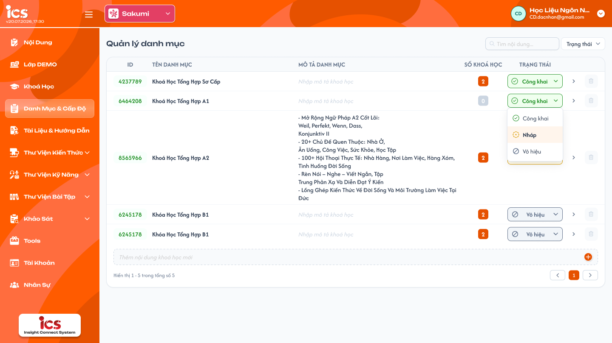
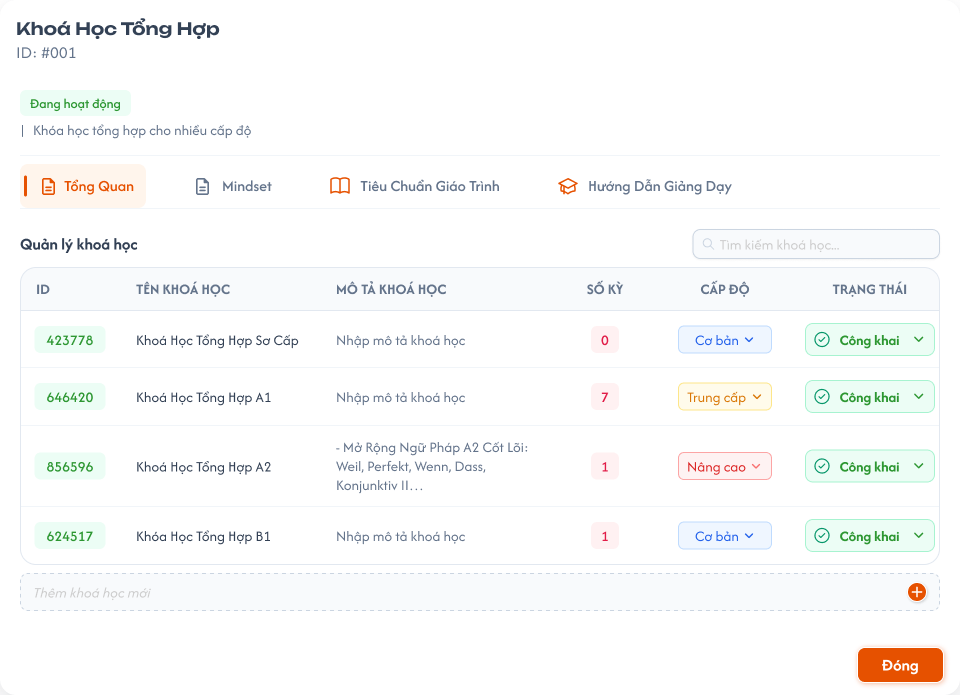
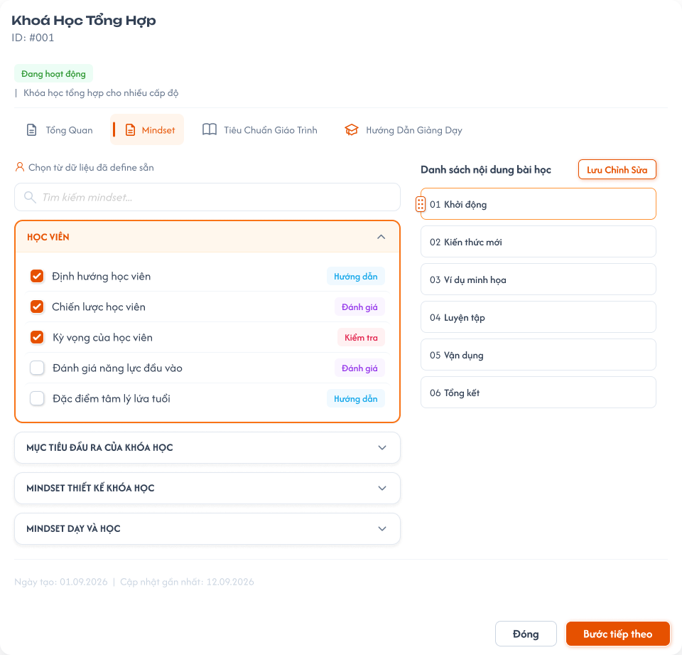
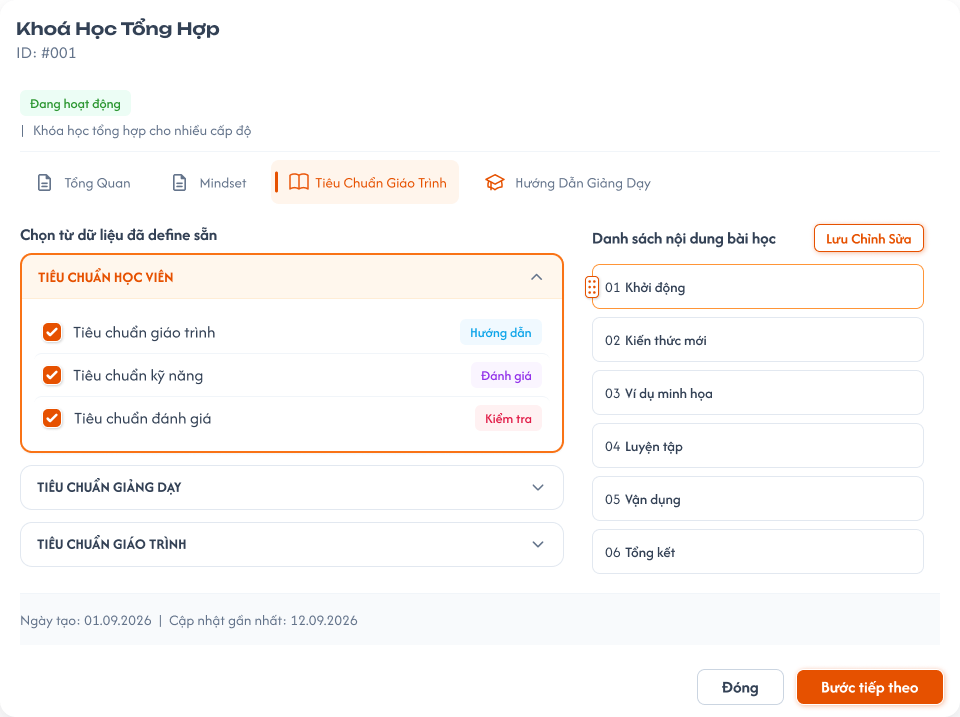
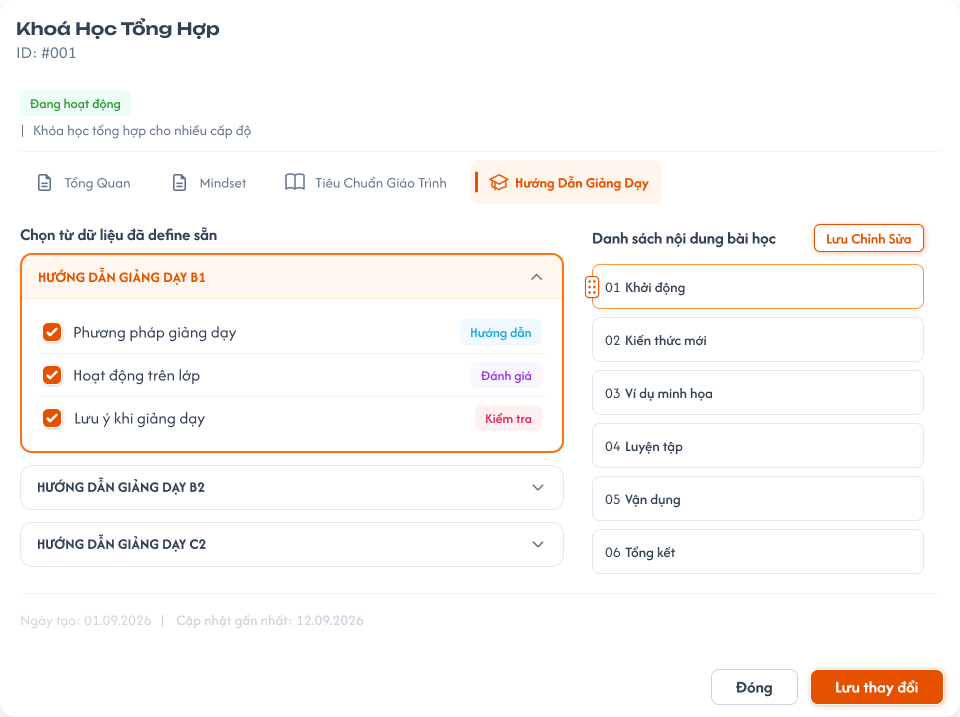
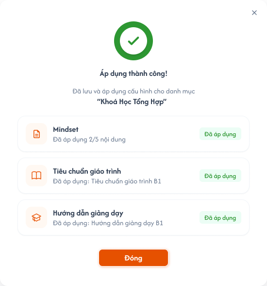
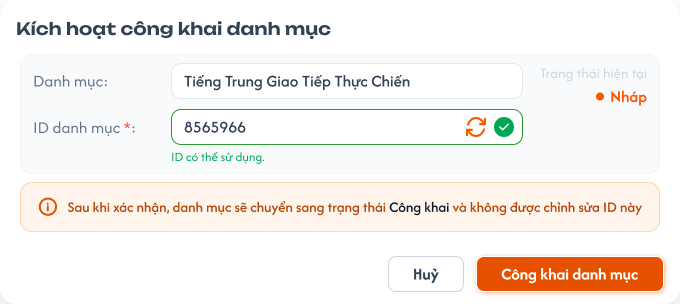
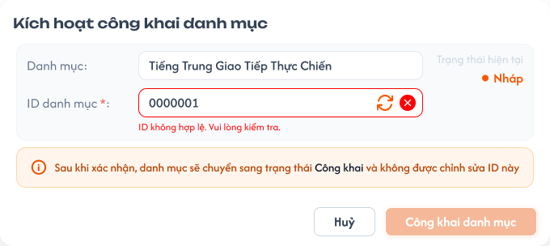

# Quản lý danh sách danh mục

## 1. UI

### Trang 1: CD-DM-010000 — Quản lý danh mục



**Mô tả:**
- `Curriculum Development Handler` có toàn quyền xem và quản lý danh mục: tìm kiếm, thêm nhanh, đổi trạng thái, xoá. Chọn `Chi tiết` (nút mũi tên cuối mỗi hàng) của một danh mục để mở popup quản lý danh mục đó (xem `detail_category.md`, Trang 2).

**Điểm cần lưu ý:**
- Tìm kiếm kích hoạt sau khi nhấn Enter, khớp một phần theo `ID` hoặc `Tên danh mục` (không tìm theo Mô tả), không phân biệt chữ hoa / thường.
- Danh mục và khoá học có quan hệ `1:n` (xem `detail_category.md`).
- **Chỉ danh mục `Nháp` được xoá**; danh mục `Công Khai` / `Vô hiệu` không được xoá. Danh mục `Nháp` đang có khoá học cũng không được xoá (REQ05, Flow 5).
- Quyền sửa theo trạng thái (REQ08): `Nháp` sửa được toàn bộ (Tên, Mô tả, ID, cấu hình Mindset / Tiêu chuẩn giáo trình / Hướng dẫn giảng dạy). `Công Khai` / `Vô hiệu` **chỉ sửa được Tên và Mô tả**; ID và toàn bộ cấu hình 3 tab nội dung chỉ đọc.
- Menu đổi trạng thái: đang `Nháp` chỉ hiện `Công Khai`; đang `Công Khai` chỉ hiện `Vô hiệu`; đang `Vô hiệu` chỉ hiện `Công Khai`.
- `A02.01` Popup xác nhận xoá: mỗi dòng có thao tác `Xóa`, **chỉ bấm được khi danh mục `Nháp`**; `Công Khai` / `Vô hiệu` thì `Xóa` hiện mờ, hover hiện tooltip `Chỉ xóa được danh mục ở trạng thái Nháp. Chuyển Vô hiệu nếu muốn ngừng dùng.` Popup: tiêu đề `Xóa danh mục`; nội dung `Bạn có chắc chắn muốn xóa danh mục "<Tên danh mục>"? Cấu hình Mindset, Tiêu chuẩn giáo trình, Hướng dẫn giảng dạy của danh mục cũng sẽ bị xóa.`; nút `Hủy`, `Xóa`. Sau khi CD xác nhận, backend kiểm tra lại trạng thái và danh mục có **đang được sử dụng** hay không rồi mới xoá.
- "Đang được sử dụng" nghĩa là có ít nhất 1 khoá học chưa bị xoá mềm (bất kỳ trạng thái) thuộc danh mục, tức `Số khóa học > 0`; khoá học đã xoá mềm không tính.
- `A02.02` Toast lỗi không được xoá: khi backend từ chối, đóng popup xác nhận và hiển thị Toast `Có Lỗi Xảy Ra` với nội dung backend trả về: `Danh mục đang được sử dụng, không thể xóa.` (danh mục `Nháp` đang có khoá học) hoặc `Chỉ xóa được danh mục ở trạng thái Nháp.` (gọi API trực tiếp với danh mục `Công Khai` / `Vô hiệu`); danh mục giữ nguyên.
- FE chỉ disable `Xóa` theo trạng thái (không phải `Nháp`); việc danh mục `Nháp` có đang được sử dụng hay không do backend quyết định tại thời điểm xoá, FE chỉ hiển thị Toast theo kết quả. Không có lựa chọn "xoá bắt buộc" hay xoá kèm khoá học; muốn xoá danh mục `Nháp` thì phải xoá hết khoá học thuộc danh mục trước.

### Trang 2: CD-DM-010010 — Quản lý danh mục / Popup danh mục & cấp độ



**Mô tả:**
- Popup chi tiết một danh mục (vd `Khoá Học Tổng Hợp`, `ID: #001`, `Đang hoạt động`) với bốn tab `Tổng Quan`, `Mindset`, `Tiêu Chuẩn Giáo Trình`, `Hướng Dẫn Giảng Dạy`. Tab Tổng Quan có bảng `Quản lý khoá học` (ID, Tên khoá học, Mô tả khoá học, Số kỳ, Cấp độ, Trạng thái) của danh mục.

**Điểm cần lưu ý:**
- Nội dung chi tiết và khoá học tạo nhanh trong tab Tổng quan được đặc tả ở `detail_category.md`; khoá học tạo nhanh ở đây thuộc danh mục đó ở mọi trạng thái (REQ07).

### Trang 3: CD-DM-010020 — Quản lý danh mục / Popup danh mục & cấp độ / Mindset



**Mô tả:**
- Tab `Mindset` của popup chi tiết: `Chọn từ dữ liệu đã define sẵn` các nhóm nội dung (Học viên, Mục tiêu đầu ra của khoá…) để cấu hình cho danh mục.

**Điểm cần lưu ý:**
- `A01.01` ID (hiện ở header popup `ID: #001`): bắt buộc ngay khi tạo mới; 2 chữ số (`01`–`99`, REQ01), duy nhất toàn hệ thống (tính cả danh mục đã xoá mềm). Sửa tự do khi còn `Nháp`; khoá vĩnh viễn kể từ khi rời `Nháp`.
- `A01.02` Tên danh mục: bắt buộc, không giới hạn độ dài, được phép trùng danh mục khác; hệ thống tự cắt khoảng trắng đầu / cuối trước khi lưu; sửa được ở mọi trạng thái.
- `A01.03` Mô tả danh mục: không bắt buộc, không giới hạn độ dài; sửa được ở mọi trạng thái.
- `A01.04` Cấu hình Mindset, Tiêu chuẩn giáo trình, Hướng dẫn giảng dạy: chỉ sửa được khi `Nháp`; `Công Khai` / `Vô hiệu` chỉ đọc (checkbox, nút Lưu / Áp dụng disable; xem `detail_category.md`).
- `A01.05` Số khóa học: chỉ đọc, hệ thống tự tính số khoá học thuộc danh mục; mặc định `0`.
- `A01.06` Trạng thái: 3 trạng thái `Nháp` (mặc định) / `Công Khai` / `Vô hiệu`, theo rule chuyển trạng thái REQ02.

### Trang 4: CD-DM-010030 — Quản lý danh mục / Popup danh mục & cấp độ / Tiêu chuẩn giáo trình



**Mô tả:**
- Tab `Tiêu Chuẩn Giáo Trình` của popup chi tiết: chọn từ dữ liệu đã define sẵn (Tiêu chuẩn học viên, Tiêu chuẩn giảng dạy, Tiêu chuẩn giáo trình) rồi `Lưu`.

**Điểm cần lưu ý:**
- Cấu hình chỉ sửa được khi danh mục `Nháp` (xem `A01.04` ở Trang 3).

### Trang 5: CD-DM-010040 — Quản lý danh mục / Popup danh mục & cấp độ / Hướng dẫn giảng dạy



**Mô tả:**
- Tab `Hướng Dẫn Giảng Dạy` của popup chi tiết: chọn từ dữ liệu đã define sẵn (vd `hướng dẫn giảng dạy b1`, `b2`, `c2`) rồi `Lưu`.

**Điểm cần lưu ý:**
- Cấu hình chỉ sửa được khi danh mục `Nháp` (xem `A01.04` ở Trang 3).

### Trang 6: CD-DM-010057 — Quản lý danh mục / Popup danh mục & cấp độ / Quản lý danh mục / Thành công



**Mô tả:**
- Popup `Áp dụng thành công!` sau khi lưu và áp dụng cấu hình cho danh mục, tóm tắt `Đã áp dụng 2/5 nội dung` (Mindset; Tiêu chuẩn giáo trình B1; Hướng dẫn giảng dạy B1) và nút `Đóng`.

**Điểm cần lưu ý:**
- Đây là kết quả áp dụng cấu hình của popup chi tiết danh mục (`detail_category.md`), chỉ xảy ra khi danh mục `Nháp`.

### Trang 7: CD-DM-010060 — Quản lý danh mục / Popup kích hoạt công khai



**Mô tả:**
- Popup `Kích hoạt công khai danh mục` mở khi CD chọn chuyển một danh mục đang `Nháp` sang `Công Khai`. Hiển thị đúng danh mục đang thao tác và cho phép xác nhận hoặc chỉnh sửa lần cuối ID trước khi khoá vĩnh viễn.

**Điểm cần lưu ý:**
- `A03.01` Danh mục: hiển thị chỉ đọc đúng Tên danh mục đang thao tác.
- `A03.02` Trạng thái hiện tại: badge trạng thái hiện tại (`Nháp`) trước khi chuyển.
- `A03.03` ID danh mục: hiển thị ID hiện tại (2 chữ số) đã có từ lúc tạo.
- `A03.04` Ô nhập ID: điền sẵn ID hiện tại, cho chỉnh sửa trực tiếp lần cuối; gõ vào ô kích hoạt kiểm tra lại (định dạng 2 chữ số + duy nhất toàn hệ thống). Mỗi lần giá trị đổi (gõ tay hoặc bấm làm mới), kết quả kiểm tra cũ bị huỷ hiệu lực, chỉ giá trị mới nhất được dùng để bật nút `Công khai danh mục`.
- `A03.05` Nút làm mới (biểu tượng xoay): sinh một ID 2 chữ số mới chưa được sử dụng, điền vào ô nhập; hệ thống phải kiểm tra lại ID mới.
- `A03.06` Biểu tượng kết quả kiểm tra: dấu tick xanh khi ID hợp lệ và chưa trùng; dấu x đỏ khi sai định dạng hoặc trùng.
- `A03.07` Thông báo trạng thái: `ID có thể sử dụng` khi hợp lệ; `ID đang bị trùng` / `ID sai định dạng` khi không hợp lệ.
- `A03.08` Ghi chú cảnh báo hiển thị cố định: `Sau khi xác nhận, danh mục sẽ chuyển sang trạng thái Công khai, chỉ còn sửa được Tên và Mô tả. ID và cấu hình Mindset, Tiêu chuẩn giáo trình, Hướng dẫn giảng dạy sẽ bị khóa.`
- `A03.09` Nút `Công khai danh mục`: chỉ bật khi ID trong ô đang hợp lệ; khi bấm, backend kiểm tra lại ID lần cuối rồi lưu ID và chuyển trạng thái sang `Công Khai` trong cùng một giao dịch. Trong lúc đang kiểm tra ID hoặc xử lý xác nhận, nút phải bị vô hiệu hoá để tránh gửi lặp.
- `A03.10` Nút `Hủy` / biểu tượng `X`: đóng popup, không lưu thay đổi ID và không đổi trạng thái danh mục.
- CD có thể giữ nguyên ID có sẵn và bấm `Công khai danh mục` ngay nếu ID đó vẫn hợp lệ.
- Nếu backend từ chối ở bước kiểm tra cuối (ID vừa bị dùng, hoặc dữ liệu không còn hợp lệ), danh mục giữ nguyên `Nháp`, popup giữ mở và hiện lỗi tương ứng để CD sửa lại. Sau khi xác nhận thành công, ID trở thành ID chính thức, vĩnh viễn không sửa được (REQ01).

### Trang 8: CD-DM-010062 — Quản lý danh mục / Popup kích hoạt công khai / Điền sai



**Mô tả:**
- Trạng thái popup khi ID nhập sai (vd `0000001`): hiện `ID không hợp lệ. Vui lòng kiểm tra.`, nút `Công khai danh mục` bị vô hiệu hoá, danh mục vẫn ở `Nháp`.

**Điểm cần lưu ý:**
- Lỗi hiển thị ngay trong popup (EX06); nút `Huỷ` vẫn đóng được popup mà không lưu ID.

---

## 2. Yêu cầu

### 2.1. Flow chính

**Flow 1: Thêm nhanh danh mục**

```
CD nhập Tên vào ô "Thêm danh mục mới" → Nhấn nút "+" / Nhấn Enter
  → Hệ thống cắt khoảng trắng đầu/cuối của Tên (Tên được phép trùng với danh mục khác)
  → FE gọi API tạo danh mục (ID tự sinh 2 chữ số duy nhất, Mô tả = trống, Số khóa học = 0, Trạng thái = Nháp) → BE tạo record
  → FE thêm dòng mới vào bảng
```

**Flow 2: Sửa danh mục**

```
CD mở một danh mục (ở bất kỳ trạng thái nào)
  → Sửa Tên và/hoặc Mô tả (sửa được ở mọi trạng thái: Nháp, Công Khai, Vô hiệu)
  → Nếu danh mục đang Nháp: có thể sửa thêm ID (nhập tay 1 mã 2 chữ số khác) và cấu hình Mindset / Tiêu chuẩn giáo trình / Hướng dẫn giảng dạy
  → Nếu danh mục đang Công Khai / Vô hiệu: chỉ sửa Tên, Mô tả; ID và cấu hình 3 tab nội dung chỉ đọc, backend từ chối request sửa (EX04, EX11)
  → Hệ thống cắt khoảng trắng đầu/cuối của Tên, kiểm tra Tên không để trống (Tên được phép trùng); nếu có sửa ID thì kiểm tra đúng 2 chữ số và chưa trùng (kể cả với danh mục đã xóa mềm)
    → Hợp lệ: lưu thay đổi
    → Không hợp lệ: từ chối lưu, báo lỗi tại field tương ứng
```

**Flow 3: Kích hoạt công khai danh mục**

```
CD đang ở Nháp, chọn chuyển sang Công Khai (menu đổi trạng thái khi Nháp chỉ có lựa chọn này)
  → Hệ thống mở popup Kích hoạt công khai danh mục
  → Popup hiển thị Tên danh mục, ID hiện tại (2 chữ số) và trạng thái hiện tại (Nháp)
  → CD giữ nguyên ID có sẵn hoặc chỉnh sửa trực tiếp trong ô nhập
      → Giữ nguyên: hệ thống dùng ID hiện tại, vẫn kiểm tra lại tính hợp lệ trước khi xác nhận
      → Sửa tay: hệ thống kiểm tra lại định dạng 2 chữ số và tính duy nhất mỗi khi giá trị thay đổi
      → Bấm làm mới: hệ thống sinh một ID 2 chữ số mới, chưa dùng, điền vào ô và kiểm tra lại
  → ID hợp lệ: hiển thị "ID có thể sử dụng", bật nút Công khai danh mục
  → ID không hợp lệ hoặc bị trùng: hiển thị lỗi tương ứng, giữ nút Công khai danh mục tắt
  → CD bấm Công khai danh mục
  → Backend kiểm tra lại ID lần cuối trước khi lưu
      → Hợp lệ: lưu ID và chuyển danh mục sang Công Khai trong cùng một giao dịch; ID bị khóa vĩnh viễn từ đây
      → Không hợp lệ: không lưu, giữ nguyên trạng thái Nháp, giữ popup mở và hiển thị lỗi
  → CD bấm Hủy hoặc đóng popup: không lưu thay đổi ID, không đổi trạng thái danh mục
```

**Flow 4: Đổi trạng thái Công Khai ↔ Vô hiệu**

```
CD đang ở Công Khai hoặc Vô hiệu, chọn trạng thái còn lại → ID đã bị khóa từ lúc rời Nháp nên không cần popup xác nhận ID
  → BE kiểm tra lại ID còn hợp lệ/chưa trùng trước khi chuyển
  → Hệ thống chuyển trạng thái, giữ nguyên ID đã có
  → CD không được chọn Nháp; UI không hiển thị lựa chọn này trong menu đổi trạng thái (Công Khai chỉ hiện Vô hiệu, Vô hiệu chỉ hiện Công Khai)
  → Danh mục Vô hiệu: khóa học đã thuộc danh mục giữ nguyên; danh mục không hiển thị để chọn mới ở field Danh mục của feature Quản lý khoá học
```

**Flow 5: Xóa danh mục**

```
CD chọn Xóa danh mục (chỉ bấm được khi danh mục Nháp; Công Khai / Vô hiệu: nút mờ + tooltip) → Hệ thống hiển thị popup xác nhận xóa
  → CD bấm Hủy: đóng popup, không xóa, giữ nguyên dữ liệu
  → CD bấm Xóa → FE gọi API xóa → Backend kiểm tra danh mục đang Nháp và có khóa học nào (chưa bị xóa mềm) không
      → Đang Nháp và chưa được sử dụng: xóa mềm danh mục và cấu hình nội dung; FE đóng popup, loại dòng khỏi bảng, Toast Thành Công; danh mục không còn trong danh sách lựa chọn ở feature khác
      → Không ở Nháp (gọi API trực tiếp) hoặc đang được sử dụng: backend từ chối, trả lỗi (EX08); FE đóng popup, hiển thị Toast lỗi với nội dung backend trả về; dữ liệu không đổi
```

### 2.2. Ngoại lệ

- **EX01:** Tên danh mục mới bị bỏ trống hoặc chỉ chứa khoảng trắng → chặn tạo mới, dữ liệu không thay đổi, disable nút "+". Nếu Enter thì hiện thông báo "Tên danh mục không được bỏ trống".
- **EX02:** Khi sửa lúc `Nháp`, ID sai định dạng (không đúng 2 chữ số) hoặc trùng (kể cả trùng ID của danh mục đã xóa mềm) → hệ thống từ chối lưu, hiển thị lỗi tương ứng, giữ nguyên ID cũ.
- **EX03:** Gọi API hoặc thao tác trực tiếp đổi trạng thái không hợp lệ (từ `Công Khai` / `Vô hiệu` về `Nháp`, hoặc từ `Nháp` sang thẳng `Vô hiệu`) → hệ thống từ chối, hiển thị thông báo lỗi (ví dụ: `"Không thể chuyển sang trạng thái này."`), giữ nguyên trạng thái hiện tại. UI chỉ hiển thị lựa chọn hợp lệ: `Nháp` chỉ có `Công Khai`; `Công Khai` chỉ có `Vô hiệu`; `Vô hiệu` chỉ có `Công Khai`.
- **EX04:** Cố sửa ID khi danh mục có trạng thái khác `Nháp` → hệ thống từ chối, field ID ở trạng thái chỉ đọc / disable.
- **EX05:** ID hợp lệ tại thời điểm nhập nhưng bị đối tượng khác dùng ngay trước lúc backend lưu (race condition) → backend từ chối tại bước kiểm tra cuối, không lưu, giữ nguyên trạng thái và hiển thị lỗi.
- **EX06:** Trong popup Kích hoạt công khai danh mục, ID nhập tay hoặc ID vừa làm mới sai định dạng (không đúng 2 chữ số) hoặc đã bị trùng → hiển thị lỗi tương ứng ngay trong popup, vô hiệu hoá nút `Công khai danh mục`, giữ danh mục ở `Nháp`.
- **EX07:** CD bấm `Hủy` hoặc đóng popup Kích hoạt công khai danh mục sau khi đã sửa ID trong ô nhập → không lưu ID vừa sửa, ID của danh mục giữ nguyên như trước khi mở popup, trạng thái vẫn là `Nháp`.
- **EX08:** Xóa danh mục `Công Khai` / `Vô hiệu` (gọi API trực tiếp) → backend từ chối, trả lỗi `Chỉ xóa được danh mục ở trạng thái Nháp.`. Xóa danh mục `Nháp` đang có khóa học (qua UI, gọi API trực tiếp, hoặc khóa học được tạo ngay trước lúc backend xóa) → backend từ chối, trả lỗi `Danh mục đang được sử dụng, không thể xóa.`. FE hiển thị Toast lỗi với nội dung backend trả về, dữ liệu không đổi.
- **EX09:** Người dùng không có quyền gửi request xóa trực tiếp → từ chối, không thay đổi dữ liệu.
- **EX10:** Sửa Tên danh mục thành trống hoặc chỉ chứa khoảng trắng (ở bất kỳ trạng thái nào) → từ chối lưu, báo lỗi tại field Tên, giữ nguyên Tên cũ.
- **EX11:** Sửa cấu hình Mindset / Tiêu chuẩn giáo trình / Hướng dẫn giảng dạy (hoặc bất kỳ field nào ngoài Tên, Mô tả) khi danh mục `Công Khai` / `Vô hiệu` (qua UI hoặc gọi API trực tiếp) → UI chỉ đọc; backend từ chối, trả lỗi `Danh mục không ở trạng thái Nháp, chỉ được sửa Tên và Mô tả.`, dữ liệu không đổi.

### 2.3. Yêu cầu khác

| Mã | Tên yêu cầu | Mô tả |
|---|---|---|
| REQ01 | ID danh mục | Tự động sinh khi tạo mới: đúng 2 chữ số trong dải `01`–`99` (giữ số 0 đứng đầu, ví dụ `05`; không cấp `00` vì `00` trong ID khoá học nghĩa là chưa chọn), duy nhất toàn hệ thống, tính cả danh mục đã xóa mềm; hệ thống lấy mã nhỏ nhất chưa dùng. Hết mã trong dải thì từ chối tạo mới và báo lỗi `Đã hết ID danh mục khả dụng (01–99).`. ID danh mục là đoạn `AA` trong ID khoá học `CCAALLMMM` (xem `course_management.md` REQ06); vì chỉ danh mục `Công Khai` mới được gán cho khoá học nên đoạn `AA` luôn là ID đã khoá, người dùng không nhập tay lúc thêm nhanh. Có thể chỉnh sửa thủ công trong lúc `Nháp`, kể cả ngay trong popup Kích hoạt công khai danh mục trước khi xác nhận; bị khóa vĩnh viễn kể từ khi rời khỏi `Nháp`. |
| REQ02 | Rule chuyển trạng thái | `Nháp → Công Khai` (một chiều, bắt buộc qua popup Kích hoạt công khai); `Công Khai ↔ Vô hiệu` (hai chiều); không cho chuyển `Nháp → Vô hiệu` trực tiếp và không cho chuyển về `Nháp` từ hai trạng thái còn lại. UI chỉ hiển thị lựa chọn hợp lệ: đang `Nháp` chỉ hiện `Công Khai`, đang `Công Khai` chỉ hiện `Vô hiệu`, đang `Vô hiệu` chỉ hiện `Công Khai`; nếu có request gọi trực tiếp với transition không hợp lệ, backend từ chối và trả thông báo lỗi (EX03). |
| REQ03 | Thông tin cơ bản | Tên danh mục bắt buộc, không giới hạn độ dài, được phép trùng với danh mục khác; hệ thống tự cắt khoảng trắng đầu/cuối trước khi lưu. Tên và Mô tả sửa được ở mọi trạng thái (`Nháp`, `Công Khai`, `Vô hiệu`). Mô tả không bắt buộc, có thể để trống lúc tạo và bổ sung sau. Số khóa học do hệ thống tự tính, không nhập tay. |
| REQ04 | Popup Kích hoạt công khai danh mục | Khi chuyển từ `Nháp` sang `Công Khai`, hệ thống bắt buộc mở popup xác nhận, cho phép CD giữ nguyên hoặc chỉnh sửa lần cuối ID (nhập tay hoặc làm mới tự động) trước khi khóa. Nút xác nhận chỉ bật khi ID trong ô đang hợp lệ và chưa trùng; backend luôn kiểm tra lại ngay trước khi lưu và chuyển trạng thái trong cùng một giao dịch. |
| REQ05 | Xóa danh mục | **Chỉ danh mục `Nháp` được xóa** (xóa mềm), và chỉ khi **chưa có** khóa học nào (chưa bị xóa mềm). Danh mục `Công Khai` / `Vô hiệu` không được xóa (muốn ngừng dùng thì để / chuyển `Vô hiệu`); khóa học đã thuộc danh mục giữ nguyên. Nút `Xóa` mờ + tooltip khi không ở `Nháp`; backend luôn kiểm tra lại trạng thái và tham chiếu ngay tại thời điểm xóa, FE hiển thị Toast lỗi do backend trả về (EX08). Quy tắc chung với Khoá học, Học kỳ, Cấp độ: chỉ `Nháp` được xóa. |
| REQ06 | Ý nghĩa trạng thái Vô hiệu | Danh mục `Vô hiệu` không hiển thị để chọn mới ở field Danh mục (màn Quản lý khoá học, popup Công khai khoá học); khóa học đã gắn danh mục này vẫn hiển thị đúng thông tin, không bị gỡ hay báo lỗi. |
| REQ07 | Danh mục được gắn vào khóa học | Chỉ danh mục `Công Khai` mới được chọn gắn vào khóa học từ field Danh mục của feature Quản lý khoá học. Rule này áp dụng giống với Cấp độ. (Khóa học tạo nhanh trong tab Tổng quan của popup Chi tiết danh mục thì thuộc danh mục đó ở mọi trạng thái, xem `detail_category.md`.) |
| REQ08 | Quyền sửa theo trạng thái | `Nháp`: sửa được Tên, Mô tả, ID, cấu hình 3 tab nội dung. `Công Khai` / `Vô hiệu`: **chỉ sửa Tên và Mô tả**; ID và toàn bộ dữ liệu chi tiết bên trong (cấu hình Mindset, Tiêu chuẩn giáo trình, Hướng dẫn giảng dạy) chỉ đọc; backend từ chối request sửa (EX04, EX11). Danh mục không thể quay về `Nháp`. Quy tắc chung với Khoá học, Học kỳ, Cấp độ (xem `course_management.md` REQ10). |

### 2.4. Ràng buộc

#### Quyền

| Role | Xem | Thêm | Sửa (theo REQ08) / đổi trạng thái | Xóa (chỉ `Nháp`, chưa được sử dụng) |
|---|:---:|:---:|:---:|:---:|
| Curriculum Development Handler | ✅ | ✅ | ✅ | ✅ |
| Các role khác | ❌ | ❌ | ❌ | ❌ |

#### Ràng buộc khác

- Kiểm tra trùng ID phải thực hiện lại tại backend ngay thời điểm lưu, không chỉ dựa vào kết quả kiểm tra trước đó trên UI.
- Không cho phép truy cập hoặc thực hiện hành động bị đánh dấu `❌`, kể cả khi gọi trực tiếp bằng URL hoặc request.
- Việc lưu ID (khi giữ nguyên hoặc chỉnh sửa trong popup) và chuyển trạng thái sang `Công Khai` phải nguyên tử; không được có trường hợp trạng thái đã đổi nhưng ID chưa được lưu hợp lệ hoặc ngược lại.
- Không được xóa danh mục không ở `Nháp` hoặc đang có khóa học; việc kiểm tra và xóa mềm phải thực hiện tại backend trong cùng một giao dịch, không dựa vào kết quả kiểm tra trên UI.

---

## 3. Testcase

### Feature: Quản lý danh mục

| Tên testcase | Priority | Scenario | Role | Pre-condition | Given/When/Then | Expected Result |
|---|---|---|---|---|---|---|
| Case 1: Thêm nhanh danh mục | High | Flow 1 / EX01 / REQ01 / REQ03 | Curriculum Development Handler | Đã có danh mục tên `Tiếng Trung` | **Given:** CD ở trang danh sách<br>**When:** nhập tên hợp lệ rồi nhấn "+" hoặc Enter; nhập `  Tiếng Trung  `; để trống ô nhập rồi nhấn "+" / Enter<br>**Then:** danh mục mới được tạo, tên trống bị chặn | - Danh mục xuất hiện trong bảng với ID tự sinh 2 chữ số duy nhất, Mô tả trống, Số khóa học `0`, Trạng thái `Nháp`<br>- Tạo được dù trùng tên, tên lưu là `Tiếng Trung` (đã cắt khoảng trắng)<br>- Tên trống: nút "+" disable, Enter hiện "Tên danh mục không được bỏ trống", không tạo<br>- Hết mã `01`–`99` thì báo `Đã hết ID danh mục khả dụng (01–99).` |
| Case 2: Sửa danh mục khi Nháp | High | Flow 2 / REQ01 / REQ03 / EX02 / EX10 | Curriculum Development Handler | Danh mục đang `Nháp`; có danh mục đã xóa mềm ID `22` | **Given:** CD mở danh mục<br>**When:** sửa Tên, Mô tả, ID hợp lệ chưa trùng; sau đó sửa ID sai định dạng hoặc thành `22`; xóa trống Tên rồi lưu<br>**Then:** thay đổi hợp lệ được lưu, không hợp lệ bị từ chối | - Sửa lại nhiều lần được khi còn `Nháp`<br>- ID sai / trùng (kể cả ID danh mục đã xóa mềm): báo `ID đang bị trùng` hoặc lỗi tương ứng, ID giữ nguyên<br>- Tên trống: báo lỗi tại field Tên, giữ Tên cũ |
| Case 3: Sửa khi Công Khai / Vô hiệu | High | Flow 2 / REQ08 / EX04 / EX10 / EX11 | Curriculum Development Handler | Danh mục `Công Khai` và danh mục `Vô hiệu` đã có cấu hình Mindset | **Given:** CD mở danh mục<br>**When:** sửa Tên, Mô tả rồi lưu; thử sửa ID; thử tick / bỏ chọn / lưu cấu hình 3 tab (hoặc gửi request trực tiếp); xóa trống Tên<br>**Then:** chỉ Tên và Mô tả lưu được | - Tên, Mô tả cập nhật đúng<br>- ID chỉ đọc / disable, không đổi<br>- Checkbox và nút Lưu / Áp dụng disable; API trực tiếp trả `Danh mục không ở trạng thái Nháp, chỉ được sửa Tên và Mô tả.`<br>- Tên trống bị từ chối, báo lỗi tại field Tên |
| Case 4: Mở popup Kích hoạt công khai và công khai với ID có sẵn | High | Flow 3 / REQ04 | Curriculum Development Handler | Danh mục đang `Nháp`, ID hiện tại còn hợp lệ | **Given:** CD chọn chuyển sang `Công Khai`, popup mở<br>**When:** không sửa ID, bấm `Công khai danh mục`<br>**Then:** hệ thống chuyển trạng thái | - Popup đúng Tên danh mục, ID hiện tại, trạng thái `Nháp`; ô ID điền sẵn; nút bật<br>- Backend kiểm tra lại ID; trạng thái thành `Công Khai`, ID giữ nguyên và khóa vĩnh viễn |
| Case 5: Công khai với ID làm mới hoặc nhập tay | High | Flow 3 / REQ04 | Curriculum Development Handler | Popup đang mở | **Given:** bấm nút làm mới ID, hoặc sửa tay ô ID thành mã 2 chữ số chưa dùng<br>**When:** hệ thống báo `ID có thể sử dụng` và CD bấm `Công khai danh mục`<br>**Then:** lưu ID vừa chọn và chuyển trạng thái | - ID làm mới đúng 2 chữ số, duy nhất, chưa từng dùng; kết quả kiểm tra ID cũ không còn dùng để xác nhận<br>- Hiển thị `ID có thể sử dụng` trước khi cho bấm xác nhận<br>- Trạng thái thành `Công Khai` với đúng ID vừa chọn |
| Case 6: ID trong popup không hợp lệ hoặc bị chiếm | High | EX05 / EX06 | Curriculum Development Handler | Popup đang mở | **Given:** CD sửa ID thành mã sai định dạng hoặc đã trùng; một case khác ID hợp lệ nhưng bị đối tượng khác dùng ngay trước lúc lưu<br>**When:** hệ thống kiểm tra / backend kiểm tra cuối<br>**Then:** không cho công khai | - Lỗi hiển thị ngay trong popup, nút `Công khai danh mục` bị vô hiệu hoá<br>- Race: backend từ chối, popup giữ mở và hiện lỗi<br>- Danh mục vẫn `Nháp` |
| Case 7: Hủy popup Kích hoạt công khai | High | EX07 | Curriculum Development Handler | Popup đang mở, CD đã sửa ID | **Given:** CD nhập một ID khác trong ô<br>**When:** bấm `Hủy` hoặc đóng popup<br>**Then:** không lưu thay đổi | - ID giữ nguyên như trước khi mở popup<br>- Trạng thái vẫn `Nháp` |
| Case 8: Đổi trạng thái hợp lệ và chặn chuyển sai | High | Flow 4 / REQ02 / REQ06 / REQ07 / EX03 | Curriculum Development Handler | Có danh mục ở cả 3 trạng thái | **Given:** CD mở menu đổi trạng thái của từng danh mục; thử chuyển về `Nháp` hoặc `Nháp` → `Vô hiệu` bằng API<br>**When:** chọn trạng thái còn lại / gửi request<br>**Then:** chỉ chuyển hợp lệ | - `Nháp` chỉ có `Công Khai`; `Công Khai` chỉ có `Vô hiệu`; `Vô hiệu` chỉ có `Công Khai`<br>- Công Khai ↔ Vô hiệu: ID giữ nguyên, không mở popup ID<br>- API sai transition trả lỗi, trạng thái không đổi<br>- Danh mục `Vô hiệu` không còn để chọn mới ở field Danh mục; khoá học đã gắn không bị ảnh hưởng; chỉ `Công Khai` được gắn cho khoá học |
| Case 9: Xóa danh mục chưa được sử dụng | High | Flow 5 / REQ05 | Curriculum Development Handler | Danh mục `Nháp`, `Số khóa học = 0` (hoặc mọi khoá học của danh mục đã xóa mềm) | **Given:** CD chọn `Xóa`, popup xác nhận hiện<br>**When:** bấm `Hủy`, rồi làm lại và bấm `Xóa`<br>**Then:** Hủy không xóa; Xóa thì xóa mềm | - Hủy giữ nguyên dữ liệu<br>- Xóa: dòng biến khỏi bảng và danh sách lựa chọn, Toast `Thành Công`<br>- Khoá học đã xóa mềm không tính là đang sử dụng |
| Case 10: Chặn xóa danh mục không được phép | High | Flow 5 / REQ05 / EX08 | Curriculum Development Handler | Danh mục A `Công Khai`, B `Vô hiệu`, C `Nháp` có khóa học (hoặc khoá học vừa thêm ngay trước lúc xóa) | **Given:** CD xem nút `Xóa` của A, B; bấm `Xóa` và xác nhận ở C; gọi API xóa trực tiếp<br>**When:** backend xử lý<br>**Then:** backend từ chối | - A, B: nút mờ, tooltip `Chỉ xóa được danh mục ở trạng thái Nháp. Chuyển Vô hiệu nếu muốn ngừng dùng.`; API trả `Chỉ xóa được danh mục ở trạng thái Nháp.`<br>- C: popup đóng, Toast `Có Lỗi Xảy Ra` với `Danh mục đang được sử dụng, không thể xóa.`<br>- Dữ liệu không đổi |
| Case 11: Tìm kiếm | Medium | Tìm kiếm theo ID / Tên | Curriculum Development Handler | Có danh mục tên `Tiếng Trung` | **Given:** CD ở trang danh sách<br>**When:** nhập `TIẾNG TRUNG`, `tiếng trung`, `TiẾnG tRuNg` hoặc một phần ID rồi Enter; nhập một phần Mô tả<br>**Then:** hệ thống trả kết quả | - Cả ba lần đều ra `Tiếng Trung`; khớp một phần theo ID hoặc Tên<br>- Không tìm theo Mô tả |
| Case 12: Quyền truy cập | High | Ràng buộc quyền / EX09 | Các role khác | Người dùng không có quyền | **Given:** không có quyền quản lý danh mục<br>**When:** mở URL hoặc gửi request trực tiếp (xem, thêm, sửa, đổi trạng thái, xóa)<br>**Then:** hệ thống từ chối | - Không xem / đổi được dữ liệu |
