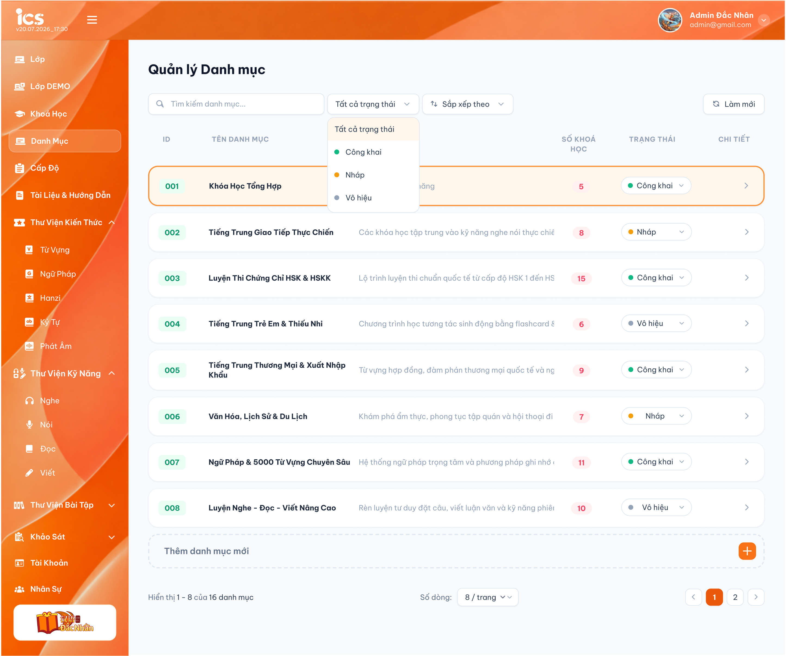
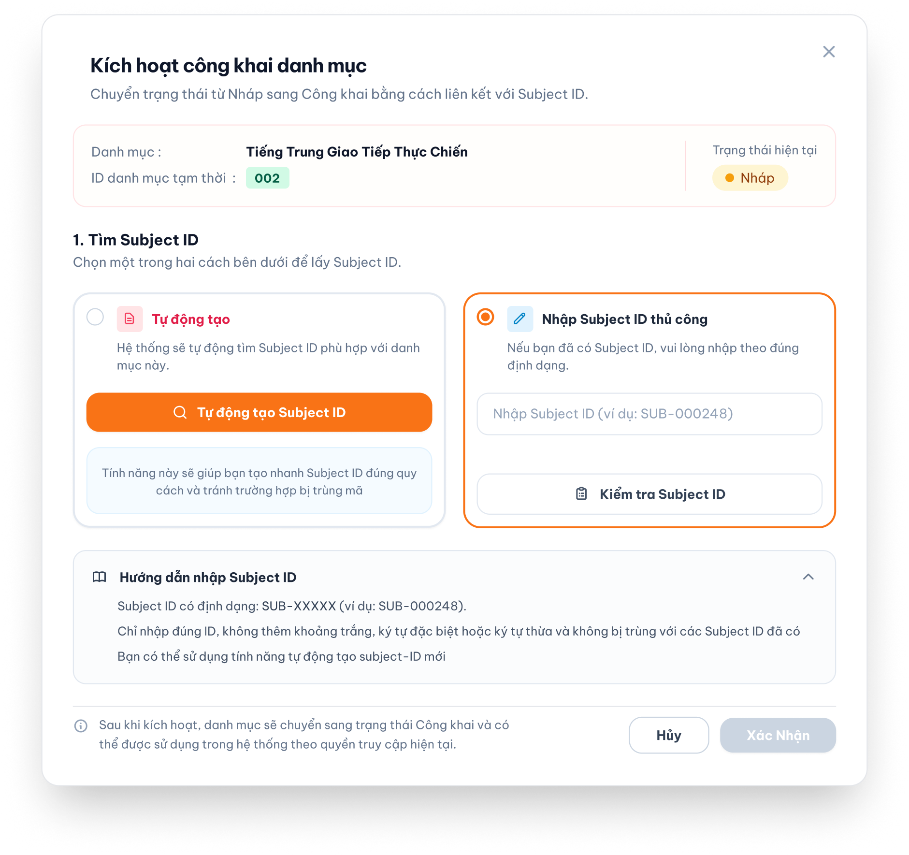
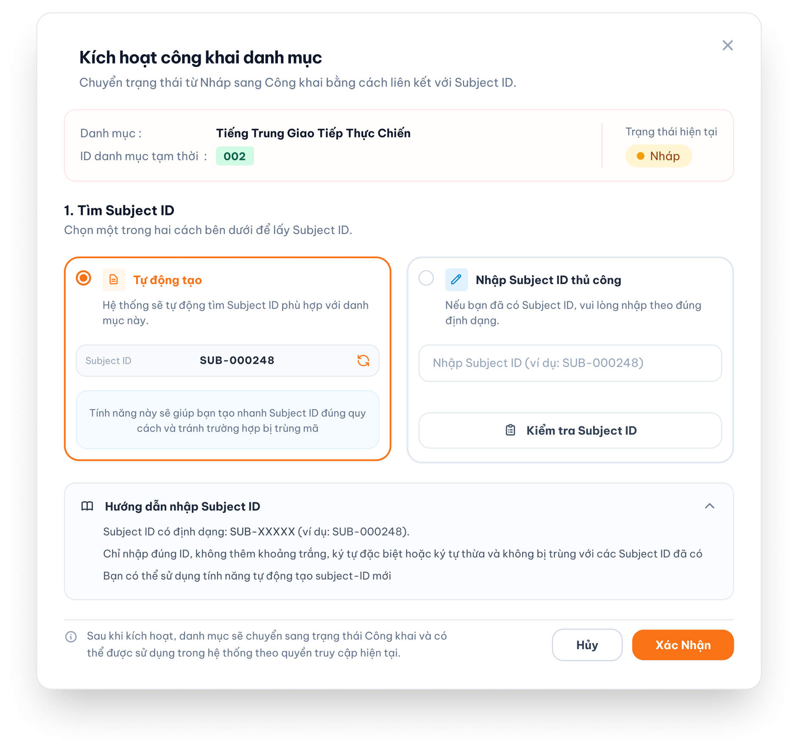
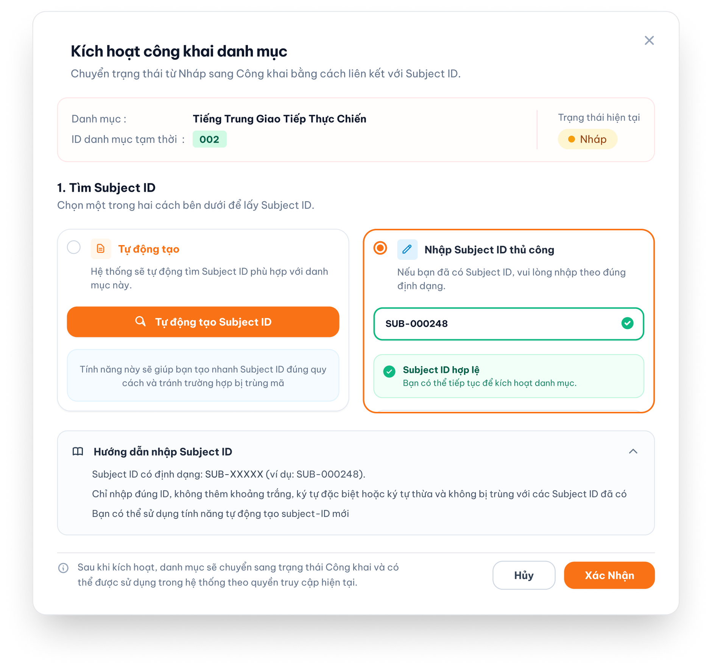
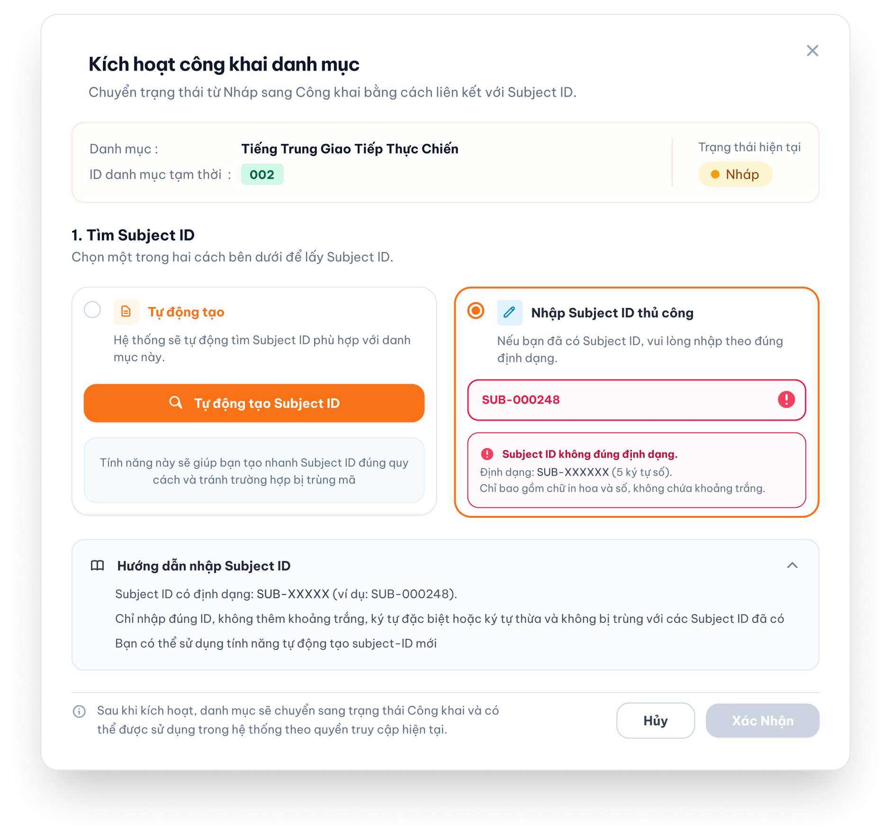
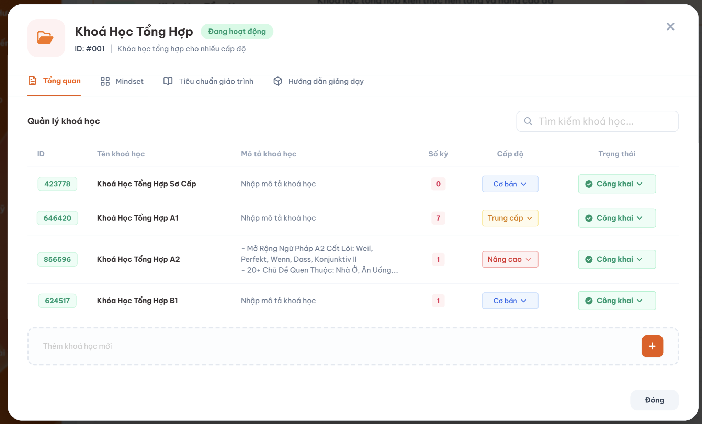
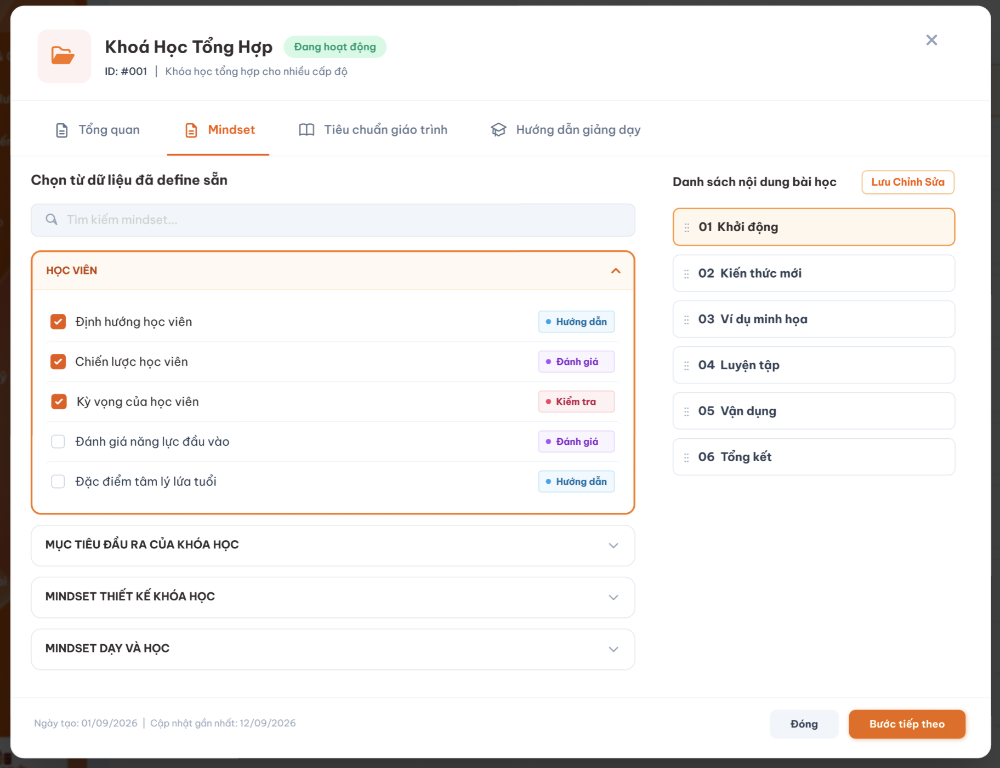
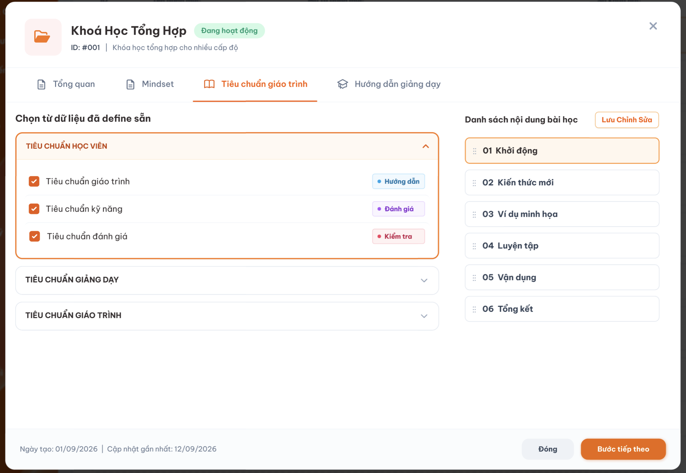
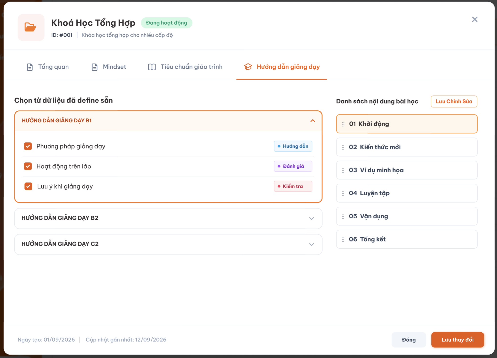
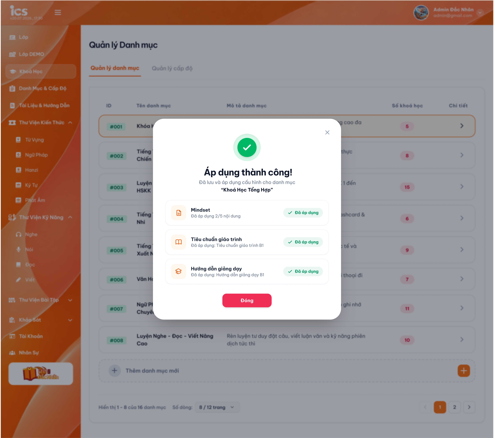

# Quản lý danh mục

## 1. UI

### Trang 1: Danh sách danh mục


*Danh sách danh mục — nhấn để xem ảnh gốc*

**Mô tả:**

- `Curriculum Development Handler` có toàn quyền xem và quản lý tất cả danh mục, khóa học và cấu hình nội dung trong feature này.
- Chọn `Chi tiết` của một danh mục để mở popup quản lý danh mục đó.

**Điểm cần lưu ý:**

- Danh sách hiển thị: `ID`, `Tên danh mục`, `Mô tả danh mục`, `Số khóa học` và `Chi tiết`.
- `Số khóa học` do hệ thống tính theo số khóa học đang thuộc danh mục, người dùng không nhập thủ công.
- Danh mục có ba trạng thái: `Nháp`, `Công khai`, `Vô hiệu hóa`.
- Khi tạo mới, trạng thái mặc định của danh mục là `Nháp`.
- Cho phép chuyển hai chiều giữa mọi trạng thái: `Nháp` ↔ `Công khai`, `Nháp` ↔ `Vô hiệu hóa` và `Công khai` ↔ `Vô hiệu hóa`.
- Khi trạng thái đích là `Công khai`, hệ thống phải kiểm tra lại Subject ID trước khi chuyển. Khi chuyển sang `Nháp` hoặc `Vô hiệu hóa`, Subject ID đã có vẫn được giữ lại và tiếp tục được dành riêng cho danh mục đó.
- Danh mục ở trạng thái `Nháp` không bắt buộc có `Subject ID` công khai. Hệ thống có thể hiển thị `ID danh mục tạm thời` để nhận diện bản nháp; ID tạm thời không thay thế `Subject ID` dùng khi công khai.
- Khi chuyển danh mục từ `Nháp` sang `Công khai`, hệ thống mở popup `Kích hoạt công khai danh mục`. Người dùng chọn một trong hai cách lấy `Subject ID`: hệ thống tự động tạo ID mới hoặc nhập thủ công.
- Mỗi Subject ID là duy nhất toàn hệ thống. Danh mục chỉ được chuyển sang `Công khai` sau khi Subject ID đúng định dạng và chưa được sử dụng.
- Tìm kiếm danh mục được kích hoạt sau khi người dùng ngừng nhập `2 giây`; hệ thống tìm theo keyword khớp một phần với `ID`, `Tên danh mục` hoặc `Mô tả danh mục`, không yêu cầu nội dung khớp chính xác 100%.
- Danh mục và khóa học có quan hệ `1:n`: một danh mục có nhiều khóa học; mỗi khóa học thuộc một danh mục.

### Trang 2: Form thêm danh mục
- `A02.01` **ID danh mục tạm thời**: Có thể được hệ thống sinh để nhận diện bản nháp và chỉ dùng hiển thị. Không được xem là `Subject ID` công khai.
- `A02.02` **Subject ID**: Không bắt buộc khi lưu `Nháp`. Bắt buộc khi chuyển sang `Công khai`; được hệ thống tự động tạo mới hoặc do người dùng nhập thủ công. Phải đúng định dạng và duy nhất toàn hệ thống.
- `A02.03` **Tên danh mục**: Bắt buộc, không áp dụng giới hạn độ dài nghiệp vụ.
- `A02.04` **Mô tả danh mục**: Bắt buộc, không áp dụng giới hạn độ dài nghiệp vụ.
- `A02.05` **Số khóa học**: Field chỉ đọc, do hệ thống tự tính; danh mục mới chưa có khóa học hiển thị `0`.
- `A02.06` **Trạng thái**: Gồm `Nháp`, `Công khai`, `Vô hiệu hóa`; mặc định khi tạo là `Nháp`. Cho phép chuyển từ bất kỳ trạng thái hiện tại sang một trong hai trạng thái còn lại. Khi chuyển đến `Công khai`, Subject ID phải hợp lệ; chuyển sang trạng thái khác không xóa Subject ID đã có.

### Trang 3: Popup Kích hoạt công khai danh mục


*Bước đầu chọn cách lấy Subject ID — nhấn để xem ảnh gốc*



*Subject ID do hệ thống trả về — nhấn để xem ảnh gốc*



*Subject ID nhập thủ công đã được kiểm tra hợp lệ — nhấn để xem ảnh gốc*


*Lỗi Subject ID bị trùng — nhấn để xem ảnh gốc*



*Lỗi Subject ID không đúng định dạng — nhấn để xem ảnh gốc*

- `A03.01` **Thông tin danh mục**: Hiển thị đúng `Tên danh mục`, `ID danh mục tạm thời` và trạng thái hiện tại của đối tượng (`Nháp` hoặc `Vô hiệu hóa`) khi chuyển sang `Công khai`.
- `A03.02` **Chọn cách lấy Subject ID**: Chỉ được chọn một trong hai chế độ: `Tự động tạo` hoặc `Nhập Subject ID thủ công`. Khi đổi chế độ, kết quả kiểm tra của chế độ trước không được dùng để xác nhận.
- `A03.03` **Tự động tạo**: Hệ thống sinh một Subject ID mới, chưa được sử dụng và không tìm hay tái sử dụng Subject ID đã tồn tại. Trong lúc xử lý, hệ thống hiển thị trạng thái đang tạo và vô hiệu hóa `Xác nhận`. Khi thành công, hiển thị Subject ID vừa tạo; nút làm mới cho phép tạo một Subject ID mới khác và phải kiểm tra lại.
- `A03.04` **Lỗi tự động tạo**: Hiển thị notification `Không thể tự động tạo Subject ID. Vui lòng thử lại.` kèm hành động `Thử lại`. Mỗi lần người dùng chọn `Thử lại`, hệ thống gửi lại yêu cầu tạo ID mới; không giới hạn số lần thử lại ở tầng nghiệp vụ.
- `A03.05` **Nhập thủ công**: Cho phép nhập Subject ID và chủ động chọn `Kiểm tra Subject ID`. Hệ thống kiểm tra định dạng và tính duy nhất toàn hệ thống.
- `A03.06` **Subject ID hợp lệ**: Hiển thị trạng thái thành công và thông báo `Subject ID hợp lệ`. Nút `Xác nhận` được bật.
- `A03.07` **Subject ID bị trùng**: Hiển thị lỗi `Subject ID đang bị trùng.`; không cho xác nhận.
- `A03.08` **Subject ID sai định dạng**: Hiển thị lỗi `Subject ID không đúng định dạng.`; không cho xác nhận.
- `A03.09` **Hướng dẫn nhập**: Subject ID có tiền tố `SUB-`, chỉ gồm chữ in hoa và số theo cấu trúc được cấu hình; không có khoảng trắng, ký tự đặc biệt hoặc ký tự thừa. Số lượng chữ số chính xác cần xác nhận do hình minh họa chưa thống nhất.
- `A03.10` **Xác nhận**: Chỉ bật sau khi cách đang chọn có Subject ID hợp lệ. Khi bấm, backend phải kiểm tra lại trước khi lưu Subject ID và chuyển trạng thái sang `Công khai` trong cùng một giao dịch.
- `A03.11` **Hủy/Đóng**: Nút `Hủy` hoặc biểu tượng `X` đóng popup, không lưu Subject ID và không đổi trạng thái danh mục.

**Điểm cần lưu ý:**

- Trong thời gian tự động tạo, kiểm tra thủ công hoặc kiểm tra lại khi xác nhận, nút `Xác nhận` phải bị vô hiệu hóa để tránh gửi lặp.
- Nếu kiểm tra cuối cùng thất bại do Subject ID vừa bị đối tượng khác sử dụng hoặc dữ liệu không còn hợp lệ, danh mục giữ nguyên trạng thái trước khi thao tác, popup được giữ mở và hiển thị lỗi tương ứng.
- Sau khi xác nhận thành công, danh mục chuyển sang `Công khai` và có thể được sử dụng theo quyền truy cập hiện tại.
- Nếu thao tác tạo danh mục/khóa học hoặc công khai thất bại, hệ thống phải hiển thị notification lỗi, giữ lại dữ liệu người dùng đã nhập và không ghi nhận thay đổi một phần. Nội dung chữ chính xác của các notification này cần được bổ sung vào thiết kế; riêng lỗi tự động tạo Subject ID sử dụng notification và hành động `Thử lại` đã quy định ở trên.

### Trang 4: CD-DM-010010 — Popup Chi tiết danh mục


**Mô tả:**

- Popup hiển thị thông tin của đúng danh mục được chọn.
- Popup gồm bốn tab: `Tổng quan`, `Mindset`, `Tiêu chuẩn giáo trình`, `Hướng dẫn giảng dạy`.
- Tab mặc định khi mở popup là `Tổng quan`.

### Trang 5: Tab Tổng quan


*Tab Tổng quan và danh sách khóa học thuộc danh mục — nhấn để xem ảnh gốc*

- `A05.01` **Danh sách khóa học**: Hiển thị các khóa học đang thuộc danh mục hiện tại.
- `A05.02` **Tìm kiếm khóa học**: Sau khi người dùng ngừng nhập `2 giây`, lọc trong danh mục hiện tại theo keyword khớp một phần với ID, Tên hoặc Mô tả khóa học; không yêu cầu khớp chính xác 100%.
- `A05.03` **Thêm khóa học**: Mở form tạo khóa học mới và gắn khóa học vào danh mục hiện tại.
- `A05.04` **ID khóa học tạm thời**: Có thể được hệ thống sinh để nhận diện bản nháp và chỉ dùng hiển thị; không thay thế ID công khai của khóa học.
- `A05.05` **ID công khai của khóa học**: Không bắt buộc khi lưu `Nháp`. Bắt buộc khi chuyển sang `Công khai`; được hệ thống tự động tạo mới hoặc do người dùng nhập thủ công, sau đó phải được kiểm tra đúng định dạng và duy nhất toàn hệ thống.
- `A05.06` **Tên khóa học**: Bắt buộc, không áp dụng giới hạn độ dài nghiệp vụ.
- `A05.07` **Mô tả khóa học**: Bắt buộc, không áp dụng giới hạn độ dài nghiệp vụ.
- `A05.08` **Số kỳ**: Field chỉ đọc. Khóa học và kỳ có quan hệ `1:n`; hệ thống đếm số kỳ đang liên kết với khóa học và cập nhật khi quan hệ khóa học–kỳ được thêm hoặc xóa.
- `A05.09` **Cấp độ**: Chỉ được chọn từ danh sách cấp độ đã được định nghĩa tại feature `Quản lý cấp độ`.
- `A05.10` **Trạng thái**: Gồm `Nháp`, `Công khai`, `Vô hiệu hóa`; mặc định khi tạo là `Nháp`. Cho phép chuyển từ bất kỳ trạng thái hiện tại sang một trong hai trạng thái còn lại. Khi chuyển đến `Công khai`, ID công khai phải hợp lệ; chuyển sang trạng thái khác không xóa ID đã có.

### Trang 6: CD-DM-010060 — Popup Kích hoạt công khai khóa học


- Khóa học sử dụng cùng trình tự, trạng thái giao diện, điều kiện bật nút, xử lý lỗi và nguyên tắc kiểm tra lại như popup `Kích hoạt công khai danh mục`.
- Nội dung trên popup phải đổi đúng theo đối tượng đang thao tác: tiêu đề, tên đối tượng, ID tạm thời, trạng thái hiện tại và thông báo kết quả đều hiển thị thông tin khóa học.
- Việc kích hoạt chỉ thành công khi ID công khai của khóa học đã được kiểm tra hợp lệ; sau đó hệ thống lưu ID và chuyển khóa học từ `Nháp` sang `Công khai` trong cùng một giao dịch.
- Tên chính thức và định dạng của ID công khai dành cho khóa học cần được xác nhận vì bộ UI hiện tại chỉ minh họa `Subject ID` của danh mục.

### Trang 7: CD-DM-010020, CD-DM-010030, CD-DM-010040 — Tab Mindset, Tiêu chuẩn giáo trình và Hướng dẫn giảng dạy


#### Tab Mindset



*Chọn package/category và action item Mindset — nhấn để xem ảnh gốc*

#### Tab Tiêu chuẩn giáo trình



*Chọn nội dung Tiêu chuẩn giáo trình — nhấn để xem ảnh gốc*

#### Tab Hướng dẫn giảng dạy



*Chọn nội dung Hướng dẫn giảng dạy — nhấn để xem ảnh gốc*

- `A07.01` **Tìm kiếm**: Sau khi người dùng ngừng nhập `2 giây`, lọc theo keyword khớp một phần với tên package/category hoặc tiêu đề action item đã được định nghĩa trước; không yêu cầu khớp chính xác 100%.
- `A07.02` **Package/category**: Người dùng được chọn nhiều package/category; không giới hạn số lượng lựa chọn. Mỗi package/category được chọn sẽ tải các action item trực thuộc.
- `A07.03` **Action item**: Người dùng được chọn nhiều action item từ các package/category đã chọn; không giới hạn số lượng lựa chọn.
- `A07.04` **Xem trước nội dung**: Hiển thị nội dung của package/category và các action item đang được chọn.
- `A07.05` **Lưu/Áp dụng**: Lưu các action item được chọn vào danh mục hiện tại; không tạo hoặc chỉnh sửa dữ liệu gốc.

**Điểm cần lưu ý:**

- Ba tab sử dụng cùng nguyên tắc: chọn một hoặc nhiều package/category trước, sau đó chọn các action item trực thuộc; không giới hạn số package/category hoặc action item được chọn.
- Chỉ hiển thị package/category và action item đã được định nghĩa tại feature tương ứng.
- Các nội dung được chọn chỉ được tham chiếu và áp dụng cho danh mục; dữ liệu gốc không bị thay đổi.
- Vì cấu hình lưu dưới dạng tham chiếu, khi package/category hoặc action item được cập nhật tại feature định nghĩa, nội dung đang áp dụng cho danh mục phải phản ánh dữ liệu mới. Dữ liệu không được sao chép thành một bản độc lập tại danh mục.
- Quyền `Chỉ xem` được mở package/category/action item và xem trước nội dung, nhưng không được thay đổi lựa chọn hoặc lưu/áp dụng.
- Quyền `Cập nhật kết quả` được tick chọn package/category/action item và lưu/áp dụng lựa chọn cho danh mục.
- Không yêu cầu quyền `Định nghĩa nội dung` cho thao tác chọn và áp dụng, vì thao tác này không tạo, sửa hoặc xóa cấu trúc dữ liệu nguồn.
- Sau khi lưu thành công, hệ thống hiển thị xác nhận `Áp dụng thành công!` và tóm tắt nội dung đã áp dụng.

### Trang 8: CD-DM-010057 — Popup Áp dụng thành công




*Kết quả áp dụng cấu hình cho danh mục — nhấn để xem ảnh gốc*

- Chỉ hiển thị popup sau khi cấu hình được lưu thành công.
- Popup tóm tắt kết quả áp dụng của `Mindset`, `Tiêu chuẩn giáo trình` và `Hướng dẫn giảng dạy`.

---

---

## 2. Yêu cầu

### 2.1. Flow chính

**Flow 1 / REQ01: Quản lý danh sách và thêm danh mục**

```text
Curriculum Development Handler mở màn hình Quản lý danh mục
      → Hệ thống hiển thị ID, Tên danh mục, Mô tả danh mục, Số khóa học và Chi tiết
      → Người dùng chọn Thêm danh mục
      → Hệ thống mở form với trạng thái mặc định là Nháp và Số khóa học bằng 0
      → Người dùng nhập Tên danh mục và Mô tả danh mục; ID có thể để trống
      → Hệ thống kiểm tra Tên danh mục và Mô tả danh mục không để trống
      → Thành công: danh mục được thêm vào danh sách ở trạng thái Nháp; không bắt buộc có ID
      → Hệ thống có thể hiển thị ID danh mục tạm thời để nhận diện bản nháp
      → ID tạm thời không phải Subject ID và không làm danh mục tự động chuyển sang Công khai
```

**Flow 1B / REQ01: Kích hoạt công khai danh mục**

```text
Curriculum Development Handler chọn chuyển một danh mục từ Nháp hoặc Vô hiệu hóa sang Công khai
      → Hệ thống mở popup Kích hoạt công khai danh mục
      → Popup hiển thị đúng Tên danh mục, ID danh mục tạm thời và trạng thái hiện tại
      → Người dùng chọn một trong hai cách lấy Subject ID

      → Cách 1 - Tự động tạo:
          → Người dùng chọn chế độ tự động và yêu cầu hệ thống tạo một Subject ID mới, duy nhất
          → Hệ thống hiển thị trạng thái đang xử lý; nút Xác nhận bị vô hiệu hóa
          → Thành công: hiển thị Subject ID hợp lệ và bật nút Xác nhận
          → Thất bại: hiển thị notification lỗi kèm hành động Thử lại; không bật nút Xác nhận
          → Người dùng có thể chọn làm mới để tạo một Subject ID khác; hệ thống phải kiểm tra lại

      → Cách 2 - Nhập thủ công:
          → Người dùng nhập Subject ID và chọn Kiểm tra Subject ID
          → Hệ thống kiểm tra định dạng và tính duy nhất toàn hệ thống
          → Hợp lệ: hiển thị xác nhận hợp lệ và bật nút Xác nhận
          → Không hợp lệ hoặc bị trùng: hiển thị đúng lỗi và giữ nút Xác nhận bị vô hiệu hóa

      → Người dùng chọn Xác nhận
      → Backend kiểm tra lại Subject ID ngay trước khi lưu
      → Hợp lệ: lưu Subject ID và chuyển danh mục sang Công khai trong cùng một giao dịch
      → Không hợp lệ: không lưu, giữ nguyên trạng thái trước khi thao tác và giữ popup mở để người dùng xử lý
      → Nếu người dùng chọn Hủy hoặc đóng popup: không lưu và không đổi trạng thái
      → Danh mục ở Công khai hoặc Vô hiệu hóa cũng có thể chuyển sang một trong hai trạng thái còn lại
      → Nếu trạng thái đích là Công khai: kiểm tra lại Subject ID trước khi chuyển
      → Nếu trạng thái đích là Nháp hoặc Vô hiệu hóa: chuyển trạng thái và giữ nguyên Subject ID đã có
```

**Flow 2 / REQ02: Xem chi tiết và quản lý khóa học thuộc danh mục**

```text
Curriculum Development Handler chọn Chi tiết của một danh mục
      → Hệ thống mở popup của đúng danh mục và mặc định hiển thị tab Tổng quan
      → Popup hiển thị bốn tab: Tổng quan, Mindset, Tiêu chuẩn giáo trình, Hướng dẫn giảng dạy
      → Tại tab Tổng quan, hệ thống hiển thị các khóa học thuộc danh mục
      → Người dùng có thể tìm kiếm hoặc chọn Thêm khóa học
      → Form tạo khóa học có trạng thái mặc định là Nháp
      → Người dùng nhập Tên khóa học và Mô tả khóa học, chọn cấp độ từ dữ liệu đã định nghĩa; ID có thể để trống
      → Thành công: khóa học được tạo và gắn vào danh mục hiện tại
      → Hệ thống tự cập nhật Số khóa học của danh mục
      → Mỗi danh mục có nhiều khóa học và mỗi khóa học chỉ thuộc một danh mục
      → Mỗi khóa học có thể liên kết với nhiều kỳ
      → Hệ thống tự tính Số kỳ theo số quan hệ khóa học–kỳ và cập nhật khi quan hệ được thêm hoặc xóa
      → Khi chuyển khóa học từ Nháp hoặc Vô hiệu hóa sang Công khai, hệ thống mở popup kích hoạt công khai khóa học
      → Popup áp dụng cùng hai cách lấy ID, trạng thái xử lý, kiểm tra hợp lệ, lỗi và điều kiện bật Xác nhận như danh mục
      → Backend kiểm tra lại ID ngay trước khi lưu
      → ID hợp lệ: lưu ID và chuyển khóa học sang Công khai trong cùng một giao dịch
      → ID không hợp lệ hoặc bị trùng: giữ nguyên trạng thái khóa học trước khi thao tác và không lưu thay đổi
      → Hủy hoặc đóng popup: không lưu ID và không đổi trạng thái khóa học
      → Khóa học được chuyển hai chiều giữa Nháp, Công khai và Vô hiệu hóa
      → Khi trạng thái đích là Công khai: kiểm tra lại ID công khai trước khi chuyển
      → Khi trạng thái đích là Nháp hoặc Vô hiệu hóa: giữ nguyên ID công khai đã có
```

**Flow 3 / REQ03: Cấu hình nội dung cho danh mục**

```text
Curriculum Development Handler mở một trong ba tab Mindset, Tiêu chuẩn giáo trình hoặc Hướng dẫn giảng dạy
      → Hệ thống hiển thị các package/category đã được định nghĩa tại feature tương ứng
      → Người dùng có quyền Chỉ xem được mở package/category/action item và xem trước nhưng không được thay đổi lựa chọn
      → Người dùng có quyền Cập nhật kết quả tìm kiếm và chọn một hoặc nhiều package/category
      → Hệ thống hiển thị các action item trực thuộc các package/category đã chọn
      → Người dùng chọn nhiều action item cần áp dụng; không giới hạn số lượng
      → Hệ thống hiển thị nội dung xem trước của lựa chọn hiện tại
      → Người dùng lưu/áp dụng cấu hình
      → Hệ thống kiểm tra package/category và action item vẫn còn hợp lệ
      → Thành công: lưu các tham chiếu vào đúng danh mục, không thay đổi dữ liệu gốc và hiển thị "Áp dụng thành công!"
      → Khi dữ liệu nguồn được thay đổi tại feature định nghĩa, nội dung tham chiếu tại danh mục phản ánh thay đổi đó
      → Thất bại: không ghi nhận cấu hình chưa lưu và không hiển thị xác nhận thành công
```

### 2.2. Ngoại lệ

- **EX01:** Subject ID danh mục để trống, sai định dạng hoặc đã tồn tại khi chuyển sang `Công khai` → hiển thị lỗi tương ứng, vô hiệu hóa `Xác nhận` và giữ nguyên trạng thái trước khi thao tác.
- **EX02:** ID công khai của khóa học để trống, sai định dạng hoặc đã tồn tại khi chuyển sang `Công khai` → hiển thị lỗi tương ứng, vô hiệu hóa `Xác nhận` và giữ nguyên trạng thái trước khi thao tác.
- **EX03:** Cấp độ được chọn đã bị xóa hoặc không còn khả dụng trước khi lưu khóa học → không lưu cấp độ không hợp lệ; dữ liệu khóa học đã lưu trước đó không thay đổi.
- **EX04:** Package/category hoặc action item đã bị xóa hay không còn khả dụng tại feature định nghĩa → nội dung tham chiếu tại danh mục phải phản ánh trạng thái mới và không được tiếp tục hiển thị như dữ liệu còn hiệu lực.
- **EX05:** Tìm kiếm khóa học không có kết quả → hiển thị trạng thái không có dữ liệu; không làm thay đổi dữ liệu.
- **EX06:** Lưu/áp dụng cấu hình thất bại → không hiển thị `Áp dụng thành công!` và không hiển thị dữ liệu chưa lưu như dữ liệu đã áp dụng.
- **EX07:** Người dùng không có quyền truy cập hoặc gửi request trực tiếp → từ chối thao tác và không thay đổi dữ liệu.
- **EX08:** Người dùng chỉ có quyền `Chỉ xem` gửi request tick chọn hoặc lưu/áp dụng package/category/action item → hệ thống từ chối và giữ nguyên cấu hình danh mục.
- **EX09:** Tự động tạo ID thất bại hoặc hết thời gian chờ → dừng trạng thái đang xử lý, hiển thị notification `Không thể tự động tạo Subject ID. Vui lòng thử lại.` kèm hành động `Thử lại`, không bật `Xác nhận` và giữ nguyên trạng thái đối tượng.
- **EX10:** ID đã hợp lệ trên UI nhưng bị đối tượng khác sử dụng trước lúc người dùng xác nhận → backend từ chối tại bước kiểm tra cuối, không lưu ID và giữ nguyên trạng thái đối tượng.
- **EX11:** Người dùng đổi giữa chế độ tự động và nhập thủ công → hủy kết quả kiểm tra của chế độ trước; chỉ kết quả hợp lệ của chế độ đang chọn mới được dùng để bật `Xác nhận`.

### 2.3. Yêu cầu khác

| Mã | Tên yêu cầu | Mô tả |
|---|---|---|
| REQ01 | Quản lý danh sách danh mục | Cho phép xem, tìm kiếm và thêm danh mục; Tên danh mục và Mô tả danh mục là bắt buộc, không giới hạn độ dài nghiệp vụ. Danh mục mới mặc định ở trạng thái `Nháp` và chưa bắt buộc có Subject ID công khai. Cho phép chuyển tự do giữa `Nháp`, `Công khai` và `Vô hiệu hóa`. Khi trạng thái đích là `Công khai`, người dùng lấy Subject ID bằng chế độ tự động tạo ID mới hoặc nhập thủ công nếu chưa có ID; hệ thống kiểm tra định dạng và tính duy nhất toàn hệ thống tại backend trước khi chuyển. Danh mục và khóa học có quan hệ `1:n`. |
| REQ02 | Quản lý khóa học thuộc danh mục | Popup chi tiết có bốn tab và mặc định mở `Tổng quan`; cho phép tìm kiếm, tạo khóa học trong danh mục, chọn cấp độ từ dữ liệu đã định nghĩa và chuyển tự do giữa ba trạng thái của khóa học. Tên và Mô tả khóa học là bắt buộc, không giới hạn độ dài nghiệp vụ. Khóa học mới mặc định là `Nháp`, chưa bắt buộc có ID công khai. Khi trạng thái đích là `Công khai`, khóa học áp dụng cùng cơ chế tự động tạo/nhập thủ công và kiểm tra ID như danh mục; chuyển sang trạng thái khác không xóa ID đã có. Khóa học và kỳ có quan hệ `1:n`; Số kỳ là số quan hệ kỳ đang liên kết với khóa học. |
| REQ03 | Cấu hình nội dung danh mục | Tại từng tab `Mindset`, `Tiêu chuẩn giáo trình`, `Hướng dẫn giảng dạy`, người dùng được chọn nhiều package/category rồi chọn nhiều action item trực thuộc để áp dụng cho danh mục; không giới hạn số lượng lựa chọn. Dữ liệu nguồn chỉ được tham chiếu, không bị chỉnh sửa hoặc sao chép; thay đổi tại feature định nghĩa được phản ánh vào nội dung áp dụng. Quyền `Chỉ xem` chỉ được xem trước; quyền `Cập nhật kết quả` được tick chọn và lưu/áp dụng. Lưu/áp dụng và thông báo kết quả là bước kết thúc của requirement này. |

### 2.4. Ràng buộc

#### Quyền

| Role | Xem danh mục | Thêm danh mục | Quản lý khóa học | Cấu hình nội dung |
|---|:---:|:---:|:---:|:---:|
| Curriculum Development Handler | ✅ | ✅ | ✅ | ✅ |
| Các role khác | ❌ | ❌ | ❌ | ❌ |

#### Ràng buộc khác

**Quyền chọn và áp dụng nội dung**

| Chế độ quyền | Xem package/category/action item | Tick chọn | Lưu/Áp dụng | Quản lý cấu trúc nguồn tại feature define |
|---|:---:|:---:|:---:|:---:|
| Cập nhật kết quả | ✅ | ✅ | ✅ | ❌ |
| Chỉ xem | ✅ | ❌ | ❌ | ❌ |
| Chỉ bình luận | ✅ | ❌ | ❌ | ❌ |
| Định nghĩa nội dung | ✅ | ❌ | ❌ | ✅ |
| Không có quyền | ❌ | ❌ | ❌ | ❌ |

- `Cập nhật kết quả` là quyền phù hợp cho thao tác tick package/category/action item và lưu/áp dụng vào danh mục.
- `Chỉ xem` chỉ cho phép mở danh sách và xem trước nội dung.
- `Định nghĩa nội dung` dùng để tạo/sửa/xóa cấu trúc nguồn tại feature tương ứng; quyền này không thay thế `Cập nhật kết quả` khi áp dụng nội dung cho danh mục.

#### Phạm vi dữ liệu

- `Curriculum Development Handler` có toàn quyền trên toàn bộ dữ liệu danh mục, khóa học và cấu hình nội dung của feature; không giới hạn theo phạm vi danh mục.
- Danh mục và khóa học có quan hệ `1:n`: một danh mục có nhiều khóa học; mỗi khóa học thuộc một danh mục.
- Khóa học và kỳ có quan hệ `1:n`: một khóa học có thể được sử dụng trong nhiều kỳ; mỗi kỳ trong quan hệ này thuộc khóa học tương ứng.
- `Số khóa học` bằng số khóa học đang liên kết với danh mục và được cập nhật khi liên kết danh mục–khóa học được thêm hoặc xóa.
- `Số kỳ` bằng số kỳ đang liên kết với khóa học và được cập nhật khi liên kết khóa học–kỳ được thêm hoặc xóa.
- ID tạm thời của bản nháp và ID công khai là hai giá trị có mục đích khác nhau; ID tạm thời không được dùng để bỏ qua bước kiểm tra ID khi kích hoạt công khai.
- Việc lưu ID công khai và chuyển trạng thái phải nguyên tử; không được có trường hợp trạng thái đã là `Công khai` nhưng ID chưa được lưu hợp lệ hoặc ngược lại.
- Kiểm tra trùng ID phải thực hiện lại tại backend tại thời điểm xác nhận, không chỉ dựa vào kết quả kiểm tra trước đó trên giao diện.
- Subject ID/ID công khai phải duy nhất toàn hệ thống; chế độ tự động luôn tạo ID mới và không tìm hoặc tái sử dụng ID đã tồn tại.
- Cả danh mục và khóa học đều được chuyển từ bất kỳ trạng thái hiện tại sang một trong hai trạng thái còn lại. ID đã cấp vẫn gắn với đúng đối tượng khi trạng thái thay đổi và chỉ được giải phóng nếu đối tượng bị xóa theo một requirement khác.
- Tất cả ô tìm kiếm trong phạm vi feature này thực hiện tìm theo keyword khớp một phần sau khi người dùng ngừng nhập `2 giây`; không yêu cầu khớp chính xác 100%.
- Danh sách khóa học, Số khóa học, Số kỳ và cấu hình nội dung phải thuộc đúng danh mục/khóa học đang thao tác.
- Dữ liệu cấp độ, Mindset, Tiêu chuẩn giáo trình và Hướng dẫn giảng dạy được lấy từ feature quản lý tương ứng; không hard-code dữ liệu minh họa trong thiết kế.
- Không cho phép truy cập hoặc thực hiện hành động bị đánh dấu `❌`, kể cả khi gọi trực tiếp bằng URL hoặc request.

---

---

## 3. Testcase

### Feature: Quản lý danh mục

| Tên testcase | Priority | Scenario | Role | Pre-condition | Given/When/Then | Expected Result |
|---|---|---|---|---|---|---|
| Case 1: Hiển thị danh sách danh mục | High · Smoke | REQ01 | Curriculum Development Handler | Người dùng đã đăng nhập và có quyền | **Given** hệ thống có dữ liệu danh mục<br>**When** người dùng mở màn hình Quản lý danh mục<br>**Then** hệ thống hiển thị danh sách | - Có ID, Tên danh mục, Mô tả danh mục, Số khóa học và Chi tiết<br>- Role được xem toàn bộ dữ liệu danh mục<br>- Số khóa học phản ánh dữ liệu hiện tại |
| Case 2: Thêm danh mục Nháp không có ID | High · Smoke | Flow 1 / REQ01 | Curriculum Development Handler | Màn hình danh sách đang mở | **Given** người dùng mở form thêm danh mục<br>**When** nhập Tên danh mục và Mô tả danh mục, để trống ID rồi lưu<br>**Then** hệ thống tạo danh mục | - Trạng thái mặc định là `Nháp`<br>- ID được phép để trống<br>- Số khóa học bằng `0`<br>- Danh mục xuất hiện trong danh sách |
| Case 3: Mở popup kích hoạt công khai danh mục | High | Flow 1B / REQ01 | Curriculum Development Handler | Danh mục đang ở trạng thái `Nháp` | **Given** danh mục chưa có Subject ID công khai<br>**When** người dùng chọn chuyển sang `Công khai`<br>**Then** hệ thống mở popup kích hoạt | - Hiển thị đúng Tên danh mục, ID tạm thời và trạng thái `Nháp`<br>- Có hai chế độ lấy Subject ID<br>- `Xác nhận` bị vô hiệu hóa khi chưa có ID hợp lệ |
| Case 4: Công khai danh mục bằng Subject ID tự động tạo | High · Smoke | Flow 1B / REQ01 | Curriculum Development Handler | Popup kích hoạt đang mở | **Given** người dùng chọn chế độ `Tự động tạo`<br>**When** yêu cầu hệ thống tạo Subject ID mới và hệ thống trả về ID hợp lệ<br>**Then** người dùng xác nhận kích hoạt | - Không tìm hoặc tái sử dụng ID đã tồn tại<br>- Có trạng thái đang xử lý và không cho xác nhận trong lúc chờ<br>- ID mới duy nhất toàn hệ thống<br>- Backend kiểm tra lại và lưu ID<br>- Trạng thái chuyển thành `Công khai` |
| Case 5: Công khai danh mục bằng Subject ID nhập thủ công | High | Flow 1B / REQ01 | Curriculum Development Handler | Popup kích hoạt đang mở | **Given** người dùng chọn nhập thủ công<br>**When** nhập Subject ID đúng định dạng, chưa được sử dụng và chọn kiểm tra<br>**Then** hệ thống xác nhận ID hợp lệ và cho phép kích hoạt | - Hiển thị thông báo `Subject ID hợp lệ`<br>- `Xác nhận` được bật<br>- Lưu đúng ID đã nhập<br>- Trạng thái chuyển thành `Công khai` |
| Case 6: Mở chi tiết danh mục | High · Smoke | Flow 2 / REQ02 | Curriculum Development Handler | Danh sách có ít nhất một danh mục | **Given** người dùng đang xem danh sách<br>**When** chọn Chi tiết của một danh mục<br>**Then** hệ thống mở popup tương ứng | - Hiển thị đúng danh mục đã chọn<br>- Có bốn tab<br>- Tab `Tổng quan` được chọn mặc định |
| Case 7: Tìm kiếm khóa học trong danh mục | Medium | Flow 2 / REQ02 | Curriculum Development Handler | Tab Tổng quan có nhiều khóa học | **Given** có khóa học chứa một phần keyword trong ID, Tên hoặc Mô tả<br>**When** người dùng ngừng nhập trong `2 giây`<br>**Then** hệ thống tự động lọc danh sách | - Không cần khớp chính xác 100%<br>- Chỉ tìm trong danh mục hiện tại<br>- Không làm thay đổi dữ liệu |
| Case 8: Thêm khóa học Nháp không có ID | High · Smoke | Flow 2 / REQ02 | Curriculum Development Handler | Popup danh mục đang mở | **Given** người dùng mở form thêm khóa học<br>**When** nhập Tên và Mô tả khóa học, chọn cấp độ đã được định nghĩa, để trống ID rồi lưu<br>**Then** hệ thống tạo khóa học | - Trạng thái mặc định là `Nháp`<br>- ID được phép để trống<br>- Khóa học thuộc đúng một danh mục<br>- Số khóa học của danh mục tăng tương ứng |
| Case 9: Tự tính Số kỳ của khóa học | High | REQ02 | Curriculum Development Handler | Khóa học đã tồn tại | **Given** quan hệ khóa học–kỳ được thêm hoặc xóa<br>**When** hệ thống cập nhật thông tin khóa học<br>**Then** hệ thống tính lại Số kỳ | - Số kỳ bằng số kỳ đang liên kết với khóa học<br>- Một khóa học có thể có nhiều kỳ<br>- Người dùng không nhập hoặc sửa Số kỳ thủ công |
| Case 10: Công khai khóa học với ID hợp lệ | High | Flow 2 / REQ02 | Curriculum Development Handler | Khóa học đang ở trạng thái `Nháp` | **Given** người dùng mở popup kích hoạt khóa học<br>**When** tự động tạo ID mới hoặc nhập thủ công và ID được kiểm tra hợp lệ<br>**Then** người dùng xác nhận kích hoạt | - UI áp dụng cùng trạng thái và điều kiện nút như danh mục<br>- ID duy nhất toàn hệ thống<br>- Backend kiểm tra lại và lưu đúng ID<br>- Trạng thái khóa học chuyển thành `Công khai` |
| Case 11: Chặn công khai khóa học khi ID không hợp lệ | High | EX02 / REQ02 | Curriculum Development Handler | Khóa học đang ở trạng thái `Nháp` | **Given** ID công khai để trống, sai định dạng hoặc bị trùng<br>**When** người dùng kiểm tra hoặc xác nhận<br>**Then** hệ thống từ chối | - Hiển thị lỗi tương ứng<br>- `Xác nhận` bị vô hiệu hóa hoặc backend từ chối tại bước kiểm tra cuối<br>- Khóa học vẫn ở trạng thái `Nháp` |
| Case 12: Chọn nhiều package/category và action item | High | Flow 3 / REQ03 | Curriculum Development Handler | Người dùng có quyền `Cập nhật kết quả`; có dữ liệu đã được định nghĩa | **Given** người dùng mở tab Mindset, Tiêu chuẩn giáo trình hoặc Hướng dẫn giảng dạy<br>**When** chọn nhiều package/category rồi tick nhiều action item trực thuộc<br>**Then** hệ thống hiển thị toàn bộ lựa chọn và nội dung xem trước | - Không giới hạn số package/category hoặc action item được chọn<br>- Action item thuộc đúng package/category<br>- Không chỉnh sửa dữ liệu nguồn |
| Case 13: Áp dụng cấu hình thành công | High | Flow 3 / REQ03 | Curriculum Development Handler | Người dùng có quyền `Cập nhật kết quả`; các lựa chọn còn hợp lệ | **Given** người dùng đã chọn các action item cần áp dụng<br>**When** lưu/áp dụng cấu hình<br>**Then** hệ thống lưu tham chiếu vào danh mục | - Cấu hình thuộc đúng danh mục<br>- Dữ liệu nguồn không thay đổi<br>- Hiển thị `Áp dụng thành công!` và đúng nội dung tóm tắt |
| Case 14: Đồng bộ thay đổi từ dữ liệu define | High | EX04 / REQ03 | Curriculum Development Handler | Danh mục đang tham chiếu package/category hoặc action item đã được áp dụng | **Given** nội dung nguồn được cập nhật, vô hiệu hóa hoặc xóa tại feature định nghĩa<br>**When** người dùng mở lại cấu hình hoặc nội dung được tải lại<br>**Then** hệ thống phản ánh trạng thái mới của dữ liệu nguồn | - Nội dung cập nhật được hiển thị theo dữ liệu define mới<br>- Dữ liệu đã vô hiệu hóa/xóa không tiếp tục hiển thị như còn hiệu lực<br>- Không duy trì một bản sao độc lập tại danh mục |
| Case 15: Kiểm tra quyền truy cập trực tiếp | High | EX07 / Ràng buộc quyền | Các role khác | Người dùng đã đăng nhập nhưng không có quyền | **Given** người dùng không có quyền quản lý danh mục<br>**When** mở URL hoặc gửi request trực tiếp<br>**Then** hệ thống từ chối | - Không xem hoặc thay đổi được dữ liệu<br>- Dữ liệu không thay đổi |
| Case 16: Chặn lưu khi thiếu tên hoặc mô tả | High | REQ01 / REQ02 | Curriculum Development Handler | Form thêm danh mục hoặc khóa học đang mở | **Given** Tên hoặc Mô tả đang để trống<br>**When** người dùng lưu bản Nháp hoặc chuyển sang Công khai<br>**Then** hệ thống từ chối lưu | - Không tạo dữ liệu thiếu field bắt buộc<br>- Hiển thị lỗi tại field tương ứng |
| Case 17: Quyền Chỉ xem không được thay đổi cấu hình | High | EX08 / REQ03 | Curriculum Development Handler | Người dùng chỉ có quyền `Chỉ xem` | **Given** người dùng mở tab cấu hình nội dung<br>**When** xem package/category/action item hoặc gửi request tick chọn/lưu trực tiếp<br>**Then** hệ thống chỉ cho xem trước và từ chối thay đổi | - Không thể tick chọn hoặc lưu/áp dụng<br>- Cấu hình danh mục không thay đổi |
| Case 18: Báo lỗi Subject ID danh mục bị trùng | High | EX01 / REQ01 | Curriculum Development Handler | Popup kích hoạt danh mục đang mở ở chế độ nhập thủ công | **Given** Subject ID đã được sử dụng<br>**When** người dùng nhập ID và chọn kiểm tra<br>**Then** hệ thống báo trùng | - Hiển thị `Subject ID đang bị trùng.`<br>- Field và thông báo ở trạng thái lỗi<br>- `Xác nhận` bị vô hiệu hóa<br>- Danh mục vẫn là `Nháp` |
| Case 19: Báo lỗi Subject ID danh mục sai định dạng | High | EX01 / REQ01 | Curriculum Development Handler | Popup kích hoạt danh mục đang mở ở chế độ nhập thủ công | **Given** Subject ID có sai tiền tố, cấu trúc, khoảng trắng, ký tự đặc biệt hoặc ký tự thừa<br>**When** người dùng chọn kiểm tra<br>**Then** hệ thống báo sai định dạng | - Hiển thị `Subject ID không đúng định dạng.`<br>- `Xác nhận` bị vô hiệu hóa<br>- Danh mục vẫn là `Nháp` |
| Case 20: Làm mới Subject ID tự động | Medium | Flow 1B / REQ01 | Curriculum Development Handler | Hệ thống đã tạo một Subject ID hợp lệ | **Given** ID tự động đang hiển thị<br>**When** người dùng chọn biểu tượng làm mới<br>**Then** hệ thống tạo một ID mới khác và kiểm tra lại | - Không tìm hoặc tái sử dụng ID cũ<br>- Vô hiệu hóa `Xác nhận` trong lúc xử lý<br>- Không dùng lại kết quả kiểm tra cũ<br>- Chỉ bật `Xác nhận` khi ID mới hợp lệ |
| Case 21: Hủy kích hoạt công khai | High | Flow 1B / REQ01, Flow 2 / REQ02 | Curriculum Development Handler | Popup kích hoạt danh mục hoặc khóa học đang mở | **Given** người dùng đã chọn chế độ hoặc đã có ID hợp lệ<br>**When** chọn `Hủy` hoặc biểu tượng `X`<br>**Then** popup đóng | - Không lưu ID mới<br>- Đối tượng giữ nguyên trạng thái trước khi thao tác |
| Case 22: ID bị chiếm trước thời điểm xác nhận | High | EX10 / REQ01, REQ02 | Curriculum Development Handler | UI đã xác nhận ID hợp lệ nhưng ID vừa được đối tượng khác sử dụng | **Given** kết quả kiểm tra cũ không còn hợp lệ<br>**When** người dùng chọn `Xác nhận`<br>**Then** backend kiểm tra lại và từ chối | - Không lưu ID trùng<br>- Không chuyển trạng thái<br>- Giữ popup mở và hiển thị lỗi để người dùng chọn hoặc nhập ID khác |
| Case 23: Đổi chế độ lấy ID | Medium | EX11 / REQ01, REQ02 | Curriculum Development Handler | Một chế độ đã có kết quả kiểm tra hợp lệ | **Given** `Xác nhận` đang được bật bởi kết quả của chế độ hiện tại<br>**When** người dùng chuyển sang chế độ còn lại<br>**Then** hệ thống hủy hiệu lực kết quả cũ | - `Xác nhận` trở lại trạng thái vô hiệu hóa<br>- Chỉ kết quả hợp lệ của chế độ đang chọn được dùng để kích hoạt |
| Case 24: Tự động tạo Subject ID thất bại và thử lại | High | EX09 / REQ01, REQ02 | Curriculum Development Handler | Popup kích hoạt đang ở chế độ tự động tạo | **Given** yêu cầu tạo ID bị lỗi hoặc hết thời gian chờ<br>**When** hệ thống trả lỗi<br>**Then** hiển thị notification có hành động thử lại | - Nội dung `Không thể tự động tạo Subject ID. Vui lòng thử lại.`<br>- `Xác nhận` bị vô hiệu hóa<br>- Đối tượng giữ nguyên trạng thái trước khi thao tác<br>- Chọn `Thử lại` gửi một yêu cầu tạo ID mới |
| Case 25: Tìm kiếm danh mục theo keyword | Medium | REQ01 | Curriculum Development Handler | Danh sách có dữ liệu chứa keyword trong ID, Tên hoặc Mô tả | **Given** người dùng đang nhập keyword<br>**When** ngừng nhập trong `2 giây`<br>**Then** hệ thống tự động tìm kiếm | - Trả về dữ liệu khớp một phần, không yêu cầu khớp 100%<br>- Không làm thay đổi dữ liệu |
| Case 26: Chuyển đổi giữa mọi trạng thái | High | REQ01, REQ02 | Curriculum Development Handler | Danh mục hoặc khóa học đã tồn tại | **Given** đối tượng đang ở một trong ba trạng thái `Nháp`, `Công khai`, `Vô hiệu hóa`<br>**When** người dùng chọn một trong hai trạng thái còn lại<br>**Then** hệ thống thực hiện chuyển trạng thái | - Cho phép đủ sáu hướng chuyển giữa ba trạng thái<br>- Trạng thái đích `Công khai` yêu cầu ID hợp lệ và được backend kiểm tra lại<br>- Trạng thái đích `Nháp` hoặc `Vô hiệu hóa` không yêu cầu tạo ID mới<br>- ID đã có được giữ nguyên và vẫn dành riêng cho đối tượng |

### Feature: Quản lý danh mục

---

---

## 4. Câu hỏi cần xác nhận

- **Q01:** UI quy định Subject ID danh mục có tiền tố `SUB-`, chỉ gồm chữ in hoa và số, không có khoảng trắng, ký tự đặc biệt hoặc ký tự thừa. Tuy nhiên số lượng chữ số chưa thống nhất: hướng dẫn ghi `SUB-XXXXX` nhưng ví dụ hiển thị `SUB-000248`; cần chốt cấu trúc và độ dài chính xác.
- **Q02:** Bộ UI hiện tại chỉ thể hiện `Subject ID` của danh mục; cần chốt tên field, tiền tố và định dạng ID công khai của khóa học khi áp dụng cùng flow.
- **Q03:** Chưa có nội dung chữ và hình thức hiển thị chính thức cho notification khi tạo danh mục/khóa học hoặc công khai thất bại. Requirement hiện chỉ chốt hành vi giữ dữ liệu, không cập nhật một phần và cho phép thử lại; riêng lỗi tự động tạo Subject ID đã có nội dung notification cụ thể.
