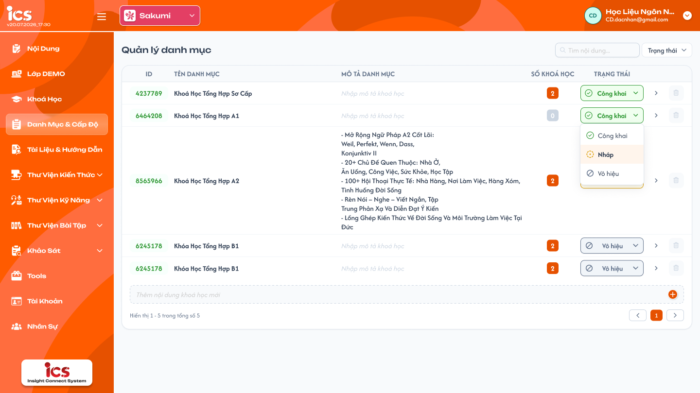
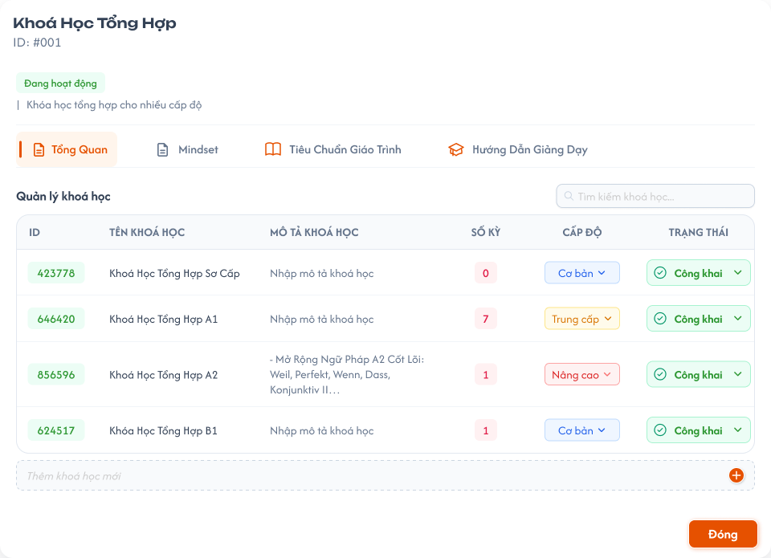
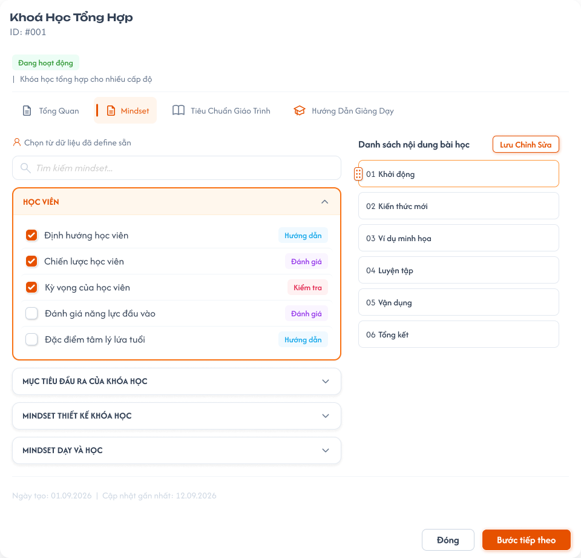
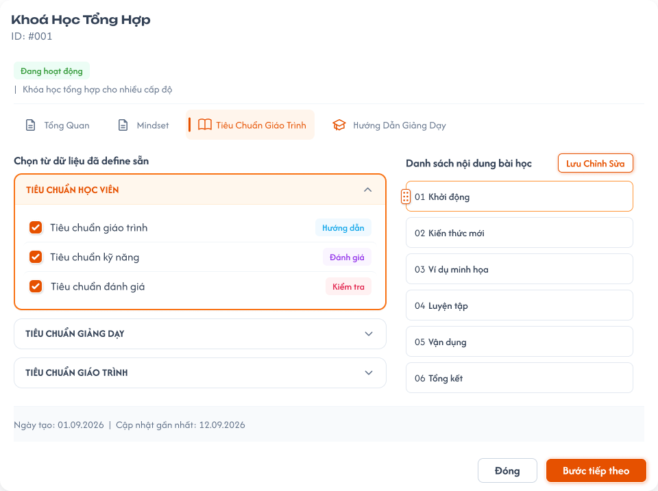
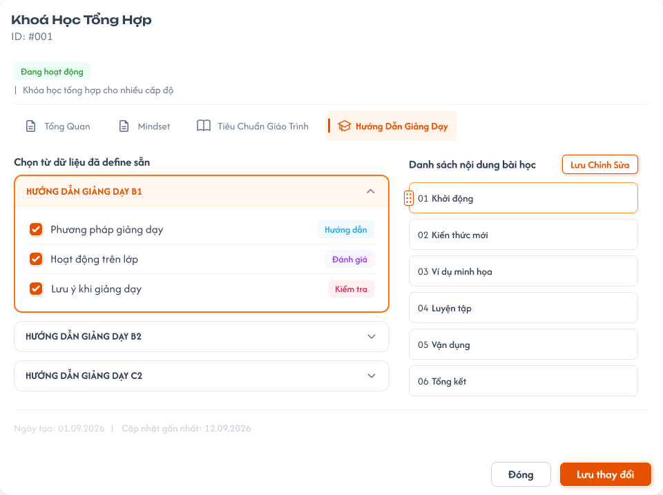
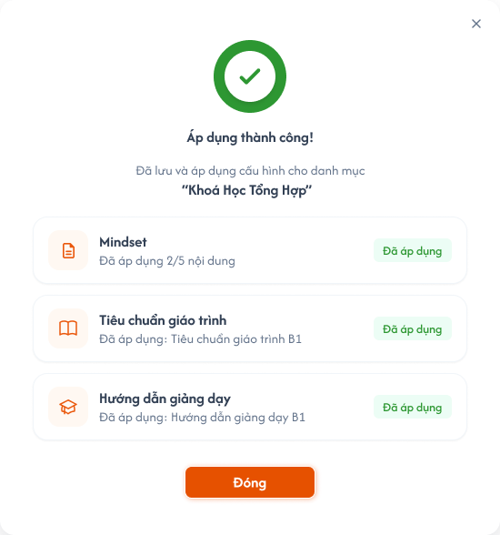
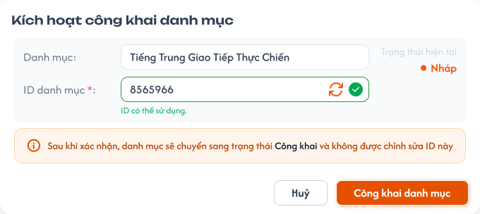
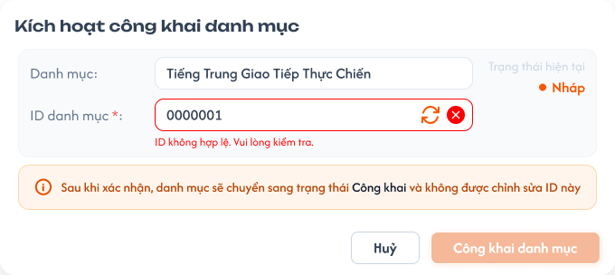

# Chi tiết danh mục (Popup)

## 1. UI

### Trang 1: CD-DM-010000 — Quản lý danh mục



**Mô tả:**
- Màn danh sách danh mục; chọn một danh mục để mở popup Chi tiết danh mục (Trang 2) với đúng danh mục được chọn. Kích hoạt công khai danh mục mở popup ở Trang 7.

**Điểm cần lưu ý:**
- Popup Chi tiết danh mục có 4 tab: `Tổng quan`, `Mindset`, `Tiêu chuẩn giáo trình`, `Hướng dẫn giảng dạy`; tab mặc định khi mở là `Tổng quan`.

### Trang 2: CD-DM-010010 — Quản lý danh mục / Popup danh mục & cấp độ



**Mô tả:**
- Tab `Tổng quan` của popup: hiển thị các khóa học thuộc danh mục hiện tại (bảng `ID`, `Tên khoá học`, `Mô tả khoá học`, `Số kỳ`, `Cấp độ`, `Trạng thái`) và ô tìm kiếm khóa học.

**Điểm cần lưu ý:**
- Ô **"Thêm khóa học mới"** ở đầu danh sách cho tạo nhanh chỉ với Tên khóa học (giống cơ chế thêm nhanh danh mục); nút `+` bị disable khi tên trống.
- Cho thêm khóa học mới bất kể danh mục đang `Nháp`, `Công Khai` hay `Vô hiệu` (khóa học là đối tượng riêng có trạng thái riêng, không phải dữ liệu chi tiết của danh mục).
- Sửa, xóa, đổi trạng thái, nhân bản khóa học tại tab này tuân theo rule của [Quản lý khoá học](../../course_management/course_management.md): chỉ khóa học `Nháp` được xóa; khóa học `Công Khai` / `Vô hiệu` chỉ sửa được Tên và Mô tả (REQ01, REQ05, REQ10, REQ11 của file đó).
- Chi tiết từng field của tab Tổng quan xem các dòng `A02.xx` ở Trang 7.

### Trang 3: CD-DM-010020 — Quản lý danh mục / Popup danh mục & cấp độ / Mindset



**Mô tả:**
- Tab `Mindset`: chọn từ dữ liệu đã define sẵn, có ô `Tìm kiếm mindset...`, các nhóm (vd `HỌC VIÊN`, `MỤC TIÊU ĐẦU RA CỦA KH...`) và các action item; cấu hình cho đúng danh mục đang mở.

**Điểm cần lưu ý:**
- Ba tab Mindset, Tiêu chuẩn giáo trình, Hướng dẫn giảng dạy dùng chung nguyên tắc: chọn package/category trước, rồi chọn action item trực thuộc.
- `A03.01` Tìm kiếm: sau khi ngừng nhập `2 giây`, lọc theo keyword khớp một phần với tên package/category hoặc tiêu đề action item.
- `A03.02` Package/category: chọn nhiều, không giới hạn số lượng; mỗi package/category tải các action item trực thuộc.
- `A03.03` Action item: chọn nhiều từ các package/category đã chọn, không giới hạn số lượng.
- Nội dung chỉ được **tham chiếu**; khi dữ liệu nguồn đổi tại feature định nghĩa, nội dung áp dụng tại danh mục phản ánh theo (package/category hoặc action item bị xóa / không còn khả dụng thì không hiển thị như còn hiệu lực).
- Quyền `Chỉ xem`: xem trước, không tick / lưu. Quyền `Cập nhật kết quả`: tick chọn và lưu / áp dụng.
- Theo trạng thái danh mục: chỉ tick chọn / lưu / áp dụng được khi danh mục `Nháp`. Danh mục `Công Khai` / `Vô hiệu`: 3 tab chỉ đọc với mọi quyền (checkbox, nút Lưu / Áp dụng disable), backend từ chối request (EX12). Xem `category_management.md` REQ08.

### Trang 4: CD-DM-010030 — Quản lý danh mục / Popup danh mục & cấp độ / Tiêu chuẩn giáo trình



**Mô tả:**
- Tab `Tiêu chuẩn giáo trình`: chọn từ dữ liệu đã define sẵn (nhóm `TIÊU CHUẨN HỌC VIÊN`, `TIÊU CHUẨN GIẢNG DẠY`, `TIÊU CHUẨN GIÁO TRÌNH`...), có nút lưu ở cuối.

**Điểm cần lưu ý:**
- Cùng cơ chế chọn, tham chiếu và quyền như tab Mindset (Trang 3).

### Trang 5: CD-DM-010040 — Quản lý danh mục / Popup danh mục & cấp độ / Hướng dẫn giảng dạy



**Mô tả:**
- Tab `Hướng dẫn giảng dạy`: chọn từ dữ liệu đã define sẵn (vd `hướng dẫn giảng dạy b1`, `b2`, `c2` và các action item như `Phương pháp giảng dạy`, `Hoạt động trên lớp`, `Lưu ý khi giảng dạy`), có nút lưu ở cuối.

**Điểm cần lưu ý:**
- Cùng cơ chế chọn, tham chiếu và quyền như tab Mindset (Trang 3).

### Trang 6: CD-DM-010057 — Quản lý danh mục / Popup danh mục & cấp độ / Quản lý danh mục / Thành công



**Mô tả:**
- Popup `Áp dụng thành công!` tóm tắt kết quả của cả 3 tab (vd `Mindset · Đã áp dụng 2/5 nội dung`, `Tiêu chuẩn giáo trình · Đã áp dụng: ...`, `Hướng dẫn giảng dạy · Đã áp dụng: ...`), nút `Đóng`.

**Điểm cần lưu ý:**
- `A03.04` Lưu / Áp dụng: lưu tham chiếu vào danh mục hiện tại, không tạo / sửa dữ liệu gốc; hệ thống kiểm tra dữ liệu vẫn còn hợp lệ trước khi lưu. Sau khi lưu thành công mới hiển thị popup này; lưu thất bại thì không hiển thị `Áp dụng thành công!` và không lưu một phần.

### Trang 7: CD-DM-010060 — Quản lý danh mục / Popup kích hoạt công khai



**Mô tả:**
- Popup `Kích hoạt công khai danh mục`: hiển thị tên danh mục, ô `ID danh mục *` kèm thông báo kiểm tra ID (vd `ID có thể sử dụng.`), `Trạng thái hiện tại` `Nháp`, nút `Huỷ` / `Công khai danh mục`.
- Các field tab Tổng quan (danh sách khóa học trong danh mục, Trang 2) được mô tả dưới đây theo registry của frame này.

**Điểm cần lưu ý:**
- `A02.01` ID: 9 chữ số `CCAALLMMM` theo [Quản lý khoá học](../../course_management/course_management.md) REQ06 — `AA` = ID danh mục hiện tại, `LL` = ID cấp độ đã chọn (chưa chọn Cấp độ thì `LL` = `00`), `MMM` do hệ thống cấp. Không nhập tay lúc thêm nhanh; khi còn `Nháp` chỉ sửa được `MMM` (trong popup Kích hoạt công khai khoá học); khóa vĩnh viễn kể từ khi rời `Nháp`.
- `A02.02` Tên khóa học: bắt buộc, không giới hạn độ dài nghiệp vụ.
- `A02.03` Mô tả khóa học: không bắt buộc.
- `A02.04` Cấp độ: chọn từ danh sách tại feature `Quản lý cấp độ`; không bắt buộc, mặc định `Không`; được giữ `Không` kể cả khi khóa học đã `Công Khai`.
- `A02.05` Số kỳ: chỉ đọc; khóa học – kỳ có quan hệ `1:n`, hệ thống tự đếm và cập nhật khi quan hệ được thêm / xóa.
- `A02.06` Trạng thái: `Nháp` (mặc định) / `Công Khai` / `Vô hiệu`, theo `course_management.md` REQ05: `Nháp → Công Khai` (qua popup Công khai khoá học), `Công Khai ↔ Vô hiệu`, không về `Nháp`.
- `A02.07` Tìm kiếm: sau khi ngừng nhập `2 giây`, lọc trong danh mục hiện tại theo keyword khớp một phần với ID, Tên hoặc Mô tả; không có kết quả hiển thị `Không có dữ liệu`.

### Trang 8: CD-DM-010062 — Quản lý danh mục / Popup kích hoạt công khai / Điền sai



**Mô tả:**
- Popup `Kích hoạt công khai danh mục` khi ID điền sai: thông báo lỗi `ID không hợp lệ. Vui lòng kiểm tra.` dưới ô ID.

**Điểm cần lưu ý:**
- ID sai định dạng hoặc trùng thì từ chối, giữ nguyên ID cũ (xem EX02).

---

## 2. Yêu cầu

### 2.1. Flow chính

**Flow 1: Thêm nhanh khóa học**

```
CD nhập Tên vào ô "Thêm khóa học mới" (Trang 2) → nhấn "+" / Enter
  → FE gọi API tạo khóa học (Mô tả = trống, Cấp độ = Không → ID = CCAA00MMM, Số kỳ = 0, Trạng thái = Nháp),
    gắn vào danh mục hiện tại và trung tâm CD đang chọn ở header
  → BE tạo record, danh mục tự cập nhật Số khóa học
  → FE thêm dòng mới vào bảng
```

**Flow 2: Sửa khóa học**

```
Khóa học đang Nháp → sửa Tên, Mô tả và/hoặc Cấp độ
  → đổi Cấp độ: LL trong ID đổi theo, hệ thống cấp lại MMM (course_management.md REQ06)
  → kiểm tra Tên không trống
        ↓ (hợp lệ)             ↓ (không hợp lệ)
     lưu thay đổi        từ chối lưu, báo lỗi tại field
Khóa học đang Công Khai / Vô hiệu → chỉ sửa được Tên, Mô tả; ID, Cấp độ và dữ liệu bên trong chỉ đọc (course_management.md REQ10)
```

**Flow 3: Đổi trạng thái khóa học**

```
Đang Nháp, chọn Công Khai (Nháp chỉ có lựa chọn này)
  → popup Kích hoạt công khai khoá học như course_management.md Flow 5 → sau khi công khai, ID bị khóa, field ID chỉ đọc
Đang Công Khai / Vô hiệu, chọn trạng thái còn lại
  → chuyển trạng thái, giữ nguyên ID; UI không hiển thị lựa chọn Nháp
```

**Flow 4: Cấu hình nội dung cho danh mục**

```
Mở 1 trong 3 tab Mindset / Tiêu chuẩn giáo trình / Hướng dẫn giảng dạy (Trang 3, 4, 5)
  → hiển thị package/category đã định nghĩa tại feature tương ứng
  → quyền Chỉ xem, hoặc danh mục Công Khai / Vô hiệu: chỉ xem, không tick / lưu được
  → danh mục Nháp + quyền Cập nhật kết quả: chọn nhiều package/category → tải action item trực thuộc → chọn nhiều action item
  → Lưu / Áp dụng → kiểm tra dữ liệu còn hợp lệ
  → Thành công: lưu tham chiếu vào đúng danh mục, không đổi dữ liệu gốc, hiển thị "Áp dụng thành công!" (Trang 6)
  → Dữ liệu nguồn đổi: nội dung tham chiếu tại danh mục phản ánh theo
```

### 2.2. Ngoại lệ

- **EX01:** Tên khóa học mới bỏ trống hoặc chỉ khoảng trắng → chặn tạo, disable nút "+", khi Enter hiện lỗi "Tên khoá học không được bỏ trống".
- **EX02:** Trong popup Kích hoạt công khai khoá học, `MMM` sai định dạng hoặc ID 9 số trùng → từ chối, hiển thị lỗi, giữ nguyên ID cũ (course_management.md EX05).
- **EX03:** Cấp độ đã chọn chuyển sang `Vô hiệu hóa` / không còn khả dụng trước khi lưu → không lưu cấp độ không hợp lệ; dữ liệu đã lưu trước đó không đổi. (Cấp độ đang được khóa học sử dụng không thể bị xóa, chỉ bị Vô hiệu hóa — `level_management.md` REQ07.)
- **EX04:** Gọi API / thao tác trực tiếp chuyển trạng thái từ `Công Khai` / `Vô hiệu` về `Nháp` → từ chối, báo lỗi, giữ nguyên trạng thái; UI không hiển thị lựa chọn `Nháp`.
- **EX05:** Cố sửa ID khi khóa học đã rời `Nháp` → từ chối, field ID chỉ đọc / disable.
- **EX06:** ID hợp lệ lúc nhập nhưng bị đối tượng khác dùng ngay trước lúc backend lưu (race condition) → backend từ chối, giữ nguyên trạng thái, báo lỗi.
- **EX07:** Tìm kiếm khóa học không có kết quả → hiển thị "Không có dữ liệu", không đổi dữ liệu.
- **EX08:** Package/category hoặc action item bị xóa / không còn khả dụng tại feature định nghĩa → nội dung tham chiếu tại danh mục phản ánh trạng thái mới, không hiển thị như còn hiệu lực.
- **EX09:** Lưu / áp dụng cấu hình thất bại → không hiển thị "Áp dụng thành công!", không lưu một phần.
- **EX10:** Người dùng không có quyền, truy cập / gửi request trực tiếp → từ chối, không đổi dữ liệu.
- **EX11:** Quyền `Chỉ xem` gửi request tick chọn / lưu trực tiếp → từ chối, giữ nguyên cấu hình danh mục.
- **EX12:** Tick chọn / lưu cấu hình khi danh mục `Công Khai` / `Vô hiệu` (UI hoặc request trực tiếp) → UI chỉ đọc; backend từ chối, trả lỗi `Danh mục không ở trạng thái Nháp, chỉ được sửa Tên và Mô tả.`, cấu hình không đổi.
- **EX13:** Sửa field ngoài Tên, Mô tả của khóa học `Công Khai` / `Vô hiệu`, hoặc xóa khóa học không ở `Nháp` tại tab Tổng quan → backend từ chối theo `course_management.md` EX09, EX11.

### 2.3. Yêu cầu khác

| Mã | Tên yêu cầu | Mô tả |
|---|---|---|
| REQ01 | ID khóa học | 9 chữ số `CCAALLMMM`, quy tắc sinh, đồng bộ và khoá theo `course_management.md` REQ06. Khi ID danh mục (đang `Nháp`) đổi, `AA` trong ID mọi khóa học `Nháp` thuộc danh mục đổi theo và hệ thống cấp lại `MMM` nếu trùng trong `CCAALL` mới (khóa học `Công Khai` / `Vô hiệu` không thể thuộc danh mục `Nháp`). |
| REQ02 | Rule chuyển trạng thái khóa học | Theo `course_management.md` REQ05: `Nháp → Công Khai` (một chiều, qua popup); `Công Khai ↔ Vô hiệu` (hai chiều); không cho `Nháp → Vô hiệu` và không cho về `Nháp`. UI chỉ hiển thị lựa chọn hợp lệ; request trực tiếp với transition không hợp lệ bị backend từ chối. |
| REQ03 | Thông tin cơ bản khóa học | Tên bắt buộc, không giới hạn độ dài. Mô tả và Cấp độ không bắt buộc (mặc định `Không`); được giữ Cấp độ `Không` kể cả khi khóa học đã `Công Khai`. Số kỳ tự tính, không nhập tay. Mỗi khóa học thuộc đúng 1 danh mục (`1:n`); được thêm mới bất kể danh mục ở trạng thái nào. |
| REQ04 | Cấu hình nội dung danh mục | Chỉ sửa được khi danh mục `Nháp`; `Công Khai` / `Vô hiệu` chỉ đọc (EX12). Tại mỗi tab Mindset / Tiêu chuẩn giáo trình / Hướng dẫn giảng dạy, chọn nhiều package/category rồi nhiều action item trực thuộc, không giới hạn số lượng. Dữ liệu nguồn chỉ được tham chiếu, không sao chép hay chỉnh sửa; thay đổi tại feature định nghĩa được phản ánh vào nội dung áp dụng. |

### 2.4. Ràng buộc

#### Quyền

| Chế độ quyền | Xem | Tick chọn | Lưu / Áp dụng |
|---|:---:|:---:|:---:|
| Cập nhật kết quả | ✅ | ✅ | ✅ |
| Chỉ xem / Chỉ bình luận | ✅ | ❌ | ❌ |
| Không có quyền | ❌ | ❌ | ❌ |

#### Ràng buộc khác

- Kiểm tra trùng ID khóa học thực hiện lại tại backend ngay lúc lưu. ID khóa học và ID danh mục kiểm tra trùng **độc lập** theo từng loại đối tượng: ID khóa học (9 số) duy nhất trong phạm vi khóa học, ID danh mục (2 số) duy nhất trong phạm vi danh mục.
- Danh sách khóa học, Số kỳ, cấu hình nội dung phải thuộc đúng danh mục / khóa học đang thao tác.
- Dữ liệu Cấp độ, Mindset, Tiêu chuẩn giáo trình, Hướng dẫn giảng dạy lấy từ feature quản lý tương ứng, không hard-code.
- Không cho truy cập / thực hiện hành động bị `❌`, kể cả gọi trực tiếp bằng URL hoặc request.

---

## 3. Testcase

### Feature: Chi tiết danh mục

| Tên testcase | Priority | Scenario | Role | Pre-condition | Given/When/Then | Expected Result |
|---|---|---|---|---|---|---|
| Case 1: Thêm nhanh khóa học | High | Flow 1 / EX01 | Curriculum Development Handler | Popup danh mục đang mở, tab Tổng quan | **Given:** CD nhập tên hợp lệ vào ô "Thêm khóa học mới"; lần khác để trống<br>**When:** nhấn "+" hoặc Enter<br>**Then:** khóa học mới được tạo hoặc bị chặn | - Tên hợp lệ: ID 9 số `CCAA00MMM` có ngay (`AA` = ID danh mục), Mô tả trống, Cấp độ = Không, Trạng thái = `Nháp`, Số khóa học của danh mục tăng<br>- Tên trống: không tạo, nút "+" disable, Enter hiện "Tên khoá học không được bỏ trống" |
| Case 2: Sửa khóa học khi đang Nháp | High | Flow 2 / REQ01 / REQ03 / EX02 / EX06 | Curriculum Development Handler | Khóa học `Nháp`; popup Kích hoạt công khai | **Given:** CD sửa Tên / Mô tả / Cấp độ; nhập `MMM` sai định dạng hoặc ID trùng (kể cả bị dùng ngay trước lúc lưu)<br>**When:** lưu / bấm `Công khai danh mục`<br>**Then:** hệ thống cập nhật hoặc từ chối | - Dữ liệu cập nhật đúng, sửa lại nhiều lần khi còn `Nháp`<br>- Chọn Cấp độ: ID = `CC` + ID danh mục + ID cấp độ + `MMM`; đổi Cấp độ thì `LL` và `MMM` đổi theo<br>- ID sai / trùng: hiển thị `ID không hợp lệ. Vui lòng kiểm tra.`, giữ ID cũ |
| Case 3: Chuyển Nháp → Công Khai | High | Flow 3 / REQ02 | Curriculum Development Handler | Khóa học `Nháp` | **Given:** CD chọn `Công Khai`<br>**When:** popup Kích hoạt công khai mở, CD xác nhận hợp lệ<br>**Then:** hệ thống chuyển trạng thái | - Trạng thái = `Công Khai`, ID bị khóa<br>- Menu khi `Nháp` không có `Vô hiệu` |
| Case 4: Khóa ID và chặn quay về Nháp | High | EX04 / EX05 / REQ02 | Curriculum Development Handler | Khóa học `Công Khai` hoặc `Vô hiệu` | **Given:** khóa học đã rời `Nháp`<br>**When:** CD thử sửa ID hoặc chọn / gọi API chuyển về `Nháp`<br>**Then:** hệ thống từ chối cả 2 thao tác | - Field ID chỉ đọc<br>- UI không hiển thị lựa chọn `Nháp`; API trực tiếp bị từ chối, trạng thái giữ nguyên |
| Case 5: Chuyển đổi Công Khai ↔ Vô hiệu | Medium | Flow 3 / REQ02 | Curriculum Development Handler | Khóa học `Công Khai` hoặc `Vô hiệu` | **Given:** CD chọn trạng thái còn lại<br>**When:** xác nhận<br>**Then:** hệ thống chuyển trạng thái | - Trạng thái đổi đúng chiều, ID giữ nguyên |
| Case 6: Áp dụng cấu hình nội dung | High | Flow 4 / REQ04 / EX09 | Curriculum Development Handler | Danh mục `Nháp`; quyền `Cập nhật kết quả`; có dữ liệu đã định nghĩa | **Given:** CD chọn nhiều package/category và action item ở 3 tab; lần khác giả lập lỗi lưu<br>**When:** lưu / áp dụng<br>**Then:** hệ thống lưu tham chiếu hoặc báo lỗi | - Dữ liệu nguồn không đổi; hiển thị `Áp dụng thành công!` tóm tắt 3 tab<br>- Lỗi: không hiện `Áp dụng thành công!`, không lưu một phần |
| Case 7: Quyền Chỉ xem không đổi được cấu hình | High | EX11 | Curriculum Development Handler | Quyền `Chỉ xem` | **Given:** mở tab cấu hình nội dung<br>**When:** cố tick chọn hoặc lưu trực tiếp<br>**Then:** hệ thống từ chối | - Không tick / lưu được<br>- Cấu hình danh mục không đổi |
| Case 8: Cấu hình chỉ đọc khi danh mục Công Khai / Vô hiệu | High | REQ04 / EX12 | Curriculum Development Handler | Danh mục `Công Khai`; quyền `Cập nhật kết quả` | **Given:** mở tab Mindset<br>**When:** thử tick chọn / lưu, hoặc gửi request trực tiếp<br>**Then:** hệ thống từ chối | - Checkbox, nút Lưu / Áp dụng disable<br>- API trả lỗi, cấu hình không đổi |
| Case 9: Khóa học Công Khai trong tab Tổng quan chỉ sửa Tên, Mô tả | High | Flow 2 / EX13 | Curriculum Development Handler | Danh mục có khóa học `Công Khai` | **Given:** CD mở khóa học tại tab Tổng quan<br>**When:** sửa Tên, Mô tả; thử sửa Cấp độ, ID, xóa khóa học<br>**Then:** chỉ Tên, Mô tả được lưu | - Cấp độ, ID chỉ đọc; Xóa mờ<br>- Vẫn thêm khóa học mới vào danh mục được |
| Case 10: Tìm kiếm, cấp độ không khả dụng, dữ liệu nguồn đổi | Medium | EX03 / EX07 / EX08 | Curriculum Development Handler | Cấp độ vừa bị `Vô hiệu hóa`; package/category hoặc action item đã bị xóa ở feature nguồn | **Given:** tìm khóa học không khớp (ngừng nhập 2 giây); chọn cấp độ đã vô hiệu rồi lưu; mở lại tab cấu hình<br>**When:** hệ thống xử lý<br>**Then:** hiển thị tương ứng | - Tìm không kết quả: "Không có dữ liệu", dữ liệu không đổi<br>- Không lưu cấp độ không hợp lệ, dữ liệu đã lưu trước đó không đổi<br>- Nội dung tham chiếu phản ánh trạng thái mới, không hiển thị như còn hiệu lực |
| Case 11: Kiểm tra quyền truy cập trực tiếp | High | EX10 | Các role khác | Không có quyền quản lý danh mục | **Given:** user không có quyền<br>**When:** mở URL / gửi request trực tiếp đến popup hoặc API cấu hình<br>**Then:** hệ thống từ chối | - Không xem / đổi được dữ liệu |
