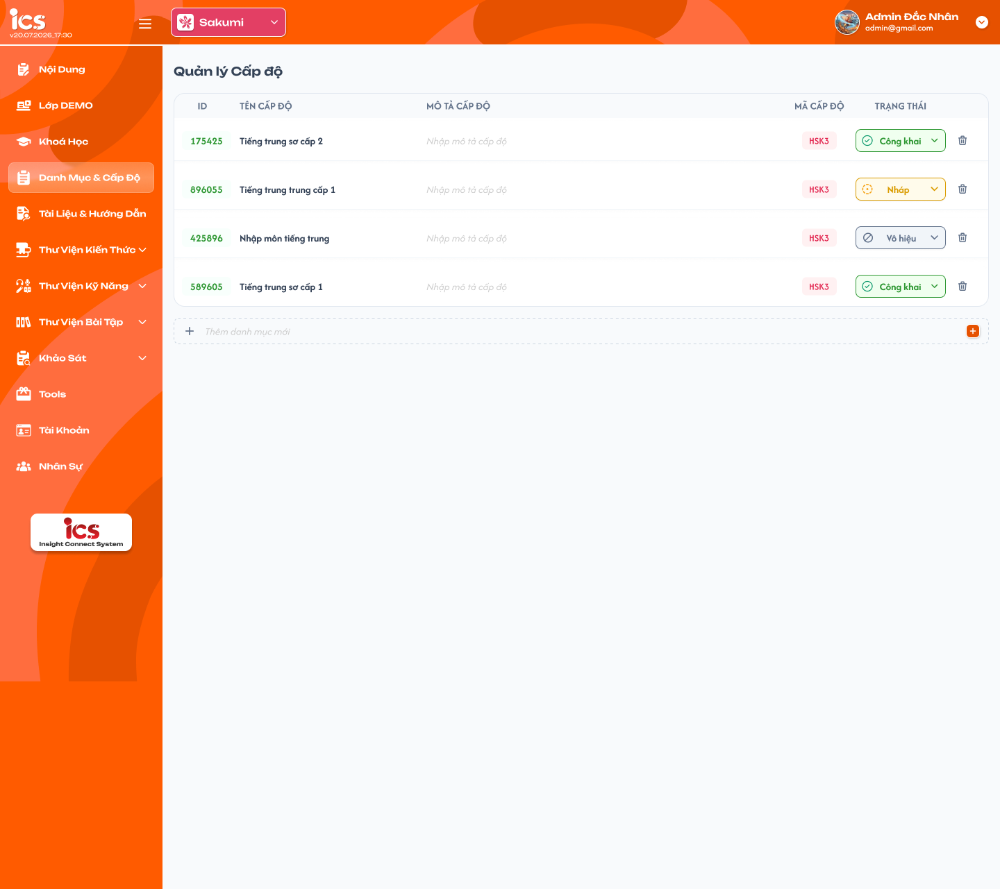
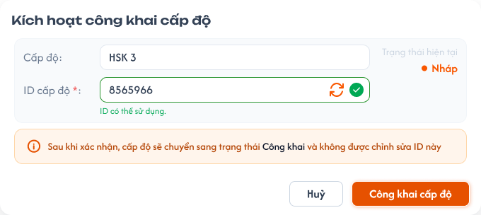
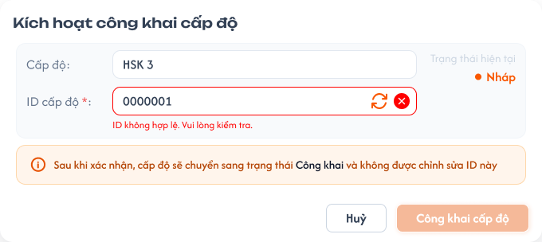

# Quản lý danh sách cấp độ

## 1. UI

### Trang 1: CD-CDO-010000 — Quản lý cấp độ



**Mô tả:**
- `Curriculum Development Handler` có toàn quyền xem và quản lý cấp độ.
- Cấp độ là dữ liệu định nghĩa dùng lại tại feature `Quản lý danh mục`, cụ thể khi chọn cấp độ cho khóa học thuộc danh mục; một cấp độ có thể được nhiều khóa học tham chiếu.

**Điểm cần lưu ý:**
- **Chỉ cấp độ `Nháp` được xóa**; cấp độ `Công Khai` / `Vô hiệu hóa` không được xóa, muốn ngừng dùng thì chuyển / giữ `Vô hiệu hóa` (xem REQ07, Flow 5).
- **Quyền sửa theo trạng thái** (REQ08): `Nháp` sửa được Tên, Mô tả, Mã cấp độ, ID. `Công Khai` / `Vô hiệu hóa` **chỉ sửa được Tên và Mô tả**; ID, Mã cấp độ chỉ đọc.
- Chỉ cấp độ ở trạng thái `Công Khai` được hiển thị để chọn mới tại feature `Quản lý danh mục`.
- Tìm kiếm kích hoạt sau khi nhấn Enter, khớp một phần theo `ID`, `Tên cấp độ`, `Mã cấp độ` hoặc `Mô tả cấp độ`; không phân biệt chữ hoa / thường.
- Thanh "Thêm cấp độ mới" chỉ có **1 input** `Tên cấp độ` (giống danh mục); nhấn nút `+` / phím `Enter` để tạo. `Mô tả cấp độ` và `Mã cấp độ` để trống lúc tạo nhanh, có placeholder, bổ sung sau inline hoặc ngay tại popup Kích hoạt công khai (đối với Mã cấp độ). `ID` tự sinh 2 chữ số, duy nhất; `Trạng thái` mặc định `Nháp`.
- `A01.01` `ID`: bắt buộc ngay khi tạo mới. 2 chữ số (`01`–`99`, xem REQ01), duy nhất toàn hệ thống (tính cả cấp độ đã xóa mềm), tự động sinh. Sửa tự do khi còn `Nháp`; khóa vĩnh viễn kể từ khi rời `Nháp`.
- `A01.02` `Tên cấp độ`: bắt buộc, không giới hạn độ dài; được phép trùng với cấp độ khác; tự cắt khoảng trắng đầu / cuối trước khi lưu. Sửa được ở mọi trạng thái.
- `A01.03` `Mô tả cấp độ`: không bắt buộc, không giới hạn độ dài. Sửa được ở mọi trạng thái.
- `A01.04` `Mã cấp độ`: không bắt buộc lúc tạo mới, mặc định rỗng; bắt buộc phải có giá trị trước khi cấp độ được chuyển sang `Công Khai`. Được phép trùng với cấp độ khác (không phải định danh như ID, hệ thống không kiểm tra trùng); tự cắt khoảng trắng đầu / cuối; không ràng buộc định dạng; lưu và hiển thị đúng chữ hoa / thường như CD nhập. Chỉ sửa được khi cấp độ đang `Nháp`; bị khóa kể từ khi `Công Khai`. Là mã tham chiếu hiển thị mà feature `Quản lý danh mục` dùng khi chọn cấp độ cho khóa học, ví dụ `HSK1`, `HSK2`.
- `A01.05` `Trạng thái`: 3 trạng thái `Nháp` (mặc định) / `Công Khai` / `Vô hiệu hóa`, theo rule chuyển trạng thái ở REQ02. Menu đổi trạng thái: đang `Nháp` chỉ hiện `Công Khai`; đang `Công Khai` chỉ hiện `Vô hiệu hóa`; đang `Vô hiệu hóa` chỉ hiện `Công Khai`.
- Mỗi dòng cấp độ có thao tác `Xóa`, **chỉ bấm được khi cấp độ đang `Nháp`**; cấp độ `Công Khai` / `Vô hiệu hóa`: `Xóa` hiện mờ, hover hiện tooltip `Chỉ xóa được cấp độ ở trạng thái Nháp. Chuyển Vô hiệu hóa nếu muốn ngừng dùng.`
- **Đang được sử dụng:** có ít nhất 1 khóa học chưa bị xóa mềm (ở bất kỳ trạng thái nào) đang tham chiếu cấp độ này; khóa học đã bị xóa mềm không tính. Cấp độ `Nháp` thông thường không thể đang được sử dụng vì chỉ cấp độ `Công Khai` mới được gắn vào khóa học (cùng rule với danh mục), nhưng backend vẫn kiểm tra.
- `A03.01` Popup xác nhận xóa: tiêu đề `Xóa cấp độ`; nội dung `Bạn có chắc chắn muốn xóa cấp độ "<Tên cấp độ>"?`; nút `Hủy`, `Xóa`. Sau khi CD xác nhận, backend kiểm tra lại trạng thái và cấp độ có đang được sử dụng hay không rồi mới xóa (xóa mềm).
- `A03.02` Toast lỗi không được xóa: khi backend từ chối, đóng popup xác nhận, hiển thị Toast `Có Lỗi Xảy Ra` với nội dung backend trả về: `Chỉ xóa được cấp độ ở trạng thái Nháp.` (gọi API trực tiếp với cấp độ `Công Khai` / `Vô hiệu hóa`) hoặc `Cấp độ đang được sử dụng, không thể xóa.`; cấp độ giữ nguyên. FE chỉ disable `Xóa` theo trạng thái, không có lựa chọn "xóa bắt buộc".

### Trang 2: CD-CDO-010010 — Quản lý cấp độ / Popup kích hoạt công khai



**Mô tả:**
- Popup `Kích hoạt công khai cấp độ`, giống Kích hoạt công khai danh mục (xem `category_management.md`). Chỉ mở khi CD chuyển một cấp độ đang `Nháp` sang `Công Khai`; chiều `Vô hiệu hóa → Công Khai` chuyển ngay, không mở popup vì ID và Mã cấp độ đã được set và khóa ở lần công khai đầu tiên (Flow 4).
- Cho phép xác nhận / chỉnh sửa lần cuối `ID` trước khi khóa vĩnh viễn, **và** bắt buộc phải có `Mã cấp độ` trước khi xác nhận (điều kiện để hiển thị chọn tại `Quản lý danh mục`).

**Điểm cần lưu ý:**
- `A04.01` `Cấp độ`: hiển thị chỉ đọc đúng Tên cấp độ đang thao tác.
- `A04.02` `Trạng thái hiện tại`: badge trạng thái hiện tại (`Nháp`) trước khi chuyển.
- `A04.03` `ID cấp độ`: hiển thị ID hiện tại (2 chữ số) đã có từ lúc tạo.
- `A04.04` Ô nhập ID: hiển thị sẵn ID hiện tại và cho sửa trực tiếp lần cuối trước khi khóa; gõ vào ô kích hoạt kiểm tra lại (định dạng 2 chữ số + duy nhất toàn hệ thống). Mỗi lần giá trị thay đổi, kết quả kiểm tra cũ bị hủy hiệu lực; chỉ giá trị mới nhất được dùng để bật nút `Công khai cấp độ`.
- `A04.05` Nút làm mới ID (biểu tượng xoay): sinh một ID 2 chữ số mới chưa được sử dụng, điền vào ô nhập; hệ thống kiểm tra lại ID mới.
- `A04.06` `Mã cấp độ`: đã có giá trị thì hiển thị chỉ đọc, không sửa trong popup; đang rỗng thì hiển thị ô nhập **bắt buộc**, kiểm tra không để trống sau khi cắt khoảng trắng đầu / cuối (không kiểm tra trùng). Sau khi công khai, Mã cấp độ bị khóa. CD có thể giữ nguyên ID có sẵn và chỉ bổ sung Mã cấp độ (nếu trống) rồi bấm `Công khai cấp độ`.
- `A04.09` Ghi chú cảnh báo cố định: `Sau khi xác nhận, cấp độ sẽ chuyển sang trạng thái Công khai, chỉ còn sửa được Tên và Mô tả. ID và Mã cấp độ sẽ bị khóa`.
- `A04.10` Nút `Công khai cấp độ`: chỉ bật khi ID hợp lệ, chưa trùng **và** Mã cấp độ có giá trị. Khi bấm, backend kiểm tra lại lần cuối rồi lưu ID, lưu Mã cấp độ (nếu vừa nhập) và chuyển trạng thái sang `Công Khai` trong cùng một giao dịch (nguyên tử). Trong lúc đang kiểm tra hoặc xử lý, nút bị vô hiệu hóa để tránh gửi lặp.
- `A04.11` Nút `Hủy` / biểu tượng `X`: đóng popup, không lưu thay đổi ID / Mã cấp độ vừa nhập, không đổi trạng thái.
- Nếu backend từ chối ở bước kiểm tra cuối (ID vừa bị dùng, Mã cấp độ trống, dữ liệu không còn hợp lệ), cấp độ giữ `Nháp`, popup giữ mở và hiển thị lỗi tương ứng. Sau khi xác nhận thành công: ID trở thành ID chính thức, vĩnh viễn không sửa; Mã cấp độ cũng bị khóa.

### Trang 3: CD-CDO-010012 — Quản lý cấp độ / Popup kích hoạt công khai / Điền sai



**Mô tả:**
- Trạng thái popup khi ID nhập vào không hợp lệ (vd `0000001`), nút `Công khai cấp độ` bị tắt.

**Điểm cần lưu ý:**
- `A04.07` Biểu tượng kết quả kiểm tra: ID (dạng nhập) tick xanh khi đúng định dạng và chưa trùng, x đỏ khi sai định dạng hoặc bị trùng; Mã cấp độ (dạng nhập) tick xanh khi có giá trị, x đỏ khi để trống.
- `A04.08` Thông báo trạng thái: ID `ID có thể sử dụng` / `ID đang bị trùng` / `ID sai định dạng`; Mã cấp độ (khi đang trống) `Mã cấp độ có thể sử dụng` / `Mã cấp độ không được để trống`.

---

## 2. Yêu cầu

### 2.1. Flow chính

**Flow 1: Thêm nhanh cấp độ**

```
CD nhập Tên cấp độ vào ô "Thêm cấp độ mới" → Nhấn nút "+" / Nhấn Enter
  → Hệ thống cắt khoảng trắng đầu/cuối của Tên (Tên được phép trùng với cấp độ khác)
  → FE gọi API tạo cấp độ (ID tự sinh 2 chữ số duy nhất, Mô tả = trống, Mã cấp độ = trống, Trạng thái = Nháp) → BE tạo record
  → FE thêm dòng mới vào bảng
```

**Flow 2: Sửa cấp độ**

```
CD mở một cấp độ
  → Sửa Tên cấp độ, Mô tả cấp độ (sửa được ở mọi trạng thái)
  → Sửa Mã cấp độ: chỉ khi cấp độ đang Nháp; từ khi Công Khai thì Mã cấp độ chỉ đọc
  → Nếu cấp độ đang Nháp: có thể sửa thêm ID (nhập tay 1 mã 2 chữ số khác)
  → Hệ thống cắt khoảng trắng đầu/cuối của Tên, kiểm tra Tên không để trống (Tên được phép trùng); Mã cấp độ được cắt khoảng trắng đầu/cuối, được phép trùng, không ràng buộc định dạng; nếu có sửa ID thì kiểm tra đúng 2 chữ số và chưa trùng (kể cả với cấp độ đã xóa mềm)
    → Hợp lệ: lưu thay đổi; nơi đang tham chiếu cấp độ hiển thị dữ liệu mới
    → Không hợp lệ: từ chối lưu, báo lỗi tại field tương ứng, giữ nguyên dữ liệu cũ
```

**Flow 3: Kích hoạt công khai cấp độ**

```
CD đang ở Nháp, chọn chuyển sang Công Khai (menu khi Nháp chỉ có lựa chọn này)
  → Hệ thống mở popup Kích hoạt công khai cấp độ (Trang 2)
  → Popup hiển thị Tên cấp độ, ID hiện tại (2 chữ số), trạng thái hiện tại (Nháp)
  → Mã cấp độ:
      → Đã có giá trị: hiển thị chỉ đọc
      → Đang trống: hiển thị ô nhập bắt buộc, kiểm tra không trống mỗi khi giá trị thay đổi (không kiểm tra trùng)
  → ID: CD giữ nguyên ID có sẵn, sửa tay, hoặc bấm làm mới để sinh ID mới — mỗi thay đổi đều được kiểm tra lại định dạng + trùng
  → Cả ID và Mã cấp độ hợp lệ: bật nút Công khai cấp độ
  → ID sai định dạng/trùng hoặc Mã cấp độ trống: hiển thị lỗi tương ứng, giữ nút Công khai cấp độ tắt (Trang 3)
  → CD bấm Công khai cấp độ
  → Backend kiểm tra lại lần cuối: ID hợp lệ và chưa trùng, Mã cấp độ có giá trị, Tên còn hợp lệ
      → Hợp lệ: lưu ID, lưu Mã cấp độ (nếu vừa nhập) và chuyển cấp độ sang Công Khai trong cùng một giao dịch; ID và Mã cấp độ bị khóa từ đây
      → Không hợp lệ: không lưu, giữ nguyên trạng thái Nháp, giữ popup mở và hiển thị lỗi
  → CD bấm Hủy hoặc đóng popup: không lưu thay đổi ID/Mã cấp độ vừa nhập, không đổi trạng thái cấp độ
```

**Flow 4: Đổi trạng thái Công Khai ↔ Vô hiệu hóa**

```
Công Khai → Vô hiệu hóa: CD chọn Vô hiệu hóa → không cần popup
Vô hiệu hóa → Công Khai: CD chọn Công Khai → chuyển ngay, không cần popup (ID và Mã cấp độ đã được set và khóa từ lần Nháp → Công Khai)
  → BE kiểm tra transition hợp lệ rồi chuyển trạng thái
  → Hệ thống chuyển trạng thái, giữ nguyên ID và Mã cấp độ đã có
  → Cấp độ Công Khai: được hiển thị trong danh sách lựa chọn cấp độ tại feature Quản lý danh mục
  → Cấp độ Vô hiệu hóa: không được hiển thị để chọn mới; liên kết đã lưu trước đó vẫn được giữ nguyên
  → CD không được chọn Nháp; UI không hiển thị lựa chọn này trong menu đổi trạng thái (Công Khai chỉ hiện Vô hiệu hóa, Vô hiệu hóa chỉ hiện Công Khai)
```

**Flow 5: Xóa cấp độ**

```
CD chọn Xóa cấp độ (chỉ bấm được khi cấp độ Nháp; Công Khai / Vô hiệu hóa: nút mờ + tooltip) → Hệ thống hiển thị popup xác nhận xóa
  → CD bấm Hủy: đóng popup, không xóa, giữ nguyên dữ liệu
  → CD bấm Xóa → FE gọi API xóa → Backend kiểm tra cấp độ đang Nháp và có đang được khóa học nào (chưa bị xóa mềm) tham chiếu không
      → Đang Nháp và chưa được sử dụng: xóa mềm cấp độ; FE đóng popup, loại dòng khỏi bảng, hiển thị Toast Thành Công; cấp độ không còn trong danh sách lựa chọn ở feature khác
      → Không ở Nháp (gọi API trực tiếp) hoặc đang được sử dụng: backend từ chối, trả lỗi (EX11); FE đóng popup, hiển thị Toast lỗi với nội dung backend trả về; dữ liệu và liên kết không đổi
```

### 2.2. Ngoại lệ

- **EX01:** Tên cấp độ mới bị bỏ trống hoặc chỉ chứa khoảng trắng → chặn tạo mới, dữ liệu không thay đổi, disable nút "+". Nếu Enter thì hiện thông báo "Tên cấp độ không được bỏ trống".
- **EX02:** Cố sửa Mã cấp độ khi cấp độ đã rời `Nháp` (`Công Khai` / `Vô hiệu hóa`, qua UI hoặc gọi API trực tiếp) → hệ thống từ chối, field Mã cấp độ chỉ đọc, giữ nguyên giá trị. Mã cấp độ trùng với cấp độ khác **không** phải lỗi.
- **EX03:** Khi sửa lúc `Nháp`, ID sai định dạng (không đúng 2 chữ số) hoặc trùng (kể cả trùng ID của cấp độ đã xóa mềm) → hệ thống từ chối lưu, hiển thị lỗi tương ứng, giữ nguyên ID cũ.
- **EX04:** Gọi API hoặc thao tác trực tiếp đổi trạng thái không hợp lệ (từ `Công Khai`/`Vô hiệu hóa` về `Nháp`, hoặc từ `Nháp` sang thẳng `Vô hiệu hóa`) → hệ thống từ chối, hiển thị thông báo lỗi (ví dụ: `"Không thể chuyển sang trạng thái này."`), giữ nguyên trạng thái hiện tại. UI chỉ hiển thị lựa chọn hợp lệ.
- **EX05:** Cố sửa ID khi cấp độ có trạng thái khác `Nháp` → hệ thống từ chối, field ID ở trạng thái chỉ đọc/disable.
- **EX06:** ID hợp lệ tại thời điểm nhập nhưng bị đối tượng khác dùng ngay trước lúc backend lưu (race condition) → backend từ chối tại bước kiểm tra cuối, không lưu, giữ nguyên trạng thái và hiển thị lỗi.
- **EX07:** Trong popup Kích hoạt công khai cấp độ, ID sai định dạng/trùng, hoặc Mã cấp độ (khi đang trống) để trống → hiển thị lỗi tương ứng ngay trong popup, vô hiệu hóa nút `Công khai cấp độ`, giữ cấp độ ở trạng thái hiện tại.
- **EX08:** CD bấm `Hủy` hoặc đóng popup Kích hoạt công khai cấp độ sau khi đã sửa ID hoặc nhập Mã cấp độ → không lưu các thay đổi đó, ID và Mã cấp độ giữ nguyên như trước khi mở popup, trạng thái vẫn là `Nháp`.
- **EX09:** Cấp độ không còn ở trạng thái `Công Khai` (bao gồm cả trường hợp đã bị xóa) tại thời điểm feature `Quản lý danh mục` lưu lựa chọn mới → từ chối liên kết mới và yêu cầu tải lại danh sách cấp độ.
- **EX10:** Người dùng không có quyền nhưng mở URL hoặc gửi request trực tiếp (kể cả thao tác xóa) → từ chối thao tác và không thay đổi dữ liệu.
- **EX11:** Xóa cấp độ `Công Khai` / `Vô hiệu hóa` (gọi API trực tiếp) → backend từ chối, trả lỗi `Chỉ xóa được cấp độ ở trạng thái Nháp.`. Xóa cấp độ `Nháp` đang được khóa học tham chiếu (tham chiếu phát sinh ngay trước lúc backend xóa) → backend từ chối, trả lỗi `Cấp độ đang được sử dụng, không thể xóa.`. FE hiển thị Toast lỗi với nội dung backend trả về, dữ liệu không đổi.
- **EX12:** Sửa Tên cấp độ thành trống hoặc chỉ chứa khoảng trắng (ở bất kỳ trạng thái nào) → từ chối lưu, báo lỗi tại field Tên, giữ nguyên Tên cũ.

### 2.3. Yêu cầu khác

| Mã | Tên yêu cầu | Mô tả |
|---|---|---|
| REQ01 | ID cấp độ | Tự động sinh khi tạo mới: đúng 2 chữ số trong dải `01`–`99` (giữ số 0 đứng đầu, ví dụ `05`; không cấp `00` vì `00` trong ID khoá học nghĩa là chưa chọn), duy nhất toàn hệ thống, tính cả cấp độ đã xóa mềm; hệ thống lấy mã nhỏ nhất chưa dùng. Hết mã trong dải thì từ chối tạo mới và báo lỗi `Đã hết ID cấp độ khả dụng (01–99).`. ID cấp độ là đoạn `LL` trong ID khoá học `CCAALLMMM` (xem `course_management.md` REQ06); vì chỉ cấp độ `Công Khai` mới được gán cho khoá học nên đoạn `LL` luôn là ID đã khoá, người dùng không nhập tay lúc thêm nhanh. Có thể chỉnh sửa thủ công trong lúc `Nháp`, kể cả ngay trong popup Kích hoạt công khai cấp độ trước khi xác nhận; bị khóa vĩnh viễn kể từ khi rời khỏi `Nháp`. |
| REQ02 | Rule chuyển trạng thái | `Nháp → Công Khai` (một chiều, bắt buộc qua popup Kích hoạt công khai); `Công Khai ↔ Vô hiệu hóa` (hai chiều); không cho chuyển `Nháp → Vô hiệu hóa` trực tiếp và không cho chuyển về `Nháp` từ hai trạng thái còn lại. UI chỉ hiển thị lựa chọn hợp lệ; request gọi trực tiếp với transition không hợp lệ thì backend từ chối và trả thông báo lỗi (EX04). Chỉ cấp độ `Công Khai` được dùng cho lựa chọn mới; thay đổi trạng thái không tự động xóa liên kết đã tồn tại. |
| REQ03 | Thông tin cơ bản | Tên cấp độ bắt buộc, không giới hạn độ dài, được phép trùng với cấp độ khác; hệ thống tự cắt khoảng trắng đầu/cuối trước khi lưu. Tên và Mô tả sửa được ở mọi trạng thái. Mô tả không bắt buộc, có thể để trống lúc tạo và bổ sung sau. |
| REQ04 | Mã cấp độ | Không bắt buộc lúc tạo (mặc định rỗng), nhưng bắt buộc phải có giá trị trước khi cấp độ được chuyển sang `Công Khai`; việc bổ sung có thể thực hiện ở màn chi tiết hoặc ngay trong popup Kích hoạt công khai. Được phép trùng với cấp độ khác (không kiểm tra trùng), không ràng buộc định dạng, phân biệt chữ hoa/thường, tự cắt khoảng trắng đầu/cuối trước khi lưu. Chỉ sửa được khi cấp độ đang `Nháp`; bị khóa, không được sửa kể từ khi cấp độ được `Công Khai`. |
| REQ05 | Popup Kích hoạt công khai cấp độ | Chỉ khi chuyển từ `Nháp` sang `Công Khai`, hệ thống bắt buộc mở popup xác nhận, cho phép CD giữ nguyên/chỉnh sửa lần cuối ID và bổ sung Mã cấp độ nếu còn trống, trước khi khóa. Nút xác nhận chỉ bật khi ID hợp lệ, chưa trùng và Mã cấp độ không để trống; backend luôn kiểm tra lại ngay trước khi lưu và chuyển trạng thái trong cùng một giao dịch. Chiều `Vô hiệu hóa → Công Khai` chuyển ngay, không mở popup. |
| REQ06 | Cung cấp dữ liệu cho feature khác | Feature `Quản lý danh mục` phải lưu tham chiếu ổn định đến bản ghi cấp độ (qua ID), không chỉ lưu tên hoặc mã hiển thị. Danh sách lựa chọn cấp độ chỉ gồm các bản ghi `Công Khai` và chưa bị xóa, lấy từ dữ liệu cấp độ đã định nghĩa, không hard-code. |
| REQ07 | Xóa cấp độ | **Chỉ cấp độ `Nháp` được xóa** (xóa mềm), và chỉ khi **chưa được** bất kỳ khóa học nào (chưa bị xóa mềm) tham chiếu. Cấp độ `Công Khai` / `Vô hiệu hóa` không được xóa, chỉ được chuyển / giữ `Vô hiệu hóa` để ngừng chọn mới; liên kết đã lưu ở khóa học giữ nguyên. Nút `Xóa` mờ + tooltip khi không ở `Nháp`; backend luôn kiểm tra lại trạng thái và tham chiếu ngay tại thời điểm xóa, FE hiển thị Toast lỗi do backend trả về (EX11). Quy tắc chung với Khoá học, Học kỳ, Danh mục: chỉ `Nháp` được xóa. Sau khi xóa, cấp độ không còn hiển thị trong danh sách quản lý và không thể chọn mới ở bất kỳ đâu. |
| REQ08 | Quyền sửa theo trạng thái | `Nháp`: sửa Tên, Mô tả, Mã cấp độ, ID. `Công Khai` / `Vô hiệu hóa`: **chỉ sửa Tên và Mô tả**; ID, Mã cấp độ chỉ đọc, backend từ chối request sửa (EX02, EX05). Cấp độ không thể quay về `Nháp`. Quy tắc chung với Khoá học, Học kỳ, Danh mục (xem `course_management.md` REQ10). |

### 2.4. Ràng buộc

#### Quyền

| Role | Xem | Thêm | Sửa (theo REQ08) / đổi trạng thái | Xóa (chỉ `Nháp`, chưa được sử dụng) |
|---|:---:|:---:|:---:|:---:|
| Curriculum Development Handler | ✅ | ✅ | ✅ | ✅ |
| Các role khác | ❌ | ❌ | ❌ | ❌ |

#### Ràng buộc khác

- Kiểm tra trùng ID phải thực hiện lại tại backend ngay thời điểm lưu, không chỉ dựa vào kết quả kiểm tra trước đó trên UI.
- `Curriculum Development Handler` có toàn quyền trên toàn bộ dữ liệu cấp độ.
- Không cho phép truy cập hoặc thực hiện hành động bị đánh dấu `❌`, kể cả khi gọi trực tiếp bằng URL hoặc request.
- Việc lưu ID/Mã cấp độ (khi giữ nguyên hoặc chỉnh sửa trong popup) và chuyển trạng thái sang `Công Khai` phải nguyên tử; không được có trường hợp trạng thái đã đổi nhưng ID/Mã cấp độ chưa được lưu hợp lệ hoặc ngược lại.
- Không được xóa cấp độ không ở `Nháp` hoặc đang được khóa học tham chiếu; việc kiểm tra tham chiếu và xóa mềm phải thực hiện tại backend trong cùng một giao dịch, không dựa vào kết quả kiểm tra trên UI.

---

## 3. Testcase

### Feature: Quản lý danh sách cấp độ

| Tên testcase | Priority | Scenario | Role | Pre-condition | Given/When/Then | Expected Result |
|---|---|---|---|---|---|---|
| Case 1: Thêm nhanh cấp độ, chặn Tên trống, hết ID | High | Flow 1 / EX01 / REQ01 | Curriculum Development Handler | Trang danh sách cấp độ; một lần dải ID `01`–`99` đã hết | **Given:** CD ở trang danh sách<br>**When:** nhập Tên hợp lệ rồi nhấn `+` hoặc Enter; để trống ô rồi nhấn `+`/Enter; tạo khi đã hết ID<br>**Then:** tạo cấp độ khi hợp lệ, chặn khi trống, từ chối khi hết ID | - Cấp độ mới xuất hiện trong bảng, ID tự sinh 2 chữ số nhỏ nhất chưa dùng, Mô tả và Mã trống, Trạng thái `Nháp`<br>- Tên trống: không tạo, nút `+` disable, Enter báo `Tên cấp độ không được bỏ trống`<br>- Hết ID: báo `Đã hết ID cấp độ khả dụng (01–99).` |
| Case 2: Sửa Tên/Mô tả ở mọi trạng thái | High | Flow 2 / EX12 / REQ03 | Curriculum Development Handler | Cấp độ đã tồn tại ở `Nháp`, `Công Khai`, `Vô hiệu hóa` | **Given:** CD mở cấp độ<br>**When:** sửa Tên (kể cả trùng tên cấp độ khác, có khoảng trắng đầu/cuối) và/hoặc Mô tả; xóa hết Tên rồi lưu<br>**Then:** hệ thống lưu hoặc từ chối tương ứng | - Lưu thành công, Tên đã cắt khoảng trắng, nơi đang tham chiếu hiển thị dữ liệu mới<br>- `Công Khai` / `Vô hiệu hóa`: ID, Mã cấp độ chỉ đọc<br>- Tên trống: báo lỗi tại field Tên, giữ Tên cũ |
| Case 3: Mã cấp độ — được trùng, tự cắt khoảng trắng, khóa sau Công Khai | High | Flow 2 / EX02 / REQ04 | Curriculum Development Handler | Đã có cấp độ khác Mã `HSK1`; cấp độ đang `Nháp` | **Given:** CD mở cấp độ<br>**When:** nhập Mã `  HSK1  ` rồi lưu; công khai cấp độ; thử sửa Mã (qua UI và API)<br>**Then:** hệ thống xử lý tương ứng | - Lưu Mã `HSK1`, không báo trùng, giữ đúng chữ hoa/thường<br>- Mã chỉ có khoảng trắng: báo `Mã cấp độ không được để trống`<br>- Sau `Công Khai`: field Mã chỉ đọc, API sửa Mã bị từ chối |
| Case 4: Sửa ID khi Nháp và khóa sau khi rời Nháp | High | Flow 2 / EX03 / EX05 / REQ01 / REQ08 | Curriculum Development Handler | Cấp độ đang `Nháp`; có cấp độ đã xóa mềm ID `22`; cấp độ khác đang `Công Khai` | **Given:** CD sửa ID khi `Nháp`: hợp lệ, sai định dạng, trùng, ID `22`; sau đó thử sửa ID cấp độ `Công Khai`<br>**When:** lưu<br>**Then:** hợp lệ thì lưu, không hợp lệ thì từ chối | - Hợp lệ: cập nhật, sửa lại nhiều lần được khi còn `Nháp`<br>- Sai định dạng/trùng (kể cả `22`): báo lỗi (`ID đang bị trùng`), giữ ID cũ<br>- `Công Khai`/`Vô hiệu hóa`: field ID chỉ đọc/disable, API bị từ chối |
| Case 5: Popup Kích hoạt công khai — yêu cầu Mã cấp độ và ID hợp lệ | High | Flow 3 / EX07 / REQ05 | Curriculum Development Handler | Cấp độ `Nháp`, Mã cấp độ trống | **Given:** CD mở popup, nhập ID sai/trùng, làm mới ID, nhập Mã cấp độ (kể cả trùng cấp độ khác) hoặc để trống<br>**When:** quan sát nút `Công khai cấp độ`<br>**Then:** nút bật/tắt tương ứng | - Mã trống: `Mã cấp độ không được để trống`, nút tắt, giữ `Nháp`<br>- ID sai/trùng: x đỏ, lỗi trong popup, nút tắt<br>- Mỗi lần đổi giá trị chỉ kết quả kiểm tra mới nhất có hiệu lực<br>- Hợp lệ: bấm → lưu Mã + ID, chuyển `Công Khai`, ID và Mã bị khóa |
| Case 6: Công khai khi ID/Mã đã sẵn hợp lệ và race condition | High | Flow 3 / EX06 / REQ05 | Curriculum Development Handler | Popup đang mở, ID và Mã đã hợp lệ; một đối tượng khác dùng ID đó ngay trước lúc lưu | **Given:** CD không sửa gì<br>**When:** bấm `Công khai cấp độ` (kể cả bấm lặp)<br>**Then:** backend kiểm tra lại lần cuối rồi chuyển trạng thái | - Thành công: `Công Khai`, ID giữ nguyên và khóa, lưu nguyên tử<br>- Race condition: từ chối, giữ `Nháp`, popup mở và hiển thị lỗi<br>- Nút bị vô hiệu hóa trong lúc xử lý |
| Case 7: Hủy popup Kích hoạt công khai | High | EX08 | Curriculum Development Handler | Popup đang mở, CD đã sửa ID và/hoặc nhập Mã | **Given:** CD đã thay đổi ID/Mã trong popup<br>**When:** bấm `Hủy` hoặc `X`<br>**Then:** hệ thống không lưu thay đổi | - ID và Mã giữ nguyên như trước khi mở popup<br>- Trạng thái vẫn `Nháp` |
| Case 8: Rule chuyển trạng thái | High | Flow 4 / EX04 / REQ02 | Curriculum Development Handler | Có cấp độ ở cả 3 trạng thái | **Given:** CD mở menu đổi trạng thái; gọi API chuyển `Nháp → Vô hiệu hóa` hoặc về `Nháp`<br>**When:** thao tác được gửi<br>**Then:** hệ thống xử lý tương ứng | - Menu: `Nháp` chỉ `Công Khai`; `Công Khai` chỉ `Vô hiệu hóa`; `Vô hiệu hóa` chỉ `Công Khai`<br>- `Công Khai ↔ Vô hiệu hóa` chuyển ngay, không mở popup, ID và Mã giữ nguyên<br>- API không hợp lệ bị từ chối, trạng thái không đổi |
| Case 9: Lựa chọn cấp độ ở Quản lý danh mục | High | EX09 / REQ06 | Curriculum Development Handler | Có cấp độ `Nháp`, `Công Khai`, `Vô hiệu hóa`; cấp độ vừa bị đổi trạng thái/xóa khi đang lưu lựa chọn | **Given:** mở field chọn cấp độ tại `Quản lý danh mục`; lưu lựa chọn với cấp độ không còn `Công Khai`<br>**When:** hệ thống tải lựa chọn / lưu<br>**Then:** chỉ trả cấp độ `Công Khai` chưa xóa; liên kết mới bị từ chối | - Không hiện `Nháp`/`Vô hiệu hóa` để chọn mới<br>- Liên kết đã lưu trước đó giữ nguyên<br>- Yêu cầu tải lại danh sách cấp độ |
| Case 10: Xóa cấp độ Nháp thành công | High | Flow 5 / REQ07 | Curriculum Development Handler | Cấp độ `Nháp` không có khóa học tham chiếu (hoặc chỉ được khóa học đã xóa mềm tham chiếu) | **Given:** CD chọn `Xóa` cấp độ<br>**When:** popup xác nhận hiện, bấm `Hủy` hoặc `Xóa`<br>**Then:** hệ thống xử lý tương ứng | - Hủy: không xóa, dữ liệu giữ nguyên<br>- Xóa: xóa mềm, đóng popup, loại dòng khỏi bảng, Toast Thành Công<br>- Không còn trong danh sách lựa chọn ở feature khác; khóa học đã xóa mềm không tính là đang sử dụng |
| Case 11: Chặn xóa Công Khai/Vô hiệu hóa và cấp độ đang sử dụng | High | Flow 5 / EX11 / REQ07 | Curriculum Development Handler | Cấp độ A `Công Khai` đang được 3 khóa học tham chiếu; B `Vô hiệu hóa`; C `Nháp` vừa được gắn vào khóa học ngay trước lúc xóa | **Given:** CD xem nút `Xóa` của A, B; gọi API xóa A, B, C<br>**When:** backend xử lý<br>**Then:** không xóa được | - Nút `Xóa` mờ + tooltip `Chỉ xóa được cấp độ ở trạng thái Nháp. Chuyển Vô hiệu hóa nếu muốn ngừng dùng.`<br>- API A/B: lỗi `Chỉ xóa được cấp độ ở trạng thái Nháp.`; C: `Cấp độ đang được sử dụng, không thể xóa.`<br>- Toast `Có Lỗi Xảy Ra` với nội dung backend, dữ liệu và liên kết không đổi |
| Case 12: Tìm kiếm | Medium | Trang danh sách cấp độ | Curriculum Development Handler | Có cấp độ Mã `HSK1`, một cấp độ có từ khoá chỉ trong Mô tả, một cấp độ Mô tả trống | **Given:** CD gõ từ khoá và nhấn Enter<br>**When:** từ khoá là một phần Mã; `hsk1`, `HSK1`, `Hsk1`; từ chỉ có trong Mô tả<br>**Then:** trả kết quả tương ứng | - Khớp một phần theo ID, Tên, Mã hoặc Mô tả<br>- Không phân biệt hoa thường<br>- Cấp độ Mô tả trống không khớp theo Mô tả |
| Case 13: Kiểm tra quyền truy cập trực tiếp | High | EX10 / Ràng buộc quyền | Các role khác | Người dùng không có quyền | **Given:** không có quyền quản lý cấp độ<br>**When:** mở URL hoặc gửi request trực tiếp (kể cả xóa)<br>**Then:** hệ thống từ chối | - Không xem, sửa hoặc xóa được dữ liệu |
