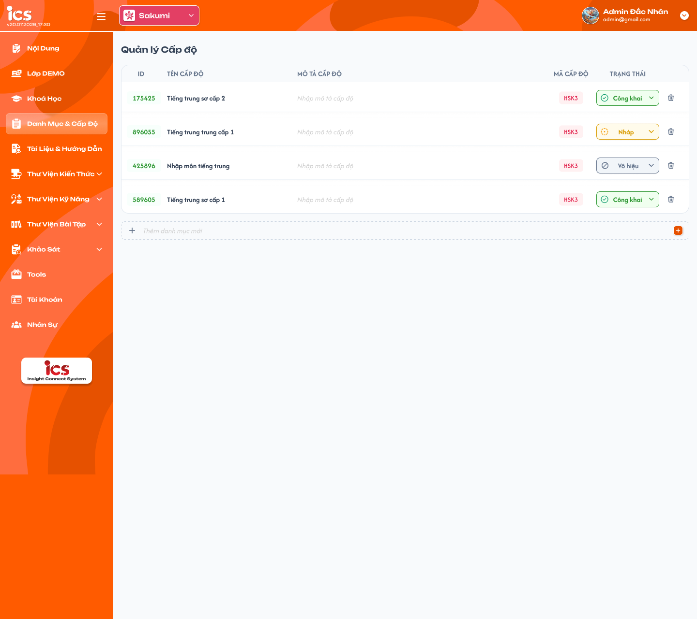
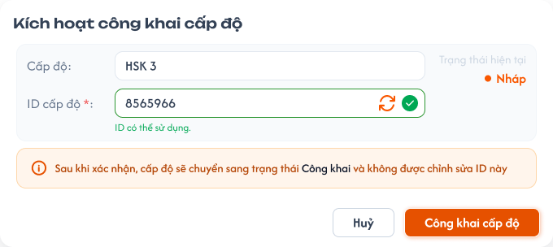
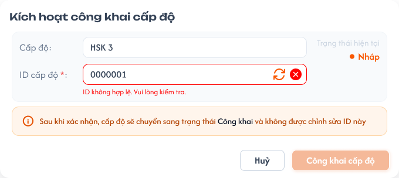

# Quản lý cấp độ

## 1. UI

### Trang 1: CD-CDO-010000 — Quản lý cấp độ



**Mô tả:**
- `Curriculum Development Handler` xem và quản lý toàn bộ dữ liệu cấp độ.
- Cấp độ là dữ liệu định nghĩa dùng lại ở feature `Quản lý danh mục`, cụ thể khi chọn cấp độ cho khóa học thuộc danh mục.

**Điểm cần lưu ý:**
- Danh sách hiển thị `ID`, `Tên cấp độ`, `Mô tả cấp độ`, `Mã cấp độ`, `Trạng thái`; kèm thao tác chuyển trạng thái cho từng cấp độ. Nút cuối danh sách là `Thêm cấp độ mới`.
- Cấp độ có ba trạng thái `Nháp`, `Công khai`, `Vô hiệu hóa`; tạo mới mặc định `Nháp`; cho chuyển hai chiều giữa mọi trạng thái (`Nháp` ↔ `Công khai`, `Nháp` ↔ `Vô hiệu hóa`, `Công khai` ↔ `Vô hiệu hóa`).
- Chỉ cấp độ `Công khai` được hiển thị để chọn mới ở feature sử dụng cấp độ; danh sách lựa chọn lấy từ dữ liệu của feature này, không hard-code giá trị minh họa.
- `A02.01` ID: hiển thị trên danh sách; quy tắc sinh, định dạng, độ dài, tính bắt buộc và khả năng chỉnh sửa chưa định nghĩa (xem Q01).
- `A02.02` Tên cấp độ: bắt buộc, không được chỉ chứa khoảng trắng. Thay đổi tên được phản ánh tại nơi đang tham chiếu.
- `A02.03` Mô tả cấp độ: bắt buộc, không được chỉ chứa khoảng trắng. Thay đổi mô tả được phản ánh tại nơi đang tham chiếu.
- `A02.04` Mã cấp độ: bắt buộc, không được trùng; là mã tham chiếu mà `Quản lý danh mục` dùng khi chọn cấp độ cho khóa học (vd `HSK1`, `HSK2`); không tự đổi chỉ vì trạng thái thay đổi; mỗi mã chỉ thuộc một cấp độ. Định dạng mã chưa chốt (xem Q02).
- `A02.05` Trạng thái: mặc định `Nháp`; cho chuyển từ trạng thái hiện tại sang một trong hai trạng thái còn lại. Chuyển sang `Công khai` phải kiểm tra Tên, Mô tả, Mã cấp độ còn hợp lệ và Mã không trùng. Chuyển sang `Nháp` hoặc `Vô hiệu hóa`: không cho chọn mới nhưng không tự xóa liên kết đã lưu ở danh mục/khóa học; chuyển lại `Công khai` thì hiển thị lại trong danh sách lựa chọn.
- `A03.01`–`A03.04` Toast phản hồi CRUD: `Thành Công` (backend xác nhận thành công), `Thông Báo` (đã tiếp nhận, dữ liệu cần thời gian đồng bộ), `Cảnh Báo` (dữ liệu/điều kiện cần kiểm tra), `Có Lỗi Xảy Ra` (backend/network không hoàn tất). Nội dung dòng hai lấy từ flow CRUD tương ứng; mỗi thao tác một Toast; `Hủy`/chỉ đọc không có Toast CRUD; nút `×` đóng thủ công; không hiển thị dữ liệu nhạy cảm.


### Trang 2: CD-CDO-010010 — Quản lý cấp độ / Popup kích hoạt công khai



**Mô tả:**
- Popup `Kích hoạt công khai cấp độ` hiển thị tên cấp độ (vd `HSK 3`), ô `ID cấp độ *` (đang nhập hợp lệ, thông báo `ID có thể sử dụng.`), `Trạng thái hiện tại` (`Nháp`), dòng thông báo trạng thái sẽ chuyển sang sau khi xác nhận, nút `Huỷ` và `Công khai cấp độ`.

### Trang 3: CD-CDO-010012 — Quản lý cấp độ / Popup kích hoạt công khai / Điền sai



**Mô tả:**
- Trạng thái lỗi của popup `Kích hoạt công khai cấp độ`: ô `ID cấp độ *` nhập sai, hiển thị `ID không hợp lệ. Vui lòng kiểm tra.`; nút `Huỷ` và `Công khai cấp độ`.

---

## 2. Yêu cầu

### 2.1. Flow chính

**Flow 1 / REQ01: Xem danh sách và thêm cấp độ**

```
Curriculum Development Handler mở Quản lý cấp độ → Hiển thị ID, Tên, Mô tả, Mã cấp độ, Trạng thái
  → Chọn Thêm cấp độ mới → Form với trạng thái mặc định Nháp
  → Nhập Tên, Mô tả, Mã cấp độ → Kiểm tra field bắt buộc + Mã không trùng
  → Thành công: tạo cấp độ trạng thái Nháp, hiển thị trong danh sách
                    ↓ (thất bại)
              Không tạo dữ liệu, giữ nội dung đã nhập, báo lỗi tại field
```

**Flow 2 / REQ02: Chuyển trạng thái cấp độ**

```
Chọn trạng thái mới cho một cấp độ → Cho chọn một trong hai trạng thái còn lại
  → Nếu chuyển sang Công khai: kiểm tra Tên, Mô tả, Mã cấp độ hợp lệ và không trùng
  → Thành công: cập nhật trạng thái
       ↓ (Công khai)                          ↓ (Nháp / Vô hiệu hóa)
  Hiển thị trong danh sách lựa chọn     Không hiển thị để chọn mới; liên kết đã lưu giữ nguyên
                    ↓ (thất bại)
              Giữ nguyên trạng thái trước đó, không cập nhật một phần
```

**Flow 3 / REQ03: Sử dụng Mã cấp độ tại feature khác**

```
Mở field chọn cấp độ cho khóa học ở Quản lý danh mục → Tải các cấp độ Công khai
  → Chọn một cấp độ → Lưu tham chiếu đến cấp độ và Mã cấp độ
  → Tên/Mô tả cấp độ cập nhật thì nơi tham chiếu hiển thị dữ liệu mới
  → Cấp độ chuyển Nháp/Vô hiệu hóa: liên kết đã lưu không bị xóa, nhưng không còn xuất hiện để chọn mới
```

### 2.2. Ngoại lệ

- **EX01:** Tên cấp độ, Mô tả cấp độ hoặc Mã cấp độ để trống/chỉ chứa khoảng trắng → không tạo hoặc cập nhật; hiển thị lỗi tại field tương ứng.
- **EX02:** Mã cấp độ đã tồn tại → không lưu dữ liệu trùng; giữ nội dung người dùng đã nhập để chỉnh sửa.
- **EX03:** Cấp độ không còn ở trạng thái `Công khai` tại thời điểm feature khác lưu lựa chọn mới → từ chối liên kết mới và yêu cầu tải lại danh sách cấp độ.
- **EX04:** Chuyển sang `Công khai` khi dữ liệu bắt buộc không hợp lệ hoặc Mã cấp độ bị trùng → giữ nguyên trạng thái trước thao tác.
- **EX05:** Người dùng không có quyền mở URL hoặc gửi request trực tiếp → từ chối thao tác, không đổi dữ liệu.

### 2.3. Yêu cầu khác

| Mã | Tên yêu cầu | Mô tả |
|---|---|---|
| REQ01 | Quản lý danh sách cấp độ | `Curriculum Development Handler` xem toàn bộ danh sách và thêm cấp độ mới. Tên, Mô tả, Mã cấp độ bắt buộc; cấp độ mới mặc định `Nháp`. |
| REQ02 | Quản lý trạng thái | Ba trạng thái `Nháp`, `Công khai`, `Vô hiệu hóa`, chuyển tự do giữa mọi trạng thái. Chỉ cấp độ `Công khai` dùng cho lựa chọn mới; đổi trạng thái không tự xóa liên kết đã tồn tại. |
| REQ03 | Cung cấp dữ liệu cấp độ | `Mã cấp độ` là mã tham chiếu khi chọn cấp độ cho khóa học ở `Quản lý danh mục`. Danh sách lựa chọn lấy từ dữ liệu cấp độ đã định nghĩa và chỉ gồm bản ghi `Công khai`. |

### 2.4. Ràng buộc

#### Quyền

| Role | Xem | Tạo | Cập nhật | Chuyển trạng thái |
|---|:---:|:---:|:---:|:---:|
| Curriculum Development Handler | ✅ | ✅ | ✅ | ✅ |
| Các role khác | ❌ | ❌ | ❌ | ❌ |

#### Ràng buộc khác

- `Curriculum Development Handler` có toàn quyền trên toàn bộ dữ liệu cấp độ.
- Mỗi `Mã cấp độ` chỉ thuộc một cấp độ và không được trùng trong hệ thống.
- Feature sử dụng cấp độ phải lưu tham chiếu ổn định đến bản ghi cấp độ, không chỉ lưu tên hiển thị.
- Không cho truy cập hoặc thực hiện hành động bị đánh dấu ❌, kể cả khi gọi trực tiếp bằng URL hoặc request.

---

## 3. Testcase

### Feature: Quản lý cấp độ

| Tên testcase | Priority | Scenario | Role | Pre-condition | Given/When/Then | Expected Result |
|---|---|---|---|---|---|---|
| Case 1: Hiển thị danh sách cấp độ | High | REQ01 | Curriculum Development Handler | Đã đăng nhập, có quyền, hệ thống có dữ liệu cấp độ | **Given:** hệ thống có dữ liệu cấp độ<br>**When:** mở màn hình Quản lý cấp độ<br>**Then:** hiển thị danh sách | - Có ID, Tên, Mô tả, Mã cấp độ và Trạng thái<br>- Hiển thị toàn bộ dữ liệu cấp độ |
| Case 2: Tạo cấp độ Nháp | High | Flow 1 / REQ01 | Curriculum Development Handler | Màn hình danh sách đang mở; Mã cấp độ chưa tồn tại | **Given:** chọn `Thêm cấp độ mới`<br>**When:** nhập đủ Tên, Mô tả, Mã cấp độ rồi lưu<br>**Then:** hệ thống tạo cấp độ | - Trạng thái mặc định `Nháp`<br>- Dữ liệu xuất hiện trong danh sách |
| Case 3: Chặn lưu khi thiếu field bắt buộc | High | EX01 / REQ01 | Curriculum Development Handler | Form thêm/cập nhật đang mở | **Given:** Tên, Mô tả hoặc Mã cấp độ để trống/chỉ có khoảng trắng<br>**When:** lưu<br>**Then:** hệ thống từ chối | - Không tạo/cập nhật dữ liệu<br>- Lỗi tại field tương ứng, giữ dữ liệu hợp lệ đã nhập |
| Case 4: Chặn Mã cấp độ trùng | High | EX02 / REQ01 | Curriculum Development Handler | Đã tồn tại cấp độ có cùng mã | **Given:** nhập Mã cấp độ đã tồn tại<br>**When:** lưu form<br>**Then:** hệ thống từ chối | - Không tạo dữ liệu trùng, Mã cấp độ cũ không đổi<br>- Giữ nội dung đã nhập để chỉnh sửa |
| Case 5: Chuyển đổi giữa mọi trạng thái | High | Flow 2 / REQ02 | Curriculum Development Handler | Cấp độ đã tồn tại | **Given:** cấp độ đang ở một trong ba trạng thái<br>**When:** chọn một trong hai trạng thái còn lại<br>**Then:** hệ thống cập nhật trạng thái | - Cho phép đủ sáu hướng chuyển<br>- Không tự đổi Mã cấp độ, không xóa liên kết đã tồn tại<br>- Một Toast kết quả |
| Case 6: Công khai cấp độ | High | Flow 2 / REQ02 / EX04 | Curriculum Development Handler | Một cấp độ đủ dữ liệu hợp lệ; một cấp độ dữ liệu không hợp lệ hoặc mã trùng | **Given:** cấp độ đang `Nháp` hoặc `Vô hiệu hóa`<br>**When:** chuyển sang `Công khai`<br>**Then:** hệ thống kiểm tra và cập nhật | - Cấp độ hợp lệ xuất hiện trong danh sách lựa chọn mới ở feature sử dụng<br>- Dữ liệu không hợp lệ/mã trùng thì giữ nguyên trạng thái trước thao tác |
| Case 7: Chỉ cho chọn mới cấp độ Công khai | High | Flow 3 / REQ03 / EX03 | Curriculum Development Handler | Có cấp độ `Nháp`, `Vô hiệu hóa`, `Công khai`; một cấp độ đổi trạng thái giữa lúc feature khác đang lưu lựa chọn | **Given:** mở field chọn cấp độ ở feature sử dụng<br>**When:** hệ thống tải lựa chọn và lưu liên kết mới<br>**Then:** chỉ trả cấp độ `Công khai` | - Không hiển thị `Nháp` hoặc `Vô hiệu hóa` để chọn mới<br>- Cấp độ không còn `Công khai` lúc lưu thì từ chối liên kết mới và yêu cầu tải lại |
| Case 8: Giữ liên kết và phản ánh thay đổi dữ liệu | High | REQ02 / REQ03 | Curriculum Development Handler | Danh mục/khóa học đã tham chiếu cấp độ | **Given:** chuyển cấp độ sang `Vô hiệu hóa` hoặc `Nháp`; sau đó cập nhật Tên/Mô tả<br>**When:** nơi tham chiếu tải lại dữ liệu<br>**Then:** giữ liên kết cũ và hiển thị thông tin mới | - Không tự xóa cấp độ khỏi dữ liệu đã lưu, không cho chọn cho liên kết mới<br>- Tên/Mô tả mới hiển thị, không giữ bản sao lỗi thời |
| Case 9: Kiểm tra quyền truy cập trực tiếp | High | EX05 / Ràng buộc quyền | Các role khác | Đã đăng nhập nhưng không có quyền | **Given:** không có quyền quản lý cấp độ<br>**When:** mở URL hoặc gửi request trực tiếp<br>**Then:** hệ thống từ chối | - Không xem hoặc thay đổi được dữ liệu, dữ liệu không đổi |
| Case 10: Toast phản hồi CRUD | Medium | Ràng buộc Toast CRUD | Curriculum Development Handler | Thao tác thành công, bị cảnh báo, lỗi backend/network, hoặc đang đồng bộ | **Given:** người dùng xác nhận thay đổi<br>**When:** backend trả kết quả hoặc người dùng bấm `×`<br>**Then:** hiển thị đúng loại Toast | - `Thành Công` chỉ hiện sau khi backend xác nhận; `Cảnh Báo` vẫn đánh dấu field lỗi, không lưu dữ liệu sai; `Có Lỗi Xảy Ra` không cập nhật một phần, cho thử lại, không lộ lỗi kỹ thuật<br>- Mỗi thao tác một Toast, `Thông Báo` tối đa một, nút `×` đóng thủ công không hoàn tác dữ liệu |

---

## 4. Câu hỏi cần xác nhận

- **Q01:** `ID` chưa có định nghĩa rõ ràng: hệ thống tự sinh hay người dùng nhập, thời điểm sinh, định dạng, độ dài, phạm vi duy nhất, khả năng chỉnh sửa. Figma popup `Kích hoạt công khai cấp độ` có ô `ID cấp độ *` kiểm tra `ID có thể sử dụng` / `ID không hợp lệ`: ID có bắt buộc trước khi chuyển sang `Công khai` không, và quy tắc hợp lệ là gì?
- **Q02:** Định dạng `Mã cấp độ`: có bắt buộc viết hoa, cho phép ký tự nào, có tự động chuẩn hóa khoảng trắng/chữ thường không (hiện chỉ chốt bắt buộc và không trùng)?
- **Q03:** Figma chưa có form thêm/cập nhật cấp độ và notification kết quả; cần bổ sung thiết kế hoặc nội dung chính thức trước khi chốt copy hiển thị.
- **Q04:** Có cho phép xóa cấp độ không, và xử lý thế nào khi cấp độ đang được khóa học thuộc danh mục tham chiếu (requirement hiện chưa gồm chức năng xóa)?
