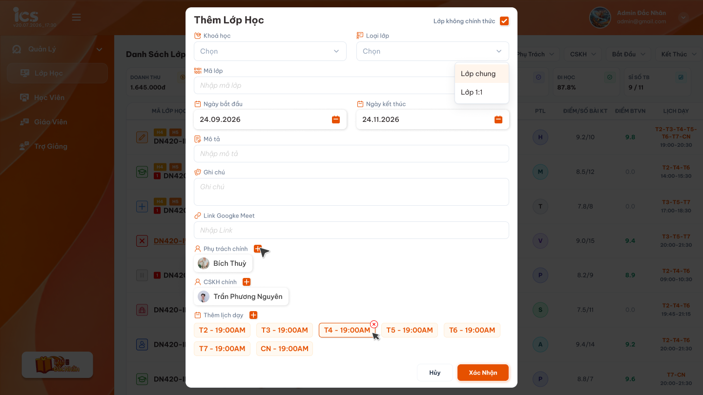
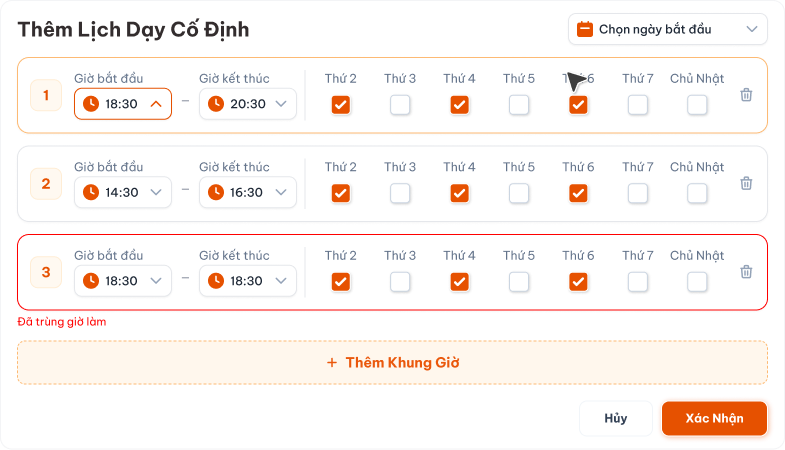
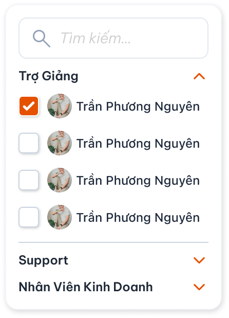

# Tạo lớp học

Requirement này đặc tả popup tạo lớp, lịch dạy cố định và trạng thái ban đầu của lớp. Màn danh sách được đặc tả riêng tại [Quản lý danh sách lớp học](./class_management_requirements.md). Các thao tác sau khi tạo được đặc tả tại [Chi tiết lớp học — Tab Thông tin](./class_detail_information_requirements.md), [Tab Học viên](./class_detail_students_requirements.md), [Tab Giáo viên](./class_detail_teachers_requirements.md), [Tab Trợ giảng & Phụ trách lớp](./class_detail_support_handlers_requirements.md) và [Tab Lịch dạy](./class_detail_schedule_requirements.md).

## 1. UI

### Trang 1: ADM-LOP-010010 — Popup Thêm lớp học




*Popup Thêm Lớp Học — nhấn để xem ảnh gốc*

**Mô tả:**

Chỉ người dùng có role `Admin` hoặc `Class Handler` được bấm nút `+` tại Danh sách lớp để mở popup `Thêm Lớp Học` và tạo lớp.

**Giải thích field/thành phần:**

- `A01.01` **Lớp không chính thức**: Không có checkbox riêng. Lớp không chính thức là lớp có `Loại lớp` = `Lớp demo`. `Admin` và `Class Handler` đều được chọn `Lớp demo` để tạo lớp test; role khác không được tạo lớp. Lớp test mở toàn bộ bài học/bài kiểm tra và bỏ qua điều kiện nghiệp vụ khi đổi trạng thái; quyền người dùng vẫn được kiểm tra.
- `A01.02` **Trung tâm**: **Bắt buộc.** Chọn một trung tâm từ danh sách trung tâm; lớp được tạo thuộc trung tâm đã chọn. Danh sách `Khóa học` lấy theo trung tâm đã chọn.
- `A01.03` **Khóa học**: **Bắt buộc.** Chỉ cho chọn từ danh sách khóa học đã được define sẵn; không nhập tên khóa học tự do.
- `A01.04` **Số buổi**: Sau khi chọn khóa học, hiển thị tổng số buổi học của các học kỳ đang `Công khai` thuộc khóa học đó; học kỳ `Nháp` không được tính. Người dùng không tự nhập một số buổi khác. Lịch dạy cố định phải sinh đủ đúng số buổi này.
- `A01.05` **Loại lớp**: **Bắt buộc.** Có ba giá trị: `Lớp chung`, `Lớp 1-1` và `Lớp demo`. `Lớp demo` là lớp không chính thức; `Admin` và `Class Handler` đều được chọn. Không hiển thị hoặc chấp nhận loại lớp khác. `Lớp 1-1` không giới hạn một học viên và có thể được thêm nhiều học viên sau khi tạo.
- `A01.06` **Mã lớp**: Hệ thống tự động sinh khi tạo lớp, duy nhất toàn hệ thống. Người dùng không nhập và không sửa; popup tạo lớp không có ô nhập Mã lớp. Backend không nhận Mã lớp do client gửi.
- `A01.07` **Ngày bắt đầu / Ngày kết thúc**: Người dùng nhập `Ngày bắt đầu`. `Ngày kết thúc` là field chỉ đọc, tự lấy ngày của buổi cuối cùng sau khi sinh đủ lịch; nếu chưa có lịch thì để trống.
- `A01.08` **Mô tả**: **Bắt buộc.** Không chấp nhận giá trị rỗng hoặc chỉ chứa khoảng trắng; không giới hạn số ký tự theo nghiệp vụ.
- `A01.09` **Ghi chú**: Không bắt buộc và không giới hạn số ký tự theo nghiệp vụ.
- `A01.10` **Link Google Meet**: Cho nhập link Meet ngay khi tạo lớp. Nếu có thì phải là URL HTTP(S) hợp lệ. Link không bắt buộc để tạo lớp hoặc để lớp ở trạng thái `Khai giảng`, nhưng bắt buộc trước khi chuyển sang `Đang học`.
- `A01.11` **Phụ trách chính**: **Bắt buộc.** Chỉ cho chọn người dùng có role `Class Handler`.
- `A01.12` **CSKH chính**: **Bắt buộc.** Chỉ cho chọn người dùng có role `Support`.
- `A01.13` **Thêm lịch dạy**: Nút `+` mở popup `Thêm Lịch Dạy Cố Định`. Lịch đã xác nhận hiển thị thành các chip trong popup tạo lớp và có thể xóa trước khi lưu.
- `A01.14` **Hủy**: Đóng popup, không tạo lớp và không lưu dữ liệu đang nhập.
- `A01.15` **Xác Nhận**: Kiểm tra dữ liệu, tạo đúng một lớp và xác định trạng thái ban đầu theo quy tắc lịch dạy.

**Điểm cần lưu ý:**

- Sáu field bắt buộc phải được đánh dấu và báo lỗi tại đúng field khi thiếu dữ liệu.
- Đổi `Khóa học` phải cập nhật lại `Số buổi` theo khóa học được chọn; người dùng không được sửa trực tiếp Số buổi.
- `Ngày kết thúc` không cho nhập thủ công; tự cập nhật bằng ngày của buổi cuối sau khi lịch được sinh hoặc thay đổi.
- `Admin` và `Class Handler` đều được chọn Loại lớp `Lớp demo` (lớp không chính thức). Role khác không được tạo lớp, kể cả lớp demo; backend phải từ chối nếu gửi request trực tiếp.
- Bấm `Hủy` không lưu dữ liệu; bấm `Xác Nhận` nhiều lần hoặc gửi lặp không được tạo lớp trùng.

### Trang 2: ADM-LOP-010000 — Lớp không chính thức


**Mô tả:**

`Lớp không chính thức` là lớp có Loại lớp `Lớp demo`, do `Admin` hoặc `Class Handler` tạo để phục vụ test. Không có checkbox riêng.

**Giải thích:**

- Ngay sau khi tạo, toàn bộ bài học và bài kiểm tra của khóa học phải ở trạng thái có thể mở/truy cập; không khóa theo tiến độ, lịch học, bài học trước hoặc điều kiện hoàn thành trước đó.
- Cho phép người dùng có quyền thay đổi tự do trạng thái lớp, trạng thái học viên, trạng thái bài học và trạng thái bài kiểm tra trong phạm vi lớp test.
- Các điều kiện chuyển trạng thái dành cho lớp chính thức không áp dụng cho lớp test, gồm điều kiện lịch dạy, Link Meet, Tiêu chuẩn GV, Quy trình lớp và hóa đơn học phí.
- Trạng thái ban đầu khi tạo vẫn được xác định theo lịch dạy (`Mới tạo` hoặc `Khai giảng`), nhưng sau khi tạo có thể đổi sang trạng thái khác mà không cần thỏa các điều kiện chuyển trạng thái.

**Điểm cần lưu ý:**

- “Không bị hạn chế” chỉ bỏ qua ràng buộc nghiệp vụ phục vụ test; hệ thống vẫn phải kiểm tra quyền người dùng, phạm vi dữ liệu, định dạng dữ liệu và ghi nhận thay đổi đúng lớp.
- Lớp có Loại lớp khác `Lớp demo` là lớp chính thức và phải áp dụng toàn bộ điều kiện nghiệp vụ được mô tả trong requirement này và các requirement liên quan.
- Role ngoài `Admin` và `Class Handler` không được tạo `Lớp demo`, kể cả bằng request trực tiếp; quyền đổi trạng thái lớp test sau khi tạo vẫn tuân theo requirement Chi tiết lớp.
- Sau khi lớp đã được tạo là `Lớp demo`, không cho phép đổi Loại lớp sang `Lớp chung` hoặc `Lớp 1-1`.

### Trang 3: ADM-LOP-010000 — Khóa học, Số buổi và lịch được sinh


**Mô tả:**

Giải thích quan hệ giữa khóa học đã define, tổng Số buổi và lịch dạy được sinh cho lớp.

**Giải thích:**

- Danh sách Khóa học lấy từ dữ liệu define hiện hành của hệ thống.
- Số buổi của khóa học bằng tổng số buổi học của các học kỳ đang `Công khai` thuộc khóa học đó; học kỳ `Nháp` không được tính. Khi đổi Khóa học, Số buổi phải cập nhật theo khóa học mới.
- Số buổi của lớp phải bằng Số buổi của khóa học được chọn; không dùng số khung giờ lịch dạy để thay thế Số buổi của khóa học.
- Lịch dạy cố định dùng Số buổi của khóa học làm tổng số lần học cần sinh.
- Ngày bắt đầu của lớp được tính là buổi 1. Các buổi tiếp theo chạy theo thứ/ngày và khung giờ cố định đã chọn cho đến khi đủ số buổi.
- Khi đã đủ số buổi, lịch phải dừng. Không sinh thêm buổi ngoài số lượng đã define và không được dừng trước khi đủ số buổi.
- Ví dụ: khóa học có `24` buổi thì Ngày bắt đầu là buổi 1; hệ thống tiếp tục xếp lịch theo lịch cố định cho đến buổi 24 và buổi 24 là buổi cuối cùng.

**Điểm cần lưu ý:**

- Nếu không tải được danh sách Khóa học hoặc khóa học không có cấu hình Số buổi, không được tạo lớp với dữ liệu thiếu/sai.
- `Ngày kết thúc` luôn được tính từ ngày của buổi cuối. Nếu lịch được sinh lại do đổi khóa học, ngày bắt đầu hoặc mẫu lịch, field này phải cập nhật trong cùng giao dịch.

### Trang 4: ADM-LOP-010000 — Loại lớp


**Mô tả:**

Field `Loại lớp` xác định lớp học chung, lớp 1-1 hay lớp demo (lớp không chính thức).

**Giải thích:**

- Hệ thống có ba loại lớp: `Lớp chung`, `Lớp 1-1` và `Lớp demo`. Cả `Admin` và `Class Handler` đều thấy đủ ba loại.
- Không hiển thị loại lớp khác trong danh sách chọn.

**Điểm cần lưu ý:**

- Backend chỉ chấp nhận một trong ba giá trị hợp lệ; request gửi loại lớp khác phải bị từ chối.
- `Lớp 1-1` là một giá trị phân loại lớp, không phải điều kiện sĩ số. Lớp 1-1 có thể có 0, 1 hoặc nhiều học viên.

### Trang 5: ADM-LOP-010020 — Popup Thêm Lịch Dạy Cố Định




*Popup Thêm Lịch Dạy Cố Định — nhấn để xem ảnh gốc*

**Mô tả:**

Popup dùng để khai báo mẫu lịch lặp và sinh đủ số buổi của khóa học.

**Giải thích field/thành phần:**

- Chọn ngày bắt đầu áp dụng lịch dạy.
- Cho thêm một hoặc nhiều khung giờ. Mỗi khung giờ gồm Giờ bắt đầu, Giờ kết thúc và ít nhất một ngày trong tuần từ Thứ 2 đến Chủ Nhật.
- Cho xóa từng khung giờ và thêm khung giờ mới trước khi xác nhận.
- `Hủy` không đưa lịch đang nhập về popup tạo lớp.
- `Xác Nhận` đưa lịch hợp lệ về popup tạo lớp nhưng chưa tạo lớp cho đến khi người dùng xác nhận popup chính.

**Điểm cần lưu ý:**

- Ngày bắt đầu phải được tính là buổi học đầu tiên. Thứ/ngày được chọn trong lịch cố định phải phù hợp để Ngày bắt đầu có một buổi học.
- Lịch cố định lặp theo các ngày/khung giờ đã chọn và sinh đủ đúng Số buổi của Khóa học.
- Giờ kết thúc phải sau Giờ bắt đầu.
- Không cho xác nhận khi các khung giờ bị trùng theo quy tắc lịch của hệ thống; hiển thị lỗi tại khung giờ liên quan.

### Trang 6: ADM-LOP-010000 — Bộ chọn Phụ trách chính / CSKH chính




*Bộ chọn người dùng có tìm kiếm và nhóm theo role — nhấn để xem ảnh gốc*

**Mô tả:**

Bộ chọn dùng để gán đúng người chịu trách nhiệm chính và CSKH chính cho lớp.

**Giải thích field/thành phần:**

- Hỗ trợ tìm kiếm người dùng theo tên hoặc thông tin định danh được hệ thống hỗ trợ.
- Khi chọn `Phụ trách chính`, chỉ hiển thị và cho chọn người dùng đang hoạt động có role `Class Handler`.
- Khi chọn `CSKH chính`, chỉ hiển thị và cho chọn người dùng đang hoạt động có role `Support`.

**Điểm cần lưu ý:**

- Không cho chọn người dùng sai role bằng thao tác trên UI hoặc bằng request trực tiếp.
- Chỉ lưu người dùng đã chọn vào đúng field đang thao tác; không tự gán cùng một lựa chọn cho field khác.

### Trang 7: ADM-LOP-010000 — Phân quyền tạo lớp và dữ liệu bắt buộc


**Mô tả:**

Quy định người được mở popup/tạo lớp và validation bắt buộc trước khi lưu.

**Giải thích:**

- Chỉ role `Admin` và `Class Handler` được tạo lớp. Các role khác không hiển thị thao tác tạo lớp và không được tạo lớp bằng request trực tiếp.
- Sáu field bắt buộc khi tạo lớp gồm: `Trung tâm`, `Khóa học`, `Loại lớp`, `Phụ trách chính`, `CSKH chính` và `Mô tả`.

**Điểm cần lưu ý:**

- Nếu thiếu một trong sáu field, hoặc giá trị text bắt buộc chỉ chứa khoảng trắng, hệ thống không gửi/lưu lớp và hiển thị lỗi tại đúng field.
- Backend phải kiểm tra lại toàn bộ field bắt buộc và role của người được gán; không chỉ dựa vào validation phía giao diện.

### Trang 8: ADM-LOP-010000 — Trạng thái sau khi tạo lớp


**Mô tả:**

Giải thích trạng thái ban đầu của lớp sau khi người dùng xác nhận tạo lớp.

**Giải thích:**

Tên trạng thái chính thức dùng trong requirement là `Mới tạo`, `Khai giảng`, `Đang học`. Hành động “Bắt đầu lớp” chuyển lớp từ `Khai giảng` sang `Đang học`.

- Tạo lớp **không có lịch dạy**: trạng thái ban đầu là `Mới tạo`.
- Tạo lớp **có ít nhất một lịch dạy hợp lệ**: trạng thái ban đầu tự động là `Khai giảng`.
- Lớp `Mới tạo` được thêm lịch dạy hợp lệ sau khi tạo: tự động chuyển sang `Khai giảng`.

**Điểm cần lưu ý:**

- Không cho chuyển `Mới tạo` sang `Khai giảng` khi chưa có lịch dạy.
- Link Meet không quyết định trạng thái `Mới tạo` hay `Khai giảng`; điều kiện phân biệt là lớp có lịch dạy hay chưa.

### Trang 9: ADM-LOP-010000 — Ràng buộc liên quan đến trạng thái Đang học


**Mô tả:**

Thao tác chuyển trạng thái được thực hiện tại màn Chi tiết lớp và sẽ được đặc tả đầy đủ trong requirement Chi tiết lớp. Requirement này ghi nhận các ràng buộc nghiệp vụ dùng chung:

**Giải thích:**

- Chỉ cho chuyển `Khai giảng` sang `Đang học` khi đồng thời thỏa tất cả điều kiện:
    - Lớp đã có Link Google Meet.
    - Đã đạt Tiêu chuẩn GV.
    - Đã hoàn tất đúng Quy trình lớp.
    - Có ít nhất 1 học viên ở trạng thái `Đang học` và tất cả học viên ở trạng thái này đã đáp ứng điều kiện học phí theo requirement riêng.
- Thiếu bất kỳ điều kiện nào thì lớp vẫn ở `Khai giảng` và hệ thống phải cho biết điều kiện còn thiếu.
- Khi chuyển một học viên sang `Đang học`, hồ sơ học viên đó bắt buộc đã có hóa đơn học phí. Chưa có hóa đơn thì không cho chuyển.

**Điểm cần lưu ý:**

- Cách xác định học viên “đã đóng học phí” tuân theo requirement học phí riêng và không được tự định nghĩa trong requirement lớp.
- Các điều kiện nghiệp vụ trong mục này không áp dụng cho lớp có Loại lớp `Lớp demo`, nhưng quyền và phạm vi dữ liệu vẫn phải được kiểm tra.

### Trang 10: ADM-LOP-010000 — Toast phản hồi CRUD


*Toast phản hồi Create, Update, Delete và đổi trạng thái — nhấn để xem ảnh gốc*

**Mô tả:** Toast phản hồi kết quả các thao tác thay đổi dữ liệu trong requirement này.

**Điểm cần lưu ý:**

- `A10.01` **Thành công**: Tiêu đề: `Thành Công`; Khi sử dụng: Backend xác nhận thao tác thành công.
- `A10.02` **Thông tin**: Tiêu đề: `Thông Báo`; Khi sử dụng: Thao tác đã tiếp nhận nhưng dữ liệu cần thời gian đồng bộ.
- `A10.03` **Cảnh báo**: Tiêu đề: `Cảnh Báo`; Khi sử dụng: Dữ liệu/điều kiện cần người dùng kiểm tra.
- `A10.04` **Lỗi**: Tiêu đề: `Có Lỗi Xảy Ra`; Khi sử dụng: Backend/network không hoàn tất thao tác.

**Điểm cần lưu ý:** Nội dung dòng hai lấy từ flow CRUD tương ứng; mỗi thao tác chỉ có một Toast; Hủy/chỉ đọc không có Toast CRUD; nút `×` đóng thủ công; không hiển thị dữ liệu nhạy cảm.

---

## 2. Yêu cầu

### 2.1. Flow chính

**Flow 1 / REQ01–REQ04: Tạo lớp học**

```text
Admin hoặc Class Handler bấm nút + tại Danh sách lớp
      → Popup tải danh sách Khóa học đã define
      → Chọn Khóa học; hệ thống hiển thị đúng Số buổi
      → Admin hoặc Class Handler có thể chọn Loại lớp = Lớp demo để tạo lớp test
      → Chọn Trung tâm, nhập đủ Khóa học, Loại lớp, Phụ trách chính, CSKH chính và Mô tả; Mã lớp do hệ thống tự sinh
      → Phụ trách chính chỉ chọn Class Handler; CSKH chính chỉ chọn Support
      → Có thể thêm lịch dạy cố định
      → Hủy: đóng popup, không tạo lớp
      → Xác Nhận: backend kiểm tra quyền, dữ liệu, Khóa học, Số buổi và lịch dạy
      → Không có lịch dạy: tạo lớp ở trạng thái Mới tạo
      → Có lịch dạy hợp lệ: tạo lớp ở trạng thái Khai giảng
      → Thành công: thêm lớp vào danh sách và hiển thị notification thành công
      → Thất bại: không tạo lớp một phần hoặc tạo trùng do gửi lặp
```

### 2.2. Ngoại lệ

- **EX01:** Người dùng không có role `Admin` hoặc `Class Handler` gửi request tạo lớp trực tiếp → backend từ chối và không tạo dữ liệu.
- **EX02:** Danh sách Khóa học tải lỗi hoặc khóa học thiếu cấu hình Số buổi → không cho tạo lớp; hiển thị lỗi và cho phép thử lại.
- **EX03:** Lịch dạy có giờ không hợp lệ, không bao gồm Ngày bắt đầu hoặc bị trùng → không đưa lịch lỗi về popup chính và không tạo lớp.
- **EX04:** Request tạo lớp thất bại hoặc bị gửi lặp → không tạo lớp một phần hoặc nhiều lớp trùng nhau; hiển thị đúng một notification kết quả.
- **EX05:** Request chuyển trạng thái lớp/học viên không thỏa điều kiện → backend từ chối, giữ nguyên trạng thái và trả đúng điều kiện còn thiếu.
- **EX06:** Người không có role `Admin` hoặc `Class Handler` gửi request tạo lớp với Loại lớp `Lớp demo`, hoặc client cố giả lập lớp test → backend từ chối; không tạo lớp test hoặc dữ liệu một phần.
- **EX07:** Thiếu `Trung tâm`, `Khóa học`, `Loại lớp`, `Phụ trách chính`, `CSKH chính` hoặc `Mô tả` → không tạo lớp và trả lỗi đúng field thiếu.
- **EX08:** Request gán `Phụ trách chính` không có role `Class Handler`, hoặc `CSKH chính` không có role `Support` → backend từ chối và không tạo lớp.
- **EX09:** Request gửi loại lớp ngoài `Lớp chung`/`Lớp 1-1`/`Lớp demo`, gửi Link Google Meet không phải URL HTTP(S), hoặc cố ghi đè Ngày kết thúc → backend từ chối dữ liệu không hợp lệ và không tạo lớp.
- **EX10:** Khóa học hoặc người dùng được chọn đã ngừng hoạt động, không còn tồn tại hoặc nằm ngoài phạm vi của người tạo tại thời điểm xác nhận → backend từ chối toàn bộ request, không tạo lớp một phần và yêu cầu chọn lại dữ liệu hợp lệ.
- **EX11:** Mã lớp tự sinh trùng với một lớp đã tồn tại (kể cả lớp đã xóa) → backend sinh mã khác, không tạo lớp trùng mã và không báo lỗi cho người dùng vì mã trùng.

### 2.3. Yêu cầu khác

| Mã | Tên yêu cầu | Mô tả |
|---|---|---|
| REQ01 | Dữ liệu tạo lớp | Popup hiển thị các field và popup con đã mô tả. `Trung tâm`, `Khóa học`, `Loại lớp`, `Phụ trách chính`, `CSKH chính` và `Mô tả` là bắt buộc. Mã lớp do hệ thống tự động sinh, duy nhất toàn hệ thống; người dùng không nhập và backend không nhận Mã lớp từ client. Backend kiểm tra lại dữ liệu, không tin cậy trạng thái, Số buổi hoặc người phụ trách do client tự gán. |
| REQ02 | Khóa học và Số buổi | Khóa học chỉ lấy từ dữ liệu define. Số buổi của khóa học bằng tổng số buổi học của các học kỳ đang `Công khai` thuộc khóa học đó; học kỳ `Nháp` không được tính. Số buổi của lớp bằng Số buổi của khóa học; người dùng không tự nhập giá trị khác. |
| REQ03 | Lịch dạy cố định | Ngày bắt đầu là buổi 1. Hệ thống sinh các buổi tiếp theo theo lịch cố định, đủ đúng Số buổi của khóa học rồi dừng. |
| REQ04 | Trạng thái ban đầu | Không có lịch dạy tạo trạng thái `Mới tạo`; có lịch dạy hợp lệ tạo trạng thái `Khai giảng`. Thêm lịch hợp lệ cho lớp `Mới tạo` tự chuyển lớp sang `Khai giảng`. |
| REQ05 | Điều kiện Đang học | Chỉ `Class Handler` được đổi trạng thái lớp. Chuyển sang `Đang học` cần Meet, Tiêu chuẩn GV, Quy trình lớp, ít nhất 1 học viên ở trạng thái `Đang học` và toàn bộ nhóm học viên đó đáp ứng điều kiện học phí. Học viên chỉ được chuyển sang `Đang học` khi hồ sơ đáp ứng requirement học phí riêng. |
| REQ06 | Notification | Tạo lớp, thêm lịch và chuyển trạng thái thành công/thất bại phải hiển thị đúng một notification sau kết quả backend. Hủy popup không hiển thị notification CUD. |
| REQ07 | Lớp không chính thức | Lớp không chính thức là lớp có Loại lớp `Lớp demo`; `Admin` và `Class Handler` đều được chọn loại này để tạo lớp test. Lớp test mở toàn bộ bài học/bài kiểm tra và bỏ qua điều kiện nghiệp vụ khi đổi trạng thái. Role khác không được tạo lớp demo. Lớp demo không được đổi sang loại lớp chính thức. |
| REQ08 | Phân quyền tạo lớp | Chỉ `Admin` và `Class Handler` được tạo lớp. Backend phải từ chối request tạo lớp của mọi role khác. |
| REQ09 | Role phụ trách | `Phụ trách chính` bắt buộc là người dùng có role `Class Handler`; `CSKH chính` bắt buộc là người dùng có role `Support`. |
| REQ10 | Ngày kết thúc | Field chỉ đọc, tự lấy ngày của buổi cuối sau khi sinh đủ số buổi. Không có lịch thì để trống; không nhận giá trị do client tự gửi. |
| REQ11 | Loại lớp | Chỉ chấp nhận `Lớp chung`, `Lớp 1-1` và `Lớp demo` (lớp không chính thức). Đây là giá trị phân loại được lưu độc lập với sĩ số; `Lớp 1-1` có thể có nhiều học viên. |
| REQ12 | Trung tâm | Khi tạo mới bắt buộc chọn `Trung tâm`; bản ghi được lưu thuộc trung tâm đã chọn. Backend kiểm tra lại trung tâm khi lưu, không chỉ dựa vào UI. Danh sách Khóa học trong popup lấy theo trung tâm đã chọn. |

### 2.4. Ràng buộc

#### Quyền

| Role | Mở popup tạo lớp | Tạo lớp chính thức | Tạo lớp không chính thức | Chọn Phụ trách chính/CSKH chính |
|---|:---:|:---:|:---:|:---:|
| Admin | ✅ | ✅ | ✅ | ✅ |
| Class Handler | ✅ | ✅ | ✅ | ✅ |
| Các role khác | ❌ | ❌ | ❌ | ❌ |

- Không cho phép role bị đánh dấu `❌` thực hiện hành động bằng cách mở URL, sửa giao diện hoặc gửi request trực tiếp.
- Quyền tạo lớp test không làm mất yêu cầu kiểm tra role và phạm vi dữ liệu.

#### Ràng buộc khác

**Phạm vi và bảo mật dữ liệu**

- Backend phải kiểm tra role tạo lớp (`Admin` hoặc `Class Handler`), cho cả hai role gán Loại lớp `Lớp demo`, và kiểm tra phạm vi dữ liệu trước khi lưu.
- Khóa học, người dùng được chọn và dữ liệu liên quan phải thuộc phạm vi mà người tạo được phép sử dụng.
- Khóa học, lớp, lịch dạy, người phụ trách, CSKH và học viên phải liên kết bằng định danh nội bộ.
- Không dùng tên hoặc mã hiển thị làm khóa phân quyền/cập nhật.
- Nội dung Mô tả/Ghi chú phải được lưu và hiển thị an toàn, không thực thi HTML/script.

#### Tính toàn vẹn dữ liệu và notification

- Chỉ thông báo thành công sau khi backend xác nhận toàn bộ lớp và lịch hợp lệ đã được lưu.
- Không lưu lớp một phần nếu tạo lớp hoặc lưu lịch thất bại.
- Mỗi thao tác tạo lớp chỉ hiển thị một notification kết quả; request gửi lặp không được tạo lớp hoặc notification thành công trùng.
- Notification không được chứa stack trace, token, định danh nội bộ hoặc thông tin kỹ thuật nhạy cảm.

---

## 3. Testcase

### Feature: Tạo lớp học

| Tên testcase | Priority | Scenario | Role | Pre-condition | Given/When/Then | Expected Result |
|---|---|---|---|---|---|---|
| Case 1: Mở và hủy popup Thêm lớp học | High | REQ01 / REQ08 | `Admin` hoặc `Class Handler` | Người dùng đang ở Danh sách lớp | **Given** người dùng bấm nút `+`<br>**When** popup hiển thị rồi chọn `Hủy`<br>**Then** đóng popup mà không tạo lớp | - Hiển thị đủ field<br>- Không gửi request tạo lớp<br>- Dữ liệu không thay đổi |
| Case 20: Tự tính Ngày kết thúc theo buổi cuối | High | REQ03 / REQ10 | `Admin` hoặc `Class Handler` | Popup tạo lớp đang mở; khóa học và lịch dạy hợp lệ | **Given** người dùng nhập Ngày bắt đầu và chọn lịch cố định<br>**When** hệ thống sinh đủ N buổi<br>**Then** Ngày kết thúc bằng ngày của buổi N | - Field Ngày kết thúc chỉ đọc<br>- Đổi Khóa học/lịch sẽ tính lại ngày kết thúc<br>- Không nhận giá trị ngày kết thúc do client tự gửi |
| Case 23: Tạo lớp thất bại hoặc gửi request lặp | High | EX04 / REQ06 / Ràng buộc tính toàn vẹn | `Admin` hoặc `Class Handler` | Dữ liệu hợp lệ; mô phỏng backend thất bại hoặc người dùng bấm Xác Nhận nhiều lần | **Given** một thao tác tạo lớp đang được xử lý<br>**When** request thất bại hoặc cùng thao tác được gửi lặp<br>**Then** hệ thống không tạo dữ liệu một phần hoặc nhiều lớp trùng | - Thất bại không tạo lớp và không lưu lịch dở dang<br>- Request lặp chỉ tạo tối đa một lớp<br>- Hiển thị đúng một notification kết quả<br>- Notification không chứa thông tin kỹ thuật nhạy cảm |
| Case 24: Validation dữ liệu text, Mã lớp tự sinh và URL Meet | High | EX07 / EX09 / EX11 / REQ01 | `Admin` hoặc `Class Handler` | Popup tạo lớp đang mở | **Given** Mô tả rỗng hoặc Meet không phải URL HTTP(S); sau đó nhập hợp lệ<br>**When** bấm `Xác Nhận`<br>**Then** hệ thống validate tại đúng field và tự sinh Mã lớp khi tạo thành công | - Popup không có ô nhập Mã lớp<br>- Mã lớp do hệ thống tự sinh, không trùng lớp đã có<br>- Rỗng/URL sai thì không tạo lớp<br>- Không giới hạn số ký tự text theo nghiệp vụ |
| Case 25: Bắt buộc chọn trung tâm khi tạo | High | REQ12 | `Admin` hoặc `Class Handler` | Popup/dòng tạo lớp đang mở | **Given** các field bắt buộc khác hợp lệ<br>**When** bỏ trống `Trung tâm` rồi xác nhận; sau đó chọn trung tâm A và xác nhận<br>**Then** thiếu Trung tâm thì không tạo; chọn A thì tạo thành công | - Báo lỗi tại field Trung tâm khi bỏ trống<br>- Lớp mới thuộc trung tâm A; lọc trung tâm A thì thấy, lọc trung tâm B thì không thấy |
| Case 15: Admin hoặc Class Handler tạo lớp không chính thức | High | REQ07 | `Admin` hoặc `Class Handler` | Người tạo chọn Loại lớp `Lớp demo`; lớp chưa có Meet, Tiêu chuẩn GV, Quy trình hoặc học phí | **Given** lớp test được tạo thành công<br>**When** mở nội dung và Class Handler đổi trạng thái trong Chi tiết lớp<br>**Then** hệ thống bỏ qua điều kiện nghiệp vụ của lớp chính thức | - Toàn bộ bài học/bài kiểm tra mở ngay<br>- Không khóa theo tiến độ hoặc bài trước<br>- Không yêu cầu lịch, Meet, tiêu chuẩn, quy trình hoặc học phí để đổi trạng thái<br>- Vẫn kiểm tra quyền từng hành động |
| Case 16: Chặn role khác tạo lớp không chính thức | High | EX06 / REQ07 / Ràng buộc quyền | Role ngoài `Admin` và `Class Handler` | Người dùng không có quyền tạo lớp | **Given** role không thấy nút tạo lớp<br>**When** gửi request trực tiếp để tạo lớp với Loại lớp `Lớp demo`<br>**Then** backend từ chối | - Không tạo lớp test<br>- Không tạo lớp một phần<br>- Không cho client giả lập quyền Admin/Class Handler |
| Case 2: Khóa học define quyết định Số buổi | High | REQ02 | `Admin` hoặc `Class Handler` | Khóa học A có học kỳ Công khai 24 buổi và học kỳ Nháp 12 buổi; khóa học B có 2 học kỳ Công khai, tổng 36 buổi | **Given** popup đang mở<br>**When** chọn A rồi đổi sang B<br>**Then** Số buổi lần lượt là 24 rồi 36 | - Chỉ hiển thị khóa học đã define<br>- Số buổi cập nhật theo khóa học<br>- Chỉ cộng số buổi của học kỳ Công khai; học kỳ Nháp 12 buổi của A không được tính<br>- Không cho nhập số khác |
| Case 3: Không tạo lớp khi cấu hình khóa học lỗi | High | EX02 / REQ02 | `Admin` hoặc `Class Handler` | Danh sách khóa học tải lỗi hoặc khóa học thiếu Số buổi | **Given** dữ liệu Khóa học/Số buổi không đầy đủ<br>**When** xác nhận tạo lớp<br>**Then** hệ thống từ chối | - Không tạo dữ liệu sai<br>- Hiển thị lỗi phù hợp<br>- Cho phép thử lại |
| Case 5: Sinh đủ lịch cố định theo Số buổi | High | REQ03 | `Admin` hoặc `Class Handler` | Khóa học có 24 buổi; Ngày bắt đầu phù hợp lịch đã chọn | **Given** Ngày bắt đầu là buổi 1<br>**When** sinh lịch theo mẫu lặp<br>**Then** xếp lịch đến đủ buổi 24 | - Đúng 24 buổi<br>- Buổi 24 là buổi cuối<br>- Không bỏ qua ngày bắt đầu<br>- Không dừng ở 23 hoặc sinh buổi 25 |
| Case 21: Chỉ chấp nhận ba loại lớp | High | EX09 / REQ11 | `Admin` hoặc `Class Handler` | Popup tạo lớp đang mở | **Given** người dùng mở danh sách Loại lớp<br>**When** xem lựa chọn hoặc gửi request tạo lớp<br>**Then** hệ thống chỉ chấp nhận `Lớp chung`, `Lớp 1-1` hoặc `Lớp demo` | - Admin và Class Handler đều thấy ba loại lớp<br>- Backend từ chối giá trị khác<br>- Không gắn giới hạn sĩ số bằng 1 cho Lớp 1-1 |
| Case 4: Kiểm tra khung giờ lịch cố định | High | EX03 / REQ03 | `Admin` hoặc `Class Handler` | Popup lịch đang mở | **Given** người dùng thêm nhiều khung giờ<br>**When** giờ bị trùng hoặc Giờ kết thúc không sau Giờ bắt đầu<br>**Then** không cho xác nhận | - Lỗi hiển thị đúng khung giờ<br>- Lịch lỗi không về popup chính<br>- Hủy không lưu lịch |
| Case 6: Từ chối lịch không chứa Ngày bắt đầu | High | EX03 / REQ03 | `Admin` hoặc `Class Handler` | Thứ/ngày đã chọn không tạo buổi học vào Ngày bắt đầu | **Given** Ngày bắt đầu không khớp lịch cố định<br>**When** xác nhận lịch<br>**Then** hệ thống từ chối | - Không tự lấy ngày sau làm buổi 1<br>- Yêu cầu chỉnh Ngày bắt đầu hoặc lịch<br>- Không tạo lớp với lịch sai |
| Case 14: Chọn đúng Phụ trách chính và CSKH chính | High | REQ01 / REQ09 | `Admin` hoặc `Class Handler` | Có người dùng thuộc các role `Class Handler`, `Support` và role khác | **Given** mở bộ chọn ở từng field<br>**When** tìm kiếm và chọn người phụ trách<br>**Then** mỗi field chỉ cho chọn đúng role và chỉ cập nhật field đang thao tác | - `Phụ trách chính` chỉ có `Class Handler`<br>- `CSKH chính` chỉ có `Support`<br>- Không hiển thị/cho chọn người sai role<br>- Không sao chép lựa chọn giữa hai field |
| Case 19: Backend từ chối người phụ trách sai role | High | EX08 / REQ09 | `Admin` hoặc `Class Handler` | Có ID người dùng thuộc role không hợp lệ | **Given** client sửa request để gán sai role<br>**When** gửi request tạo lớp<br>**Then** backend từ chối toàn bộ request | - Phụ trách chính phải là Class Handler<br>- CSKH chính phải là Support<br>- Không tạo lớp một phần<br>- Trả lỗi xác định đúng field sai role |
| Case 22: Từ chối dữ liệu ngoài phạm vi hoặc không còn hoạt động | High | EX10 / Ràng buộc phạm vi dữ liệu | `Admin` hoặc `Class Handler` | Khóa học, Class Handler hoặc Support đã ngừng hoạt động, bị xóa hoặc ngoài phạm vi trước khi xác nhận | **Given** popup vẫn đang giữ dữ liệu đã chọn trước đó<br>**When** người dùng xác nhận tạo lớp<br>**Then** backend từ chối toàn bộ request và yêu cầu chọn lại dữ liệu hợp lệ | - Không tạo lớp một phần<br>- Không làm lộ dữ liệu ngoài phạm vi<br>- Chỉ báo lỗi tại dữ liệu không còn hợp lệ<br>- Người dùng có thể chọn lại và thử lại |
| Case 17: Chỉ Admin và Class Handler được tạo lớp | High | EX01 / REQ08 / Ràng buộc quyền | Kiểm thử lần lượt nhiều role | Tài khoản `Admin`, `Class Handler`, `Support` và role khác đang hoạt động | **Given** người dùng truy cập Danh sách lớp<br>**When** kiểm tra nút tạo lớp và gửi request tạo lớp<br>**Then** chỉ `Admin` và `Class Handler` được phép tạo | - Admin và Class Handler thấy nút `+` và tạo được lớp hợp lệ<br>- Role khác không thấy thao tác tạo<br>- Backend từ chối request trực tiếp của role khác<br>- Không phát sinh dữ liệu khi bị từ chối |
| Case 18: Kiểm tra sáu field bắt buộc | High | EX07 / REQ01 | `Admin` hoặc `Class Handler` | Popup tạo lớp đang mở | **Given** lần lượt bỏ trống từng field bắt buộc hoặc nhập text chỉ có khoảng trắng<br>**When** bấm `Xác Nhận`<br>**Then** hệ thống không tạo lớp và báo lỗi tại field tương ứng | - Kiểm tra đủ Trung tâm, Khóa học, Loại lớp, Phụ trách chính, CSKH chính, Mô tả<br>- Không gửi request khi lỗi được phát hiện ở UI<br>- Backend vẫn từ chối nếu request thiếu field<br>- Các field hợp lệ không bị báo lỗi sai |
| Case 7: Tạo lớp không có lịch dạy | High · Smoke | REQ04 | `Admin` hoặc `Class Handler` | Dữ liệu bắt buộc hợp lệ; không thêm lịch | **Given** lớp có hoặc không có Meet nhưng chưa có lịch<br>**When** tạo thành công<br>**Then** trạng thái là `Mới tạo` | - Meet không tự làm lớp thành `Khai giảng`<br>- Số buổi vẫn lấy theo Khóa học<br>- Một notification thành công |
| Case 8: Tạo lớp có lịch dạy | High · Smoke | REQ03 / REQ04 | `Admin` hoặc `Class Handler` | Có ít nhất một lịch hợp lệ | **Given** popup chính chứa lịch đã xác nhận<br>**When** tạo thành công<br>**Then** trạng thái tự động là `Khai giảng` | - Không cần chuyển trạng thái riêng<br>- Meet chưa có không làm lớp quay về `Mới tạo`<br>- Lịch lưu đúng lớp |
| Case 9: Thêm lịch cho lớp Mới tạo | High | REQ04 | Role được cấp quyền sửa lớp | Lớp `Mới tạo` chưa có lịch | **Given** thêm lịch hợp lệ sau khi tạo lớp<br>**When** backend lưu thành công<br>**Then** tự chuyển sang `Khai giảng` | - Lịch và trạng thái cập nhật cùng lớp<br>- Lưu lỗi vẫn giữ `Mới tạo` |
| Case 10: Không cho Khai giảng khi chưa có lịch | High | REQ04 | Role được cấp quyền sửa lớp | Lớp `Mới tạo` chưa có lịch | **Given** request chuyển trực tiếp sang `Khai giảng`<br>**When** backend kiểm tra<br>**Then** từ chối | - Vẫn là `Mới tạo`<br>- Không thay đổi một phần<br>- Báo thiếu lịch dạy |
| Case 11: Chuyển lớp sang Đang học | High · Smoke | REQ05 | `Class Handler` | Có Meet, đạt Tiêu chuẩn GV, hoàn tất Quy trình; có ít nhất 1 học viên Đang học và toàn bộ nhóm này đủ học phí | **Given** tất cả điều kiện đều thỏa<br>**When** Bắt đầu lớp<br>**Then** chuyển sang `Đang học` | - Backend kiểm tra từng học viên Đang học<br>- Không yêu cầu học phí của học viên chưa ở trạng thái Đang học<br>- Cập nhật đúng lớp |
| Case 12: Chặn Đang học khi thiếu điều kiện | High | EX05 / REQ05 | `Class Handler` | Thiếu ít nhất một điều kiện | **Given** thiếu Meet, Tiêu chuẩn GV, Quy trình, không có học viên Đang học hoặc có học viên Đang học chưa đủ học phí<br>**When** Bắt đầu lớp<br>**Then** hệ thống từ chối | - Vẫn ở `Khai giảng`<br>- Báo đúng điều kiện/học viên chưa đạt<br>- Không cập nhật một phần |
| Case 13: Chặn học viên Đang học khi chưa có hóa đơn | High | EX05 / REQ05 | Role được cấp quyền tại Chi tiết lớp | Học viên chưa có hóa đơn | **Given** chọn trạng thái `Đang học` cho học viên<br>**When** xác nhận<br>**Then** hệ thống từ chối | - Trạng thái không đổi<br>- Yêu cầu thêm hóa đơn trước<br>- Không dùng hóa đơn của học viên khác |
| Toast Case 1: Thành công | High | Ràng buộc Toast CRUD | Role có quyền CRUD | Dữ liệu hợp lệ | **Given** người dùng xác nhận thay đổi<br>**When** backend thành công<br>**Then** hiển thị Toast `Thành Công` | - Đúng nội dung nghiệp vụ<br>- Đúng một Toast<br>- Chỉ hiện sau khi backend xác nhận |
| Toast Case 2: Cảnh báo | High | Ràng buộc Toast CRUD | Role có quyền CRUD | Dữ liệu/điều kiện chưa hợp lệ | **Given** thao tác chưa đủ điều kiện<br>**When** người dùng xác nhận<br>**Then** hiển thị Toast `Cảnh Báo` nếu flow có Toast validation | - Không lưu dữ liệu sai<br>- Vẫn đánh dấu field lỗi<br>- Không hiện thành công |
| Toast Case 3: Lỗi | High | Ràng buộc Toast CRUD | Role có quyền CRUD | Backend/network lỗi | **Given** request hợp lệ đã gửi<br>**When** xử lý thất bại<br>**Then** hiển thị Toast `Có Lỗi Xảy Ra` | - Không cập nhật một phần<br>- Cho phép thử lại<br>- Không lộ lỗi kỹ thuật |
| Toast Case 4: Thông tin, đóng và chống lặp | Medium | Ràng buộc Toast CRUD | Role có quyền CRUD | Đang đồng bộ hoặc Toast đang hiển thị | **Given** thao tác xử lý bất đồng bộ hoặc callback lặp<br>**When** UI nhận trạng thái hoặc người dùng bấm `×`<br>**Then** hiển thị tối đa một Toast `Thông Báo` và cho đóng thủ công | - Không báo thành công sớm<br>- Không nhân đôi Toast<br>- Đóng không hoàn tác dữ liệu |

---

## 4. Câu hỏi cần xác nhận

- **Q01:** Nội dung chính xác của notification khi tạo lớp thành công hoặc thất bại.
