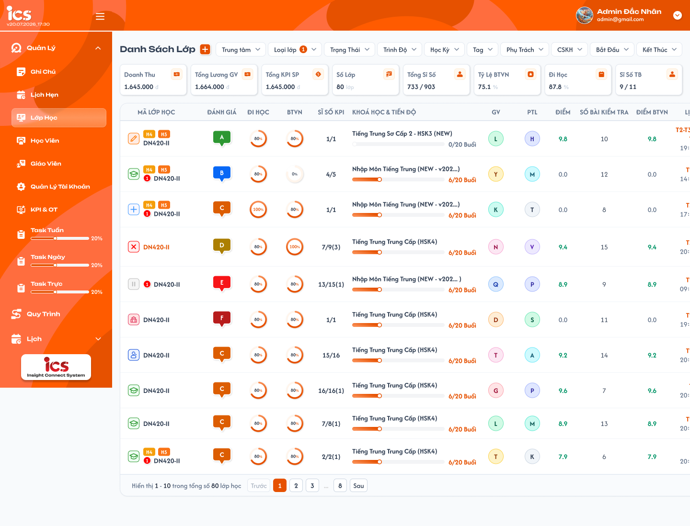
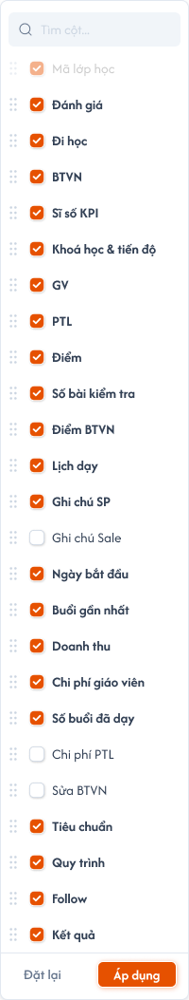
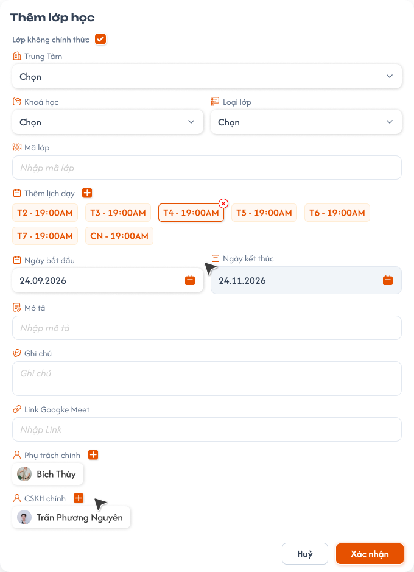
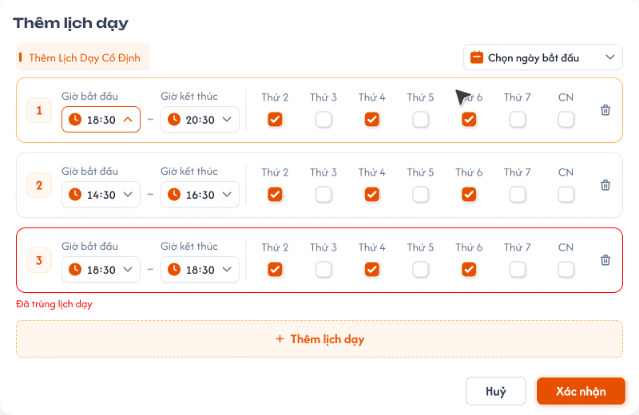
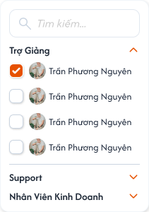
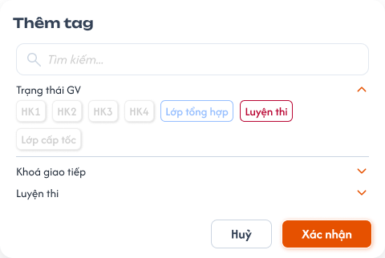
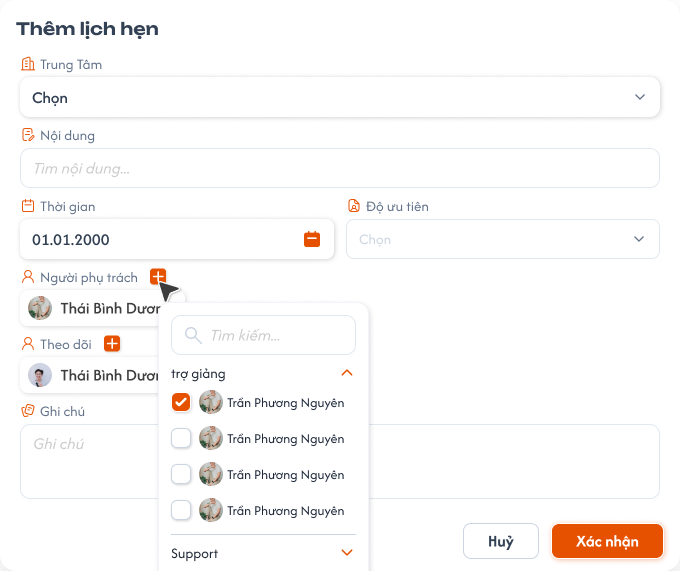

# Tạo lớp học

## 1. UI

### Trang 1: ADM-LOP-010000 — Danh sách lớp học



**Mô tả:**
- Màn Danh sách lớp, nơi `Admin` hoặc `Class Handler` bấm nút `+` để mở popup `Thêm Lớp Học`. Màn danh sách được đặc tả riêng tại `class_management_requirements.md`; requirement này chỉ đặc tả popup tạo lớp, lịch dạy cố định và trạng thái ban đầu của lớp.

**Điểm cần lưu ý:**
- Chỉ role `Admin` và `Class Handler` thấy nút `+` và tạo được lớp; role khác không thấy và backend từ chối request trực tiếp.
- `A10.01`–`A10.04` Toast phản hồi CRUD: `Thành Công` (backend xác nhận thao tác thành công), `Thông Báo` (đã tiếp nhận, dữ liệu cần thời gian đồng bộ), `Cảnh Báo` (dữ liệu/điều kiện cần kiểm tra), `Có Lỗi Xảy Ra` (backend/network không hoàn tất). Nội dung dòng hai lấy từ flow CRUD tương ứng; mỗi thao tác một Toast; `Hủy` không có Toast CRUD; nút `×` đóng thủ công; không hiển thị dữ liệu nhạy cảm.


### Trang 2: ADM-LOP-010004 — Danh sách lớp học / Ẩn hiện cột



**Mô tả:**
- Dropdown chọn ẩn/hiện cột của bảng Danh sách lớp: ô `Tìm cột...`, danh sách cột (Mã lớp học, Đánh giá, Đi học, BTVN, Sĩ số KPI, Khoá học & tiến độ, GV, PTL, Điểm, Số bài kiểm tra, Điểm BTVN, Lịch dạy, Ghi chú SP, Ghi chú Sale, Ngày bắt đầu, Buổi gần nhất, Doanh thu, Chi phí giáo viên, Số buổi đã dạy, Chi phí PTL, Sửa BTVN, Tiêu chuẩn, Quy trình, Follow, Kết quả), nút `Đặt lại` và `Áp dụng`. Không thuộc phạm vi nghiệp vụ tạo lớp.

### Trang 3: ADM-LOP-010010 — Danh sách lớp học / Popup thêm lớp học



**Mô tả:**
- Popup `Thêm lớp học`: nhập thông tin lớp, chọn Trung tâm, Khóa học, Loại lớp, Ngày bắt đầu, Phụ trách chính, CSKH chính và thêm lịch dạy cố định; `Xác Nhận` tạo đúng một lớp.

**Điểm cần lưu ý:**
- Sáu field bắt buộc: `Trung tâm`, `Khóa học`, `Loại lớp`, `Phụ trách chính`, `CSKH chính`, `Mô tả`; thiếu hoặc text chỉ có khoảng trắng thì không gửi/lưu và báo lỗi tại đúng field. Backend kiểm tra lại toàn bộ field và role của người được gán.
- `A01.01` Lớp không chính thức: không có checkbox riêng; lớp không chính thức là lớp có `Loại lớp` = `Lớp demo`. `Admin` và `Class Handler` đều được chọn để tạo lớp test; lớp test mở toàn bộ bài học/bài kiểm tra, bỏ qua điều kiện nghiệp vụ khi đổi trạng thái (lịch dạy, Meet, Tiêu chuẩn GV, Quy trình lớp, hóa đơn học phí) nhưng vẫn kiểm tra quyền, phạm vi, định dạng dữ liệu. Sau khi tạo là `Lớp demo` thì không đổi sang `Lớp chung`/`Lớp 1-1`. Trạng thái ban đầu vẫn theo lịch dạy (`Mới tạo`/`Khai giảng`).
- `A01.02` Trung tâm: bắt buộc; lớp thuộc trung tâm đã chọn; danh sách `Khóa học` lấy theo trung tâm; backend kiểm tra lại khi lưu.
- `A01.03` Khóa học: bắt buộc; chỉ chọn từ danh sách đã define, không nhập tự do. Không tải được danh sách hoặc khóa học thiếu cấu hình Số buổi thì không tạo lớp.
- `A01.04` Số buổi: tự hiển thị sau khi chọn khóa = tổng số buổi các học kỳ đang `Công khai` của khóa (học kỳ `Nháp` không tính); đổi khóa thì cập nhật lại; người dùng không sửa; không dùng số khung giờ lịch dạy thay Số buổi.
- `A01.05` Loại lớp: bắt buộc; ba giá trị `Lớp chung`, `Lớp 1-1`, `Lớp demo`; backend từ chối giá trị khác. `Lớp 1-1` là giá trị phân loại, không giới hạn một học viên (có thể 0, 1 hoặc nhiều).
- `A01.06` Mã lớp: hệ thống tự sinh, duy nhất toàn hệ thống; không có ô nhập, backend không nhận Mã lớp từ client; nếu mã sinh trùng (kể cả lớp đã xóa) thì backend sinh mã khác, không báo lỗi người dùng.
- `A01.07` Ngày bắt đầu / Ngày kết thúc: người dùng nhập Ngày bắt đầu (là buổi 1); Ngày kết thúc chỉ đọc, tự lấy ngày buổi cuối sau khi sinh đủ lịch, chưa có lịch thì trống, tính lại khi đổi khóa/ngày/mẫu lịch; backend không nhận giá trị client gửi.
- `A01.08` Mô tả: bắt buộc, không rỗng/chỉ khoảng trắng, không giới hạn ký tự.
- `A01.09` Ghi chú: không bắt buộc, không giới hạn ký tự.
- `A01.10` Link Google Meet: nhập được khi tạo; nếu có phải là URL HTTP(S) hợp lệ; không bắt buộc để tạo lớp hoặc ở `Khai giảng`, bắt buộc trước khi chuyển sang `Đang học`.
- `A01.11` Phụ trách chính: bắt buộc; chỉ chọn người dùng đang hoạt động có role `Class Handler`.
- `A01.12` CSKH chính: bắt buộc; chỉ chọn người dùng đang hoạt động có role `Support`.
- `A01.13` Thêm lịch dạy: nút `+` mở popup `Thêm Lịch Dạy Cố Định`; lịch đã xác nhận hiển thị thành chip trong popup tạo lớp và xóa được trước khi lưu. Lịch chỉ về popup chính khi bấm `Xác Nhận` ở popup lịch.
- `A01.14` Hủy: đóng popup, không tạo lớp, không lưu dữ liệu đang nhập.
- `A01.15` Xác Nhận: kiểm tra dữ liệu, tạo đúng một lớp và xác định trạng thái ban đầu theo lịch dạy: không có lịch thì `Mới tạo`; có ít nhất một lịch hợp lệ thì `Khai giảng`; Link Meet không quyết định trạng thái này. Bấm nhiều lần/gửi lặp không tạo lớp trùng; thất bại không lưu lớp hay lịch một phần. Lớp `Mới tạo` được thêm lịch hợp lệ sau đó tự chuyển `Khai giảng`; không cho `Mới tạo` sang `Khai giảng` khi chưa có lịch.
- Điều kiện `Khai giảng` sang `Đang học` (thực hiện ở Chi tiết lớp, chỉ `Class Handler`): có Link Google Meet, đạt Tiêu chuẩn GV, hoàn tất Quy trình lớp, có ít nhất 1 học viên `Đang học` và tất cả học viên đó đáp ứng học phí; thiếu thì giữ `Khai giảng` và báo điều kiện còn thiếu. Học viên chuyển sang `Đang học` phải đã có hóa đơn học phí. Cách xác định “đã đóng học phí” theo requirement học phí riêng. Lớp `Lớp demo` không áp dụng các điều kiện này.

### Trang 4: ADM-LOP-010020 — Danh sách lớp học / Popup thêm lịch dạy cố định



**Mô tả:**
- Popup `Thêm Lịch Dạy Cố Định`: khai báo mẫu lịch lặp để sinh đủ số buổi của khóa học.

**Điểm cần lưu ý:**
- Chọn ngày bắt đầu áp dụng lịch; thêm được một hoặc nhiều khung giờ, mỗi khung gồm Giờ bắt đầu, Giờ kết thúc và ít nhất một ngày từ Thứ 2 đến Chủ Nhật; xóa từng khung và thêm khung mới trước khi xác nhận.
- Ngày bắt đầu được tính là buổi 1, nên thứ/ngày chọn phải có một buổi vào Ngày bắt đầu; không tự lấy ngày sau làm buổi 1. Lịch lặp theo các ngày/khung giờ đã chọn, sinh đúng Số buổi của khóa rồi dừng (vd 24 buổi thì buổi 24 là buổi cuối, không dừng ở 23 hay sinh buổi 25).
- Giờ kết thúc phải sau Giờ bắt đầu. Khung giờ trùng (hiển thị `Đã trùng lịch dạy`) thì không cho xác nhận, lỗi hiển thị tại khung liên quan.
- `Huỷ` không đưa lịch đang nhập về popup tạo lớp; `Xác nhận` đưa lịch hợp lệ về popup tạo lớp nhưng chưa tạo lớp.

### Trang 5: ADM-LOP-010002 — Danh sách lớp học / Dropdown chọn nhân sự (đang mở)



**Mô tả:**
- Bộ chọn người dùng có ô `Tìm kiếm...`, nhóm theo role (trợ giảng, Support, Nhân viên kinh doanh…), dùng để gán `Phụ trách chính` và `CSKH chính`.

**Điểm cần lưu ý:**
- Tìm kiếm người dùng theo tên hoặc thông tin định danh được hệ thống hỗ trợ. `Phụ trách chính` chỉ hiển thị/cho chọn người dùng đang hoạt động có role `Class Handler`; `CSKH chính` chỉ role `Support`. Không cho chọn sai role bằng UI hay request trực tiếp.
- Chỉ lưu lựa chọn vào đúng field đang thao tác, không tự gán cùng lựa chọn cho field khác.

### Trang 6: ADM-LOP-010040 — Danh sách lớp học / Popup thêm tag



**Mô tả:**
- Popup `Thêm tag` ở Danh sách lớp: ô `Tìm kiếm...`, danh sách tag (Trạng thái GV, HK1–HK4, Lớp tổng hợp, Luyện thi, Lớp cấp tốc, Khoá giao tiếp), nút `Huỷ` và `Xác nhận`. Requirement tạo lớp không đặc tả popup này.

### Trang 7: ADM-LOP-010050 — Danh sách lớp học / Popup thêm lịch hẹn



**Mô tả:**
- Popup `Thêm lịch hẹn` ở Danh sách lớp: Trung Tâm, Nội dung (tìm nội dung), Thời gian, Độ ưu tiên, Người phụ trách (chọn từ bộ chọn nhân sự), Theo dõi, Ghi chú, nút `Huỷ` và `Xác nhận`. Requirement tạo lớp không đặc tả popup này.

---

## 2. Yêu cầu

### 2.1. Flow chính

**Flow 1 / REQ01–REQ04: Tạo lớp học**

```
Admin / Class Handler bấm nút + tại Danh sách lớp → Popup tải danh sách Khóa học đã define
  → Chọn Trung tâm, Khóa học (hiển thị đúng Số buổi), Loại lớp (có thể chọn Lớp demo để tạo lớp test)
  → Nhập Mô tả; chọn Phụ trách chính (Class Handler), CSKH chính (Support); Mã lớp do hệ thống tự sinh
  → Có thể thêm lịch dạy cố định
  → Hủy: đóng popup, không tạo lớp
  → Xác Nhận: backend kiểm tra quyền, dữ liệu, Khóa học, Số buổi, lịch dạy
       ↓ (không có lịch dạy)              ↓ (có lịch dạy hợp lệ)
  Tạo lớp trạng thái Mới tạo         Tạo lớp trạng thái Khai giảng
  → Thành công: thêm lớp vào danh sách, notification thành công
  → Thất bại: không tạo lớp một phần, không tạo trùng do gửi lặp
```

### 2.2. Ngoại lệ

- **EX01:** Người dùng không có role `Admin` hoặc `Class Handler` gửi request tạo lớp trực tiếp → backend từ chối, không tạo dữ liệu.
- **EX02:** Danh sách Khóa học tải lỗi hoặc khóa học thiếu cấu hình Số buổi → không cho tạo lớp; hiển thị lỗi và cho phép thử lại.
- **EX03:** Lịch dạy có giờ không hợp lệ, không bao gồm Ngày bắt đầu hoặc bị trùng → không đưa lịch lỗi về popup chính và không tạo lớp.
- **EX04:** Request tạo lớp thất bại hoặc bị gửi lặp → không tạo lớp một phần hoặc nhiều lớp trùng; hiển thị đúng một notification kết quả.
- **EX05:** Request chuyển trạng thái lớp/học viên không thỏa điều kiện → backend từ chối, giữ nguyên trạng thái và trả đúng điều kiện còn thiếu.
- **EX06:** Người không có role `Admin` hoặc `Class Handler` gửi request tạo lớp với Loại lớp `Lớp demo`, hoặc client cố giả lập lớp test → backend từ chối; không tạo lớp test hay dữ liệu một phần.
- **EX07:** Thiếu `Trung tâm`, `Khóa học`, `Loại lớp`, `Phụ trách chính`, `CSKH chính` hoặc `Mô tả` → không tạo lớp, trả lỗi đúng field thiếu.
- **EX08:** Request gán `Phụ trách chính` không có role `Class Handler`, hoặc `CSKH chính` không có role `Support` → backend từ chối, không tạo lớp.
- **EX09:** Request gửi loại lớp ngoài `Lớp chung`/`Lớp 1-1`/`Lớp demo`, Link Google Meet không phải URL HTTP(S), hoặc cố ghi đè Ngày kết thúc → backend từ chối, không tạo lớp.
- **EX10:** Khóa học hoặc người dùng được chọn đã ngừng hoạt động, không còn tồn tại hoặc ngoài phạm vi người tạo tại thời điểm xác nhận → backend từ chối toàn bộ request, không tạo lớp một phần, yêu cầu chọn lại.
- **EX11:** Mã lớp tự sinh trùng với lớp đã tồn tại (kể cả lớp đã xóa) → backend sinh mã khác, không tạo lớp trùng mã và không báo lỗi người dùng.

### 2.3. Yêu cầu khác

| Mã | Tên yêu cầu | Mô tả |
|---|---|---|
| REQ01 | Dữ liệu tạo lớp | Sáu field bắt buộc: `Trung tâm`, `Khóa học`, `Loại lớp`, `Phụ trách chính`, `CSKH chính`, `Mô tả`. Mã lớp hệ thống tự sinh, duy nhất toàn hệ thống; người dùng không nhập, backend không nhận Mã lớp từ client. Backend kiểm tra lại dữ liệu, không tin trạng thái, Số buổi hay người phụ trách do client gán. |
| REQ02 | Khóa học và Số buổi | Khóa học chỉ lấy từ dữ liệu define. Số buổi của khóa = tổng số buổi các học kỳ `Công khai` (học kỳ `Nháp` không tính). Số buổi của lớp bằng Số buổi của khóa; người dùng không tự nhập. |
| REQ03 | Lịch dạy cố định | Ngày bắt đầu là buổi 1. Hệ thống sinh các buổi tiếp theo theo lịch cố định, đủ đúng Số buổi của khóa rồi dừng. |
| REQ04 | Trạng thái ban đầu | Không có lịch dạy tạo `Mới tạo`; có lịch dạy hợp lệ tạo `Khai giảng`. Thêm lịch hợp lệ cho lớp `Mới tạo` tự chuyển sang `Khai giảng`. |
| REQ05 | Điều kiện Đang học | Chỉ `Class Handler` đổi trạng thái lớp. Sang `Đang học` cần Meet, Tiêu chuẩn GV, Quy trình lớp, ít nhất 1 học viên `Đang học` và toàn bộ nhóm này đáp ứng học phí. Học viên chỉ chuyển sang `Đang học` khi hồ sơ đáp ứng requirement học phí riêng (có hóa đơn học phí). |
| REQ06 | Notification | Tạo lớp, thêm lịch, chuyển trạng thái thành công/thất bại hiển thị đúng một notification sau kết quả backend. Hủy popup không có notification CUD. |
| REQ07 | Lớp không chính thức | Là lớp có Loại lớp `Lớp demo`; `Admin` và `Class Handler` đều được chọn để tạo lớp test. Lớp test mở toàn bộ bài học/bài kiểm tra và bỏ qua điều kiện nghiệp vụ khi đổi trạng thái. Role khác không được tạo. Lớp demo không được đổi sang loại lớp chính thức. |
| REQ08 | Phân quyền tạo lớp | Chỉ `Admin` và `Class Handler` được tạo lớp; backend từ chối mọi role khác. |
| REQ09 | Role phụ trách | `Phụ trách chính` bắt buộc role `Class Handler`; `CSKH chính` bắt buộc role `Support`. |
| REQ10 | Ngày kết thúc | Chỉ đọc, tự lấy ngày buổi cuối sau khi sinh đủ số buổi; không có lịch thì trống; không nhận giá trị client gửi. |
| REQ11 | Loại lớp | Chỉ `Lớp chung`, `Lớp 1-1`, `Lớp demo`; lưu độc lập với sĩ số; `Lớp 1-1` có thể có nhiều học viên. |
| REQ12 | Trung tâm | Bắt buộc chọn `Trung tâm`; bản ghi thuộc trung tâm đã chọn; backend kiểm tra lại khi lưu; danh sách Khóa học trong popup lấy theo trung tâm. |

### 2.4. Ràng buộc

#### Quyền

| Role | Mở popup tạo lớp | Tạo lớp chính thức | Tạo lớp không chính thức | Chọn Phụ trách chính/CSKH chính |
|---|:---:|:---:|:---:|:---:|
| Admin | ✅ | ✅ | ✅ | ✅ |
| Class Handler | ✅ | ✅ | ✅ | ✅ |
| Các role khác | ❌ | ❌ | ❌ | ❌ |

#### Ràng buộc khác

- Role bị đánh dấu ❌ không thực hiện được bằng cách mở URL, sửa giao diện hay gửi request trực tiếp. Quyền tạo lớp test không làm mất yêu cầu kiểm tra role và phạm vi dữ liệu.
- Backend kiểm tra role tạo lớp, cho cả hai role gán `Lớp demo`, và kiểm tra phạm vi dữ liệu trước khi lưu. Khóa học, người dùng được chọn và dữ liệu liên quan phải thuộc phạm vi người tạo được phép dùng.
- Khóa học, lớp, lịch dạy, người phụ trách, CSKH, học viên liên kết bằng định danh nội bộ; không dùng tên hoặc mã hiển thị làm khóa phân quyền/cập nhật.
- Mô tả/Ghi chú lưu và hiển thị an toàn, không thực thi HTML/script.
- Chỉ thông báo thành công sau khi backend xác nhận toàn bộ lớp và lịch đã lưu; không lưu lớp một phần nếu tạo lớp hoặc lưu lịch thất bại.
- Mỗi thao tác tạo lớp chỉ một notification kết quả; request gửi lặp không tạo lớp hay notification thành công trùng; notification không chứa stack trace, token, định danh nội bộ hoặc thông tin kỹ thuật nhạy cảm.

---

## 3. Testcase

### Feature: Tạo lớp học

| Tên testcase | Priority | Scenario | Role | Pre-condition | Given/When/Then | Expected Result |
|---|---|---|---|---|---|---|
| Case 1: Mở popup và hủy | High | Flow 1 / REQ01 / REQ08 | Admin / Class Handler | Đang ở Danh sách lớp | **Given:** bấm nút `+`<br>**When:** popup hiển thị rồi chọn `Hủy`<br>**Then:** đóng popup mà không tạo lớp | - Hiển thị đủ field, không có ô nhập Mã lớp<br>- Không gửi request tạo lớp, dữ liệu không đổi, không có notification CUD |
| Case 2: Khóa học quyết định Số buổi | High | REQ02 / EX02 | Admin / Class Handler | Khóa A có học kỳ Công khai 24 buổi và Nháp 12 buổi; khóa B có 2 học kỳ Công khai tổng 36 buổi; một trường hợp danh sách khóa lỗi hoặc thiếu Số buổi | **Given:** popup mở<br>**When:** chọn A rồi đổi sang B; xác nhận khi cấu hình lỗi<br>**Then:** Số buổi cập nhật theo khóa | - Số buổi lần lượt 24 rồi 36, chỉ cộng học kỳ Công khai, không cho nhập số khác<br>- Cấu hình lỗi thì không tạo lớp, báo lỗi và cho thử lại |
| Case 3: Sinh đủ lịch và tính Ngày kết thúc | High | REQ03 / REQ10 | Admin / Class Handler | Khóa 24 buổi; Ngày bắt đầu phù hợp lịch đã chọn | **Given:** nhập Ngày bắt đầu và chọn lịch cố định<br>**When:** hệ thống sinh lịch<br>**Then:** xếp đến đủ buổi 24 | - Đúng 24 buổi, buổi 1 là Ngày bắt đầu, buổi 24 là cuối, không sinh buổi 25<br>- Ngày kết thúc chỉ đọc bằng ngày buổi 24, tính lại khi đổi khóa/lịch; giá trị client gửi bị từ chối |
| Case 4: Validation khung giờ lịch cố định | High | EX03 / REQ03 | Admin / Class Handler | Popup lịch đang mở | **Given:** thêm nhiều khung giờ; giờ trùng, Giờ kết thúc không sau Giờ bắt đầu, hoặc thứ chọn không có buổi vào Ngày bắt đầu<br>**When:** bấm `Xác nhận`<br>**Then:** không cho xác nhận | - Lỗi hiển thị đúng khung giờ, lịch lỗi không về popup chính<br>- Không tự lấy ngày sau làm buổi 1<br>- `Huỷ` không lưu lịch |
| Case 5: Sáu field bắt buộc và Trung tâm | High | EX07 / REQ01 / REQ12 | Admin / Class Handler | Popup tạo lớp đang mở | **Given:** lần lượt bỏ trống từng field bắt buộc hoặc nhập text chỉ có khoảng trắng; sau đó chọn trung tâm A<br>**When:** bấm `Xác Nhận`<br>**Then:** thiếu thì không tạo, đủ thì tạo | - Báo lỗi đúng field (Trung tâm, Khóa học, Loại lớp, Phụ trách chính, CSKH chính, Mô tả); backend vẫn từ chối request thiếu<br>- Lớp mới thuộc trung tâm A: lọc A thấy, lọc B không thấy |
| Case 6: Validation Mô tả, Meet và Mã lớp tự sinh | High | EX09 / EX11 / REQ01 | Admin / Class Handler | Popup tạo lớp đang mở | **Given:** Mô tả rỗng hoặc Meet không phải URL HTTP(S); sau đó nhập hợp lệ<br>**When:** bấm `Xác Nhận`<br>**Then:** validate đúng field và tự sinh Mã lớp khi thành công | - Rỗng/URL sai thì không tạo lớp<br>- Mã lớp tự sinh, không trùng; mã sinh trùng thì backend sinh mã khác, không báo lỗi<br>- Không giới hạn ký tự text |
| Case 7: Chọn đúng Phụ trách chính và CSKH chính | High | REQ09 / EX08 / EX10 | Admin / Class Handler | Có người dùng role Class Handler, Support, role khác; một người đã ngừng hoạt động hoặc ngoài phạm vi | **Given:** mở bộ chọn từng field, tìm kiếm và chọn; client sửa request gán sai role; người được chọn không còn hợp lệ trước khi xác nhận<br>**When:** gửi request tạo lớp<br>**Then:** chỉ nhận đúng role và dữ liệu hợp lệ | - Phụ trách chính chỉ Class Handler, CSKH chính chỉ Support, không sao chép lựa chọn giữa hai field<br>- Sai role hoặc ngoài phạm vi: backend từ chối toàn bộ, không tạo lớp một phần, báo đúng field, cho chọn lại |
| Case 8: Loại lớp và lớp không chính thức | High | REQ11 / REQ07 / EX09 | Admin / Class Handler | Popup tạo lớp đang mở | **Given:** xem danh sách Loại lớp, chọn `Lớp demo` và tạo; gửi loại lớp khác ba giá trị<br>**When:** gửi request<br>**Then:** chỉ chấp nhận ba loại | - Cả Admin và Class Handler thấy `Lớp chung`, `Lớp 1-1`, `Lớp demo`; backend từ chối giá trị khác<br>- Lớp demo: mở ngay toàn bộ bài học/bài kiểm tra, đổi trạng thái không cần lịch, Meet, tiêu chuẩn, quy trình, học phí nhưng vẫn kiểm tra quyền<br>- Lớp demo không đổi sang loại chính thức; `Lớp 1-1` không bị giới hạn sĩ số |
| Case 9: Trạng thái ban đầu theo lịch dạy | High | REQ04 | Admin / Class Handler | Dữ liệu bắt buộc hợp lệ | **Given:** tạo lớp không lịch (có hoặc không Meet); tạo lớp có lịch hợp lệ<br>**When:** tạo thành công<br>**Then:** xác định trạng thái | - Không lịch: `Mới tạo` (Meet không đổi trạng thái)<br>- Có lịch: `Khai giảng`, lịch lưu đúng lớp, Meet chưa có không đưa về `Mới tạo`<br>- Một notification thành công |
| Case 10: Thêm lịch cho lớp Mới tạo | High | REQ04 | Role được cấp quyền sửa lớp | Lớp `Mới tạo` chưa có lịch | **Given:** thêm lịch hợp lệ; một trường hợp gửi trực tiếp chuyển sang `Khai giảng` khi chưa có lịch<br>**When:** backend lưu/kiểm tra<br>**Then:** tự chuyển hoặc từ chối | - Thêm lịch thành công thì tự `Khai giảng`, lịch và trạng thái cùng lớp; lưu lỗi vẫn `Mới tạo`<br>- Chuyển trực tiếp khi chưa có lịch bị từ chối, báo thiếu lịch dạy |
| Case 11: Chuyển Đang học | High | REQ05 / EX05 | Class Handler | Lớp `Khai giảng`; một trường hợp đủ Meet, Tiêu chuẩn GV, Quy trình, ≥1 học viên Đang học đủ học phí; trường hợp khác thiếu điều kiện; học viên chưa có hóa đơn | **Given:** Bắt đầu lớp; chọn `Đang học` cho học viên chưa có hóa đơn<br>**When:** xác nhận<br>**Then:** kiểm tra điều kiện | - Đủ điều kiện thì sang `Đang học`, kiểm tra từng học viên Đang học, không yêu cầu học phí học viên chưa Đang học<br>- Thiếu thì giữ `Khai giảng`, báo đúng điều kiện/học viên chưa đạt, không cập nhật một phần<br>- Học viên chưa có hóa đơn bị từ chối, yêu cầu thêm hóa đơn trước |
| Case 12: Tạo lớp thất bại hoặc gửi lặp | High | EX04 / REQ06 | Admin / Class Handler | Dữ liệu hợp lệ; mô phỏng backend lỗi hoặc bấm `Xác Nhận` nhiều lần | **Given:** một thao tác tạo lớp đang xử lý<br>**When:** request thất bại hoặc gửi lặp<br>**Then:** không tạo dữ liệu một phần hay lớp trùng | - Thất bại không tạo lớp, không lưu lịch dở dang<br>- Gửi lặp tạo tối đa một lớp, đúng một notification, không chứa thông tin kỹ thuật nhạy cảm |
| Case 13: Chặn role khác tạo lớp | High | EX01 / EX06 / REQ08 / Ràng buộc quyền | Support / role khác | Tài khoản Admin, Class Handler, Support và role khác hoạt động | **Given:** truy cập Danh sách lớp<br>**When:** kiểm tra nút `+` và gửi request tạo lớp (kể cả `Lớp demo`)<br>**Then:** chỉ Admin, Class Handler được tạo | - Admin, Class Handler thấy `+` và tạo được lớp hợp lệ<br>- Role khác không thấy thao tác, backend từ chối, không phát sinh dữ liệu hay lớp test một phần |

---

## 4. Câu hỏi cần xác nhận

- **Q01:** Nội dung chính xác của notification khi tạo lớp thành công hoặc thất bại?
