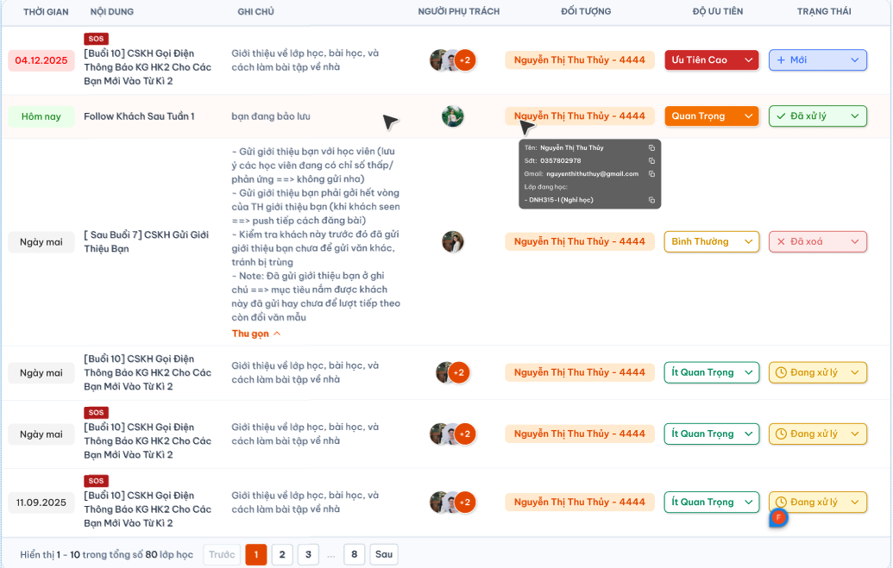

# Chi tiết lớp học — Menu Nhật ký — Tab Lịch hẹn

Tab **Chi tiết lớp học → Menu Nhật ký → Lịch Hẹn** hiển thị cùng bản ghi lịch hẹn lớp từ [Danh sách lớp](./class_management_requirements.md#popup-them-lich-hen-cho-lop) và [menu Lịch Hẹn](../../appointment_requirement/appointment_requirements.md). Đối tượng của tab Hẹn lớp là **lớp**, không phải học viên/học phí. Người trong `Người phụ trách` được sửa; `Theo dõi` chỉ xem. Quy tắc trạng thái, ưu tiên và xóa theo requirement Lịch Hẹn mới. Tab [Nhật Ký](./class_detail_journal_requirements.md) và [Ghi Chú](./class_detail_notes_requirements.md) có requirement riêng.

## 1. UI

### Trang 1: Tab Lịch Hẹn — Danh sách lịch hẹn của lớp


*Ảnh tham chiếu bảng Lịch Hẹn do người dùng cung cấp — nhấn để xem ảnh gốc*

**Mô tả:**

- Chọn tab `Lịch Hẹn` trong menu Nhật ký để xem các lịch hẹn đã thêm cho chính lớp đang mở ở Danh sách lớp học.
- Danh sách phản ánh dữ liệu đã lưu của lịch hẹn: Nội dung, Thời gian, Ghi chú, Người phụ trách, Đối tượng, Độ ưu tiên và Trạng thái.
- Admin, Class Handler và Support có quyền trên lớp được xem tab theo quyền menu Nhật ký đã chốt. Sale không được vào tab, kể cả có quyền lịch hẹn tại Danh sách lớp hoặc được gán phụ trách/Theo dõi.

**Giải thích field/thành phần:**

- `A01.01` **Tab Lịch Hẹn**: Hiển thị trạng thái đang chọn trong nhóm Nhật Ký / Ghi Chú / Lịch Hẹn / Tin Nhắn. Chuyển tab không tạo lịch hẹn mới.
- `A01.02` **Thời gian**: Ngày thực hiện lịch hẹn, lấy từ field Thời gian đã lưu; không lấy ngày tạo/cập nhật. Ngày trùng ngày hiện tại hiển thị `Hôm nay`, ngày liền sau hiển thị `Ngày mai`; các ngày khác hiển thị `dd.MM.yyyy` theo ảnh. Giữ nguyên dữ liệu giờ đã lưu ở nguồn. Quy tắc màu và hiển thị giờ cần chốt riêng.
- `A01.03` **Nội dung**: Hiển thị nội dung đã nhập; dài thì xuống dòng. `SOS` là cờ riêng hiển thị khi lịch hẹn được đánh dấu Rất quan trọng, không phải mức ưu tiên thứ năm hay trạng thái xử lý.
- `A01.04` **Ghi chú**: Hiển thị Ghi chú đã lưu; giữ xuống dòng và bố cục nội dung. Nội dung dài cho mở rộng/`Thu gọn` ngay trong dòng như ảnh, không làm thay đổi dữ liệu.
- `A01.05` **Người phụ trách**: Hiển thị đúng các user được chọn ở field Người phụ trách của lịch hẹn; nhiều người dùng nhóm avatar và `+N` cho số người còn lại như ảnh. Không thay bằng người tạo hoặc người phụ trách chính của lớp.
- `A01.06` **Đối tượng**: Hiển thị **lớp** được gắn với lịch hẹn, dùng mã lớp/tên lớp đúng nguồn; không thay bằng học viên, học phí hoặc người phụ trách.
- `A01.07` **Độ ưu tiên**: Bốn mức chính thức: `Ưu tiên thấp`, `Bình thường`, `Quan trọng`, `Ưu tiên cao`. Chỉ owner được đổi trực tiếp; người khác chỉ xem.
- `A01.08` **Trạng thái**: Có `Mới`, `Chưa xử lý`, `Đang xử lý`, `Đã xử lý` với icon/màu theo UI mới. Không có `Đã xoá`; xóa dùng biểu tượng thùng rác ở cuối hàng và popup xác nhận tại menu Lịch Hẹn.
- `A01.09` **Người theo dõi**: Giữ dữ liệu đã chọn ở nguồn; ảnh bảng chưa thể hiện cột Theo dõi riêng. Không gộp user Theo dõi vào Người phụ trách; vị trí hiển thị Theo dõi cần xác nhận.
- `A01.10` **Trạng thái tải**: Phân biệt đang tải, không có lịch hẹn và tải lỗi. Lỗi cho thử lại, không hiển thị dữ liệu lớp cũ như của lớp mới.

**Điểm cần lưu ý:**

- Lịch hẹn tạo thành công ở Danh sách lớp phải xuất hiện khi tải lại tab của đúng lớp; hủy hoặc tạo thất bại không sinh dòng mới.
- Cùng một lịch hẹn có cùng định danh, nội dung, thời gian, phân công, độ ưu tiên và trạng thái giữa các màn hình. Không sao chép sang bản ghi khác hoặc ghi đè người tạo lúc xem tab.
- Việc phân công Người phụ trách/Theo dõi vẫn theo nguồn: mỗi field cho nhiều user thuộc Class Handler, Support, Sale. Có người được gán không tự cấp quyền vào menu ngoài phạm vi đã chốt.
- Ngày tương đối dùng cùng múi giờ nghiệp vụ của hệ thống; đổi ngày hiện tại hoặc tải lại sẽ tính lại Hôm nay/Ngày mai. Ngày không bị đổi theo ngày tạo/cập nhật.
- Bấm mở rộng/Thu gọn hoặc xem avatar/Đối tượng chỉ thay đổi hiển thị. Dropdown ưu tiên/trạng thái cho owner chỉnh trực tiếp; ảnh chưa có editor Nội dung/Thời gian/Phân công nên cách chỉnh các field này cần chốt riêng.
- Tab này không tự thêm trạng thái `Đã xoá`; người có quyền xóa thực hiện qua danh sách ở menu Lịch Hẹn theo requirement mới.

### Trang 2: Phân trang danh sách lịch hẹn
**Mô tả:** Xem danh sách theo từng trang, footer và nút chuyển trang theo ảnh.

**Giải thích field/thành phần:**

- `A02.01` **Số dòng mỗi trang**: 50 lịch hẹn/trang theo footer ảnh; trang cuối có thể ít hơn.
- `A02.02` **Tổng số**: Tổng lịch hẹn được phép xem của lớp hiện tại; ảnh mẫu ghi lớp học nhưng ngữ cảnh này dùng `lịch hẹn`. Lịch hẹn đã xóa không còn trong danh sách/tổng.
- `A02.03` **Khoảng đang xem**: `Hiển thị 1 – 10 trong tổng số N lịch hẹn`, cập nhật theo trang thực tế; danh sách rỗng không hiển thị khoảng 1 – 10 giả.
- `A02.04` **Điều hướng**: Trước / số trang / dấu … / Sau theo UI; trang hiện tại nổi bật. Không cho chuyển ra ngoài phạm vi trang hợp lệ.
- `A02.05` **Thứ tự**: Giữ một thứ tự ổn định khi chuyển trang; tiêu chí thứ tự mặc định cần xác nhận.

**Điểm cần lưu ý:**

- Tổng số/trang chỉ tính dữ liệu đúng lớp và quyền xem. Chuyển sang lớp khác bắt đầu từ trang đầu.
- Chuyển trang không tạo/sửa/xóa lịch hẹn, không phát sinh Toast CRUD. Response của trang cũ không ghi đè trang vừa chọn.
- Nếu số trang giảm sau dữ liệu thay đổi, tải trang hợp lệ gần nhất; không để số trang đang chọn vượt quá tổng trang.

### Trang 3: Chỉnh sửa lịch hẹn — Chỉ owner
**Mô tả:** Owner được chỉnh lịch hẹn; Người theo dõi chỉ được xem trong phạm vi quyền, không có quyền sửa chỉ vì được gán Theo dõi.

**Giải thích field/thành phần:**

- `A03.01` **Dropdown Độ ưu tiên**: Owner chọn một trong 4 mức theo ảnh; lưu khi chọn giá trị mới. Người khác hiển thị giá trị chỉ đọc.
- `A03.02` **Dropdown Trạng thái**: Owner chọn `Mới`, `Chưa xử lý`, `Đang xử lý`, `Đã xử lý`; không có lựa chọn `Đã xoá`.
- `A03.03` **Quyền chỉnh**: Kiểm tra owner của chính lịch hẹn và quyền trên lớp; được gán Theo dõi hoặc có cùng role không tự được sửa. **Owner là các user được chọn ở Người phụ trách**, mỗi người có quyền sửa nếu đồng thời có role/phạm vi truy cập tab. Người tạo không tự có quyền sửa khi không ở Người phụ trách.
- `A03.04` **Đang lưu**: Chống thao tác/gửi lặp trên cùng field; chỉ cập nhật dữ liệu đã lưu sau phản hồi thành công.
- `A03.05` **Kết quả**: Thành công hiển thị một Toast `Thành Công` với `Cập nhật lịch hẹn thành công.`; thất bại một Toast `Có Lỗi Xảy Ra` với `Không thể cập nhật lịch hẹn. Vui lòng thử lại.`.

**Điểm cần lưu ý:**

- Request sửa phải kiểm tra lại owner, lớp và bản ghi tại backend. Giao diện chỉ đọc không thay thế việc kiểm tra quyền.
- Cập nhật dùng cùng bản ghi với lịch hẹn ở Danh sách lớp; không đổi người tạo, liên kết lớp, Người phụ trách/Theo dõi hoặc field khác khi chỉ đổi ưu tiên/trạng thái.
- Chọn lại giá trị hiện có không tạo thao tác cập nhật hoặc Toast mới. Lưu thất bại giữ/trả lại giá trị đã lưu, không báo thành công sớm.
- Mọi user trong Người phụ trách đều là owner, không chỉ người đầu tiên. Người theo dõi chỉ được sửa nếu đồng thời có trong Người phụ trách và có quyền vào tab; quyền sửa đến từ Người phụ trách. Người tạo/Admin không được vượt quy tắc owner.

### Trang 4: Toast phản hồi CRUD


*Toast theo UI dùng chung — nhấn để xem ảnh gốc*

**Mô tả:** Phản hồi sau thay đổi lịch hẹn, dùng component Toast chung.

**Giải thích field/thành phần:**

- `A04.01` **Thành công**: Tiêu đề: `Thành Công`; Nội dung/hành vi: `Cập nhật lịch hẹn thành công.` sau backend lưu.
- `A04.02` **Lỗi**: Tiêu đề: `Có Lỗi Xảy Ra`; Nội dung/hành vi: `Không thể cập nhật lịch hẹn. Vui lòng thử lại.` khi lưu lỗi.
- `A04.03` **Cảnh báo**: Tiêu đề: `Cảnh Báo`; Nội dung/hành vi: `Bạn không có quyền chỉnh sửa lịch hẹn này.` khi quyền owner bị từ chối lúc cập nhật.
- `A04.04` **Thông tin**: Tiêu đề: `Thông Báo`; Nội dung/hành vi: Chỉ dùng nếu có trạng thái đồng bộ bất đồng bộ thực tế theo component chung; không tạo thông báo khi chỉ xem.

**Điểm cần lưu ý:**

- Một thao tác logic có đúng một Toast kết quả, kể cả callback/gửi lặp; màu/icon/nút ×, vị trí và tự đóng theo component dùng chung.
- Toast không thay kiểm tra quyền/field. Đóng Toast không hoàn tác bản ghi; không lộ stack trace/thông tin kỹ thuật.
- Chỉ xem/chuyển trang/chọn lại giá trị cũ không tạo Toast CRUD. Tab không cho xóa hoặc khôi phục nên không có Toast xóa/khôi phục.

---

## 2. Yêu cầu

### 2.1. Flow chính

**Flow 1 / REQ01 / REQ02 / REQ04: Xem lịch hẹn đã thêm cho lớp**

```text
Người có quyền mở Chi tiết lớp → Nhật ký → Lịch Hẹn
      → Kiểm tra quyền tab và phạm vi lớp
      → Tải cùng các bản ghi lịch hẹn đã tạo cho lớp ở Danh sách lớp học
      → Hiển thị đúng Nội dung, Thời gian, Ghi chú, phân công, Đối tượng, ưu tiên và trạng thái
      → Mở rộng/Thu gọn chỉ thay đổi hiển thị
      → Tải lỗi cho thử lại; không tạo bản ghi hoặc Toast CRUD khi xem
```

**Flow 2 / REQ03 / REQ04: Chuyển trang**

```text
Danh sách lịch hẹn của lớp tải xong
      → Hiển thị 50 dòng/trang, tổng số theo đúng lớp/quyền
      → Người dùng chọn Trước/Sau/số trang hợp lệ
      → Tải và hiển thị trang đã chọn theo thứ tự ổn định
      → Chỉ nhận response đúng lớp/tab/trang hiện tại
```

**Flow 3 / REQ05 / REQ06: Owner chỉnh lịch hẹn**

```text
Owner có quyền trên lớp mở lịch hẹn của mình
      → Chọn độ ưu tiên hoặc trạng thái mới bằng dropdown
      → Kiểm tra role/phạm vi và user thuộc Người phụ trách của lịch hẹn
      → Chỉ cho 4 mức ưu tiên và Mới/Chưa xử lý/Đang xử lý/Đã xử lý; không có trạng thái Đã xoá
      → Kiểm tra lớp/bản ghi; chống gửi lặp
      → Thành công: lưu cùng bản ghi, cập nhật hiển thị và Toast Cập nhật lịch hẹn thành công.
      → Thất bại: giữ/trả giá trị đã lưu, một Toast lỗi; không đổi dữ liệu khác
      → Người theo dõi không phải owner chỉ xem, request sửa bị từ chối
```

### 2.2. Ngoại lệ

- **EX01:** Không có quyền tab hoặc lớp → từ chối xem kể cả URL/request trực tiếp, không trả dữ liệu hoặc tổng số ngoài quyền.
- **EX02:** Tải danh sách/trang lỗi → hiển thị lỗi và Thử lại, không coi dữ liệu là rỗng hoặc tạo dòng thay thế.
- **EX03:** Response thuộc lớp/tab/trang cũ → không cập nhật vào màn hiện tại.
- **EX05:** Không phải owner hoặc mất quyền sửa lúc lưu → từ chối request, dữ liệu không đổi, Toast Cảnh Báo; làm mới quyền control.
- **EX06:** Cập nhật thất bại/lặp → không lưu một phần; giữ giá trị đã lưu và một Toast lỗi, cho thử lại.
- **EX07:** Request đặt trạng thái `Đã xoá` → từ chối; xóa lịch hẹn thực hiện bằng thao tác riêng có xác nhận ở menu Lịch Hẹn.
- **EX04:** Dữ liệu enum ưu tiên/trạng thái chưa thống nhất giữa nguồn và tab → không tự ánh xạ hoặc cập nhật bản ghi sang giá trị khác; thống nhất bộ dữ liệu trước triển khai.

### 2.3. Yêu cầu khác

| Mã | Tên yêu cầu | Mô tả |
|---|---|---|
| REQ01 | Cùng dữ liệu lịch hẹn lớp | Tab hiển thị các lịch hẹn đã lưu từ popup tại Danh sách lớp, liên kết đúng lớp và định danh bản ghi. Tạo thành công được nhìn thấy khi tải lại; hủy/thất bại không thêm dòng. Không phát sinh lịch hẹn mới khi xem hoặc chuyển tab. |
| REQ02 | Hiển thị theo UI | Đủ 7 cột; Nội dung/Ghi chú giữ text và xuống dòng; Người phụ trách đúng danh sách đã gán; ngày lấy thời gian hẹn, hiển thị Hôm nay/Ngày mai hoặc dd.MM.yyyy và chuyển đỏ khi tới hạn. Ưu tiên có bốn mức mới, trạng thái có Mới/Chưa xử lý/Đang xử lý/Đã xử lý. Đối tượng là lớp liên kết; SOS hiển thị khi lịch hẹn được đánh dấu Rất quan trọng. |
| REQ03 | Phân trang | 50 lịch hẹn/trang, footer dùng đơn vị lịch hẹn, tổng số và trang trong phạm vi dữ liệu được phép xem. Giữ thứ tự ổn định, không vượt biên, response cũ không ghi đè. |
| REQ04 | Quyền và liên kết | Kiểm tra quyền tab, lớp và bản ghi trên UI/backend; giữ người tạo thực tế, Người phụ trách và Người theo dõi như nguồn. Thay đổi màn hiển thị không tự thay đổi quyền, lớp liên kết hoặc owner. |
| REQ05 | Chỉ owner chỉnh | Owner là các user ở Người phụ trách; Người theo dõi chỉ xem, người tạo không mặc nhiên được sửa nếu tự gỡ khỏi Người phụ trách. Dropdown Ưu tiên/Trạng thái cập nhật cùng bản ghi và kiểm tra quyền ở UI/backend; không có trạng thái `Đã xoá`. Xóa bằng biểu tượng thùng rác cố định ở cuối hàng, không cần hover, và xác nhận ở menu Lịch Hẹn. |
| REQ06 | Notification | Cập nhật có đúng một Toast kết quả theo khu vực Toast; chỉ thành công sau lưu. Chỉ đọc/chọn lại giá trị không có Toast CRUD; lỗi giữ dữ liệu đã lưu để thử lại. |

### 2.4. Ràng buộc

#### Quyền

| Role | Xem tab trong phạm vi lớp | Mở rộng/Thu gọn và phân trang | Chỉnh khi thuộc Người phụ trách | Chỉnh nếu chỉ Theo dõi | Xóa/Khôi phục tại tab |
|---|:---:|:---:|:---:|:---:|:---:|
| Admin | ✅ | ✅ | ✅ | ❌ | ❌ |
| Class Handler | ✅ | ✅ | ✅ | ❌ | ❌ |
| Support | ✅ | ✅ | ✅ | ❌ | ❌ |
| Sale và các role khác | ❌ | ❌ | ❌ | ❌ | ❌ |

- Sale vẫn theo quyền riêng tại Danh sách lớp, không được vào tab Lịch Hẹn trong menu Nhật ký; được gán phụ trách/Theo dõi không vượt quyền tab.
- Role có quyền xem chỉ được chỉnh khi đồng thời là owner lịch hẹn. Người theo dõi không phải owner chỉ xem; Admin không tự có quyền sửa lịch hẹn người khác. Tab không cấp quyền xóa/khôi phục.

#### Ràng buộc khác

**Phạm vi dữ liệu**

- Chỉ trả lịch hẹn thuộc lớp hiện tại trong phạm vi người dùng được phân quyền. Không lấy toàn bộ lịch hẹn học viên để thay danh sách lịch hẹn lớp.
- Liên kết bằng định danh nội bộ; không dùng tên học viên/mã lớp hiển thị làm khóa dữ liệu hoặc phân quyền.
- Người theo dõi vẫn được giữ theo source dù chưa có cột riêng trong ảnh. Không gộp với Người phụ trách hoặc làm mất dữ liệu khi tải lại.
- Badge lịch hẹn ở Danh sách lớp dùng cùng dữ liệu nguồn; tiêu chí tính badge còn chờ xác nhận trong requirement nguồn, không tự quyết định lại tại tab.

---

## 3. Testcase

### Feature: Chi tiết lớp học — Menu Nhật ký — Tab Lịch hẹn

| Tên testcase | Priority | Scenario | Role | Pre-condition | Given/When/Then | Expected Result |
|---|---|---|---|---|---|---|
| Case 1: Hiển thị lịch hẹn đã thêm ở Danh sách lớp | High · Smoke | Flow 1 / REQ01 | Admin / Class Handler / Support | Lớp A có lịch hẹn tạo thành công từ Danh sách lớp | **Given** mở Chi tiết lớp A<br>**When** chọn Lịch Hẹn<br>**Then** tải lịch hẹn đã tạo cho A | - Hiển thị đúng 7 cột theo ảnh<br>- Dữ liệu đúng lịch hẹn đã lưu |
| Case 2: Không trộn lịch hẹn lớp khác | High | REQ01 / REQ04 | Admin / Class Handler / Support | Có lịch hẹn lớp A và B | **Given** đang xem A<br>**When** tải danh sách/trang tiếp theo<br>**Then** chỉ trả lịch hẹn thuộc A và phạm vi quyền | - Không trộn B<br>- Không dùng tên/mã hiển thị làm khóa liên kết |
| Case 3: Tạo thất bại hoặc hủy không thêm dòng | High | REQ01 | Admin / Class Handler / Support | Popup thêm lịch hẹn ở Danh sách lớp | **Given** hủy hoặc lưu lịch hẹn thất bại<br>**When** mở/tải lại tab Lịch Hẹn<br>**Then** không có lịch hẹn chưa được lưu | - Không có dòng ảo/trùng<br>- Badge không tăng sai |
| Case 4: Nhiều người phụ trách | High | REQ02 | Admin / Class Handler / Support | Lịch hẹn có nhiều user phụ trách và Theo dõi khác nhau | **Given** danh sách tải xong<br>**When** xem Người phụ trách<br>**Then** nhóm avatar đúng danh sách được gán | - +N đúng số còn lại<br>- Không nhầm người tạo/owner lớp/Theo dõi |
| Case 5: Ngày tương đối và ngày cụ thể | Medium | REQ02 | Admin / Class Handler / Support | Có lịch hẹn hôm nay, ngày mai và ngày khác | **Given** xem theo múi giờ dùng chung<br>**When** hiển thị Thời gian<br>**Then** dùng Hôm nay/Ngày mai hoặc dd.MM.yyyy phù hợp | - Dựa vào thời gian thực hiện đã lưu<br>- Không lấy ngày tạo/sửa<br>- Không mất dữ liệu giờ nguồn |
| Case 6: Ghi chú dài và Thu gọn | Medium | REQ02 | Admin / Class Handler / Support | Có ghi chú nhiều dòng và dài | **Given** dòng đang thu gọn<br>**When** mở rộng rồi Thu gọn<br>**Then** xem đúng nội dung đã lưu | - Giữ xuống dòng<br>- Không sửa dữ liệu/ngày giờ<br>- Không có Toast CRUD |
| Case 7: Nhãn SOS dùng cờ riêng | Medium | REQ02 | Admin / Class Handler / Support | Có lịch hẹn có/không có cờ SOS | **Given** tải danh sách<br>**When** xem Nội dung<br>**Then** chỉ dòng có cờ SOS mới hiện nhãn | - Không tự suy ra SOS từ ngày hay bốn mức ưu tiên |
| Case 8: Hiển thị trạng thái và độ ưu tiên đã lưu | High | REQ02 | Admin / Class Handler / Support | Lịch hẹn có giá trị hợp lệ theo bộ thống nhất | **Given** danh sách tải xong<br>**When** xem các nhãn<br>**Then** hiển thị đúng giá trị/màu/icon | - Không đổi giá trị khi chỉ xem<br>- Đúng 4 mức ưu tiên đã chốt; dữ liệu cũ cần quy tắc chuyển đổi riêng |
| Case 9: Loading, rỗng và lỗi tải | High | EX02 / REQ01 | Admin / Class Handler / Support | Chưa có lịch hẹn hoặc request tải lỗi | **Given** mở tab<br>**When** tải chậm/rỗng/lỗi rồi thử lại<br>**Then** hiển thị đúng trạng thái và tải lại khi được yêu cầu | - Lỗi không bị coi là rỗng<br>- Không hiển thị dữ liệu giả<br>- Không có Toast CRUD khi chỉ đọc |
| Case 10: Response lớp cũ không ghi đè | High | EX03 / REQ04 | Admin / Class Handler / Support | Request A chậm; chuyển sang B hoặc tab khác | **Given** có nhiều request đang chạy<br>**When** response A về sau B<br>**Then** chỉ cập nhật đúng lớp/tab hiện tại | - Không ghi đè dữ liệu B bằng A<br>- Không trộn tổng số/phân trang |
| Case 11: Kiểm tra quyền xem tab | High | EX01 / Ràng buộc quyền | Admin / Class Handler / Support và role khác | Có tài khoản trong/ngoài phạm vi lớp | **Given** mở tab hoặc gọi request trực tiếp<br>**When** kiểm tra quyền<br>**Then** chỉ tài khoản được cấp quyền tab và lớp được xem | - Không trả dữ liệu ngoài phạm vi<br>- Sale không được xem tab, kể cả biết URL/ID |
| Case 12: Đối tượng là lớp | High | REQ02 / REQ04 | Admin / Class Handler / Support | Lịch hẹn gắn lớp A | **Given** xem Đối tượng của lịch hẹn lớp A<br>**When** đối chiếu với lớp nguồn<br>**Then** hiển thị đúng lớp A | - Không thay bằng avatar học viên, học phí hoặc lớp B |
| Case 13: Trang 50 dòng và trang cuối | High | Flow 2 / REQ03 | Admin / Class Handler / Support | Lớp có 103 lịch hẹn được phép xem | **Given** mở trang 1<br>**When** chuyển trang 2 rồi trang 3<br>**Then** số dòng lần lượt 50, 50, 3 | - Footer lần lượt 1–50, 51–100, 101–103 trên tổng 103 lịch hẹn<br>- Không dùng đơn vị lớp học |
| Case 14: Trước/Sau và biên trang | Medium | Flow 2 / REQ03 | Admin / Class Handler / Support | Danh sách có nhiều trang | **Given** đang ở trang đầu/cuối<br>**When** kiểm tra hoặc chọn Trước/Sau<br>**Then** chỉ chuyển trang hợp lệ | - Trang đang chọn đúng<br>- Không yêu cầu trang 0 hoặc vượt tổng |
| Case 15: Tổng số và danh sách rỗng theo quyền | High | REQ03 / REQ04 | Admin / Class Handler / Support | Lớp A không có lịch hẹn; B có nhiều lịch hẹn | **Given** đang mở A<br>**When** xem footer và bảng<br>**Then** hiển thị rỗng và tổng 0 của A | - Không tính lịch hẹn B<br>- Không có số trang/khoảng dòng giả |
| Case 16: Response trang cũ và giảm số trang | High | EX03 / REQ03 | Admin / Class Handler / Support | Chuyển trang khi đang tải hoặc số dòng nguồn giảm | **Given** request cũ chưa hoàn tất<br>**When** chọn trang khác hoặc tải lại<br>**Then** chỉ hiển thị trang hiện tại còn hợp lệ | - Không ghi đè bởi request cũ<br>- Không để trang vượt tổng<br>- Không trùng dòng do thứ tự không ổn định |
| Case 17: Owner cập nhật độ ưu tiên | High · Smoke | Flow 3 / REQ05 | Admin / Class Handler / Support (thuộc Người phụ trách) | User có trong Người phụ trách | **Given** owner mở lịch hẹn của mình<br>**When** chọn mức ưu tiên mới<br>**Then** cập nhật cùng bản ghi và hiển thị sau lưu thành công | - Đủ 4 lựa chọn mới<br>- Tải lại giữ giá trị mới<br>- Một Toast Cập nhật lịch hẹn thành công. |
| Case 18: Owner cập nhật trạng thái | High | Flow 3 / REQ05 | Admin / Class Handler / Support (thuộc Người phụ trách) | Lịch hẹn và chuyển trạng thái được phép theo quy tắc đã chốt | **Given** owner chọn trạng thái mới<br>**When** backend lưu thành công<br>**Then** hiển thị nhãn/icon/màu tương ứng | - Đúng bản ghi/lớp<br>- Không đổi phân công/người tạo<br>- Một Toast thành công |
| Case 19: Người theo dõi không được chỉnh | High | EX05 / REQ05 | Admin / Class Handler / Support (chỉ Theo dõi) | User được xem và được gán Theo dõi | **Given** user mở lịch hẹn<br>**When** kiểm tra UI hoặc gửi request cập nhật trực tiếp<br>**Then** không được thay đổi lịch hẹn | - Dropdown chỉ đọc<br>- Backend từ chối request<br>- Không đổi ưu tiên/trạng thái |
| Case 20: Người khác không được chỉnh | High | EX05 / REQ05 | Admin / Class Handler / Support không phải owner | User được xem nhưng không phải owner | **Given** user cùng role/lớp xem lịch hẹn<br>**When** thử cập nhật bằng UI/request<br>**Then** từ chối | - Role Admin không tự thay thế owner<br>- Các user trong Người phụ trách là owner; người tạo không thuộc danh sách vẫn bị chặn |
| Case 21: Cập nhật lỗi và chống lặp | High | EX06 / REQ05 / REQ06 | Admin / Class Handler / Support (thuộc Người phụ trách) | Backend lỗi hoặc user chọn lặp lúc lưu | **Given** gửi một cập nhật hợp lệ<br>**When** xử lý lỗi hoặc callback lặp<br>**Then** không lưu một phần/nhân bản thao tác | - Giữ/trả giá trị đã lưu để thử lại<br>- Đúng một Toast thất bại<br>- Không báo thành công sớm |
| Case 22: Chọn lại giá trị và chuyển lớp | Medium | EX03 / REQ04 / REQ05 | Admin / Class Handler / Support (thuộc Người phụ trách) | Đang xem lịch hẹn A hoặc cập nhật A chưa hoàn tất | **Given** chọn lại giá trị hiện tại hoặc chuyển sang lớp B<br>**When** control/response được xử lý<br>**Then** không gửi cập nhật thừa và không ghi dữ liệu A vào B | - Chọn giá trị cũ không tạo Toast<br>- Không đổi liên kết lịch hẹn/lớp |
| Case 23: Mỗi người phụ trách đều là owner | High | REQ05 | Admin / Class Handler / Support | Lịch hẹn có phụ trách A và B; người tạo C không ở Người phụ trách | **Given** A/B/C cùng có quyền xem tab<br>**When** kiểm tra và thử cập nhật<br>**Then** A và B được sửa, C không được sửa | - Không chỉ cấp cho người đầu tiên<br>- Người vừa phụ trách vừa Theo dõi được sửa do vai trò phụ trách<br>- Sale không thuộc role được gán phụ trách cho lịch hẹn mới |
| Case 24: Không có trạng thái Đã xoá | High | EX07 / REQ05 | Admin / Class Handler / Support (thuộc Người phụ trách) | Có lịch hẹn đang hoạt động | **Given** owner mở dropdown Trạng thái<br>**When** xem lựa chọn hoặc gửi request đặt `Đã xoá`<br>**Then** hệ thống từ chối giá trị này | - Chỉ chọn Mới/Chưa xử lý/Đang xử lý/Đã xử lý<br>- Xóa là thao tác riêng có xác nhận ở menu Lịch Hẹn |
| Toast Case 1: Thành công sau lưu | High | REQ06 | Admin / Class Handler / Support (thuộc Người phụ trách) | Dữ liệu hợp lệ | **Given** owner cập nhật<br>**When** backend lưu thành công<br>**Then** hiển thị Thành Công | - Đúng nội dung<br>- Không báo thành công trước phản hồi |
| Toast Case 2: Lỗi lưu | High | EX06 / REQ06 | Admin / Class Handler / Support (thuộc Người phụ trách) | Network/backend lỗi | **Given** gửi cập nhật<br>**When** không hoàn tất<br>**Then** hiển thị Có Lỗi Xảy Ra | - Đúng nội dung thử lại<br>- Không đổi dữ liệu đã lưu |
| Toast Case 3: Mất quyền owner | High | EX05 / REQ06 | Admin / Class Handler / Support (mất quyền sửa) | User có dữ liệu cũ trên UI | **Given** gửi request cập nhật<br>**When** backend từ chối quyền<br>**Then** hiển thị Cảnh Báo | - Nêu không có quyền<br>- Không cập nhật bản ghi |
| Toast Case 4: Đóng và chống trùng | Medium | REQ06 | Admin / Class Handler / Support (thuộc Người phụ trách) | Một thao tác có nhiều callback | **Given** kết quả đã hiển thị<br>**When** callback lặp hoặc bấm ×<br>**Then** chỉ một Toast và cho đóng thủ công | - Đóng không hoàn tác dữ liệu<br>- Chỉ xem không có Toast CRUD |

---

## 4. Câu hỏi cần xác nhận

- **Q01:** Đối tượng của lịch hẹn lớp là lớp; cách hiển thị mã/tên lớp chi tiết theo nguồn lớp.
- **Q02:** Bộ ưu tiên bốn mức và bốn trạng thái mới áp dụng từ [Requirement Lịch Hẹn](../../appointment_requirement/appointment_requirements.md); giá trị mặc định và cách chuyển dữ liệu lịch hẹn cũ còn cần chốt.
- **Q03:** Thứ tự mặc định của danh sách; giờ lịch hẹn có hiển thị trong cột Thời gian hay không. SOS hiển thị theo dấu Rất quan trọng của lịch hẹn.
- **Q04:** Số avatar phụ trách hiển thị trước +N; cách xem đầy đủ danh sách Người phụ trách và Người theo dõi. Ảnh chưa có cột Theo dõi riêng.
- **Q05:** Tiêu chí badge lịch hẹn tại Danh sách lớp đang chờ xác nhận; xóa thành công ở menu Lịch Hẹn phải cập nhật cùng bản ghi và tổng số.
