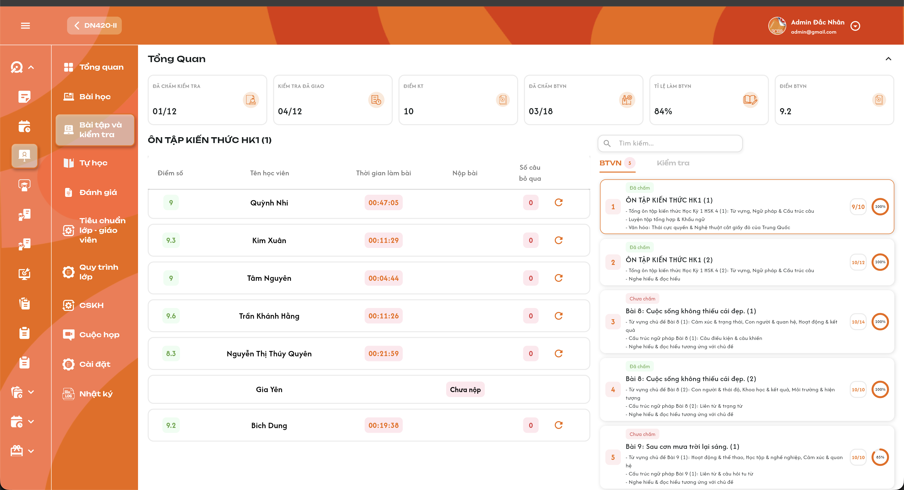
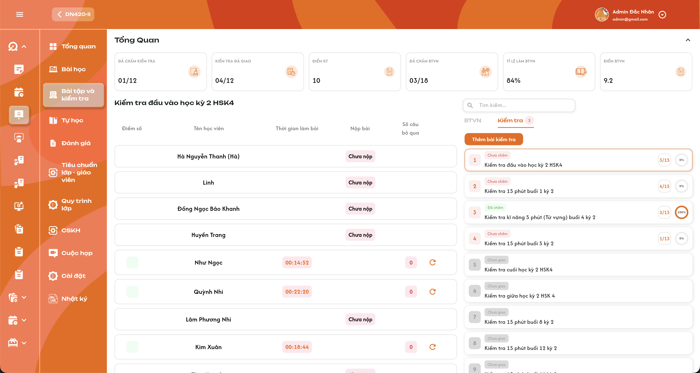

# Chi tiết lớp học — Menu Bài tập và kiểm tra

Đặc tả theo UI ngày 29/09/2026. **Admin, Class Handler và Support có quyền lớp được xem kết quả và reset BTVN/Kiểm tra cho từng học viên**, không mở chi tiết để chấm như giáo viên. Badge tab BTVN/Kiểm tra là **số bài chưa chấm**; số trên card là **đã nộp / chưa nộp**, ví dụ 3/15 = 3 đã nộp và 15 chưa nộp; vòng % là **tỷ lệ đã chấm trong số bài học viên đã nộp**. Ví dụ có 3 học viên đã nộp, cả 3 được chấm → **100%**, dù còn học viên chưa nộp. Đây là tỷ lệ chấm, khác tỷ lệ nộp BTVN ở [menu Bài học](./class_detail_lessons_requirements.md).

## 1. UI

### Trang 1: ADM-LOP-020300 — Khung menu Bài tập và kiểm tra




*Menu Bài tập và kiểm tra — Tab BTVN — nhấn để xem ảnh gốc*



*Menu Bài tập và kiểm tra — Tab Kiểm tra — nhấn để xem ảnh gốc*

**Mô tả:**

Phía trên là khối Tổng Quan. Vùng trái hiển thị tên bài đang chọn và bảng kết quả từng học viên; vùng phải có Search, tab BTVN/Kiểm tra và danh sách card bài.

**Giải thích field/thành phần:**

- `A01.01` **Chọn tab**: BTVN và Kiểm tra có danh sách/badge riêng. Chuyển tab hiển thị dữ liệu đúng loại; không trộn điểm hoặc bài nộp giữa hai loại.
- `A01.02` **Chọn card**: Viền cam và tên bài vùng trái đồng bộ; bấm card chỉ chọn bảng kết quả, không mở trang chi tiết bài làm/chấm bài.
- `A01.03` **Search**: Ô Tìm kiếm ở phía danh sách bài như ảnh. **Search theo tên bài học/bài đang hiển thị trong danh sách**, không theo tên học viên. Thời điểm kích hoạt search và cách xử lý khi đổi tab còn cần chốt.
- `A01.04` **Thêm bài kiểm tra**: Ảnh nguồn có nút Thêm bài kiểm tra nhưng phạm vi **Admin/Class Handler/Support chỉ xem và reset**: không cấp quyền thêm/giao bài ở menu quản trị này. Danh sách Kiểm tra gồm bài kiểm tra của khoá học và bài kiểm tra bổ sung được thêm ở chức năng riêng. **Giáo viên không thêm bài kiểm tra**; Giáo viên phụ trách chính chỉ `Giao bài` và `Thu hồi` bài kiểm tra. BTVN tự giao khi bài học mở, giáo viên không giao/thu hồi BTVN. Không tạo Kiểm tra theo số bài học/BTVN.
- `A01.05` **Loading/rỗng/lỗi**: Hiển thị riêng theo vùng, có Thử lại khi lỗi; không biến lỗi thành danh sách rỗng, số 0 hoặc Chưa nộp. Response lớp/tab/bài cũ không ghi đè lựa chọn hiện tại.

**Điểm cần lưu ý:**

- Bảng hiện kết quả từ chức năng nộp/chấm của học viên/giáo viên; Admin/Class Handler/Support không nhập điểm, nhận xét chấm hoặc sửa đề. **BTVN liên kết 1–1 với bài học của lớp: bao nhiêu bài học thì bấy nhiêu BTVN**. Bài tự học không góp vào danh sách này; Kiểm tra gồm bài của khoá học và bài bổ sung, giáo viên không thêm.
- **Tải full danh sách bài và học viên hợp lệ, không phân trang/load-more**. Mặc định tab/bài và thứ tự cần chốt; không tự kế thừa lựa chọn mặc định từ menu khác.

### Trang 2: ADM-LOP-020300 — Khối Tổng Quan


*Sáu thẻ Tổng Quan của menu — nhấn để xem ảnh gốc*

**Mô tả:**

Sáu thẻ thống kê toàn lớp: Đã chấm kiểm tra, Kiểm tra đã giao, Điểm KT, Đã chấm BTVN, Tỉ lệ làm BTVN và Điểm BTVN. Chevron mở/thu gọn khối như ảnh.

**Giải thích field/thành phần:**

- `A02.01` **Đã chấm kiểm tra**: Hiển thị dạng A/B như 01/12, lấy số đã chấm/tổng Kiểm tra theo **cùng nguồn và công thức Tổng quan lớp**. Không tự thay bằng cặp số đã nộp/chưa nộp hoặc % chấm của card.
- `A02.02` **Kiểm tra đã giao**: Hiển thị số bài kiểm tra đã giao/tổng bài của lớp như 04/12; lấy trạng thái giao từ nguồn, không dựa vào có người nộp mới coi đã giao.
- `A02.03` **Điểm KT**: Điểm trung bình KT của lớp theo quy tắc đã chốt ở Tổng quan lớp: cộng điểm các bài học viên đã chấm/chia số bài đã chấm, giữ kết quả lịch sử; làm tròn 1 chữ số thập phân. Chưa nộp/chưa chấm không tham gia, điểm 0 đã chấm vẫn tính.
- `A02.04` **Đã chấm BTVN**: Dạng A/B như 03/18, tính riêng BTVN theo **cùng nguồn và công thức Tổng quan lớp**; tập bài BTVN gắn với bài học lớp, không cộng Tự học hoặc Kiểm tra.
- `A02.05` **Tỉ lệ làm BTVN**: Trung bình cộng tỷ lệ làm/nộp BTVN của các học viên có dữ liệu, cùng nguồn và công thức Tổng quan lớp; không có dữ liệu thì để trống. Không dùng tỷ lệ chấm C/S của card để thay Tỉ lệ làm BTVN.
- `A02.06` **Điểm BTVN**: Điểm trung bình các bài BTVN học viên đã được chấm, tách KT; cùng quy tắc trung bình theo bài/làm tròn 1 chữ số thập phân. Không có bài đã chấm thì để trống, không tự tạo 0.
- `A02.07` **Chevron**: Chỉ mở/thu gọn vùng Tổng Quan; không đổi dữ liệu hay reset.

**Điểm cần lưu ý:**

- Đọc thống kê lớp và kết quả hiện tại từ nguồn thống nhất; chọn card/Search không được âm thầm đổi thống kê toàn lớp thành thống kê bài đang chọn.
- Reset thành công phải cập nhật các chỉ số liên quan theo trạng thái/kết quả sau reset; kết quả bị reset không còn dùng như bài nộp/điểm hiện hành. Việc giữ kết quả khi Rời lớp/Xóa không có nghĩa tiếp tục dùng điểm đã chủ động reset.

### Trang 3: ADM-LOP-020300 — Tab BTVN/Kiểm tra, badge và card bài


*Badge tab và card Kiểm tra — nhấn để xem ảnh gốc*

**Mô tả:**

Badge cạnh mỗi tab là **số bài chưa chấm**, không phải số học viên hoặc số bài nộp. Mỗi card hiển thị số thứ tự, tiêu đề, mô tả nếu có, nhãn trạng thái, số nộp bài và vòng tỷ lệ chấm.

**Giải thích field/thành phần:**

- `A03.01` **Badge tab**: Đếm số bài thuộc nhóm chưa chấm của đúng loại BTVN hoặc Kiểm tra; mỗi bài chỉ đếm một lần dù có nhiều bài nộp chưa chấm. Không cộng bài của tab còn lại.
- `A03.02` **Trạng thái card**: Kiểm tra có 4 nhãn: **Đã chấm / Chưa chấm / Đang đợi nộp bài / Chưa giao**. **Chưa giao**: giáo viên chưa giao; **Đang đợi nộp bài**: đã giao, chưa có bài nộp; **Chưa chấm**: có bài nộp còn chưa được chấm; **Đã chấm**: giáo viên đã chấm xong các bài đã nộp. Có người chưa nộp không ngăn trạng thái Đã chấm nếu toàn bộ bài đã nộp đã chấm. Chỉ đọc; không có dropdown quản trị đổi trạng thái.
- `A03.03` **Số nộp bài**: **S / U = số học viên đã nộp / số học viên chưa nộp** của bài, chỉ trong tập học viên **Đang học hoặc Dự thính**. Ví dụ 3/15 là 3 đã nộp và 15 chưa nộp, tổng tập là 18; **không phải 3 trên tổng 15**. U = N − S; người đã chấm vẫn nằm trong S.
- `A03.04` **Vòng %**: Tỷ lệ đã chấm trong số bài học viên đã nộp của card; công thức ở UI riêng bên dưới.
- `A03.05` **Card Chưa giao**: Hiển thị nhãn xám như ảnh, không giả có người nộp hoặc 0 điểm. Chọn để xem trạng thái nếu nguồn cho phép, không tự giao đề.
- `A03.06` **Mô tả**: Hiển thị mô tả bài nguồn nếu có, không thay bằng nội dung câu trả lời của học viên.

**Điểm cần lưu ý:**

- Nhãn trạng thái, badge và % chấm cùng lấy dữ liệu hiện hành: còn bài nộp chưa chấm thì Chưa chấm; tất cả bài đã nộp được chấm thì Đã chấm. Không dùng điểm > 0 làm điều kiện đã chấm.
- Reset không thu hồi việc giao bài. Reset hết bài nộp hiện hành khiến bài đã giao trở về Đang đợi nộp bài; khi học viên nộp lại chưa được chấm thì Chưa chấm. Badge tab chỉ đếm bài Chưa chấm, không cộng Chưa giao/Đang đợi nộp bài.

### Trang 4: ADM-LOP-020300 — Tỷ lệ chấm bài trên từng card


**Mô tả:**

**C là số bài học viên đã nộp được chấm xong; S là số bài học viên đã nộp của đúng card. Tỷ lệ = C / S × 100.** Học viên chưa nộp không tham gia mẫu số S.

**Giải thích field/thành phần:**

- `A04.01` **Số đã nộp S**: Đếm bài nộp hiện hành của học viên **Đang học/Dự thính** ở đúng lớp–loại BTVN/KT–bài; cùng học viên nộp nhiều lần không cộng nhiều người. Sau reset người đó về Chưa nộp, không tính phiên/điểm cũ vào S/C; nộp lại thì được tính lại.
- `A04.02` **Số đã chấm C**: Trong tập S, đếm bài đã chấm hoàn tất; dựa vào trạng thái đã chấm, không dùng điểm > 0. Điểm 0 được chấm vẫn tính vào C.
- `A04.03` **Ví dụ 3/3**: 3 học viên đã nộp và cả 3 được giáo viên chấm → **100%**, bất kể còn bao nhiêu học viên chưa nộp. Không lấy C chia sĩ số toàn lớp.
- `A04.04` **Ví dụ 0/3**: 3 học viên đã nộp nhưng chưa bài nào chấm → **0%**.
- `A04.05` **S = 0**: Không chia cho 0, không tự báo 100% vì không có việc chấm. Hiển thị trống/0% khi chưa có bài nộp và cách làm tròn tỷ lệ cần chốt.
- `A04.06` **Sau khi dữ liệu thay đổi**: Nhận bài nộp/chấm/reset từ nguồn thì tính lại C/S của đúng card; cập nhật badge/trạng thái theo dữ liệu thống nhất, không đổi card khác không liên quan.

**Điểm cần lưu ý:**

- Không dùng % nộp BTVN ở menu Bài học hoặc điểm trung bình của bài thay tỷ lệ chấm.
- Tỷ lệ 100% chỉ nói tất cả bài đã nộp trong tập S đã chấm; không chứng minh tất cả học viên đã nộp.

### Trang 5: ADM-LOP-020300 — Bảng trạng thái/kết quả của từng học viên


*Bảng BTVN theo học viên và icon reset — nhấn để xem ảnh gốc*


*Bảng Kiểm tra với người chưa nộp/đã nộp chưa chấm — nhấn để xem ảnh gốc*

**Mô tả:**

Bảng vùng trái có **Điểm số / Tên học viên / Thời gian làm bài / Nộp bài / Số câu bỏ qua** và icon reset theo dòng. Admin/Class Handler/Support có quyền lớp xem trạng thái **Đã nộp, Chưa nộp hoặc Điểm khi giáo viên đã chấm xong**.

**Giải thích field/thành phần:**

- `A05.01` **Tên học viên**: Dòng thuộc đúng lớp/bài đang chọn, theo định danh học viên. **Chỉ học viên Đang học hoặc Dự thính** trong bảng/count hiện hành; đây là trạng thái **học viên**, không phải trạng thái bài học. **Giữ kết quả đã làm khi học viên Rời lớp/Xóa**, không xóa điểm/bài nộp lịch sử vì đổi trạng thái. Thứ tự hiển thị còn cần chốt; không dùng full trạng thái của Tự học.
- `A05.02` **Chưa nộp**: Hiển thị badge Chưa nộp ở cột Nộp bài như ảnh; không dựng điểm/thời gian/số câu bỏ qua của bài khác.
- `A05.03` **Đã nộp chưa chấm**: Thể hiện trạng thái Đã nộp; điểm để trống/chưa có điểm, không tự lấy 0. Thời gian/số câu bỏ qua lấy dữ liệu phiên nộp nếu có.
- `A05.04` **Đã chấm**: Hiển thị điểm giáo viên đã chấm ở cột Điểm số. Điểm 0 hợp lệ phải hiện 0; trạng thái nộp vẫn là đã nộp.
- `A05.05` **Thời gian làm bài**: Thời gian thực làm bài từ nguồn app, dạng HH:mm:ss như ảnh; không lấy thời gian tự học, lịch dạy hoặc thời gian từ khi Admin mở bảng. Giới hạn hiển thị **giống Tự học: vượt 24 giờ hiển thị tối đa 23:59:59**, không quay về 00:00:00; vẫn giữ thời gian thực đã ghi nhận. Chỉ kế thừa cách hiển thị thời gian, không lấy dữ liệu thời gian ôn tập.
- `A05.06` **Số câu bỏ qua**: Số câu bỏ qua của phiên bài nộp đang hiển thị, 0 hợp lệ. Không tự quy đổi thành câu sai/điểm trừ khi chưa có rule.
- `A05.07` **Reset từng dòng**: Icon vòng mũi tên theo ảnh, thao tác đúng một học viên–loại bài–bài. Không reset cả lớp hoặc đưa user vào trang chấm.

**Điểm cần lưu ý:**

- Admin/Class Handler/Support không click điểm/dòng để mở bài làm chi tiết; không có form chấm/sửa nhận xét như Teacher.
- Đã nộp và Điểm là hai mức dữ liệu khác nhau: có bài nộp không đồng nghĩa đã chấm; điểm chưa có khác điểm 0.

### Trang 6: ADM-LOP-020300 — Reset BTVN/Kiểm tra cho học viên


**Mô tả:**

**Admin, Class Handler và Support** có quyền lớp bấm **icon mũi tên xoay vòng ở từng học viên** để mở **popup xác nhận reset**. Xác nhận sẽ reset toàn bộ bài làm/kết quả của đúng học viên ở bài đó để học viên làm lại. Popup dùng component xác nhận chung; chưa có ảnh riêng.

**Giải thích field/thành phần:**

- `A06.01` **Phạm vi**: Reset đúng một học viên và một BTVN hoặc Kiểm tra của lớp đang xem. Kiểm tra quyền và liên kết bài nộp trước khi lưu.
- `A06.02` **Xác nhận**: Popup `Xác nhận reset BTVN` hoặc `Xác nhận reset bài kiểm tra`, hiển thị tên học viên/tên bài. Nội dung: `Bạn có muốn reset [BTVN/bài kiểm tra] của [Tên học viên]? Toàn bộ bài làm và kết quả của bài này sẽ được reset để học viên làm lại.` Nút **Hủy** / **Reset**. Mở popup chưa reset dữ liệu; Hủy chỉ đóng, không Toast CRUD.
- `A06.03` **Kết quả reset**: **Toàn bộ dữ liệu bài làm/kết quả hiện hành của bài đó được reset**: nội dung/câu trả lời/tệp bài nộp, điểm, nhận xét chấm, trạng thái/thời điểm nộp, thời gian làm bài và số câu bỏ qua. Về **Chưa nộp**, không còn điểm/kết quả cũ; thời gian/số câu bỏ qua trở về dữ liệu ban đầu. **Học viên được làm và nộp lại**. Không xóa đề, bài được giao hoặc bài của học viên khác. Cách lưu audit/lịch sử ở DB còn cần chốt riêng.
- `A06.04` **Thành công**: Cập nhật lại dòng và các count/%/badge/Tổng Quan bị ảnh hưởng theo dữ liệu mới. Toast `Reset BTVN thành công.` / `Reset bài kiểm tra thành công.`; không đổi học viên hoặc bài khác.
- `A06.05` **Lỗi/chống lặp**: Khóa thao tác khi đang lưu, không thực hiện hai reset từ một thao tác; lỗi giữ kết quả cũ và một Toast lỗi. Kiểm tra lại quyền ở backend.

**Điểm cần lưu ý:**

- Reset bài làm là thay dữ liệu, không phải thao tác chỉ đọc; đây là thao tác Admin/Class Handler/Support được phép trong menu.
- Không cho nhập điểm mới hoặc chấm câu trả lời thông qua reset; khả năng reset bài chưa nộp và nhiều phiên đồng thời cần chốt.

### Trang 7: ADM-LOP-020300 — Toast phản hồi reset


**Mô tả:**

Reset BTVN và Kiểm tra dùng Toast chung sau khi backend xác nhận kết quả. Thông báo dưới đây là nội dung đề xuất cho nghiệp vụ reset.

**Giải thích field/thành phần:**

- `A07.01` **Thành Công**: `Reset BTVN thành công.` / `Reset bài kiểm tra thành công.` đúng loại thao tác.
- `A07.02` **Có Lỗi Xảy Ra**: `Không thể reset BTVN. Vui lòng thử lại.` / `Không thể reset bài kiểm tra. Vui lòng thử lại.` khi thất bại.
- `A07.03` **Cảnh Báo**: Khi bài/phiên không còn đủ điều kiện hoặc không có quyền, báo lý do nghiệp vụ; điều kiện reset chi tiết theo mục 3.
- `A07.04` **Thông Báo**: Chỉ sử dụng khi có trạng thái đồng bộ thực tế, không báo thành công sớm.
- `A07.05` **Component**: [Toast chung](../../images/01-toast-crud.png), icon/màu/tiêu đề/nút × theo component chuẩn; vị trí/thời lượng theo chức năng dùng chung.

**Điểm cần lưu ý:**

- Một thao tác logic có một Toast kết quả; đọc bảng/chọn tab/card/search không Toast CRUD.
- Hủy trong popup xác nhận chỉ đóng, không reset/Toast thành công.

---

## 2. Yêu cầu

### 2.1. Flow chính

**Flow 1 / REQ01 / REQ03: Mở menu và chọn loại bài**

```text
Admin hoặc Class Handler/Support được add vào lớp mở Bài tập và kiểm tra
      → Tải full Tổng Quan lớp + tab BTVN/Kiểm tra và danh sách bài/học viên; không phân trang
      → BTVN 1–1 với bài học lớp; Kiểm tra lấy từ khoá học và bài bổ sung, không lấy Tự học
      → Badge tab đếm bài chưa chấm, tách riêng từng loại
      → Chọn card: bảng kết quả đúng lớp–bài–loại, không vào trang chấm
```

**Flow 2 / REQ06 / REQ07: Xem kết quả học viên**

```text
Chọn BTVN hoặc Kiểm tra
      → Bảng/count chỉ tập học viên Đang học hoặc Dự thính
      → Giữ kết quả lịch sử khi Rời lớp/Xóa, không tự xóa do đổi trạng thái
      → Mỗi học viên: Chưa nộp / Đã nộp / Điểm khi đã chấm
      → Hiện thời gian làm bài và số câu bỏ qua từ đúng phiên nếu có; vượt 24 giờ hiện max 23:59:59
      → Điểm 0 đã chấm là dữ liệu thật; chưa chấm không tạo điểm 0
      → Chỉ xem, không mở bài làm chi tiết để chấm
```

**Flow 3 / REQ05: Tính tỷ lệ chấm của card**

```text
S = số bài nộp hiện hành của học viên Đang học/Dự thính thuộc card
      → C = số bài trong S đã được chấm xong, kể cả điểm 0
      → S > 0: C/S × 100; 3 đã nộp, 3 đã chấm → 100%
      → Người chưa nộp không vào mẫu S; không chia cho sĩ số toàn lớp
      → S = 0: không chia 0, hiển thị theo rule cần chốt
```

**Flow 4 / REQ08 / REQ09 / REQ10: Reset một học viên**

```text
Admin/Class Handler/Support có quyền lớp bấm icon mũi tên xoay vòng của học viên tại BTVN/KT đang chọn
      → Xác định đúng lớp–loại–bài–học viên–phiên, kiểm tra quyền
      → Popup xác nhận đúng loại bài/học viên, cảnh báo reset toàn bộ bài làm/kết quả
      → Hủy: không thay dữ liệu/Toast CRUD; Reset: kiểm tra lại quyền, chống lặp
      → Reset toàn bộ bài làm/kết quả hiện hành, về Chưa nộp/không điểm để học viên làm lại
      → UI lấy lại dòng/count/%/badge/Tổng Quan liên quan: S giảm, U tăng, C giảm nếu bài đã chấm
      → Không thu hồi giao bài hoặc sửa đề, không tác động bài/người khác
      → Thành công: một Toast Reset BTVN thành công. hoặc Reset bài kiểm tra thành công.
      → Lỗi: giữ dữ liệu cũ, một Toast lỗi, không reset nhầm/lặp
```

### 2.2. Ngoại lệ

- **EX01:** Admin/Class Handler/Support thử thêm/giao bài, sửa đề/điểm/chấm hoặc mở chức năng Teacher → không được phép; reset không cấp quyền chấm.
- **EX02:** Tải lỗi → báo lỗi/Thử lại, không dựng số 0, Chưa nộp hoặc danh sách rỗng giả.
- **EX03:** Response lớp/tab/bài cũ → không ghi đè ngữ cảnh hiện tại.
- **EX04:** Số đã nộp S = 0 → không chia 0 hoặc dựng 100%; cách hiển thị cần chốt.
- **EX05:** Sai quyền/liên kết lớp–học viên–loại–bài–phiên → không đọc/reset ngoài phạm vi.
- **EX06:** Reset lỗi/lặp hoặc dữ liệu đã đổi → không thay dữ liệu một phần, giữ/tải lại kết quả phù hợp và một Toast kết quả.

### 2.3. Yêu cầu khác

| Mã | Tên yêu cầu | Mô tả |
|---|---|---|
| REQ01 | Khung | Tab/card/bảng đồng bộ theo lớp–loại bài–bài. Click chỉ chọn bảng, không vào chi tiết chấm. Tải full không phân trang; search theo tên bài học/bài danh sách. Mặc định tab/bài, thứ tự và thời điểm search cần chốt. |
| REQ02 | Tổng Quan | Sáu thẻ đúng UI, phạm vi toàn lớp, **cùng nguồn/công thức Tổng quan lớp**; điểm BTVN/KT trung bình theo bài học viên đã chấm, làm tròn 1 chữ số thập phân, điểm 0 vẫn tính. Không trộn tỷ lệ làm với tỷ lệ chấm card. |
| REQ03 | Badge/count | Badge là số bài Chưa chấm của từng tab, mỗi bài đếm một lần; card là S/U (đã nộp/chưa nộp) của học viên Đang học/Dự thính, 3/15 = tổng 18 người. Không lấy U làm mẫu số % chấm. |
| REQ04 | Trạng thái bài | Kiểm tra có Đã chấm / Chưa chấm / Đang đợi nộp bài / Chưa giao; chỉ đọc. Chưa giao là chưa được giáo viên giao; đã giao/S=0 là Đang đợi nộp bài; có bài nộp chưa chấm là Chưa chấm; chấm xong mọi bài đã nộp là Đã chấm, không đợi người chưa nộp. |
| REQ05 | Tỷ lệ chấm | C/S × 100 trên từng card, S chỉ bài học viên đã nộp, C bài đã chấm trong S; 3/3 là 100% dù còn người chưa nộp. Điểm 0 tính đã chấm, không cộng trùng lịch sử nộp; S=0 không chia 0. |
| REQ06 | Học viên | Chưa nộp, Đã nộp hoặc điểm khi đã chấm; bảng/count chỉ học viên Đang học/Dự thính, giữ kết quả khi Rời lớp/Xóa. Thời gian HH:mm:ss, vượt 24 giờ max 23:59:59, số câu bỏ qua đúng phiên; chưa có điểm khác điểm 0. |
| REQ07 | Quyền | Admin và Class Handler/Support được add vào lớp được xem/reset BTVN/KT từng học viên; không thêm/giao/chấm/sửa nội dung hoặc mở chi tiết chấm của giáo viên ở menu quản trị này. |
| REQ08 | Reset | Đúng một học viên–loại–bài–phiên; kiểm tra quyền, chống lặp. Click icon từng học viên mở popup xác nhận; Hủy không lưu; xác nhận reset toàn bộ bài làm/kết quả hiện hành về Chưa nộp/không điểm để học viên làm lại. Không reset đề hoặc người/bài khác. |
| REQ09 | Đồng bộ | Kết quả reset/thay đổi nộp/chấm phản ánh dòng, count, % chấm, badge và thống kê liên quan từ cùng dữ liệu; không ảnh hưởng người/bài/lớp khác. |
| REQ10 | Toast | Reset có một Toast kết quả sau backend; chỉ xem/search/chọn tab/card không Toast CRUD. |
| REQ11 | Liên kết bài | Bao nhiêu bài học lớp thì bấy nhiêu BTVN, liên kết 1–1; Kiểm tra lấy từ khoá học và bài bổ sung, giáo viên không thêm; giáo viên chỉ giao/thu hồi bài kiểm tra, BTVN tự giao khi bài học mở và không thu hồi. Tự học không liên quan tập bài này. |

### 2.4. Ràng buộc

#### Quyền

| Role/Phạm vi | Xem danh sách/kết quả | Reset BTVN/Kiểm tra từng học viên | Thêm/giao/chấm/sửa đề/điểm qua menu này | Vào chi tiết chấm Teacher |
|---|:---:|:---:|:---:|:---:|
| Admin trong phạm vi quản trị lớp | ✅ | ✅ | ❌ | ❌ |
| Class Handler được add vào lớp | ✅ | ✅ | ❌ | ❌ |
| Support được add vào lớp | ✅ | ✅ | ❌ | ❌ |
| User không có quyền lớp/thao tác | ❌ | ❌ | ❌ | ❌ |

- Admin và Class Handler/Support được add vào lớp đều được xem/reset; kiểm tra lại quyền lớp khi xác nhận. Không cấp quyền Teacher chấm bài qua chức năng reset.
- Teacher dùng chức năng nghiệp vụ riêng để giao/nộp/chấm theo quyền riêng; bảng này không thay quyền Teacher ở chức năng đó.

#### Ràng buộc khác

**Phạm vi dữ liệu**

- Tách BTVN và Kiểm tra; dữ liệu gắn đúng lớp–bài–loại–học viên–phiên hiện hành.
- Badge tab, cặp số nộp trên card, % chấm card và các thẻ Tổng Quan là các chỉ số riêng; không lấy một giá trị thay tất cả.
- BTVN 1–1 với bài học lớp; Kiểm tra lấy từ khoá học và bài bổ sung, Tự học không tham gia. S/U là đã nộp/chưa nộp trong tập học viên Đang học/Dự thính; trạng thái bài là bộ giao/nộp/chấm riêng.
- Giữ kết quả khi học viên Rời lớp/Xóa; reset chủ động thì toàn bộ bài làm/kết quả hiện hành của bài được chọn trở về ban đầu, không dùng điểm/phiên cũ để tính kết quả hiện hành. Cách lưu lịch sử/audit hoặc xóa vật lý là quy tắc DB riêng chưa chốt.

---

## 3. Testcase

### Feature: Chi tiết lớp học — Menu Bài tập và kiểm tra

| Tên testcase | Priority | Scenario | Role | Pre-condition | Given/When/Then | Expected Result |
|---|---|---|---|---|---|---|
| Case 1: Chọn tab/card chỉ xem bảng | High · Smoke | Flow 1 / REQ01 | Admin / Class Handler / Support có quyền lớp | Có BTVN và Kiểm tra với kết quả khác | **Given** chuyển tab và bấm card<br>**When** tải kết quả<br>**Then** tên/viền/bảng thuộc đúng lớp–loại–bài | - Không mở chi tiết chấm bài<br>- Không trộn dữ liệu |
| Case 2: Ba role quản trị không thêm/giao/chấm | High | EX01 / REQ07 | Admin / Class Handler / Support có quyền lớp | Ảnh tham chiếu có Thêm bài kiểm tra | **Given** kiểm tra nút hoặc gọi thao tác trực tiếp<br>**When** kiểm tra quyền<br>**Then** không được thêm/giao/chấm qua menu này | - Không nút chấm/nhập điểm<br>- Reset không cấp quyền giáo viên |
| Case 3: Lỗi/rỗng/response cũ | High | EX02 / EX03 / REQ01 | Admin / Class Handler / Support có quyền lớp | Đổi lớp/tab/bài khi request chậm hoặc lỗi | **Given** mở/chuyển ngữ cảnh<br>**When** response về<br>**Then** chỉ dữ liệu đúng lựa chọn hiển thị | - Lỗi có Thử lại<br>- Không dựng Chưa nộp/0 giả |
| Case 4: Full danh sách và search bài | High | REQ01 | Admin / Class Handler / Support có quyền lớp | Có hơn 20 bài và 20 học viên hợp lệ, tên bài khác tên học viên | **Given** mở menu và tìm theo tên bài<br>**When** lấy danh sách/kết quả tìm<br>**Then** full dữ liệu không phân trang, search khớp bài học/bài danh sách | - Không tìm theo tên học viên<br>- Không đổi Tổng Quan lớp khi search |
| Case 5: BTVN theo bài học, Kiểm tra thêm riêng | High | REQ01 / REQ11 | Admin / Class Handler / Support có quyền lớp | Lớp có 8 bài học, Tự học có 20 bài, khoá học có 3 bài kiểm tra | **Given** mở hai tab<br>**When** tải dữ liệu nguồn<br>**Then** BTVN có 8 bài liên kết bài học lớp, Kiểm tra có 3 bài của khoá học | - Không cộng 20 bài Tự học<br>- Không tự tạo 8 bài Kiểm tra |
| Case 6: Đủ sáu thẻ, phạm vi toàn lớp | High · Smoke | REQ02 | Admin / Class Handler / Support có quyền lớp | Lớp có thống kê, nhiều bài khác nhau | **Given** chọn các card và thu gọn/mở Tổng Quan<br>**When** render<br>**Then** sáu thẻ đúng nguồn lớp | - Không đổi thành KPI của một bài<br>- Không gọi reset từ chevron |
| Case 7: Điểm trung bình không bỏ điểm 0 | High | REQ02 | Admin / Class Handler / Support có quyền lớp | KT đã chấm có điểm 8, 0; một Chưa nộp và một Chưa chấm | **Given** xem Điểm KT<br>**When** tổng hợp<br>**Then** 4.0 | - Chưa nộp/chưa chấm không vào mẫu<br>- KT không trộn BTVN<br>- Chỉ làm tròn kết quả cuối |
| Case 8: Không lấy tỷ lệ chấm thay tỷ lệ làm | High | REQ02 / REQ05 | Admin / Class Handler / Support có quyền lớp | Chỉ một phần học viên nộp nhưng tất cả bài nộp đã chấm | **Given** xem Tổng Quan và card<br>**When** render<br>**Then** card chấm 100%, Tỉ lệ làm BTVN vẫn theo dữ liệu nộp toàn lớp | - Hai chỉ số giữ đúng nghĩa<br>- Không thay toàn bộ thành 100% |
| Case 9: Badge đếm bài, không đếm bài nộp | High | REQ03 | Admin / Class Handler / Support có quyền lớp | BTVN có 2 bài nhóm chưa chấm, mỗi bài có 5 bài nộp chưa chấm; KT có 1 bài nhóm chưa chấm | **Given** xem hai badge<br>**When** tổng hợp<br>**Then** BTVN 2, Kiểm tra 1 | - Không hiện 10 hoặc gộp 3 vào một tab<br>- Một bài đếm một lần |
| Case 10: Đủ bốn nhãn Kiểm tra và chỉ đọc | High | REQ04 | Admin / Class Handler / Support có quyền lớp | Nguồn có bài ở từng trạng thái | **Given** xem danh sách Kiểm tra<br>**When** render<br>**Then** đúng bốn nhãn đã chốt | - Không dùng Đã nộp thay trạng thái card<br>- Không dropdown quản trị đổi trạng thái |
| Case 11: Card không mở chức năng chấm | High | REQ01 / REQ07 | Admin / Class Handler / Support có quyền lớp | Card có bài nộp/điểm | **Given** bấm tên/card hoặc điểm/vòng %<br>**When** xử lý<br>**Then** chỉ chọn bảng của bài, không vào chi tiết chấm | - Không sửa đề/kết quả giáo viên<br>- Không tạo bài nộp từ thao tác xem |
| Case 12: Card 3/15 là 3 đã nộp và 15 chưa nộp | High | REQ03 / REQ05 / REQ06 | Admin / Class Handler / Support có quyền lớp | 18 học viên Đang học/Dự thính: 3 đã nộp, 15 chưa nộp; 3 bài nộp đều đã chấm | **Given** xem card<br>**When** tính S/U và C/S<br>**Then** cặp số 3/15 và vòng chấm 100% | - Không diễn giải tổng học viên là 15<br>- Người đã chấm vẫn tính đã nộp |
| Case 13: Nhãn trạng thái theo giao/nộp/chấm | High | REQ04 | Admin / Class Handler / Support có quyền lớp | Có bài chưa giao; đã giao/S=0; S=3/C=2; S=3/C=3 và còn người chưa nộp | **Given** xem bốn card<br>**When** xác định nhãn<br>**Then** lần lượt Chưa giao, Đang đợi nộp bài, Chưa chấm, Đã chấm | - Badge chỉ đếm Chưa chấm<br>- Đã chấm không đợi tất cả học viên nộp |
| Case 14: Ba bài nộp đều chấm là 100% | High | Flow 3 / REQ05 | Admin / Class Handler / Support có quyền lớp | 3 học viên đã nộp, nhiều học viên khác chưa nộp | **Given** giáo viên chấm xong cả 3<br>**When** xem card<br>**Then** 3/3 × 100 = 100% | - Không chia cho tổng học viên<br>- Không đợi người chưa nộp |
| Case 15: Chưa chấm 3 bài nộp là 0% | High | REQ05 | Admin / Class Handler / Support có quyền lớp | S=3, C=0 | **Given** xem card<br>**When** tính tỷ lệ<br>**Then** 0% | - Không lấy tỷ lệ đã nộp/tổng học viên<br>- Không lấy số câu trả lời |
| Case 16: Điểm 0 và nộp lại không cộng người | High | REQ05 | Admin / Class Handler / Support có quyền lớp | A chấm điểm 0, B chấm điểm 8; A có lịch sử nhiều phiên nộp | **Given** tổng hợp hiện hành của đúng bài<br>**When** đếm C/S<br>**Then** 2/2 = 100% | - Điểm 0 tính đã chấm<br>- Không cộng lịch sử A thành nhiều người |
| Case 17: Không có bài nộp | High | EX04 / REQ05 | Admin / Class Handler / Support có quyền lớp | S=0 | **Given** tính tỷ lệ<br>**When** xử lý mẫu số 0<br>**Then** không chia 0 hoặc 100% giả | - Giá trị hiển thị theo rule chốt mục 3<br>- Không biến tải lỗi thành S=0 |
| Case 18: Ba trạng thái học viên không bị gộp | High · Smoke | Flow 2 / REQ06 | Admin / Class Handler / Support có quyền lớp | A chưa nộp, B nộp chưa chấm, C được chấm 0 | **Given** xem bảng<br>**When** render<br>**Then** A Chưa nộp, B Đã nộp không điểm, C hiện điểm 0 | - Không dùng 0 cho B<br>- Không giấu điểm 0 của C |
| Case 19: Thời gian và bỏ qua đúng phiên | High | REQ06 / REQ09 | Admin / Class Handler / Support có quyền lớp | A có thời gian 00:14:52 và số bỏ qua 0 | **Given** chọn đúng bài<br>**When** xem A<br>**Then** đúng thời gian/bỏ qua từ bài nộp | - Không dùng thời gian toàn lớp/Tự học<br>- Không lấy phiên học viên B |
| Case 20: Không vào bài làm chi tiết để chấm | High | EX01 / REQ07 | Admin / Class Handler / Support có quyền lớp | Có điểm/bài nộp | **Given** bấm dòng/điểm/trạng thái<br>**When** xử lý<br>**Then** không mở chi tiết chấm hoặc form đổi điểm | - Vẫn có reset theo quyền<br>- Không thay dữ liệu khi chỉ xem |
| Case 21: Reset gắn đúng dòng | High | Flow 4 / REQ08 / REQ09 | Admin / Class Handler / Support có quyền lớp | Có BTVN/KT và A/B | **Given** bấm reset của A ở KT đang chọn<br>**When** xác định đối tượng<br>**Then** đúng A–KT–bài–lớp | - Không reset B hoặc BTVN<br>- Không dựa vào số thứ tự/tên |
| Case 22: Tập trạng thái học viên và giữ kết quả lịch sử | High | REQ02 / REQ06 / REQ09 | Admin / Class Handler / Support có quyền lớp | Có Đang học/Dự thính và học viên đã Rời lớp/Xóa có kết quả cũ | **Given** mở bảng/count hiện hành và lấy thống kê điểm theo Tổng quan lớp<br>**When** kiểm tra tập tính và dữ liệu lịch sử<br>**Then** bảng/count dùng Đang học/Dự thính, kết quả cũ không bị xóa và thống kê điểm giữ theo nguồn Tổng quan | - Không dùng trạng thái bài học làm trạng thái học viên<br>- Không áp dụng full trạng thái Tự học |
| Case 23: Thời gian vượt 24 giờ giống Tự học | High | REQ06 | Admin / Class Handler / Support có quyền lớp | Bài nộp có thời gian 25:30:00 | **Given** xem Thời gian làm bài<br>**When** định dạng<br>**Then** hiển thị 23:59:59 | - Giữ thời gian thực ở dữ liệu<br>- Không lấy thời gian ôn tập hoặc quay về 00:00:00 |
| Case 24: Reset đúng một bài/học viên và cập nhật UI | High · Smoke | Flow 4 / REQ08 / REQ09 | Admin / Class Handler / Support có quyền lớp | Có quyền; điều kiện reset hợp lệ theo rule chốt | **Given** thực hiện reset A ở bài KT<br>**When** backend thành công<br>**Then** UI phản ánh đúng kết quả sau reset của A | - Dòng/count/%/badge liên quan đồng bộ<br>- Một Toast thành công<br>- Không sửa đề/chấm bài |
| Case 25: Reset lỗi/thiếu quyền/chống lặp | High | EX05 / EX06 / REQ08 | Admin / Class Handler / Support có quyền lớp | Backend lỗi, request đang lưu hoặc không có quyền lớp | **Given** gửi reset lặp/ngoài quyền<br>**When** backend kiểm tra<br>**Then** không reset lặp hoặc ngoài phạm vi | - Lỗi giữ dữ liệu cũ<br>- Một Toast lỗi<br>- Không reset cả lớp |
| Case 26: Popup reset và Hủy không thay dữ liệu | High | Flow 4 / REQ08 | Admin / Class Handler / Support có quyền lớp | A có bài KT đã nộp, điểm/thời gian/câu trả lời | **Given** click icon mũi tên xoay vòng của A<br>**When** popup hiện rồi bấm Hủy<br>**Then** đúng A/bài/loại, dữ liệu giữ nguyên | - Chưa reset khi mở popup<br>- Hủy không Toast CRUD |
| Case 27: Reset toàn bộ và học viên làm lại | High | Flow 4 / REQ08 / REQ09 | Admin / Class Handler / Support có quyền lớp | A có điểm, nhận xét, câu trả lời/tệp, thời gian và số câu bỏ qua | **Given** mở popup rồi bấm Reset<br>**When** lưu thành công<br>**Then** A về Chưa nộp/không điểm, toàn bộ bài làm/kết quả hiện hành reset và được làm lại | - Không còn điểm/đáp án/thời gian cũ hiện hành<br>- Không xóa đề hoặc reset B/bài khác<br>- Một Toast đúng loại |
| Case 28: Reset đổi count và tỷ lệ trên tập đã nộp | High | REQ03 / REQ04 / REQ05 / REQ09 | Admin / Class Handler / Support có quyền lớp | S=3/U=15/C=3; A đã chấm thuộc S | **Given** reset A thành công<br>**When** tải lại card/bảng<br>**Then** S=2/U=16/C=2, card 2/16, chấm vẫn 100% | - Không tính phiên cũ của A<br>- A nộp lại chưa chấm thì S=3/C=2 và nhãn Chưa chấm<br>- Badge/Tổng Quan liên quan cập nhật |
| Case 29: Toast đúng loại reset | High | REQ10 | Admin / Class Handler / Support có quyền lớp | Request reset lưu thành công | **Given** reset BTVN hoặc KT<br>**When** backend trả kết quả<br>**Then** một Toast thành công đúng loại | - Không báo trước lưu<br>- Không báo đã chấm bài |
| Case 30: Lỗi/chỉ xem/đóng Toast | Medium | EX06 / REQ10 | Admin / Class Handler / Support có quyền lớp | Reset lỗi hoặc chỉ xem bảng | **Given** thực hiện thao tác/callback lặp<br>**When** xử lý<br>**Then** một Toast lỗi khi reset lỗi; chỉ xem không Toast CRUD | - Đóng × không hoàn tác kết quả<br>- Không nhân đôi Toast |

---

## 4. Câu hỏi cần xác nhận

- **Q01:** Khi chưa có bài nộp/S=0 hiển thị vòng % trống hay 0%; tỷ lệ chấm làm tròn mấy chữ số? Ý nghĩa bốn nhãn giao/nộp/chấm đã chốt.
- **Q02:** Search theo tên bài đã chốt; kích hoạt khi nhập, Enter hay debounce? Mặc định tab/bài, thứ tự học viên/bài và giữ lựa chọn khi tìm kiếm thế nào? Tải full không phân trang đã chốt.
- **Q03:** Tập Đang học/Dự thính áp dụng theo thời điểm hiện tại hay từng bài/buổi khi tính count? Kết quả sau Rời lớp/Xóa vẫn giữ đã chốt; không tự xóa lịch sử.
- **Q04:** Audit/lịch sử reset, xóa mềm/cứng dữ liệu cũ ở DB và xử lý khi reset đồng thời với học viên đang làm/nộp bài? Reset toàn bộ kết quả hiện hành để làm lại và popup xác nhận đã chốt; không tự dùng lại phiên cũ trong điểm/count hiện hành.
- **Q05:** Có cho reset học viên chưa có bài làm hay chỉ dòng đã làm/đã nộp? Điều kiện giao/hạn nộp của giáo viên áp dụng thế nào khi học viên làm lại?
