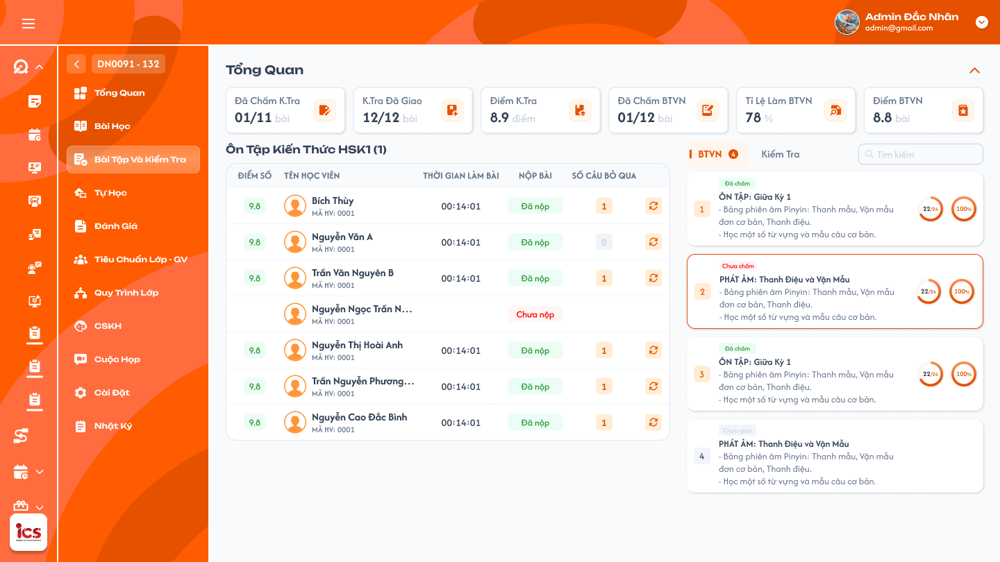

# Chi tiết lớp học — Menu Bài tập và kiểm tra

## 1. UI

### Trang 1: ADM-LOP-020300 — Chi tiết lớp học / Bài tập về nhà



**Mô tả:**
- **Admin, Class Handler và Support có quyền lớp được xem kết quả và reset BTVN/Kiểm tra cho từng học viên**, không mở chi tiết để chấm như giáo viên.
- Phía trên là khối Tổng Quan. Vùng trái hiển thị tên bài đang chọn và bảng kết quả từng học viên; vùng phải có Search, tab BTVN/Kiểm tra và danh sách card bài.

**Điểm cần lưu ý:**
- `A01.01` Chọn tab: BTVN và Kiểm tra có danh sách/badge riêng. Chuyển tab hiển thị dữ liệu đúng loại; không trộn điểm hoặc bài nộp giữa hai loại.
- `A01.02` Chọn card: viền cam và tên bài vùng trái đồng bộ; bấm card chỉ chọn bảng kết quả, không mở trang chi tiết bài làm/chấm bài.
- `A01.03` Search: **search theo tên bài học/bài đang hiển thị trong danh sách**, không theo tên học viên; không đổi Tổng Quan lớp khi search.
- `A01.04` Thêm bài kiểm tra: ảnh nguồn có nút này nhưng phạm vi Admin/Class Handler/Support chỉ xem và reset, không cấp quyền thêm/giao bài ở menu quản trị. Danh sách Kiểm tra gồm bài kiểm tra của khoá học và bài kiểm tra bổ sung được thêm ở chức năng riêng; **giáo viên không thêm bài kiểm tra**, Giáo viên phụ trách chính chỉ `Giao bài` và `Thu hồi`. BTVN tự giao khi bài học mở, giáo viên không giao/thu hồi BTVN. Không tạo Kiểm tra theo số bài học/BTVN.
- `A01.05` Loading/rỗng/lỗi: hiển thị riêng theo vùng, có Thử lại khi lỗi; không biến lỗi thành danh sách rỗng, số 0 hoặc Chưa nộp. Response lớp/tab/bài cũ không ghi đè lựa chọn hiện tại. Tải full danh sách bài và học viên hợp lệ, không phân trang/load-more.
- `A01.06` Thẻ chỉ số: sáu thẻ Tổng Quan, thống kê toàn lớp. Đọc từ nguồn thống nhất; chọn card/Search không được đổi thống kê toàn lớp thành thống kê bài đang chọn. Reset thành công phải cập nhật các chỉ số liên quan; kết quả bị reset không còn dùng như bài nộp/điểm hiện hành.
- `A01.07` Trạng thái nộp bài và điểm: `Đã nộp` và `Điểm` là hai mức dữ liệu khác nhau; có bài nộp không đồng nghĩa đã chấm, điểm chưa có khác điểm 0. Bảng hiện kết quả từ chức năng nộp/chấm; Admin/Class Handler/Support không nhập điểm, nhận xét chấm hoặc sửa đề, không click điểm/dòng để mở bài làm chi tiết.
- `A01.08` Ô định danh học viên (Molecule): dòng thuộc đúng lớp/bài đang chọn, theo định danh học viên. Chỉ học viên `Đang học` hoặc `Dự thính` trong bảng/count hiện hành (đây là trạng thái học viên, không phải trạng thái bài học). **Giữ kết quả đã làm khi học viên Rời lớp/Xóa**, không xóa điểm/bài nộp lịch sử vì đổi trạng thái. Không dùng full trạng thái của Tự học.
- `A01.09` Number Badge cạnh tab: số bài chưa chấm (xem `A03.01`).
- `A01.10` Side Tab BTVN / Kiểm tra: BTVN liên kết 1–1 với bài học của lớp (bao nhiêu bài học thì bấy nhiêu BTVN); bài Tự học không góp vào danh sách này.
- `A01.11` Badge trạng thái ở cột `Nộp bài` (`Chưa nộp` / `Đã nộp`).
- `A01.12` Vòng `PERCENT %` trên card: tỷ lệ đã chấm trong số bài học viên đã nộp, công thức ở `A04.01`–`A04.06`. Khác tỷ lệ nộp BTVN ở menu Bài học.
- `A02.01` `Đã chấm kiểm tra`: dạng A/B như 01/12, lấy số đã chấm/tổng Kiểm tra theo **cùng nguồn và công thức Tổng quan lớp**. Không thay bằng cặp số đã nộp/chưa nộp hoặc % chấm của card.
- `A02.02` `Kiểm tra đã giao`: số bài kiểm tra đã giao/tổng bài của lớp như 04/12; lấy trạng thái giao từ nguồn, không dựa vào có người nộp mới coi đã giao.
- `A02.03` `Điểm KT`: điểm trung bình KT của lớp theo quy tắc ở Tổng quan lớp: cộng điểm các bài học viên đã chấm/chia số bài đã chấm, giữ kết quả lịch sử; làm tròn 1 chữ số thập phân. Chưa nộp/chưa chấm không tham gia, điểm 0 đã chấm vẫn tính.
- `A02.04` `Đã chấm BTVN`: dạng A/B như 03/18, tính riêng BTVN theo cùng nguồn và công thức Tổng quan lớp; không cộng Tự học hoặc Kiểm tra.
- `A02.05` `Tỉ lệ làm BTVN`: trung bình cộng tỷ lệ làm/nộp BTVN của các học viên có dữ liệu; không có dữ liệu thì để trống. Không dùng tỷ lệ chấm C/S của card để thay.
- `A02.06` `Điểm BTVN`: điểm trung bình các bài BTVN học viên đã được chấm, tách KT; làm tròn 1 chữ số thập phân. Không có bài đã chấm thì để trống, không tự tạo 0.
- `A02.07` Chevron: chỉ mở/thu gọn vùng Tổng Quan; không đổi dữ liệu hay reset.
- `A03.01` Badge tab: đếm số bài thuộc nhóm chưa chấm của đúng loại BTVN hoặc Kiểm tra; mỗi bài đếm một lần dù có nhiều bài nộp chưa chấm. Không cộng bài của tab còn lại, không cộng Chưa giao / Đang đợi nộp bài.
- `A03.02` Trạng thái card (Kiểm tra) có 4 nhãn: **Đã chấm / Chưa chấm / Đang đợi nộp bài / Chưa giao**. `Chưa giao`: giáo viên chưa giao; `Đang đợi nộp bài`: đã giao, chưa có bài nộp; `Chưa chấm`: có bài nộp còn chưa được chấm; `Đã chấm`: đã chấm xong các bài đã nộp (có người chưa nộp không ngăn `Đã chấm`). Chỉ đọc, không có dropdown quản trị đổi trạng thái. Không dùng điểm > 0 làm điều kiện đã chấm.
- `A03.03` Số nộp bài: **S / U = số học viên đã nộp / số học viên chưa nộp**, chỉ trong tập `Đang học` hoặc `Dự thính`. Ví dụ 3/15 là 3 đã nộp và 15 chưa nộp, tổng tập 18; **không phải 3 trên tổng 15**. U = N − S; người đã chấm vẫn nằm trong S.
- `A03.04` Vòng %: tỷ lệ đã chấm trong số bài học viên đã nộp của card (xem khu vực tỷ lệ chấm).
- `A03.05` Card `Chưa giao`: hiển thị nhãn xám, không giả có người nộp hoặc 0 điểm. Chọn để xem trạng thái nếu nguồn cho phép, không tự giao đề. Reset không thu hồi việc giao bài: reset hết bài nộp hiện hành khiến bài đã giao trở về `Đang đợi nộp bài`; học viên nộp lại chưa chấm thì `Chưa chấm`.
- `A03.06` Mô tả: hiển thị mô tả bài nguồn nếu có, không thay bằng nội dung câu trả lời của học viên.
- `A04.01` Số đã nộp S: đếm bài nộp hiện hành của học viên `Đang học`/`Dự thính` ở đúng lớp–loại BTVN/KT–bài; cùng học viên nộp nhiều lần không cộng nhiều người. Sau reset người đó về Chưa nộp, không tính phiên/điểm cũ vào S/C; nộp lại thì được tính lại. **Tỷ lệ = C / S × 100**; học viên chưa nộp không tham gia mẫu số.
- `A04.02` Số đã chấm C: trong tập S, đếm bài đã chấm hoàn tất; dựa vào trạng thái đã chấm, không dùng điểm > 0. Điểm 0 được chấm vẫn tính vào C.
- `A04.03` Ví dụ 3/3: 3 học viên đã nộp và cả 3 được chấm → **100%**, bất kể còn bao nhiêu học viên chưa nộp. Không lấy C chia sĩ số toàn lớp; 100% chỉ nói mọi bài đã nộp đã chấm, không chứng minh mọi học viên đã nộp.
- `A04.04` Ví dụ 0/3: 3 học viên đã nộp nhưng chưa bài nào chấm → **0%**.
- `A04.05` S = 0: không chia cho 0, không tự báo 100% vì không có việc chấm. Hiển thị trống/0% khi chưa có bài nộp (cách làm tròn cần chốt).
- `A04.06` Sau khi dữ liệu thay đổi: nhận bài nộp/chấm/reset thì tính lại C/S của đúng card; cập nhật badge/trạng thái theo dữ liệu thống nhất, không đổi card khác không liên quan.
- `A05.01` Tên học viên: dòng thuộc đúng lớp/bài đang chọn, theo định danh học viên (xem `A01.08` về tập học viên). Thứ tự hiển thị còn cần chốt.
- `A05.02` Chưa nộp: badge `Chưa nộp` ở cột `Nộp bài`; không dựng điểm/thời gian/số câu bỏ qua của bài khác.
- `A05.03` Đã nộp chưa chấm: trạng thái `Đã nộp`; điểm để trống, không tự lấy 0. Thời gian/số câu bỏ qua lấy dữ liệu phiên nộp nếu có.
- `A05.04` Đã chấm: hiển thị điểm giáo viên đã chấm ở cột `Điểm số`. Điểm 0 hợp lệ phải hiện `0`; trạng thái nộp vẫn là đã nộp.
- `A05.05` Thời gian làm bài: thời gian thực làm bài từ nguồn app, dạng `HH:mm:ss`; không lấy thời gian tự học, lịch dạy hoặc thời gian Admin mở bảng. **Vượt 24 giờ hiển thị tối đa `23:59:59`** (giống Tự học), vẫn giữ thời gian thực đã ghi nhận.
- `A05.06` Số câu bỏ qua: số câu bỏ qua của phiên bài nộp đang hiển thị, 0 hợp lệ. Không tự quy đổi thành câu sai/điểm trừ.
- `A05.07` Reset từng dòng: icon vòng mũi tên theo dòng, thao tác đúng một học viên–loại bài–bài. Không reset cả lớp hoặc đưa user vào trang chấm.
- `A06.01` Reset — phạm vi: đúng một học viên và một BTVN hoặc Kiểm tra của lớp đang xem. Kiểm tra quyền và liên kết bài nộp trước khi lưu. Reset là thao tác thay dữ liệu (không phải chỉ đọc); không cho nhập điểm mới hoặc chấm qua reset.
- `A06.02` Reset — xác nhận: popup chung `Xác nhận reset BTVN` hoặc `Xác nhận reset bài kiểm tra`, hiển thị tên học viên/tên bài. Nội dung: `Bạn có muốn reset [BTVN/bài kiểm tra] của [Tên học viên]? Toàn bộ bài làm và kết quả của bài này sẽ được reset để học viên làm lại.` Nút **Hủy** / **Reset**. Mở popup chưa reset dữ liệu; Hủy chỉ đóng, không Toast CRUD. Popup chưa có ảnh riêng.
- `A06.03` Reset — kết quả: **toàn bộ dữ liệu bài làm/kết quả hiện hành của bài đó được reset**: câu trả lời/tệp bài nộp, điểm, nhận xét chấm, trạng thái/thời điểm nộp, thời gian làm bài và số câu bỏ qua. Về **Chưa nộp**, học viên làm và nộp lại. Không xóa đề, bài được giao hoặc bài của học viên khác. Cách lưu audit/lịch sử ở DB cần chốt riêng.
- `A06.04` Reset — thành công: cập nhật lại dòng và các count/%/badge/Tổng Quan bị ảnh hưởng. Toast `Reset BTVN thành công.` / `Reset bài kiểm tra thành công.`; không đổi học viên hoặc bài khác.
- `A06.05` Reset — lỗi/chống lặp: khóa thao tác khi đang lưu, không thực hiện hai reset từ một thao tác; lỗi giữ kết quả cũ và một Toast lỗi. Kiểm tra lại quyền ở backend.
- `A07.01` Toast `Thành Công`: `Reset BTVN thành công.` / `Reset bài kiểm tra thành công.` đúng loại thao tác.
- `A07.02` Toast `Có Lỗi Xảy Ra`: `Không thể reset BTVN. Vui lòng thử lại.` / `Không thể reset bài kiểm tra. Vui lòng thử lại.`
- `A07.03` Toast `Cảnh Báo`: khi bài/phiên không còn đủ điều kiện hoặc không có quyền, báo lý do nghiệp vụ.
- `A07.04` Toast `Thông Báo`: chỉ dùng khi có trạng thái đồng bộ thực tế, không báo thành công sớm.
- `A07.05` Component Toast chung (icon/màu/tiêu đề/nút × theo component chuẩn). Mỗi thao tác logic một Toast kết quả; đọc bảng/chọn tab/card/search không Toast CRUD; Hủy không Toast thành công.


---

## 2. Yêu cầu

### 2.1. Flow chính

**Flow 1: Mở menu và chọn loại bài**

```
Admin hoặc Class Handler/Support được add vào lớp mở Bài tập và kiểm tra
      → Tải full Tổng Quan lớp + tab BTVN/Kiểm tra và danh sách bài/học viên; không phân trang
      → BTVN 1–1 với bài học lớp; Kiểm tra lấy từ khoá học và bài bổ sung, không lấy Tự học
      → Badge tab đếm bài chưa chấm, tách riêng từng loại
      → Chọn card: bảng kết quả đúng lớp–bài–loại, không vào trang chấm
```

**Flow 2: Xem kết quả học viên**

```
Chọn BTVN hoặc Kiểm tra
      → Bảng/count chỉ tập học viên Đang học hoặc Dự thính
      → Giữ kết quả lịch sử khi Rời lớp/Xóa, không tự xóa do đổi trạng thái
      → Mỗi học viên: Chưa nộp / Đã nộp / Điểm khi đã chấm
      → Hiện thời gian làm bài và số câu bỏ qua từ đúng phiên nếu có; vượt 24 giờ hiện max 23:59:59
      → Điểm 0 đã chấm là dữ liệu thật; chưa chấm không tạo điểm 0
      → Chỉ xem, không mở bài làm chi tiết để chấm
```

**Flow 3: Tính tỷ lệ chấm của card**

```
S = số bài nộp hiện hành của học viên Đang học/Dự thính thuộc card
      → C = số bài trong S đã được chấm xong, kể cả điểm 0
      → S > 0: C/S × 100; 3 đã nộp, 3 đã chấm → 100%
      → Người chưa nộp không vào mẫu S; không chia cho sĩ số toàn lớp
      → S = 0: không chia 0, hiển thị theo rule cần chốt
```

**Flow 4: Reset một học viên**

```
Admin/Class Handler/Support có quyền lớp bấm icon mũi tên xoay vòng của học viên tại BTVN/KT đang chọn
      → Xác định đúng lớp–loại–bài–học viên–phiên, kiểm tra quyền
      → Popup xác nhận đúng loại bài/học viên, cảnh báo reset toàn bộ bài làm/kết quả
      → Hủy: không thay dữ liệu/Toast CRUD; Reset: kiểm tra lại quyền, chống lặp
      → Reset toàn bộ bài làm/kết quả hiện hành, về Chưa nộp/không điểm để học viên làm lại
      → UI lấy lại dòng/count/%/badge/Tổng Quan liên quan: S giảm, U tăng, C giảm nếu bài đã chấm
      → Không thu hồi giao bài hoặc sửa đề, không tác động bài/người khác
      → Thành công: một Toast Reset BTVN thành công. hoặc Reset bài kiểm tra thành công.
      → Lỗi: giữ dữ liệu cũ, một Toast lỗi, không reset nhầm/lặp
```

### 2.2. Ngoại lệ

- **EX01:** Admin/Class Handler/Support thử thêm/giao bài, sửa đề/điểm/chấm hoặc mở chức năng Teacher → không được phép; reset không cấp quyền chấm.
- **EX02:** Tải lỗi → báo lỗi/Thử lại, không dựng số 0, Chưa nộp hoặc danh sách rỗng giả.
- **EX03:** Response lớp/tab/bài cũ → không ghi đè ngữ cảnh hiện tại.
- **EX04:** Số đã nộp S = 0 → không chia 0 hoặc dựng 100%; cách hiển thị cần chốt.
- **EX05:** Sai quyền/liên kết lớp–học viên–loại–bài–phiên → không đọc/reset ngoài phạm vi.
- **EX06:** Reset lỗi/lặp hoặc dữ liệu đã đổi → không thay dữ liệu một phần, giữ/tải lại kết quả phù hợp và một Toast kết quả.

### 2.3. Yêu cầu khác

| Mã | Tên yêu cầu | Mô tả |
|---|---|---|
| REQ01 | Khung | Tab/card/bảng đồng bộ theo lớp–loại bài–bài. Click chỉ chọn bảng, không vào chi tiết chấm. Tải full không phân trang; search theo tên bài học/bài danh sách. Mặc định tab/bài, thứ tự và thời điểm search cần chốt. |
| REQ02 | Tổng Quan | Sáu thẻ đúng UI, phạm vi toàn lớp, **cùng nguồn/công thức Tổng quan lớp**; điểm BTVN/KT trung bình theo bài học viên đã chấm, làm tròn 1 chữ số thập phân, điểm 0 vẫn tính. Không trộn tỷ lệ làm với tỷ lệ chấm card. |
| REQ03 | Badge/count | Badge là số bài Chưa chấm của từng tab, mỗi bài đếm một lần; card là S/U (đã nộp/chưa nộp) của học viên Đang học/Dự thính, 3/15 = tổng 18 người. Không lấy U làm mẫu số % chấm. |
| REQ04 | Trạng thái bài | Kiểm tra có Đã chấm / Chưa chấm / Đang đợi nộp bài / Chưa giao; chỉ đọc. Chưa giao là chưa được giáo viên giao; đã giao/S=0 là Đang đợi nộp bài; có bài nộp chưa chấm là Chưa chấm; chấm xong mọi bài đã nộp là Đã chấm, không đợi người chưa nộp. |
| REQ05 | Tỷ lệ chấm | C/S × 100 trên từng card, S chỉ bài học viên đã nộp, C bài đã chấm trong S; 3/3 là 100% dù còn người chưa nộp. Điểm 0 tính đã chấm, không cộng trùng lịch sử nộp; S=0 không chia 0. |
| REQ06 | Học viên | Chưa nộp, Đã nộp hoặc điểm khi đã chấm; bảng/count chỉ học viên Đang học/Dự thính, giữ kết quả khi Rời lớp/Xóa. Thời gian HH:mm:ss, vượt 24 giờ max 23:59:59, số câu bỏ qua đúng phiên; chưa có điểm khác điểm 0. |
| REQ07 | Quyền | Admin và Class Handler/Support được add vào lớp được xem/reset BTVN/KT từng học viên; không thêm/giao/chấm/sửa nội dung hoặc mở chi tiết chấm của giáo viên ở menu quản trị này. |
| REQ08 | Reset | Đúng một học viên–loại–bài–phiên; kiểm tra quyền, chống lặp. Click icon từng học viên mở popup xác nhận; Hủy không lưu; xác nhận reset toàn bộ bài làm/kết quả hiện hành về Chưa nộp/không điểm để học viên làm lại. Không reset đề hoặc người/bài khác. |
| REQ09 | Đồng bộ | Kết quả reset/thay đổi nộp/chấm phản ánh dòng, count, % chấm, badge và thống kê liên quan từ cùng dữ liệu; không ảnh hưởng người/bài/lớp khác. |
| REQ10 | Toast | Reset có một Toast kết quả sau backend; chỉ xem/search/chọn tab/card không Toast CRUD. |
| REQ11 | Liên kết bài | Bao nhiêu bài học lớp thì bấy nhiêu BTVN, liên kết 1–1; Kiểm tra lấy từ khoá học và bài bổ sung, giáo viên không thêm; giáo viên chỉ giao/thu hồi bài kiểm tra, BTVN tự giao khi bài học mở và không thu hồi. Tự học không liên quan tập bài này. |

### 2.4. Ràng buộc

#### Quyền

| Role/Phạm vi | Xem danh sách/kết quả | Reset BTVN/Kiểm tra từng học viên | Thêm/giao/chấm/sửa đề/điểm qua menu này | Vào chi tiết chấm Teacher |
|---|:---:|:---:|:---:|:---:|
| Admin trong phạm vi quản trị lớp | ✅ | ✅ | ❌ | ❌ |
| Class Handler được add vào lớp | ✅ | ✅ | ❌ | ❌ |
| Support được add vào lớp | ✅ | ✅ | ❌ | ❌ |
| User không có quyền lớp/thao tác | ❌ | ❌ | ❌ | ❌ |

#### Ràng buộc khác

- Admin và Class Handler/Support được add vào lớp đều được xem/reset; kiểm tra lại quyền lớp khi xác nhận. Không cấp quyền Teacher chấm bài qua chức năng reset. Teacher dùng chức năng nghiệp vụ riêng để giao/nộp/chấm; bảng này không thay quyền Teacher.
- Tách BTVN và Kiểm tra; dữ liệu gắn đúng lớp–bài–loại–học viên–phiên hiện hành.
- Badge tab, cặp số nộp trên card, % chấm card và các thẻ Tổng Quan là các chỉ số riêng; không lấy một giá trị thay tất cả.
- BTVN 1–1 với bài học lớp; Kiểm tra lấy từ khoá học và bài bổ sung, Tự học không tham gia. S/U là đã nộp/chưa nộp trong tập học viên Đang học/Dự thính; trạng thái bài là bộ giao/nộp/chấm riêng.
- Giữ kết quả khi học viên Rời lớp/Xóa; reset chủ động thì toàn bộ bài làm/kết quả hiện hành của bài được chọn trở về ban đầu, không dùng điểm/phiên cũ để tính kết quả hiện hành.

---

## 3. Testcase

### Feature: Chi tiết lớp học — Menu Bài tập và kiểm tra

| Tên testcase | Priority | Scenario | Role | Pre-condition | Given/When/Then | Expected Result |
|---|---|---|---|---|---|---|
| Case 1: Chọn tab/card chỉ xem bảng | High | Flow 1 / REQ01 | Admin / Class Handler / Support có quyền lớp | Có BTVN và Kiểm tra với kết quả khác | **Given:** chuyển tab và bấm card<br>**When:** tải kết quả<br>**Then:** tên/viền/bảng thuộc đúng lớp–loại–bài | - Không mở chi tiết chấm bài<br>- Không trộn dữ liệu |
| Case 2: Full danh sách, search bài và liên kết bài | High | REQ01 / REQ11 | Admin / Class Handler / Support có quyền lớp | Lớp có 8 bài học, Tự học 20 bài, khoá học 3 bài kiểm tra; hơn 20 học viên hợp lệ | **Given:** mở hai tab và tìm theo tên bài<br>**When:** lấy danh sách/kết quả tìm<br>**Then:** BTVN 8 bài, Kiểm tra 3 bài, full không phân trang | - Không cộng 20 bài Tự học, không tự tạo 8 bài Kiểm tra<br>- Không tìm theo tên học viên<br>- Không đổi Tổng Quan lớp khi search |
| Case 3: Lỗi/rỗng/response cũ | High | EX02 / EX03 / REQ01 | Admin / Class Handler / Support có quyền lớp | Đổi lớp/tab/bài khi request chậm hoặc lỗi | **Given:** mở/chuyển ngữ cảnh<br>**When:** response về<br>**Then:** chỉ dữ liệu đúng lựa chọn hiển thị | - Lỗi có Thử lại<br>- Không dựng Chưa nộp/0 giả |
| Case 4: Sáu thẻ Tổng Quan và điểm trung bình | High | REQ02 | Admin / Class Handler / Support có quyền lớp | Lớp có thống kê; KT đã chấm điểm 8 và 0, một Chưa nộp, một Chưa chấm; chỉ một phần học viên nộp nhưng mọi bài nộp đã chấm | **Given:** chọn các card, thu gọn/mở Tổng Quan, xem Điểm KT và Tỉ lệ làm BTVN<br>**When:** render<br>**Then:** sáu thẻ đúng nguồn lớp, Điểm KT 4.0 | - Không đổi thành KPI của một bài, chevron không gọi reset<br>- Chưa nộp/chưa chấm không vào mẫu, KT không trộn BTVN<br>- Card chấm 100% nhưng Tỉ lệ làm BTVN vẫn theo dữ liệu nộp toàn lớp |
| Case 5: Badge tab và bốn nhãn trạng thái | High | REQ03 / REQ04 | Admin / Class Handler / Support có quyền lớp | BTVN có 2 bài chưa chấm (mỗi bài 5 bài nộp), KT có 1; có bài Chưa giao, đã giao S=0, S=3/C=2, S=3/C=3 còn người chưa nộp | **Given:** xem hai badge và danh sách Kiểm tra<br>**When:** render<br>**Then:** badge BTVN 2, Kiểm tra 1; nhãn lần lượt Chưa giao, Đang đợi nộp bài, Chưa chấm, Đã chấm | - Không hiện 10, mỗi bài đếm một lần<br>- Đã chấm không đợi tất cả học viên nộp<br>- Không dropdown quản trị đổi trạng thái<br>- Bấm card/điểm/vòng % chỉ chọn bảng |
| Case 6: Card S/U và tỷ lệ chấm C/S | High | Flow 3 / REQ03 / REQ05 / EX04 | Admin / Class Handler / Support có quyền lớp | 18 học viên Đang học/Dự thính: 3 đã nộp, 15 chưa nộp; thêm các trường hợp S=3/C=0, A điểm 0 và B điểm 8 (A nhiều phiên nộp), S=0 | **Given:** xem card<br>**When:** tính S/U và C/S<br>**Then:** cặp 3/15, vòng chấm 100% khi 3/3; 0% khi C=0; 2/2 = 100% | - Không diễn giải tổng học viên là 15, không chia sĩ số toàn lớp<br>- Điểm 0 tính đã chấm, không cộng lịch sử A thành nhiều người<br>- S=0 không chia 0 hoặc 100% giả, không biến tải lỗi thành S=0 |
| Case 7: Bảng kết quả học viên | High | Flow 2 / REQ06 | Admin / Class Handler / Support có quyền lớp | A chưa nộp, B nộp chưa chấm, C chấm 0 và có thời gian 25:30:00; học viên Rời lớp/Xóa có kết quả cũ; A Đang học thời gian 00:14:52 | **Given:** xem bảng đúng bài<br>**When:** render<br>**Then:** A Chưa nộp, B Đã nộp không điểm, C hiện điểm 0 | - Không dùng 0 cho B, không giấu điểm 0 của C<br>- Thời gian 25:30:00 hiển thị 23:59:59, giữ dữ liệu thực; đúng thời gian/bỏ qua của phiên, không lấy Tự học<br>- Bảng/count dùng Đang học/Dự thính, kết quả cũ không bị xóa |
| Case 8: Không thêm/giao/chấm, không vào chi tiết chấm | High | EX01 / REQ07 / Ràng buộc quyền | Admin / Class Handler / Support có quyền lớp | Ảnh tham chiếu có Thêm bài kiểm tra; có điểm/bài nộp | **Given:** bấm dòng/điểm/trạng thái hoặc gọi trực tiếp thao tác thêm/giao/chấm<br>**When:** kiểm tra quyền<br>**Then:** không mở chi tiết chấm hoặc form đổi điểm | - Không nút chấm/nhập điểm<br>- Reset không cấp quyền giáo viên<br>- Không thay dữ liệu khi chỉ xem |
| Case 9: Popup reset và Hủy | High | Flow 4 / REQ08 | Admin / Class Handler / Support có quyền lớp | A có bài KT đã nộp, điểm/thời gian/câu trả lời | **Given:** bấm icon mũi tên xoay vòng của A ở đúng bài<br>**When:** popup hiện rồi bấm Hủy<br>**Then:** đúng A/bài/loại, dữ liệu giữ nguyên | - Chưa reset khi mở popup<br>- Hủy không Toast CRUD<br>- Không reset B hoặc BTVN, không dựa vào số thứ tự/tên |
| Case 10: Reset thành công và cập nhật UI | High | Flow 4 / REQ08 / REQ09 / REQ10 | Admin / Class Handler / Support có quyền lớp | S=3/U=15/C=3; A đã chấm có điểm, nhận xét, câu trả lời/tệp, thời gian, số câu bỏ qua | **Given:** mở popup rồi bấm Reset<br>**When:** lưu thành công<br>**Then:** A về Chưa nộp/không điểm, được làm lại; S=2/U=16/C=2, card 2/16, chấm vẫn 100% | - Không còn điểm/đáp án/thời gian cũ hiện hành, không xóa đề hoặc reset B/bài khác<br>- Dòng/count/%/badge/Tổng Quan đồng bộ<br>- A nộp lại chưa chấm thì S=3/C=2 và nhãn Chưa chấm<br>- Một Toast `Reset BTVN thành công.` / `Reset bài kiểm tra thành công.` |
| Case 11: Reset lỗi, thiếu quyền, chống lặp | High | EX05 / EX06 / REQ08 / REQ10 | Admin / Class Handler / Support có quyền lớp | Backend lỗi, request đang lưu hoặc không có quyền lớp | **Given:** gửi reset lặp/ngoài quyền<br>**When:** backend kiểm tra<br>**Then:** không reset lặp hoặc ngoài phạm vi | - Lỗi giữ dữ liệu cũ, một Toast lỗi (`Không thể reset ... Vui lòng thử lại.`)<br>- Không reset cả lớp<br>- Đóng × không hoàn tác kết quả, không nhân đôi Toast |
| Case 12: User không có quyền lớp | High | Ràng buộc quyền | User không có quyền lớp | Có ID lớp hợp lệ | **Given:** mở menu hoặc gọi request xem/reset trực tiếp<br>**When:** backend kiểm tra<br>**Then:** từ chối | - Không đọc/reset ngoài phạm vi lớp<br>- Dữ liệu không đổi |

---

## 4. Câu hỏi cần xác nhận

- **Q01:** Khi chưa có bài nộp (S=0), vòng % hiển thị trống hay 0%; tỷ lệ chấm làm tròn mấy chữ số? (Ý nghĩa bốn nhãn giao/nộp/chấm đã chốt.)
- **Q02:** Search theo tên bài kích hoạt khi nhập, Enter hay debounce? Mặc định tab/bài, thứ tự học viên/bài và giữ lựa chọn khi tìm kiếm thế nào? (Tải full không phân trang đã chốt.)
- **Q03:** Tập Đang học/Dự thính áp dụng theo thời điểm hiện tại hay từng bài/buổi khi tính count? (Kết quả sau Rời lớp/Xóa vẫn giữ đã chốt.)
- **Q04:** Audit/lịch sử reset, xóa mềm/cứng dữ liệu cũ ở DB và xử lý khi reset đồng thời với học viên đang làm/nộp bài?
- **Q05:** Có cho reset học viên chưa có bài làm hay chỉ dòng đã làm/đã nộp? Điều kiện giao/hạn nộp của giáo viên áp dụng thế nào khi học viên làm lại?
