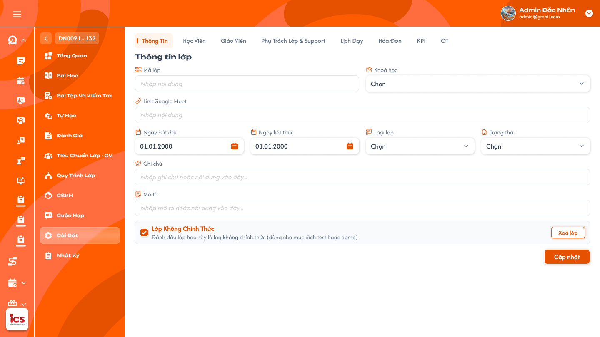

# Chi tiết lớp học — Tab Thông tin

## 1. UI

### Trang 1: ADM-LOP-040100 — Lớp học / Cài đặt / Thông tin



**Mô tả:**
- Hiển thị thông tin hiện tại của một lớp và cho phép người dùng có quyền chỉnh sửa các field được quy định. `Admin` và `Class Handler` chỉnh sửa thông tin chung của lớp trong phạm vi được phân quyền; riêng `Trạng thái` chỉ `Class Handler` được thay đổi.
- Dữ liệu phải được lấy lại từ backend khi mở tab; không dùng dữ liệu cũ của màn danh sách làm nguồn quyết định quyền hoặc điều kiện nghiệp vụ.

**Điểm cần lưu ý:**
- `A01.01` Lớp không chính thức: chỉ `Admin` được chuyển lớp chính thức thành không chính thức; chuyển đổi một chiều, đã tick và lưu thì không bỏ tick được (field chuyển chỉ đọc). Lớp test bỏ qua điều kiện nghiệp vụ nhưng không bỏ qua phân quyền.
- `A01.02` Mã lớp: cho chỉnh sửa; lưu in hoa, không rỗng/chỉ khoảng trắng, không giới hạn ký tự; kiểm tra trùng toàn hệ thống sau chuẩn hóa in hoa (không phân biệt hoa/thường).
- `A01.03` Link Google Meet: nếu có giá trị phải là URL `http://` hoặc `https://` hợp lệ; có thể trống khi lớp chưa `Đang học`, bắt buộc có trước khi lớp chính thức chuyển sang `Đang học`.
- `A01.04` Khóa học: hiển thị khóa hiện tại; đổi được khi bài học số 1 chưa từng được mở, bị khóa vĩnh viễn sau lần đầu mở bài 1 (xem `A02.*`).
- `A01.05` Ghi chú: cho chỉnh sửa, không bắt buộc, không giới hạn ký tự; lưu và hiển thị như text, không thực thi HTML/script.
- `A01.06` Mô tả: cho chỉnh sửa, không được rỗng hoặc chỉ khoảng trắng, không giới hạn ký tự.
- `A01.07` Ngày bắt đầu: chỉnh được trước khi bài 1 mở lần đầu; lưu ngày mới thì sinh lại toàn bộ lịch chưa mở theo số buổi của khóa học; sau khi bài 1 đã mở chuyển chỉ đọc (xem `A03.*`).
- `A01.08` Ngày kết thúc: chỉ đọc, luôn bằng ngày buổi cuối trong lịch được sinh, tự cập nhật khi lịch đổi; backend bỏ qua giá trị client gửi.
- `A01.09` Loại lớp: chỉ hai giá trị `Lớp chung` và `Lớp 1-1`; không phụ thuộc sĩ số, `Lớp 1-1` có thể có 0, 1 hoặc nhiều học viên; đổi loại không tự thêm/xóa học viên.
- `A01.10` Trạng thái: chỉ `Class Handler` đổi được; không hiển thị control đổi cho role khác, backend vẫn từ chối request trực tiếp (xem `A04.*`).
- `A01.11` Lưu/Cập nhật: lưu toàn bộ thay đổi đang có trên tab; không tự lưu theo field hay khi rời field; nút chưa có trong Figma nhưng bắt buộc có khi triển khai. Thành công: `Cập nhật thông tin lớp học thành công.`; thất bại: `Không thể cập nhật thông tin lớp học. Vui lòng thử lại.` kèm lỗi cụ thể tại field.
- `A01.12` Xóa lớp: hiển thị cho `Admin` và `Class Handler` đang là Phụ trách chính của lớp; mở quy trình xác nhận hai lần, chưa xong lần hai thì chưa gửi request xóa.
- `A02.01` Giá trị hiện tại của dropdown Khóa học: hiển thị đúng khóa đang gắn với lớp.
- `A02.02` Ô Tìm kiếm khóa học: tìm trong danh sách khóa được phép dùng; không tạo khóa mới, không nhập giá trị tự do.
- `A02.03` Danh sách khóa học: chỉ khóa đang hoạt động, đã define và thuộc phạm vi người dùng.
- `A02.04` Chọn khóa học mới: trước lần đầu mở bài 1 thì chọn và lưu được; sau đó control chỉ đọc/disabled và backend từ chối mọi request đổi khóa. Đổi thành công thay đồng thời `Bài học`, BTVN theo bài, `Bài kiểm tra`, tổng số buổi và lịch dạy theo khóa mới (vd 24 buổi sang 30 buổi thì đủ 30 buổi, không giữ buổi dư/thiếu buổi); toàn bộ nguyên tử, không sinh được lịch thì giữ nguyên khóa, số buổi, lịch cũ; backend kiểm tra lại mốc mở bài 1 tại thời điểm lưu. Thành công: `Đổi khóa học thành công. Bài học, bài kiểm tra và lịch dạy đã được cập nhật.`; bài 1 đã mở: `Không thể đổi khóa học vì bài học đầu tiên đã được mở.`
- `A03.01` Ngày bắt đầu (nhóm lịch): là ngày buổi 1; trước khi mở bài 1 chọn ngày mới, sau đó chỉ đọc và backend từ chối. Đổi thành công: `Cập nhật ngày bắt đầu và lịch dạy thành công.`; sau khi bài 1 đã mở: `Không thể đổi ngày bắt đầu vì bài học đầu tiên đã được mở.`
- `A03.02` Ngày kết thúc (nhóm lịch): luôn chỉ đọc, bằng ngày buổi có số thứ tự cuối trong tổng số buổi của khóa.
- `A03.03` Lịch cố định: mẫu thứ/giờ dùng sinh các buổi tự động từ Ngày bắt đầu đến khi đủ số buổi. Đổi Ngày bắt đầu xóa lịch tự sinh cũ chưa mở và sinh lại.
- `A03.04` Lịch/buổi được chèn: mọi buổi chèn mặc định được tính vào tổng số buổi (không cần control đánh dấu); hệ thống tự dời, sinh lại, đánh số các buổi phía sau để vẫn đủ N buổi.
- `A03.05` Xóa/hủy một buổi có tính vào chương trình: đánh lại số thứ tự và sinh bù một buổi ở khung hợp lệ kế tiếp để tổng trở lại N.
- `A03.06` Dời lịch một buổi: chỉ đổi ngày/giờ buổi đó, không đổi tổng số; sắp xếp và đánh số lại theo thời gian nếu cần.
- `A03.07` Khung giờ bị trùng: không xếp hai buổi cùng lớp vào cùng thời gian; bỏ qua khung trùng và tìm khung hợp lệ kế tiếp theo lịch cố định.
- Không tự xóa, dời hoặc thay nội dung buổi đã mở/hoàn thành; chỉ điều chỉnh buổi tương lai chưa mở. Sau mọi thay đổi hợp lệ lịch được sắp xếp, đánh số liên tục `1…N`, không thiếu/trùng số buổi và `Ngày kết thúc` = ngày buổi N. Không cân bằng được mà không tác động buổi đã mở/hoàn thành thì từ chối toàn bộ và giữ lịch cũ.
- `A04.01` Trạng thái hiện tại: luôn hiển thị giá trị mới nhất của lớp.
- `A04.02` Danh sách trạng thái: bảy trạng thái vận hành `Mới tạo`, `Khai giảng`, `Trải nghiệm`, `Đang học`, `Tạm dừng`, `Hoàn thành`, `Hủy`; không hiển thị trạng thái nguồn; `Xóa` là trạng thái hệ thống qua nút Xóa lớp, không nằm trong dropdown. `Hoàn thành`/`Hủy` vẫn mở lại sang trạng thái khác được.
- `A04.03` Trạng thái `Đang học` (lớp chính thức): chỉ chuyển khi đồng thời có Link Google Meet, đạt Tiêu chuẩn giáo viên, hoàn tất đúng Quy trình lớp, có ít nhất 1 học viên `Đang học` và tất cả học viên `Đang học` đáp ứng điều kiện học phí (cách xác định theo requirement học phí riêng). Thiếu điều kiện thì giữ nguyên và báo: `Không thể chuyển lớp sang Đang học. Vui lòng hoàn tất: {danh sách điều kiện còn thiếu}.`
- `A04.04` Ma trận chuyển lớp chính thức: từ bất kỳ trạng thái vận hành nào sang bất kỳ trạng thái vận hành khác; đích `Khai giảng` cần lịch dạy hợp lệ; đích `Đang học` cần đủ điều kiện ở `A04.03`. Tạo lớp có ít nhất một lịch hợp lệ thì tự `Khai giảng`, không có lịch thì `Mới tạo`; lớp `Mới tạo` được thêm lịch hợp lệ cũng tự chuyển `Khai giảng`. Lớp không chính thức bỏ qua điều kiện Meet/Tiêu chuẩn GV/Quy trình lớp/học phí, Class Handler đổi tự do giữa bảy trạng thái nhưng vẫn phải đúng role. Requirement này không định nghĩa hóa đơn, số tiền hay trạng thái “đã đóng học phí”. Thành công: `Cập nhật trạng thái lớp học thành công.`
- `A04.05` Xóa: trạng thái hệ thống sau flow xóa của Admin hoặc Phụ trách chính; không đổi qua dropdown, không có trạng thái đích nào từ `Xóa`.
- `A05.01` Popup xóa lần 1, Tiêu đề: `Xóa lớp học?`
- `A05.02` Popup xóa lần 1, Nội dung: `Bạn đang yêu cầu xóa lớp {Mã lớp}. Hành động này cần được xác nhận thêm một lần.`
- `A05.03` Hủy: đóng popup, giữ nguyên lớp; đóng bằng icon đóng hoặc Escape cũng không xóa.
- `A05.04` Tiếp tục: đóng popup lần 1 và mở popup lần 2; chưa gửi request, chưa đổi dữ liệu. Không dùng một lần bấm để vượt cả hai bước.
- `A06.01` Popup xóa lần 2, Tiêu đề: `Xác nhận xóa lớp học`
- `A06.02` Popup xóa lần 2, Nội dung: `Bạn có chắc chắn muốn xóa lớp {Mã lớp}? Lớp sẽ chuyển sang trạng thái Xóa và không còn được sử dụng cho hoạt động mới.`
- `A06.03` Quay lại: đóng popup lần 2, quay về popup lần 1, không xóa.
- `A06.04` Xóa lớp: gửi đúng một request sau khi backend kiểm tra lại người dùng là `Admin` hoặc Phụ trách chính và trạng thái hiện tại; xóa mềm bằng trạng thái `Xóa`, không xóa vật lý dữ liệu liên quan; gửi lặp chỉ cho một kết quả. Thành công: `Đã xóa lớp học {Mã lớp}.`; thất bại: `Không thể xóa lớp học. Vui lòng thử lại.`
- `A07.01`–`A07.04` Toast phản hồi CRUD: `Thành Công` (backend xác nhận), `Thông Báo` (đã tiếp nhận, cần thời gian đồng bộ), `Cảnh Báo` (dữ liệu/điều kiện cần kiểm tra), `Có Lỗi Xảy Ra` (backend/network không hoàn tất). Nội dung dòng hai lấy từ flow tương ứng; mỗi thao tác một Toast; Hủy/chỉ đọc không có Toast CRUD; nút `×` đóng thủ công; không hiển thị dữ liệu nhạy cảm.


---

## 2. Yêu cầu

### 2.1. Flow chính

**Flow 1 / REQ01, REQ05–REQ06: Xem và chỉnh sửa thông tin chung**

```
Mở Chi tiết lớp → tab Thông tin → Tải dữ liệu và quyền mới nhất từ backend
  → Admin / Class Handler chỉnh field được phép (chưa bấm Lưu: không gửi request, không tự lưu)
  → Bấm Lưu/Cập nhật → Backend kiểm tra quyền, phạm vi, field bắt buộc, URL Meet, Loại lớp
  → Hợp lệ: lưu đúng field thay đổi → notification thành công
                    ↓ (không hợp lệ)
              Không cập nhật một phần, giữ dữ liệu cũ, báo lỗi đúng field
```

**Flow 2 / REQ02–REQ03: Đổi Khóa học**

```
Mở dropdown Khóa học (bài 1 chưa từng mở) → Tìm và chọn khóa đã define → Lưu/Cập nhật
  → Backend kiểm tra lại mốc mở bài 1 + cấu hình khóa mới → Tính lại tổng số buổi
  → Thay Bài học, BTVN theo bài, Bài kiểm tra → Tạo lại danh sách buổi và lịch theo lịch cố định
  → Hợp lệ: cập nhật đồng thời khóa, nội dung, số buổi, lịch
                    ↓ (bài 1 đã mở / sinh lịch thất bại)
              Giữ nguyên toàn bộ dữ liệu cũ
```

**Flow 3 / REQ04: Class Handler đổi Trạng thái**

```
Class Handler mở dropdown Trạng thái → Chỉ hiển thị trạng thái đích hợp lệ
  → Chọn Đang học (lớp chính thức) → Backend kiểm tra đồng thời: Meet, Tiêu chuẩn GV, Quy trình lớp,
    ≥1 học viên Đang học, tất cả học viên Đang học đạt học phí
  → Đủ: cập nhật trạng thái
                    ↓ (thiếu)
              Giữ nguyên, trả toàn bộ điều kiện còn thiếu
  Lớp không chính thức: đổi tự do giữa bảy trạng thái, vẫn phải đúng role Class Handler
```

**Flow 4 / REQ07: Xóa lớp với hai lần xác nhận**

```
Admin / Class Handler Phụ trách chính bấm Xóa lớp → Popup lần 1 "Xóa lớp học?"
  → Hủy: kết thúc, không xóa
  → Tiếp tục → Popup lần 2 "Xác nhận xóa lớp học" (chưa gửi request)
       → Quay lại: về popup lần 1
       → Xóa lớp: Backend kiểm tra lại role/phụ trách + trạng thái
            → Thành công: trạng thái Xóa, notification thành công
            → Thất bại: giữ nguyên lớp, cho thử lại
```

**Flow 5 / REQ12: Đổi ngày bắt đầu và cân bằng lịch**

```
Chỉnh Ngày bắt đầu (trước khi mở bài 1) → Lưu/Cập nhật
  → Backend kiểm tra mốc mở bài 1, tổng số buổi, lịch cố định
  → Xóa lịch tự sinh cũ chưa mở, sinh lại từ ngày mới
  → Chèn buổi: tính vào tổng, dời/sinh lại + đánh số buổi sau
  → Xóa buổi tính vào chương trình: đánh lại số, sinh bù ở khung hợp lệ kế tiếp
  → Dời buổi: giữ tổng, sắp xếp/đánh số lại
  → Luôn đủ N buổi; Ngày kết thúc = ngày buổi N
                    ↓ (không cân bằng được)
              Rollback toàn bộ, giữ lịch cũ
```

### 2.2. Ngoại lệ

- **EX01:** Mã lớp hoặc Mô tả rỗng/chỉ khoảng trắng, Mã lớp trùng sau khi chuẩn hóa in hoa, hoặc Link Google Meet không phải URL HTTP(S) hợp lệ → từ chối lưu, báo đúng field và giữ dữ liệu cũ.
- **EX02:** Client gửi giá trị `Ngày kết thúc` → bỏ qua/từ chối field này và tính lại từ buổi cuối.
- **EX04:** Role không có quyền hoặc lớp ngoài phạm vi gửi request cập nhật → backend từ chối, không đổi dữ liệu.
- **EX05:** Bài học số 1 đã từng được mở → từ chối mọi request đổi khóa học, kể cả request trực tiếp hoặc UI giữ dữ liệu cũ.
- **EX06:** Khóa mới thiếu cấu hình số buổi, lịch cố định không còn hợp lệ hoặc không thể sinh/lưu đủ lịch → không đổi khóa; giữ nguyên khóa, số buổi và lịch cũ.
- **EX07:** Bài học số 1 được mở trong lúc người khác đang đổi khóa → tại thời điểm lưu ưu tiên mốc mở bài và từ chối đổi khóa.
- **EX08:** Người không có role `Class Handler` (kể cả `Admin`) gửi request đổi trạng thái → backend từ chối.
- **EX09:** Lớp chính thức thiếu Meet, Tiêu chuẩn giáo viên, Quy trình lớp, không có học viên `Đang học`, hoặc có học viên `Đang học` chưa đáp ứng học phí → không chuyển sang `Đang học`; trả đúng toàn bộ điều kiện còn thiếu.
- **EX10:** Điều kiện chuyển trạng thái thay đổi sau khi UI tải nhưng trước khi lưu → backend dùng dữ liệu mới nhất và từ chối nếu không còn đủ.
- **EX11:** Xóa lớp thất bại hoặc request bị gửi lặp → không thay đổi một phần; chỉ một kết quả xóa mềm.
- **EX12:** Người không phải `Admin` và không phải `Class Handler` đang phụ trách chính gửi request xóa → backend từ chối; không đổi trạng thái hoặc xóa dữ liệu liên quan.
- **EX13:** Người không có role `Admin` gửi request tick/bỏ tick `Lớp không chính thức` → backend từ chối, giữ nguyên giá trị.
- **EX14:** Bài học số 1 đã mở → không cho đổi Ngày bắt đầu, kể cả request trực tiếp hoặc UI cũ.
- **EX15:** Gặp khung giờ trùng khi sinh lịch → bỏ qua khung trùng và tiếp tục theo lịch cố định đến đủ N buổi.
- **EX16:** Không thể sinh/cân bằng đủ N buổi mà không tác động buổi đã mở/hoàn thành → rollback toàn bộ thay đổi lịch.
- **EX17:** Request gửi giá trị ngoài bảy trạng thái vận hành hoặc chọn `Xóa` qua dropdown → backend từ chối và giữ nguyên trạng thái nguồn.
- **EX18:** Lớp đã là lớp không chính thức nhưng client gửi request bỏ tick → backend từ chối; lớp test không được chuyển lại thành lớp chính thức.

### 2.3. Yêu cầu khác

| Mã | Tên yêu cầu | Mô tả |
|---|---|---|
| REQ01 | Thông tin được chỉnh sửa và cơ chế lưu | Cho chỉnh `Mã lớp`, `Link Google Meet`, `Ghi chú`, `Mô tả`, `Loại lớp`; `Ngày bắt đầu` theo REQ12. Không tự lưu; chỉ gửi cập nhật khi bấm `Lưu/Cập nhật`. `Ngày kết thúc` chỉ đọc. |
| REQ02 | Mốc khóa Khóa học | Chỉ đổi Khóa học trước khi bài học số 1 được mở lần đầu. Mốc đã mở là vĩnh viễn, kiểm tra ở backend. |
| REQ03 | Đồng bộ khi đổi Khóa học | Khóa mới quyết định toàn bộ Bài học, BTVN theo bài, Bài kiểm tra và tổng số buổi. Tạo lại lịch đến đủ số buổi mới; cập nhật nguyên tử cùng Khóa học. |
| REQ04 | Quyền và điều kiện đổi Trạng thái | Chỉ `Class Handler` đổi trạng thái. Bảy trạng thái vận hành chuyển qua lại, kể cả mở lại từ `Hoàn thành`/`Hủy`; `Xóa` không nằm trong dropdown. Sang `Khai giảng` cần lịch hợp lệ. Sang `Đang học` cần Meet, Tiêu chuẩn GV, Quy trình lớp, ≥1 học viên `Đang học` và toàn bộ nhóm này đáp ứng học phí. Có lịch ngay khi tạo hoặc thêm lịch cho lớp `Mới tạo` thì tự chuyển `Khai giảng`. |
| REQ05 | Loại lớp | Chỉ `Lớp chung` và `Lớp 1-1`; độc lập với sĩ số (0, 1 hoặc nhiều học viên); đổi loại không tự thêm/xóa học viên. |
| REQ06 | Validation và toàn vẹn cập nhật | Backend kiểm tra lại dữ liệu, quyền, phạm vi; không tin field chỉ đọc/cờ điều kiện từ client; cập nhật thất bại không lưu một phần. |
| REQ07 | Xóa lớp | `Admin` và `Class Handler` đang phụ trách chính được xóa; xác nhận qua hai popup độc lập; chỉ nút `Xóa lớp` ở popup lần 2 gửi request; backend kiểm tra lại quan hệ phụ trách tại thời điểm xóa; xóa mềm bằng trạng thái `Xóa`. |
| REQ08 | Theo dõi thay đổi | Ghi nhận tối thiểu lớp, field/trạng thái cũ và mới, người thực hiện, thời điểm cho chỉnh sửa, đổi khóa, đổi trạng thái, xóa. |
| REQ09 | Hiển thị an toàn | Mã lớp, Mô tả, Ghi chú hiển thị như text, không thực thi HTML/script. Lỗi trả về không chứa stack trace, token hay định danh kỹ thuật nhạy cảm. |
| REQ10 | Dữ liệu text và URL | Không giới hạn ký tự Mã lớp, Mô tả, Ghi chú. Mã lớp lưu in hoa, duy nhất toàn hệ thống sau chuẩn hóa, không phân biệt hoa/thường. Link Google Meet chỉ nhận URL HTTP(S) hợp lệ. |
| REQ11 | Lớp không chính thức | Chỉ `Admin` chuyển lớp chính thức thành không chính thức; một chiều; không được bỏ tick sau khi lưu. Class Handler chỉ đổi trạng thái của lớp test, không tự gán cờ lớp test. |
| REQ12 | Ngày và cân bằng lịch | Ngày bắt đầu chỉ đổi trước khi mở bài 1. Lịch luôn đúng N buổi; mọi buổi chèn tính vào tổng, các buổi sau tự dời/sinh lại và đánh số lại. Ngày kết thúc luôn bằng ngày buổi N, không cho sửa. |

### 2.4. Ràng buộc

#### Quyền

| Role | Xem tab theo phạm vi | Sửa thông tin chung | Đổi Khóa học/Ngày bắt đầu trước khi mở bài 1 | Tick Lớp không chính thức | Đổi Trạng thái | Xóa lớp |
|---|:---:|:---:|:---:|:---:|:---:|:---:|
| Admin | ✅ | ✅ | ✅ | ✅ | ❌ | ✅ |
| Class Handler | ✅ | ✅ | ✅ | ❌ | ✅ | ✅ |
| Các role khác | ✅ | ❌ | ❌ | ❌ | ❌ | ❌ |

#### Ràng buộc khác

- Role bị đánh dấu ❌ không thực hiện được hành động bằng cách sửa giao diện, mở URL hay gửi request trực tiếp. Các role khác xem tab theo quyền xem hiện hành.
- Quyền xóa của `Class Handler` chỉ áp dụng khi là `Phụ trách chính` hiện tại của chính lớp đó; `Admin` không bị giới hạn bởi quan hệ phụ trách. `Class Handler` chỉ thao tác trên lớp thuộc phạm vi phân công, trừ khi có permission phạm vi rộng hơn.
- Backend là nguồn quyết định cuối cùng cho quyền, mốc đã mở bài 1, trạng thái lớp, điều kiện `Đang học`, cờ lớp test và quyền xóa.
- Khóa học được chọn phải tồn tại, đang hoạt động, đã define số buổi và thuộc phạm vi người dùng tại thời điểm lưu.
- Đổi khóa nguyên tử giữa Khóa học, Bài học, BTVN, Bài kiểm tra, tổng số buổi và lịch dạy.
- Mọi thay đổi lịch giữ đúng tổng số buổi, không tác động buổi đã mở/hoàn thành và cập nhật Ngày kết thúc trong cùng giao dịch.
- Không dùng tên Khóa học, Mã lớp hoặc text hiển thị làm định danh cập nhật/phân quyền. Thao tác gửi lặp có kết quả nhất quán, không tạo thêm lịch hay xóa lớp nhiều lần.

---

## 3. Testcase

### Feature: Chi tiết lớp học — Tab Thông tin

| Tên testcase | Priority | Scenario | Role | Pre-condition | Given/When/Then | Expected Result |
|---|---|---|---|---|---|---|
| Case 1: Mở tab và lưu các field thông tin chung | High | Flow 1 / REQ01 / REQ09 | Admin / Class Handler | Lớp thuộc phạm vi, người dùng có quyền sửa | **Given:** mở Chi tiết lớp, chọn tab `Thông tin`<br>**When:** sửa Mã lớp, Meet, Ghi chú, Mô tả, Loại lớp rồi bấm `Lưu/Cập nhật`<br>**Then:** backend kiểm tra và lưu | - Tải dữ liệu mới nhất từ backend, không tự lưu trước khi bấm nút<br>- Hiển thị `Cập nhật thông tin lớp học thành công.`, dữ liệu mới còn sau khi tải lại, có ghi nhận người và thời điểm<br>- Ghi chú/Mô tả hiển thị như text |
| Case 2: Validation Mã lớp, Mô tả, Meet và Ngày kết thúc | High | EX01 / EX02 / REQ06 / REQ10 | Admin / Class Handler | Người dùng có quyền sửa lớp | **Given:** Mã lớp/Mô tả rỗng, Mã lớp trùng (khác hoa/thường), Meet không phải URL HTTP(S); client gửi `Ngày kết thúc`<br>**When:** bấm `Lưu/Cập nhật`<br>**Then:** hệ thống chuẩn hóa và validate | - Mã hợp lệ lưu in hoa; mã trùng toàn hệ thống bị từ chối<br>- Lỗi báo đúng field, không lưu một phần<br>- Giá trị `Ngày kết thúc` từ client bị bỏ qua |
| Case 3: Lớp không chính thức một chiều | High | REQ11 / EX13 / EX18 | Admin; Class Handler | Một lớp chính thức, một lớp đã là không chính thức | **Given:** Admin tick `Lớp không chính thức` rồi lưu; sau đó Admin hoặc client gửi bỏ tick; Class Handler gửi tick<br>**When:** hệ thống xử lý<br>**Then:** chỉ Admin được chuyển một chiều | - Lớp chuyển thành lớp test, checkbox thành chỉ đọc, ghi nhận người và thời điểm<br>- Bỏ tick và request của role khác bị backend từ chối, giá trị không đổi |
| Case 4: Đổi Loại lớp | High | REQ05 | Admin / Class Handler | Lớp có từ 2 học viên | **Given:** Loại lớp đang `Lớp chung`<br>**When:** chọn `Lớp 1-1` và lưu<br>**Then:** hệ thống cập nhật | - Loại lớp mới `Lớp 1-1`, danh sách học viên giữ nguyên, không cảnh báo giới hạn sĩ số<br>- Không chấp nhận loại lớp thứ ba |
| Case 5: Tìm và đổi Khóa học trước khi mở bài 1 | High | Flow 2 / REQ02 / REQ03 | Admin / Class Handler | Bài 1 chưa mở; khóa A 24 buổi, khóa B 30 buổi | **Given:** mở dropdown, nhập từ khóa tìm; chọn khóa B<br>**When:** bấm `Lưu/Cập nhật`<br>**Then:** thay toàn bộ dữ liệu theo khóa B | - Chỉ hiện khóa hoạt động, thuộc phạm vi, không nhập tự do<br>- Bài học, BTVN, Bài kiểm tra, tổng số buổi và lịch thuộc khóa B, đúng 30 buổi, buổi 1 từ Ngày bắt đầu<br>- Hiển thị notification đổi khóa thành công |
| Case 6: Khóa đổi Khóa học sau khi mở bài 1 | High | EX05 / EX07 / REQ02 | Admin / Class Handler | Bài 1 đã mở, hoặc được người khác mở lúc đang chọn khóa mới | **Given:** dropdown chỉ đọc, hoặc client dùng UI cũ gửi request đổi khóa<br>**When:** gửi yêu cầu đổi khóa<br>**Then:** backend kiểm tra mốc mở bài | - Khóa học, bài học, BTVN, bài kiểm tra, số buổi, lịch không đổi<br>- Hiển thị `Không thể đổi khóa học vì bài học đầu tiên đã được mở.`<br>- Đóng bài hoặc chưa hoàn thành bài không mở lại quyền đổi |
| Case 7: Lỗi khi sinh lịch lúc đổi khóa | High | EX06 / REQ03 | Admin / Class Handler | Bài 1 chưa mở; mô phỏng lỗi sinh/lưu lịch | **Given:** lớp có khóa và lịch cũ hợp lệ<br>**When:** đổi khóa nhưng không sinh được đủ lịch<br>**Then:** toàn bộ thao tác thất bại | - Giữ nguyên khóa, số buổi, lịch cũ, không nửa cũ nửa mới<br>- Cho phép thử lại |
| Case 8: Đổi Ngày bắt đầu và Ngày kết thúc | High | Flow 5 / REQ12 / EX14 | Admin / Class Handler | Một lớp bài 1 chưa mở; một lớp bài 1 đã mở | **Given:** chọn Ngày bắt đầu mới và lưu; ở lớp kia đổi ngày hoặc gửi request trực tiếp<br>**When:** hệ thống xử lý<br>**Then:** sinh lại lịch hoặc từ chối | - Lịch tự sinh cũ chưa mở bị xóa, sinh lại đúng N buổi đánh số 1…N, Ngày kết thúc = ngày buổi N (chỉ đọc)<br>- Hiển thị `Cập nhật ngày bắt đầu và lịch dạy thành công.`<br>- Bài 1 đã mở: field chỉ đọc, báo `Không thể đổi ngày bắt đầu vì bài học đầu tiên đã được mở.` |
| Case 9: Chèn, xóa, dời buổi và khung giờ trùng | High | Flow 5 / REQ12 / EX15 / EX16 | Admin / Class Handler | Còn buổi tương lai chưa mở; lịch đủ N buổi; một khung lịch cố định trùng lịch khác | **Given:** chèn một buổi; xóa/hủy một buổi tính vào chương trình; dời một buổi; sinh lịch gặp khung trùng; một trường hợp không đủ khung hợp lệ<br>**When:** xác nhận thao tác<br>**Then:** hệ thống cân bằng lịch | - Luôn đủ N buổi, đánh số liên tục, Ngày kết thúc cập nhật<br>- Buổi chèn tính vào tổng, buổi xóa được sinh bù ở khung kế tiếp, dời không đổi tổng, khung trùng bị bỏ qua<br>- Không tác động buổi đã mở/hoàn thành<br>- Không cân bằng được thì rollback toàn bộ, giữ lịch cũ |
| Case 10: Class Handler đổi Trạng thái hợp lệ | High | Flow 3 / REQ04 / EX17 | Class Handler | Lớp chính thức thuộc phạm vi phụ trách | **Given:** mở dropdown trạng thái<br>**When:** chọn trạng thái đích (kể cả mở lại lớp `Hoàn thành`/`Hủy`) và xác nhận<br>**Then:** backend kiểm tra quyền và ma trận | - Dropdown gồm sáu trạng thái vận hành còn lại, không có trạng thái nguồn hay `Xóa`<br>- Hiển thị `Cập nhật trạng thái lớp học thành công.`, có ghi nhận người và thời điểm<br>- Giá trị ngoài bảy trạng thái hoặc `Xóa` bị backend từ chối |
| Case 11: Điều kiện chuyển sang Đang học | High | Flow 3 / REQ04 / EX09 / EX10 | Class Handler | Lớp chính thức; lần lượt thiếu Meet, Tiêu chuẩn GV, Quy trình, học viên `Đang học`, hoặc học phí; một trường hợp điều kiện đổi sau khi UI tải | **Given:** chọn `Đang học`<br>**When:** xác nhận<br>**Then:** backend kiểm tra đồng thời và theo dữ liệu mới nhất | - Đủ điều kiện thì chuyển; thiếu thì giữ nguyên và liệt kê đúng toàn bộ điều kiện thiếu, không cập nhật một phần<br>- Chỉ kiểm tra học phí học viên đang `Đang học`<br>- Điều kiện không còn đủ lúc lưu thì bị từ chối |
| Case 12: Lớp không chính thức, tự chuyển Khai giảng và chặn role khác | High | REQ04 / REQ11 / EX08 | Class Handler; Admin / Support / role khác | Lớp test thiếu điều kiện; lớp `Mới tạo` chưa có lịch | **Given:** Class Handler đổi tự do giữa bảy trạng thái lớp test; thêm lịch hợp lệ cho lớp `Mới tạo`; Admin/role khác đổi trạng thái<br>**When:** hệ thống xử lý<br>**Then:** áp dụng quy tắc | - Lớp test không kiểm tra Meet/tiêu chuẩn/quy trình/học phí nhưng vẫn cần role Class Handler<br>- Thêm lịch thành công thì tự thành `Khai giảng` cùng giao dịch; lưu lịch lỗi vẫn `Mới tạo`<br>- UI chỉ xem, backend từ chối request trực tiếp, trạng thái không đổi |
| Case 13: Xóa lớp qua hai lần xác nhận | High | Flow 4 / REQ07 / REQ08 / EX11 | Admin; Class Handler Phụ trách chính | Tab Thông tin đang mở | **Given:** bấm `Xóa lớp`; thử `Hủy`/Escape ở lần 1, `Tiếp tục`, `Quay lại` ở lần 2, rồi `Xóa lớp`; mô phỏng lỗi và bấm lặp<br>**When:** xác nhận ở popup lần 2<br>**Then:** backend kiểm tra lại quyền và xóa mềm | - Popup lần 1 `Xóa lớp học?` và lần 2 có đúng Mã lớp; Hủy/Quay lại/Escape không gửi request<br>- Thành công: trạng thái `Xóa`, không xóa vật lý, hiển thị `Đã xóa lớp học {Mã lớp}.`<br>- Thất bại giữ nguyên lớp; gửi lặp chỉ xóa một lần |
| Case 14: Chặn role không có quyền gửi request trực tiếp | High | EX04 / EX12 / Ràng buộc quyền / REQ06 | Role không có quyền; Class Handler không phụ trách | Có ID lớp hợp lệ | **Given:** UI không hiển thị field/nút sửa, đổi trạng thái hay xóa<br>**When:** sửa request và gửi trực tiếp<br>**Then:** backend từ chối | - Không field nào bị thay đổi, trạng thái lớp không đổi, không xóa dữ liệu<br>- Không lộ dữ liệu ngoài phạm vi<br>- Toast `Thành Công`, `Cảnh Báo`, `Có Lỗi Xảy Ra` đúng ngữ cảnh, mỗi thao tác một Toast |

---

## 4. Câu hỏi cần xác nhận

- **Q01:** Figma hiện chỉ có một frame Tab Thông tin, chưa có nút `Lưu/Cập nhật`, dropdown Khóa học/Trạng thái đang mở và hai popup xác nhận xóa lớp. Có bổ sung thiết kế các phần này không?
