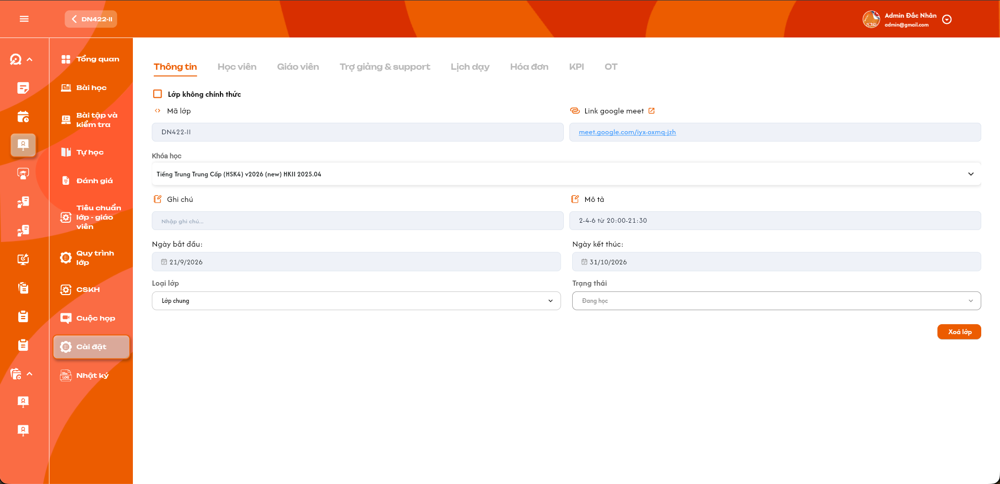
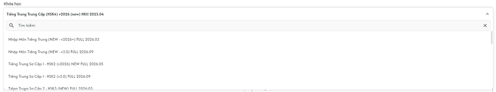

# Chi tiết lớp học — Tab Thông tin

Requirement này đặc tả màn **Chi tiết lớp học → Tab Thông tin**. Màn danh sách lớp, popup tạo lớp và các tab liên quan được đặc tả riêng tại [Quản lý danh sách lớp học](./class_management_requirements.md), [Tạo lớp học](./class_creation_requirements.md), [Tab Học viên](./class_detail_students_requirements.md), [Tab Giáo viên](./class_detail_teachers_requirements.md), [Tab Trợ giảng & Phụ trách lớp](./class_detail_support_handlers_requirements.md) và [Tab Lịch dạy](./class_detail_schedule_requirements.md).

## 1. UI

### Trang 1: ADM-LOP-040100 — Tab Thông tin lớp học




*Chi tiết lớp học — Tab Thông tin — nhấn để xem ảnh gốc*

**Mô tả:**

- Hiển thị thông tin hiện tại của một lớp và cho phép người dùng có quyền chỉnh sửa các field được quy định bên dưới.
- `Admin` và `Class Handler` được chỉnh sửa thông tin chung của lớp trong phạm vi được phân quyền. Riêng `Trạng thái` chỉ `Class Handler` được thay đổi.
- Dữ liệu phải được lấy lại từ backend khi mở tab; không sử dụng dữ liệu cũ của màn danh sách làm nguồn quyết định quyền hoặc điều kiện nghiệp vụ.

**Giải thích field/thành phần:**

- `A01.01` **Lớp không chính thức**: Chỉ `Admin` được chuyển một lớp chính thức thành lớp không chính thức. Đây là chuyển đổi **một chiều**: sau khi đã tick và lưu, không được bỏ tick để chuyển lại thành lớp chính thức. Lớp test bỏ qua điều kiện nghiệp vụ nhưng không bỏ qua phân quyền.
- `A01.02` **Mã lớp**: Cho phép chỉnh sửa. Bắt buộc lưu bằng chữ in hoa, không được rỗng/chỉ chứa khoảng trắng và không giới hạn số ký tự theo nghiệp vụ. Hệ thống chuẩn hóa sang in hoa rồi kiểm tra trùng trên toàn hệ thống.
- `A01.03` **Link Google Meet**: Cho phép chỉnh sửa. Nếu có giá trị thì phải là URL `http://` hoặc `https://` hợp lệ. Có thể để trống khi lớp chưa chuyển sang `Đang học`; bắt buộc có URL hợp lệ trước khi lớp chính thức chuyển sang `Đang học`.
- `A01.04` **Khóa học**: Hiển thị khóa học hiện tại. Cho phép đổi khi bài học đầu tiên chưa từng được mở; bị khóa ngay sau lần đầu mở bài học số 1. Hành vi chi tiết nằm tại khu vực `Dropdown chọn Khóa học`.
- `A01.05` **Ghi chú**: Cho phép chỉnh sửa; không bắt buộc. Nội dung phải được lưu và hiển thị an toàn.
- `A01.06` **Mô tả**: Cho phép chỉnh sửa; không được rỗng hoặc chỉ chứa khoảng trắng.
- `A01.07` **Ngày bắt đầu**: Cho phép chỉnh sửa trước khi bài học số 1 được mở lần đầu. Khi lưu ngày mới, hệ thống sinh lại toàn bộ lịch chưa mở theo số buổi của khóa học. Sau khi bài 1 đã mở, field chuyển sang chỉ đọc.
- `A01.08` **Ngày kết thúc**: Field chỉ đọc, người dùng không được chỉnh sửa. Luôn bằng ngày của buổi cuối cùng trong lịch được sinh; tự cập nhật khi lịch thay đổi.
- `A01.09` **Loại lớp**: Cho phép đổi giữa đúng hai giá trị `Lớp chung` và `Lớp 1-1`. Loại lớp không phụ thuộc sĩ số; `Lớp 1-1` có thể có nhiều học viên.
- `A01.10` **Trạng thái**: Chỉ `Class Handler` được thay đổi. Các điều kiện chuyển sang `Đang học` được mô tả tại khu vực `Dropdown Trạng thái`.
- `A01.11` **Lưu/Cập nhật**: Nút lưu toàn bộ thay đổi đang có trên tab. Không tự lưu theo từng field hoặc khi rời field. Nút chưa xuất hiện trong ảnh tham chiếu nhưng bắt buộc có trong UI triển khai.
- `A01.12` **Xóa lớp**: Hiển thị cho `Admin` và `Class Handler` đang là Phụ trách chính của lớp. Mở quy trình xác nhận hai lần. Chưa hoàn tất xác nhận lần hai thì chưa gửi yêu cầu xóa lớp.

**Điểm cần lưu ý:**

- Các field được phép chỉnh sửa gồm: `Mã lớp`, `Link Google Meet`, `Ghi chú`, `Mô tả`, `Loại lớp`; `Ngày bắt đầu` và `Khóa học` chỉ được chỉnh khi bài học đầu tiên chưa mở. `Ngày kết thúc` luôn chỉ đọc.
- Không hiển thị control đổi trạng thái ở trạng thái có thể thao tác cho role khác `Class Handler`; backend vẫn phải từ chối request đổi trạng thái được gửi trực tiếp.
- Chỉ `Admin` được chuyển lớp chính thức thành `Lớp không chính thức`. `Admin` và `Class Handler` đang phụ trách chính được xóa lớp. Không role nào được chuyển lớp không chính thức về lớp chính thức.
- Không tự lưu khi nhập/chọn field. Chỉ lưu sau khi người dùng bấm `Lưu/Cập nhật` và backend xác nhận thành công.
- Cho phép đổi sang `Lớp 1-1` bất kể lớp hiện có 0, 1 hay nhiều học viên; không tự thêm hoặc xóa học viên khi đổi Loại lớp.
- Cập nhật thành công hiển thị notification: `Cập nhật thông tin lớp học thành công.`
- Cập nhật thất bại hiển thị notification: `Không thể cập nhật thông tin lớp học. Vui lòng thử lại.` Validation tại field vẫn phải hiển thị đúng nguyên nhân cụ thể.

### Trang 2: ADM-LOP-040100 — Dropdown chọn Khóa học




*Dropdown chọn Khóa học có tìm kiếm — nhấn để xem ảnh gốc*

**Mô tả:**

- Cho phép chọn một khóa học khác trong danh sách khóa học đã được define sẵn khi bài học đầu tiên của lớp chưa từng được mở.
- Chỉ cần bài học số 1 được mở lần đầu là lớp bị khóa đổi khóa học vĩnh viễn; đóng bài, quay lại trạng thái cũ hoặc chưa hoàn thành bài không mở lại quyền đổi khóa.

**Giải thích field/thành phần:**

- `A02.01` **Giá trị hiện tại**: Hiển thị đúng khóa học đang gắn với lớp.
- `A02.02` **Ô Tìm kiếm**: Tìm trong danh sách khóa học được phép sử dụng; không tạo khóa học mới và không cho nhập giá trị tự do.
- `A02.03` **Danh sách khóa học**: Chỉ hiển thị khóa học đang hoạt động, đã được define và thuộc phạm vi người dùng được phép chọn.
- `A02.04` **Chọn khóa học mới**: Trước lần đầu mở bài 1: cho chọn và lưu. Sau lần đầu mở bài 1: control chỉ đọc/disabled và backend từ chối mọi request đổi khóa.

**Điểm cần lưu ý:**

- Đổi khóa học thành công phải đồng thời thay toàn bộ `Bài học`, BTVN gắn với bài học, `Bài kiểm tra`, tổng số buổi và lịch dạy bằng dữ liệu của khóa học mới.
- Hệ thống dùng số buổi của khóa học mới để sinh lại lịch theo cấu hình lịch cố định hiện tại. Ví dụ đổi khóa `24 buổi` sang `30 buổi` thì lịch mới phải có đủ `30 buổi`.
- Ngày bắt đầu của lớp là buổi 1; các buổi tiếp theo chạy theo lịch cố định đến đủ tổng số buổi của khóa mới.
- Không được giữ lại các buổi dư của khóa cũ hoặc thiếu buổi của khóa mới.
- Toàn bộ thay đổi phải có tính nguyên tử: nếu không thể tạo đủ lịch mới thì giữ nguyên khóa học, số buổi và lịch cũ.
- Backend phải kiểm tra lại mốc “đã mở bài học đầu tiên” tại thời điểm lưu để tránh hai người thao tác đồng thời.
- Thành công hiển thị: `Đổi khóa học thành công. Bài học, bài kiểm tra và lịch dạy đã được cập nhật.`
- Nếu bài 1 đã mở, hiển thị: `Không thể đổi khóa học vì bài học đầu tiên đã được mở.`

### Trang 3: ADM-LOP-040100 — Nhóm Ngày bắt đầu, Ngày kết thúc và lịch được sinh


**Mô tả:**

- `Ngày bắt đầu` là ngày của buổi 1 và chỉ được chỉnh trước khi bài học số 1 được mở lần đầu.
- `Ngày kết thúc` không cho người dùng nhập; luôn lấy ngày của buổi cuối cùng sau khi hệ thống sinh hoặc điều chỉnh lịch.
- Lịch của lớp luôn phải có đúng tổng số buổi của khóa học, kể cả khi có buổi được chèn, xóa, dời lịch hoặc phải bỏ qua một khung giờ bị trùng.

**Giải thích field/thành phần:**

- `A03.01` **Ngày bắt đầu**: Trước khi mở bài 1: cho chọn ngày mới. Sau khi mở bài 1: chỉ đọc và backend từ chối request chỉnh sửa.
- `A03.02` **Ngày kết thúc**: Luôn chỉ đọc. Bằng ngày của buổi có số thứ tự cuối cùng trong tổng số buổi của khóa học.
- `A03.03` **Lịch cố định**: Là mẫu thứ/giờ dùng để sinh các buổi tự động từ Ngày bắt đầu đến khi đủ số buổi.
- `A03.04` **Lịch/buổi được chèn**: Mọi buổi học được chèn vào lịch lớp đều được tính vào tổng số buổi khóa học. Hệ thống đưa buổi chèn vào đúng vị trí thời gian rồi tự động dời, sinh lại và đánh số các buổi phía sau để lịch cuối cùng vẫn đủ đúng N buổi.
- `A03.05` **Xóa/hủy một buổi có tính vào chương trình**: Đánh lại số thứ tự các buổi sau và sinh bù một buổi ở khung hợp lệ tiếp theo để tổng số trở lại đúng cấu hình khóa học.
- `A03.06` **Dời lịch một buổi**: Chỉ đổi ngày/giờ của chính buổi đó, không tăng/giảm tổng số; sau khi sắp xếp lại phải đánh lại thứ tự theo thời gian nếu cần.
- `A03.07` **Khung giờ bị trùng**: Không xếp hai buổi của cùng lớp vào cùng thời gian. Bỏ qua khung bị trùng và tiếp tục tìm khung hợp lệ tiếp theo theo lịch cố định.

**Điểm cần lưu ý:**

- Mọi phép cộng/trừ lịch đều lấy `Số buổi của khóa học` làm tổng chuẩn; một buổi được chèn mặc định có tính vào tổng, không cần thêm control đánh dấu có/không tính.
- Không tự xóa, dời hoặc thay nội dung một buổi đã mở/đã hoàn thành. Khi cần cân bằng tổng số, chỉ điều chỉnh các buổi tương lai chưa mở.
- Đổi Ngày bắt đầu trước khi mở bài 1 sẽ xóa lịch tự sinh cũ chưa mở và sinh lại từ ngày mới đến đủ số buổi.
- Sau mọi thay đổi hợp lệ, hệ thống sắp xếp lịch theo thời gian, đánh số liên tục `1…N`, bảo đảm không thiếu/trùng số buổi và cập nhật `Ngày kết thúc` bằng ngày buổi N.
- Nếu không thể cân bằng đủ số buổi mà không tác động đến buổi đã mở/hoàn thành, từ chối toàn bộ thay đổi và giữ lịch cũ.
- Đổi ngày bắt đầu thành công hiển thị: `Cập nhật ngày bắt đầu và lịch dạy thành công.`
- Sau khi bài 1 đã mở, hiển thị: `Không thể đổi ngày bắt đầu vì bài học đầu tiên đã được mở.`

### Trang 4: ADM-LOP-040100 — Dropdown Trạng thái


**Mô tả:**

- Hiển thị trạng thái hiện tại của lớp.
- Chỉ người dùng có role `Class Handler` được thay đổi trạng thái lớp. `Admin` và các role khác chỉ được xem, không được đổi trạng thái.

**Giải thích field/thành phần:**

- `A04.01` **Trạng thái hiện tại**: Luôn hiển thị giá trị mới nhất của lớp.
- `A04.02` **Danh sách trạng thái**: Các trạng thái vận hành gồm: `Mới tạo`, `Khai giảng`, `Trải nghiệm`, `Đang học`, `Tạm dừng`, `Hoàn thành`, `Hủy`. `Xóa` là trạng thái hệ thống do Admin thực hiện qua nút Xóa lớp, không phải lựa chọn trong dropdown.
- `A04.03` **Trạng thái `Đang học`**: Với lớp chính thức, chỉ cho chuyển khi đồng thời có Link Google Meet, đạt Tiêu chuẩn giáo viên, hoàn tất đúng Quy trình lớp, có ít nhất 1 học viên ở trạng thái `Đang học` và **tất cả** học viên ở trạng thái đó đã đáp ứng điều kiện học phí. Cách xác định học phí tuân theo requirement học phí riêng.

**Ma trận chuyển trạng thái lớp chính thức:**

- `A04.04` **Mới tạo, Khai giảng, Trải nghiệm, Đang học, Tạm dừng, Hoàn thành hoặc Hủy**: Trạng thái được phép chuyển đến: Bất kỳ trạng thái vận hành nào khác trong bảy trạng thái; Điều kiện bổ sung: Nếu đích là `Khai giảng` thì lớp phải có lịch dạy hợp lệ. Nếu đích là `Đang học` thì phải đủ điều kiện Meet, Tiêu chuẩn GV, Quy trình lớp và học phí. `Hoàn thành`/`Hủy` vẫn được mở lại sang trạng thái khác như bình thường.
- `A04.05` **Xóa**: Trạng thái được phép chuyển đến: Không có; Điều kiện bổ sung: Trạng thái hệ thống sau flow xóa của Admin hoặc Phụ trách chính, không đổi qua dropdown.

**Điểm cần lưu ý:**

- Thiếu bất kỳ điều kiện nào của `Đang học` thì giữ nguyên trạng thái và trả đúng danh sách điều kiện còn thiếu.
- Khi tạo lớp có ít nhất một lịch dạy hợp lệ, hệ thống tự đặt trạng thái `Khai giảng`; tạo không có lịch thì là `Mới tạo`. Lớp `Mới tạo` được thêm lịch hợp lệ sau đó cũng tự chuyển sang `Khai giảng`.
- Lớp không chính thức được bỏ qua các điều kiện Meet, Tiêu chuẩn giáo viên, Quy trình lớp và học phí; tuy nhiên chỉ `Class Handler` vẫn được quyền đổi trạng thái.
- Với lớp không chính thức, `Class Handler` có thể chuyển tự do giữa bảy trạng thái vận hành để phục vụ test; `Xóa` vẫn chỉ do `Admin` thực hiện qua flow xóa hai lần.
- Requirement này không tự định nghĩa hóa đơn, số tiền hoặc trạng thái thanh toán được coi là “đã đóng học phí”.
- Backend phải kiểm tra quyền, trạng thái nguồn và điều kiện nghiệp vụ tại thời điểm cập nhật.
- Đổi trạng thái thành công hiển thị: `Cập nhật trạng thái lớp học thành công.`
- Thiếu điều kiện vào `Đang học` hiển thị: `Không thể chuyển lớp sang Đang học. Vui lòng hoàn tất: {danh sách điều kiện còn thiếu}.`

### Trang 5: ADM-LOP-040100 — Popup xác nhận xóa lớp — Lần 1


**Mô tả:**

- Chỉ xuất hiện khi `Admin` hoặc `Class Handler` đang phụ trách chính bấm `Xóa lớp`.
- Đây là bước xác nhận ý định; xác nhận lần 1 chỉ mở popup xác nhận lần 2 và chưa gửi request xóa.

**Điểm cần lưu ý:**

- `A05.01` **Tiêu đề**: `Xóa lớp học?`
- `A05.02` **Nội dung**: `Bạn đang yêu cầu xóa lớp {Mã lớp}. Hành động này cần được xác nhận thêm một lần.`
- `A05.03` **Hủy**: Đóng popup, giữ nguyên lớp.
- `A05.04` **Tiếp tục**: Đóng popup lần 1 và mở popup xác nhận lần 2; chưa thay đổi dữ liệu lớp.

- Không được dùng một lần bấm để vượt qua cả hai bước xác nhận.
- Đóng popup bằng nút Hủy, icon đóng hoặc phím Escape đều không được xóa lớp.

### Trang 6: ADM-LOP-040100 — Popup xác nhận xóa lớp — Lần 2


**Mô tả:**

- Là bước xác nhận cuối cùng sau khi người dùng đã xác nhận lần 1.
- Chỉ thao tác xác nhận tại popup lần 2 mới gửi request xóa lớp.

**Điểm cần lưu ý:**

- `A06.01` **Tiêu đề**: `Xác nhận xóa lớp học`
- `A06.02` **Nội dung**: `Bạn có chắc chắn muốn xóa lớp {Mã lớp}? Lớp sẽ chuyển sang trạng thái Xóa và không còn được sử dụng cho hoạt động mới.`
- `A06.03` **Quay lại**: Đóng popup lần 2 và quay lại popup lần 1; không xóa lớp.
- `A06.04` **Xóa lớp**: Gửi đúng một request xóa lớp sau khi backend kiểm tra lại người dùng là `Admin` hoặc Phụ trách chính của lớp và kiểm tra trạng thái hiện tại.

- Xóa lớp là xóa mềm bằng trạng thái `Xóa`, phù hợp với trạng thái `Xóa` đang có ở màn danh sách; không xóa vật lý dữ liệu liên quan.
- Request lặp chỉ được tạo một kết quả xóa; không phát sinh lỗi dữ liệu do bấm nhiều lần.
- Backend không được tin việc client đã đi qua popup lần 1 để bỏ qua kiểm tra quyền ở lần cuối.
- Thành công hiển thị: `Đã xóa lớp học {Mã lớp}.`
- Thất bại hiển thị: `Không thể xóa lớp học. Vui lòng thử lại.`

### Trang 7: ADM-LOP-040100 — Toast phản hồi CRUD


*Toast phản hồi Create, Update, Delete và đổi trạng thái — nhấn để xem ảnh gốc*

**Mô tả:** Toast phản hồi kết quả các thao tác thay đổi dữ liệu trong requirement này.

**Điểm cần lưu ý:**

- `A07.01` **Thành công**: Tiêu đề: `Thành Công`; Khi sử dụng: Backend xác nhận thao tác thành công.
- `A07.02` **Thông tin**: Tiêu đề: `Thông Báo`; Khi sử dụng: Thao tác đã tiếp nhận nhưng dữ liệu cần thời gian đồng bộ.
- `A07.03` **Cảnh báo**: Tiêu đề: `Cảnh Báo`; Khi sử dụng: Dữ liệu/điều kiện cần người dùng kiểm tra.
- `A07.04` **Lỗi**: Tiêu đề: `Có Lỗi Xảy Ra`; Khi sử dụng: Backend/network không hoàn tất thao tác.

**Điểm cần lưu ý:** Nội dung dòng hai lấy từ flow CRUD tương ứng; mỗi thao tác chỉ có một Toast; Hủy/chỉ đọc không có Toast CRUD; nút `×` đóng thủ công; không hiển thị dữ liệu nhạy cảm.

---

## 2. Yêu cầu

### 2.1. Flow chính

**Flow 1 / REQ01, REQ05–REQ06: Xem và chỉnh sửa thông tin chung**

```text
Người dùng có quyền mở Chi tiết lớp → tab Thông tin
      → Hệ thống tải dữ liệu và quyền mới nhất từ backend
      → Admin hoặc Class Handler chỉnh field được phép
      → Chưa bấm Lưu/Cập nhật: không gửi request và không tự lưu
      → Người dùng bấm Lưu/Cập nhật
      → Backend kiểm tra quyền, phạm vi, field bắt buộc, URL Meet và Loại lớp
      → Hợp lệ: lưu đúng field thay đổi và hiển thị notification thành công
      → Không hợp lệ: không cập nhật một phần; giữ dữ liệu hợp lệ trước đó và trả lỗi đúng field
```

**Flow 2 / REQ02–REQ03: Đổi Khóa học**

```text
Admin hoặc Class Handler mở dropdown Khóa học
      → Backend/UI kiểm tra bài học số 1 chưa từng được mở
      → Người dùng tìm và chọn khóa học đã define
      → Bấm Lưu/Cập nhật; backend kiểm tra lại mốc mở bài 1 và cấu hình khóa mới
      → Tính lại tổng số buổi theo khóa mới
      → Thay toàn bộ Bài học, BTVN theo bài và Bài kiểm tra theo khóa mới
      → Tạo lại danh sách buổi và lịch dạy theo lịch cố định đến đủ số buổi mới
      → Chỉ khi toàn bộ dữ liệu hợp lệ: cập nhật đồng thời khóa, nội dung, số buổi và lịch
      → Nếu bài 1 đã mở hoặc sinh lịch thất bại: giữ nguyên toàn bộ dữ liệu cũ
```

**Flow 3 / REQ04: Class Handler đổi Trạng thái**

```text
Class Handler mở dropdown Trạng thái
      → Hệ thống chỉ hiển thị trạng thái đích hợp lệ theo ma trận
      → Nếu chọn Đang học cho lớp chính thức, backend kiểm tra đồng thời:
           có Link Google Meet
           đạt Tiêu chuẩn giáo viên
           hoàn tất đúng Quy trình lớp
           có ít nhất 1 học viên ở trạng thái Đang học
           tất cả học viên ở trạng thái Đang học đáp ứng điều kiện học phí
      → Đủ điều kiện: cập nhật trạng thái
      → Thiếu điều kiện: giữ nguyên trạng thái và trả toàn bộ điều kiện còn thiếu
      → Lớp không chính thức cho Class Handler đổi tự do giữa bảy trạng thái vận hành
      → Mọi trường hợp vẫn không bỏ qua quyền Class Handler
```

**Flow 4 / REQ07: Xóa lớp với hai lần xác nhận**

```text
Admin hoặc Class Handler đang phụ trách chính bấm Xóa lớp
      → Popup Xóa lớp học? hiển thị đúng Mã lớp
      → Hủy: kết thúc, không xóa
      → Tiếp tục: mở popup Xác nhận xóa lớp học, chưa gửi request xóa
      → Quay lại: trở về popup lần 1, không xóa
      → Xóa lớp: backend kiểm tra lại role/phạm vi phụ trách và trạng thái
      → Thành công: chuyển lớp sang trạng thái Xóa và hiển thị notification thành công
      → Thất bại: giữ nguyên lớp và cho phép thử lại
```

**Flow 5 / REQ12: Đổi ngày bắt đầu và cân bằng lịch**

```text
Admin hoặc Class Handler chỉnh Ngày bắt đầu trước khi mở bài 1
      → Bấm Lưu/Cập nhật
      → Backend kiểm tra lại mốc mở bài 1, tổng số buổi và lịch cố định
      → Xóa lịch tự sinh cũ chưa mở và sinh lại từ ngày mới
      → Nếu chèn một buổi: mặc định tính vào tổng; tự dời/sinh lại và đánh số các buổi phía sau
      → Nếu xóa một buổi tính vào chương trình: đánh lại số, sinh bù ở khung hợp lệ kế tiếp
      → Nếu dời buổi: giữ nguyên tổng số và sắp xếp/đánh số lại
      → Luôn giữ đúng N buổi; Ngày kết thúc bằng ngày buổi N
      → Không thể cân bằng: rollback toàn bộ và giữ lịch cũ
```

### 2.2. Ngoại lệ

- **EX01:** Mã lớp hoặc Mô tả rỗng/chỉ chứa khoảng trắng, Mã lớp trùng sau khi chuẩn hóa in hoa, hoặc Link Google Meet không phải URL HTTP(S) hợp lệ → từ chối lưu, báo đúng field và giữ dữ liệu cũ.
- **EX02:** Client gửi giá trị `Ngày kết thúc` → bỏ qua/từ chối field này và tính lại từ buổi cuối; không dùng giá trị client để ghi đè.
- **EX04:** Role không có quyền hoặc lớp ngoài phạm vi gửi request cập nhật → backend từ chối và không thay đổi dữ liệu.
- **EX05:** Bài học số 1 đã từng được mở → từ chối mọi request đổi khóa học, kể cả request trực tiếp hoặc UI đang giữ dữ liệu cũ.
- **EX06:** Khóa mới thiếu cấu hình số buổi, lịch cố định không còn hợp lệ hoặc không thể sinh/lưu đủ lịch → không đổi khóa; giữ nguyên toàn bộ khóa, số buổi và lịch cũ.
- **EX07:** Bài học số 1 được mở trong lúc một người khác đang đổi khóa → tại thời điểm lưu, ưu tiên mốc mở bài và từ chối đổi khóa.
- **EX08:** Người không có role `Class Handler` gửi request đổi trạng thái → backend từ chối, kể cả `Admin`.
- **EX09:** Lớp chính thức thiếu Meet, Tiêu chuẩn giáo viên, Quy trình lớp, không có học viên ở trạng thái `Đang học`, hoặc có ít nhất một học viên `Đang học` chưa đáp ứng học phí → không chuyển lớp sang `Đang học`; trả đúng toàn bộ điều kiện còn thiếu.
- **EX10:** Một điều kiện chuyển trạng thái thay đổi sau khi UI tải nhưng trước khi lưu → backend dùng dữ liệu mới nhất và từ chối nếu không còn đủ điều kiện.
- **EX11:** Xóa lớp thất bại hoặc request bị gửi lặp → không thay đổi một phần; chỉ cho phép một kết quả xóa mềm.
- **EX12:** Người dùng không phải `Admin` và không phải `Class Handler` đang phụ trách chính gửi request xóa → backend từ chối; không đổi trạng thái hoặc xóa dữ liệu liên quan.
- **EX13:** Người không có role `Admin` gửi request tick/bỏ tick `Lớp không chính thức` → backend từ chối và giữ nguyên giá trị.
- **EX14:** Bài học số 1 đã mở → không cho đổi Ngày bắt đầu, kể cả request trực tiếp hoặc UI cũ.
- **EX15:** Gặp khung giờ trùng khi sinh lịch → bỏ qua khung trùng và tiếp tục theo lịch cố định đến khi đủ N buổi.
- **EX16:** Không thể sinh/cân bằng đủ N buổi mà không tác động buổi đã mở/hoàn thành → rollback toàn bộ thay đổi lịch.
- **EX17:** Request gửi giá trị ngoài bảy trạng thái vận hành hoặc cố chọn `Xóa` qua dropdown → backend từ chối và giữ nguyên trạng thái nguồn.
- **EX18:** Lớp đã là lớp không chính thức nhưng client gửi request bỏ tick → backend từ chối; lớp test không được chuyển lại thành lớp chính thức.

### 2.3. Yêu cầu khác

| Mã | Tên yêu cầu | Mô tả |
|---|---|---|
| REQ01 | Thông tin được chỉnh sửa và cơ chế lưu | Cho phép chỉnh `Mã lớp`, `Link Google Meet`, `Ghi chú`, `Mô tả`, `Loại lớp`; `Ngày bắt đầu` tuân theo REQ12. Không tự lưu; chỉ gửi cập nhật khi bấm `Lưu/Cập nhật`. `Ngày kết thúc` chỉ đọc. |
| REQ02 | Mốc khóa Khóa học | Chỉ được đổi Khóa học trước khi bài học số 1 được mở lần đầu. Mốc đã mở là vĩnh viễn và phải được kiểm tra ở backend. |
| REQ03 | Đồng bộ khi đổi Khóa học | Khóa mới quyết định toàn bộ Bài học, BTVN theo bài, Bài kiểm tra và tổng số buổi. Hệ thống tạo lại lịch đến đủ số buổi mới; cập nhật nguyên tử cùng Khóa học. |
| REQ04 | Quyền và điều kiện đổi Trạng thái | Chỉ `Class Handler` được đổi trạng thái. Bảy trạng thái vận hành được chuyển qua lại, kể cả mở lại từ `Hoàn thành`/`Hủy`; `Xóa` không nằm trong dropdown. Chuyển sang `Khai giảng` cần lịch hợp lệ. Chuyển sang `Đang học` cần Meet, Tiêu chuẩn GV, Quy trình lớp, ít nhất 1 học viên `Đang học` và toàn bộ nhóm này đáp ứng học phí. Có lịch ngay khi tạo hoặc thêm lịch cho lớp `Mới tạo` thì tự chuyển `Khai giảng`. |
| REQ05 | Loại lớp | Chỉ có `Lớp chung` và `Lớp 1-1`. Loại lớp là field độc lập với sĩ số; lớp 1-1 có thể có 0, 1 hoặc nhiều học viên. Đổi Loại lớp không tự thêm/xóa học viên. |
| REQ06 | Validation và toàn vẹn cập nhật | Backend kiểm tra lại dữ liệu, quyền và phạm vi; không tin field chỉ đọc/cờ điều kiện từ client; một lần cập nhật thất bại không được lưu một phần. |
| REQ07 | Xóa lớp | `Admin` và `Class Handler` đang phụ trách chính được xóa lớp. Phải xác nhận qua hai popup độc lập. Chỉ nút `Xóa lớp` ở popup lần 2 mới gửi request; backend kiểm tra lại quan hệ phụ trách tại thời điểm xóa; xóa mềm bằng trạng thái `Xóa`. |
| REQ08 | Theo dõi thay đổi | Ghi nhận tối thiểu lớp, field/trạng thái cũ và mới, người thực hiện và thời điểm cho thao tác chỉnh sửa, đổi khóa, đổi trạng thái và xóa. |
| REQ09 | Hiển thị an toàn | Mã lớp, Mô tả và Ghi chú phải được hiển thị như text; không thực thi HTML/script. Lỗi trả về không chứa stack trace, token hoặc định danh kỹ thuật nhạy cảm. |
| REQ10 | Dữ liệu text và URL | Không giới hạn số ký tự theo nghiệp vụ đối với Mã lớp, Mô tả và Ghi chú. Mã lớp bắt buộc lưu in hoa và duy nhất toàn hệ thống sau chuẩn hóa, không phân biệt hoa/thường khi kiểm tra trùng. Link Google Meet, nếu có, chỉ chấp nhận URL HTTP(S) hợp lệ. |
| REQ11 | Lớp không chính thức | Chỉ `Admin` được chuyển lớp chính thức thành lớp không chính thức. Chuyển đổi là một chiều; sau khi lưu lớp test thì không được bỏ tick để về lớp chính thức. Class Handler chỉ được đổi trạng thái của lớp test, không được tự gán cờ lớp test. |
| REQ12 | Ngày và cân bằng lịch | Ngày bắt đầu chỉ đổi trước khi mở bài 1. Lịch luôn đúng N buổi của khóa học; mọi buổi chèn được tính vào tổng và làm các buổi phía sau tự dời/sinh lại, đánh số lại. Ngày kết thúc luôn bằng ngày buổi N và không cho người dùng sửa. |

### 2.4. Ràng buộc

#### Quyền

| Role | Xem tab theo phạm vi | Sửa thông tin chung | Đổi Khóa học/Ngày bắt đầu trước khi mở bài 1 | Tick Lớp không chính thức | Đổi Trạng thái | Xóa lớp |
|---|:---:|:---:|:---:|:---:|:---:|:---:|
| Admin | ✅ | ✅ | ✅ | ✅ | ❌ | ✅ |
| Class Handler | ✅ | ✅ | ✅ | ❌ | ✅ | ✅ |
| Các role khác | Theo quyền xem hiện hành | ❌ | ❌ | ❌ | ❌ | ❌ |

- Không cho phép role bị đánh dấu `❌` thực hiện hành động bằng cách sửa giao diện, mở URL hoặc gửi request trực tiếp.
- Quyền xóa của `Class Handler` chỉ áp dụng khi người đó là `Phụ trách chính` hiện tại của chính lớp cần xóa; `Admin` không bị giới hạn bởi quan hệ phụ trách.
- `Class Handler` chỉ thao tác trên lớp thuộc phạm vi được phân công, trừ khi có permission phạm vi rộng hơn được cấu hình riêng.

#### Ràng buộc khác

**Phạm vi và tính toàn vẹn dữ liệu**

- Backend là nguồn quyết định cuối cùng cho quyền, mốc đã mở bài 1, trạng thái lớp, điều kiện `Đang học`, cờ lớp test và quyền xóa.
- Khóa học được chọn phải tồn tại, đang hoạt động, đã define số buổi và thuộc phạm vi người dùng tại thời điểm lưu.
- Thao tác đổi khóa phải nguyên tử giữa Khóa học, Bài học, BTVN, Bài kiểm tra, tổng số buổi và lịch dạy.
- Mọi thay đổi lịch phải giữ đúng tổng số buổi, không tác động buổi đã mở/hoàn thành và cập nhật Ngày kết thúc trong cùng giao dịch.
- Không dùng tên Khóa học, Mã lớp hoặc text hiển thị làm định danh cập nhật/phân quyền.
- Mỗi thao tác gửi lặp phải có kết quả nhất quán, không tạo thêm lịch hoặc xóa lớp nhiều lần.

---

---

## 3. Testcase

### Feature: Chi tiết lớp học — Tab Thông tin

| Tên testcase | Priority | Scenario | Role | Pre-condition | Given/When/Then | Expected Result |
|---|---|---|---|---|---|---|
| Case 1: Mở tab và hiển thị dữ liệu lớp | High · Smoke | Flow 1 / REQ01 | Người dùng có quyền xem lớp | Lớp tồn tại và thuộc phạm vi được xem | **Given** người dùng mở Chi tiết lớp<br>**When** chọn tab `Thông tin`<br>**Then** hệ thống tải dữ liệu mới nhất từ backend | - Hiển thị đúng Mã lớp, Meet, Khóa học, Ghi chú, Mô tả, ngày, Loại lớp và Trạng thái<br>- Không dùng dữ liệu cũ để quyết định quyền<br>- Không làm thay đổi dữ liệu |
| Case 2: Chỉnh sửa và lưu các field thông tin chung | High · Smoke | Flow 1 / REQ01 | `Admin` hoặc `Class Handler` | Người dùng có quyền sửa lớp | **Given** tab đang hiển thị dữ liệu hiện tại<br>**When** sửa Mã lớp, Meet, Ghi chú, Mô tả hoặc Loại lớp rồi bấm `Lưu/Cập nhật`<br>**Then** backend kiểm tra và lưu đúng field đã đổi | - Không tự lưu trước khi bấm nút<br>- Dữ liệu mới hiển thị sau khi tải lại<br>- Hiển thị `Cập nhật thông tin lớp học thành công.`<br>- Có ghi nhận người và thời điểm cập nhật |
| Case 3: Validation Mã lớp, Mô tả và URL Meet | High | EX01 / REQ06 / REQ10 | `Admin` hoặc `Class Handler` | Người dùng có quyền sửa lớp | **Given** Mã lớp/Mô tả rỗng, Mã lớp trùng sau chuẩn hóa hoặc Meet không phải URL HTTP(S)<br>**When** bấm `Lưu/Cập nhật`<br>**Then** hệ thống chuẩn hóa và validate | - Mã lớp hợp lệ được lưu in hoa<br>- Mã trùng toàn hệ thống bị từ chối, không phân biệt hoa/thường<br>- Báo lỗi tại đúng field<br>- Không giới hạn ký tự Mã lớp, Mô tả, Ghi chú |
| Case 4: Admin chuyển lớp chính thức thành lớp không chính thức | High | Flow 1 / REQ11 | `Admin` | Lớp đang là lớp chính thức | **Given** checkbox chưa tick<br>**When** Admin tick rồi bấm `Lưu/Cập nhật`<br>**Then** backend chuyển lớp thành lớp test | - Ghi nhận người và thời điểm thay đổi<br>- Quy tắc lớp test có hiệu lực sau khi lưu<br>- Checkbox trở thành chỉ đọc sau khi chuyển thành công |
| Case 5: Chặn role khác thay đổi Lớp không chính thức | High | EX13 / REQ11 / Ràng buộc quyền | `Class Handler` hoặc role khác | Lớp tồn tại | **Given** checkbox ở chế độ chỉ đọc/không hiển thị control<br>**When** người dùng sửa request để tick/bỏ tick<br>**Then** backend từ chối | - Giá trị không đổi<br>- Không cho client giả lập lớp test<br>- Các field hợp lệ khác không bị ghi đè ngoài ý muốn |
| Case 39: Không cho chuyển lớp không chính thức về lớp chính thức | High | EX18 / REQ11 | `Admin` | Lớp đã là lớp không chính thức | **Given** checkbox hiển thị đã tick và chỉ đọc<br>**When** Admin hoặc client gửi request bỏ tick<br>**Then** backend từ chối | - Lớp vẫn là lớp không chính thức<br>- Không áp dụng lại một phần quy tắc lớp chính thức<br>- Trả lỗi chuyển đổi một chiều |
| Case 6: Đổi Loại lớp thành Lớp 1-1 hợp lệ | High | Flow 1 / REQ05 | `Admin` hoặc `Class Handler` | Lớp có số lượng học viên bất kỳ | **Given** Loại lớp hiện tại là `Lớp chung`<br>**When** chọn `Lớp 1-1` và lưu<br>**Then** hệ thống cập nhật Loại lớp | - Loại lớp mới là `Lớp 1-1`<br>- Danh sách học viên không đổi<br>- Không chấp nhận loại lớp thứ ba |
| Case 7: Đổi thành Lớp 1-1 khi lớp có nhiều học viên | High | REQ05 | `Admin` hoặc `Class Handler` | Lớp có từ 2 học viên trở lên | **Given** người dùng chọn `Lớp 1-1`<br>**When** lưu thay đổi<br>**Then** backend chấp nhận nếu các field khác hợp lệ | - Giữ nguyên toàn bộ học viên<br>- Không cảnh báo giới hạn sĩ số bằng 1<br>- Loại lớp và sĩ số được lưu độc lập |
| Case 8: Role không có quyền gửi request chỉnh sửa trực tiếp | High | EX04 / Ràng buộc quyền | Role không có quyền sửa lớp | Có ID lớp hợp lệ | **Given** role không được phép sửa không thấy hoặc không thao tác được field<br>**When** sửa request và gửi trực tiếp<br>**Then** backend từ chối | - Không có field nào bị thay đổi<br>- Không làm lộ dữ liệu ngoài phạm vi<br>- Ghi nhận sự kiện từ chối theo cơ chế hệ thống |
| Case 9: Mở dropdown và tìm khóa học | Medium | Flow 2 / REQ02 | `Admin` hoặc `Class Handler` | Bài học 1 chưa từng được mở; người dùng có quyền sửa lớp | **Given** dropdown đang khả dụng<br>**When** mở dropdown và nhập từ khóa<br>**Then** hệ thống lọc danh sách khóa học hợp lệ | - Hiển thị khóa học khớp từ khóa<br>- Không cho nhập giá trị tự do<br>- Không hiển thị khóa bị xóa, ngừng hoạt động hoặc ngoài phạm vi |
| Case 10: Đổi khóa học trước khi mở bài đầu tiên | High | Flow 2 / REQ02 / REQ03 | `Admin` hoặc `Class Handler` | Bài học 1 chưa từng được mở; lịch hiện tại hợp lệ | **Given** lớp đang dùng khóa A<br>**When** chọn khóa B và bấm `Lưu/Cập nhật`<br>**Then** hệ thống thay toàn bộ dữ liệu theo khóa B | - Bài học, BTVN thuộc bài và bài kiểm tra thuộc khóa B<br>- Tổng số buổi và lịch thuộc khóa B<br>- Không còn nội dung/lịch dư của khóa A<br>- Hiển thị notification đổi khóa thành công |
| Case 11: Đổi khóa từ 24 buổi sang 30 buổi | High | Flow 2 / REQ03 | `Admin` hoặc `Class Handler` | Bài học 1 chưa mở; khóa A có 24 buổi; khóa B có 30 buổi | **Given** lớp có đủ 24 lịch của khóa A<br>**When** đổi sang khóa B và lưu thành công<br>**Then** hệ thống sinh lại lịch đủ 30 buổi | - Buổi 1 bắt đầu từ Ngày bắt đầu<br>- Có đúng 30 buổi theo lịch cố định<br>- Không dừng ở 24 và không sinh quá 30 |
| Case 12: Khóa đổi khóa học ngay khi mở bài đầu tiên | High | Flow 2 / REQ02 | `Admin` hoặc `Class Handler` | Bài học 1 chưa từng mở | **Given** dropdown đang khả dụng<br>**When** bài học số 1 được mở lần đầu rồi người dùng quay lại tab Thông tin<br>**Then** khóa học không còn được phép thay đổi | - Dropdown ở chế độ chỉ đọc/disabled<br>- Đóng bài hoặc bài chưa hoàn thành không mở lại quyền đổi<br>- Giá trị khóa học hiện tại vẫn hiển thị |
| Case 13: Từ chối request đổi khóa sau khi bài 1 đã mở | High | EX05 / REQ02 / Ràng buộc quyền | `Admin` hoặc `Class Handler` | Bài học số 1 đã từng được mở | **Given** client sửa request hoặc dùng dữ liệu UI cũ<br>**When** gửi yêu cầu đổi khóa học<br>**Then** backend kiểm tra mốc mở bài và từ chối | - Khóa học, bài học, BTVN, bài kiểm tra, số buổi và lịch không đổi<br>- Không cập nhật một phần<br>- Hiển thị `Không thể đổi khóa học vì bài học đầu tiên đã được mở.` |
| Case 14: Lỗi khi sinh lịch mới | High | EX06 / REQ03 | `Admin` hoặc `Class Handler` | Bài 1 chưa mở; khóa mới hợp lệ; mô phỏng lỗi sinh/lưu lịch | **Given** lớp đang có khóa và lịch cũ hợp lệ<br>**When** đổi khóa nhưng không thể sinh hoặc lưu đủ lịch mới<br>**Then** toàn bộ thao tác thất bại | - Giữ nguyên khóa học, tổng số buổi, danh sách buổi và lịch cũ<br>- Không để dữ liệu nửa cũ nửa mới<br>- Cho phép thử lại |
| Case 15: Bài 1 được mở trong lúc người khác đang đổi khóa | High | EX07 / REQ02 | `Admin` hoặc `Class Handler` | Hai người cùng mở dữ liệu khi bài 1 chưa mở | **Given** người A đang chọn khóa mới<br>**When** người B mở bài 1 trước khi người A lưu<br>**Then** backend từ chối thao tác đổi khóa của người A | - Mốc mở bài được ưu tiên kiểm tra tại thời điểm lưu<br>- Không thay khóa hoặc lịch<br>- UI yêu cầu tải lại dữ liệu mới nhất |
| Case 29: Đổi Ngày bắt đầu trước khi mở bài 1 | High | Flow 5 / REQ12 | `Admin` hoặc `Class Handler` | Bài 1 chưa mở; khóa học và lịch cố định hợp lệ | **Given** lớp đã có lịch tự sinh<br>**When** chọn Ngày bắt đầu mới và bấm `Lưu/Cập nhật`<br>**Then** hệ thống sinh lại lịch từ ngày mới | - Ngày mới là ngày buổi 1<br>- Có đúng N buổi theo khóa học<br>- Đánh số liên tục 1…N<br>- Ngày kết thúc bằng ngày buổi N<br>- Hiển thị notification thành công |
| Case 30: Khóa Ngày bắt đầu sau khi mở bài 1 | High | EX14 / REQ12 | `Admin` hoặc `Class Handler` | Bài 1 đã từng được mở | **Given** tab Thông tin được tải lại<br>**When** xem field hoặc gửi request đổi ngày trực tiếp<br>**Then** hệ thống từ chối chỉnh sửa | - Field chỉ đọc<br>- Ngày bắt đầu và lịch không đổi<br>- Hiển thị notification không thể đổi vì bài đầu đã mở |
| Case 31: Ngày kết thúc luôn bằng ngày buổi cuối | High | REQ12 | Người dùng có quyền xem lớp | Lớp có N buổi được sinh hợp lệ | **Given** lịch đã được sắp xếp và đánh số<br>**When** xem tab Thông tin<br>**Then** Ngày kết thúc lấy từ buổi N | - Field chỉ đọc<br>- Không nhận giá trị do client tự gửi<br>- Tự cập nhật khi ngày buổi N thay đổi |
| Case 32: Chèn một buổi và tự điều chỉnh các lịch phía sau | High | Flow 5 / REQ12 | Người dùng có quyền chỉnh lịch | Còn các buổi tương lai chưa mở; lịch hiện có đủ N buổi | **Given** thêm một buổi vào giữa lịch<br>**When** xác nhận chèn buổi<br>**Then** hệ thống tính buổi chèn vào tổng và tự điều chỉnh toàn bộ lịch phía sau | - Tổng vẫn đúng N<br>- Các buổi sau được dời/sinh lại và đánh số liên tục<br>- Không tác động buổi đã mở/hoàn thành<br>- Ngày kết thúc cập nhật theo buổi N mới |
| Case 33: Xóa hoặc hủy một buổi có tính vào chương trình | High | Flow 5 / REQ12 | Người dùng có quyền chỉnh lịch | Buổi cần xóa chưa mở; lịch cố định còn khung hợp lệ | **Given** lịch đang có đúng N buổi<br>**When** xóa/hủy một buổi có tính vào chương trình<br>**Then** hệ thống đánh lại số và sinh bù ở khung tiếp theo | - Tổng trở lại đúng N<br>- Không thiếu số thứ tự<br>- Không thay buổi đã mở/hoàn thành<br>- Ngày kết thúc bằng ngày của buổi sinh bù nếu đó là buổi N |
| Case 34: Dời một buổi không làm đổi tổng số | High | REQ12 | Người dùng có quyền chỉnh lịch | Buổi cần dời chưa mở; thời gian mới hợp lệ | **Given** lớp có đúng N buổi<br>**When** dời một buổi sang ngày/giờ khác<br>**Then** hệ thống sắp xếp và đánh số lại nếu cần | - Vẫn đúng N buổi<br>- Không nhân đôi hoặc làm mất buổi<br>- Ngày kết thúc tự cập nhật nếu buổi cuối thay đổi |
| Case 35: Bỏ qua khung giờ bị trùng khi sinh lịch | High | EX15 / REQ12 | `Admin` hoặc `Class Handler` | Một hoặc nhiều khung lịch cố định đã có lịch khác của cùng lớp | **Given** hệ thống cần sinh/tái sinh lịch<br>**When** gặp khung giờ bị trùng<br>**Then** bỏ qua khung trùng và tiếp tục đến khung hợp lệ kế tiếp | - Không tạo lịch chồng nhau<br>- Cuối cùng vẫn đủ N buổi nếu còn khả năng xếp<br>- Ngày kết thúc phản ánh buổi N thực tế |
| Case 36: Không thể cân bằng lịch | High | EX16 / REQ12 | `Admin` hoặc `Class Handler` | Không đủ khung hợp lệ hoặc việc cân bằng sẽ tác động buổi đã mở | **Given** người dùng đổi ngày/khóa hoặc chỉnh lịch<br>**When** hệ thống không thể tạo đủ N buổi hợp lệ<br>**Then** từ chối toàn bộ thay đổi | - Giữ nguyên Ngày bắt đầu, Ngày kết thúc và lịch cũ<br>- Không lưu dữ liệu một phần<br>- Trả nguyên nhân không thể sinh đủ lịch |
| Case 16: Class Handler đổi trạng thái hợp lệ | High · Smoke | Flow 3 / REQ04 | `Class Handler` | Lớp thuộc phạm vi phụ trách; trạng thái đích hợp lệ | **Given** dropdown trạng thái khả dụng<br>**When** chọn trạng thái đích và xác nhận<br>**Then** backend kiểm tra quyền và ma trận chuyển trạng thái | - Cập nhật đúng lớp khi đủ điều kiện<br>- Hiển thị `Cập nhật trạng thái lớp học thành công.`<br>- Có ghi nhận người và thời điểm đổi |
| Case 17: Chỉ Class Handler được đổi trạng thái | High | EX08 / REQ04 / Ràng buộc quyền | Kiểm thử `Admin`, `Support` và role khác | Lớp tồn tại | **Given** người dùng không có role `Class Handler`<br>**When** xem UI hoặc gửi request đổi trạng thái trực tiếp<br>**Then** hệ thống không cho phép | - UI chỉ hiển thị trạng thái ở chế độ xem<br>- Backend từ chối request trực tiếp<br>- Trạng thái không đổi |
| Case 18: Chuyển lớp chính thức sang Đang học khi đủ điều kiện | High | Flow 3 / REQ04 | `Class Handler` | Có Meet; đạt Tiêu chuẩn GV; hoàn tất Quy trình; có ít nhất 1 học viên `Đang học` và tất cả nhóm này đủ điều kiện học phí | **Given** lớp chính thức đang ở một trạng thái vận hành khác<br>**When** chọn `Đang học` và xác nhận<br>**Then** hệ thống kiểm tra đồng thời các điều kiện | - Trạng thái lớp chuyển thành `Đang học`<br>- Kiểm tra học phí từng học viên có trạng thái `Đang học`<br>- Không yêu cầu học phí của học viên chưa ở trạng thái `Đang học` |
| Case 19: Chặn Đang học khi thiếu một hoặc nhiều điều kiện | High | EX09 / REQ04 | `Class Handler` | Thiếu Meet, Tiêu chuẩn GV, Quy trình; không có học viên Đang học; hoặc ít nhất một học viên Đang học chưa đủ học phí | **Given** lần lượt thiếu từng điều kiện và tổ hợp nhiều điều kiện<br>**When** chọn `Đang học`<br>**Then** backend từ chối | - Giữ nguyên trạng thái<br>- Notification liệt kê đúng toàn bộ điều kiện còn thiếu/học viên chưa đạt<br>- Không cập nhật một phần |
| Case 20: Lớp không chính thức đổi tự do trạng thái nhưng không bỏ qua quyền | High | REQ04 / REQ11 / Ràng buộc quyền | Kiểm thử `Class Handler` và role khác | Lớp được Admin đánh dấu không chính thức | **Given** lớp test thiếu các điều kiện của lớp chính thức<br>**When** lần lượt chọn các trạng thái vận hành<br>**Then** chỉ Class Handler được đổi tự do giữa bảy trạng thái | - Không kiểm tra Meet, tiêu chuẩn, quy trình, học phí hoặc ma trận lớp chính thức<br>- Role khác vẫn bị từ chối<br>- Trạng thái Xóa không xuất hiện trong dropdown |
| Case 21: Điều kiện thay đổi trong lúc xác nhận trạng thái | High | EX10 / REQ04 | `Class Handler` | UI đã hiển thị đủ điều kiện nhưng một điều kiện không còn hợp lệ trước khi lưu | **Given** dữ liệu điều kiện trên UI đã cũ<br>**When** Class Handler xác nhận chuyển sang `Đang học`<br>**Then** backend kiểm tra lại dữ liệu mới nhất | - Từ chối nếu điều kiện không còn đủ<br>- Trạng thái nguồn được giữ nguyên<br>- UI tải lại điều kiện hiện tại |
| Case 37: Hiển thị trạng thái đích và mở lại trạng thái kết thúc | High | REQ04 | `Class Handler` | Có lớp lần lượt ở từng trạng thái vận hành | **Given** Class Handler mở dropdown trạng thái<br>**When** xem danh sách trạng thái đích, gồm lớp Hoàn thành/Hủy<br>**Then** hiển thị sáu trạng thái vận hành còn lại | - Không hiển thị trạng thái nguồn hoặc Xóa<br>- Hoàn thành/Hủy vẫn chuyển được sang trạng thái khác<br>- Backend áp dụng cùng danh sách với UI |
| Case 38: Chặn trạng thái không thuộc danh sách vận hành | High | EX17 / REQ04 | `Class Handler` | Lớp chính thức có trạng thái nguồn xác định | **Given** client gửi giá trị ngoài bảy trạng thái hoặc gửi Xóa qua dropdown<br>**When** backend xử lý request<br>**Then** từ chối thay đổi | - Giữ nguyên trạng thái nguồn<br>- Xóa chỉ qua flow xóa của Admin/Phụ trách chính<br>- Không cập nhật dữ liệu một phần |
| Case 40: Tự chuyển Mới tạo sang Khai giảng khi thêm lịch | High | REQ04 | Người dùng có quyền thêm lịch | Lớp `Mới tạo` chưa có lịch | **Given** người dùng thêm ít nhất một lịch hợp lệ<br>**When** backend lưu lịch thành công<br>**Then** trạng thái tự chuyển thành `Khai giảng` | - Lịch và trạng thái cập nhật cùng giao dịch<br>- Không cần Class Handler chọn trạng thái thủ công<br>- Lưu lịch thất bại vẫn giữ `Mới tạo` |
| Case 22: Mở popup xóa lần 1 | High | Flow 4 / REQ07 | `Admin` hoặc Phụ trách chính | Tab Thông tin đang mở | **Given** người dùng có quyền đang xem đúng lớp<br>**When** bấm `Xóa lớp`<br>**Then** hiển thị popup `Xóa lớp học?` | - Nội dung có đúng Mã lớp<br>- Có nút Hủy và Tiếp tục<br>- Chưa gửi request xóa |
| Case 23: Hủy tại lần xác nhận thứ nhất | High | Flow 4 / REQ07 | `Admin` hoặc Phụ trách chính | Popup lần 1 đang mở | **Given** popup xác nhận ý định đang hiển thị<br>**When** chọn Hủy/đóng popup<br>**Then** kết thúc flow xóa | - Không mở popup lần 2<br>- Không gửi request xóa<br>- Lớp vẫn hoạt động như trước |
| Case 24: Tiếp tục sang lần xác nhận thứ hai | High | Flow 4 / REQ07 | `Admin` hoặc Phụ trách chính | Popup lần 1 đang mở | **Given** popup hiển thị đúng lớp<br>**When** chọn `Tiếp tục`<br>**Then** mở popup xác nhận lần 2 | - Chưa gửi request xóa ở bước này<br>- Popup lần 2 vẫn nhận diện đúng lớp<br>- Không thể xác nhận nhầm lớp khác |
| Case 25: Quay lại tại lần xác nhận thứ hai | High | Flow 4 / REQ07 | `Admin` hoặc Phụ trách chính | Đã xác nhận lần 1; popup lần 2 đang mở | **Given** cảnh báo cuối đang hiển thị<br>**When** chọn `Quay lại`<br>**Then** quay về popup lần 1 | - Không gửi request xóa<br>- Lớp và dữ liệu liên quan giữ nguyên<br>- Người dùng có thể Hủy hoặc tiếp tục lại |
| Case 26: Xóa lớp sau hai lần xác nhận | High · Smoke | Flow 4 / REQ07 | `Admin` hoặc Phụ trách chính | Đã xác nhận lần 1; popup lần 2 đang mở | **Given** popup hiển thị đúng lớp<br>**When** chọn `Xóa lớp`<br>**Then** backend kiểm tra lại quyền và xử lý xóa mềm | - Trạng thái lớp thành `Xóa`<br>- Không xóa vật lý dữ liệu liên quan<br>- Hiển thị `Đã xóa lớp học {Mã lớp}.` |
| Case 27: Request xóa thất bại hoặc được gửi lặp | High | EX11 / REQ07 | `Admin` hoặc Phụ trách chính | Popup lần 2 đang mở; mô phỏng lỗi hoặc bấm nhiều lần | **Given** request đầu tiên đang xử lý<br>**When** request thất bại hoặc bị gửi lặp<br>**Then** hệ thống xử lý nhất quán | - Thất bại giữ nguyên trạng thái lớp và hiển thị notification thất bại<br>- Gửi lặp chỉ xóa mềm một lần<br>- Không mất dữ liệu liên quan |
| Case 28: Backend từ chối Class Handler không phụ trách xóa lớp | High | EX12 / Ràng buộc quyền | Class Handler không phụ trách hoặc role khác | Có ID lớp hợp lệ | **Given** UI không hiển thị nút xóa<br>**When** người dùng gửi request trực tiếp<br>**Then** backend từ chối | - Trạng thái lớp không đổi<br>- Không xóa dữ liệu<br>- Backend kiểm tra quan hệ phụ trách tại thời điểm xóa |
| Toast Case 1: Thành công | High | Ràng buộc Toast CRUD | Role có quyền CRUD | Dữ liệu hợp lệ | **Given** người dùng xác nhận thay đổi<br>**When** backend thành công<br>**Then** hiển thị Toast `Thành Công` | - Đúng nội dung nghiệp vụ<br>- Đúng một Toast<br>- Chỉ hiện sau khi backend xác nhận |
| Toast Case 2: Cảnh báo | High | Ràng buộc Toast CRUD | Role có quyền CRUD | Dữ liệu/điều kiện chưa hợp lệ | **Given** thao tác chưa đủ điều kiện<br>**When** người dùng xác nhận<br>**Then** hiển thị Toast `Cảnh Báo` nếu flow có Toast validation | - Không lưu dữ liệu sai<br>- Vẫn đánh dấu field lỗi<br>- Không hiện thành công |
| Toast Case 3: Lỗi | High | Ràng buộc Toast CRUD | Role có quyền CRUD | Backend/network lỗi | **Given** request hợp lệ đã gửi<br>**When** xử lý thất bại<br>**Then** hiển thị Toast `Có Lỗi Xảy Ra` | - Không cập nhật một phần<br>- Cho phép thử lại<br>- Không lộ lỗi kỹ thuật |
| Toast Case 4: Thông tin, đóng và chống lặp | Medium | Ràng buộc Toast CRUD | Role có quyền CRUD | Đang đồng bộ hoặc Toast đang hiển thị | **Given** thao tác xử lý bất đồng bộ hoặc callback lặp<br>**When** UI nhận trạng thái hoặc người dùng bấm `×`<br>**Then** hiển thị tối đa một Toast `Thông Báo` và cho đóng thủ công | - Không báo thành công sớm<br>- Không nhân đôi Toast<br>- Đóng không hoàn tác dữ liệu |

---

---

## 4. Câu hỏi cần xác nhận

- **Q01:** Không còn nội dung nghiệp vụ cần xác nhận cho phạm vi tab Thông tin tại thời điểm cập nhật requirement này.
