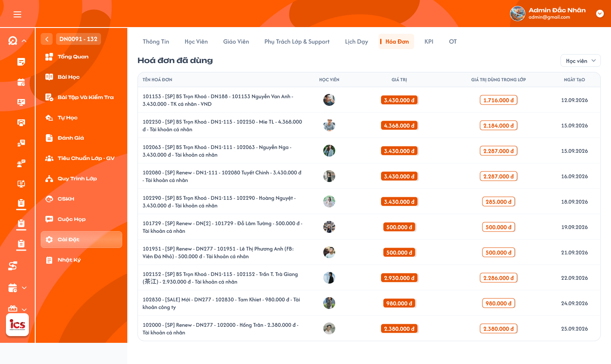

# Chi tiết lớp học — Tab Hóa đơn

## 1. UI

### Trang 1: ADM-LOP-040600 — Lớp học / Cài đặt / Hoá đơn



**Mô tả:**
- Hiển thị các hóa đơn đã được dùng để ghi nhận học phí cho lớp hiện tại (tiêu đề `Hóa đơn đã dùng`). Đây là màn chỉ xem, không có thao tác CRUD hóa đơn hoặc học phí; thao tác ghi nhận học phí nằm ở Tab Học viên (`class_detail_students_requirements.md`).
- Hóa đơn được tạo tại Cơm Gạo rồi đồng bộ sang ICS; tab chỉ đọc dữ liệu đồng bộ.

**Điểm cần lưu ý:**
- `A01.01` Tab: nhãn `Hóa đơn`, làm nổi bật khi đang chọn.
- `A01.02` Tiêu đề: `Hóa đơn đã dùng`.
- `A01.03` Tên hóa đơn: lấy từ dữ liệu hóa đơn, cho xuống dòng để đọc đầy đủ; hiển thị an toàn, không thực thi HTML/script.
- `A01.04` Tên học viên: cột riêng, lấy theo quan hệ dữ liệu và `student_id`, không tách tên từ chuỗi Tên hóa đơn; không phải nút mở/chỉnh sửa học viên.
- `A01.05` Ngày tạo hóa đơn: cột chỉ xem, là ngày tạo gốc tại Cơm Gạo (không phải ngày đồng bộ, ngày ghi nhận học phí hay ngày sửa); đồng bộ lại không đổi ngày tạo gốc. Thiếu ngày tạo gốc thì đánh dấu cột ngày không khả dụng, không tự gán ngày thay thế và không loại hóa đơn khỏi bảng/filter.
- `A01.06` Giá trị: tổng giá trị hóa đơn từ nguồn quản lý hóa đơn, không phải số dư hay học phí riêng của lớp. Ví dụ hóa đơn 1.000.000đ luôn hiển thị 1.000.000đ dù đã dùng một phần.
- `A01.07` Giá trị dùng trong lớp: cộng các lần ghi nhận học phí cùng `invoice_id` và `class_id` đang xem (vd 100.000đ + 200.000đ ở lớp A = 300.000đ). Hóa đơn 1.000.000đ dùng 300.000đ ở lớp A, 400.000đ ở lớp B: tab lớp A hiển thị Giá trị 1.000.000đ, Giá trị dùng trong lớp 300.000đ; không cộng phần dùng ở lớp khác, không tính lần ghi nhận thất bại/chưa lưu/request lặp, không cộng theo tên hóa đơn vì hai hóa đơn khác nhau có thể trùng tên. Hoàn/hủy giao dịch học phí theo requirement học phí riêng.
- `A01.08` Mỗi dòng: một hóa đơn, nhận diện bằng `invoice_id`; một hóa đơn dùng nhiều lần trong cùng lớp vẫn một dòng. Chỉ hiển thị hóa đơn có học phí đã ghi nhận cho chính lớp này; không lọc bỏ khi học viên đã Rời lớp, Nghỉ học hoặc bị xóa mềm. Bấm dòng không mở flow chỉnh sửa.
- Định dạng tiền VND, phân cách hàng nghìn bằng dấu chấm, có ký hiệu đồng, căn phải (vd `1.000.000 đ`).
- Chỉ `Admin`, `Class Handler`, `Support` được xem tab và thông tin tiền trong phạm vi lớp; `Teacher` và mọi role khác không xem được, backend từ chối cả request trực tiếp (kể cả khi có quyền xem lịch lớp). Không có Toast CRUD vì tab không CRUD; lỗi đọc dữ liệu hiển thị ngay tại bảng.
- `A02.01` Filter Học viên: chọn một hoặc nhiều học viên liên kết với hóa đơn trong lớp bằng `student_id`, hiển thị tên để nhận biết; không có filter ngày tạo hóa đơn. Filter chỉ đổi tập dòng hiển thị.
- `A02.02` Chọn nhiều học viên: trả hóa đơn của bất kỳ học viên nào trong tập đã chọn (OR giữa các `student_id`), chỉ trong lớp hiện tại; mỗi `invoice_id` vẫn một dòng, tiền không cộng lặp.
- `A02.03` Không chọn học viên: không giới hạn theo học viên, hiển thị toàn bộ hóa đơn đã dùng của lớp.
- `A02.04` Cột Ngày tạo hóa đơn: chỉ hiển thị, không có date picker hay điều kiện ngày trong request lọc.
- `A02.05` Kết quả rỗng: `Không có hóa đơn phù hợp với bộ lọc.`; phân biệt với lớp chưa có hóa đơn được sử dụng. Lọc ở backend trên toàn bộ dữ liệu của lớp trước khi chia nhóm load-more, không chỉ lọc dòng đã tải; đổi/xóa điều kiện thì reset cursor và dữ liệu cũ, retry dùng đúng điều kiện đang áp dụng. Hai học viên trùng tên phân biệt bằng `student_id`; học viên Rời lớp/Nghỉ học/Xóa mềm vẫn hiển thị tên và lọc được. Một hóa đơn liên kết nhiều học viên chưa chốt cách hiển thị, giữ quy tắc một dòng mỗi `invoice_id`.
- `A03.01` Giá trị (cột tiền): tổng hóa đơn; không biến thành tổng của nhóm tải hoặc tự phân bổ lại theo filter.
- `A03.02` Giá trị dùng trong lớp (cột tiền): tổng học phí đầy đủ của hóa đơn trong lớp, không phụ thuộc số hàng đang hiển thị.
- `A03.03` Định dạng: tiền VND dấu chấm phân cách hàng nghìn kèm ký hiệu đồng, căn phải; tên dài xuống dòng, không cắt mất giá trị, không chồng cột.
- `A04.01` Loading: hiển thị loading/skeleton khi tải; không trình bày dữ liệu cũ của lớp khác.
- `A04.02` Rỗng: `Chưa có hóa đơn được sử dụng trong lớp này.`; không tạo dòng 0đ giả.
- `A04.03` Lỗi: `Không thể tải thông tin hóa đơn và học phí. Vui lòng thử lại.` kèm nút Thử lại; không dùng giá trị 0 hay empty state thay lỗi tải.
- `A04.04` Đồng bộ: mở/tải lại tab đọc dữ liệu mới nhất đã commit (vd học phí vừa ghi nhận ở tab Học viên); response của lớp cũ không được ghi đè khi đã chuyển sang lớp khác.
- `A05.01` Vùng cuộn: cuộn gần cuối kích hoạt tải nhóm tiếp theo nếu còn hóa đơn; load-more, không phân trang số. Mỗi thời điểm chỉ một request tải thêm cho cùng lớp/cursor.
- `A05.02` Loading cuối bảng: hiển thị trong lúc tải thêm, giữ các dòng hiện có và vị trí cuộn.
- `A05.03` Lỗi tải thêm: hiển thị lỗi và Thử lại ở cuối bảng, không thay toàn bộ bảng bằng lỗi; giữ cursor chưa thành công.
- `A05.04` Hết dữ liệu: dừng gọi tải thêm khi backend báo không còn dữ liệu.
- Dữ liệu tổng hợp theo `invoice_id` trước khi chia nhóm tải; nối danh sách theo `invoice_id`, không nhân đôi dòng khi response giao nhau hoặc retry. Cursor và thứ tự ổn định trong một lượt tải.

---

## 2. Yêu cầu

### 2.1. Flow chính

**Flow 1 / REQ01–REQ04: Xem hóa đơn đã dùng**

```
Mở Chi tiết lớp → chọn tab Hóa đơn → Kiểm tra quyền xem dữ liệu tài chính của lớp
  → Lấy hóa đơn đã có học phí ghi nhận trong lớp → Gộp theo invoice_id, cộng học phí theo class_id
  → Hiển thị Tên hóa đơn / Tên học viên / Ngày tạo hóa đơn / Giá trị / Giá trị dùng trong lớp
  → Cho phép lọc theo một hoặc nhiều học viên (ngày tạo chỉ hiển thị ở cột)
```

**Flow 2 / REQ05: Đồng bộ khi học phí thay đổi**

```
Ghi nhận học phí thành công ở function khác → Mở lại/tải lại tab Hóa đơn
  → Đọc dữ liệu đã commit mới nhất → Cập nhật học phí của dòng hoặc thêm dòng nếu lần đầu dùng
```

**Flow 3 / REQ07: Tải thêm khi cuộn**

```
Cuộn gần cuối bảng → Kiểm tra còn dữ liệu và không có request đang xử lý
  → Gửi class_id + tập student_id đang lọc (nếu có) + cursor tiếp theo → Loading cuối bảng
  → Thành công: hợp nhất theo invoice_id, giữ vị trí cuộn
  → Lỗi: giữ dữ liệu đã tải, cho Thử lại
  → Hết dữ liệu: dừng tải thêm
```

**Flow 4 / REQ08: Lọc hóa đơn theo học viên**

```
Chọn một/nhiều học viên hoặc bỏ lựa chọn → Reset dữ liệu và cursor của kết quả cũ
  → Backend kiểm tra quyền và class_id → Lọc theo tập student_id (OR) trên toàn bộ dữ liệu lớp, không lọc ngày tạo
  → Tổng hợp hóa đơn–lớp, trả nhóm đầu
       ↓ (có kết quả)                ↓ (không có)
  Bảng + load-more cùng điều kiện   Thông báo không có hóa đơn phù hợp bộ lọc
```

### 2.2. Ngoại lệ

- **EX01:** Chưa có hóa đơn dùng trong lớp → hiển thị empty state.
- **EX02:** API lỗi/hết thời gian chờ → hiển thị lỗi và Thử lại; không biến lỗi thành số 0.
- **EX03:** Response lớp cũ về muộn → bỏ response không còn phù hợp `class_id` hiện tại.
- **EX04:** Người dùng không có quyền xem tài chính hoặc ngoài phạm vi lớp → từ chối truy cập; không trả tên hóa đơn và tiền.
- **EX05:** Dữ liệu hóa đơn thiếu hoặc không nhất quán → báo trạng thái dữ liệu không khả dụng; không tự suy ra giá trị hóa đơn từ tổng học phí.
- **EX06:** Tải thêm thất bại → giữ các dòng hiện có và cursor chưa thành công; hiển thị Thử lại ở cuối bảng.
- **EX07:** Response bộ lọc cũ trả về sau khi đổi điều kiện → bỏ response, không nối hoặc ghi đè kết quả hiện tại.
- **EX08:** Lớp có hóa đơn nhưng không khớp bộ lọc → hiển thị empty state theo bộ lọc; không báo lớp chưa có hóa đơn.

### 2.3. Yêu cầu khác

| Mã | Tên yêu cầu | Mô tả |
|---|---|---|
| REQ01 | Chỉ xem | Tab hiển thị thông tin hóa đơn và học phí; không CRUD, không mở popup chỉnh sửa từ dòng. |
| REQ02 | Danh sách | Chỉ hóa đơn đã dùng cho lớp hiện tại; một dòng mỗi `invoice_id`, không gộp theo tên. |
| REQ03 | Giá trị tiền | Giá trị là tổng giá trị hóa đơn. Giá trị dùng trong lớp là tổng học phí ghi nhận từ hóa đơn cho lớp hiện tại; không phải số dư hay tổng dùng ở mọi lớp. |
| REQ04 | Hiển thị | Tên dài xuống dòng, tiền VND căn phải với dấu phân cách hàng nghìn; layout đọc được trên các kích thước màn hình. |
| REQ05 | Đồng bộ | Mở/tải lại tab hiển thị dữ liệu mới nhất đã lưu; không nhân đôi giao dịch hoặc dùng dữ liệu ngoài `class_id`. |
| REQ06 | Quyền và bảo mật | Chỉ Admin/Class Handler/Support xem trong phạm vi lớp; Teacher và mọi role khác bị chặn ở UI và API. Tên hóa đơn hiển thị an toàn, không thực thi HTML/script. |
| REQ07 | Load-more | Cuộn gần cuối tự tải nhóm tiếp theo; không phân trang số. Giữ vị trí cuộn, chống request/dòng trùng, hỗ trợ thử lại, dừng khi hết dữ liệu. |
| REQ08 | Học viên | Cột Tên học viên và filter Học viên chọn một hoặc nhiều người theo quan hệ `student_id` với hóa đơn đã dùng trong lớp. Nhiều người áp dụng OR; không chọn thì không giới hạn. Lọc toàn bộ dữ liệu trước load-more; đổi/bỏ lựa chọn reset kết quả và cursor, tải thêm/retry theo đúng tập đã chọn. Không suy học viên từ tên hóa đơn, không bỏ dữ liệu lịch sử do trạng thái Rời lớp / Nghỉ học / Xóa mềm. |
| REQ09 | Ngày tạo hóa đơn | Cột chỉ xem ngày tạo gốc Cơm Gạo đồng bộ sang ICS, không dùng ngày đồng bộ, ngày học phí hay ngày sửa. Không có filter ngày tạo hóa đơn, không gửi điều kiện ngày trong request lọc. Thiếu ngày tạo thì đánh dấu cột không khả dụng, không thay ngày, không loại hóa đơn khỏi bảng. |

### 2.4. Ràng buộc

#### Quyền

| Role | Xem tab Hóa đơn | Lọc theo Học viên | Thêm/sửa/xóa hóa đơn hoặc học phí |
|---|:---:|:---:|:---:|
| Admin | ✅ | ✅ | ❌ |
| Class Handler | ✅ | ✅ | ❌ |
| Support | ✅ | ✅ | ❌ |
| Teacher và các role khác | ❌ | ❌ | ❌ |

#### Ràng buộc khác

- Admin/Class Handler/Support chỉ xem trong phạm vi lớp được phân quyền; áp dụng cho cả bảng, cột Tên học viên và dữ liệu control filter, không dùng filter để lấy dữ liệu lớp ngoài quyền.
- Tab không làm thay đổi hóa đơn, học phí, số dư hoặc trạng thái học viên; không Toast CRUD, không nút tạo/sửa/xóa.
- Dữ liệu nhận diện dùng `class_id`, `invoice_id`, `transaction_id`; mỗi giao dịch đã lưu được tổng hợp đúng một lần. Tổng học phí một dòng khớp các giao dịch cùng hóa đơn trong lớp.
- Quy tắc số dư, phân bổ vượt giá trị, hoàn/hủy và hiệu lực giao dịch theo requirement Học phí/Hóa đơn riêng.
- Bản đồng bộ lại của cùng hóa đơn không tạo dòng trùng hay đổi ngày tạo gốc.

---

## 3. Testcase

### Feature: Chi tiết lớp học — Tab Hóa đơn

| Tên testcase | Priority | Scenario | Role | Pre-condition | Given/When/Then | Expected Result |
|---|---|---|---|---|---|---|
| Case 1: Mở đúng bảng hóa đơn của lớp, chỉ xem | High | Flow 1 / REQ01 / REQ08 / REQ09 | Admin / Class Handler / Support | Có hóa đơn đã dùng tại nhiều lớp | **Given:** mở lớp A<br>**When:** chọn tab Hóa đơn, xem hoặc bấm một dòng<br>**Then:** tải dữ liệu theo `class_id` của A | - Đúng tiêu đề và các cột Tên hóa đơn / Tên học viên / Ngày tạo hóa đơn / Giá trị / Giá trị dùng trong lớp; có filter Học viên, không có filter ngày tạo<br>- Không trộn hóa đơn chỉ dùng ở lớp B<br>- Không có nút thêm/sửa/xóa, không input chỉnh tiền, không gửi request ghi |
| Case 2: Một hóa đơn một dòng, không gộp theo tên | High | REQ02 | Admin / Class Handler / Support | Một hóa đơn có nhiều lần ghi nhận học phí; hai `invoice_id` khác nhau cùng tên | **Given:** các giao dịch cùng `invoice_id`<br>**When:** tải bảng<br>**Then:** gộp theo hóa đơn | - Một dòng duy nhất mỗi `invoice_id`, Giá trị không nhân đôi, cộng đủ học phí trong lớp<br>- Hai hóa đơn trùng tên hiển thị hai dòng độc lập, tiền đúng từng hóa đơn |
| Case 3: Phân biệt Giá trị và Giá trị dùng trong lớp | High | Flow 2 / REQ03 | Admin / Class Handler / Support | Hóa đơn 1.000.000đ; lớp A dùng 100.000đ + 200.000đ, lớp B dùng 400.000đ | **Given:** xem lớp A<br>**When:** tải bảng<br>**Then:** hiển thị hai giá trị đúng nghĩa | - Giá trị = 1.000.000đ; Giá trị dùng trong lớp = 300.000đ (không hiển thị số dư hay phần của lớp B)<br>- Một dòng hóa đơn<br>- Sau khi thêm học phí ở tab Học viên và quay lại, dòng cập nhật đúng, không dòng trùng, không tính thao tác thất bại |
| Case 4: Định dạng tiền và tên dài | Medium | REQ04 | Admin / Class Handler / Support | Tên dài, giá trị nhiều chữ số | **Given:** bảng render<br>**When:** đọc các cột<br>**Then:** tên xuống dòng, tiền rõ ràng | - Tiền căn phải, phân cách hàng nghìn, có ký hiệu đồng<br>- Không cắt giá trị, không chồng cột |
| Case 5: Giữ dữ liệu khi học viên không còn học | High | REQ02 / REQ08 | Admin / Class Handler / Support | Học viên đã có học phí rồi chuyển Rời lớp / Nghỉ học / Xóa mềm | **Given:** học phí vẫn được lưu<br>**When:** mở bảng và lọc theo học viên đó<br>**Then:** vẫn hiển thị và lọc được | - Hiển thị đúng Tên học viên, học phí lịch sử không mất hay bị tính lại<br>- Không tự hoàn tiền hay trả số dư, không khôi phục trạng thái học viên |
| Case 6: Cột Tên học viên và Ngày tạo gốc | High | REQ08 / REQ09 / EX05 | Admin / Class Handler / Support | Hóa đơn tạo 21/09/2026 ở Cơm Gạo, đồng bộ ICS 25/09/2026, ghi nhận học phí 27/09/2026; hóa đơn khác thiếu ngày tạo gốc | **Given:** dữ liệu có `student_id`, tên hóa đơn không chứa tên học viên<br>**When:** tải bảng, đồng bộ lại cùng hóa đơn<br>**Then:** hiển thị tên và ngày đúng | - Tên đúng học viên liên kết, không tách từ Tên hóa đơn<br>- Ngày tạo hiển thị 21/09/2026, không đổi sau đồng bộ lại, không thay bằng ngày đồng bộ/học phí/sửa, không tạo dòng trùng<br>- Thiếu ngày: dòng vẫn hiển thị, cột ngày đánh dấu không khả dụng, không gán ngày giả |
| Case 7: Lọc một hoặc nhiều học viên | High | Flow 4 / REQ08 / REQ09 | Admin / Class Handler / Support | Lớp có hóa đơn của A, B, C; hóa đơn cần lọc nằm ngoài nhóm đã tải; hai học viên trùng tên khác `student_id` | **Given:** chọn A; sau đó chọn A và B; kiểm tra UI và request<br>**When:** áp dụng filter<br>**Then:** backend lọc trên toàn bộ dữ liệu lớp trước khi chia nhóm | - Chọn A chỉ trả hóa đơn của A kể cả chưa tải trước đó; A + B trả hóa đơn của A hoặc B (OR), không có C; mỗi `invoice_id` một dòng, tiền không cộng lặp<br>- Phân biệt học viên trùng tên bằng `student_id`<br>- Không có filter ngày/date picker, không gửi điều kiện ngày tạo |
| Case 8: Reset load-more khi đổi bộ lọc | High | REQ07 / REQ08 / EX07 | Admin / Class Handler / Support | Đã tải nhiều nhóm, request bộ lọc cũ chưa xong | **Given:** thêm/bỏ học viên khi request cũ đang chạy<br>**When:** tải nhóm đầu mới rồi response cũ về<br>**Then:** giữ kết quả bộ lọc mới | - Reset cursor và dữ liệu cũ, bỏ response cũ<br>- Tải thêm/retry đúng tập `student_id` mới, không trộn/lặp/bỏ sót dòng |
| Case 9: Không có kết quả khi lọc và bỏ lọc | Medium | REQ08 / EX08 | Admin / Class Handler / Support | Lớp có hóa đơn nhưng không dòng nào khớp học viên đã chọn | **Given:** filter trả rỗng<br>**When:** xem rồi bỏ hết học viên đã chọn<br>**Then:** tải lại danh sách hóa đơn của lớp | - Hiển thị `Không có hóa đơn phù hợp với bộ lọc.`, khác thông báo lớp chưa có hóa đơn<br>- Bỏ filter khôi phục toàn bộ dữ liệu lớp, không biến thành lỗi hoặc dòng 0đ |
| Case 10: Trạng thái rỗng, lỗi và thử lại | High | EX01 / EX02 | Admin / Class Handler / Support | Lớp chưa có hóa đơn dùng; API lỗi | **Given:** mở tab khi API trả rỗng; mở tab khi API lỗi rồi Thử lại thành công<br>**When:** render<br>**Then:** hiển thị đúng trạng thái | - Rỗng: `Chưa có hóa đơn được sử dụng trong lớp này.`, không dòng 0đ giả<br>- Lỗi: có nút Thử lại, không hiển thị 0 thay lỗi, không Toast CRUD |
| Case 11: Response lớp cũ trả về muộn | High | EX03 | Admin / Class Handler / Support | Hai request của hai lớp trả không đúng thứ tự | **Given:** chuyển từ lớp A sang B khi A đang tải<br>**When:** response A về sau B<br>**Then:** giữ dữ liệu B | - Không trộn `invoice_id`/`class_id`<br>- Header và dữ liệu cùng lớp |
| Case 12: Cuộn tải thêm hóa đơn | High | Flow 3 / REQ07 | Admin / Class Handler / Support | Còn hóa đơn chưa tải | **Given:** nhóm đầu đã hiển thị<br>**When:** cuộn gần cuối, cuộn liên tục hoặc retry<br>**Then:** tải và nối nhóm tiếp theo | - Loading ở cuối bảng, giữ dòng và vị trí cuộn, không có nút số trang<br>- Một request đang xử lý cho cùng cursor; hợp nhất theo `invoice_id`, mỗi hóa đơn một dòng, không cộng tiền lại |
| Case 13: Tải thêm lỗi và hết dữ liệu | High | EX06 / REQ07 | Admin / Class Handler / Support | Đã có dữ liệu, request tiếp theo lỗi; sau đó tới nhóm cuối | **Given:** lỗi tải thêm, bấm Thử lại; tải tới nhóm cuối rồi tiếp tục cuộn<br>**When:** hệ thống xử lý<br>**Then:** giữ dữ liệu và dừng đúng lúc | - Lỗi ở cuối bảng, giữ dữ liệu cũ, không quay về đầu bảng, không bỏ sót/nhân đôi dòng<br>- Hết dữ liệu thì không gửi thêm request, không loading vô hạn |
| Case 14: Chặn role không có quyền xem tài chính | High | EX04 / REQ06 | Teacher / Sale / Student; Admin / Class Handler / Support ngoài phạm vi lớp | Có ID lớp/hóa đơn hợp lệ | **Given:** mở lớp hoặc gọi API tab Hóa đơn trực tiếp<br>**When:** backend kiểm tra quyền<br>**Then:** từ chối | - Tab không hiển thị cho role bị chặn<br>- API không trả tên hóa đơn hoặc tiền, kể cả khi có quyền xem lịch lớp<br>- Không dựa riêng vào việc ẩn tab ở client |

---

## 4. Câu hỏi cần xác nhận

- **Q01:** Thứ tự hiển thị hóa đơn mặc định theo tiêu chí nào (cơ chế load-more đã chốt, tiêu chí sắp xếp chưa)?
- **Q02:** Control filter Học viên có hỗ trợ tìm kiếm theo tên không?
- **Q03:** Cột Ngày tạo hóa đơn hiển thị định dạng ngày nào, có kèm giờ không và theo múi giờ nào?
- **Q04:** Nếu một hóa đơn liên kết nhiều học viên, cột Tên học viên hiển thị thế nào và filter Học viên đối chiếu theo quan hệ nào (hiện giữ một dòng mỗi `invoice_id`)?
- **Q05:** Figma hiện có filter `Học viên` và cột `Ngày Tạo` nhưng chưa thấy cột `Tên học viên` riêng; cần bổ sung cột này vào thiết kế không?
