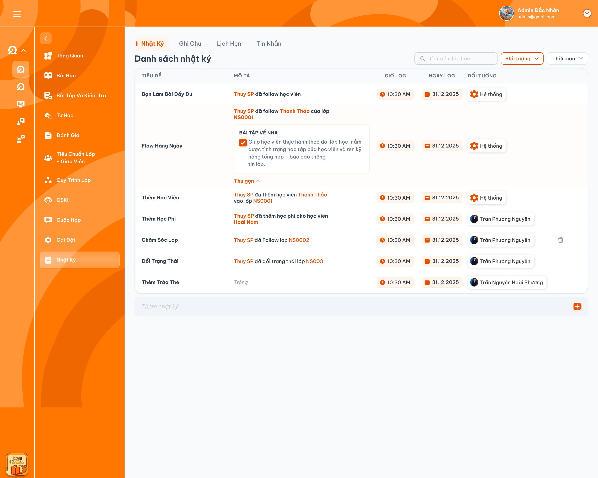

# Chi tiết lớp học — Menu Nhật ký

Requirement này đặc tả **Chi tiết lớp học → Menu Nhật ký → Tab Nhật Ký** theo ảnh tham chiếu. Tab [Ghi Chú](./class_detail_notes_requirements.md) có chức năng giống Ghi chú trong Chi tiết giáo viên, liên kết với lớp học và được đặc tả riêng. Tab [Lịch Hẹn](./class_detail_appointments_requirements.md) hiển thị lịch hẹn đã thêm tại Danh sách lớp và được đặc tả riêng. Tab [Tin Nhắn](./class_detail_messages_requirements.md) được đặc tả riêng. Nghiệp vụ thêm học viên và ghi nhận học phí thực hiện tại [Tab Học viên](./class_detail_students_requirements.md); Nhật ký ghi lại kết quả của các thao tác đó. Thông tin Follow tại [Danh sách lớp](./class_management_requirements.md) lấy từ nhật ký do Class Handler hoặc Support viết.

## 1. UI

### Trang 1: ADM-LOP-050100 — Menu Nhật ký — Danh sách nhật ký




*Danh sách nhật ký trong Chi tiết lớp — nhấn để xem ảnh gốc*

**Mô tả:**

- Chọn menu `Nhật Ký` trong Chi tiết lớp để xem nhật ký của chính lớp đang mở. Tab `Nhật Ký` được làm nổi bật; tiêu đề bảng là `Danh sách nhật ký`.
- Chỉ `Admin`, `Class Handler` và `Support` có quyền trên lớp được xem menu; các role khác không được xem, kể cả gọi request trực tiếp.
- Danh sách gồm nhật ký được hệ thống tự ghi và nhật ký do người dùng tạo. `Class Handler` và `Support` được tạo nhật ký trong phạm vi lớp được phân quyền; chỉ người tạo được sửa/xóa nhật ký của mình.
- Các dòng mẫu `Bạn Làm Bài Đầy Đủ`, `Flow Hằng Ngày`, `Chăm Sóc Lớp`, `Đổi Trạng Thái`, `Thêm Tag Thẻ` trong ảnh không xác lập thêm action tự ghi log. Hai action tự ghi đã chốt là **thêm học viên vào lớp** và **đóng tiền**.

**Giải thích field/thành phần:**

- `A01.01` **Tiêu đề**: Tiêu đề của từng nhật ký, hiển thị ở cột `TIÊU ĐỀ`.
- `A01.02` **Mô tả**: Nội dung nhật ký không bắt buộc; khi rỗng hiển thị chữ `Trống` như ảnh. Không giới hạn ký tự; nội dung dài hỗ trợ xuống dòng. Tên người thực hiện, học viên và mã lớp trong log hệ thống phải đúng dữ liệu của action đã lưu.
- `A01.03` **Giờ log**: Giờ tạo nếu chưa sửa; sau khi sửa thành công hiển thị giờ sửa gần nhất. Trình bày giờ/phút và AM/PM theo UI.
- `A01.04` **Ngày log**: Ngày tạo nếu chưa sửa; sau khi sửa thành công hiển thị ngày sửa gần nhất, định dạng `dd.MM.yyyy`. Ngày và giờ cùng lấy từ thời điểm log đang hiển thị và cùng múi giờ nghiệp vụ.
- `A01.05` **Đối tượng**: Với nhật ký viết tay: avatar và tên người tạo. Với log tự động: icon hệ thống và nhãn `Hệ thống`, kể cả khi action do một user thực hiện.
- `A01.06` **Mở rộng / Thu gọn**: Khi mô tả có phần chi tiết dài, cho mở rộng để đọc và `Thu gọn` để thu lại tại cùng dòng. Chỉ thay đổi cách hiển thị, không thay đổi dữ liệu.
- `A01.07` **Thao tác sửa**: Bấm dòng nhật ký viết tay của chính mình để sửa trực tiếp ngay tại dòng, nhấn Enter hoặc đưa chuột ra ngoài vùng chỉnh sửa của dòng để lưu; tài khoản phải có role `Class Handler` hoặc `Support` và quyền trên lớp. Không cho sửa dòng của người khác hoặc Hệ thống.
- `A01.08` **Icon thùng rác**: Chỉ hiển thị/cho thao tác trên nhật ký viết tay do chính mình tạo và còn quyền `Class Handler` hoặc `Support`. Bấm mở popup xác nhận xóa, chưa xóa ngay.
- `A01.09` **Khu vực Thêm nhật ký**: Nhập `Tiêu đề` trước, sau đó nhập `Nội dung` trực tiếp tại khu vực cuối bảng rồi xác nhận lưu bằng `+`; không mở popup tạo nhật ký. Không cho chọn tài khoản khác hoặc `Hệ thống` làm người tạo.

**Điểm cần lưu ý:**

- Không đưa nhật ký của lớp khác vào danh sách; chuyển lớp phải đổi dữ liệu theo đúng lớp mới.
- Xác định người tạo bằng tài khoản nội bộ, không so sánh tên hiển thị. Hai tài khoản trùng tên vẫn là hai người khác nhau.
- Quyền sửa/xóa phải được kiểm tra cả trên UI và backend. Cùng role, cùng lớp hoặc role `Admin` không tự cấp quyền sửa/xóa nhật ký của người khác.
- Log `Hệ thống` không có người tạo thủ công nên không được sửa/xóa qua menu này.
- Nội dung dạng checklist trong dòng `Flow Hằng Ngày` của ảnh chưa được xác định là thành phần tương tác; không tự thêm nghiệp vụ tick/hoàn thành công việc từ ảnh.
- Loading, lỗi tải và danh sách rỗng phải phân biệt rõ; có thể thử lại khi tải lỗi. Không hiển thị dữ liệu lớp cũ như dữ liệu lớp mới.

### Trang 2: ADM-LOP-050100 — Tìm kiếm và filter Đối tượng / Thời gian


**Mô tả:** Thu hẹp danh sách nhật ký của lớp hiện tại theo Tiêu đề, người tạo/nguồn và thời gian log đang hiển thị.

**Giải thích field/thành phần:**

- `A02.01` **Tìm kiếm**: Tìm trong nhật ký của lớp hiện tại. Placeholder `Tìm kiếm lớp học` trong ảnh không phù hợp ngữ cảnh; dùng `Tìm kiếm nhật ký`. Chỉ search theo **Tiêu đề**. Nhấn **Enter** để search ngay hoặc tự search sau **2 giây kể từ lần nhập cuối**.
- `A02.02` **Filter Đối tượng**: Các lựa chọn là **tên user** và **Hệ thống**, không phải tên role hay tên học viên được nhắc trong mô tả. Danh sách user chỉ lấy những người đã viết nhật ký của **lớp hiện tại**, mỗi user một lựa chọn theo ID; không lấy toàn bộ tài khoản hệ thống. Lựa chọn user ứng với người tạo nhật ký viết tay; Hệ thống ứng với log tự động.
- `A02.03` **Filter Thời gian**: Mặc định `Hôm nay`, dùng cùng danh sách khoảng thời gian và quy tắc ngày như [filter tab Ghi chú](../teacher_management/teacher_detail_requirements.md). Lọc theo thời điểm log đang hiển thị: thời điểm tạo nếu chưa sửa, thời điểm sửa gần nhất nếu đã sửa thành công. Cùng cơ sở với `Giờ log` và `Ngày log`.
- `A02.04` **Kết hợp điều kiện**: Kết quả phải đồng thời thỏa search, Đối tượng và Thời gian đang áp dụng; luôn giới hạn trong lớp hiện tại.
- `A02.05` **Bỏ điều kiện**: Bỏ filter nào thì chỉ bỏ điều kiện đó, không xóa search hoặc filter khác. Khi không có điều kiện, hiển thị danh sách của lớp theo quyền xem.

**Khoảng thời gian:**

- `A02.06` **`Tới hạn`**: Phạm vi bao gồm: Từ thời điểm bắt đầu lưu dữ liệu của hệ thống đến hết ngày hôm nay.
- `A02.07` **`Hôm nay`**: Phạm vi bao gồm: Từ đầu ngày đến hết ngày hôm nay; là lựa chọn mặc định như filter tab Ghi chú.
- `A02.08` **`Hôm qua`**: Phạm vi bao gồm: Toàn bộ ngày liền trước hôm nay.
- `A02.09` **`Hôm nay và hôm qua`**: Phạm vi bao gồm: Hợp của toàn bộ ngày hôm qua và ngày hôm nay.
- `A02.10` **`Tuần này`**: Phạm vi bao gồm: Từ đầu Thứ 2 đến hết Chủ Nhật của tuần hiện tại.
- `A02.11` **`Tuần trước`**: Phạm vi bao gồm: Từ đầu Thứ 2 đến hết Chủ Nhật của tuần liền trước.
- `A02.12` **`Tháng này`**: Phạm vi bao gồm: Từ ngày đầu đến ngày cuối của tháng hiện tại.
- `A02.13` **`Tháng trước`**: Phạm vi bao gồm: Từ ngày đầu đến ngày cuối của tháng liền trước.
- `A02.14` **`3 tháng trước`**: Phạm vi bao gồm: Từ đầu ngày cách ngày hiện tại ba tháng đến thời điểm hiện tại.
- `A02.15` **`Năm nay`**: Phạm vi bao gồm: Từ ngày 01/01 đến ngày 31/12 của năm hiện tại.
- `A02.16` **`Năm trước`**: Phạm vi bao gồm: Từ ngày 01/01 đến ngày 31/12 của năm liền trước.
- `A02.17` **`Tùy chọn`**: Phạm vi bao gồm: Chọn `Từ ngày` và `Đến ngày`; bao gồm toàn bộ hai ngày biên. Không áp dụng nếu thiếu ngày hoặc Từ ngày sau Đến ngày.

**Điểm cần lưu ý:**

- User được chọn bằng ID; filter hiển thị tên. Không gộp hai user khác nhau chỉ vì trùng tên.
- Ví dụ log `A đã thêm học viên B vào lớp C` do hệ thống tự ghi: filter `Hệ thống` trả dòng này; filter user A không trả dòng này chỉ vì A được nhắc trong mô tả.
- Nhật ký của A do A viết tay vẫn thuộc đối tượng A dù mô tả nhắc tới B.
- Không có kết quả phải hiển thị trạng thái rỗng theo điều kiện đang chọn; không dùng toàn bộ danh sách thay cho kết quả rỗng.
- Mỗi lần chọn một khoảng Thời gian; dùng cùng múi giờ nghiệp vụ khi tính filter và hiển thị ngày/giờ. Đổi điều kiện chỉ cho response của tổ hợp mới nhất cập nhật danh sách.
- Filter Đối tượng chỉ có người đã viết nhật ký lớp này và Hệ thống; không đưa người chỉ thực hiện action được hệ thống ghi log hoặc chỉ được nhắc trong mô tả vào danh sách user. Cách chọn một/nhiều đối tượng còn cần chốt.
- Mỗi lần nhập tiếp phải tính lại thời gian chờ search 2 giây. Enter hủy lần search đang chờ và search ngay; Enter rồi hết 2 giây không gửi lặp cùng truy vấn. Xóa từ khóa bỏ điều kiện search, giữ các filter còn lại.
- Search chỉ so khớp Tiêu đề; không đưa dòng vào kết quả chỉ vì từ khóa nằm ở Mô tả, tên user hay tên hóa đơn.
- Sửa thành công cập nhật thời điểm log nên kết quả filter thời gian phải được tính lại theo ngày/giờ mới, không tiếp tục lọc bằng ngày tạo cũ.

### Trang 3: ADM-LOP-050100 — Tạo, sửa và xóa nhật ký viết tay


**Mô tả:** `Class Handler` và `Support` ghi nội dung nhật ký cho lớp được phân quyền. Tài khoản tạo nhật ký là chủ sở hữu của nhật ký đó.

**Giải thích field/thành phần:**

- `A03.01` **Thêm nhật ký / `+`**: Nhập Tiêu đề trước, sau đó nhập Nội dung trực tiếp tại cuối bảng rồi xác nhận lưu bằng `+`; không mở popup. Chưa lưu nhật ký chỉ vì hoàn tất bước nhập Tiêu đề.
- `A03.02` **Tiêu đề**: Nhập trước, bắt buộc, không giới hạn ký tự; hiển thị ở cột TIÊU ĐỀ sau khi lưu. Không chấp nhận tiêu đề rỗng/chỉ chứa khoảng trắng.
- `A03.03` **Nội dung**: Nhập sau Tiêu đề, **không bắt buộc**, không giới hạn ký tự; hiển thị ở cột MÔ TẢ. Được bỏ trống khi tạo hoặc xóa hết nội dung khi sửa; nội dung rỗng/chỉ có khoảng trắng hiển thị `Trống`.
- `A03.04` **Người tạo / Đối tượng**: Tự lấy tài khoản đang đăng nhập khi tạo; không có field để giả lập người khác hay nguồn Hệ thống.
- `A03.05` **Ngày / Giờ log**: Khi tạo lấy thời điểm tạo thành công; mỗi lần sửa thành công cập nhật theo thời điểm sửa gần nhất. Thời điểm do hệ thống ghi, không nhập tùy ý.
- `A03.06` **Sửa**: Bấm dòng nhật ký của mình để sửa Tiêu đề/Nội dung **trực tiếp tại dòng**, không mở editor/popup riêng. **Enter** hoặc **đưa chuột ra ngoài vùng chỉnh sửa của dòng** sẽ lưu; kiểm tra role, phạm vi lớp và chủ sở hữu trước khi sửa/lưu. Không được thay người tạo hoặc chuyển nhật ký sang lớp khác.
- `A03.07` **Xóa**: Bấm icon thùng rác để mở popup xác nhận; chỉ gửi yêu cầu xóa khi chọn Xác Nhận. Xóa nhật ký không hoàn tác thêm học viên hay giao dịch tiền.
- `A03.08` **Chưa lưu / Hủy**: Tiêu đề/Nội dung chưa xác nhận lưu không tạo nhật ký, kể cả khi đã chuyển từ bước Tiêu đề sang Nội dung. Hủy/Đóng popup xóa không lưu thay đổi và không có Toast thành công. Sửa trực tiếp dùng Enter hoặc đưa chuột ra ngoài để lưu, không thêm bước xác nhận bằng nút Lưu/Hủy riêng.

**Điểm cần lưu ý:**

- Điều kiện sửa/xóa đồng thời gồm: là nhật ký viết tay, tài khoản có `Class Handler` hoặc `Support`, có quyền trên lớp và là chính người tạo nhật ký.
- `Class Handler` không được sửa/xóa nhật ký của `Support`, và ngược lại. Cùng role cũng không được sửa/xóa của nhau.
- `Admin` không có ngoại lệ sửa/xóa nhật ký người khác. Tài khoản có thêm role `Class Handler`/`Support` chỉ sửa/xóa nhật ký do chính tài khoản đó tạo, theo cùng quy tắc.
- Nếu mất role hoặc mất quyền trên lớp sau khi mở form, backend phải từ chối tại lúc lưu. Không tin thông tin người tạo do client gửi.
- Sửa không chuyển quyền sở hữu. Sau khi sửa thành công, Giờ log/Ngày log hiển thị thời điểm sửa mới nhất; filter Thời gian và Follow phải dùng cùng thời điểm này. Lưu lỗi không thay đổi ngày/giờ đã lưu.
- Enter và việc đưa chuột ra ngoài vùng sửa cùng kích hoạt lưu trên chính dòng đang sửa. Di chuyển chuột giữa ô Tiêu đề và Nội dung trong vùng sửa chưa lưu; không yêu cầu click ra ngoài. Cùng một thay đổi chỉ được lưu một lần nếu Enter và rời vùng sửa xảy ra liên tiếp.
- Nếu chưa thay đổi dữ liệu, Enter/rời vùng sửa chỉ thoát chế độ sửa, không tạo cập nhật, không đổi thời điểm log và không hiện Toast CRUD.
- Tiêu đề không hợp lệ hoặc lưu lỗi phải giữ phần đã nhập tại dòng để chỉnh/thử lại; không cập nhật danh sách/ngày giờ như đã lưu thành công. Nội dung rỗng là hợp lệ, không báo lỗi bắt buộc.
- Chỉ lưu sau bước nhập Tiêu đề và Nội dung khi người dùng xác nhận cuối. Tiêu đề rỗng/chỉ chứa khoảng trắng phải báo lỗi tại ô nhập, không tạo dòng rỗng. Trong lúc lưu, chặn gửi lặp; thành công thì reset khu vực nhập về bước Tiêu đề, thất bại giữ cả Tiêu đề/Nội dung để thử lại.
- Thành công mới cập nhật danh sách và hiển thị một Toast kết quả. Lỗi lưu giữ dữ liệu đã lưu trước đó, báo lỗi và cho thử lại phù hợp; bấm lặp cùng thao tác không được tạo bản ghi trùng.
- Follow của Danh sách lớp dùng nhật ký viết tay của `Class Handler`/`Support` theo requirement Danh sách lớp. Log Hệ thống không được tính là nhật ký do user viết; sửa/xóa phải làm thông tin Follow phản ánh dữ liệu còn hợp lệ.

### Trang 4: Popup xác nhận xóa nhật ký
**Mô tả:** Bấm icon thùng rác trên nhật ký viết tay do chính mình tạo để mở popup xác nhận. Chỉ Class Handler/Support có quyền trên lớp và là người tạo được thực hiện.

**Giải thích field/thành phần:**

- `A04.01` **Nội dung xác nhận**: `Bạn có chắc muốn xóa nhật ký này?`; có thể hiển thị Tiêu đề nhật ký đang chọn để nhận diện đúng dòng.
- `A04.02` **Hủy / Đóng**: Đóng popup và giữ nguyên nhật ký; không gửi request xóa.
- `A04.03` **Xác Nhận**: Gửi yêu cầu xóa đúng nhật ký sau khi backend kiểm tra lại quyền; chặn bấm lặp trong lúc xử lý.

**Điểm cần lưu ý:** Không mở popup này cho log Hệ thống hoặc nhật ký người khác. Xóa thất bại giữ nguyên dòng và báo lỗi; không xóa trước khi backend thành công.

### Trang 5: ADM-LOP-050100 — Log Hệ thống — Thêm học viên vào lớp và đóng tiền


**Mô tả:** Hệ thống tự ghi nhật ký cho hai action đã chốt khi thao tác nghiệp vụ được lưu thành công. Người dùng không cần tạo thêm nhật ký thủ công.

**Giải thích field/thành phần:**

- `A05.01` **Thêm học viên vào lớp**: Thời điểm ghi: Sau khi việc thêm học viên vào lớp thành công. Không áp dụng cho thêm Giáo viên, Support hoặc Class Handler.; Nội dung và đối tượng: Tiêu đề `Thêm Học Viên`; mô tả nêu người thực hiện, học viên được thêm và lớp. Đối tượng luôn là `Hệ thống`.
- `A05.02` **Đóng tiền**: Thời điểm ghi: Sau khi ghi nhận một lần đóng học phí thành công cho học viên trong lớp, theo flow học phí tại Tab Học viên. Không ghi chỉ vì mở popup, nhập tiền hoặc tạo hóa đơn chưa được dùng cho lớp.; Nội dung và đối tượng: Tiêu đề `Thêm Học Phí` theo UI; mô tả nêu người thực hiện, học viên, lớp, **tên hóa đơn** và **số tiền của lần đóng này**. Đối tượng luôn là `Hệ thống`.
- `A05.03` **Người thực hiện**: Thời điểm ghi: Tài khoản thực sự thực hiện action nghiệp vụ; nêu trong mô tả.; Nội dung và đối tượng: Không đồng nhất với cột Đối tượng: nguồn tạo log vẫn là Hệ thống.
- `A05.04` **Ngày / Giờ log**: Thời điểm ghi: Tự ghi thời điểm action được lưu thành công.; Nội dung và đối tượng: Không dùng thời điểm mở popup, hạn học phí hay ngày bắt đầu lớp.

**Điểm cần lưu ý:**

- Ví dụ `Thuy SP đã thêm học viên Thanh Thảo vào lớp NS0001`: nguồn là Hệ thống, Thuy SP là người thực hiện, Thanh Thảo là học viên và NS0001 là lớp.
- Dòng `Thêm Học Phí` trong ảnh hiển thị tên user ở Đối tượng; với log đóng tiền tự động phải hiển thị `Hệ thống` theo yêu cầu đã chốt.
- Ví dụ đóng tiền: `Thuy SP đã ghi nhận 100.000 đ cho học viên Hoài Nam trong lớp NS0001 từ hóa đơn Học phí tháng 9`. Số tiền là giá trị của **lần đóng đã lưu**, không phải tổng giá trị hóa đơn, số dư hay tổng học phí học viên. Định dạng VND bằng dấu chấm phân cách hàng nghìn và ký hiệu `đ`.
- Tên hóa đơn và số tiền phải lấy đúng hóa đơn/giao dịch của sự kiện đó; hai hóa đơn trùng tên vẫn liên kết bằng ID, không gộp sự kiện theo tên.
- Mỗi action thành công tạo đúng một log; retry/callback/gửi request lặp của cùng action không tạo thêm log. Hai lần đóng tiền riêng biệt đều thành công thì có hai log riêng.
- Action thất bại, bị từ chối hoặc hủy trước khi lưu không tạo log thành công. Nghiệp vụ đã lưu thành công phải có log tương ứng; cơ chế xử lý phải tránh mất hoặc ghi trùng log khi đồng bộ lại.
- Thêm học viên theo nhiều lựa chọn: mỗi học viên thực sự được thêm thành công là một sự kiện; không log cho học viên đã có trong lớp hoặc thêm thất bại.
- Log Hệ thống chỉ đọc; không cho `Class Handler`, `Support` hay `Admin` sửa/xóa qua UI hoặc request trực tiếp.
- Chỉ ghi hai action trong phạm vi đã chốt; không tự ghi thêm action Follow, đổi trạng thái, thêm tag, sửa/xóa nhật ký hoặc sửa/xóa học phí khi chưa có requirement.
- Tự ghi log không tạo thêm Toast CRUD độc lập bên cạnh Toast của thao tác thêm vào lớp/đóng tiền.

### Trang 6: ADM-LOP-050100 — Toast phản hồi CRUD


*Toast phản hồi tạo, sửa và xóa nhật ký — nhấn để xem ảnh gốc*

**Mô tả:** Phản hồi sau thao tác tạo/sửa/xóa nhật ký viết tay. Đọc danh sách, search/filter và mở rộng/thu gọn không có Toast CRUD.

**Giải thích field/thành phần:**

- `A06.01` **Thành công**: Tiêu đề: `Thành Công`; Khi sử dụng: Backend xác nhận tạo/sửa/xóa thành công; nội dung dòng hai theo bảng thông báo bên dưới.
- `A06.02` **Thông tin**: Tiêu đề: `Thông Báo`; Khi sử dụng: Chỉ dùng nếu flow có trạng thái tiếp nhận nhưng chưa đồng bộ xong.
- `A06.03` **Cảnh báo**: Tiêu đề: `Cảnh Báo`; Khi sử dụng: Nếu flow có Toast validation; vẫn đánh dấu lỗi tại field tương ứng.
- `A06.04` **Lỗi**: Tiêu đề: `Có Lỗi Xảy Ra`; Khi sử dụng: Thao tác không hoàn tất hoặc bị từ chối; không hiển thị thành công.

**Nội dung thông báo:**

- `A06.05` **Tạo thành công**: Nội dung dòng hai: `Đã thêm nhật ký.`
- `A06.06` **Sửa thành công**: Nội dung dòng hai: `Đã cập nhật nhật ký.`
- `A06.07` **Xóa thành công**: Nội dung dòng hai: `Đã xóa nhật ký.`
- `A06.08` **Tạo thất bại**: Nội dung dòng hai: `Không thể thêm nhật ký. Vui lòng thử lại.`
- `A06.09` **Sửa thất bại**: Nội dung dòng hai: `Không thể cập nhật nhật ký. Vui lòng thử lại.`
- `A06.10` **Xóa thất bại**: Nội dung dòng hai: `Không thể xóa nhật ký. Vui lòng thử lại.`
- `A06.11` **Thiếu quyền**: Nội dung dòng hai: `Bạn không có quyền thực hiện thao tác này.`
- `A06.12` **Tiêu đề thiếu/không hợp lệ**: Nội dung dòng hai: `Vui lòng nhập tiêu đề nhật ký.`; đánh dấu lỗi tại ô Tiêu đề, không gửi/lưu dữ liệu sai.
- `A06.13` **Đang đồng bộ nếu flow có trạng thái này**: Nội dung dòng hai: `Nhật ký đang được đồng bộ. Vui lòng chờ.`

**Điểm cần lưu ý:** Mỗi thao tác chỉ có một Toast kết quả; nút `×` đóng Toast. Hủy không có Toast thành công. Log tự động dùng phản hồi của nghiệp vụ nguồn, không tạo Toast thứ hai. Không đưa token, stack trace hoặc thông tin kỹ thuật nhạy cảm vào nội dung.

---

## 2. Yêu cầu

### 2.1. Flow chính

**Flow 1 / REQ01–REQ02: Xem nhật ký**

```text
Người dùng có quyền xem lớp mở Chi tiết lớp → Nhật Ký
      → Kiểm tra quyền xem menu Nhật ký
      → Tải nhật ký của lớp hiện tại
      → Hiển thị tiêu đề, mô tả, giờ log, ngày log và đối tượng
      → Nhật ký viết tay hiển thị người tạo; log tự động hiển thị Hệ thống
      → Chỉ chủ sở hữu có Class Handler/Support và quyền trên lớp được sửa/xóa nhật ký viết tay
```

**Flow 2 / REQ03–REQ04: Search/filter**

```text
Người dùng nhập search, chọn tên user/Hệ thống và điều kiện Thời gian
      → Search chỉ theo Tiêu đề: Enter thực hiện ngay hoặc tự chạy sau 2 giây từ lần nhập cuối
      → Áp dụng đồng thời các điều kiện trên nhật ký lớp hiện tại
      → Lọc Đối tượng theo người tạo hoặc nguồn Hệ thống, không theo user nhắc trong mô tả
      → Hiển thị kết quả hoặc trạng thái không có kết quả
```

**Flow 3 / REQ05–REQ06: Tạo nhật ký viết tay**

```text
Class Handler hoặc Support có quyền trên lớp chọn Thêm nhật ký / +
      → Nhập Tiêu đề trước, sau đó nhập Nội dung trực tiếp; không mở popup
      → Xác nhận lưu cuối bằng +; kiểm tra Tiêu đề và backend kiểm tra quyền trên lớp
      → Lưu nhật ký do tài khoản đang đăng nhập tạo; tự ghi thời điểm
      → Thành công: cập nhật danh sách, một Toast Thành Công: Đã thêm nhật ký.
      → Hủy/lỗi: không tạo nhật ký; lỗi có phản hồi phù hợp
```

**Flow 4 / REQ05: Sửa nhật ký**

```text
Người tạo có Class Handler/Support và quyền trên lớp bấm dòng nhật ký của mình để sửa
      → Chỉnh Tiêu đề/Nội dung trực tiếp tại dòng
      → Nhấn Enter hoặc đưa chuột ra ngoài vùng sửa để tự lưu một lần
      → Backend kiểm tra lại chủ sở hữu, role, lớp và nguồn viết tay
      → Thành công: cập nhật cùng nhật ký, giữ người tạo, ngày/giờ log = thời điểm sửa mới nhất
      → Hiển thị một Toast Thành Công: Đã cập nhật nhật ký.
      → Không đủ quyền/lỗi: không thay đổi dữ liệu đã lưu
```

**Flow 5 / REQ05: Xóa nhật ký**

```text
Người tạo có Class Handler/Support và quyền trên lớp bấm xóa nhật ký của mình
      → Mở popup xác nhận; Hủy/Đóng giữ nguyên nhật ký; Xác Nhận mới gửi yêu cầu xóa
      → Backend kiểm tra lại chủ sở hữu, role, lớp và nguồn viết tay
      → Thành công: bỏ nhật ký khỏi danh sách, một Toast Thành Công: Đã xóa nhật ký.
      → Không đủ quyền/lỗi: giữ nguyên nhật ký
```

**Flow 6 / REQ07 / REQ09: Tự ghi log thêm học viên vào lớp**

```text
Người dùng thực hiện thêm học viên vào lớp theo nghiệp vụ tại Tab Học viên
      → Thêm thành công: Hệ thống ghi một log cho mỗi sự kiện thực sự được lưu
      → Log nêu người thực hiện, học viên được thêm, lớp và thời điểm; Đối tượng = Hệ thống
      → Hủy/thất bại/trùng: không ghi log thêm thành công
```

**Flow 7 / REQ08–REQ09: Tự ghi log đóng tiền**

```text
Người dùng ghi nhận học phí của học viên trong lớp
      → Giao dịch thành công: Hệ thống ghi một log cho lần đóng tiền
      → Log nêu người thực hiện, học viên, lớp, tên hóa đơn, số tiền của lần đóng và thời điểm; Đối tượng = Hệ thống
      → Hủy/thất bại/chỉ tạo hóa đơn: không ghi log đã đóng tiền trong lớp
```

### 2.2. Ngoại lệ

- **EX01:** Tải danh sách lỗi hoặc response lớp cũ về muộn → báo lỗi đọc/cho thử lại, không hiển thị dữ liệu sai lớp.
- **EX02:** Sửa/xóa nhật ký người khác hoặc log Hệ thống, kể cả gửi request trực tiếp → từ chối, giữ nguyên dữ liệu.
- **EX03:** Thiếu role/phạm vi hoặc giả mạo người tạo/nguồn/lớp → backend từ chối thao tác không hợp lệ; không chỉ dựa vào ẩn control UI.
- **EX04:** Validation/lưu nhật ký thất bại → không tạo hoặc thay đổi dữ liệu sai; giữ nội dung đã nhập để sửa/thử lại khi phù hợp.
- **EX05:** Thêm học viên vào lớp/đóng tiền bị hủy, thất bại hoặc bị từ chối → không tạo log thành công.
- **EX06:** Search/filter không có kết quả → hiển thị rỗng theo điều kiện đã chọn; không reset âm thầm hay trả dữ liệu lớp khác.
- **EX07:** Khoảng Tùy chọn thiếu ngày hoặc Từ ngày sau Đến ngày → không áp dụng, giữ điều kiện cũ và báo lỗi để người dùng chỉnh lại.

### 2.3. Yêu cầu khác

| Mã | Tên yêu cầu | Mô tả |
|---|---|---|
| REQ01 | Danh sách | Chỉ Admin, Class Handler và Support có quyền trên lớp được xem. Nhật ký gắn đúng lớp, hiển thị năm cột và trạng thái tải/rỗng/lỗi. Mở rộng/thu gọn chỉ ảnh hưởng trình bày. |
| REQ02 | Đối tượng | Nhật ký viết tay lấy người tạo; log tự động có nguồn Hệ thống. Người thực hiện action được nêu trong mô tả, không thay thế nguồn của log. |
| REQ03 | Search và Đối tượng | Chỉ search theo Tiêu đề trong lớp hiện tại, chạy ngay khi Enter hoặc tự chạy sau 2 giây từ lần nhập cuối; không search Mô tả. Dropdown Đối tượng chỉ lấy người đã viết nhật ký của lớp và Hệ thống, lọc user theo ID người tạo hoặc Hệ thống theo nguồn. Không lọc theo tên role hoặc người chỉ được nhắc trong mô tả. |
| REQ04 | Thời gian | Lọc theo thời điểm log đang hiển thị: thời điểm tạo nếu chưa sửa, thời điểm sửa gần nhất nếu đã sửa thành công. Mặc định Hôm nay, dùng đủ 12 khoảng thời gian như filter tab Ghi chú; Tùy chọn bao gồm toàn bộ hai ngày biên và chặn khoảng không hợp lệ. Các điều kiện filter/search kết hợp đồng thời trong cùng múi giờ nghiệp vụ. |
| REQ05 | Quyền sở hữu | Chỉ Class Handler/Support có quyền trên lớp mới được tạo nhật ký và sửa/xóa nhật ký viết tay do chính mình tạo. Không có ngoại lệ sửa/xóa nhật ký người khác cho Admin; log Hệ thống chỉ đọc. Backend kiểm tra lại quyền tại lúc lưu. |
| REQ06 | Tạo/sửa | Tự lấy người tạo từ tài khoản đăng nhập và thời điểm từ hệ thống; không đổi chủ sở hữu, nguồn hoặc lớp bằng thao tác sửa. Nhập Tiêu đề trước rồi Nội dung trực tiếp, xác nhận cuối bằng + để lưu; không mở popup tạo. Từ chối Tiêu đề rỗng/chỉ chứa khoảng trắng; không tạo bản ghi khi chỉ chuyển bước nhập. Tiêu đề và Nội dung không giới hạn ký tự; Nội dung được để trống và hiển thị Trống. Bấm dòng của mình để sửa ngay tại dòng, Enter hoặc đưa chuột ra ngoài vùng sửa để lưu; sửa thành công cập nhật ngày/giờ log theo thời điểm sửa. Xóa cần popup xác nhận. |
| REQ07 | Log thêm học viên vào lớp | Tự ghi đúng một log cho mỗi sự kiện thêm học viên vào lớp thành công; không ghi cho thao tác hủy/thất bại/trùng. Chỉ áp dụng thêm học viên, không áp dụng thêm Giáo viên, Support hoặc Class Handler. |
| REQ08 | Log đóng tiền | Tự ghi đúng một log cho mỗi lần đóng học phí được lưu thành công trong lớp, có tên hóa đơn và số tiền của lần đóng đó; không ghi cho thao tác chưa lưu hoặc chỉ tạo hóa đơn. |
| REQ09 | Không mất/trùng log | Action thành công phải có log tương ứng; xử lý lặp cùng action không thêm log. Những action độc lập tạo các log riêng. |
| REQ10 | Follow | Nhật ký viết tay của Class Handler/Support cung cấp thông tin Follow theo thời điểm log đang hiển thị (tạo mới hoặc sửa thành công). Log tự động không thay thế Follow của người viết. |
| REQ11 | Notification | CRUD nhật ký viết tay có một phản hồi sau kết quả backend. Tự ghi log dùng phản hồi của nghiệp vụ nguồn, không thêm Toast nhật ký độc lập. |

### 2.4. Ràng buộc

#### Quyền

| Role/quan hệ với nhật ký | Xem trong phạm vi lớp | Tạo viết tay | Sửa viết tay | Xóa viết tay | Sửa/xóa log Hệ thống |
|---|:---:|:---:|:---:|:---:|:---:|
| Class Handler có quyền trên lớp, là người tạo | ✅ | ✅ | ✅ | ✅ | ❌ |
| Support có quyền trên lớp, là người tạo | ✅ | ✅ | ✅ | ✅ | ❌ |
| Class Handler/Support, nhật ký của người khác | ✅ | ✅ | ❌ | ❌ | ❌ |
| Admin có quyền trên lớp, không có thêm Class Handler/Support | ✅ | ❌ | ❌ | ❌ | ❌ |
| Role khác hoặc ngoài phạm vi lớp | ❌ | ❌ | ❌ | ❌ | ❌ |

- Tài khoản có nhiều role vẫn phải đáp ứng đồng thời role phù hợp, quyền trên lớp và đúng người tạo khi sửa/xóa.

#### Ràng buộc khác

**Phạm vi và tính toàn vẹn dữ liệu**

- Nhật ký, người tạo, lớp và sự kiện nguồn liên kết bằng định danh nội bộ; tên hiển thị không dùng để xác định quyền sở hữu.
- Chỉ lấy dữ liệu thuộc phạm vi lớp được phép xem/thao tác. Filter không được làm lộ user hoặc nhật ký ngoài phạm vi.
- Nội dung nhật ký hiển thị an toàn; không thực thi HTML/script do người dùng nhập.
- Xóa nhật ký viết tay không xóa tài khoản, không xóa học viên khỏi lớp và không đảo giao dịch tiền.
- Request thất bại không làm UI báo thành công hoặc ghi nhật ký sai sự kiện.

---

## 3. Testcase

### Feature: Chi tiết lớp học — Menu Nhật ký

| Tên testcase | Priority | Scenario | Role | Pre-condition | Given/When/Then | Expected Result |
|---|---|---|---|---|---|---|
| Case 1: Xem đúng nhật ký của lớp | High · Smoke | Flow 1 / REQ01 | Class Handler hoặc Support | Có nhật ký ở lớp A và B; user có quyền xem A | **Given** đang mở lớp A<br>**When** chọn menu Nhật Ký<br>**Then** chỉ tải nhật ký lớp A | - Đúng tiêu đề và 5 cột<br>- Không trộn nhật ký lớp B |
| Case 2: Phân biệt user và Hệ thống | High | REQ02 | Role có quyền xem nhật ký | Có nhật ký viết tay và log tự động | **Given** danh sách đã tải<br>**When** đọc cột Đối tượng<br>**Then** viết tay hiển thị người tạo, tự động hiển thị Hệ thống | - Tên user trong mô tả không thay thế nguồn Hệ thống<br>- Avatar/icon đúng loại |
| Case 3: Chỉ chủ sở hữu thấy sửa/xóa | High | REQ05 / Ràng buộc quyền | Class Handler hoặc Support | A và B đều có nhật ký trong cùng lớp | **Given** A đang đăng nhập<br>**When** kiểm tra thao tác từng dòng<br>**Then** A chỉ được sửa/xóa dòng do A tạo | - Dòng của B và Hệ thống không có thao tác CRUD<br>- Hai tài khoản trùng tên vẫn kiểm tra bằng ID |
| Case 4: Mở rộng và thu gọn mô tả | Medium | REQ01 | Role có quyền xem nhật ký | Một nhật ký có chi tiết dài | **Given** dòng có phần chi tiết<br>**When** mở rộng rồi Thu gọn<br>**Then** chỉ thay đổi phần hiển thị của dòng | - Không gửi request sửa nhật ký<br>- Không đổi người tạo hoặc ngày/giờ |
| Case 5: Tải rỗng, lỗi và chuyển lớp | High | EX01 / REQ01 | Role có quyền xem nhật ký | Có lớp chưa có nhật ký hoặc API tải lỗi | **Given** mở Nhật Ký<br>**When** tải rỗng/lỗi hoặc chuyển lớp khi đang tải<br>**Then** hiển thị đúng trạng thái | - Rỗng không bị nhầm với lỗi<br>- Có Thử lại khi lỗi<br>- Response lớp cũ không ghi đè lớp mới |
| Case 6: Kiểm tra quyền xem | High | EX03 / REQ01 / Ràng buộc quyền | Admin, Class Handler, Support và role khác | Có ID lớp hợp lệ | **Given** kiểm tra từng role và tài khoản ngoài phạm vi<br>**When** mở menu hoặc gọi request xem trực tiếp<br>**Then** chỉ Admin/Class Handler/Support có quyền trên lớp được xem | - Role khác và ngoài phạm vi bị từ chối<br>- Không trả dữ liệu nhật ký khi thiếu quyền |
| Case 7: Lọc theo người tạo | High | Flow 2 / REQ03 | Role có quyền xem nhật ký | A và B đã viết nhật ký; mô tả của B nhắc A | **Given** chọn Đối tượng A<br>**When** tải kết quả<br>**Then** chỉ trả nhật ký viết tay do A tạo | - Không lấy dòng của B vì mô tả nhắc A<br>- Không gộp user trùng tên |
| Case 8: Danh sách Đối tượng chỉ có người đã viết nhật ký | High | REQ03 | Role có quyền xem nhật ký | A viết tay ở lớp C; B chỉ có log Hệ thống, D chỉ viết ở lớp khác | **Given** mở filter Đối tượng tại C<br>**When** danh sách lựa chọn tải<br>**Then** có A và Hệ thống, không có B/D vì các dữ liệu trên | - User không bị lặp nếu viết nhiều nhật ký<br>- Không lấy toàn bộ tài khoản hoặc người được nhắc trong mô tả |
| Case 9: Lọc Hệ thống | High | Flow 2 / REQ03 | Role có quyền xem nhật ký | Có log tự động do action của A và nhật ký A viết tay | **Given** chọn Hệ thống<br>**When** tải kết quả<br>**Then** chỉ trả log tự động | - Có log thêm học viên vào lớp/đóng tiền của hệ thống<br>- Không có nhật ký viết tay của A |
| Case 10: Kết hợp search và filter | High | REQ03–REQ04 | Role có quyền xem nhật ký | Dữ liệu khác nhau về nguồn và thời điểm | **Given** search và hai filter đang áp dụng<br>**When** tải danh sách<br>**Then** chỉ trả dòng thỏa tất cả điều kiện | - Đúng lớp hiện tại<br>- Rỗng khi không có dòng phù hợp<br>- Không trả dòng chỉ thỏa một điều kiện |
| Case 11: Bỏ từng filter | Medium | REQ03–REQ04 | Role có quyền xem nhật ký | Đang áp dụng nhiều điều kiện | **Given** bỏ Đối tượng<br>**When** danh sách cập nhật<br>**Then** giữ search và Thời gian | - Không reset toàn bộ điều kiện<br>- Kết quả được tính lại đúng |
| Case 12: Lọc theo thời điểm log | High | REQ04 | Role có quyền xem nhật ký | Có nhật ký ở các thời điểm khác nhau | **Given** chọn điều kiện Thời gian đã chốt<br>**When** tải kết quả<br>**Then** lọc theo thời điểm log đang hiển thị | - Không lọc theo ngày khai giảng hay hạn đóng tiền<br>- Ngày/giờ hiển thị và filter thống nhất |
| Case 13: Đủ khoảng thời gian và mốc biên | High | REQ04 | Role có quyền xem nhật ký | Có log ở đầu/cuối ngày, tuần, tháng và năm | **Given** mở filter Thời gian<br>**When** chọn các khoảng định sẵn<br>**Then** lọc đúng phạm vi trong bảng | - Đủ 12 lựa chọn như các requirement khác<br>- Tuần bắt đầu Thứ 2<br>- Tới hạn không phải hạn học phí |
| Case 14: Khoảng Tùy chọn | High | EX07 / REQ04 | Role có quyền xem nhật ký | Có log trong và ngoài khoảng chọn | **Given** chọn Tùy chọn<br>**When** nhập Từ ngày/Đến ngày và áp dụng<br>**Then** nhận dữ liệu trong khoảng hợp lệ | - Bao gồm toàn bộ hai ngày biên<br>- Thiếu ngày hoặc Từ ngày sau Đến ngày thì không áp dụng<br>- Giữ điều kiện cũ và cho chỉnh lại |
| Case 15: Search chỉ theo Tiêu đề | High | Flow 2 / REQ03 | Role có quyền xem nhật ký | Từ khóa nằm ở Tiêu đề dòng A và chỉ trong Mô tả dòng B | **Given** nhập từ khóa<br>**When** search<br>**Then** có A, không có B chỉ vì Mô tả khớp | - Đúng lớp và các filter hiện tại |
| Case 16: Search bằng Enter hoặc sau 2 giây | High | REQ03 / REQ09 | Role có quyền xem nhật ký | Ô search đang thay đổi | **Given** nhập tiếp trước khi đủ 2 giây<br>**When** dừng nhập đủ 2 giây hoặc Enter trước đó<br>**Then** search theo từ khóa cuối | - Tính 2 giây từ lần nhập cuối<br>- Enter chạy ngay và hủy lần đang chờ<br>- Không gửi lặp cùng truy vấn khi timer hết sau Enter |
| Case 17: Xóa từ khóa và kết quả search về muộn | High | REQ03 | Role có quyền xem nhật ký | Search cũ đang tải, các filter còn hiệu lực | **Given** xóa từ khóa hoặc nhập truy vấn mới<br>**When** response cũ về muộn<br>**Then** chỉ hiển thị kết quả điều kiện mới nhất | - Xóa từ khóa chỉ bỏ search<br>- Giữ filter Đối tượng/Thời gian |
| Case 18: Tạo nhật ký của chính mình | High · Smoke | Flow 3 / REQ05–REQ06 | Class Handler hoặc Support | User A có quyền trên lớp | **Given** A nhập Tiêu đề trước rồi Nội dung trực tiếp ở Thêm nhật ký<br>**When** xác nhận lưu cuối và backend thành công<br>**Then** thêm một nhật ký do A tạo | - Không mở popup tạo<br>- Đối tượng là A, đúng lớp và thời điểm<br>- Hiển thị đúng hai cột Tiêu đề/Mô tả, reset về bước Tiêu đề sau thành công<br>- Một Toast thành công |
| Case 19: Tạo và sửa với Nội dung trống | High | REQ06 | Class Handler hoặc Support | Có Tiêu đề hợp lệ | **Given** bỏ trống Nội dung khi tạo hoặc xóa hết Nội dung khi sửa<br>**When** lưu thành công<br>**Then** nhật ký hợp lệ, cột Mô tả hiển thị Trống | - Không báo Nội dung bắt buộc<br>- Giữ đúng Tiêu đề và người tạo |
| Case 20: Tiêu đề và Nội dung không giới hạn ký tự | High | REQ06 | Class Handler hoặc Support | Có dữ liệu text dài | **Given** nhập Tiêu đề/Nội dung dài<br>**When** tạo hoặc sửa<br>**Then** không chặn theo giới hạn ký tự | - Không cắt mất dữ liệu<br>- Nội dung dài đọc được qua xuống dòng/mở rộng |
| Case 21: Chặn tiêu đề rỗng và không lưu khi mới nhập tiêu đề | High | EX04 / REQ06 | Class Handler hoặc Support | Khu vực Thêm nhật ký đang mở | **Given** Tiêu đề rỗng/chỉ chứa khoảng trắng hoặc chưa xác nhận lưu cuối<br>**When** chuyển bước nhập/xác nhận<br>**Then** chưa tạo nhật ký | - Tiêu đề sai thì báo lỗi tại ô nhập<br>- Chuyển từ Tiêu đề sang Nội dung không tự tạo bản ghi<br>- Không có Toast thành công sớm |
| Case 22: Sửa nhật ký của chính mình | High · Smoke | Flow 4 / REQ05 | Class Handler hoặc Support | A có nhật ký viết tay trong lớp | **Given** A bấm dòng nhật ký của A<br>**When** sửa trực tiếp rồi Enter hoặc đưa chuột ra ngoài vùng sửa để lưu<br>**Then** cập nhật đúng nhật ký | - Không đổi người tạo/lớp<br>- Không tạo nhật ký thứ hai<br>- Một Toast thành công |
| Case 23: Sửa trực tiếp và tự lưu một lần | High | Flow 4 / REQ06 / REQ09 | Class Handler hoặc Support | Nhật ký thuộc user đang đăng nhập | **Given** bấm dòng và sửa Tiêu đề/Nội dung<br>**When** Enter hoặc đưa chuột ra ngoài vùng chỉnh sửa<br>**Then** lưu trực tiếp cùng nhật ký | - Không mở editor/popup riêng hoặc cần nút Lưu/Hủy<br>- Không lưu khi chuột chỉ di chuyển giữa các ô trong vùng sửa<br>- Enter rồi rời vùng sửa không gửi lặp, không có hai Toast |
| Case 24: Sửa cập nhật thời điểm log và filter | High | REQ04 / REQ06 / REQ10 | Class Handler hoặc Support | Nhật ký tạo hôm qua; hôm nay sửa thành công | **Given** sửa nhật ký của mình<br>**When** backend lưu thành công<br>**Then** Giờ log/Ngày log là thời điểm sửa hôm nay | - Filter Hôm nay lấy dòng theo thời điểm sửa<br>- Không tiếp tục lọc theo ngày tạo hôm qua<br>- Follow tính lại bằng thời điểm log mới |
| Case 25: Sửa lỗi hoặc không thay đổi dữ liệu | High | EX04 / REQ06 | Class Handler hoặc Support | Dòng đang được sửa | **Given** Tiêu đề sai, API lỗi hoặc nội dung không đổi<br>**When** Enter/rời vùng sửa<br>**Then** không ghi nhận thời điểm sửa thành công mới | - Tiêu đề sai/lưu lỗi giữ phần nhập để chỉnh/thử lại<br>- Lỗi có thông báo phù hợp<br>- Không thay đổi thì không gửi cập nhật, không Toast CRUD |
| Case 26: Xóa nhật ký của chính mình | High · Smoke | Flow 5 / REQ05 | Class Handler hoặc Support | A có nhật ký viết tay trong lớp | **Given** A bấm thùng rác và Xác Nhận trong popup<br>**When** backend xác nhận thành công<br>**Then** nhật ký không còn trong danh sách | - Không xóa trước xác nhận<br>- Không thay đổi học viên hoặc học phí<br>- Một Toast thành công |
| Case 27: Chặn sửa/xóa nhật ký của người khác | High | EX02 / REQ05 | Class Handler, Support hoặc Admin | Nhật ký thuộc B | **Given** A khác B, kể cả cùng role hoặc trùng tên<br>**When** gọi request sửa/xóa trực tiếp<br>**Then** backend từ chối | - Nội dung B giữ nguyên<br>- Không có ngoại lệ Admin<br>- Không chuyển người tạo sang A |
| Case 28: Chặn giả mạo người tạo và mất quyền | High | EX02–EX03 / REQ05–REQ06 | Role không hợp lệ hoặc ngoài phạm vi | User sửa dữ liệu request hoặc đã bị thu hồi quyền | **Given** gửi creator của user khác/Hệ thống hoặc mất quyền sau khi mở form<br>**When** tạo/sửa/xóa<br>**Then** backend từ chối thao tác không hợp lệ | - Không lưu dữ liệu sai nguồn/sai lớp<br>- Kiểm tra session và quyền lúc lưu |
| Case 29: Chưa tạo, hủy xóa, lỗi lưu và gửi lặp | High | EX04 / REQ06 / REQ09 | Class Handler hoặc Support | Đang có thao tác chưa hoàn tất | **Given** chưa xác nhận tạo, hủy popup xóa, lưu lỗi hoặc cùng thay đổi kích hoạt lưu lặp<br>**When** hệ thống xử lý<br>**Then** dữ liệu phản ánh đúng kết quả | - Hủy không lưu<br>- Lỗi không báo thành công<br>- Một thao tác tạo chỉ có một nhật ký |
| Case 30: Follow không bị thay bởi log Hệ thống | High | REQ10 | Role có quyền xem danh sách lớp | A có nhật ký viết tay, sau đó có log Hệ thống mới hơn | **Given** mở Danh sách lớp<br>**When** tính Follow<br>**Then** Follow vẫn lấy nhật ký viết tay hợp lệ gần nhất | - Không lấy Hệ thống hay actor trong mô tả làm người Follow<br>- Xóa nhật ký gần nhất thì tính lại từ dữ liệu còn hợp lệ |
| Case 31: Mở rồi hủy xóa | High | Flow 5 / REQ05 | Class Handler hoặc Support | Có nhật ký của chính mình | **Given** bấm thùng rác<br>**When** popup mở rồi Hủy/Đóng<br>**Then** giữ nguyên nhật ký | - Chưa xóa lúc mở popup<br>- Hủy không gửi request và không có Toast thành công |
| Case 32: Xác nhận xóa bị lỗi hoặc mất quyền | High | EX02–EX04 / REQ05 | Class Handler hoặc Support | Popup đang mở; backend lỗi hoặc quyền bị thu hồi | **Given** user bấm Xác Nhận<br>**When** backend từ chối/không hoàn tất<br>**Then** giữ nguyên nhật ký | - Có phản hồi lỗi<br>- Không hiện thành công<br>- Kiểm tra lại quyền tại lúc xóa |
| Case 33: Tự ghi log thêm học viên | High | Flow 6 / REQ07 | Role được thêm học viên | Học viên B chưa thuộc lớp C | **Given** A thêm B vào C<br>**When** thao tác thành công<br>**Then** Hệ thống tạo đúng một log tại C | - Nội dung đúng A/B/C<br>- Đối tượng Hệ thống<br>- Thời điểm đúng action đã lưu |
| Case 34: Tự ghi log đóng tiền | High | Flow 7 / REQ08 | Role được ghi nhận học phí | Học viên có giao dịch học phí hợp lệ trong lớp C | **Given** A ghi nhận học phí cho B<br>**When** giao dịch được lưu thành công<br>**Then** có đúng một log đóng tiền tại C | - Không log khi chỉ tạo hóa đơn chưa dùng trong lớp<br>- Đối tượng Hệ thống, mô tả đúng A/B/C<br>- Có đúng tên hóa đơn và số tiền của lần đóng đã lưu |
| Case 35: Log tiền dùng tên hóa đơn và giá trị của lần đóng | High | Flow 7 / REQ08 | Role được ghi nhận học phí | Hóa đơn Học phí tháng 9 trị giá 1.000.000 đ, lần này ghi nhận 100.000 đ | **Given** lần đóng 100.000 đ thành công<br>**When** xem log Hệ thống<br>**Then** mô tả có tên hóa đơn và 100.000 đ | - Không ghi 1.000.000 đ hoặc số dư thay cho lần đóng<br>- Đúng học viên và lớp<br>- Hai hóa đơn trùng tên vẫn theo đúng ID sự kiện |
| Case 36: Action bị hủy hoặc thất bại | High | EX05 / REQ07–REQ08 | Role thực hiện nghiệp vụ | Hủy popup, học viên trùng hoặc giao dịch tiền không hợp lệ | **Given** action chưa được lưu thành công<br>**When** nghiệp vụ hủy/thất bại/bị từ chối<br>**Then** không tạo log thành công | - Không có nhật ký gây hiểu nhầm là đã thêm/đã đóng<br>- Dữ liệu nghiệp vụ tuân theo requirement nguồn |
| Case 37: Không trùng log khi xử lý lặp | High | REQ09 | Hệ thống | Một action được gửi lại hoặc xử lý callback lặp | **Given** cùng một action đã thành công<br>**When** xử lý lại<br>**Then** vẫn chỉ có một log | - Không có dòng trùng<br>- Hai giao dịch tiền độc lập thành công vẫn có hai log |
| Case 38: Thêm nhiều học viên | High | REQ07 / REQ09 | Role được thêm học viên | Chọn nhiều học viên, có người đã thuộc lớp | **Given** thao tác thêm nhiều lựa chọn<br>**When** nghiệp vụ hoàn tất<br>**Then** log đúng các học viên thực sự được thêm | - Mỗi sự kiện thành công có một log<br>- Không log thêm mới cho học viên trùng/thất bại |
| Case 39: Chặn sửa/xóa log Hệ thống | High | EX02 / REQ05 | Class Handler, Support hoặc Admin | Có ID log Hệ thống | **Given** user gọi request sửa/xóa log tự động<br>**When** backend kiểm tra<br>**Then** từ chối | - Log giữ nguyên<br>- Không thể giả lập người tạo để được sửa/xóa |
| Case 40: Thêm nhân sự không ghi log Thêm Học Viên | High | REQ07 | Role được thêm nhân sự | Thêm Giáo viên, Support hoặc Class Handler vào lớp | **Given** nhân sự được thêm thành công<br>**When** xem Nhật Ký<br>**Then** không ghi log Thêm Học Viên cho thao tác này | - Không mở rộng action tự log sang nhân sự lớp<br>- Không sai tên hoặc loại đối tượng trong mô tả |
| Toast Case 1: Thành công | High | REQ11 | Class Handler hoặc Support | Thao tác nhật ký hợp lệ | **Given** xác nhận tạo/sửa/xóa<br>**When** backend thành công<br>**Then** hiện một Toast Thành Công | - Đúng action<br>- Chỉ hiện sau kết quả lưu |
| Toast Case 2: Validation và lỗi lưu | High | EX03–EX04 / REQ11 | Class Handler hoặc Support | Thiếu dữ liệu theo validation đã chốt hoặc API lỗi | **Given** thao tác chưa hợp lệ/không hoàn tất<br>**When** nhận kết quả<br>**Then** báo đúng lỗi | - Không hiện thành công<br>- Không thay lỗi field bằng Toast chung |
| Toast Case 3: Hủy, đóng và chống lặp | Medium | REQ09 / REQ11 | Class Handler hoặc Support | Có flow đang mở hoặc callback lặp | **Given** hủy hoặc có kết quả lặp<br>**When** UI xử lý<br>**Then** không tạo Toast trùng | - Hủy không có Toast thành công<br>- Cho đóng Toast bằng × |
| Toast Case 4: Action có log tự động | High | REQ07–REQ08 / REQ11 | Role thực hiện nghiệp vụ | Thêm vào lớp hoặc đóng tiền thành công | **Given** action nguồn có phản hồi<br>**When** log tự động được ghi<br>**Then** không phát sinh thêm Toast nhật ký | - Một phản hồi của action nguồn<br>- Log vẫn xuất hiện trong Nhật Ký |

---

## 4. Câu hỏi cần xác nhận

- **Q01:** Nhật ký viết tay có hỗ trợ định dạng/checklist tương tác hay chỉ nhập text? Nội dung được để trống và Tiêu đề/Nội dung không giới hạn ký tự đã chốt.
- **Q02:** Filter Đối tượng cho chọn một hay nhiều giá trị? Nguồn user đã chốt là những người đã viết nhật ký của lớp, kèm Hệ thống.
- **Q03:** Thứ tự mặc định, phân trang/load-more và số dòng mỗi lần tải chưa được chốt; search đã chốt chỉ theo Tiêu đề, Enter hoặc sau 2 giây từ lần nhập cuối.
- **Q04:** Múi giờ nghiệp vụ cụ thể dùng chung với các requirement khác; Thời gian mặc định Hôm nay và dùng cùng 12 khoảng thời gian đã chốt.
