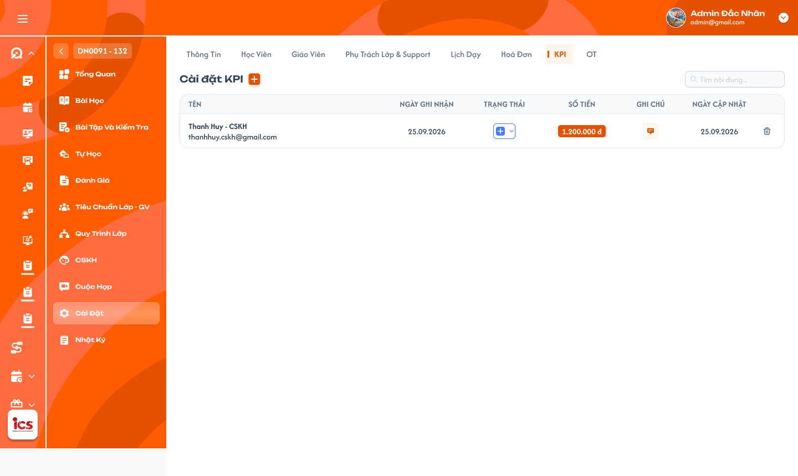
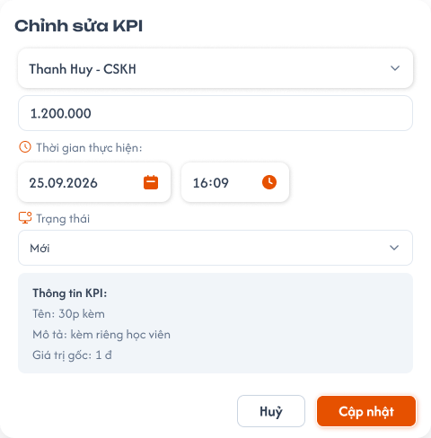
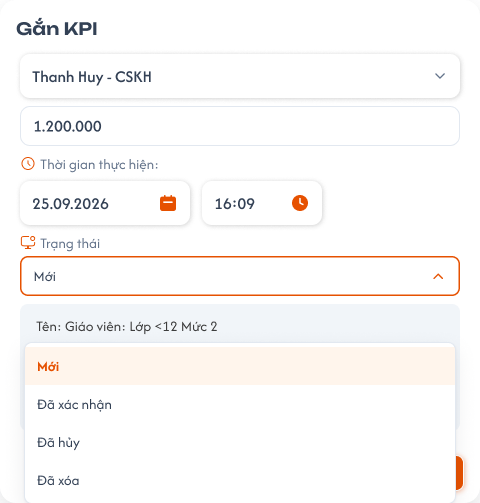

# Chi tiết lớp học — Tab KPI của Phụ trách lớp

## 1. UI

### Trang 1: ADM-LOP-040700 — Lớp học / Cài đặt / KPI



**Mô tả:**
- Tab này quản lý khoản KPI của `Class Handler` (PTL) trong lớp. Admin và Class Handler được xem, thêm, sửa, xóa và xác nhận KPI trong phạm vi lớp; Handler được xác nhận khoản của chính mình.
- Chỉ KPI **Đã xác nhận** được tính vào Chi phí PTL từng lớp và Tổng chi PTL tại [Danh sách lớp](./class_management_requirements.md).
- Tên người nhận, tên/mô tả KPI và giá trị tiền hiển thị theo dữ liệu thực tế.

**Điểm cần lưu ý:**
- Chỉ Admin/Class Handler được truy cập. Support, Teacher và role khác không xem hoặc CRUD, kể cả gọi API trực tiếp.
- Một Handler có thể có nhiều khoản KPI trong cùng lớp; không gộp khoản chỉ vì trùng tên.
- `A01.01` Nút `Cài đặt KPI` và `+`: mở popup Thêm KPI (Trang 2).
- `A01.02` Tìm kiếm theo tên Handler nhận KPI; tìm toàn bộ dữ liệu lớp, không chỉ dòng đã tải.
- `A01.03` Tên: người nhận của khoản KPI; mỗi khoản đúng một Handler.
- `A01.04` Ngày ghi nhận: ngày của Thời gian thực hiện nhập trong popup; lưu cả giờ.
- `A01.05` Trạng thái: Mới, Đã xác nhận, Đã hủy; Đã xóa không hiển thị trong bảng. Đã hủy vẫn hiển thị và được tìm kiếm; Đã xóa ẩn khỏi danh sách, giữ audit.
- `A01.06` Số tiền: tiền thực tế đã lưu, định dạng VND và dấu phân cách hàng nghìn.
- `A01.07` Ghi chú: mở ghi chú/lịch sử của đúng khoản KPI.
- `A01.08` Ngày cập nhật: lần cập nhật gần nhất do máy chủ ghi.
- `A01.09` X: mở popup xác nhận xóa khoản chưa xác nhận.
- Bấm tên/vùng thông tin mở popup sửa hoặc xem; thao tác trạng thái, ghi chú và X không đồng thời mở form sửa.
- `A03.01` Mới: hiển thị, không tính chi PTL; được sửa, xác nhận, hủy hoặc xóa.
- `A03.02` Đã xác nhận: hiển thị, tính chi PTL; khóa mọi thay đổi (không sửa tiền/người, không về Mới, không hủy, không xóa); Handler được tự xác nhận khoản của mình. Không tự tạo điều chỉnh bảng lương. Xác nhận ghi nhận chi phí, không đồng nghĩa đã thanh toán cho Handler.
- `A03.03` Đã hủy: hiển thị, không tính chi PTL; giữ để xem, có thể xóa nếu chưa xác nhận. Phục hồi chưa chốt (xem Q04).
- `A03.04` Đã xóa: không hiển thị, không tính chi PTL; xóa mềm, giữ audit. Chọn Đã xóa trong dropdown phải dùng cùng popup xác nhận như X.
- Dropdown trạng thái tại dòng lưu sau khi chọn và backend thành công.
- `A04.01` Popup xóa: `Xóa khoản KPI?` — `Khoản KPI của {Handler} với số tiền {tiền} sẽ được ẩn khỏi danh sách. Lịch sử vẫn được lưu.` Không xóa tài khoản, cấu hình mẫu hoặc audit.
- `A04.02` Hủy bỏ: đóng popup, giữ dữ liệu.
- `A04.03` Xác nhận xóa: kiểm tra quyền/trạng thái mới nhất, chuyển Đã xóa rồi ẩn dòng. Không có X hoạt động trên khoản xác nhận, API cũng chặn. Xóa lặp không tạo nhiều thao tác logic.
- `A05.01` Popup ghi chú: click icon ghi chú tại dòng KPI mở popup/popover dùng bố cục của [Tab Học viên](./class_detail_students_requirements.md); tiêu đề `Ghi chú KPI`, icon lịch sử cạnh tiêu đề. Click không mở đồng thời form chỉnh sửa KPI. Nội dung và lịch sử thuộc đúng khoản KPI, không phải ghi chú học viên.
- `A05.02` Ô nhập nội dung (textarea): hiển thị nội dung hiện tại; gõ/chỉnh nhiều dòng ở khoản Mới; chưa có ghi chú thì ô trống. Không thêm dropdown loại ghi chú. Gõ/chỉnh chỉ thay đổi draft.
- `A05.03` Lưu nội dung: theo cơ chế lưu ghi chú của tab Học viên; mỗi lần lưu thành công tạo một phiên bản và cập nhật Ngày cập nhật. Không tạo lịch sử sau từng phím gõ hoặc khi chỉ mở popup. Lưu lỗi giữ draft, không tạo lịch sử thành công giả. Sửa ghi chú không đổi tiền, trạng thái KPI hoặc Tổng chi PTL. Quyền sửa khoản Đã hủy cần chốt riêng (xem Q04).
- `A05.04` Icon lịch sử: mở popup `Lịch sử ghi chú` của đúng khoản KPI trong lớp, giống UI lịch sử của tab Học viên.
- `A05.05` Mỗi phiên bản: nội dung đầy đủ, avatar/tên người tạo hoặc chỉnh sửa, thời điểm máy chủ; mới nhất trước. Không ghi đè, không sửa/xóa lịch sử, không thực thi HTML/script.
- `A05.06` Copy: icon ở từng bản ghi; copy đúng nội dung của phiên bản được bấm, không kèm metadata; không tạo phiên bản hoặc đổi Ngày cập nhật.
- Khoản Đã xác nhận chỉ xem/Copy ghi chú, không sửa. Chỉ Admin/Class Handler dùng ghi chú KPI; tái sử dụng UI không kế thừa quyền Support của tab Học viên. Ghi chú và lịch sử lưu theo `class_id + kpi_id`, không dùng `student_id` hoặc chỉ tên Handler.
- Hai người sửa cùng phiên bản: không âm thầm ghi đè, cảnh báo xung đột và cho tải lại.
- `A06.01` Chi phí PTL của lớp: cộng mỗi khoản Đã xác nhận một lần, lấy tiền thực tế lưu; loại Mới/Hủy/Xóa; không dùng tiền gốc mẫu. Search KPI không thay đổi chi phí của lớp. Ví dụ Mới 100.000đ, xác nhận 200.000đ và 300.000đ, hủy 400.000đ → chi PTL 500.000đ.
- `A06.02` Tổng chi PTL: cộng toàn bộ lớp thỏa filter danh sách, không chỉ trang đang xem. Xác nhận lặp không cộng lại.
- `A07.01` Loading khi tải; rỗng hiện `Chưa có khoản KPI.`; lỗi có `Thử lại`. Lỗi tải không biến thành 0 khoản.
- `A07.02` Toast `Thành Công`: `Đã thêm KPI.`, `Đã cập nhật KPI.`, `Đã xác nhận KPI.`, `Đã xóa KPI.`
- `A07.03` Toast `Cảnh Báo`: `KPI đã được xác nhận và không thể chỉnh sửa.` hoặc lỗi field.
- `A07.04` Toast `Có Lỗi Xảy Ra`: `Không thể cập nhật KPI. Vui lòng thử lại.`
- `A07.05` Toast `Thông Báo`: chỉ khi chờ đồng bộ thực tế.
- Một thao tác một kết quả; không báo thành công sớm. Mở form/Hủy draft/search/Copy không có Toast CRUD thành công. Lỗi lưu giữ draft và tiền/trạng thái cũ.

### Trang 2: ADM-LOP-040710 — Popup chỉnh sửa KPI



**Mô tả:**
- Nút `+` mở Thêm KPI; mở khoản Mới để Chỉnh sửa KPI. Form thêm dùng cùng field với form chỉnh sửa. Khoản Đã xác nhận chỉ đọc.

**Điểm cần lưu ý:**
- `A02.01` Người nhận: bắt buộc một Class Handler, không multi-select và không chọn role khác.
- `A02.02` Số tiền: nhập tùy ý, không ép bằng giá trị gốc, không áp trần mẫu hoặc kiểm tra tự động điều kiện trong mô tả. Phải là giá trị số có thể đọc/lưu được. Rule tiền âm/0/phần lẻ chưa chốt (xem Q03).
- `A02.03` Dùng giá trị gốc: điền tiền từ cấu hình KPI tương ứng vào draft, chưa lưu backend.
- `A02.04` Thời gian thực hiện: ngày và giờ ghi nhận người dùng nhập. Ngày cập nhật lấy máy chủ khi tạo/sửa/trạng thái/ghi chú thành công; xem/search/Hủy draft không đổi mốc này.
- `A02.05` Trạng thái: mặc định Mới khi thêm; chọn theo rule trạng thái ở Trang 1. Trong popup chỉ là draft đến khi bấm Thêm/Cập nhật.
- `A02.06` Tên/Mô tả/Giá trị gốc: khối tham chiếu cấu hình KPI, chỉ đọc.
- `A02.07` Hủy bỏ: đóng form và bỏ draft; không chuyển trạng thái Đã hủy.
- `A02.08` Thêm/Cập nhật: validate rồi lưu; cập nhật bảng và chi PTL sau thành công.
- Không tự tính tiền theo số học viên lên kỳ hoặc chặn vì chưa đạt mô tả mẫu. Người dùng quyết định giá trị thực tế.
- Một người được thêm nhiều khoản độc lập; bấm lặp cùng request tạo chỉ một khoản.
- Khoản Đã xác nhận khóa người nhận, tiền, thời gian, ghi chú và trạng thái. Không có flow mở lại/đảo KPI.

### Trang 3: ADM-LOP-040712 — Popup chỉnh sửa KPI / Đang mở



**Mô tả:**
- Popup `Gắn KPI` với dropdown Trạng thái đang mở, hiện đủ bốn trạng thái Mới, Đã xác nhận, Đã hủy, Đã xóa.

**Điểm cần lưu ý:**
- Chọn trạng thái trong popup chỉ là draft đến khi bấm Cập nhật; chọn `Đã xóa` phải dùng cùng popup xác nhận như X.

---

## 2. Yêu cầu

### 2.1. Flow chính

**Flow 1: Xem và tìm KPI của lớp**

```
Mở lớp → tab KPI (Trang 1) → BE kiểm tra Admin/Class Handler + phạm vi lớp
  → tải KPI chưa xóa → nhập tên Handler vào Tìm kiếm → lọc toàn bộ dữ liệu lớp
```

**Flow 2: Thêm / sửa KPI**

```
"+" hoặc khoản Mới (Trang 2) → chọn một Handler, nhập tiền / ngày giờ / trạng thái
  → Thêm / Cập nhật → BE validate + lưu → cập nhật bảng và chi PTL → Toast thành công
                    ↓ (dữ liệu sai)
              Báo lỗi field, không lưu
```

**Flow 3: Xác nhận KPI**

```
Chọn Đã xác nhận → BE kiểm tra phiên bản / quyền → ghi audit → khóa khoản
  → đồng bộ chi PTL → Toast "Đã xác nhận KPI."
```

**Flow 4: Xóa KPI**

```
X / chọn Đã xóa → Popup xác nhận xóa
  ├─ Hủy bỏ → đóng, giữ dữ liệu
  └─ Xác nhận xóa → BE kiểm tra chưa xác nhận → xóa mềm → ẩn dòng → Toast "Đã xóa KPI."
```

**Flow 5: Ghi chú KPI**

```
Click icon ghi chú → popup giống tab Học viên → gõ / chỉnh (khoản Mới)
  → Lưu nội dung → BE tạo phiên bản + cập nhật Ngày cập nhật
  → icon lịch sử cạnh tiêu đề → xem / Copy từng bản
                    ↓ (Đã xác nhận)
              Chỉ xem / Copy
```

### 2.2. Ngoại lệ

- **EX01:** Sai role/ngoài phạm vi → chặn API/dữ liệu.
- **EX02:** Thiếu/sai người nhận, nhiều người, tiền hoặc ngày/giờ không đọc/lưu được → lỗi đúng field, không lưu một phần.
- **EX03:** Đã xác nhận bị sửa/hủy/xóa → từ chối; không đảo KPI/bảng lương.
- **EX04:** Request lặp hoặc xung đột version → một kết quả; không sửa khoản vừa khóa hoặc cộng chi phí lặp.
- **EX05:** Lỗi lưu → giữ dữ liệu cũ/draft, cho thử lại.
- **EX06:** Response search/lớp cũ → bỏ qua.

### 2.3. Yêu cầu khác

| Mã | Tên yêu cầu | Mô tả |
|---|---|---|
| REQ01 | Phân quyền | Chỉ Admin/Class Handler xem và CRUD/xác nhận; tự xác nhận KPI được phép. |
| REQ02 | Danh sách và tìm kiếm | Mỗi khoản một dòng; search tên Handler; giữ Hủy, ẩn Xóa. |
| REQ03 | Thêm / sửa KPI | Một người mỗi khoản; nhiều khoản/người; tiền tùy ý, giá trị gốc, ngày thực hiện và ngày cập nhật riêng. |
| REQ04 | Trạng thái KPI | Bốn trạng thái; xác nhận khóa khoản, không mở lại/đảo. |
| REQ05 | Xóa khoản KPI | Xóa có xác nhận, xóa mềm khoản chưa xác nhận. |
| REQ06 | Ghi chú và lịch sử | UI ghi chú giống tab Học viên: click icon mở popup có ô gõ/chỉnh nhiều dòng và icon lịch sử; dữ liệu theo class_id + kpi_id, lịch sử người/thời điểm và Copy từng bản; chỉ Admin/Class Handler, khoản xác nhận chỉ đọc. |
| REQ07 | Tổng chi PTL | Cộng tiền thực tế của KPI xác nhận vào chi PTL; tổng toàn bộ lớp thỏa filter. |
| REQ08 | Toast và trạng thái tải | Toast CRUD, tải/rỗng/lỗi rõ ràng. |

### 2.4. Ràng buộc

#### Quyền

| Role | Xem KPI | Thêm / Sửa | Xác nhận / Hủy | Xóa | Ghi chú KPI |
|---|:---:|:---:|:---:|:---:|:---:|
| Admin | ✅ | ✅ | ✅ | ✅ | ✅ |
| Class Handler | ✅ | ✅ | ✅ | ✅ | ✅ |
| Support | ❌ | ❌ | ❌ | ❌ | ❌ |
| Teacher / role khác | ❌ | ❌ | ❌ | ❌ | ❌ |

#### Ràng buộc khác

- Dùng kpi_id, class_id, handler_id; không cập nhật theo tên/vị trí dòng.
- Backend kiểm tra quyền/phạm vi, trạng thái/version tại thời điểm lưu.
- Audit người tạo/sửa/xác nhận/xóa và thời điểm máy chủ; lịch sử bất biến.
- Một request tạo lặp chỉ một khoản; hai thao tác tạo độc lập cho cùng Handler được phép.
- Không bỏ khóa khoản xác nhận qua request trực tiếp hoặc lớp test.
- Đã xác nhận không đồng nghĩa đã thanh toán; trả lương thuộc function khác.
- Mỗi thao tác một Toast: `Thành Công`, `Cảnh Báo`, `Có Lỗi Xảy Ra` hoặc `Thông Báo`.


---

## 3. Testcase

### Feature: Chi tiết lớp học — Tab KPI của Phụ trách lớp

| Tên testcase | Priority | Scenario | Role | Pre-condition | Given/When/Then | Expected Result |
|---|---|---|---|---|---|---|
| Case 1: Mở đúng lớp, tìm kiếm, nhiều khoản cho một người | High | Flow 1 / REQ01 / REQ02 | Admin / Class Handler | Có KPI ở nhiều lớp; một Handler có hai khoản | **Given:** mở lớp A, chọn tab KPI<br>**When:** tải bảng rồi nhập tên Handler vào Tìm kiếm<br>**Then:** tải đúng class_id và lọc theo người nhận | - Đúng các cột, không trộn lớp B, không trả Đã xóa<br>- Tìm toàn bộ dữ liệu, giữ Đã hủy<br>- Hai khoản của một người hiện hai dòng độc lập, tiền/trạng thái đúng từng ID<br>- Không search tên mẫu thay cho tên Handler |
| Case 2: Chặn role khác | High | EX01 / REQ01 | Support / Teacher / role khác | Có ID lớp | **Given:** truy cập tab hoặc gọi API<br>**When:** kiểm tra quyền<br>**Then:** từ chối | - Không trả tiền hoặc người nhận<br>- Không ghi dữ liệu |
| Case 3: Thêm KPI, tiền khác giá trị gốc, hai mốc ngày | High | Flow 2 / REQ03 | Admin / Class Handler | Dữ liệu hợp lệ; giá trị gốc 1.200.000đ; Thời gian thực hiện khác ngày hiện tại | **Given:** bấm `+`, chọn một người, nhập 800.000đ hoặc 1.500.000đ, nhập ngày/giờ<br>**When:** bấm `Dùng giá trị gốc` rồi `Hủy bỏ`; làm lại và bấm Thêm<br>**Then:** tạo khoản Mới giữ đúng tiền nhập | - Hủy bỏ không lưu backend, không chuyển Đã hủy<br>- Không ép tiền gốc, không áp trần mẫu, không kiểm tra điều kiện mô tả<br>- Ngày ghi nhận theo input, Ngày cập nhật theo máy chủ; xem không đổi<br>- Cho tạo khoản khác cho cùng người; chưa tính chi PTL |
| Case 4: Dữ liệu sai hoặc request bị sửa | High | EX02 / REQ03 | Admin / Class Handler | Request bị sửa | **Given:** gửi nhiều người, người là Support/Teacher, thiếu người nhận, tiền hoặc ngày giờ không hợp lệ<br>**When:** lưu<br>**Then:** từ chối | - Báo lỗi đúng field, không lưu một phần<br>- Không tin role từ client |
| Case 5: Tự xác nhận và hủy KPI | High | Flow 3 / REQ04 | Class Handler | Khoản Mới của chính mình; một khoản Mới khác | **Given:** chọn Đã xác nhận cho khoản của mình; chuyển khoản khác sang Đã hủy<br>**When:** lưu thành công<br>**Then:** xác nhận được, khoản hủy vẫn hiện | - Audit người/thời điểm, khóa khoản, tăng chi PTL đúng tiền, Toast `Đã xác nhận KPI.`<br>- Đã hủy vẫn hiển thị, không tính chi PTL, không xóa dòng |
| Case 6: Khóa khoản đã xác nhận | High | EX03 / REQ04 | Admin / Class Handler | KPI Đã xác nhận | **Given:** mở form hoặc gửi request sửa tiền/người/ngày/ghi chú, chuyển Mới/Hủy/Xóa<br>**When:** xử lý<br>**Then:** từ chối | - Form chỉ đọc<br>- Tiền, trạng thái và chi PTL giữ nguyên<br>- Toast `Cảnh Báo` `KPI đã được xác nhận và không thể chỉnh sửa.` |
| Case 7: Xác nhận lặp hoặc sửa đồng thời | High | EX04 / REQ04 / REQ07 | Hai role có quyền | Cùng bản dữ liệu, khoản 200.000đ | **Given:** gửi request xác nhận lặp; A xác nhận trước, B sửa từ bản cũ<br>**When:** xử lý<br>**Then:** một xác nhận; B bị từ chối và tải lại | - Tăng đúng 200.000đ, không nhân khoản<br>- Không sửa khoản đã khóa |
| Case 8: Xóa mềm khoản chưa xác nhận | High | Flow 4 / REQ05 | Admin / Class Handler | Khoản Mới hoặc Đã hủy | **Given:** bấm X (hoặc chọn Đã xóa)<br>**When:** bấm Hủy bỏ; làm lại và bấm Xác nhận xóa<br>**Then:** Hủy bỏ giữ khoản; Xác nhận ẩn dòng | - Hủy bỏ: không đổi trạng thái, không Toast thành công<br>- Xác nhận: không hiện khi search/tải lại, audit/tài khoản còn, không tính chi PTL<br>- Toast `Đã xóa KPI.` |
| Case 9: Sửa ghi chú đúng khoản | High | Flow 5 / REQ06 | Admin / Class Handler | KPI Mới, có hoặc chưa có ghi chú | **Given:** click icon ghi chú<br>**When:** gõ nhiều dòng rồi Lưu nội dung<br>**Then:** ghi đúng khoản KPI | - Popup đúng UI tham chiếu, tiêu đề Ghi chú KPI, có ô nhập và icon lịch sử, không mở form sửa KPI đồng thời, không có dropdown loại ghi chú<br>- Chưa lưu thì không tạo phiên bản hoặc đổi Ngày cập nhật<br>- Lưu xong có lịch sử người/thời điểm, cập nhật Ngày cập nhật |
| Case 10: Lịch sử và Copy | Medium | Flow 5 / REQ06 | Admin / Class Handler | Nhiều phiên bản; có khoản Đã xác nhận | **Given:** popup ghi chú đang mở<br>**When:** click icon lịch sử và Copy bản chọn<br>**Then:** mở lịch sử đúng KPI, sao chép đúng nội dung | - Nội dung, avatar/tên người, thời điểm đầy đủ; mới nhất trước<br>- Copy không kèm metadata, không thêm phiên bản<br>- Khoản Đã xác nhận vẫn xem/Copy, không sửa |
| Case 11: Xung đột hoặc lỗi lưu ghi chú | High | EX04 / EX05 / REQ06 | Admin / Class Handler | Hai người mở cùng phiên bản hoặc backend lỗi | **Given:** A lưu trước B hoặc lưu thất bại<br>**When:** B gửi nội dung draft<br>**Then:** cảnh báo xung đột/lỗi, không ghi đè | - Giữ draft để xử lý/thử lại, giữ các phiên bản trước<br>- Không tạo lịch sử thành công giả<br>- Tiền/trạng thái/Tổng chi PTL không đổi |
| Case 12: Chi PTL và Tổng chi PTL | High | REQ07 | Role xem thống kê | Dữ liệu ví dụ: Mới 100.000đ, xác nhận 200.000đ và 300.000đ, hủy 400.000đ; lớp A 500.000đ, B 700.000đ, C ngoài filter | **Given:** tính chi PTL; lọc danh sách lớp A/B<br>**When:** cộng và tổng hợp<br>**Then:** chi PTL một lớp 500.000đ, tổng 1.200.000đ | - Loại Mới/Hủy/Xóa<br>- Loại lớp C, không giới hạn trang<br>- Search KPI không đổi chi phí lớp hay tổng |
| Case 13: Toast thành công và lỗi lưu | Medium | EX05 / REQ08 | Admin / Class Handler | CRUD hợp lệ; sau đó backend lỗi | **Given:** lưu KPI<br>**When:** backend thành công; lần khác thất bại<br>**Then:** một Toast đúng thao tác | - Thành công: bảng/tổng đồng bộ, không nhân Toast<br>- Lỗi: Toast `Có Lỗi Xảy Ra`, giữ draft, không đổi tiền/trạng thái/tổng, thử lại được<br>- Tải rỗng hiện `Chưa có khoản KPI.`; lỗi tải có `Thử lại` |
| Case 14: Search trả response cũ | High | EX06 / REQ02 | Admin / Class Handler | Search liên tục | **Given:** gõ liên tục, response cũ về sau<br>**When:** render<br>**Then:** giữ kết quả search mới | - Không trộn kết quả |

---

## 4. Câu hỏi cần xác nhận

- **Q01:** Nguồn cấu hình Tên/Mô tả/Giá trị gốc và cách chọn mẫu KPI chưa rõ trong ảnh; người nhận đã chốt là một Handler.
- **Q02:** Picker giới hạn ở Handler đã thêm vào lớp hay từ danh sách hệ thống?
- **Q03:** Tiền âm/0/phần lẻ: hiện chỉ chốt nhập tùy ý, không kiểm tra điều kiện mẫu.
- **Q04:** Đã hủy được sửa/phục hồi về Mới hoặc xác nhận không? Hiện chỉ chốt giữ hiển thị và xóa khi chưa xác nhận.
- **Q05:** Danh sách KPI dùng load-more hay phân trang? Search theo tên Handler đã chốt, cơ chế tải thêm chưa có câu trả lời.
