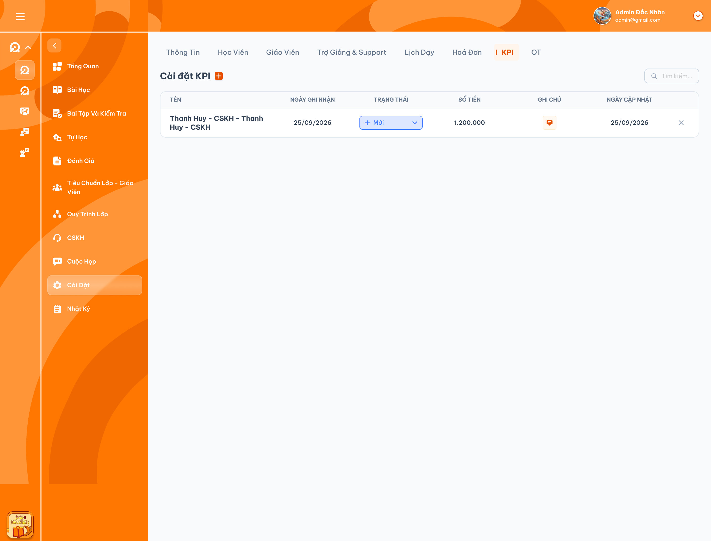
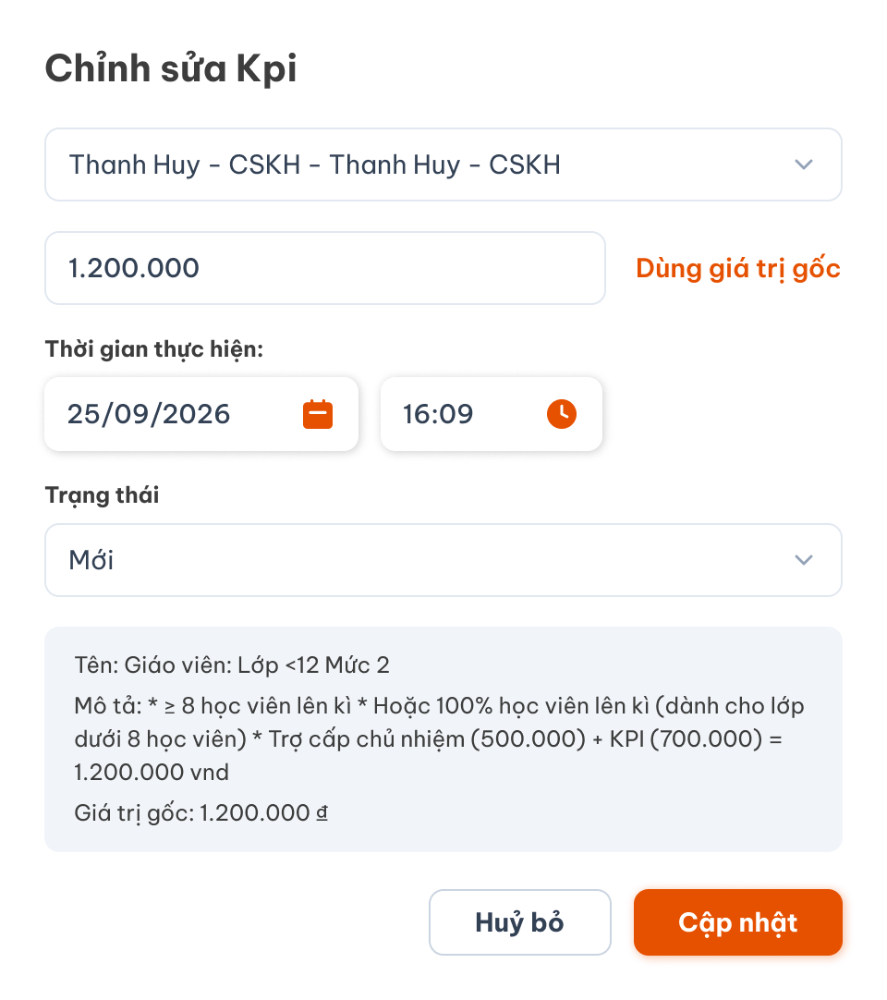
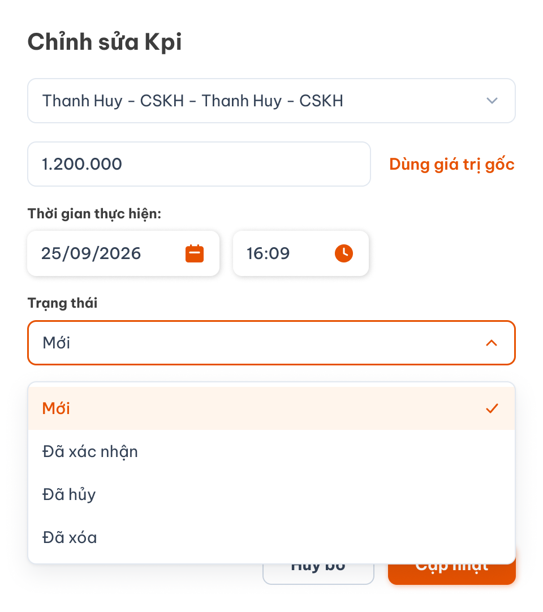
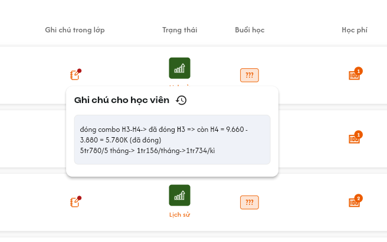
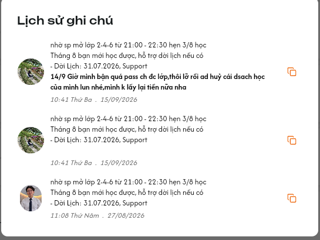

# Chi tiết lớp học — Tab KPI của Phụ trách lớp

Tab này quản lý khoản KPI của `Class Handler` (PTL). Chỉ KPI **Đã xác nhận** được tính vào Chi phí PTL từng lớp và Tổng chi PTL tại [Danh sách lớp](./class_management_requirements.md). Bộ ba ảnh dưới đây là UI tham chiếu chính thức được người dùng xác nhận. Giữ bố cục, thành phần và nhãn giao diện theo ảnh; tên người nhận, tên/mô tả KPI và giá trị tiền hiển thị theo dữ liệu thực tế. Nội dung mẫu trong ảnh không thay đổi quyền hoặc rule nghiệp vụ đã chốt.

## 1. UI

### Trang 1: Tab KPI — Danh sách và tìm kiếm

*Danh sách KPI — nhấn để xem ảnh gốc*

**Mô tả:** Admin và Class Handler được xem, thêm, sửa, xóa và xác nhận KPI trong phạm vi lớp. Handler được xác nhận khoản của chính mình.

**Giải thích field/thành phần:**

- `A01.01` **Cài đặt KPI và +**: Mở popup Thêm KPI.
- `A01.02` **Tìm kiếm**: Theo tên Handler nhận KPI; tìm toàn bộ dữ liệu lớp, không chỉ dòng đã tải.
- `A01.03` **Tên**: Người nhận của khoản KPI; mỗi khoản đúng một Handler.
- `A01.04` **Ngày ghi nhận**: Ngày của Thời gian thực hiện nhập trong popup; lưu cả giờ.
- `A01.05` **Trạng thái**: Mới, Đã xác nhận, Đã hủy; Đã xóa không hiển thị trong bảng.
- `A01.06` **Số tiền**: Tiền thực tế đã lưu, định dạng VND và dấu phân cách hàng nghìn.
- `A01.07` **Ghi chú**: Mở ghi chú/lịch sử của đúng khoản KPI.
- `A01.08` **Ngày cập nhật**: Lần cập nhật gần nhất do máy chủ ghi.
- `A01.09` **X**: Popup xác nhận xóa khoản chưa xác nhận.

**Điểm cần lưu ý:**

- Chỉ Admin/Class Handler được truy cập. Support, Teacher và role khác không xem hoặc CRUD, kể cả gọi API trực tiếp.
- Một Handler có thể có nhiều khoản KPI trong cùng lớp; không gộp khoản chỉ vì trùng tên.
- Đã hủy vẫn hiển thị và được tìm kiếm; Đã xóa ẩn khỏi danh sách, giữ audit.
- Bấm tên/vùng thông tin mở popup sửa hoặc xem; thao tác trạng thái, ghi chú và X không đồng thời mở form sửa.

### Trang 2: Popup thêm và chỉnh sửa KPI

*Form thêm dùng cùng field với form chỉnh sửa — nhấn để xem ảnh gốc*

**Mô tả:** Nút + mở Thêm KPI; mở khoản Mới để Chỉnh sửa KPI. Khoản xác nhận chỉ đọc; khả năng sửa/phục hồi khoản Đã hủy cần chốt riêng.

**Giải thích field/thành phần:**

- `A02.01` **Người nhận**: Bắt buộc một Class Handler, không multi-select và không chọn role khác.
- `A02.02` **Số tiền**: Nhập tùy ý, không ép bằng giá trị gốc, không áp trần mẫu hoặc kiểm tra tự động điều kiện trong mô tả. Phải là giá trị số có thể đọc/lưu được.
- `A02.03` **Dùng giá trị gốc**: Điền tiền từ cấu hình KPI tương ứng vào draft, chưa lưu backend.
- `A02.04` **Thời gian thực hiện**: Ngày và giờ ghi nhận người dùng nhập.
- `A02.05` **Trạng thái**: Mặc định Mới khi thêm; chọn theo rule trạng thái bên dưới.
- `A02.06` **Tên/Mô tả/Giá trị gốc**: Khối tham chiếu cấu hình KPI chỉ đọc.
- `A02.07` **Hủy bỏ**: Đóng form và bỏ draft; không chuyển trạng thái Đã hủy.
- `A02.08` **Thêm/Cập nhật**: Validate rồi lưu; cập nhật bảng và chi PTL sau thành công.

**Điểm cần lưu ý:**

- Không tự tính tiền theo số học viên lên kỳ hoặc chặn vì chưa đạt mô tả mẫu. Người dùng quyết định giá trị thực tế.
- Rule tiền âm/0/phần lẻ chưa chốt; không tự đặt giới hạn nghiệp vụ ngoài khả năng parse/lưu số tiền.
- Một người được thêm nhiều khoản độc lập; bấm lặp cùng request tạo chỉ một khoản.
- Ngày cập nhật lấy máy chủ khi tạo/sửa/trạng thái/ghi chú thành công; xem/search/Hủy draft không đổi mốc này.
- Khoản xác nhận khóa người nhận, tiền, thời gian, ghi chú và trạng thái. Không có flow mở lại/đảo KPI.

### Trang 3: Dropdown trạng thái và xác nhận

*Bốn trạng thái KPI — nhấn để xem ảnh gốc*

**Mô tả:** Trạng thái quyết định khả năng sửa, hiển thị và tính chi PTL.

**Giải thích field/thành phần:**

- `A03.01` **Mới**: Hiển thị: Có; Tính chi PTL: Không; Quy tắc: Sửa, xác nhận, hủy hoặc xóa.
- `A03.02` **Đã xác nhận**: Hiển thị: Có; Tính chi PTL: Có; Quy tắc: Khóa mọi thay đổi; Handler được tự xác nhận khoản của mình.
- `A03.03` **Đã hủy**: Hiển thị: Có; Tính chi PTL: Không; Quy tắc: Giữ để xem; có thể xóa nếu chưa xác nhận. Phục hồi chưa chốt.
- `A03.04` **Đã xóa**: Hiển thị: Không; Tính chi PTL: Không; Quy tắc: Xóa mềm; giữ audit.

**Điểm cần lưu ý:**

- Dropdown tại dòng lưu sau khi chọn và backend thành công; trong popup chỉ là draft đến Thêm/Cập nhật.
- Đã xác nhận không được sửa tiền/người, về Mới, hủy hoặc xóa. Không tự tạo điều chỉnh bảng lương.
- Chọn Đã xóa trong dropdown phải dùng cùng popup xác nhận như X.
- Xác nhận ghi nhận chi phí; không đồng nghĩa đã thanh toán cho Handler.

### Trang 4: Xóa khoản KPI
**Mô tả:** X hoặc Đã xóa mở popup xác nhận cho khoản chưa xác nhận.

**Giải thích field/thành phần:**

- `A04.01` **Popup**: `Xóa khoản KPI?` — `Khoản KPI của {Handler} với số tiền {tiền} sẽ được ẩn khỏi danh sách. Lịch sử vẫn được lưu.`
- `A04.02` **Hủy bỏ**: Đóng, giữ dữ liệu.
- `A04.03` **Xác nhận xóa**: Kiểm tra quyền/trạng thái mới nhất, chuyển Đã xóa rồi ẩn dòng.

**Điểm cần lưu ý:**

- Không xóa tài khoản, cấu hình mẫu hoặc audit.
- Không có X hoạt động trên khoản xác nhận; API cũng chặn.
- Xóa lặp không tạo nhiều thao tác logic.

### Trang 5: Ghi chú, lịch sử và Copy

*Dùng lại UI popup ghi chú của tab Học viên; tiêu đề khi dùng cho KPI là Ghi chú KPI.*

*Dùng lại UI Lịch sử ghi chú: nội dung, người chỉnh sửa, thời điểm và Copy từng phiên bản.*

**Mô tả:** Click icon ghi chú tại dòng KPI mở popup/popover giống [Tab Học viên](./class_detail_students_requirements.md): có ô nhập văn bản để gõ/chỉnh nội dung và icon xem lịch sử chỉnh sửa ngay cạnh tiêu đề. Nội dung và lịch sử thuộc đúng khoản KPI, không phải ghi chú học viên.

**Giải thích field/thành phần:**

- `A05.01` **Popup ghi chú**: Dùng bố cục của tab Học viên; tiêu đề `Ghi chú KPI` và icon lịch sử cạnh tiêu đề. Click không mở đồng thời form chỉnh sửa KPI.
- `A05.02` **Ô nhập nội dung (textarea)**: Hiển thị nội dung hiện tại; cho gõ/chỉnh văn bản nhiều dòng ở khoản Mới. Nếu chưa có ghi chú, ô nhập trống. Không thêm dropdown loại ghi chú.
- `A05.03` **Lưu nội dung**: Theo cơ chế lưu ghi chú của tab Học viên; lưu phiên bản và cập nhật Ngày cập nhật sau backend thành công. Quyền sửa khoản Đã hủy cần chốt riêng.
- `A05.04` **Icon lịch sử**: Click mở popup `Lịch sử ghi chú` của đúng khoản KPI trong lớp, giống UI lịch sử của tab Học viên.
- `A05.05` **Mỗi phiên bản**: Nội dung đầy đủ, avatar/tên người tạo hoặc chỉnh sửa, thời điểm máy chủ; mới nhất trước. Không ghi đè phiên bản cũ.
- `A05.06` **Copy**: Icon ở từng bản ghi; copy đúng nội dung của phiên bản được bấm, không kèm metadata.

**Điểm cần lưu ý:**

- Đã xác nhận chỉ xem/Copy; không sửa ghi chú.
- Chỉ Admin/Class Handler dùng phần ghi chú KPI; tái sử dụng UI không kế thừa quyền Support của tab Học viên.
- Ghi chú và lịch sử lưu theo `class_id + kpi_id`; không dùng `student_id` hoặc chỉ tên Handler để xác định bản ghi.
- Gõ/chỉnh chỉ thay đổi draft; mỗi lần lưu nội dung mới thành công mới tạo phiên bản. Không tạo lịch sử sau từng phím gõ hoặc khi chỉ mở popup.
- Không sửa/xóa lịch sử; không thực thi HTML/script.
- Copy không tạo phiên bản hoặc đổi ngày cập nhật.
- Không âm thầm ghi đè khi hai người sửa cùng phiên bản; cảnh báo xung đột và cho tải lại. Lưu lỗi giữ draft, không tạo lịch sử thành công giả.
- Sửa ghi chú không thay đổi tiền, trạng thái KPI hoặc Tổng chi PTL.

### Trang 6: Tổng chi PTL
**Mô tả:** Chi phí PTL từng lớp cộng KPI Đã xác nhận; Tổng chi PTL cộng chi phí của tất cả lớp thỏa filter danh sách.

**Giải thích field/thành phần:**

- `A06.01` **Chi phí PTL của lớp**: Cách tính: Cộng mỗi khoản Đã xác nhận một lần, lấy tiền thực tế lưu.
- `A06.02` **Tổng chi PTL**: Cách tính: Cộng toàn bộ lớp thỏa filter, không chỉ trang đang xem.

**Điểm cần lưu ý:**

- Loại Mới/Hủy/Xóa; không dùng tiền gốc mẫu.
- Search KPI không thay đổi chi phí của lớp.
- Ví dụ Mới 100.000đ, xác nhận 200.000đ và 300.000đ, hủy 400.000đ → chi PTL 500.000đ.
- Lưu trạng thái và đồng bộ tổng nhất quán; xác nhận lặp không cộng lại.

### Trang 7: Toast và trạng thái tải

**Mô tả:** CRUD có Toast sau backend; loading/rỗng/lỗi tại bảng.

**Giải thích field/thành phần:**

- `A07.01` **Loading/rỗng/lỗi**: Loading khi tải; `Chưa có khoản KPI.` nếu rỗng; lỗi có Thử lại.
- `A07.02` **Thành Công**: `Đã thêm KPI.`, `Đã cập nhật KPI.`, `Đã xác nhận KPI.`, `Đã xóa KPI.`
- `A07.03` **Cảnh Báo**: `KPI đã được xác nhận và không thể chỉnh sửa.` hoặc lỗi field.
- `A07.04` **Có Lỗi Xảy Ra**: `Không thể cập nhật KPI. Vui lòng thử lại.`
- `A07.05` **Thông Báo**: Chỉ khi chờ đồng bộ thực tế.

**Điểm cần lưu ý:**

- Một thao tác một kết quả; không báo thành công sớm.
- Mở form/Hủy draft/search/Copy không có Toast CRUD thành công.
- Lỗi lưu giữ draft và tiền/trạng thái cũ; lỗi tải không biến thành 0 khoản.

---

## 2. Yêu cầu

### 2.1. Flow chính

- **Flow 1 / REQ01–REQ02:** Mở lớp → kiểm tra Admin/Class Handler và phạm vi → tải KPI chưa xóa → tìm theo tên Handler.
- **Flow 2 / REQ03:** + hoặc khoản Mới → một Handler, tiền/ngày/giờ/trạng thái → Thêm/Cập nhật → lưu và Toast.
- **Flow 3 / REQ04, REQ07:** Đã xác nhận → kiểm tra phiên bản/quyền → audit → khóa khoản → đồng bộ chi PTL.
- **Flow 4 / REQ05:** X/Đã xóa → xác nhận → kiểm tra chưa xác nhận → xóa mềm → ẩn → Toast.
- **Flow 5 / REQ06:** Click icon ghi chú → popup giống tab Học viên → gõ/chỉnh trong ô văn bản nếu khoản Mới → lưu nội dung và phiên bản → icon lịch sử cạnh tiêu đề → xem/Copy từng bản; Đã xác nhận chỉ đọc, quyền sửa Đã hủy cần chốt riêng.

### 2.2. Ngoại lệ

- **EX01:** Sai role/ngoài phạm vi → chặn API/dữ liệu.
- **EX02:** Thiếu/sai người nhận, nhiều người, tiền hoặc ngày/giờ không đọc/lưu được → lỗi đúng field, không lưu một phần.
- **EX03:** Đã xác nhận bị sửa/hủy/xóa → từ chối; không đảo KPI/bảng lương.
- **EX04:** Request lặp hoặc xung đột version → một kết quả; không sửa khoản vừa khóa hoặc cộng chi phí lặp.
- **EX05:** Lỗi lưu → giữ dữ liệu cũ/draft, cho thử lại.
- **EX06:** Response search/lớp cũ → bỏ qua.

### 2.3. Yêu cầu khác

| Mã | Tên yêu cầu | Mô tả |
|---|---|---|
| REQ01 |  | Chỉ Admin/Class Handler xem và CRUD/xác nhận; tự xác nhận KPI được phép. |
| REQ02 |  | Mỗi khoản một dòng; search tên Handler; giữ Hủy, ẩn Xóa. |
| REQ03 |  | Một người mỗi khoản; nhiều khoản/người; tiền tùy ý, giá trị gốc, ngày thực hiện và ngày cập nhật riêng. |
| REQ04 |  | Bốn trạng thái; xác nhận khóa khoản, không mở lại/đảo. |
| REQ05 |  | Xóa có xác nhận, xóa mềm khoản chưa xác nhận. |
| REQ06 |  | UI ghi chú giống tab Học viên: click icon mở popup có ô gõ/chỉnh nhiều dòng và icon lịch sử; dữ liệu theo class_id + kpi_id, lịch sử người/thời điểm và Copy từng bản; chỉ Admin/Class Handler, khoản xác nhận chỉ đọc. |
| REQ07 |  | Cộng tiền thực tế của KPI xác nhận vào chi PTL; tổng toàn bộ lớp thỏa filter. |
| REQ08 |  | Toast CRUD, tải/rỗng/lỗi rõ ràng. |

### 2.4. Ràng buộc

- Dùng kpi_id, class_id, handler_id; không cập nhật theo tên/vị trí dòng.
- Backend kiểm tra quyền/phạm vi, trạng thái/version tại thời điểm lưu.
- Audit người tạo/sửa/xác nhận/xóa và thời điểm máy chủ; lịch sử bất biến.
- Một request tạo lặp chỉ một khoản; hai thao tác tạo độc lập cho cùng Handler được phép.
- Không bỏ khóa khoản xác nhận qua request trực tiếp hoặc lớp test.
- Đã xác nhận không đồng nghĩa đã thanh toán; trả lương thuộc function khác.

---

## 3. Testcase

### Feature: Chi tiết lớp học — Tab KPI của Phụ trách lớp

| Tên testcase | Priority | Scenario | Role | Pre-condition | Given/When/Then | Expected Result |
|---|---|---|---|---|---|---|
| Case 1: Mở đúng lớp và quyền | High · Smoke | Flow 1 / REQ01 | Admin/Class Handler | Có KPI ở nhiều lớp | **Given** mở lớp A **When** chọn KPI **Then** tải đúng class_id | - Đúng các cột - Không trộn lớp B - Không trả Đã xóa |
| Case 2: Chặn role khác | High | EX01 / REQ01 | Support/Teacher/role khác | Có ID lớp | **Given** truy cập tab/API **When** kiểm tra quyền **Then** từ chối | - Không trả tiền hoặc người nhận - Không ghi dữ liệu |
| Case 3: Search tên Handler | High | REQ02 | Role có quyền | Nhiều Handler có KPI | **Given** nhập tên **When** tìm **Then** lọc theo người nhận | - Tìm toàn bộ dữ liệu - Giữ Đã hủy, loại Đã xóa - Không search tên mẫu thay cho tên Handler |
| Case 4: Nhiều khoản cho một người | High | REQ02 | Role có quyền | Một người có hai khoản | **Given** tải bảng **When** render **Then** có hai dòng độc lập | - Không gộp theo tên - Tiền/trạng thái đúng từng ID |
| Case 5: Thêm với một Handler | High · Smoke | Flow 2 / REQ03 | Role có quyền | Dữ liệu hợp lệ | **Given** + và chọn một người **When** lưu Mới **Then** tạo khoản | - Một người nhận - Cho tạo khoản khác cho cùng người - Chưa tính chi PTL |
| Case 6: Chặn nhiều người hoặc role sai | High | EX02 / REQ03 | Role có quyền | Request bị sửa | **Given** gửi nhiều người/Support/Teacher **When** lưu **Then** từ chối | - Không lưu một phần - Không tin role client |
| Case 7: Tiền khác giá trị gốc | High | REQ03 | Role có quyền | Giá trị gốc 1.200.000đ | **Given** nhập 800.000đ hoặc 1.500.000đ **When** lưu **Then** giữ đúng tiền nhập | - Không ép tiền gốc - Không áp trần mẫu - Không kiểm tra điều kiện mô tả |
| Case 8: Dùng giá trị gốc rồi Hủy bỏ | Medium | REQ03 | Role có quyền | Draft tiền khác giá trị gốc | **Given** bấm Dùng giá trị gốc **When** Hủy bỏ **Then** bỏ draft | - Không lưu backend - Không chuyển Đã hủy |
| Case 9: Hai mốc ngày độc lập | High | REQ03 | Role có quyền | Thời gian thực hiện khác ngày hiện tại | **Given** nhập ngày/giờ **When** lưu **Then** giữ riêng hai mốc | - Ghi nhận theo input - Cập nhật theo máy chủ - Xem không đổi thời gian |
| Case 10: Khóa khoản xác nhận | High | EX03 / REQ04 | Role có quyền | KPI Đã xác nhận | **Given** mở form hoặc gửi request sửa tiền/người/ngày/ghi chú **When** xử lý **Then** từ chối | - Form chỉ đọc - Tiền và chi PTL giữ nguyên |
| Case 11: Tự xác nhận KPI | High | Flow 3 / REQ04 | Class Handler | Khoản Mới của chính mình | **Given** chọn Đã xác nhận **When** lưu thành công **Then** xác nhận được | - Audit người/thời điểm - Khóa khoản - Tăng chi PTL đúng tiền |
| Case 12: Đã hủy vẫn hiển thị | High | REQ04 | Role có quyền | KPI Mới | **Given** chuyển Đã hủy **When** lưu **Then** dòng vẫn hiện | - Không tính chi PTL - Không xóa dòng |
| Case 13: Không mở lại khoản xác nhận | High | EX03 / REQ04 | Admin/Class Handler | Đã xác nhận | **Given** gửi chuyển Mới/Hủy/Xóa **When** xử lý **Then** từ chối | - Tiền/trạng thái giữ nguyên - Không đảo KPI |
| Case 14: Sửa đồng thời với xác nhận | High | EX04 / REQ04 | Hai role có quyền | Cùng bản dữ liệu | **Given** A xác nhận trước **When** B sửa từ bản cũ **Then** từ chối và tải lại | - Không sửa khoản khóa - Không cộng chi PTL lặp |
| Case 15: Hủy popup xóa | Medium | Flow 4 / REQ05 | Role có quyền | Khoản chưa xác nhận | **Given** bấm X **When** Hủy bỏ **Then** giữ khoản | - Không đổi trạng thái - Không Toast thành công |
| Case 16: Xóa mềm và ẩn | High | Flow 4 / REQ05 | Role có quyền | Mới hoặc Đã hủy | **Given** X hoặc Đã xóa **When** xác nhận **Then** ẩn dòng | - Không hiện khi search/tải lại - Audit/tài khoản còn - Không tính chi PTL |
| Case 17: Sửa ghi chú đúng khoản | High | Flow 5 / REQ06 | Role có quyền | KPI Mới | **Given** mở icon **When** sửa/lưu **Then** ghi đúng KPI | - Có lịch sử người/thời điểm - Cập nhật mốc sửa |
| Case 18: Lịch sử và Copy | Medium | REQ06 | Admin/Class Handler | Nhiều phiên bản | **Given** popup ghi chú đang mở **When** click icon lịch sử cạnh tiêu đề và Copy bản chọn **Then** mở lịch sử đúng KPI và sao chép đúng nội dung | - Nội dung, avatar/tên người và thời điểm đầy đủ - Mới nhất trước - Không trộn khoản hoặc kèm metadata khi Copy - Không thêm phiên bản - Khoản xác nhận vẫn xem/Copy |
| Case 25: Popup và ô gõ giống tab Học viên | High | Flow 5 / REQ06 | Admin/Class Handler | Có KPI Mới, có hoặc chưa có ghi chú | **Given** danh sách KPI **When** click icon ghi chú rồi gõ nhiều dòng **Then** popup đúng UI tham chiếu, có ô nhập và icon lịch sử | - Tiêu đề Ghi chú KPI - Hiển thị nội dung hiện tại hoặc ô trống - Không mở form sửa KPI đồng thời - Chưa lưu thì không tạo phiên bản hoặc đổi Ngày cập nhật - Không thêm dropdown loại ghi chú |
| Case 26: Xung đột hoặc lỗi lưu ghi chú | High | EX04–EX05 / REQ06 | Admin/Class Handler | Hai người mở cùng phiên bản hoặc backend lỗi | **Given** A lưu trước B hoặc lưu thất bại **When** B gửi nội dung draft **Then** cảnh báo xung đột/lỗi, không âm thầm ghi đè | - Giữ draft để xử lý/thử lại - Giữ các phiên bản thành công trước đó - Không tạo lịch sử thành công giả - Tiền/trạng thái/Tổng chi PTL không đổi |
| Case 19: Chỉ cộng xác nhận | High | REQ07 | Role xem thống kê | Dữ liệu ví dụ | **Given** tính chi PTL **When** cộng **Then** 200.000 + 300.000 | - 500.000đ - Loại Mới/Hủy/Xóa |
| Case 20: Tổng theo filter lớp | High | REQ07 | Role xem thống kê | A 500.000đ, B 700.000đ, C ngoài filter | **Given** filter A/B **When** tổng hợp **Then** 1.200.000đ | - Loại C - Không giới hạn trang - Search KPI không đổi tổng |
| Case 21: Xác nhận lặp | High | EX04 / REQ07 | Role có quyền | Khoản 200.000đ | **Given** request xác nhận lặp **When** xử lý **Then** một xác nhận | - Tăng đúng 200.000đ - Không nhân khoản |
| Case 22: Toast thành công | Medium | REQ08 | Role có quyền | CRUD hợp lệ | **Given** lưu **When** backend thành công **Then** một Toast đúng thao tác | - Bảng/tổng đồng bộ - Không nhân Toast |
| Case 23: Lưu lỗi | High | EX05 / REQ08 | Role có quyền | Backend lỗi | **Given** lưu **When** thất bại **Then** lỗi và giữ draft | - Không đổi tiền/trạng thái/tổng - Thử lại được |
| Case 24: Search response cũ | High | EX06 / REQ02 | Role có quyền | Search liên tục | **Given** response cũ về sau **When** render **Then** giữ search mới | - Không trộn kết quả |

---

## 4. Câu hỏi cần xác nhận

- **Q01:** Nguồn cấu hình Tên/Mô tả/Giá trị gốc và cách chọn mẫu KPI chưa rõ trong ảnh; người nhận đã chốt là một Handler.
- **Q02:** Picker giới hạn ở Handler đã thêm vào lớp hay từ danh sách hệ thống?
- **Q03:** Tiền âm/0/phần lẻ: hiện chỉ chốt nhập tùy ý, không kiểm tra điều kiện mẫu.
- **Q04:** Đã hủy được sửa/phục hồi về Mới hoặc xác nhận không? Hiện chỉ chốt giữ hiển thị và xóa khi chưa xác nhận.
- **Q05:** Danh sách KPI dùng load-more hay phân trang? Search theo tên Handler đã chốt, cơ chế tải thêm chưa có câu trả lời.
