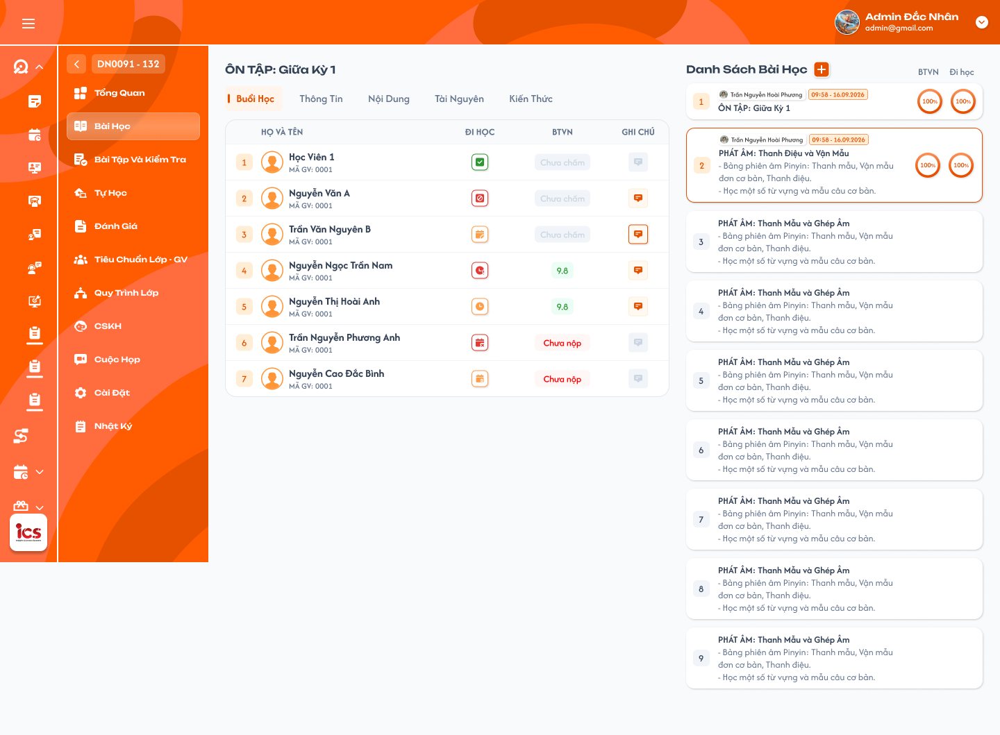
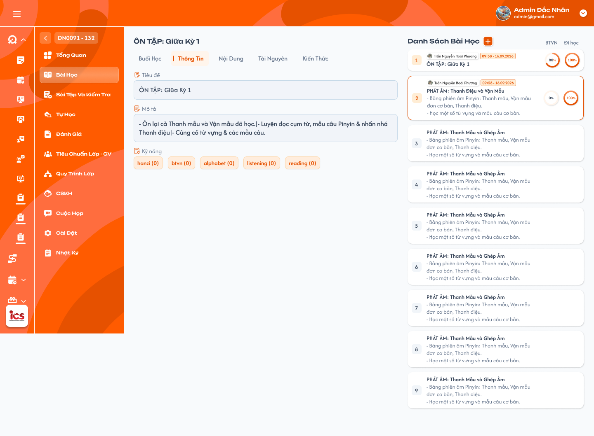
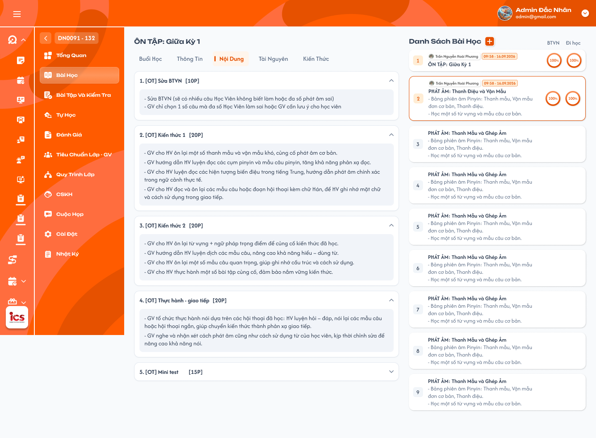
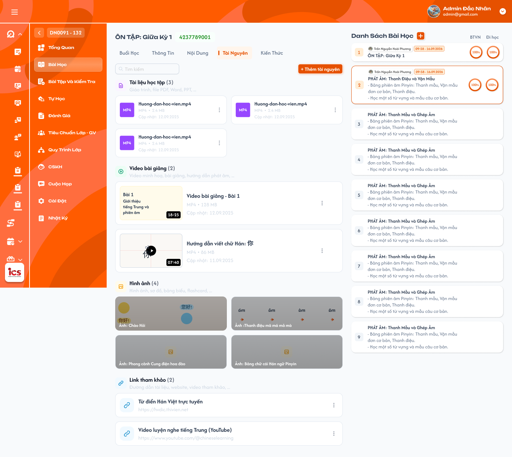
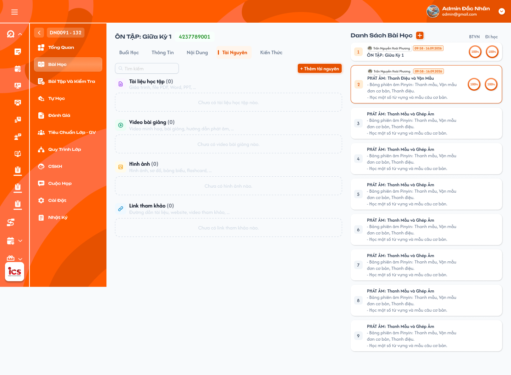
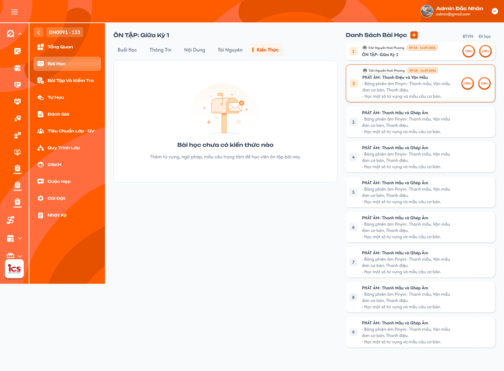

# Chi tiết lớp học — Menu Bài học

## 1. UI

### Trang 1: ADM-LOP-030100 — Lớp học / Bài học / Buổi học



**Mô tả:**
- Menu Bài học trong Chi tiết lớp: vùng trái là bài đang chọn và các tab Buổi học / Thông tin / Nội dung / Tài nguyên / Kiến thức; vùng phải là Danh sách bài học. Tab Buổi học hiển thị dữ liệu buổi thực tế của lớp: nhận xét giáo viên, ghi chú cho Support, bàn giao giáo viên tiếp theo và từng học viên (Họ và tên, Đi học, BTVN, Ghi chú).
- **Mặc định chọn bài đầu tiên theo thứ tự danh sách** khi mở menu. **Tải toàn bộ danh sách**, không phân trang/load-more; cuộn để xem hết.
- Định nghĩa bài, kỹ năng, nội dung và tài nguyên thuộc Học kỳ — Tab Bài học của **Curriculum Development Handler**; tại menu lớp, dữ liệu nguồn chỉ đọc. Thao tác được bổ sung: **thêm một hoặc nhiều bài vào lớp** (mỗi bài chọn một khóa học/bài có sẵn) và **Admin/Class Handler/Support sửa điểm danh sai của học viên**.
- Popup Ghi chú từng học viên, menu sửa điểm danh, trạng thái bài chưa bắt đầu và popup Thêm bài học mới thuộc tab/màn này và không có frame riêng.

**Điểm cần lưu ý:**
- `A01.01` Card bài học: số thứ tự, tên bài; bài đã mở có giáo viên, mốc mở bài và vòng % BTVN/Đi học. Bài chưa bắt đầu có tên/mô tả, số thứ tự xám và chưa có chỉ số thực tế.
- `A01.02` Chọn bài/tab: bấm card chọn bài, viền cam và tiêu đề bên trái đồng bộ; các tab chuyển bình thường trong bài đang chọn. Không tự mở/bắt đầu buổi hoặc sửa dữ liệu khi chuyển tab.
- `A01.03` Thứ tự/danh sách: đọc đúng thứ tự nguồn đã gán cho lớp và toàn bộ các bài bổ sung. Không kéo-thả/sửa thứ tự từ UI.
- `A01.04` Giáo viên và mốc mở: giáo viên thực tế của buổi và mốc mở bài của lớp, dạng HH:mm - dd/MM/yyyy; không lấy giờ nộp cá nhân hay sửa Curriculum.
- `A01.05` Thêm bài học mới: nút mở popup chọn Khóa học/Bài học nguồn, Tiêu đề và Mô tả. Đây là thêm vào lớp, không tạo định nghĩa Curriculum. Admin hoặc Class Handler/Support được add vào lớp được thêm.
- `A01.06` Tải dữ liệu: loading/rỗng/lỗi riêng; lỗi có Thử lại. Response lớp/bài/tab cũ không ghi đè hiện tại. Không có bài thì không chọn bài đầu giả.
- Định nghĩa Curriculum chỉ đọc; việc thêm bài lớp/sửa điểm danh không cấp quyền chỉnh mẫu, chấm BTVN hoặc upload/xóa tài nguyên.
- Nhận xét/bàn giao, điểm danh và bài nộp là dữ liệu buổi thực tế; Thông tin/Nội dung/Tài nguyên là định nghĩa bài nguồn được áp dụng. Không trộn hai nhóm.
- Mở tab/chọn bài/tải file không tự bắt đầu hay hoàn thành bài; không Toast CRUD cho chỉ xem.
- `A02.01` Giáo viên nhận xét lớp: nhận xét giáo viên cho cả lớp tại bài/buổi đang chọn, chỉ đọc.
- `A02.02` Ghi chú của Giáo viên gửi cho Support: ghi chú giáo viên cho team hỗ trợ về buổi này; chỉ đọc và tách riêng bàn giao giáo viên tiếp theo.
- `A02.03` Ghi chú của Giáo viên gửi cho Giáo viên tiếp theo: nội dung bàn giao đúng bài/buổi, chỉ đọc.
- `A02.04` Học viên: số thứ tự và Họ và tên theo dữ liệu buổi của lớp; không dùng tên làm khóa.
- `A02.05` Đi học: icon điểm danh đúng học viên–bài/buổi theo bộ icon `Trạng thái đi học` (bảng ghép 7 trạng thái ở Tổng quan — Bảng bài học); hover hiện tooltip tên trạng thái. Admin/Class Handler/Support được mở menu chọn trạng thái để sửa giáo viên điểm danh sai.
- `A02.06` BTVN: Chưa nộp / Chưa chấm / điểm đã chấm. Đã nộp chưa chấm hoặc đã chấm 0 vẫn là đã nộp, không dùng điểm KT; không chỉnh/chấm điểm tại menu này. Click trạng thái BTVN hoặc điểm **không mở chi tiết**, không điều hướng.
- `A02.07` Ghi chú từng học viên: click icon mở popup Ghi chú có hai vùng Cho Học viên và Cho Team Support. Chỉ đọc, không chỉnh ghi chú.
- Mỗi dữ liệu gắn đúng lớp–bài–buổi–học viên; sửa điểm danh không đổi điểm BTVN, bài nộp, nhận xét hoặc ghi chú. Nộp BTVN không chứng minh đi học; điểm danh không quyết định học viên đã làm BTVN.
- `A03.01` Ghi chú từ Giáo viên cho Học viên: vùng chỉ đọc, đúng ghi chú giáo viên dành cho học viên ở bài/buổi đó.
- `A03.02` Ghi chú từ Giáo viên cho Team Support: vùng chỉ đọc, đúng ghi chú nội bộ giáo viên cho Team Support của cùng học viên/bài/buổi.
- `A03.03` Hủy: đóng popup, không lưu/thay đổi ghi chú; không Toast CRUD.
- `A03.04` Dữ liệu trống/lỗi: mỗi vùng trống hiển thị đúng dữ liệu, không tự chép vùng kia; tải lỗi cho thử lại, không biến lỗi thành ghi chú trống.
- Popup dùng định danh lớp, học viên và bài/buổi (không chỉ student_id); không dùng ghi chú menu Nhật ký, ghi chú cài đặt hay ghi chú chung cho lớp thay popup học viên.
- `A04.01` Menu điểm danh: click icon Đi học của dòng học viên mở menu có search và trạng thái hiện tại được chọn sẵn.
- `A04.02` Lựa chọn: Có mặt; Vào trễ; Ra sớm; Vào trễ & Ra sớm; Nghỉ CP; Nghỉ KP (tương ứng source Nghỉ có phép/Nghỉ không phép). Chọn **một** trạng thái, không tạo tổ hợp nhiều checkbox như Có mặt + Nghỉ KP.
- `A04.03` Chưa điểm danh: giữ trạng thái chưa có điểm danh theo dữ liệu nguồn. UI không có lựa chọn reset Chưa điểm danh; không tự thêm thao tác reset.
- `A04.04` Search trạng thái: tìm theo tên lựa chọn trong menu; không phải search học viên/toàn bộ bài.
- `A04.05` Lưu: chọn trạng thái mới gửi cập nhật đúng học viên/buổi; khóa chống lặp, giữ trạng thái đã lưu khi lỗi. Chọn lại trạng thái hiện tại không tạo cập nhật/Toast thừa.
- `A04.06` Kết quả: thành công đổi icon/tooltip sang trạng thái mới và cập nhật % Đi học của đúng bài, một Toast `Cập nhật điểm danh thành công.`; lỗi giữ/trả trạng thái cũ, một Toast lỗi.
- `A04.07` Dấu vết sửa: ghi nhận người sửa, thời điểm và trạng thái trước/sau; không ghi đè danh tính giáo viên đã mở/dạy buổi.
- Class Handler/Support phải được add/phân công vào lớp; backend kiểm tra role, phạm vi lớp, buổi và học viên mỗi lần sửa. Nghỉ CP và Nghỉ KP không tính vào số đi học, vẫn thuộc mẫu số nếu học viên Đang học/Dự thính; sửa từ Có mặt sang Nghỉ làm giảm % Đi học, không đổi % BTVN. Không mở điểm danh cho bài chưa bắt đầu hoặc dòng học viên/buổi không tồn tại.
- Bài chưa bắt đầu hiển thị `Bài học chưa bắt đầu` ở giữa vùng trái; không coi đây là lỗi tải.
- `A05.01` Thông báo: chính xác `Bài học chưa bắt đầu`, theo trạng thái bài/buổi nguồn của lớp; không dựa vào số thứ tự hoặc giờ máy.
- `A05.02` Dữ liệu buổi: không dựng nhận xét/bảng điểm danh/BTVN/0% giả khi chưa có buổi.
- `A05.03` Các tab khác: vẫn xem Thông tin/Nội dung và tải Tài nguyên định nghĩa nếu có; Kiến thức trống.
- `A05.04` Quyền thao tác: không tự bắt đầu/hoàn thành bài khi xem hoặc tải file; chưa có dòng điểm danh để sửa. Bài chưa bắt đầu khác bài đã bắt đầu có 0% BTVN hợp lệ và khác lỗi request.
- Tỷ lệ **tính theo số học viên**, không lấy trung bình % số bài nộp của từng người và không dùng điểm BTVN. Tập được tính chỉ có học viên **Đang học hoặc Dự thính theo trạng thái tham gia của từng bài/buổi**, không lọc ngược toàn bộ lịch sử bằng trạng thái lớp hiện tại.
- `A09.01` Tập tính và 2 mẫu số: **N_BTVN** là số học viên Đang học/Dự thính được áp dụng cho chính bài/buổi đang xem; **N_Đi_học** là số người trong tập đó đã có điểm danh, **loại Chưa điểm danh**. Trạng thái ngoài Đang học/Dự thính tại bài đó không đóng góp vào tử/mẫu. Thay đổi trạng thái ở bài sau không loại học viên khỏi các bài trước đã học (ví dụ học viên rời lớp từ bài 6 vẫn được tính ở 5 bài trước).
- `A09.02` % BTVN: `Số học viên Đang học/Dự thính đã nộp BTVN của bài / N_BTVN × 100`. Ví dụ 10 học viên hợp lệ, 7 đã nộp → **70.0%**. Nộp chưa chấm/điểm 0 vẫn tính đã nộp; một học viên có nhiều bản nộp chỉ tính một người.
- `A09.03` % Đi học: `Số học viên Đang học/Dự thính được tính đi học tại buổi / N_Đi_học × 100`. Có mặt, Vào trễ, Ra sớm, Vào trễ & Ra sớm tính đi học. **Nghỉ CP/KP không tính tử số nhưng vẫn trong mẫu số**. **Chưa điểm danh loại khỏi cả tử số và mẫu số Đi học**; không tự tính là vắng.
- `A09.04` Làm tròn: chỉ làm tròn tỷ lệ cuối đến **1 chữ số thập phân**, ví dụ 2/3 → 66.7%; không làm tròn từng đóng góp rồi cộng.
- `A09.05` Không có mẫu số: mỗi chỉ số dùng mẫu số riêng; bằng 0 thì để trống, không chia 0. Mẫu số > 0 mà tử số = 0 thì 0.0% hợp lệ. Tất cả Chưa điểm danh làm Đi học trống, không có nghĩa BTVN cũng trống nếu N_BTVN > 0.
- `A09.06` Bài chưa bắt đầu: không tạo vòng tỷ lệ khi chưa có buổi. Bài đã bắt đầu chưa nộp vẫn có thể có 0.0% BTVN.
- `A09.07` Cập nhật sau sửa: sửa điểm danh thành công tính lại % Đi học đúng bài, không tự đổi tỷ lệ BTVN. Bài nộp mới được ghi nhận tính lại BTVN theo đúng học viên/bài.
- Không dùng sĩ số KPI có điều kiện học phí, tỷ lệ toàn khóa, điểm trung bình, số lần nộp hoặc số bài thành công làm thay cho số học viên. Chưa điểm danh loại khỏi Đi học nhưng vẫn thuộc mẫu số BTVN nếu Đang học/Dự thính.
- Popup Thêm bài học mới: có thể thêm **một hoặc nhiều bài học trong một lần**; mỗi bài đều **chọn Khóa học rồi Bài học đã define**. Thao tác thêm vào lớp dùng nội dung nguồn, không tạo/sửa bài Curriculum.
- `A10.01` Tiêu đề: tự hiển thị tiêu đề của bài nguồn sau khi chọn Khóa học/Bài học, **chỉ đọc, không được sửa**. Đổi bài thì cập nhật tiêu đề theo bài mới.
- `A10.02` Nội dung: một hoặc nhiều dòng chọn bài. Mỗi dòng **chọn một khóa học**, sau đó **hiển thị dropdown bài học thuộc khóa đó và chọn một bài học**. Nút nét đứt Thêm bài học mới thêm dòng chọn tiếp; mỗi dòng phải có cặp khóa–bài riêng, không kế thừa ngầm lựa chọn dòng trước.
- `A10.03` Khóa học: chọn từ danh sách khóa học đã define được phép dùng. Không nhập tên mới tự do.
- `A10.04` Bài học: danh sách bài nguồn thuộc đúng khóa học cùng dòng. Đổi khóa học phải xóa/chọn lại bài không còn thuộc khóa học mới.
- `A10.05` Mô tả: vùng Nhập mô tả, **được chỉnh sửa**; lưu cho lớp, không sửa Mô tả Curriculum.
- `A10.06` Hủy: đóng popup, không thêm vào lớp/đổi nguồn/mở buổi/Toast CRUD.
- `A10.07` Thêm: kiểm tra quyền, các cặp khóa học–bài hợp lệ và validation; chống gửi lặp. Thành công cập nhật full danh sách và Toast `Thêm bài học thành công.`; lỗi giữ input, không thêm một phần.
- Không đưa action board, form thêm file/kỹ năng hay tạo bài nguồn vào popup. Tạo thành công chưa tự bắt đầu buổi/điểm danh/chấm bài. **Mỗi dòng tương ứng một bài được thêm**; không gộp nội dung nhiều bài nguồn thành một bài. Kiểm tra toàn bộ dòng trước khi lưu, không bỏ qua dòng thiếu lựa chọn.
- `A12.01` Toast Thành Công: `Cập nhật điểm danh thành công.` / `Thêm bài học thành công.` sau backend xác nhận lưu.
- `A12.02` Toast Có Lỗi Xảy Ra: `Không thể cập nhật điểm danh. Vui lòng thử lại.` / `Không thể thêm bài học. Vui lòng thử lại.` khi lưu lỗi.
- `A12.03` Toast Cảnh Báo: `Vui lòng chọn đầy đủ khóa học và bài học.` hoặc lỗi field theo validation; quyền không hợp lệ nêu không có quyền thao tác trên lớp.
- `A12.04` Toast Thông Báo: chỉ dùng khi nguồn có trạng thái đang đồng bộ thực tế; không báo thành công sớm.
- `A12.05` Component: icon/màu/tiêu đề, vị trí/thời lượng tự đóng/nút × theo UI Toast chung. Đóng Toast không hoàn tác dữ liệu.
- Mỗi thao tác logic có một Toast kết quả; callback/bấm lặp không nhân đôi. Lỗi field vẫn hiển thị riêng, không chỉ Toast. Xem ghi chú/chọn bài/tab/tải tài nguyên/Hủy không có Toast CRUD.


### Trang 2: ADM-LOP-030200 — Lớp học / Bài học / Thông tin



**Mô tả:**
- Tab Thông tin hiển thị dữ liệu định nghĩa bài học từ Curriculum Development Handler (Tiêu đề, Mô tả, Kỹ năng), không cho Admin / Class Handler / Support chỉnh tại menu lớp.

**Điểm cần lưu ý:**
- `A06.01` Tiêu đề: tiêu đề bài từ nguồn, khớp tên bài bên trái/card; ô xám chỉ đọc.
- `A06.02` Mô tả: hiển thị mô tả đang áp dụng cho bài lớp, giữ văn bản/xuống dòng. Bài thêm mới có Mô tả được nhập khi thêm; dữ liệu này lưu cho lớp, không sửa Mô tả Curriculum. Không dùng nhận xét buổi thay thế.
- `A06.03` Kỹ năng: các tag kỹ năng đã gắn ở nguồn (ví dụ listening, reading, vocabulary, grammar, btvn). Không fix cứng 5 tag ví dụ; tên tag và số trong ngoặc **do Curriculum Development Handler thiết lập**, hiển thị nguyên giá trị nguồn, không tính lại theo học viên lớp hoặc tỷ lệ BTVN.
- `A06.04` Quyền thao tác: không nút + gắn kỹ năng, không chỉnh tên/mô tả, không Lưu/Xóa như popup quản trị Curriculum.
- Khi chưa có kỹ năng/mô tả, hiển thị trạng thái trống theo dữ liệu thật, không thêm tag mẫu. Bấm tag không tự tạo flow chỉnh hoặc điều hướng.

### Trang 3: ADM-LOP-030300 — Lớp học / Bài học / Nội dung



**Mô tả:**
- Tab Nội dung hiển thị các khối nội dung/kế hoạch đã định nghĩa cho bài học (ví dụ `[OT] Sửa BTVN`, `[OT] Kiến thức 1` kèm thời lượng), theo thứ tự nguồn.

**Điểm cần lưu ý:**
- `A07.01` Khối nội dung: card văn bản, ví dụ 5p Sửa BTVN/Ôn lại bài cũ, Học từ mới, Ngữ pháp, Nghe/Đọc bài khóa, Bài tập trên lớp và dặn dò. Lấy dữ liệu thật, không fix số lượng/dòng mẫu.
- `A07.02` Thứ tự khối: theo thứ tự đã lưu ở chức năng nguồn; số thứ tự/thời lượng trong văn bản giữ đúng dữ liệu. Admin / Class Handler / Support không kéo-thả.
- `A07.03` Dữ liệu chi tiết: hiển thị phần nội dung đã định nghĩa tương ứng, chỉ đọc. Không chuyển các loại action trong source thành thao tác thực hiện/đánh giá/lưu mới; không thêm form tạo/sửa/thực thi action của role Curriculum Development Handler.
- `A07.04` Thời lượng: thời lượng kế hoạch trong nội dung không phải thời gian thực tế học trên app hoặc thời gian buổi đã dạy. Không tự tính tổng thời gian hoặc % hoàn thành khối.
- Nội dung trống phải phản ánh đúng nguồn.

### Trang 4: ADM-LOP-030400 — Lớp học / Bài học / Tài nguyên



**Mô tả:**
- Tab Tài nguyên hiển thị hai nhóm Bài giảng và Tài nguyên khác. **Click một tài nguyên sẽ tải trực tiếp tài nguyên đó**, không mở viewer/xem trước rồi yêu cầu click Tải xuống lần nữa.

**Điểm cần lưu ý:**
- `A08.01` Bài giảng/Tài nguyên khác: nhóm theo dữ liệu bài nguồn áp dụng; các loại tải hiện tại là **video, PowerPoint (PPT), tài liệu (Docs) và Excel**. Tên, icon/thumbnail theo file thật.
- `A08.02` Header/chevron: mở/thu gọn cùng nhóm; không tải cả nhóm và không đổi dữ liệu.
- `A08.03` Card tài nguyên: click tên/card tải đúng file/tài nguyên đã chọn với tên/định dạng/nội dung gốc. Video cũng tải ngay, không tự mở player.
- `A08.04` Tải lỗi/thiếu quyền: báo đúng lý do, cho thử lại phù hợp; không trả file bài khác hoặc thumbnail thay file.
- `A08.05` Nguồn tài nguyên: không upload/xóa/gỡ/chỉnh nguồn. Phạm vi hiện tại chỉ có video/PPT/Docs/Excel dạng file tải; không có viewer hoặc luồng link ngoài không có file.
- Kiểm tra quyền lớp/bài/tài nguyên khi tải trực tiếp URL/request. Tải file không thay tiến độ, điểm danh hay bắt đầu bài.

### Trang 5: ADM-LOP-030401 — Lớp học / Bài học / Tài nguyên / Từng mục trống



**Mô tả:**
- Trạng thái tab Tài nguyên khi từng mục chưa có file: mỗi nhóm hiển thị số lượng `(0)` và dòng báo trống (ví dụ `Chưa có tài liệu học tập nào.`, `Chưa có video bài giảng nào.`).

**Điểm cần lưu ý:**
- Trạng thái trống phản ánh đúng dữ liệu nguồn của bài, không phải lỗi tải; không dựng tài nguyên mẫu.

### Trang 6: ADM-LOP-030500 — Lớp học / Bài học / Kiến thức



**Mô tả:**
- Tab Kiến thức hiện chưa có UI/định nghĩa áp dụng cho menu Admin / Class Handler / Support nên giữ tab và vùng nội dung trống theo yêu cầu.

**Điểm cần lưu ý:**
- `A11.01` Nhãn tab: hiển thị `Kiến thức` trong nhóm tab.
- `A11.02` Vùng nội dung: khi chọn, để trống; không danh sách/chi tiết/badge/link/thao tác gắn kiến thức hoặc nội dung mẫu.
- `A11.03` Nguồn kiến thức: không đưa UI Kiến thức/Kỹ năng của Curriculum vào menu Admin / Class Handler / Support trong phạm vi hiện tại, dù tài liệu nguồn đã có thiết kế riêng.
- Trống là trạng thái được yêu cầu, không phải lỗi tải hoặc chưa làm BTVN. Không hiển thị spinner/lỗi/Toast giả để thay vùng trống.
- Chuyển vào tab vẫn giữ bài đang chọn và danh sách bên phải, không tạo/đổi liên kết kiến thức.

---

## 2. Yêu cầu

### 2.1. Flow chính

**Flow 1: Mở menu và chọn bài**

```
Admin/Class Handler/Support có quyền lớp mở Bài học
      → Tải toàn bộ danh sách theo thứ tự; không phân trang/load-more
      → Mặc định chọn bài đầu tiên khi có bài
      → Chọn card/tab: cập nhật đúng lớp–bài–buổi, không tự bắt đầu bài
```

**Flow 2: Xem Buổi học**

```
Chọn Buổi học
      → Chưa bắt đầu: Bài học chưa bắt đầu, không dựng dữ liệu giả
      → Đã bắt đầu: nhận xét lớp, ghi chú Support, bàn giao giáo viên tiếp theo
      → Học viên: Đi học / BTVN / Ghi chú đúng từng dòng
      → BTVN đã nộp chưa chấm hoặc điểm 0 vẫn tính đã nộp
      → Điểm/nhận xét/ghi chú chỉ đọc; sửa điểm danh theo Flow 7
```

**Flow 3: Xem định nghĩa**

```
Chọn Thông tin/Nội dung → Hiển thị định nghĩa bài nguồn đang áp dụng, chỉ đọc
      → Không sửa mẫu/kỹ năng/action hoặc upload/gỡ file
      → Chọn Kiến thức: giữ bài hiện tại, vùng nội dung trống
```

**Flow 4: Click tài nguyên tải ngay**

```
Mở Tài nguyên → Chọn card/tên file Bài giảng hoặc Tài nguyên khác
      → Kiểm tra quyền lớp–bài–file
      → Tải trực tiếp đúng file gốc, không preview/player hoặc bước click download thêm
      → Lỗi: báo đúng lý do; không trả file khác/thumbnail thay thế
```

**Flow 5: Tính tỷ lệ theo số học viên**

```
Xác định đúng lớp–bài–buổi và tập Đang học/Dự thính của chính bài đó
      → Học viên rời lớp từ bài 6 vẫn tính trong 5 bài trước đã học; không lọc ngược lịch sử
      → BTVN: N_BTVN = tất cả Đang học/Dự thính; đếm người đã nộp duy nhất / N_BTVN × 100
      → Đi học: N_Đi_học loại Chưa điểm danh; đếm người đi học / N_Đi_học × 100
      → Nghỉ CP/KP không tính tử Đi học nhưng còn trong mẫu; không loại khỏi BTVN
      → Làm tròn kết quả cuối 1 chữ số thập phân
      → Mỗi tỷ lệ: mẫu số > 0/tử = 0 là 0.0%; mẫu số = 0 để trống, không chia 0
      → Bài chưa bắt đầu không dựng vòng chỉ số; không dùng tỷ lệ toàn khóa
```

**Flow 6: Xem ghi chú học viên**

```
Click Ghi chú tại học viên/bài/buổi
      → Kiểm tra quyền/ngữ cảnh và mở popup Ghi chú
      → Hai vùng: Cho Học viên / Cho Team Support, đúng nguồn và chỉ đọc
      → Hủy: đóng, không lưu/Toast CRUD
```

**Flow 7: Sửa điểm danh sai**

```
Admin/Class Handler/Support trong phạm vi lớp click Đi học của học viên
      → Menu có search, trạng thái hiện tại và 6 lựa chọn
      → Chọn một trạng thái mới, backend kiểm tra lại quyền/ngữ cảnh/giá trị; chống lặp
      → Thành công: lưu trước/sau/người sửa/thời điểm, cập nhật icon/% Đi học đúng bài
      → Toast "Cập nhật điểm danh thành công."
      → Thất bại: giữ/trả trạng thái cũ, một Toast "Không thể cập nhật điểm danh. Vui lòng thử lại."
      → Không đổi điểm/nhận xét/bài nộp hoặc mốc giáo viên mở buổi
```

**Flow 8: Thêm bài nguồn vào lớp**

```
Admin hoặc Class Handler/Support được add vào lớp bấm Thêm bài học mới
      → Popup Tiêu đề / Nội dung (Khóa học, Bài học) / Mô tả
      → Chọn một khóa rồi một bài thuộc khóa đó; tiêu đề tự lấy từ nguồn, không được sửa
      → Có thể thêm dòng để chọn bài tiếp, mỗi dòng chọn đủ cặp khóa–bài riêng
      → Đổi khóa loại bài không còn hợp lệ; đổi bài cập nhật tiêu đề; chỉ Mô tả được sửa
      → Hủy: không lưu/Toast; Thêm: kiểm tra dữ liệu/quyền, chống gửi lặp
      → Thành công: thêm bài lớp, cập nhật full danh sách, Toast "Thêm bài học thành công."
      → Lỗi: không thêm một phần/đổi source; giữ input, một Toast lỗi
      → Mỗi dòng là một bài; không tự bắt đầu buổi
```

### 2.2. Ngoại lệ

- **EX01:** Thử chỉnh định nghĩa Curriculum/nhận xét/ghi chú/điểm BTVN, upload/xóa file → từ chối; quyền thêm bài lớp/sửa điểm danh không cấp các quyền này.
- **EX02:** Tải lỗi → lỗi/Thử lại, không coi là trống/chưa bắt đầu/0%.
- **EX03:** Response thuộc lớp/bài/buổi/tab cũ → không ghi đè giao diện hiện tại hoặc lưu dữ liệu sang ngữ cảnh mới.
- **EX04:** File mất/tải lỗi → báo đúng lý do, không trả file khác hoặc thumbnail; không chuyển sang viewer để thay yêu cầu tải trực tiếp.
- **EX05:** Thiếu role/phạm vi lớp/bài/buổi/học viên/file → từ chối cả UI/request trực tiếp, không lộ dữ liệu hoặc lưu ngoài quyền.
- **EX06:** Mẫu số của từng chỉ số = 0 → để chỉ số đó trống, không chia 0; > 0/tử = 0 là 0.0% hợp lệ. Tất cả Chưa điểm danh không bị biến thành vắng/0% Đi học.
- **EX07:** Sửa điểm danh lỗi/lặp/giá trị sai → không đổi một phần; giữ trạng thái cũ, một Toast lỗi, chỉ lưu trạng thái hợp lệ.
- **EX08:** Cặp khóa học–bài không hợp lệ hoặc field chưa đúng validation → từ chối thêm, báo field/Toast Cảnh Báo; không tạo bài nguồn mới.
- **EX09:** Thêm bài lỗi/lặp → không nhân bản hoặc thêm một phần, giữ input phù hợp và một Toast kết quả.

### 2.3. Yêu cầu khác

| Mã | Tên yêu cầu | Mô tả |
|---|---|---|
| REQ01 | Danh sách | Mặc định bài đầu, tải full không phân trang/load-more; card/tiêu đề/tab đúng lớp–bài. Metadata giáo viên/mốc mở từ buổi thực tế. |
| REQ02 | Buổi học | Nhận xét, ghi chú cho Support, bàn giao giáo viên tiếp theo và học viên đúng nguồn; chưa bắt đầu có thông báo. Điểm BTVN/ghi chú/nhận xét vẫn chỉ đọc; click BTVN/điểm không mở chi tiết. Trạng thái điểm danh được sửa theo REQ11. |
| REQ03 | Thông tin | Tiêu đề/Kỹ năng từ bài nguồn và Mô tả đang áp dụng cho bài lớp chỉ đọc tại tab; Mô tả nhập lúc thêm không thay Mô tả Curriculum. Số trong ngoặc tag do Curriculum Development Handler thiết lập, hiển thị nguyên giá trị nguồn. |
| REQ04 | Nội dung | Khối/thứ tự nguồn chỉ đọc; không thực thi/sửa action. Thời lượng kế hoạch không phải thời gian app/buổi thực tế. |
| REQ05 | Tài nguyên | Video/PPT/Docs/Excel thuộc Bài giảng/Tài nguyên khác; click tải trực tiếp file gốc; không viewer/player/xem trước hoặc click download thêm. Header thu gọn không tải cả nhóm, không upload/xóa nguồn. |
| REQ06 | Tỷ lệ | Chỉ Đang học/Dự thính của chính bài/buổi. Rời lớp từ bài 6 không loại học viên khỏi 5 bài trước đã học; không lọc ngược lịch sử theo trạng thái lớp hiện tại. N_BTVN gồm tất cả người trong tập này; BTVN = số người nộp duy nhất/N_BTVN × 100, 7/10 = 70.0%, không đợi chấm/đạt điểm. N_Đi_học chỉ gồm người đã điểm danh; loại Chưa điểm danh khỏi tử/mẫu. Đi học = số Có mặt/Trễ/Sớm/Trễ & Sớm/N_Đi_học × 100; Nghỉ CP/KP còn trong mẫu nhưng không trong tử. Làm tròn cuối 1 chữ số thập phân. Mẫu số = 0 để chỉ số đó trống, > 0/tử = 0 là 0.0%. |
| REQ07 | Ranh giới quyền | Định nghĩa bài/kỹ năng/nội dung/tài nguyên do Curriculum Development Handler quản lý ở chức năng riêng. Menu lớp chỉ đọc nguồn, bổ sung chọn bài nguồn vào lớp và sửa điểm danh; không chấm BTVN hay sửa ghi chú/nhận xét. |
| REQ08 | Phạm vi | Kiểm tra role/phân công lớp và liên kết nội bộ lớp–bài–buổi–học viên–file/cặp khóa–bài; không ghép theo tên/thứ tự. Không trộn dữ liệu khi đổi ngữ cảnh, tải file trực tiếp cũng kiểm tra quyền. |
| REQ09 | Kiến thức | Giữ tab nhưng vùng nội dung trống; không đưa UI quản trị kiến thức/kỹ năng nguồn vào phạm vi hiện tại. |
| REQ10 | Ghi chú học viên | Click icon mở popup có hai vùng Cho Học viên/Cho Team Support, Admin/Class Handler/Support trong lớp được xem, không sửa; Hủy chỉ đóng. |
| REQ11 | Sửa điểm danh | Cột Đi học hiển thị bộ icon `Trạng thái đi học` kèm tooltip tên trạng thái. Admin/Class Handler/Support có quyền lớp chọn một trong 6 trạng thái để sửa điểm danh sai; lưu đúng dòng, có trước/sau/người sửa/thời điểm, cập nhật Đi học sau thành công. Không đổi bài nộp/điểm/nhận xét/giáo viên buổi, không tự thêm reset Chưa điểm danh. |
| REQ12 | Thêm bài lớp | Admin/Class Handler/Support trong lớp thêm một hoặc nhiều bài bằng popup. Mỗi dòng chọn một khóa rồi một bài thuộc khóa đó; tiêu đề tự lấy đúng bài nguồn và không sửa, chỉ Mô tả được chỉnh. Mỗi dòng thêm một bài lớp, không tạo định nghĩa Curriculum. Validate tất cả dòng, lưu chống lặp và cập nhật danh sách, chưa bắt đầu buổi. |
| REQ13 | Toast | Thêm bài/sửa điểm danh có một Toast kết quả sau validation/backend; lỗi giữ input/trạng thái cũ. Chỉ xem/chọn bài/tab/xem ghi chú/Hủy/tải file không Toast CRUD. |

### 2.4. Ràng buộc

#### Quyền

| Role/Phạm vi | Xem bài và nguồn định nghĩa | Tải tài nguyên | Xem 2 vùng Ghi chú | Sửa điểm danh | Thêm bài học vào lớp | Sửa nguồn/nhận xét/ghi chú/điểm BTVN |
|---|:---:|:---:|:---:|:---:|:---:|:---:|
| Admin trong phạm vi quản trị | ✅ | ✅ | ✅ | ✅ | ✅ | ❌ |
| Class Handler được add/phân công vào lớp | ✅ | ✅ | ✅ | ✅ | ✅ | ❌ |
| Support được add/phân công vào lớp | ✅ | ✅ | ✅ | ✅ | ✅ | ❌ |
| User thiếu quyền lớp/thao tác | ❌ | ❌ | ❌ | ❌ | ❌ | ❌ |

#### Ràng buộc khác

- Admin và Class Handler/Support được add vào lớp được Thêm bài học mới; dùng cùng kiểm tra phạm vi lớp như sửa điểm danh.
- Curriculum Development Handler quản lý định nghĩa ở function bài học nguồn; thêm bài lớp không thay quyền hay dữ liệu source.
- Teacher và các role khác giữ quyền ở chức năng riêng, không tự mở rộng quyền từ bảng này. Quyền sửa điểm danh không phải quyền chấm BTVN/KT.
- Nhận xét/ghi chú học viên/điểm danh/bài nộp gắn đúng lớp–bài–buổi–học viên. Định nghĩa nội dung/tài nguyên giữ liên kết nguồn khóa–bài được áp dụng.
- Click xem/tab/tải không tự mở/hoàn thành buổi. Thêm bài lớp cũng chưa làm bắt đầu buổi hoặc phát sinh điểm danh giả.
- Hai tỷ lệ dùng tập Đang học/Dự thính theo từng bài; rời lớp ở bài sau không xóa đóng góp ở bài trước đã học. Không áp dụng công thức Điểm BTVN lịch sử hay KPI học phí để thay tập tính.
- Kiến thức trống theo yêu cầu hiện tại dù source có UI riêng; việc chỉnh source chỉ thuộc Curriculum Development Handler.

---

## 3. Testcase

### Feature: Chi tiết lớp học — Menu Bài học

| Tên testcase | Priority | Scenario | Role | Pre-condition | Given/When/Then | Expected Result |
|---|---|---|---|---|---|---|
| Case 1: Mặc định bài đầu, chọn bài, chuyển tab | High | Flow 1 / Flow 3 / REQ01 / REQ08 | Admin / Class Handler / Support trong phạm vi lớp | Lớp A có hơn 20 bài theo thứ tự nguồn; lớp B có dữ liệu khác; mốc mở bài khác giờ nộp/sửa source | **Given:** mở menu lần đầu<br>**When:** tải danh sách, chọn bài 4, lần lượt bấm Buổi học/Thông tin/Nội dung/Tài nguyên/Kiến thức<br>**Then:** chọn bài đầu và có đầy đủ bài khi cuộn; card/tiêu đề/tab cùng thuộc A/bài 4; card đã mở hiển thị đúng giáo viên và mốc mở bài | - Không phân trang/load-more; viền cam đúng card<br>- Mốc mở dạng HH:mm - dd/MM/yyyy, không dùng thời điểm cá nhân<br>- Chuyển tab không đổi card, không lưu hay bắt đầu buổi; không trộn B hoặc bài trước |
| Case 2: Tải lỗi, rỗng, response cũ | High | EX02 / EX03 / REQ08 | Admin / Class Handler / Support trong phạm vi lớp | Request chậm/lỗi hoặc lớp chưa có bài | **Given:** mở/chuyển lớp hoặc bài<br>**When:** request về<br>**Then:** chỉ dữ liệu đúng ngữ cảnh được hiển thị | - Lỗi không coi là rỗng, có Thử lại<br>- Lớp rỗng không dựng bài đầu giả |
| Case 3: Dữ liệu nguồn và nhận xét chỉ đọc | High | EX01 / REQ03 / REQ04 / REQ07 | Admin / Class Handler / Support trong phạm vi lớp | Có định nghĩa, kỹ năng, nội dung và tài nguyên; buổi có điểm/nhận xét | **Given:** xem Thông tin/Nội dung; thử sửa/xóa/kéo-thả/upload, gắn/gỡ kỹ năng, đổi điểm hoặc nhận xét, hoặc gửi request trực tiếp<br>**When:** backend kiểm tra<br>**Then:** từ chối thay dữ liệu ngoài quyền sửa điểm danh | - Thêm bài lớp khác với tạo bài Curriculum<br>- Không có nút thêm/xóa/lưu; không chấm BTVN hay sửa nhận xét<br>- Tag, số trong ngoặc và khối nội dung đúng nguồn từng bài, thứ tự nguồn |
| Case 4: Buổi học đã bắt đầu: 3 vùng ghi chú và BTVN | High | Flow 2 / REQ02 | Admin / Class Handler / Support trong phạm vi lớp | Có nhận xét lớp, ghi chú Support, bàn giao giáo viên; A nộp chưa chấm, B chưa nộp, C chấm 0 | **Given:** mở Buổi học đã bắt đầu, click từng trạng thái/điểm BTVN<br>**When:** tải và click<br>**Then:** hiển thị 3 vùng đúng nguồn chỉ đọc; giữ 3 trạng thái BTVN khác nhau, A/C tính đã nộp; click không mở chi tiết | - Không gộp/hoán đổi Support với giáo viên tiếp theo<br>- 0 không thay thành Chưa nộp<br>- Không popup, điều hướng, chấm hay đổi trạng thái |
| Case 5: Popup Ghi chú từng học viên | High | Flow 6 / REQ10 / EX05 | Admin / Class Handler / Support trong phạm vi lớp | A/B có ghi chú khác nhau ở bài 1/2; một vùng trống; dữ liệu ngoài quyền | **Given:** click Ghi chú của B ở bài 2, bấm Hủy, hoặc gọi request ngoài quyền<br>**When:** popup tải<br>**Then:** hai vùng đúng B/bài 2/lớp, chỉ đọc; vùng trống hiển thị trống riêng | - Không trả A/bài 1, không gộp hai vùng, không sao chép vùng còn lại<br>- Hủy chỉ đóng, không Toast CRUD<br>- Ngoài quyền không trả nội dung |
| Case 6: Sửa điểm danh hợp lệ | High | Flow 7 / REQ11 / REQ13 / REQ06 | Admin / Class Handler / Support | Buổi đã bắt đầu, Class Handler/Support có phân công lớp; 10 học viên hợp lệ đều đi học; buổi có học viên ở đủ 7 trạng thái | **Given:** mở icon Đi học, tìm và chọn Nghỉ CP cho 1 người từ Có mặt; sửa A từ Có mặt sang Vào trễ<br>**When:** lưu thành công<br>**Then:** menu có 6 lựa chọn chọn một, trạng thái hiện tại chọn sẵn; icon/tooltip đổi đúng; Đi học từ 100.0% thành 90.0% | - Cả 3 role được sửa; Nghỉ CP/KP đúng mapping, không tự thêm reset Chưa điểm danh<br>- Vào trễ khác Vào trễ & Ra sớm; icon theo bảng ghép 7 trạng thái<br>- BTVN, điểm, nhận xét, giáo viên/mốc mở không đổi; chỉ trạng thái và dấu vết sửa đổi<br>- Một Toast `Cập nhật điểm danh thành công.` |
| Case 7: Sửa điểm danh lỗi, lặp, trái quyền | High | EX05 / EX07 / EX03 / REQ08 / REQ11 | Admin / Class Handler / Support; Sale / role khác; Class Handler / Support ngoài lớp | Đang lưu hoặc backend lỗi; biết ID buổi/học viên | **Given:** chọn trạng thái/bấm lặp rồi chuyển bài; hoặc gọi request sửa trực tiếp ngoài quyền/sai học viên<br>**When:** xử lý response<br>**Then:** không lưu lặp/sai buổi, lỗi giữ trạng thái cũ; request ngoài quyền bị từ chối | - Không tăng giảm % sai; chọn giá trị cũ không cập nhật, không Toast<br>- Một Toast `Không thể cập nhật điểm danh. Vui lòng thử lại.`<br>- Không đổi trạng thái/count, không sửa dòng lớp khác |
| Case 8: Bài học chưa bắt đầu | High | Flow 2 / EX02 / REQ02 / REQ05 / REQ06 | Admin / Class Handler / Support trong phạm vi lớp | Bài 4 chưa mở, có tài nguyên; bài đã mở có 0% BTVN; có lỗi tải | **Given:** chọn bài 4/Buổi học, chuyển Thông tin/Nội dung/Tài nguyên, chọn bài đã mở 0% và tình huống lỗi<br>**When:** tải<br>**Then:** hiển thị `Bài học chưa bắt đầu`; mỗi trạng thái hiển thị riêng | - Không dựng số liệu/điểm danh giả, không có vòng tỷ lệ<br>- Tài nguyên định nghĩa không bị khóa, không mở bài<br>- Bài đã mở 0.0% không bị coi là chưa bắt đầu; lỗi có Thử lại |
| Case 9: Tab Kiến thức để trống | Medium | Flow 3 / REQ01 / REQ09 | Admin / Class Handler / Support | Bài nguồn có hoặc không có kiến thức | **Given:** chọn tab Kiến thức rồi trở lại tab khác<br>**When:** vùng trái hiển thị<br>**Then:** vùng nội dung trống, giữ đúng bài | - Không copy UI/giá trị kiến thức nguồn, không loading/lỗi giả<br>- Danh sách bên phải còn đúng, không Toast CRUD |
| Case 10: Tài nguyên tải ngay | High | Flow 4 / REQ05 / EX04 / EX05 / REQ08 | Admin / Class Handler / Support trong phạm vi lớp | Có video, PPT, Docs, Excel; A/B khác file; request có thể lỗi/ngoài quyền; nhóm tài nguyên có header | **Given:** click card/tên từng loại file, header nhóm, thử upload/xóa, hoặc URL ngoài quyền<br>**When:** xử lý<br>**Then:** tải đúng file gốc ngay; header chỉ thu gọn; lỗi/ngoài quyền không trả file thay thế | - Không viewer/player, không click lần hai, không tải cả nhóm<br>- Giữ tên/định dạng; không báo tải thành công giả<br>- Không sửa Curriculum |
| Case 11: Tỷ lệ BTVN | High | Flow 5 / REQ06 | Admin / Class Handler / Support trong phạm vi lớp | 10 học viên Đang học/Dự thính, 7 nộp (gồm nộp chưa chấm, điểm 0, nộp nhiều lần); thêm người Rời lớp/Xóa/Chỉ xem tại bài đó có nộp; bài A 2/3, bài B khác | **Given:** tính BTVN bài<br>**When:** tổng hợp<br>**Then:** BTVN = 7/10 = 70.0%; bài A 66.7% | - Không lấy % số bài từng người; người nộp nhiều lần chỉ tính 1<br>- Không cộng người ngoài tập; không giới hạn học viên đóng học phí<br>- Tính độc lập mỗi bài, làm tròn cuối |
| Case 12: Tỷ lệ Đi học, Chưa điểm danh và rời lớp | High | Flow 5 / EX06 / REQ06 / REQ11 | Admin / Class Handler / Support trong phạm vi lớp | 10 người Đang học/Dự thính: 5 đi học, 1 CP, 1 KP, 3 Chưa điểm danh; 7 nộp; 4 người đi học trễ/sớm; bài/lớp không có người hợp lệ; bài 1–5 có 10 người gồm A (7 nộp, 8 đi học, 2 nghỉ), A rời lớp từ bài 6 | **Given:** tính hai chỉ số bài, sửa lần đầu khi tất cả Chưa điểm danh, xem lại bài 1–5 và bài 6<br>**When:** render<br>**Then:** Đi học 5/7 = 71.4%, BTVN 7/10 = 70.0%; 4/4 = 100.0% với Trễ/Sớm; N = 0 thì trống, 0.0% hợp lệ; bài 1–5 vẫn BTVN 70.0%, Đi học 80.0% và A không thuộc tập bài 6 | - CP/KP còn trong mẫu Đi học, Chưa điểm danh không tính là vắng và không loại khỏi mẫu BTVN<br>- Không chia 0; không nhầm 0.0% với chưa bắt đầu<br>- Không đổi mẫu bài trước thành 9, không xóa đóng góp trước khi rời lớp |
| Case 13: Thêm một hoặc nhiều bài vào lớp | High | Flow 8 / REQ12 / REQ13 / REQ07 | Admin / Class Handler / Support trong phạm vi lớp | Có khóa A/B và bài tương ứng; popup đang chọn bài A | **Given:** bấm Thêm bài học mới, chọn A/bài A, thêm dòng rồi chọn B/bài B, đổi bài, sửa Mô tả, bấm Thêm lặp<br>**When:** backend xử lý thành công<br>**Then:** thêm đúng hai bài lớp một lần, tiêu đề lấy từ nguồn từng dòng và không sửa được, Mô tả giữ nội dung đã nhập, danh sách đầy đủ phản ánh | - Mỗi dòng chọn khóa rồi bài, không gộp hoặc kế thừa ngầm nguồn<br>- Không tạo định nghĩa Curriculum, không đổi tiêu đề/Mô tả nguồn, không mở buổi<br>- Một Toast `Thêm bài học thành công.` |
| Case 14: Thêm bài sai dữ liệu, hủy, lỗi, ngoài quyền | High | EX05 / EX08 / EX09 / REQ12 | Admin / Class Handler / Support trong phạm vi lớp; user ngoài quyền | Popup có input; hai khóa A/B; dòng đầu đủ khóa–bài, dòng sau chưa chọn bài; backend lỗi hoặc biết ID lớp khác | **Given:** đổi khóa A sang B, bấm Thêm với dữ liệu thiếu, bấm Hủy, hoặc gửi Thêm khi backend lỗi/ngoài quyền<br>**When:** validate và xử lý<br>**Then:** không giữ bài A trong khóa B; báo lỗi dòng thiếu, không thêm một phần; Hủy không lưu | - Request giả cặp khóa–bài bị chặn<br>- Giữ lựa chọn và Mô tả để sửa; Hủy không Toast<br>- `Vui lòng chọn đầy đủ khóa học và bài học.` / `Không thể thêm bài học. Vui lòng thử lại.`; không lưu bài sai lớp |
| Case 15: Toast phản hồi CRUD | Medium | REQ13 / EX07 / EX09 | Admin / Class Handler / Support trong phạm vi lớp | Request hợp lệ lưu xong; hoặc backend lỗi/callback lặp; hoặc input thiếu/chỉ xem/Hủy | **Given:** thêm bài hoặc sửa điểm danh<br>**When:** backend thành công, lỗi hoặc lặp<br>**Then:** một Toast đúng nội dung; validation Cảnh Báo; Hủy/xem/tải không Toast CRUD | - Không báo thành công trước khi lưu<br>- Lỗi giữ dữ liệu cũ/input, không lưu một phần<br>- Không tạo update giả |

---

## 4. Câu hỏi cần xác nhận

- **Q01:** Mô tả popup thêm có bắt buộc/giới hạn ký tự/tự điền không; khi thêm nhiều bài, ô Mô tả chung áp dụng cho từng bài hay mỗi dòng có mô tả riêng?
- **Q02:** Cho phép chọn bài nguồn trùng trong lần thêm hoặc với bài đã có không; vị trí bài bổ sung và ảnh hưởng lịch dạy/số buổi khi thêm?
- **Q03:** Phiên bản định nghĩa áp dụng khi Curriculum thay đổi và mapping nhóm file nguồn sang Bài giảng/Tài nguyên khác.
- **Q04:** Search trong menu trạng thái điểm danh kích hoạt khi nhập, Enter hay debounce?
