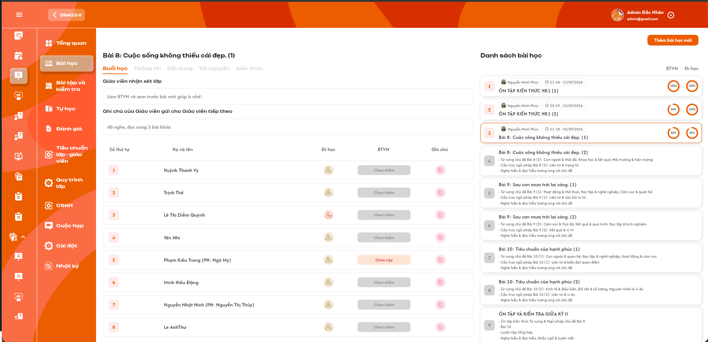
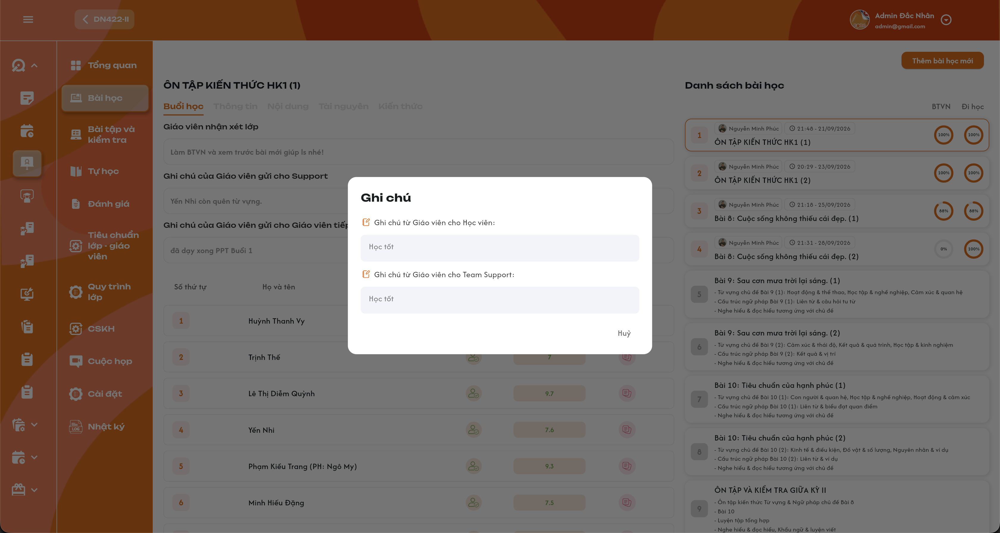
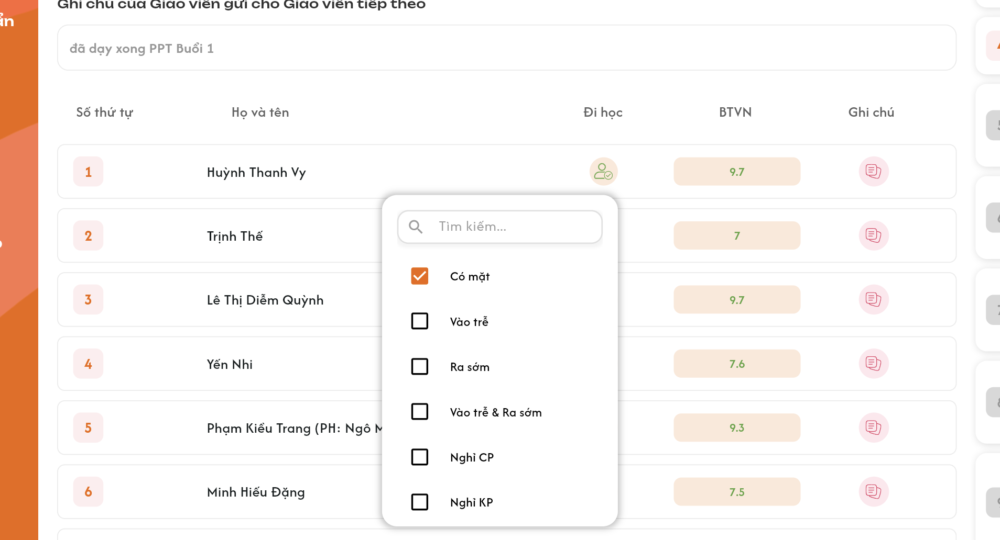
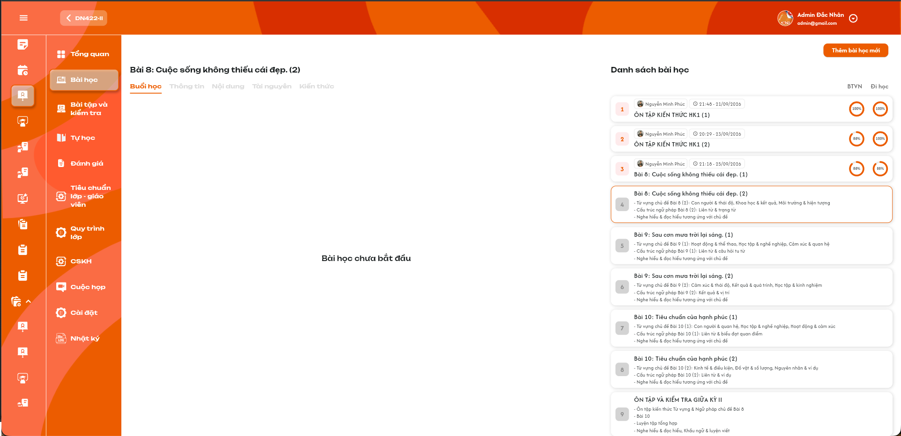
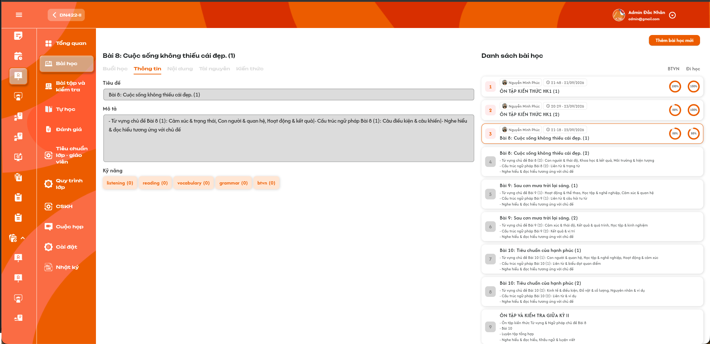
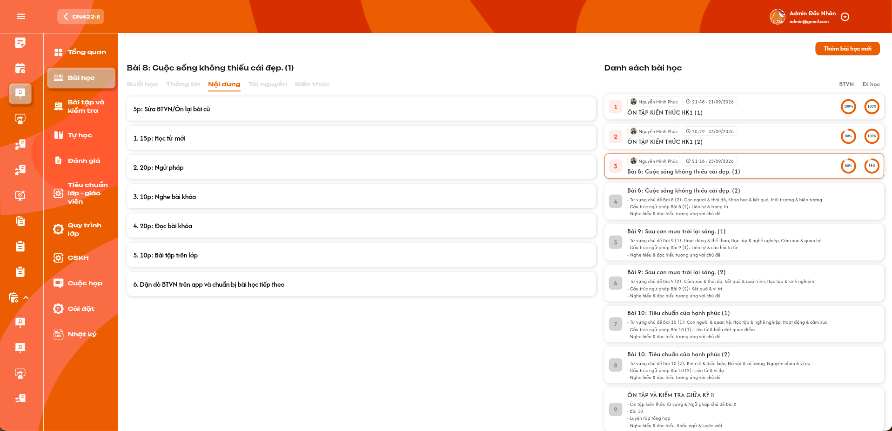
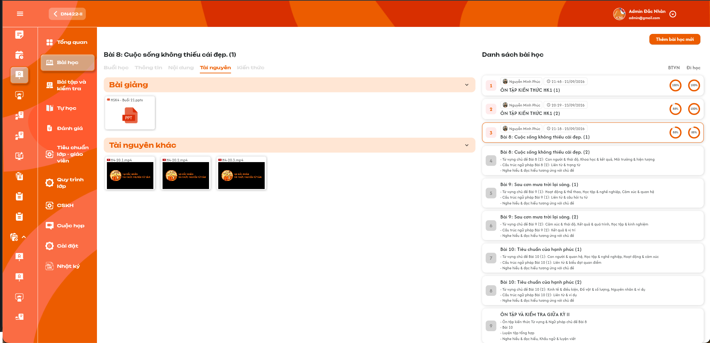
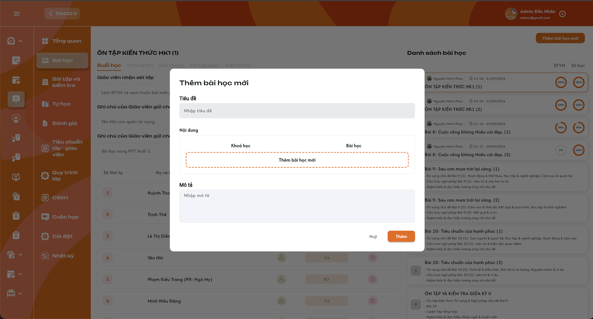
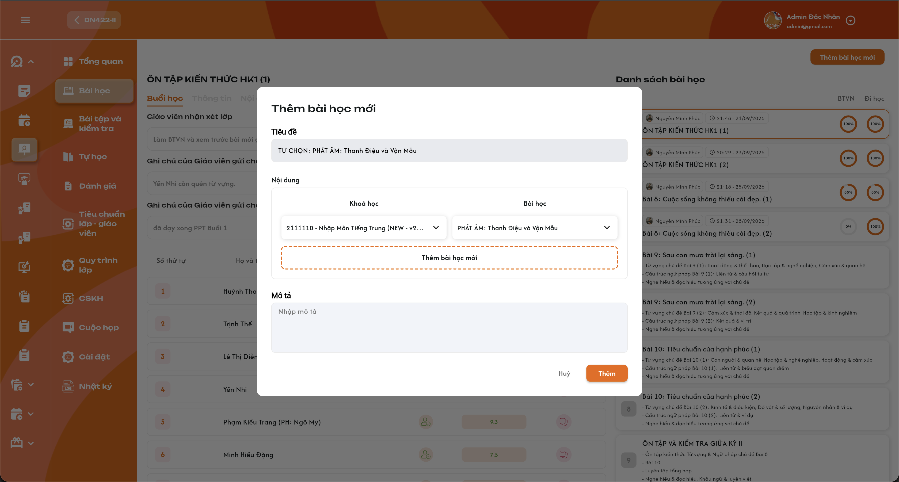

# Chi tiết lớp học — Menu Bài học

Đặc tả **Chi tiết lớp học → Bài học** theo UI ngày 28–29/09/2026 và các xác nhận mới. Định nghĩa bài, kỹ năng, nội dung và tài nguyên vẫn thuộc [Học kỳ — Tab Bài học](../../course_management/semester/lesson/lesson.md) của **Curriculum Development Handler**; tại menu lớp, dữ liệu nguồn chỉ đọc. Các thao tác được bổ sung là **thêm một hoặc nhiều bài vào lớp, mỗi bài chọn một khóa học/bài có sẵn** và **Admin/Class Handler/Support sửa điểm danh sai của học viên**. Click tài nguyên **tải xuống ngay**. % BTVN tính theo số học viên đã nộp; hai tỷ lệ chỉ tính **Đang học/Dự thính theo từng bài đã học**, giữ lịch sử khi học viên rời lớp ở bài sau, làm tròn **1 chữ số thập phân**. **Kiến Thức để trống** như phạm vi đã chốt.

## 1. UI

### Trang 1: ADM-LOP-030100 — Khung menu và Danh sách bài học




*Khung menu Bài học và danh sách bên phải — nhấn để xem ảnh gốc*

**Mô tả:**

- Vùng trái là bài đang chọn và các tab Buổi học / Thông tin / Nội dung / Tài nguyên / Kiến thức; vùng phải là Danh sách bài học.
- **Mặc định chọn bài đầu tiên theo thứ tự danh sách** khi mở menu. **Tải toàn bộ danh sách**, không phân trang/load-more; cuộn để xem hết.

**Giải thích field/thành phần:**

- `A01.01` **Card bài học**: Số thứ tự, tên bài; bài đã mở có giáo viên, mốc mở bài và vòng % BTVN/Đi học. Bài chưa bắt đầu có tên/mô tả, số thứ tự xám và chưa có chỉ số thực tế.
- `A01.02` **Chọn bài/tab**: Bấm card chọn bài, viền cam và tiêu đề bên trái đồng bộ; các tab chuyển bình thường trong bài đang chọn. Không tự mở/bắt đầu buổi hoặc sửa dữ liệu khi chuyển tab.
- `A01.03` **Thứ tự/danh sách**: Đọc đúng thứ tự nguồn đã gán cho lớp và toàn bộ các bài bổ sung. Không kéo-thả/sửa thứ tự từ UI chưa được đặc tả.
- `A01.04` **Giáo viên và mốc mở**: Giáo viên thực tế của buổi và mốc mở bài của lớp, dạng HH:mm - dd/MM/yyyy như ảnh; không lấy giờ nộp cá nhân hay sửa Curriculum.
- `A01.05` **Thêm bài học mới**: Có nút mở popup chọn Khóa học/Bài học nguồn, Tiêu đề và Mô tả theo ảnh mới. Đây là thêm vào lớp, không tạo định nghĩa Curriculum. Admin hoặc Class Handler/Support được add vào lớp được thêm.
- `A01.06` **Tải dữ liệu**: Loading/rỗng/lỗi riêng; lỗi có Thử lại. Response lớp/bài/tab cũ không ghi đè hiện tại. Không có bài thì không chọn bài đầu giả.

**Điểm cần lưu ý:**

- Định nghĩa Curriculum chỉ đọc; việc thêm bài lớp/sửa điểm danh mới không cấp quyền chỉnh mẫu, chấm BTVN hoặc upload/xóa tài nguyên.
- Nhận xét/bàn giao, điểm danh và bài nộp là dữ liệu buổi thực tế; Thông tin/Nội dung/Tài nguyên là định nghĩa bài nguồn được áp dụng. Không trộn hai nhóm.
- Mở tab/chọn bài/tải file không tự bắt đầu hay hoàn thành bài; không Toast CRUD cho chỉ xem.

### Trang 2: ADM-LOP-030100 — Tab Buổi học — Bài đã bắt đầu




*UI buổi học mới và popup ghi chú học viên — nhấn để xem ảnh gốc*

**Mô tả:**

Hiển thị dữ liệu buổi của lớp: nhận xét giáo viên, ghi chú cho Support, bàn giao giáo viên tiếp theo và từng học viên. Cho sửa điểm danh theo phần riêng; các nhận xét/ghi chú/điểm BTVN vẫn chỉ đọc.

**Giải thích field/thành phần:**

- `A02.01` **Giáo viên nhận xét lớp**: Nhận xét giáo viên cho cả lớp tại bài/buổi đang chọn, chỉ đọc.
- `A02.02` **Ghi chú của Giáo viên gửi cho Support**: Ghi chú giáo viên cho team hỗ trợ về buổi này, theo UI mới; chỉ đọc và tách riêng bàn giao giáo viên tiếp theo.
- `A02.03` **Ghi chú của Giáo viên gửi cho Giáo viên tiếp theo**: Nội dung bàn giao đúng bài/buổi, chỉ đọc.
- `A02.04` **Học viên**: Số thứ tự và Họ và tên theo dữ liệu buổi của lớp; không dùng tên làm khóa.
- `A02.05` **Đi học**: Icon điểm danh đúng học viên–bài/buổi theo bộ icon `Trạng thái đi học` ([ảnh](./images/attendance-status-icons.png); bảng ghép 7 trạng thái ở [Tổng quan — Bảng bài học](./class_detail_overview_requirements.md)); hover hiện tooltip tên trạng thái. Admin/Class Handler/Support được mở menu chọn trạng thái để sửa giáo viên điểm danh sai.
- `A02.06` **BTVN**: Chưa nộp / Chưa chấm / điểm đã chấm. Đã nộp chưa chấm hoặc đã chấm 0 vẫn là đã nộp, không dùng điểm KT; không chỉnh/chấm điểm tại menu này. Click trạng thái BTVN hoặc điểm **không mở chi tiết**, không điều hướng.
- `A02.07` **Ghi chú từng học viên**: Click icon mở popup Ghi chú có hai vùng Cho Học viên và Cho Team Support như UI. Chỉ đọc, không chỉnh ghi chú.

**Điểm cần lưu ý:**

- Mỗi dữ liệu gắn đúng lớp–bài–buổi–học viên; sửa điểm danh không đổi điểm BTVN, bài nộp, nhận xét hoặc ghi chú.
- Quyền sửa điểm danh là ngoại lệ được bổ sung rõ; không suy rộng thành quyền chấm BTVN hay thay nội dung Curriculum.
- Nộp BTVN không chứng minh đi học; điểm danh không quyết định học viên đã làm BTVN.

### Trang 3: Popup Ghi chú từng học viên


*Popup Ghi chú: Cho Học viên và Cho Team Support — nhấn để xem ảnh gốc*

**Mô tả:**

Click icon Ghi chú ở dòng học viên để xem popup `Ghi chú`, theo ảnh mới. Admin/Class Handler/Support trong phạm vi lớp được xem cả hai vùng, không chỉnh sửa.

**Giải thích field/thành phần:**

- `A03.01` **Ghi chú từ Giáo viên cho Học viên**: Vùng chỉ đọc, đúng ghi chú giáo viên dành cho học viên ở bài/buổi đó.
- `A03.02` **Ghi chú từ Giáo viên cho Team Support**: Vùng chỉ đọc, đúng ghi chú nội bộ giáo viên cho Team Support của cùng học viên/bài/buổi.
- `A03.03` **Hủy**: Đóng popup, không lưu/thay đổi ghi chú; không Toast CRUD.
- `A03.04` **Dữ liệu trống/lỗi**: Mỗi vùng trống hiển thị đúng dữ liệu, không tự chép vùng kia; tải lỗi cho thử lại, không biến lỗi thành ghi chú trống.

**Điểm cần lưu ý:**

- Popup dùng định danh lớp, học viên và bài/buổi; không chỉ dùng student_id rồi trả ghi chú bài khác.
- Không dùng ghi chú menu Nhật ký, ghi chú cài đặt hay ghi chú chung cho lớp thay popup học viên.

### Trang 4: Sửa điểm danh cho học viên


*Menu chỉnh điểm danh theo UI mới — nhấn để xem ảnh gốc*

**Mô tả:**

**Admin, Class Handler và Support** có quyền trên lớp được sửa điểm danh trong trường hợp giáo viên điểm danh sai. Class Handler/Support phải được add/phân công vào lớp theo quyền lớp đã dùng; kiểm tra lại khi lưu.

**Giải thích field/thành phần:**

- `A04.01` **Menu điểm danh**: Click icon Đi học của dòng học viên mở menu như UI, có search và trạng thái hiện tại được chọn sẵn.
- `A04.02` **Lựa chọn**: Có mặt; Vào trễ; Ra sớm; Vào trễ & Ra sớm; Nghỉ CP; Nghỉ KP. Tương ứng source: Nghỉ có phép/Nghỉ không phép. Chọn **một** trạng thái, không tạo tổ hợp nhiều checkbox như Có mặt + Nghỉ KP.
- `A04.03` **Chưa điểm danh**: Giữ trạng thái chưa có điểm danh theo dữ liệu nguồn. UI mới không có lựa chọn reset Chưa điểm danh; không tự thêm thao tác reset.
- `A04.04` **Search trạng thái**: Tìm theo tên lựa chọn trong menu; không phải search học viên/toàn bộ bài. Thời điểm kích hoạt search còn cần chốt.
- `A04.05` **Lưu**: Chọn trạng thái mới gửi cập nhật đúng học viên/buổi; khóa chống lặp, giữ trạng thái đã lưu khi lỗi. Chọn lại trạng thái hiện tại không tạo cập nhật/Toast thừa.
- `A04.06` **Kết quả**: Thành công đổi icon/tooltip sang trạng thái mới theo bộ `Trạng thái đi học` và cập nhật % Đi học của đúng bài, một Toast `Cập nhật điểm danh thành công.`; lỗi giữ/trả trạng thái cũ, một Toast lỗi.
- `A04.07` **Dấu vết sửa**: Ghi nhận người sửa, thời điểm và trạng thái trước/sau; không ghi đè danh tính giáo viên đã mở/dạy buổi.

**Điểm cần lưu ý:**

- Backend kiểm tra role, phạm vi lớp, buổi và học viên mỗi lần sửa; được xem ảnh/icon không tự cấp quyền sửa ngoài lớp.
- Nghỉ CP và Nghỉ KP không tính vào số đi học, vẫn thuộc mẫu số nếu học viên Đang học/Dự thính; sửa từ Có mặt sang Nghỉ làm giảm % Đi học, không đổi % BTVN.
- Không mở điểm danh cho bài chưa bắt đầu hoặc dòng học viên/buổi không tồn tại.

### Trang 5: ADM-LOP-030100 — Tab Buổi học — Bài học chưa bắt đầu




*Buổi học chưa bắt đầu — nhấn để xem ảnh gốc*

**Mô tả:**

Chọn bài chưa bắt đầu hiển thị `Bài học chưa bắt đầu` ở giữa vùng trái như ảnh cũ; không coi đây là lỗi tải.

**Giải thích field/thành phần:**

- `A05.01` **Thông báo**: Chính xác Bài học chưa bắt đầu, theo trạng thái bài/buổi nguồn của lớp; không dựa vào số thứ tự hoặc giờ máy.
- `A05.02` **Dữ liệu buổi**: Không dựng nhận xét/bảng điểm danh/BTVN/0% giả khi chưa có buổi.
- `A05.03` **Các tab khác**: Vẫn xem Thông tin/Nội dung và tải Tài nguyên định nghĩa nếu có; Kiến thức trống.
- `A05.04` **Quyền thao tác**: Không tự bắt đầu/hoàn thành bài khi xem hoặc tải file; chưa có dòng điểm danh để sửa.

**Điểm cần lưu ý:**

- Bài chưa bắt đầu khác bài đã bắt đầu có 0% BTVN hợp lệ và khác lỗi request.

### Trang 6: ADM-LOP-030200 — Tab Thông tin




*Thông tin bài học chỉ đọc — nhấn để xem ảnh gốc*

**Mô tả:** Hiển thị dữ liệu định nghĩa bài học từ Curriculum Development Handler, không cho Admin / Class Handler / Support chỉnh tại menu lớp.

**Giải thích field/thành phần:**

- `A06.01` **Tiêu đề**: Tiêu đề bài từ nguồn, khớp tên bài bên trái/card; ô xám chỉ đọc như ảnh.
- `A06.02` **Mô tả**: Hiển thị mô tả đang áp dụng cho bài lớp, giữ văn bản/xuống dòng. Bài thêm mới có Mô tả được nhập khi thêm; dữ liệu này lưu cho lớp, không sửa Mô tả Curriculum. Không dùng nhận xét buổi thay thế.
- `A06.03` **Kỹ năng**: Các tag kỹ năng đã gắn ở nguồn, ví dụ listening, reading, vocabulary, grammar, btvn. Không fix cứng chỉ 5 tag ví dụ; giá trị và số trong ngoặc do Curriculum Development Handler thiết lập, hiển thị đúng nguồn.
- `A06.04` **Quyền thao tác**: Không nút + gắn kỹ năng, không chỉnh tên/mô tả, không Lưu/Xóa như popup quản trị Curriculum.

**Điểm cần lưu ý:**

- Tên tag và số trong ngoặc **do Curriculum Development Handler thiết lập**; hiển thị nguyên giá trị nguồn, không tính lại theo học viên lớp hoặc tỷ lệ BTVN.
- Khi chưa có kỹ năng/mô tả, hiển thị trạng thái trống theo dữ liệu thật, không thêm tag mẫu. Bấm tag không tự tạo flow chỉnh hoặc điều hướng khi chưa có đặc tả.

### Trang 7: ADM-LOP-030300 — Tab Nội dung




*Các khối nội dung theo thứ tự nguồn — nhấn để xem ảnh gốc*

**Mô tả:** Hiển thị các khối nội dung/kế hoạch đã định nghĩa cho bài học, theo thứ tự nguồn như ảnh.

**Giải thích field/thành phần:**

- `A07.01` **Khối nội dung**: Card văn bản, ví dụ 5p Sửa BTVN/Ôn lại bài cũ, Học từ mới, Ngữ pháp, Nghe/Đọc bài khóa, Bài tập trên lớp và dặn dò. Lấy dữ liệu thật, không fix số lượng/dòng mẫu.
- `A07.02` **Thứ tự khối**: Theo thứ tự đã lưu ở chức năng nguồn; số thứ tự/thời lượng trong văn bản giữ đúng dữ liệu. Admin / Class Handler / Support không kéo-thả.
- `A07.03` **Dữ liệu chi tiết**: Hiển thị phần nội dung đã định nghĩa tương ứng, chỉ đọc. Không chuyển các loại action trong source thành thao tác thực hiện/đánh giá/lưu mới ở menu Admin / Class Handler / Support.
- `A07.04` **Thời lượng**: Thời lượng kế hoạch trong nội dung không phải thời gian thực tế học trên app hoặc thời gian buổi đã dạy.

**Điểm cần lưu ý:**

- Nguồn bài học có action board; menu Admin / Class Handler / Support hiển thị theo UI hiện tại, không thêm các form tạo/sửa/thực thi action của role Curriculum Development Handler.
- Không tự tính tổng thời gian hoặc % hoàn thành khối khi ảnh/yêu cầu chưa cung cấp. Nội dung trống phải phản ánh đúng nguồn.

### Trang 8: ADM-LOP-030400 — Tab Tài nguyên — Click tải xuống ngay




*Bài giảng/Tài nguyên khác: click file để tải ngay — nhấn để xem ảnh gốc*

**Mô tả:**

Hiển thị hai nhóm Bài giảng và Tài nguyên khác. **Click một tài nguyên sẽ tải trực tiếp tài nguyên đó**, không mở viewer/xem trước rồi yêu cầu click Tải xuống lần nữa.

**Giải thích field/thành phần:**

- `A08.01` **Bài giảng/Tài nguyên khác**: Nhóm theo dữ liệu bài nguồn áp dụng; các loại tải hiện tại là **video, PowerPoint (PPT), tài liệu (Docs) và Excel**. Tên, icon/thumbnail theo file thật.
- `A08.02` **Header/chevron**: Mở/thu gọn cùng nhóm; không tải cả nhóm và không đổi dữ liệu.
- `A08.03` **Card tài nguyên**: Click tên/card tải đúng file/tài nguyên đã chọn với tên/định dạng/nội dung gốc. Video cũng tải ngay, không tự mở player.
- `A08.04` **Tải lỗi/thiếu quyền**: Báo đúng lý do, cho thử lại phù hợp; không trả file bài khác hoặc thumbnail thay file.
- `A08.05` **Nguồn tài nguyên**: Không upload/xóa/gỡ/chỉnh nguồn. Phạm vi hiện tại chỉ có video/PPT/Docs/Excel dạng file tải; không có viewer hoặc luồng link ngoài không có file.

**Điểm cần lưu ý:**

- Đây là hành vi mới thay cho mô tả preview của bản trước; không giữ flow xem trước hoặc yêu cầu nút download bổ sung.
- Kiểm tra quyền lớp/bài/tài nguyên khi tải trực tiếp URL/request. Tải file không thay tiến độ, điểm danh hay bắt đầu bài.

### Trang 9: ADM-LOP-030100 — Chỉ số % BTVN và Đi học theo bài


**Mô tả:**

**Tính theo số học viên**, không lấy trung bình % số bài nộp của từng người và không dùng điểm BTVN. Tập được tính chỉ có học viên **Đang học hoặc Dự thính theo trạng thái tham gia của từng bài/buổi**, không lọc ngược toàn bộ lịch sử bằng trạng thái lớp hiện tại.

**Giải thích field/thành phần:**

- `A09.01` **Tập tính và 2 mẫu số**: **N_BTVN** là số học viên Đang học/Dự thính được áp dụng cho chính bài/buổi đang xem; **N_Đi_học** là số người trong tập đó đã có điểm danh, **loại Chưa điểm danh**. Trạng thái ngoài Đang học/Dự thính tại bài đó không đóng góp vào tử/mẫu. Thay đổi trạng thái ở bài sau không loại học viên khỏi các bài trước đã học.
- `A09.02` **% BTVN**: `Số học viên Đang học/Dự thính đã nộp BTVN của bài / N_BTVN × 100`. Ví dụ 10 học viên hợp lệ, 7 đã nộp, 3 chưa nộp → **70.0%**. Nộp chưa chấm/điểm 0 vẫn tính đã nộp; một học viên có nhiều bản nộp chỉ tính một người.
- `A09.03` **% Đi học**: `Số học viên Đang học/Dự thính được tính đi học tại buổi / N_Đi_học × 100`. Có mặt, Vào trễ, Ra sớm, Vào trễ & Ra sớm tính đi học. **Nghỉ CP/KP không tính tử số nhưng vẫn trong mẫu số** nếu thuộc tập N_Đi_học. **Chưa điểm danh loại khỏi cả tử số và mẫu số Đi học**; không tự tính là vắng.
- `A09.04` **Làm tròn**: Chỉ làm tròn tỷ lệ cuối đến **1 chữ số thập phân**, ví dụ 2/3 → 66.7%; không làm tròn từng đóng góp rồi cộng.
- `A09.05` **Không có mẫu số**: Mỗi chỉ số dùng mẫu số riêng: bằng 0 thì để trống, không chia 0. Có mẫu số > 0 mà tử số = 0 thì 0.0% hợp lệ. Tất cả Chưa điểm danh làm Đi học trống, không có nghĩa BTVN cũng trống nếu N_BTVN > 0.
- `A09.06` **Bài chưa bắt đầu**: Không tạo vòng tỷ lệ khi chưa có buổi như ảnh. Bài đã bắt đầu chưa nộp vẫn có thể có 0.0% BTVN đúng dữ liệu.
- `A09.07` **Cập nhật sau sửa**: Sửa điểm danh thành công tính lại % Đi học đúng bài; không tự đổi tỷ lệ BTVN. Bài nộp mới được ghi nhận tính lại BTVN theo đúng học viên/bài.

**Điểm cần lưu ý:**

- Không dùng sĩ số KPI có điều kiện học phí, tỷ lệ toàn khóa, điểm trung bình, số lần nộp hoặc số bài thành công làm thay cho số học viên.
- Nghỉ CP/KP bị giảm % Đi học vì không có trong số đi học, không được loại khỏi mẫu số để biến thành 100%. Chưa điểm danh loại khỏi Đi học nhưng vẫn thuộc mẫu số BTVN nếu Đang học/Dự thính.
- Tử số và mẫu số áp dụng cùng tập Đang học/Dự thính của từng bài. Ví dụ học viên đã học 5 bài, rời lớp từ bài 6: **5 bài trước vẫn tính học viên đó vào tỷ lệ**; bài 6 và các bài sau không tính người đã rời lớp. Giữ tập lịch sử của từng bài, không loại ngược khi trạng thái hiện tại đổi.

### Trang 10: Popup Thêm bài học mới vào lớp


*Thêm bài học mới — Popup chưa chọn nguồn — nhấn để xem ảnh gốc*



*Thêm bài học mới — Chọn Khóa học và Bài học — nhấn để xem ảnh gốc*

**Mô tả:**

Nút Thêm bài học mới mở popup như 2 ảnh mới. Có thể thêm **một hoặc nhiều bài học trong một lần**; mỗi bài đều **chọn Khóa học rồi Bài học đã define**. Tiêu đề tự lấy từ bài được chọn và không chỉnh sửa; chỉ Mô tả được nhập/sửa. Thao tác thêm vào lớp dùng nội dung nguồn, không tạo/sửa bài Curriculum.

**Giải thích field/thành phần:**

- `A10.01` **Tiêu đề**: Tự hiển thị tiêu đề của bài nguồn sau khi chọn Khóa học/Bài học, **chỉ đọc, không được sửa**. Đổi bài thì cập nhật tiêu đề theo bài mới; mỗi bài được thêm giữ tiêu đề từ nguồn tương ứng.
- `A10.02` **Nội dung**: Một hoặc nhiều dòng chọn bài. Mỗi dòng **chọn một khóa học**, sau đó **hiển thị dropdown bài học thuộc khóa đó và chọn một bài học**. Nút nét đứt Thêm bài học mới thêm dòng chọn tiếp; mỗi dòng phải có cặp khóa–bài riêng, không kế thừa ngầm lựa chọn dòng trước.
- `A10.03` **Khóa học**: Chọn từ danh sách khóa học đã define được phép dùng. Không nhập tên mới tự do, không bắt buộc chỉ khóa học đang gắn với lớp khi user chưa quy định.
- `A10.04` **Bài học**: Danh sách bài nguồn thuộc đúng khóa học cùng dòng. Chọn khóa học trước; đổi khóa học phải xóa/chọn lại bài không còn thuộc khóa học mới.
- `A10.05` **Mô tả**: Vùng Nhập mô tả theo ảnh, **được chỉnh sửa**. Quy tắc bắt buộc/giới hạn, tự điền và phạm vi áp dụng mô tả khi thêm nhiều bài còn cần chốt.
- `A10.06` **Hủy**: Đóng popup, không thêm vào lớp/đổi nguồn/mở buổi/Toast CRUD.
- `A10.07` **Thêm**: Kiểm tra quyền, các cặp khóa học–bài hợp lệ và validation metadata đã chốt; chống gửi lặp. Thành công cập nhật full danh sách và Toast Thêm bài học thành công.; lỗi giữ input/không thêm một phần.

**Điểm cần lưu ý:**

- Không đưa action board, form thêm file/kỹ năng hay tạo bài nguồn vào popup này. Thêm vào lớp không làm thay title/content của bài trong khóa học nguồn.
- Tạo thành công chưa tự bắt đầu buổi/điểm danh/chấm bài. Thứ tự đặt bài bổ sung, trùng bài nguồn và ảnh hưởng lịch/số buổi cần chốt khi chưa có rule.
- Admin/Class Handler/Support trong lớp được thêm một hoặc nhiều bài. **Mỗi dòng tương ứng một bài được thêm**, luôn chọn đủ khóa và bài nguồn; không gộp nội dung nhiều bài nguồn thành một bài hoặc sửa tiêu đề nguồn. Kiểm tra toàn bộ dòng trước khi lưu, không bỏ qua dòng thiếu lựa chọn.

### Trang 11: ADM-LOP-030500 — Tab Kiến thức — Để trống


**Mô tả:** Tab Kiến thức hiện chưa có UI/định nghĩa áp dụng cho menu Admin / Class Handler / Support nên giữ tab và vùng nội dung trống theo yêu cầu người dùng.

**Giải thích field/thành phần:**

- `A11.01` **Nhãn tab**: Hiển thị `Kiến thức` trong nhóm tab như ảnh.
- `A11.02` **Vùng nội dung**: Khi chọn, để trống; không danh sách/chi tiết/badge/link/thao tác gắn kiến thức hoặc nội dung mẫu.
- `A11.03` **Nguồn kiến thức**: Không đưa UI Kiến thức/Kỹ năng của Curriculum vào menu Admin / Class Handler / Support trong phạm vi hiện tại, dù tài liệu nguồn đã có thiết kế riêng.

**Điểm cần lưu ý:**

- Trống là trạng thái được yêu cầu, không phải lỗi tải hoặc chưa làm BTVN. Không hiển thị spinner/lỗi/Toast giả để thay vùng trống.
- Chuyển vào tab vẫn giữ bài đang chọn và danh sách bên phải, không tạo/đổi liên kết kiến thức. Feature Kiến thức sẽ được đặc tả sau khi có UI và định nghĩa áp dụng.

### Trang 12: Toast phản hồi CRUD


*Toast dùng chung — nhấn để xem ảnh gốc*

**Mô tả:**

Phản hồi cho sửa điểm danh và thêm bài vào lớp, theo component Toast dùng chung. Xem ghi chú/chọn bài/tab/tải tài nguyên/Hủy không có Toast CRUD.

**Giải thích field/thành phần:**

- `A12.01` **Thành Công**: Cập nhật điểm danh thành công. / Thêm bài học thành công. sau backend xác nhận lưu.
- `A12.02` **Có Lỗi Xảy Ra**: Không thể cập nhật điểm danh. Vui lòng thử lại. / Không thể thêm bài học. Vui lòng thử lại. khi lưu lỗi.
- `A12.03` **Cảnh Báo**: Vui lòng chọn đầy đủ khóa học và bài học. hoặc lỗi field theo validation; quyền không hợp lệ nêu không có quyền thao tác trên lớp.
- `A12.04` **Thông Báo**: Chỉ dùng khi nguồn có trạng thái đang đồng bộ thực tế; không báo thành công sớm.
- `A12.05` **Component**: Icon/màu/tiêu đề, vị trí/thời lượng tự đóng/nút × theo UI Toast chung. Đóng Toast không hoàn tác dữ liệu.

**Điểm cần lưu ý:**

- Mỗi thao tác logic có một Toast kết quả; callback/bấm lặp không nhân đôi. Lỗi field vẫn hiển thị riêng, không chỉ Toast.
- Sửa điểm danh cập nhật % Đi học sau lưu; Toast tạo bài không báo đã mở/bắt đầu bài.

---

## 2. Yêu cầu

### 2.1. Flow chính

**Flow 1 / REQ01 / REQ08: Mở menu và chọn bài**

```text
Admin/Class Handler/Support có quyền lớp mở Bài học
      → Tải toàn bộ danh sách theo thứ tự; không phân trang/load-more
      → Mặc định chọn bài đầu tiên khi có bài
      → Chọn card/tab: cập nhật đúng lớp–bài–buổi, không tự bắt đầu bài
```

**Flow 2 / REQ02 / REQ07: Xem Buổi học**

```text
Chọn Buổi học
      → Chưa bắt đầu: Bài học chưa bắt đầu, không dựng dữ liệu giả
      → Đã bắt đầu: nhận xét lớp, ghi chú Support, bàn giao giáo viên tiếp theo
      → Học viên: Đi học / BTVN / Ghi chú đúng từng dòng
      → BTVN đã nộp chưa chấm hoặc điểm 0 vẫn tính đã nộp
      → Điểm/nhận xét/ghi chú chỉ đọc; sửa điểm danh theo Flow 7
```

**Flow 3 / REQ03 / REQ04 / REQ09: Xem định nghĩa**

```text
Chọn Thông tin/Nội dung → Hiển thị định nghĩa bài nguồn đang áp dụng, chỉ đọc
      → Không sửa mẫu/kỹ năng/action hoặc upload/gỡ file
      → Chọn Kiến thức: giữ bài hiện tại, vùng nội dung trống
```

**Flow 4 / REQ05 / REQ08: Click tài nguyên tải ngay**

```text
Mở Tài nguyên → Chọn card/tên file Bài giảng hoặc Tài nguyên khác
      → Kiểm tra quyền lớp–bài–file
      → Tải trực tiếp đúng file gốc, không preview/player hoặc bước click download thêm
      → Lỗi: báo đúng lý do; không trả file khác/thumbnail thay thế
```

**Flow 5 / REQ06 / REQ08: Tính tỷ lệ theo số học viên**

```text
Xác định đúng lớp–bài–buổi và tập Đang học/Dự thính của chính bài đó
      → Học viên rời lớp từ bài 6 vẫn tính trong 5 bài trước đã học; không lọc ngược lịch sử
      → BTVN: N_BTVN = tất cả Đang học/Dự thính; đếm người đã nộp duy nhất / N_BTVN × 100
      → Đi học: N_Đi_học loại Chưa điểm danh; đếm người đi học / N_Đi_học × 100
      → Nghỉ CP/KP không tính tử Đi học nhưng còn trong mẫu; không loại khỏi BTVN
      → Làm tròn kết quả cuối 1 chữ số thập phân
      → Mỗi tỷ lệ: mẫu số > 0/tử = 0 là 0.0%; mẫu số = 0 để trống, không chia 0
      → Bài chưa bắt đầu không dựng vòng chỉ số; không dùng tỷ lệ toàn khóa
```

**Flow 6 / REQ10 / REQ08: Xem ghi chú học viên**

```text
Click Ghi chú tại học viên/bài/buổi
      → Kiểm tra quyền/ngữ cảnh và mở popup Ghi chú
      → Hai vùng: Cho Học viên / Cho Team Support, đúng nguồn và chỉ đọc
      → Hủy: đóng, không lưu/Toast CRUD
```

**Flow 7 / REQ11 / REQ13: Sửa điểm danh sai**

```text
Admin/Class Handler/Support trong phạm vi lớp click Đi học của học viên
      → Menu có search, trạng thái hiện tại và 6 lựa chọn theo UI
      → Chọn một trạng thái mới, backend kiểm tra lại quyền/ngữ cảnh/giá trị; chống lặp
      → Thành công: lưu trước/sau/người sửa/thời điểm, cập nhật icon/% Đi học đúng bài
      → Toast Cập nhật điểm danh thành công.
      → Thất bại: giữ/trả trạng thái cũ, một Toast Không thể cập nhật điểm danh. Vui lòng thử lại.
      → Không đổi điểm/nhận xét/bài nộp hoặc mốc giáo viên mở buổi
```

**Flow 8 / REQ12 / REQ13: Thêm bài nguồn vào lớp**

```text
Admin hoặc Class Handler/Support được add vào lớp bấm Thêm bài học mới
      → Popup Tiêu đề / Nội dung (Khóa học, Bài học) / Mô tả
      → Chọn một khóa rồi một bài thuộc khóa đó; tiêu đề tự lấy từ nguồn, không được sửa
      → Có thể thêm dòng để chọn bài tiếp, mỗi dòng chọn đủ cặp khóa–bài riêng
      → Đổi khóa loại bài không còn hợp lệ; đổi bài cập nhật tiêu đề; chỉ Mô tả được sửa
      → Hủy: không lưu/Toast; Thêm: kiểm tra dữ liệu/quyền, chống gửi lặp
      → Thành công: thêm bài lớp, cập nhật full danh sách, Toast Thêm bài học thành công.
      → Lỗi: không thêm một phần/đổi source; giữ input, một Toast lỗi
      → Thêm một hoặc nhiều bài đã chọn vào lớp, mỗi dòng là một bài; không tự bắt đầu buổi
      → Vị trí bài bổ sung và ảnh hưởng lịch/số buổi cần chốt
```

### 2.2. Ngoại lệ

- **EX01:** Thử chỉnh định nghĩa Curriculum/nhận xét/ghi chú/điểm BTVN, upload/xóa file → từ chối; quyền thêm bài lớp/sửa điểm danh không cấp các quyền này.
- **EX02:** Tải lỗi → lỗi/Thử lại, không coi là trống/chưa bắt đầu/0%.
- **EX03:** Response thuộc lớp/bài/buổi/tab cũ → không ghi đè giao diện hiện tại hoặc lưu dữ liệu sang ngữ cảnh mới.
- **EX04:** File mất/tải lỗi → báo đúng lý do, không trả file khác hoặc thumbnail; không chuyển sang viewer để thay yêu cầu tải trực tiếp.
- **EX05:** Thiếu role/phạm vi lớp/bài/buổi/học viên/file → từ chối cả UI/request trực tiếp, không lộ dữ liệu hoặc lưu ngoài quyền.
- **EX06:** Mẫu số của từng chỉ số = 0 → để chỉ số đó trống, không chia 0; > 0/tử = 0 là 0.0% hợp lệ. Tất cả Chưa điểm danh không bị biến thành vắng/0% Đi học.
- **EX07:** Sửa điểm danh lỗi/lặp/giá trị sai → không đổi một phần; giữ trạng thái cũ, một Toast lỗi, chỉ lưu trạng thái hợp lệ.
- **EX08:** Cặp khóa học–bài không hợp lệ hoặc field chưa đúng validation đã chốt → từ chối thêm, báo field/Toast Cảnh Báo; không tạo bài nguồn mới.
- **EX09:** Thêm bài lỗi/lặp → không nhân bản hoặc thêm một phần, giữ input phù hợp và một Toast kết quả.

### 2.3. Yêu cầu khác

| Mã | Tên yêu cầu | Mô tả |
|---|---|---|
| REQ01 | Danh sách | Mặc định bài đầu, tải full không phân trang/load-more; card/tiêu đề/tab đúng lớp–bài. Metadata giáo viên/mốc mở từ buổi thực tế. |
| REQ02 | Buổi học | Nhận xét, ghi chú cho Support, bàn giao giáo viên tiếp theo và học viên đúng nguồn; chưa bắt đầu có thông báo. Điểm BTVN/ghi chú/nhận xét vẫn chỉ đọc; click BTVN/điểm không mở chi tiết. Trạng thái điểm danh được sửa theo REQ11. |
| REQ03 | Thông tin | Tiêu đề/Kỹ năng từ bài nguồn và Mô tả đang áp dụng cho bài lớp chỉ đọc tại tab; Mô tả nhập lúc thêm không thay Mô tả Curriculum. Số trong ngoặc tag do Curriculum Development Handler thiết lập, hiển thị nguyên giá trị nguồn. |
| REQ04 | Nội dung | Khối/thứ tự nguồn chỉ đọc; không thực thi/sửa action. Thời lượng kế hoạch không phải thời gian app/buổi thực tế. |
| REQ05 | Tài nguyên | Video/PPT/Docs/Excel thuộc Bài giảng/Tài nguyên khác; click tải trực tiếp file gốc; không viewer/player/xem trước hoặc click download thêm. Header thu gọn không tải cả nhóm, không upload/xóa nguồn. |
| REQ06 | Tỷ lệ | Chỉ Đang học/Dự thính của chính bài/buổi. Rời lớp từ bài 6 không loại học viên khỏi 5 bài trước đã học; không lọc ngược lịch sử theo trạng thái lớp hiện tại. N_BTVN gồm tất cả người trong tập này; BTVN = số người nộp duy nhất/N_BTVN × 100, 7/10 = 70.0%, không đợi chấm/đạt điểm. N_Đi_học chỉ gồm người đã điểm danh; loại Chưa điểm danh khỏi tử/mẫu. Đi học = số Có mặt/Trễ/Sớm/Trễ & Sớm/N_Đi_học × 100; Nghỉ CP/KP còn trong mẫu nhưng không trong tử. Làm tròn cuối 1 chữ số thập phân. Mẫu số = 0 để chỉ số đó trống, > 0/tử = 0 là 0.0%. |
| REQ07 | Ranh giới quyền | Định nghĩa bài/kỹ năng/nội dung/tài nguyên do Curriculum Development Handler quản lý ở chức năng riêng. Menu lớp chỉ đọc nguồn, bổ sung chọn bài nguồn vào lớp và sửa điểm danh; không chấm BTVN hay sửa ghi chú/nhận xét. |
| REQ08 | Phạm vi | Kiểm tra role/phân công lớp và liên kết nội bộ lớp–bài–buổi–học viên–file/cặp khóa–bài; không ghép theo tên/thứ tự. Không trộn dữ liệu khi đổi ngữ cảnh, tải file trực tiếp cũng kiểm tra quyền. |
| REQ09 | Kiến thức | Giữ tab nhưng vùng nội dung trống; không đưa UI quản trị kiến thức/kỹ năng nguồn vào phạm vi hiện tại. |
| REQ10 | Ghi chú học viên | Click icon mở popup có hai vùng Cho Học viên/Cho Team Support, Admin/Class Handler/Support trong lớp được xem, không sửa; Hủy chỉ đóng. |
| REQ11 | Sửa điểm danh | Cột Đi học hiển thị bộ icon `Trạng thái đi học` kèm tooltip tên trạng thái. Admin/Class Handler/Support có quyền lớp chọn một trong 6 trạng thái UI để sửa điểm danh sai; lưu đúng dòng, có trước/sau/người sửa/thời điểm, cập nhật Đi học sau thành công. Không đổi bài nộp/điểm/nhận xét/giáo viên buổi, không tự thêm reset Chưa điểm danh. |
| REQ12 | Thêm bài lớp | Admin/Class Handler/Support trong lớp thêm một hoặc nhiều bài bằng popup. Mỗi dòng chọn một khóa rồi một bài thuộc khóa đó; tiêu đề tự lấy đúng bài nguồn và không sửa, chỉ Mô tả được chỉnh. Mỗi dòng thêm một bài lớp, không tạo định nghĩa Curriculum. Validate tất cả dòng, lưu chống lặp và cập nhật danh sách, chưa bắt đầu buổi. |
| REQ13 | Toast | Thêm bài/sửa điểm danh có một Toast kết quả sau validation/backend; lỗi giữ input/trạng thái cũ. Chỉ xem/chọn bài/tab/xem ghi chú/Hủy/tải file không Toast CRUD. |

### 2.4. Ràng buộc

#### Quyền

| Role/Phạm vi | Xem bài và nguồn định nghĩa | Tải tài nguyên | Xem 2 vùng Ghi chú | Sửa điểm danh | Thêm bài học vào lớp | Sửa nguồn/nhận xét/ghi chú/điểm BTVN |
|---|:---:|:---:|:---:|:---:|:---:|:---:|
| Admin trong phạm vi quản trị | ✅ | ✅ | ✅ | ✅ | ✅ | ❌ |
| Class Handler được add/phân công vào lớp | ✅ | ✅ | ✅ | ✅ | ✅ | ❌ |
| Support được add/phân công vào lớp | ✅ | ✅ | ✅ | ✅ | ✅ | ❌ |
| User thiếu quyền lớp/thao tác | ❌ | ❌ | ❌ | ❌ | ❌ | ❌ |

- Admin và Class Handler/Support được add vào lớp được Thêm bài học mới; dùng cùng kiểm tra phạm vi lớp như sửa điểm danh.
- Curriculum Development Handler quản lý định nghĩa ở [function bài học nguồn](../../course_management/semester/lesson/lesson.md); thêm bài lớp không thay quyền hay dữ liệu source.
- Teacher và các role khác giữ quyền ở chức năng riêng, không tự mở rộng quyền từ bảng này. Trong phạm vi menu này, quyền sửa điểm danh không phải quyền chấm BTVN/KT.

#### Ràng buộc khác

**Phạm vi dữ liệu**

- Nhận xét/ghi chú học viên/điểm danh/bài nộp gắn đúng lớp–bài–buổi–học viên. Định nghĩa nội dung/tài nguyên giữ liên kết nguồn khóa–bài được áp dụng.
- Click xem/tab/tải không tự mở/hoàn thành buổi. Thêm bài lớp cũng chưa làm bắt đầu buổi hoặc phát sinh điểm danh giả.
- Hai tỷ lệ dùng tập Đang học/Dự thính theo từng bài; rời lớp ở bài sau không xóa đóng góp ở bài trước đã học. Không áp dụng công thức Điểm BTVN lịch sử hay KPI học phí để thay tập tính.
- Kiến thức trống theo yêu cầu hiện tại dù source có UI riêng; việc chỉnh source chỉ thuộc Curriculum Development Handler.

---

## 3. Testcase

### Feature: Chi tiết lớp học — Menu Bài học

| Tên testcase | Priority | Scenario | Role | Pre-condition | Given/When/Then | Expected Result |
|---|---|---|---|---|---|---|
| Case 1: Mặc định bài đầu và tải full | High · Smoke | Flow 1 / REQ01 | Admin / Class Handler / Support trong phạm vi lớp | Lớp có hơn 20 bài theo thứ tự nguồn | **Given** mở menu lần đầu<br>**When** tải danh sách<br>**Then** chọn bài đầu và có đầy đủ bài khi cuộn | - Không chọn bài gần nhất thay bài đầu<br>- Không phân trang/load-more/cắt trang đầu |
| Case 2: Chọn bài và dữ liệu đúng lớp | High · Smoke | Flow 1 / REQ01 / REQ08 | Admin / Class Handler / Support trong phạm vi lớp | A/B và bài 3/4 có dữ liệu khác | **Given** mở A/bài 3<br>**When** chọn bài 4<br>**Then** card/tiêu đề/tab dữ liệu cùng thuộc A/bài 4 | - Viền cam đúng card<br>- Không trộn B hoặc bài trước |
| Case 3: Dữ liệu nguồn vẫn chỉ đọc | High | EX01 / REQ07 | Admin / Class Handler / Support trong phạm vi lớp | Có định nghĩa và tài nguyên | **Given** xem Thông tin/Nội dung<br>**When** thử sửa/xóa/kéo-thả/upload hoặc request trực tiếp<br>**Then** không được thay định nghĩa nguồn | - Thêm bài lớp khác với tạo bài Curriculum<br>- Không chấm BTVN hoặc sửa nhận xét |
| Case 4: Metadata giáo viên và thời gian | High | REQ01 / REQ08 | Admin / Class Handler / Support trong phạm vi lớp | Mốc mở bài khác giờ nộp/sửa source | **Given** xem card đã mở<br>**When** đối chiếu dữ liệu<br>**Then** đúng giáo viên và mốc mở bài của lớp | - HH:mm - dd/MM/yyyy<br>- Không dùng thời điểm cá nhân |
| Case 5: Tải lỗi/rỗng/response cũ | High | EX02 / EX03 / REQ08 | Admin / Class Handler / Support trong phạm vi lớp | Request chậm/lỗi hoặc lớp chưa có bài | **Given** mở/chuyển lớp hoặc bài<br>**When** request về<br>**Then** chỉ dữ liệu đúng ngữ cảnh được hiển thị | - Lỗi không coi là rỗng<br>- Có Thử lại<br>- Lớp rỗng không dựng bài đầu |
| Case 6: Chuyển tab trong bài đang chọn | Medium | Flow 3 / REQ01 | Admin / Class Handler / Support trong phạm vi lớp | Có bài đang chọn | **Given** lần lượt bấm Buổi học/Thông tin/Nội dung/Tài nguyên/Kiến thức<br>**When** chuyển tab<br>**Then** vùng trái hiển thị đúng tab của cùng bài | - Không đổi card bài đang chọn<br>- Không lưu hay bắt đầu buổi |
| Case 7: Ba vùng ghi chú lớp theo UI mới | High · Smoke | Flow 2 / REQ02 | Admin / Class Handler / Support trong phạm vi lớp | Có nhận xét lớp, ghi chú Support và bàn giao giáo viên | **Given** mở Buổi học đã bắt đầu<br>**When** tải<br>**Then** hiển thị 3 vùng đúng nguồn và chỉ đọc | - Không gộp/hoán đổi Support với giáo viên tiếp theo<br>- Không dùng Mô tả Curriculum |
| Case 8: Chưa nộp/Chưa chấm/điểm 0 | High | REQ02 / REQ06 | Admin / Class Handler / Support trong phạm vi lớp | A nộp chưa chấm, B chưa nộp, C chấm 0 | **Given** xem BTVN<br>**When** render<br>**Then** giữ 3 trạng thái khác nhau, A/C tính đã nộp | - 0 không bị thay thành Chưa nộp<br>- Không đòi đã chấm/đạt điểm |
| Case 9: Không sửa điểm BTVN/nhận xét | High | EX01 / REQ07 | Admin / Class Handler / Support trong phạm vi lớp | Buổi có điểm/nhận xét | **Given** thử đổi điểm hoặc nhận xét<br>**When** backend kiểm tra<br>**Then** từ chối thay dữ liệu ngoài quyền sửa điểm danh | - Không chấm bài qua menu này<br>- Dữ liệu nguồn giữ nguyên |
| Case 10: Click BTVN không mở chi tiết | Medium | REQ02 | Admin / Class Handler / Support trong phạm vi lớp | Có Chưa nộp, Chưa chấm và điểm đã chấm | **Given** click từng trạng thái/điểm BTVN<br>**When** xử lý click<br>**Then** không mở popup, trang chi tiết hoặc điều hướng | - Bài/tab đang chọn giữ nguyên<br>- Không chấm hay đổi trạng thái |
| Case 11: Mở đúng học viên/bài và hai vùng | High | Flow 6 / REQ10 / REQ08 | Admin / Class Handler / Support trong phạm vi lớp | A/B có ghi chú khác nhau ở bài 1/2 | **Given** click Ghi chú của B ở bài 2<br>**When** popup tải<br>**Then** hai vùng đúng B/bài 2/lớp | - Không trả A/bài 1<br>- Không gộp hai vùng |
| Case 12: Chỉ đọc và Hủy | High | REQ10 / REQ07 | Admin / Class Handler / Support trong phạm vi lớp | Popup có nội dung | **Given** kiểm tra field hoặc bấm Hủy<br>**When** xử lý<br>**Then** không có thao tác Lưu/Sửa, Hủy chỉ đóng | - Không thay ghi chú<br>- Không Toast CRUD |
| Case 13: Ghi chú trống/lỗi/outside scope | High | EX02 / EX05 / REQ10 | Admin / Class Handler / Support trong phạm vi lớp | Một vùng trống hoặc dữ liệu ngoài quyền | **Given** mở popup/request trực tiếp<br>**When** kiểm tra dữ liệu/quyền<br>**Then** trống riêng vùng; lỗi/ngoài quyền không trả nội dung sai | - Không sao chép vùng còn lại<br>- Không trả ghi chú lớp khác |
| Case 14: Ba role được sửa điểm danh đúng phạm vi | High · Smoke | Flow 7 / REQ11 / REQ08 | Admin / Class Handler / Support | Buổi đã bắt đầu; Class Handler/Support có phân công lớp | **Given** mở icon Đi học<br>**When** chọn trạng thái mới<br>**Then** lưu đúng dòng và cập nhật % Đi học | - Cả 3 role được sửa<br>- Một Toast thành công<br>- Không đổi điểm BTVN/ghi chú |
| Case 15: Menu 6 trạng thái chọn một và search | High | REQ11 | Admin / Class Handler / Support trong phạm vi lớp | Có trạng thái hiện tại | **Given** mở menu<br>**When** tìm/chọn trạng thái<br>**Then** hiển thị đúng lựa chọn, chỉ một trạng thái mới | - Hiện tại chọn sẵn<br>- Nghỉ CP/KP đúng mapping<br>- Không tự thêm reset Chưa điểm danh |
| Case 53: Icon Đi học đúng trạng thái | High | REQ11 | Admin / Class Handler / Support trong phạm vi lớp | Buổi có học viên ở đủ 7 trạng thái; sửa A từ Có mặt sang Vào trễ | **Given** xem cột Đi học rồi sửa A<br>**When** render và lưu thành công<br>**Then** mỗi dòng đúng icon/tooltip; icon của A đổi sang Vào trễ | - Icon theo bảng ghép 7 trạng thái<br>- Vào trễ khác Vào trễ & Ra sớm |
| Case 16: Sửa điểm danh ảnh hưởng tỷ lệ | High | REQ06 / REQ11 | Admin / Class Handler / Support trong phạm vi lớp | 10 học viên hợp lệ đều đi học | **Given** sửa 1 người Có mặt thành Nghỉ CP<br>**When** lưu thành công<br>**Then** Đi học từ 100.0% thành 90.0% | - Nghỉ KP cũng giảm tương tự<br>- BTVN không đổi<br>- Không sửa tỷ lệ bài khác |
| Case 17: Lỗi/chọn lặp/callback cũ | High | EX03 / EX07 / REQ11 | Admin / Class Handler / Support trong phạm vi lớp | Đang lưu hoặc backend lỗi | **Given** chọn trạng thái/bấm lặp rồi chuyển bài<br>**When** xử lý response<br>**Then** không lưu lặp/sai buổi; lỗi giữ trạng thái cũ | - Không tăng giảm % sai<br>- Một Toast kết quả<br>- Chọn giá trị cũ không cập nhật |
| Case 18: Chặn role/ngoài lớp/sai học viên | High | EX05 / REQ08 / REQ11 | Sale / role khác; Class Handler / Support ngoài lớp | Biết ID buổi/học viên | **Given** gọi request sửa trực tiếp<br>**When** backend kiểm tra<br>**Then** từ chối ngoài quyền | - Không đổi trạng thái/count<br>- Không sửa dòng lớp khác |
| Case 19: Không đổi nhận xét/giáo viên/điểm | High | REQ07 / REQ11 | Admin / Class Handler / Support trong phạm vi lớp | Giáo viên mở buổi và học viên có BTVN | **Given** sửa điểm danh hợp lệ<br>**When** tải lại<br>**Then** giữ giáo viên/mốc mở/nhận xét/điểm/bài nộp | - Chỉ trạng thái và dấu vết sửa đổi<br>- Không biến Admin thành giáo viên buổi |
| Case 20: Chưa bắt đầu đúng thông báo | High | Flow 2 / REQ02 | Admin / Class Handler / Support trong phạm vi lớp | Bài 4 chưa mở | **Given** chọn bài 4/Buổi học<br>**When** tải<br>**Then** hiển thị Bài học chưa bắt đầu | - Không dựng số liệu giả<br>- Card chọn đúng bài |
| Case 21: Xem nguồn/tải file không mở buổi | Medium | REQ02 / REQ05 | Admin / Class Handler / Support trong phạm vi lớp | Bài chưa mở nhưng có tài nguyên | **Given** chuyển Thông tin/Nội dung/Tài nguyên<br>**When** xem/tải<br>**Then** dùng dữ liệu nguồn, không mở bài | - Không khóa tài nguyên vì chưa mở<br>- Không tạo điểm danh |
| Case 22: Phân biệt chưa bắt đầu/lỗi/0% | High | EX02 / REQ02 / REQ06 | Admin / Class Handler / Support trong phạm vi lớp | Có bài chưa mở, bài đã mở 0% BTVN và lỗi tải | **Given** chọn từng bài<br>**When** render<br>**Then** mỗi trạng thái riêng | - Bài đã mở 0.0% không bị coi là chưa bắt đầu<br>- Lỗi có Thử lại |
| Case 23: Thông tin khớp nguồn Curriculum | High | Flow 3 / REQ03 | Admin / Class Handler / Support | Bài có tiêu đề/mô tả/kỹ năng đã định nghĩa | **Given** chọn Thông tin<br>**When** tải bài<br>**Then** nội dung đúng bản định nghĩa đang được áp dụng | - Tiêu đề/mô tả/kỹ năng đúng<br>- Không thay bằng nhận xét lớp |
| Case 24: Trường chỉ đọc và kỹ năng không tạo mới | High | EX01 / REQ03 / REQ07 | Admin / Class Handler / Support | Thông tin đang hiển thị | **Given** kiểm tra field/tag<br>**When** thử nhập/gắn/gỡ kỹ năng hoặc request trực tiếp<br>**Then** không cập nhật từ menu Admin / Class Handler / Support | - Không nút thêm/xóa/lưu<br>- Không sửa nguồn bài học |
| Case 25: Kỹ năng trống hoặc ngoài ví dụ | Medium | REQ03 | Admin / Class Handler / Support | Bài không có kỹ năng hoặc có kỹ năng khác ảnh | **Given** chuyển giữa hai bài<br>**When** hiển thị tag<br>**Then** lấy đúng dữ liệu nguồn của bài | - Số trong ngoặc khớp cấu hình Curriculum Development Handler<br>- Không fix 5 tag/số 0 hoặc tính lại theo lớp<br>- Không trộn tag bài trước |
| Case 26: Đúng khối và thứ tự bài | High | Flow 3 / REQ04 | Admin / Class Handler / Support | Bài có nhiều khối và thứ tự đã lưu | **Given** mở Nội dung<br>**When** hiển thị danh sách<br>**Then** các card đúng văn bản/thứ tự nguồn | - Không fix các dòng mẫu<br>- Không sắp theo thời lượng |
| Case 27: Nội dung chỉ đọc | High | EX01 / REQ04 / REQ07 | Admin / Class Handler / Support | Source cho role Curriculum tạo/sửa action | **Given** mở Nội dung tại Admin / Class Handler / Support<br>**When** kiểm tra hoặc thử thay đổi<br>**Then** không tạo/sửa/xóa/kéo-thả/thực thi action | - Không form quản trị source<br>- Không thay dữ liệu do xem/click card |
| Case 28: Nội dung trống và bài khác | Medium | REQ04 / REQ08 | Admin / Class Handler / Support | A có nội dung; B chưa có | **Given** đang xem A<br>**When** chuyển B<br>**Then** phần Nội dung B trống theo nguồn | - Không giữ card của A<br>- Không dựng nội dung mẫu |
| Case 29: Click bài giảng tải ngay | High | Flow 4 / REQ05 | Admin / Class Handler / Support trong phạm vi lớp | File bài giảng hợp lệ | **Given** click card/tên file<br>**When** xử lý<br>**Then** tải file gốc ngay | - Không mở viewer trước<br>- Không cần click lần hai |
| Case 30: Click video/tài nguyên khác tải ngay | High | Flow 4 / REQ05 | Admin / Class Handler / Support trong phạm vi lớp | Có video, PPT, Docs và Excel | **Given** lần lượt click video/PPT/Docs/Excel<br>**When** xử lý mỗi file<br>**Then** tải đúng file gốc đã chọn | - Không player/thumbnail thay file<br>- Không tải toàn nhóm |
| Case 31: Đúng file/quyền/trạng thái lỗi | High | EX04 / EX05 / REQ05 / REQ08 | Admin / Class Handler / Support trong phạm vi lớp | A/B khác file, request có thể lỗi/ngoài quyền | **Given** chọn A hoặc URL ngoài quyền<br>**When** backend kiểm tra<br>**Then** tải A khi hợp lệ; lỗi/ngoài quyền không trả file thay thế | - Giữ tên/định dạng<br>- Không báo tải thành công giả |
| Case 32: Thu gọn và nguồn chỉ đọc | Medium | REQ05 / REQ07 | Admin / Class Handler / Support trong phạm vi lớp | Có nhóm tài nguyên | **Given** click header hoặc thử upload/xóa<br>**When** xử lý<br>**Then** header chỉ thu gọn, không sửa file nguồn | - Không tải cả nhóm<br>- Không sửa Curriculum |
| Case 33: 7/10 nộp là 70.0% | High | Flow 5 / REQ06 | Admin / Class Handler / Support trong phạm vi lớp | 10 học viên Đang học/Dự thính; 7 nộp, 3 chưa nộp | **Given** tính bài<br>**When** tổng hợp<br>**Then** BTVN = 70.0% | - Không lấy % số bài từng người<br>- Không đợi chấm |
| Case 34: Chưa chấm/0/nộp lặp | High | REQ06 | Admin / Class Handler / Support trong phạm vi lớp | 3 người hợp lệ: A nộp chưa chấm, B chấm 0 và nộp nhiều lần, C chưa nộp | **Given** tính BTVN<br>**When** đếm người duy nhất<br>**Then** 2/3 = 66.7% | - B chỉ tính 1 người<br>- Chưa chấm/0 vẫn được tính |
| Case 35: Chỉ Đang học/Dự thính | High | REQ06 | Admin / Class Handler / Support trong phạm vi lớp | Tại bài đang xem có 8 Đang học, 2 Dự thính; 7 người nộp; thêm người đã Rời lớp/Xóa/Chỉ xem trước bài đó có nộp | **Given** tính bài<br>**When** áp dụng trạng thái<br>**Then** mẫu số 10 và tử 7 → 70.0% | - Không cộng người ngoài tập của bài đó<br>- Không loại học viên chỉ vì rời lớp sau bài này<br>- Không giới hạn học viên đóng học phí |
| Case 36: CP/KP giảm % và giữ trong mẫu | High | REQ06 | Admin / Class Handler / Support trong phạm vi lớp | 10 người hợp lệ: 8 đi học, 1 Nghỉ CP, 1 Nghỉ KP | **Given** tính Đi học<br>**When** đếm<br>**Then** 8/10 = 80.0% | - Không bỏ CP/KP khỏi mẫu thành 100%<br>- Không trừ % BTVN vì vắng |
| Case 37: Trễ/sớm vẫn tính đi học | High | REQ06 | Admin / Class Handler / Support trong phạm vi lớp | 4 người hợp lệ đã điểm danh lần lượt Có mặt, Vào trễ, Ra sớm, Vào trễ & Ra sớm | **Given** tính Đi học<br>**When** đếm<br>**Then** 4/4 = 100.0% | - Không coi trễ/sớm là Nghỉ CP/KP<br>- Một người một đóng góp |
| Case 38: N = 0 và 0% hợp lệ | High | EX06 / REQ06 | Admin / Class Handler / Support trong phạm vi lớp | Lớp/bài A không có người hợp lệ; B có 10 người chưa nộp | **Given** tính chỉ số<br>**When** render<br>**Then** A trống, B BTVN 0.0% | - Không chia 0<br>- Không nhầm 0.0% với chưa bắt đầu |
| Case 39: Đúng bài/lớp và làm tròn cuối | High | REQ06 / REQ08 | Admin / Class Handler / Support trong phạm vi lớp | Bài A có 2/3, bài B có kết quả khác | **Given** xem A<br>**When** tính/hiển thị<br>**Then** 66.7% của A, không lấy B/toàn khóa | - Tính độc lập mỗi bài<br>- Giữ dữ liệu gốc không làm tròn thành số người |
| Case 40: Loại Chưa điểm danh riêng Đi học | High | REQ06 | Admin / Class Handler / Support | 10 người Đang học/Dự thính: 5 đi học, 1 CP, 1 KP, 3 Chưa điểm danh; 7 người đã nộp | **Given** tính hai chỉ số bài<br>**When** áp dụng tập riêng<br>**Then** Đi học 5/7 = 71.4%, BTVN 7/10 = 70.0% | - Không tính Chưa điểm danh là vắng<br>- CP/KP còn mẫu Đi học<br>- Chưa điểm danh không loại khỏi mẫu BTVN |
| Case 41: Tất cả chưa điểm danh và sửa lần đầu | High | REQ06 / REQ11 | Admin / Class Handler / Support | 3 người hợp lệ đều Chưa điểm danh, 1 đã nộp BTVN | **Given** xem tỷ lệ rồi sửa A thành Có mặt<br>**When** lưu thành công<br>**Then** trước sửa Đi học trống, BTVN 33.3%; sau sửa Đi học 1/1 = 100.0% | - Không chia 0 trước sửa<br>- BTVN giữ 33.3%<br>- Không dùng mẫu 3 cho Đi học khi B/C còn Chưa điểm danh |
| Case 42: Rời lớp bài 6 giữ tỷ lệ 5 bài trước | High | Flow 5 / REQ06 | Admin / Class Handler / Support trong phạm vi lớp | Bài 1–5 có 10 người hợp lệ gồm A; 7 nộp, 8 đi học, 2 nghỉ; A rời lớp từ bài 6 | **Given** trạng thái lớp hiện tại của A là Rời lớp<br>**When** xem lại bài 1–5 rồi bài 6<br>**Then** bài 1–5 vẫn BTVN 70.0%, Đi học 80.0%; A không thuộc tập tính bài 6 | - Không đổi mẫu 10 của bài trước thành 9<br>- Không xóa đóng góp nộp/đi học trước khi rời lớp |
| Case 43: Mở popup và chọn khóa/bài | High | Flow 8 / REQ12 | Admin / Class Handler / Support trong phạm vi lớp | Có dữ liệu nguồn | **Given** bấm Thêm bài học mới<br>**When** chọn khóa và bài<br>**Then** popup đúng 4 nhóm field và dữ liệu nguồn | - Không tạo định nghĩa Curriculum<br>- Chưa mở buổi |
| Case 44: Bài phụ thuộc khóa học | High | EX08 / REQ12 | Admin / Class Handler / Support trong phạm vi lớp | Có hai khóa A/B với bài khác | **Given** chọn A/bài A rồi đổi sang B<br>**When** kiểm tra danh sách/lưu<br>**Then** không giữ/gán bài A vào khóa B | - Mỗi dòng kiểm tra cặp đúng nguồn<br>- Request giả bị chặn |
| Case 45: Thêm hợp lệ và chống lặp | High | Flow 8 / REQ12 / REQ13 | Admin / Class Handler / Support trong phạm vi lớp | Metadata/cặp nguồn hợp lệ theo rule chốt | **Given** bấm Thêm lặp<br>**When** backend xử lý thành công<br>**Then** thêm đúng bài lớp một lần và full danh sách phản ánh | - Không mở buổi<br>- Không sửa nguồn<br>- Một Toast thành công |
| Case 46: Hủy/thiếu cặp nguồn/metadata | High · Smoke | EX08 / REQ12 | Admin / Class Handler / Support trong phạm vi lớp | Popup có input | **Given** Hủy hoặc bấm Thêm với dữ liệu chưa hợp lệ<br>**When** xử lý<br>**Then** Hủy không lưu; dữ liệu thiếu bị báo field | - Không thêm lớp/đổi nguồn<br>- Hủy không Toast<br>- Cảnh báo thiếu dữ liệu khi xác nhận |
| Case 47: Thêm lỗi và quyền ngoài lớp | High | EX05 / EX09 / REQ12 | Admin / Class Handler / Support trong phạm vi lớp hoặc user ngoài quyền | Backend lỗi hoặc biết ID lớp khác | **Given** gửi Thêm<br>**When** backend kiểm tra<br>**Then** không thêm một phần/ngoài quyền, giữ input phù hợp khi lỗi | - Một Toast lỗi<br>- Không lưu bài sai lớp |
| Case 48: Thêm một hoặc nhiều bài, mỗi dòng chọn nguồn | High | Flow 8 / REQ12 | Admin / Class Handler / Support trong phạm vi lớp | Có khóa A/B và bài tương ứng | **Given** chọn A/bài A, thêm dòng rồi chọn B/bài B<br>**When** bấm Thêm với tất cả dòng hợp lệ<br>**Then** thêm đủ hai bài lớp với nguồn đúng từng dòng | - Một dòng cũng thêm được<br>- Mỗi dòng phải chọn khóa rồi bài<br>- Không gộp hoặc kế thừa ngầm nguồn |
| Case 49: Tiêu đề tự điền và khóa sửa; Mô tả được sửa | High | REQ12 / REQ07 | Admin / Class Handler / Support trong phạm vi lớp | Popup đang chọn bài A | **Given** xem tiêu đề rồi đổi sang bài B và sửa Mô tả<br>**When** kiểm tra field/lưu<br>**Then** tiêu đề lấy đúng B và không sửa được; Mô tả giữ nội dung được nhập | - Không dùng tiêu đề cũ của A<br>- Không đổi tiêu đề/Mô tả nguồn Curriculum |
| Case 50: Nhiều dòng có một dòng thiếu lựa chọn | High | EX08 / REQ12 | Admin / Class Handler / Support trong phạm vi lớp | Dòng đầu đủ khóa–bài, dòng sau chưa chọn bài | **Given** bấm Thêm<br>**When** validate tất cả dòng<br>**Then** báo lỗi dòng thiếu, không thêm một phần | - Không bỏ qua dòng thiếu<br>- Giữ lựa chọn và Mô tả để sửa<br>- Không Toast thành công |
| Case 51: Kiến thức trống theo yêu cầu | High | Flow 3 / REQ09 | Admin / Class Handler / Support | Bài nguồn có hoặc không có kiến thức | **Given** chọn tab Kiến thức<br>**When** vùng trái hiển thị<br>**Then** vùng nội dung trống | - Không copy UI/giá trị kiến thức nguồn<br>- Không loading/lỗi giả<br>- Không cấp quyền gắn/gỡ |
| Case 52: Kiến thức không đổi bài hoặc dữ liệu | Medium | REQ01 / REQ09 | Admin / Class Handler / Support | Có bài đang chọn | **Given** vào Kiến thức rồi trở lại tab khác<br>**When** chuyển tab<br>**Then** giữ đúng bài và không phát sinh cập nhật | - Danh sách bên phải còn đúng<br>- Không Toast CRUD |
| Toast Case 1: Thành công đúng thao tác | High | REQ13 | Admin / Class Handler / Support trong phạm vi lớp | Có request hợp lệ lưu xong | **Given** thêm bài hoặc sửa điểm danh<br>**When** backend thành công<br>**Then** Toast đúng nội dung | - Không báo trước lưu<br>- Một Toast |
| Toast Case 2: Lỗi giữ dữ liệu và chống trùng | High | EX07 / EX09 / REQ13 | Admin / Class Handler / Support trong phạm vi lớp | Backend lỗi/callback lặp | **Given** lưu thao tác<br>**When** xử lý lỗi/lặp<br>**Then** một Toast lỗi, giữ dữ liệu cũ/input | - Không lưu một phần<br>- Không tăng/giảm chỉ số sai |
| Toast Case 3: Validation và Hủy/chỉ đọc | Medium | REQ13 | Admin / Class Handler / Support trong phạm vi lớp | Input thiếu hoặc chỉ xem/Hủy | **Given** thực hiện thao tác<br>**When** xử lý<br>**Then** validation Cảnh Báo; Hủy/xem/tải không Toast CRUD | - Chỉ field đúng lỗi<br>- Không tạo update giả |

---

## 4. Câu hỏi cần xác nhận

- **Q01:** Mô tả popup thêm có bắt buộc/giới hạn ký tự/tự điền không; khi thêm nhiều bài, ô Mô tả chung áp dụng cho từng bài hay mỗi dòng có mô tả riêng? Tiêu đề tự lấy từ bài nguồn và khóa sửa đã chốt.
- **Q02:** Cho phép chọn bài nguồn trùng trong lần thêm hoặc với bài đã có không; vị trí bài bổ sung và ảnh hưởng lịch dạy/số buổi khi thêm?
- **Q03:** Phiên bản định nghĩa áp dụng khi Curriculum thay đổi và mapping nhóm file nguồn sang Bài giảng/Tài nguyên khác. Phạm vi file video/PPT/Docs/Excel và click tải trực tiếp đã chốt.
- **Q04:** Search trong menu trạng thái điểm danh kích hoạt khi nhập, Enter hay debounce? Click BTVN không mở chi tiết và số tag Kỹ năng lấy từ cấu hình Curriculum đã chốt.
