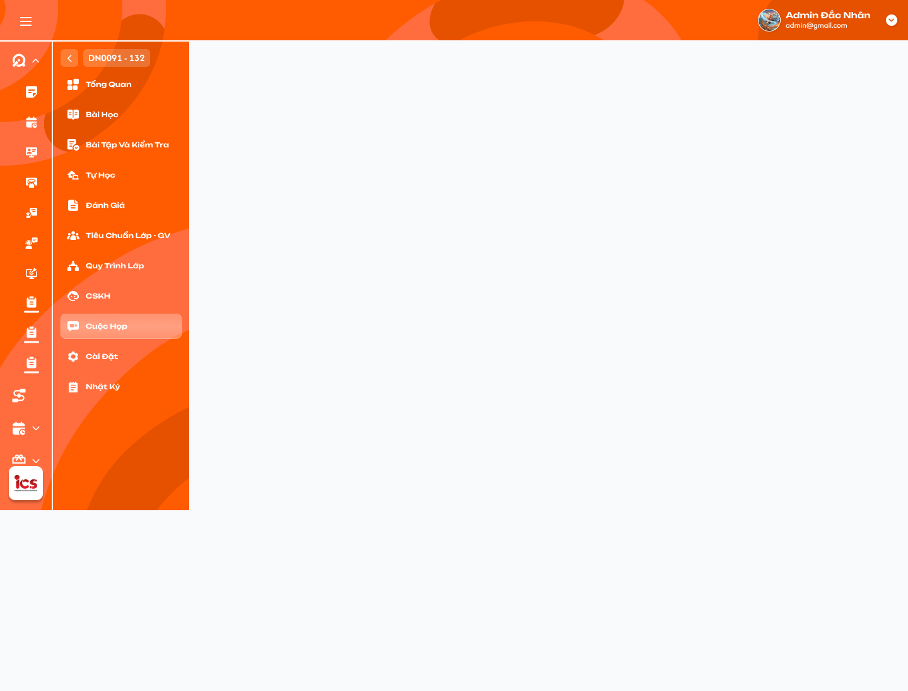

# Chi tiết lớp học — Tab Cuộc họp

## 1. UI

### Trang 1: ADM-LOP-020904 — Chi tiết lớp học / Cuộc họp / Trống



**Mô tả:**
- Menu **Cuộc họp** trong Chi tiết lớp khi lớp chưa có buổi họp nào mà người xem được phép thấy.

**Điểm cần lưu ý:**
- Cuộc họp thuộc một lớp cụ thể, khác bản ghi **Lịch hẹn** ở tab Lịch Hẹn; không tự cộng số cuộc họp vào badge lịch hẹn tại Mã lớp.
- Menu **Cuộc họp** chỉ hiện với role đã được add vào lớp và được phép tham gia; người chưa được add vào lớp không được chọn hoặc xem buổi họp.
- Phân biệt trạng thái đang tải, không có cuộc họp được phép xem và lỗi tải; lỗi có `Thử lại`, không dựng dữ liệu 0/rỗng giả.

### Trang 2: Khung tab và danh sách buổi họp


**Mô tả:**
- Vùng trái là Nội dung buổi họp đang chọn; vùng phải là Danh sách buổi họp. Giáo viên/Trợ giảng được mời có giao diện chỉ đọc.

**Điểm cần lưu ý:**
- Danh sách chỉ gồm dữ liệu thuộc lớp hiện tại và quyền hiện tại: Admin/Class Handler/Support quản lý lớp xem đầy đủ; Giáo viên/Trợ giảng chỉ xem buổi có mình được add tham gia.
- Card buổi họp hiển thị tiêu đề, số người tham gia, ngày, giờ, trạng thái; nhấn card để xem đúng nội dung cuộc họp đó.
- Số người tham gia = số user khác nhau trong danh sách đã lưu của buổi; không phải sĩ số lớp hay số cuộc họp trùng giờ.
- Dấu `+` cạnh người tham gia mở popup chọn nhiều user, chỉ Admin/Class Handler/Support thao tác được.
- Ngày giờ sửa được bởi Admin/Class Handler/Support có quyền quản lý lớp; trạng thái chỉ **người tạo** đổi được (xem Trang 6); người khác chỉ xem.
- Nút `Thêm buổi họp` / `Thêm buổi họp mới` chỉ cho Admin/Class Handler/Support có quyền quản lý lớp.
- Ô `1` / `2` trên card là số cuộc họp cùng ngày và cùng giờ:phút bắt đầu của lớp (xem Trang 9), khác số người tham gia và khác badge tiến độ `0/7` của Action Board; chỉ đếm buổi người đang xem có quyền thấy.
- Chọn / đổi cuộc họp chỉ đọc dữ liệu, không tự đổi trạng thái thành `Đang tham gia`.
- Menu trạng thái cần có đủ 4 trạng thái; ảnh tham chiếu mới có 3 (thiếu `Đang chờ`).

### Trang 3: Tạo mới và chỉnh sửa thông tin buổi họp

**Mô tả:**
- Admin/Class Handler/Support nhấn `Thêm buổi họp`, nhập thông tin, chọn người tham gia, thêm quy trình từ lớp rồi `Thêm`. Khi sửa, tải dữ liệu hiện có, đổi field rồi `Lưu`.

**Điểm cần lưu ý:**
- Field: tiêu đề cuộc họp (hiển thị tại card và danh sách trùng thời gian), người tham gia (multiselect qua popup), thời gian họp (ngày + giờ), trạng thái, mô tả cuộc họp (riêng của buổi, không phải ghi chú lớp, nội dung quy trình hay biên bản), `Thêm quy trình` / `Thêm nội dung buổi họp` (hai nhãn cùng một chức năng).
- Trạng thái mặc định `Mới tạo`; khi sửa hiển thị giá trị đã lưu, không reset về mặc định.
- `Hủy` bỏ thay đổi chưa lưu, không Toast CRUD. Chọn dữ liệu trong popup chỉ là nháp cho tới khi `Thêm` / `Lưu` buổi họp; mở popup không tạo cuộc họp.
- Admin/Class Handler/Support được tạo / sửa / xoá **thông tin** cuộc họp trong phạm vi lớp được quản lý. Trạng thái và Result của buổi chỉ **người tạo** được cập nhật. Admin/Class Handler/Support chỉ là thành viên lớp (không có quyền quản lý lớp) chỉ xem buổi được mời.
- Trùng thời gian giữa các cuộc họp **được phép**; không áp dụng quy tắc chống trùng lịch dạy.
- Không tự gán người tạo làm người tham gia, không bắt buộc chọn tối thiểu một user / quy trình khi chưa được xác nhận.
- Nút lưu chống bấm lặp; lỗi không để lại buổi mới chỉ có tiêu đề mà thiếu phần người tham gia / quy trình đã gửi.

### Trang 4: Popup chọn người tham gia


**Mô tả:**
- Popup `Thêm người tham gia vào cuộc họp`: tìm thành viên, chọn nhiều, `Hủy` / `Thêm`.

**Điểm cần lưu ý:**
- Chỉ trả user đã được add vào **lớp hiện tại** và có role trong lớp **khác Học viên**; không trả người ngoài lớp hay thành viên chỉ có role Học viên (ảnh có Học viên nhưng không được dùng làm căn cứ). Không loại Sale chỉ dựa vào tên role; với user nhiều role, kiểm tra vai trò gắn với lớp.
- Chọn nhiều, giữ lựa chọn kể cả khi đổi từ khoá tìm, không trùng user (phân biệt bằng định danh).
- Trong form tạo / sửa, `Thêm` chỉ cập nhật nháp cho tới khi `Thêm` / `Lưu` buổi họp. `Hủy` đóng popup, không áp dụng thay đổi.
- Admin/Class Handler/Support được bỏ người tham gia; không tự loại người cũ chỉ vì danh sách tìm kiếm đang ẩn họ.
- Sau khi lưu, thành viên được add xem được buổi đó qua menu **Cuộc họp**; Giáo viên/Trợ giảng bị bỏ khỏi danh sách mất quyền xem. User không còn thuộc lớp thì bị thu hồi quyền xem và không còn được tính là người tham gia hợp lệ; backend kiểm tra lại quan hệ user–lớp khi lưu và khi đọc.
- Phân biệt **được add vào lớp** và **được add vào cuộc họp**: phải thuộc lớp trước; lời mời chỉ cấp quyền xem buổi cụ thể, không mở rộng quyền CRUD.

### Trang 5: Chọn ngày và giờ họp


**Mô tả:**
- Chọn ngày bằng lịch tháng (chuyển tháng trước / sau); chọn giờ / phút bằng popup `Chọn giờ`; `OK` xác nhận, `Hủy` giữ giá trị trước.

**Điểm cần lưu ý:**
- Ngày hiển thị `dd/MM/yyyy`, giờ `HH:mm`.
- Cuộc họp chỉ có ngày giờ bắt đầu, chưa có giờ kết thúc / thời lượng; trùng thời gian chỉ xét **cùng ngày và cùng giờ:phút**, không xét khoảng giao nhau.
- Ngày giờ hiển thị, lưu, gom lịch dùng cùng một múi giờ nghiệp vụ, không dùng timezone thiết bị.
- Sửa thời gian phải cập nhật nhóm cuộc họp cũ / mới sau khi lưu thành công; không đổi thời gian lịch dạy của lớp.

### Trang 6: Trạng thái cuộc họp

**Mô tả:**
- **Người tạo cuộc họp** tự chọn trạng thái; có đúng 4 trạng thái. Trạng thái cuộc họp độc lập với trạng thái lớp / học viên / buổi học.

**Điểm cần lưu ý:**
- `Mới tạo` (mặc định, icon đồng hồ tông cam), `Đang tham gia` (icon tông xanh tím), `Hoàn thành` (dấu kiểm xanh), `Đang chờ` (icon / màu theo thiết kế cuối). Hiển thị nhãn / tooltip để nhận biết ngoài màu sắc.
- Điều kiện đổi: tại thời điểm lưu buổi phải có **ít nhất 1 người tham gia đã add** và **đã set ngày giờ họp**; thiếu một trong hai thì giữ trạng thái cũ. Nếu chưa đủ điều kiện, control đổi trạng thái khoá và vẫn là `Mới tạo`.
- Hệ thống không tự đổi trạng thái theo thời gian, khi mở tab hay khi Result thay đổi. Xoá người tham gia hoặc bỏ lịch về sau không tự chuyển ngược trạng thái đã lưu.
- Không thêm trạng thái Quá hạn / Hủy / Xoá; Quá hạn chỉ là điều kiện gửi thông báo.
- Backend kiểm tra lại người tạo, số người tham gia đã lưu và ngày giờ họp khi lưu.

### Trang 7: Popup thêm quy trình và nội dung buổi họp


**Mô tả:**
- `Thêm quy trình` / `Thêm nội dung buổi họp` mở **Action Board của Quy trình lớp hiện tại** (nội dung gắn từ menu Quy trình lớp); chọn theo thứ tự **Package → Category → Action Item**, được chọn nhiều nhánh và nhiều item.

**Điểm cần lưu ý:**
- Nguồn chỉ là Action Board của đúng lớp đang mở, không lấy board lớp khác. Tên Tiêu Chuẩn Chung, BTVN, các Meeting là dữ liệu minh hoạ, không hard-code.
- Badge như `0/7` là tiến độ theo Action Board, không phải số người tham gia hay số lịch trùng.
- Checkbox popup là **chọn đưa vào cuộc họp**, không phải Result `check` của Action Board; chọn nhánh không có nghĩa đã hoàn thành item hoặc cập nhật Result.
- Giữ định danh Package–Category–Action Item để không nhầm hai item cùng tên; không gắn trùng cùng item trong một buổi.
- `Thêm` xác nhận phần chọn, `Hủy` không áp dụng nháp; trong form tạo / sửa chưa ghi dữ liệu chính thức trước `Thêm` / `Lưu` buổi họp.
- Admin/Class Handler/Support quản lý lớp được thêm / bỏ phần Action Board gắn với buổi; không sửa định nghĩa Package/Category/Action Item qua popup này.
- **Mỗi cuộc họp có Result riêng** cho Action Item đã chọn: cùng một item ở hai buổi có hai Result độc lập, cập nhật buổi A không ghi đè Result / tiến độ buổi B hay Result trực tiếp của Action Board lớp.

### Trang 8: Nội dung và biên bản cuộc họp


**Mô tả:**
- Vùng Nội dung buổi họp hiển thị mô tả, **Package → Category → Action Item** đã gắn cùng Result của buổi, và vùng **Biên bản cuộc họp** mở / thu gọn bằng chevron.

**Điểm cần lưu ý:**
- Mô tả thuộc đúng buổi đang chọn; placeholder `Nhập mô tả` khi chưa có; không dùng Lorem Ipsum làm dữ liệu mặc định.
- Result hiển thị là **Result riêng của cuộc họp đang chọn**. Chỉ **người tạo cuộc họp** cập nhật Result, dùng control phù hợp loại Action (check / đánh giá / task theo Action Board); người khác có quyền xem chỉ đọc. Quyền này dựa vào người tạo đã lưu, không dựa vào việc là người tham gia, role Admin/Class Handler/Support hay người sửa gần nhất.
- Ngoại lệ: Action Item loại `verify` có Giáo viên được mời trong danh sách người xác nhận (assignee) thì Giáo viên tick xác nhận một lần cho Result của buổi đó, không bỏ tick (chi tiết ở requirement Giáo viên — Quy trình / Cuộc họp).
- Khi người tạo lưu Result, backend kiểm tra quyền, đúng cuộc họp, đúng item đã gắn; lưu Result theo cặp cuộc họp–Action Item, tính lại tiến độ **của buổi này** theo quy tắc Action Board, ghi Log. Không tự đổi Result khi chỉ chọn item hoặc mở / đóng nội dung.
- Biên bản là nội dung riêng từng buổi, không thay cho mô tả hay nhật ký lớp; văn bản / liên kết hiển thị an toàn, không thực thi script; đổi cuộc họp không dùng biên bản / mô tả của buổi cũ.
- Quyền sửa, cách lưu biên bản, tay nắm kéo sắp xếp và tập công cụ toolbar chưa chốt (xem Q).

### Trang 9: Popup danh sách cuộc họp cùng thời gian

**Mô tả:**
- Khi cùng thời gian có từ hai cuộc họp, card hiện số lượng (ví dụ `2`); nhấn mở popup danh sách chi tiết.

**Điểm cần lưu ý:**
- Mỗi dòng gồm số lượng người tham gia, ngày giờ, trạng thái, tiêu đề; chọn một dòng xem chi tiết buổi thuộc quyền. Hai buổi không gộp thành một bản ghi.
- **Lọc quyền trước khi gom / đếm**: Giáo viên / Trợ giảng chỉ được mời M1 thì chỉ thấy `1` và M1; Admin/Class Handler/Support quản lý lớp thấy cả hai.
- Một buổi hiện `1`; từ hai buổi trở lên hiện số lượng và mở popup. Count cập nhật sau tạo / sửa / xoá / đổi người tham gia. Trùng giờ giữa các lớp không gộp vào tab của lớp hiện tại.
- Đóng popup chỉ đóng vùng hiển thị, không đổi dữ liệu, không Toast.

### Trang 10: Xác nhận xoá buổi họp

**Mô tả:**
- Admin/Class Handler/Support chọn buổi, `Xóa` và xác nhận.

**Điểm cần lưu ý:**
- Popup hiển thị tiêu đề / ngày giờ để nhận biết đúng buổi; không áp dụng xác nhận hai lần của Xoá lớp. `Hủy` giữ nguyên buổi, không Toast.
- Xác nhận xoá kiểm tra lại quyền và liên kết lớp–buổi; thành công bỏ buổi khỏi danh sách, cập nhật nhóm trùng giờ và vùng chi tiết, ghi Log.
- Không xoá quy trình nguồn của lớp hoặc các cuộc họp khác dùng cùng nguồn.
- Giáo viên / Trợ giảng không được xoá dù là người tham gia; Admin/Class Handler/Support không có quyền quản lý lớp này cũng không được xoá.

### Trang 11: Log hoạt động cuộc họp

**Mô tả:**
- Nút `Log` xem lịch sử thay đổi cuộc họp.

**Điểm cần lưu ý:**
- Ghi nhận thay đổi đã lưu thành công: tạo, sửa thông tin, thay người tham gia, người tạo đổi trạng thái, thay nội dung Action Board / Result, xoá; mỗi thay đổi có cuộc họp / lớp, hành động, người thực hiện hoặc Hệ thống, thời điểm.
- Chỉ trả lịch sử thuộc quyền xem, không dùng Log để đọc buổi ngoài quyền. Mở / đóng Log chỉ đọc, không Toast CRUD.
- Không gộp Log với Biên bản; Log hệ thống không phải nhật ký viết tay của Class Handler/Support và không cập nhật chỉ số **Follow** tại Manage Class.
- Không có sự kiện đổi trạng thái tự động; Hủy form hoặc lỗi không thành thay đổi thành công.

---

## 2. Yêu cầu

### 2.1. Flow chính

**Flow 1: Truy cập danh sách theo quyền**

```
Người dùng mở Chi tiết lớp → Cuộc họp
  → Kiểm tra quyền quản lý lớp hoặc quyền tham gia buổi cụ thể
  → Admin/Class Handler/Support quản lý lớp: đầy đủ cuộc họp trong phạm vi lớp
  → Thành viên lớp role khác Học viên: chỉ thấy buổi có mình trong danh sách tham gia đã lưu
  → Giáo viên/Trợ giảng: chỉ đọc
  → Lọc quyền trước khi gom lịch và tính số lượng → tải danh sách (loading / rỗng / lỗi hiển thị riêng)
```

**Flow 2: Xem chi tiết**

```
Chọn card hoặc một dòng trong popup trùng thời gian
  → Kiểm tra quyền buổi cụ thể
  → Hiển thị tiêu đề, người tham gia theo quyền, thời gian, trạng thái, mô tả, Package/Category/Action Item cùng Result hiện có
  → Chỉ render response của lớp/buổi/quyền hiện tại; mở tab không đổi trạng thái
```

**Flow 3: Tạo buổi họp**

```
Admin/Class Handler/Support nhấn Thêm buổi họp
  → Nhập tiêu đề, chọn người tham gia (thành viên lớp, trừ Học viên), chọn ngày giờ, nhập mô tả
  → Thêm quy trình → chọn Package → Category → Action Item
  → Nhấn Thêm → BE kiểm tra role, lớp, user, nguồn quy trình; chống gửi lặp
  → Thành công: tạo đủ một buổi (trạng thái Mới tạo), cập nhật list/count/quyền xem, ghi Log, một Toast
                    ↓ (lỗi)
              Không tạo một phần, giữ dữ liệu để thử lại
```

**Flow 4: Chọn / sửa người tham gia**

```
Mở multiselect hoặc dấu + trên card
  → Tìm thành viên lớp hiện tại (trừ Học viên) → chọn / bỏ nhiều user, không trùng
  → Hủy: không áp dụng
  → Xác nhận → cập nhật nháp form → lưu buổi họp
  → Count cập nhật; người mới xem được buổi; người bị bỏ (không quản lý lớp) mất quyền xem → ghi Log
```

**Flow 5: Chọn / sửa thời gian**

```
Mở date picker / time picker → chọn ngày, giờ, phút
  → Hủy: giữ giá trị trước
  → OK → Lưu buổi (cùng múi giờ nghiệp vụ) → tính lại nhóm trùng giờ cũ / mới theo quyền
  → Không thay lịch dạy của lớp
```

**Flow 6: Người tạo đổi trạng thái thủ công**

```
Người tạo chọn Mới tạo / Đang tham gia / Hoàn thành / Đang chờ
  → BE kiểm tra người tạo + ≥1 người tham gia đã lưu + đã set ngày giờ + giá trị hợp lệ
  → Thành công: card/chi tiết/popup phản ánh trạng thái, Log trước/sau, một Toast
                    ↓ (thiếu điều kiện hoặc không phải người tạo)
              Giữ trạng thái cũ, báo lỗi
```

**Flow 7: Chỉnh sửa buổi họp**

```
Chọn buổi → tải dữ liệu hiện hành → đổi tiêu đề, người tham gia, thời gian, mô tả, phần Action Board
  → Hủy: không lưu
  → Lưu → BE kiểm tra quyền và dữ liệu mới nhất
  → Thành công: đồng bộ count/quyền/nhóm giờ/nội dung, ghi Log, một Toast
     (không đổi trạng thái/Result nếu người sửa không phải người tạo)
                    ↓ (lỗi)
              Không thay một phần, giữ nháp
```

**Flow 8: Thêm / sửa phần quy trình**

```
Thêm quy trình / Thêm nội dung buổi họp → tải Action Board Quy trình của đúng lớp
  → Chọn Package → Category → Action Item (nhiều nhánh/item, không trùng)
  → Hủy: không áp dụng | Thêm: xác nhận phần chọn
  → Lưu buổi → gắn phần đã chọn, ghi Log → hiển thị Package/Category/Action Item và Result hiện có
  → Không tự cập nhật Result, không sửa định nghĩa Action Board nguồn
```

**Flow 9: Xem lịch trùng thời gian**

```
Lọc quyền → gom cuộc họp cùng lớp, cùng ngày và giờ:phút bắt đầu
  → 1 buổi: hiện 1 | nhiều buổi: hiện số lượng (vd 2)
  → Nhấn số lượng → popup (số người tham gia, ngày giờ, trạng thái, tiêu đề)
  → Chọn dòng → xem đúng buổi thuộc quyền
```

**Flow 10: Nhắc quá hạn, giữ trạng thái thủ công**

```
Hệ thống kiểm tra buổi đã set lịch và điều kiện quá hạn
  → Đủ điều kiện: gửi thông báo theo người nhận/kênh/tần suất đã chốt (không gửi trùng khi chạy lại)
  → Không tự đổi trạng thái hay Result
```

**Flow 11: Xoá buổi họp**

```
Admin/Class Handler/Support chọn Xóa → popup xác nhận (tiêu đề/ngày giờ)
  → Hủy: không xoá, không Toast
  → Xác nhận → BE kiểm tra lại quyền/lớp/buổi, chống lặp
  → Thành công: bỏ buổi khỏi danh sách, cập nhật nhóm/count/chi tiết, Log, một Toast
                    ↓ (lỗi)
              Giữ buổi/count, một Toast lỗi
```

**Flow 12: Xem Log**

```
Người có quyền Log nhấn Log → kiểm tra phạm vi lớp/buổi
  → Hiển thị lịch sử thay đổi đã lưu, người thực hiện, thời điểm
  → Đóng Log: không đổi dữ liệu, không Toast
```

**Flow 13: Người tạo cập nhật Result Action Item**

```
Người tạo mở buổi có Action Item đã gắn → hiển thị Result riêng của buổi + control theo loại Action
  → Nhập / chọn Result → Lưu → BE kiểm tra người tạo, đúng buổi, đúng item, dữ liệu hợp lệ
  → Thành công: cập nhật Result/tiến độ của buổi này theo Action Board, Log, một Toast
     (Result buổi khác và Result Action Board lớp không đổi)
                    ↓ (không phải người tạo / lỗi)
              Giữ Result cũ
  Ngoại lệ: Giáo viên được mời nằm trong assignee của item verify được tick xác nhận
```

### 2.2. Ngoại lệ

- **EX01:** Không được mời và không có quyền quản lý lớp, hoặc không có quyền hành động → từ chối đọc / thay đổi tương ứng, kể cả URL / request trực tiếp; người ngoài lớp không được chọn vào buổi họp hay đọc dữ liệu cuộc họp; không trả chi tiết / count / Log ngoài quyền. Admin/Class Handler/Support có quyền quản lý lớp được miễn điều kiện tham gia trong lớp đó. **Chỉ người tạo** được đổi trạng thái và cập nhật Result.
- **EX02:** Tải list / chi tiết / user / quy trình / Log thất bại → hiển thị lỗi và `Thử lại`; không dùng danh sách rỗng, số 0 hay dữ liệu cũ như kết quả thành công mới.
- **EX03:** Đổi lớp / buổi / quyền trong khi đang tải → response cũ không ghi đè hay khôi phục nội dung đã bị thu hồi quyền.
- **EX04:** Thiếu field bắt buộc theo rule đã chốt, ngày giờ sai, trạng thái ngoài 4 giá trị, hoặc đổi trạng thái khi chưa có người tham gia / chưa set ngày giờ → đánh dấu lỗi, không lưu, một phản hồi `Cảnh Báo`, giữ trạng thái cũ. Không tự đặt giới hạn chưa được yêu cầu.
- **EX05:** Tạo / sửa / xoá / set trạng thái thất bại hoặc gửi lặp → không lưu một phần, không nhân đôi, không báo thành công giả; một Toast kết quả phù hợp.
- **EX06:** User không còn tồn tại, chưa được add vào lớp hiện tại hoặc chỉ có role Học viên trong lớp → từ chối thêm vào buổi họp và báo lựa chọn cần kiểm tra; kiểm tra lại cả khi lưu bằng request trực tiếp.
- **EX07:** Package / Category / Action Item không thuộc Action Board Quy trình lớp, chưa gắn với buổi hoặc không còn hợp lệ lúc lưu → không gán nhầm lớp / buổi, không bỏ mục âm thầm.
- **EX08:** Tác vụ nhắc quá hạn chạy lại hoặc lỗi → không gửi trùng cùng lần nhắc; không tự đổi trạng thái hoặc Result.
- **EX09:** Mở / sửa buổi đã bị xoá → không trả nội dung cũ như hiện hành, không tạo lại ngoài ý muốn; cập nhật list / count và báo trạng thái phù hợp.

### 2.3. Yêu cầu khác

| Mã | Tên yêu cầu | Mô tả |
|---|---|---|
| REQ01 | Phạm vi lớp | Mỗi buổi thuộc một lớp cụ thể. Cuộc họp không phải Lịch hẹn; không tự thay badge lịch hẹn, lịch dạy, trạng thái lớp hay Follow. |
| REQ02 | Quyền xem / sửa | Admin/Class Handler/Support có quyền quản lý lớp xem đầy đủ và CRUD **thông tin buổi họp** trong lớp đó; chỉ **người tạo** đổi trạng thái và cập nhật Result. Thành viên lớp role khác Học viên được mời xem đúng buổi qua menu Cuộc họp. Giáo viên/Trợ giảng chỉ đọc, trừ Giáo viên tick Action Item `verify` được gán; thành viên không có quyền quản lý lớp không có CRUD chỉ nhờ lời mời. Lọc quyền trước list / count / gom lịch / chi tiết và kiểm tra lại ở backend. |
| REQ03 | Danh sách / chi tiết | Card có tiêu đề, số người tham gia, ngày giờ, trạng thái; chi tiết có mô tả và phần quy trình đã gắn của đúng buổi. Số người tham gia đếm user duy nhất, không lấy sĩ số hay số lịch trùng. |
| REQ04 | CRUD buổi họp | Admin/Class Handler/Support tạo / sửa / xoá **thông tin** buổi họp. Form có tiêu đề, multiselect người tham gia, thời gian, trạng thái, mô tả, phần quy trình. `Mới tạo` mặc định; chỉ người tạo set giá trị khác sau khi có ≥1 người tham gia và lịch họp. Chỉ `Thêm` / `Lưu` / xác nhận xoá mới ghi thay đổi; `Hủy` không lưu. |
| REQ05 | Người tham gia | Nhiều user, tìm theo tên, không trùng định danh. Chỉ user đã được add vào lớp hiện tại có role trong lớp khác Học viên; không chọn người ngoài lớp. Danh sách tham gia còn hợp lệ quyết định quyền xem buổi của thành viên không quản lý lớp; thêm / bỏ hoặc mất tư cách thành viên lớp phải đồng bộ quyền và count. Không loại Sale nếu là thành viên lớp với role không phải Học viên. |
| REQ06 | Thời gian | Chọn ngày / giờ / phút, `Hủy` giữ giá trị cũ. Hiển thị, lưu, gom lịch và xác định quá hạn cùng múi giờ nghiệp vụ. |
| REQ07 | Action Board Quy trình lớp | Chọn nội dung theo Package → Category → Action Item của đúng lớp, nhiều nhánh / item, không trùng Action Item trong buổi. Chọn item đưa vào cuộc họp không tự thay Result; không sửa định nghĩa Action Board tại đây. |
| REQ08 | Trạng thái | Đúng 4 trạng thái `Mới tạo`, `Đang tham gia`, `Hoàn thành`, `Đang chờ`; `Mới tạo` mặc định. Chỉ người tạo đổi trạng thái sau khi buổi có ≥1 người tham gia và đã set ngày giờ; backend kiểm tra lại khi lưu. Người khác chỉ xem. Không tự đổi theo thời gian, khi mở tab hoặc khi Result thay đổi. |
| REQ09 | Cùng thời gian | Gom buổi cùng ngày và giờ:phút bắt đầu trong một lớp; một buổi hiện `1`, từ hai buổi hiện số lượng và mở popup (số người tham gia / ngày giờ / trạng thái / tiêu đề). Count chỉ tính buổi thuộc quyền; không gom theo khoảng giao nhau. |
| REQ10 | Nội dung, Result, biên bản | Mô tả, Package/Category/Action Item và Result riêng hiển thị đúng buổi; cùng một Action Item ở hai buổi có hai Result độc lập. Chỉ người tạo cập nhật Result theo control / validation / tiến độ của Action Board trong buổi đó; người khác chỉ xem, trừ Giáo viên tick `verify` được gán. Không sửa định nghĩa hoặc Result Action Board lớp. Nội dung hiển thị an toàn. |
| REQ11 | Thông báo quá hạn | Hệ thống gửi thông báo nếu đủ điều kiện quá hạn theo chính sách được chốt, nhưng không tự đổi trạng thái / Result. Không tự thêm loại thông báo khác (mời họp, nhắc trước giờ, chỉnh lịch). Thông báo này khác Toast CRUD. |
| REQ12 | Log | Có nút xem lịch sử, ghi nhận thay đổi đã lưu gồm CRUD / user / trạng thái / phần Action Board / Result, tác nhân và thời điểm. Đổi trạng thái và cập nhật Result ghi đúng người tạo; không có sự kiện đổi trạng thái tự động. |
| REQ13 | Đồng bộ | Sau lưu cập nhật list / card / chi tiết / count / nhóm trùng giờ / quyền; không trộn lớp / buổi / response cũ; không gửi lặp hay ghi một phần; nội dung đã thu hồi quyền không được khôi phục từ response cũ. |
| REQ14 | Toast | Chuẩn bốn biến thể `Thành Công` / `Thông Báo` / `Cảnh Báo` / `Có Lỗi Xảy Ra`; một thao tác logic một phản hồi. Chỉ đọc / `Hủy` / chọn nháp không Toast CRUD. Chọn nháp người tham gia / quy trình rồi lưu cả form chỉ một Toast. |

### 2.4. Ràng buộc

#### Quyền

| Role / Phạm vi | Xem list / chi tiết / nhóm cùng giờ | Tạo | Sửa thông tin / người tham gia / thời gian | Thêm / sửa phần Action Board | Xoá |
|---|:---:|:---:|:---:|:---:|:---:|
| Admin có quyền quản trị lớp | ✅ | ✅ | ✅ | ✅ | ✅ |
| Class Handler có quyền quản lý lớp | ✅ | ✅ | ✅ | ✅ | ✅ |
| Support có quyền quản lý lớp | ✅ | ✅ | ✅ | ✅ | ✅ |
| Admin/Class Handler/Support được mời nhưng không có quyền quản lý lớp đó | ✅ | ❌ | ❌ | ❌ | ❌ |
| Giáo viên được add vào buổi cụ thể | ✅ | ❌ | ❌ | ❌ | ❌ |
| Trợ giảng được add vào buổi cụ thể | ✅ | ❌ | ❌ | ❌ | ❌ |
| Thành viên lớp role khác Học viên được add vào buổi, không có quyền quản lý lớp | ✅ | ❌ | ❌ | ❌ | ❌ |
| Giáo viên / Trợ giảng không được add vào buổi cụ thể | ❌ | ❌ | ❌ | ❌ | ❌ |
| Học viên hoặc người ngoài lớp | ❌ | ❌ | ❌ | ❌ | ❌ |
| Người không quản lý lớp và không được mời vào buổi cụ thể | ❌ | ❌ | ❌ | ❌ | ❌ |

Quyền xem của thành viên được mời chỉ áp dụng cho chính buổi được mời, không phải mọi buổi trong lớp.

**Quyền đổi trạng thái và cập nhật Result:**

| Người dùng | Đổi trạng thái (khi có ≥1 người tham gia và lịch họp) | Cập nhật Result |
|---|:---:|:---:|
| Người tạo cuộc họp (Admin/Class Handler/Support) | ✅ | ✅ |
| Admin/Class Handler/Support khác, dù được CRUD thông tin buổi họp | ❌ | ❌ |
| Giáo viên được mời, nằm trong assignee của Action Item `verify` | ❌ | ✅ chỉ tick `verify` đó |
| Giáo viên / Trợ giảng hoặc người tham gia khác | ❌ | ❌ |

#### Ràng buộc khác

- Quyền quản lý lớp là điều kiện để CRUD và xem toàn bộ cuộc họp; quyền tham gia chỉ quyết định **xem buổi cụ thể** khi user không có quyền quản lý lớp và không mở quyền đọc các phần khác của lớp.
- Danh sách người được mời lấy từ thành viên lớp hiện tại có role khác Học viên.
- Dùng định danh lớp / buổi / user / Package / Category / Action Item / Result để xác định liên kết và quyền; tên / mã / STT chỉ để hiển thị.
- Mọi dữ liệu list, chi tiết, nhóm trùng thời gian và Log áp dụng quyền ở backend; không tải đầy đủ về client rồi chỉ ẩn card.
- Chọn Action Item vào cuộc họp không đổi Result hay tiến độ; Trạng thái `Hoàn thành` của cuộc họp không tự hoàn tất mọi Action Item. Backend kiểm tra người tạo và điều kiện mỗi lần lưu.
- Thêm / xoá cuộc họp không thay số Lịch hẹn, lịch dạy, sĩ số, thống kê tài chính hay trạng thái vận hành lớp.
- Toast CRUD dùng chung với Manage Class; câu chữ dòng hai (`Thêm buổi họp thành công.`, `Cập nhật buổi họp thành công.`, `Xóa buổi họp thành công.`, `Cập nhật trạng thái cuộc họp thành công.`, `Cập nhật kết quả Action Item thành công.`, `Vui lòng kiểm tra thông tin cuộc họp.`, `Không thể thêm/cập nhật/xóa buổi họp. Vui lòng thử lại.`) là đề xuất, cần xác nhận. Toast `Thông Báo` chỉ khi hệ thống đang đồng bộ thật, không báo thành công sớm. Đóng Toast không hoàn tác dữ liệu.


---

## 3. Testcase

### Feature: Chi tiết lớp học — Tab Cuộc họp

| Tên testcase | Priority | Scenario | Role | Pre-condition | Given/When/Then | Expected Result |
|---|---|---|---|---|---|---|
| Case 1: Danh sách theo quyền, người được mời chỉ đọc | High | Flow 1 / REQ01 / REQ02 / EX01 | Admin / Class Handler / Support / Giáo viên / Trợ giảng | Lớp có M1, M2; G (Giáo viên) và T (Trợ giảng) đã thuộc lớp, được mời M1 nhưng không mời M2 | **Given:** ba role quản lý mở lớp; G/T vào menu Cuộc họp<br>**When:** tải danh sách và thử đọc / sửa M2 bằng request trực tiếp<br>**Then:** Admin/Class Handler/Support thấy cả hai buổi; G/T chỉ thấy M1 và không sửa được | - Không lộ M2 qua URL, count hay Log<br>- Người ngoài lớp không mở được menu hay xem buổi họp |
| Case 2: Chọn buổi, rỗng, lỗi tải và response cũ | High | Flow 2 / REQ03 / REQ13 / EX02 / EX03 | Người có quyền xem | M1/M2 dữ liệu khác nhau, M1 có hai user duy nhất; có lúc rỗng, lỗi tải hoặc request chậm khi đổi lớp / buổi | **Given:** chọn lần lượt M1, M2; mở lớp không có buổi; giả lập lỗi tải<br>**When:** tải card và chi tiết<br>**Then:** nội dung đúng buổi được chọn; phân biệt rỗng và lỗi; chỉ render response đúng ngữ cảnh | - Số người tham gia đếm user duy nhất, không phải sĩ số<br>- Chọn buổi không đổi trạng thái<br>- Lỗi có `Thử lại`, không dựng dữ liệu giả |
| Case 3: Tạo buổi họp đầy đủ | High | Flow 3 / REQ04 / REQ05 / REQ07 / REQ08 / REQ14 | Admin / Class Handler / Support | Có quyền quản lý lớp; dữ liệu hợp lệ | **Given:** mở `Thêm buổi họp`, trạng thái mặc định `Mới tạo`<br>**When:** nhập tiêu đề, mô tả, chọn người, ngày giờ, quy trình rồi `Thêm`<br>**Then:** tạo đúng một buổi với toàn bộ dữ liệu đã nhập | - Tải lại giữ đúng dữ liệu<br>- Người được mời xem được buổi<br>- Có Log và một Toast |
| Case 4: Sửa buổi họp và đồng bộ | High | Flow 7 / REQ04 / REQ13 | Admin / Class Handler / Support có quyền quản lý lớp | M1 đã có thông tin, người, quy trình; người sửa không phải người tạo | **Given:** đổi tiêu đề, người tham gia, thời gian, mô tả, phần quy trình<br>**When:** `Lưu` thành công<br>**Then:** M1 cập nhật đúng | - List / card / chi tiết / count / quyền / nhóm giờ cùng cập nhật<br>- Không đổi trạng thái / Result vì người sửa không phải người tạo |
| Case 5: Hủy, validation, lỗi lưu và gửi lặp | High | Flow 3 / Flow 7 / EX04 / EX05 / REQ13 | Admin / Class Handler / Support | Form có nháp hoặc dữ liệu sai; backend / network lỗi | **Given:** soạn form, nhập dữ liệu sai, bấm lưu liên tiếp<br>**When:** `Hủy` hoặc `Thêm` / `Lưu`<br>**Then:** `Hủy` không lưu; dữ liệu sai bị từ chối tại field; lỗi không lưu một phần | - `Hủy` không Toast<br>- Không tạo / cập nhật lặp<br>- Lỗi giữ nháp để thử lại, một Toast kết quả |
| Case 6: Chọn người tham gia hợp lệ và thu hồi quyền | High | Flow 4 / REQ02 / REQ05 / EX06 | Admin / Class Handler / Support; Giáo viên / Trợ giảng | Lớp có A, B (không phải Học viên), H (Học viên); N chưa thuộc lớp; G/T đã thuộc lớp | **Given:** chọn A, B, chọn lại A; `Hủy` một lần chọn thêm; thêm rồi bỏ G/T; bỏ B khỏi lớp<br>**When:** lưu và thử gán H, N bằng request trực tiếp; G/T tải lại hoặc đọc URL cũ<br>**Then:** A chỉ một lần; H, N bị từ chối; B, G/T mất quyền xem sau khi bị bỏ | - Giữ lựa chọn khi đổi từ khoá tìm<br>- `Hủy` giữ danh sách chính thức, không Toast<br>- Count / nhóm giờ đồng bộ; response cũ không khôi phục quyền |
| Case 7: Chọn ngày giờ và chuyển nhóm lịch | High | Flow 5 / REQ06 / REQ09 / REQ13 | Admin / Class Handler / Support | M1, M2 cùng ngày giờ T; M3 ở U; múi giờ đã chốt | **Given:** đổi ngày giờ M2 sang U rồi thử `Hủy` ở một lần khác<br>**When:** `OK` rồi `Lưu`<br>**Then:** M2 giữ đúng ngày giờ; nhóm T, U tính lại | - T còn M1, U có M2 và M3<br>- `Hủy` giữ giá trị cũ, không Toast<br>- Không đổi lịch dạy, không lệch giờ khi tải lại |
| Case 8: Người tạo đổi trạng thái và nhắc quá hạn không đổi trạng thái | High | Flow 6 / Flow 10 / REQ08 / REQ11 / EX04 | Admin / Class Handler / Support là người tạo; Hệ thống | M1 `Mới tạo`; lần lượt thiếu người tham gia, thiếu lịch, rồi đủ cả hai; M1 có lịch và quá giờ | **Given:** người tạo chọn trạng thái ở từng điều kiện; để M1 quá giờ họp<br>**When:** lưu / tải lại<br>**Then:** chỉ lần đủ điều kiện được đổi; M1 vẫn `Mới tạo` khi chỉ qua giờ | - Từ chối hai lần thiếu điều kiện và giá trị ngoài 4 trạng thái<br>- Card / chi tiết / Log / Toast đồng bộ<br>- Không có Log đổi trạng thái tự động |
| Case 9: Người khác không đổi được trạng thái | High | Flow 2 / Flow 6 / REQ02 / REQ08 / EX01 | Admin / Class Handler / Support không phải người tạo; Giáo viên; Trợ giảng | M1 `Mới tạo`, đủ người và lịch | **Given:** mở M1 hoặc gửi request set trạng thái trực tiếp<br>**When:** hệ thống kiểm tra<br>**Then:** từ chối, giữ trạng thái | - Quyền CRUD thông tin / lời mời không cấp quyền set trạng thái |
| Case 10: Chọn quy trình, Result riêng từng buổi | High | Flow 8 / Flow 13 / REQ07 / REQ10 / EX07 | Admin / Class Handler / Support (người tạo) | Lớp A có nhiều Package / Category / Action Item, lớp B board khác; M1, M2 cùng gắn Action Item X | **Given:** chọn nhiều Package, Category, item của lớp A; `Hủy` một lần; người tạo M1 lưu Result X; nguồn bị xoá ở lần khác<br>**When:** tải chi tiết M1, M2<br>**Then:** Result M1 đổi, M2 giữ nguyên; nguồn không hợp lệ bị từ chối | - Không lấy nguồn lớp B, không trùng item<br>- Chọn item không tự cập nhật Result<br>- Không đổi Result Action Board lớp; có Log và một Toast |
| Case 11: Người không tạo chỉ xem Result | High | Flow 13 / REQ02 / REQ10 / EX01 | Admin / Class Handler / Support khác; Giáo viên; Trợ giảng được mời | M1 có Action Item A; một item `verify` có Giáo viên G là assignee | **Given:** xem A hoặc gửi request cập nhật Result trực tiếp; G tick item `verify`<br>**When:** kiểm tra quyền và liên kết M1–A<br>**Then:** request sửa Result bị từ chối; G tick được `verify` đúng một lần | - Không cấp quyền Result theo role CRUD hay lời mời<br>- G không bỏ tick được<br>- Biên bản hiển thị an toàn, không lộ dữ liệu ngoài buổi |
| Case 12: Cuộc họp cùng thời gian | High | Flow 9 / REQ01 / REQ02 / REQ09 | Admin / Class Handler / Support; Giáo viên / Trợ giảng | Lớp A có M1, M2 cùng ngày giờ:phút; G được mời M1; lớp B có buổi cùng giờ | **Given:** tạo M2 cùng giờ M1; G và người quản lý lớp A mở menu Cuộc họp<br>**When:** gom, đếm và mở popup; đổi giờ hoặc xoá M2<br>**Then:** người quản lý thấy `2` và hai dòng; G thấy `1`; count cập nhật sau đổi | - Popup đủ số người / ngày giờ / trạng thái / tiêu đề từng buổi<br>- Không lộ M2 cho G, không gộp buổi lớp B<br>- Không giữ badge `2` sau khi xoá hoặc đổi giờ |
| Case 13: Xác nhận xoá hoặc Hủy | High | Flow 11 / REQ04 / REQ09 / REQ12 / EX01 / EX05 / EX09 | Admin / Class Handler / Support; Giáo viên | M1, M2 cùng dùng quy trình Q1; có trường hợp request lỗi, thiếu quyền, M1 đã bị xoá | **Given:** mở xác nhận xoá M1<br>**When:** `Hủy` hoặc xác nhận (thành công, lỗi, thiếu quyền, buổi không còn)<br>**Then:** `Hủy` giữ M1; xác nhận thành công bỏ đúng M1 | - Cập nhật count / chi tiết, có Log / Toast; không xoá M2 hay nguồn Q1<br>- `Hủy` không Toast<br>- Lỗi không giảm count, không báo thành công; không tạo lại buổi đã xoá |
| Case 14: Thông báo quá hạn đúng người, không trùng | High | Flow 10 / REQ11 / EX08 | Hệ thống | Đã chốt quá hạn / người nhận / kênh / tần suất; M1 quá hạn, M2 chưa | **Given:** kiểm tra các buổi<br>**When:** gửi và chạy lại cùng lần nhắc<br>**Then:** chỉ nhắc M1 đến tập người nhận được phép | - Không gửi trùng<br>- Không lộ dữ liệu ngoài quyền<br>- Không tự thêm kênh / nội dung |
| Case 15: Log và Toast | Medium | Flow 12 / REQ12 / REQ14 / EX01 | Admin / Class Handler / Support; người không có quyền Log | Có CRUD, đổi trạng thái, đổi Result thành công, `Hủy` và lỗi; có buổi ngoài quyền | **Given:** thực hiện thao tác rồi mở Log, đọc Log bằng URL trực tiếp, bấm × Toast<br>**When:** đối chiếu sự kiện với dữ liệu chính thức<br>**Then:** Log đúng buổi / lớp / tác nhân / thời điểm; mỗi thao tác một Toast đúng loại | - Trạng thái / Result ghi đúng người tạo; không có Log trạng thái tự đổi<br>- `Hủy` / lỗi không thành thay đổi thành công; xem / đóng Log không Toast<br>- × chỉ đóng Toast, không hoàn tác dữ liệu |

---

## 4. Câu hỏi cần xác nhận

- **Q01:** Chỉ có frame Figma ADM-LOP-020904 (trạng thái trống); các Trang 2–11 (danh sách buổi họp, form tạo / sửa, popup người tham gia, chọn ngày giờ, trạng thái, popup quy trình, nội dung và biên bản, popup cùng thời gian, xác nhận xoá, Log) chưa có frame Figma có mã. Design cấp mã hoặc cho biết frame nằm ở file Figma nào?
- **Q02:** Thông báo quá hạn: mốc nào được tính là quá hạn (từ giờ bắt đầu, giờ kết thúc, thời lượng hay mốc khác), gửi cho ai, qua kênh nào, nội dung và tần suất nhắc?
- **Q03:** Biên bản cuộc họp: ai được xem / sửa, khi nào được sửa, cách lưu (nút Lưu hay auto-save), có bắt buộc trước khi `Hoàn thành` không, và tập công cụ toolbar cuối cùng?
- **Q04:** Tay nắm chấm trên danh sách Action Item: ai được kéo sắp xếp và thứ tự có được lưu không?
- **Q05:** Tiêu đề cuộc họp có bắt buộc / giới hạn ký tự không; mô tả có bắt buộc, kiểu soạn thảo, giới hạn?
- **Q06:** Múi giờ nghiệp vụ chính thức, bước phút của time picker, giá trị mặc định, và có cho chọn thời điểm trong quá khứ không?
- **Q07:** Dấu `+` trên card và `OK` của date / time picker có lưu ngay hay chờ `Lưu` buổi họp? Có cảnh báo khi rời form đang có thay đổi không?
- **Q08:** Xoá buổi họp là xoá mềm hay cứng, có giữ biên bản / quy trình gắn không, và sau khi xoá chọn buổi kế tiếp hay hiển thị rỗng?
- **Q09:** Giáo viên có được xem Log không, Log theo từng buổi hay toàn tab, vị trí nút Log, thời hạn lưu và cách xem Log của buổi đã xoá?
- **Q10:** Mặc định chọn cuộc họp nào khi mở tab, thứ tự danh sách, có phân trang / tìm kiếm / lọc hoặc lịch tháng / tuần không? Cách xử lý khi bản ghi bị sửa đồng thời?
