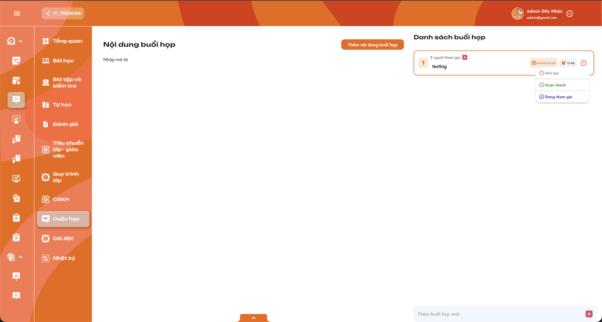
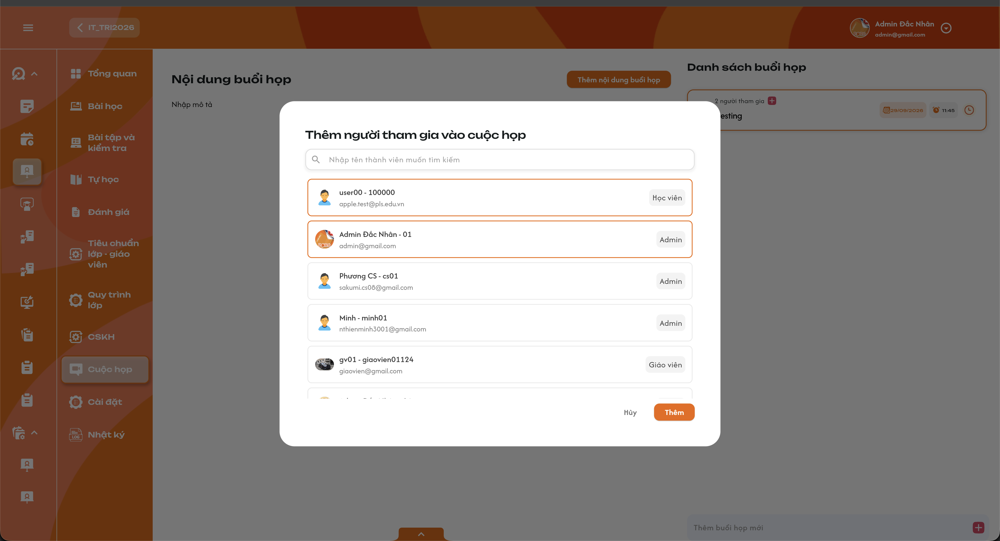
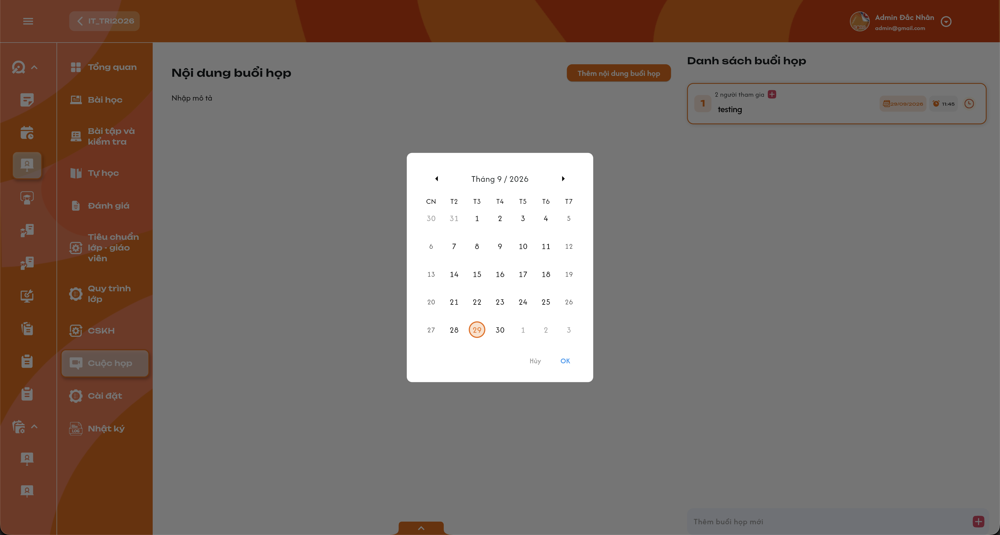
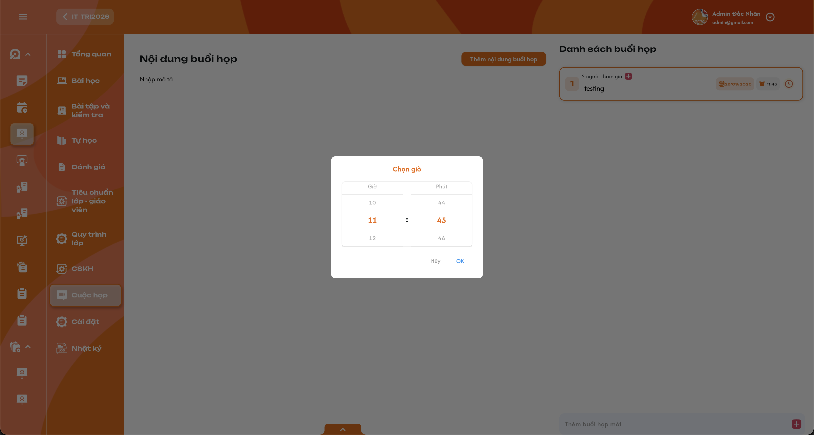
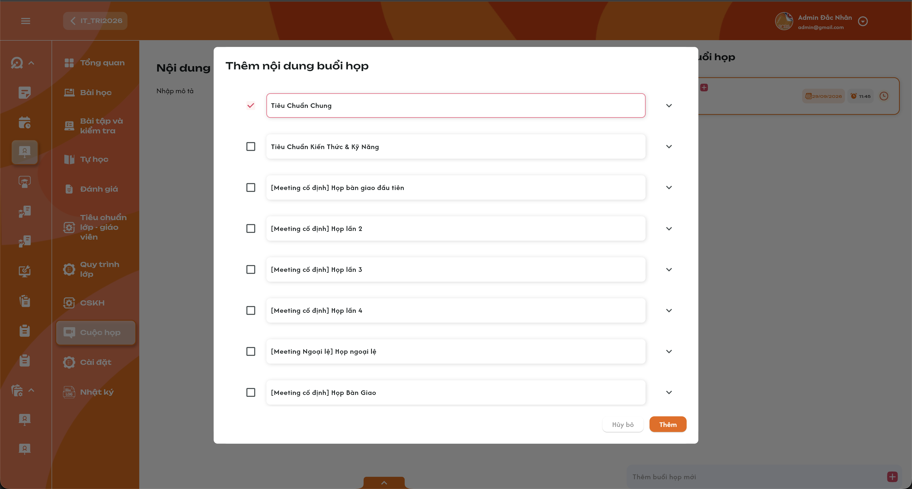
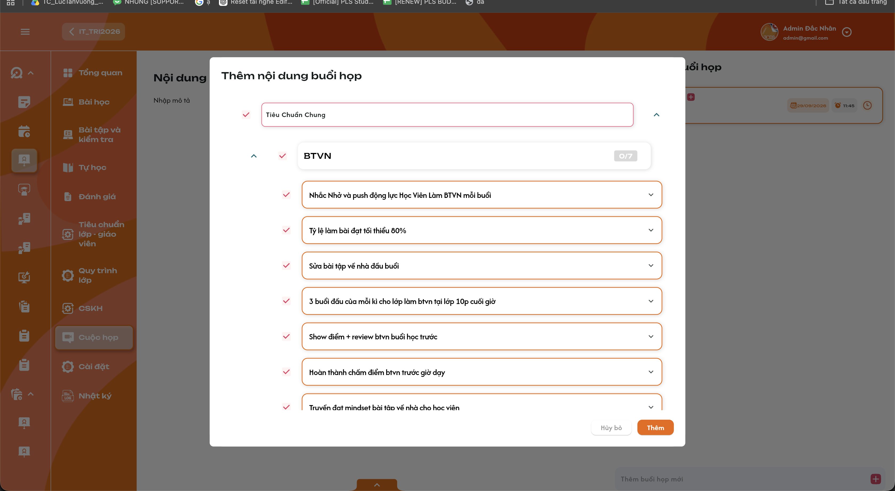
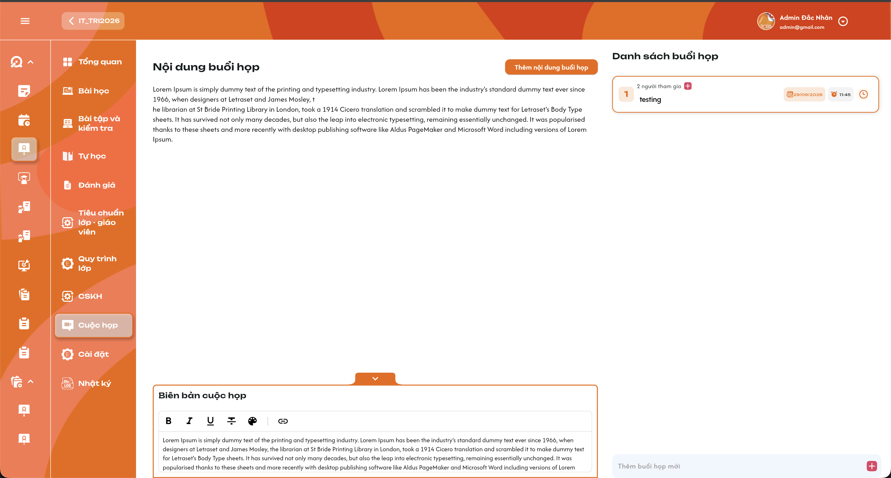

# Chi tiết lớp học — Tab Cuộc họp

Ngày ghi nhận: **29/09/2026**; cập nhật quyền, người tham gia và Action Board **30/09/2026**. Nguồn: yêu cầu Cuộc họp lớp, bổ sung của người dùng và 8 ảnh tham chiếu; đối chiếu [Requirement Manage Class](./class_management_requirements.md), [Action Board](../../action_board_requirement/action_board_requirements.md) và [template requirement](../../requirement_template.md). Tài liệu lưu đủ context để tiếp tục ở conversation khác. Quy tắc được nói rõ trong yêu cầu có ưu tiên hơn ảnh tham chiếu.

**Context đã chốt:** Cuộc họp thuộc một lớp cụ thể, lấy nội dung từ **Action Board của Quy trình lớp** theo thứ tự **Package → Category → Action Item**. **Mỗi cuộc họp có Result riêng** cho các Action Item đã chọn; chỉ **người tạo cuộc họp** được cập nhật các Result đó. **Admin, Class Handler và Support đều được CRUD thông tin cuộc họp** trong phạm vi lớp được quản lý, kể cả chọn người tham gia và nội dung quy trình; quyền CRUD không tự cấp quyền đổi trạng thái/Result của buổi do người khác tạo. Chỉ được thêm **người đã được add vào chính lớp đó**, có role trong lớp **khác Học viên**, vào cuộc họp. Các role này truy cập menu **Cuộc họp** trong Chi tiết lớp; người không có quyền quản lý lớp chỉ xem những buổi có mình trong danh sách tham gia. Giáo viên và Trợ giảng chỉ xem, không CRUD. Có đúng 4 trạng thái: **Mới tạo, Đang tham gia, Hoàn thành, Đang chờ**; mặc định **Mới tạo**. **Người tạo tự đổi trạng thái** khi buổi họp đã có ít nhất một người tham gia và đã set ngày giờ họp; hệ thống không tự đổi theo thời gian. Cho phép nhiều cuộc họp cùng ngày giờ bắt đầu (đến phút), hiển thị số lượng và popup danh sách. Yêu cầu thông báo quá hạn và xem Log vẫn áp dụng riêng.

**Lưu ý từ ảnh:** Ảnh có người tham gia là Học viên nhưng role Học viên không được add vào cuộc họp theo yêu cầu đã chốt. Biên bản và tay nắm kéo chưa đủ để xác định quyền sửa biên bản hoặc kéo sắp xếp. Badge tiến độ thuộc Action Board, không phải số cuộc họp cùng giờ. Không lấy quyền của các tab khác để tự cấp các quyền này.

## 1. UI

### Trang 1: ADM-LOP-020904 — Khung tab Cuộc họp và danh sách buổi họp




*Ảnh 6 — khung tab và menu trạng thái; ảnh chỉ có 3 trạng thái, yêu cầu phải có thêm Đang chờ*

**Mô tả:**

- Truy cập Chi tiết lớp → **Cuộc họp**. Vùng trái là Nội dung buổi họp đang chọn; vùng phải là Danh sách buổi họp. Các role đã được add vào lớp và được phép tham gia có menu **Cuộc họp** trong Chi tiết lớp. Giáo viên/Trợ giảng được mời có giao diện chỉ đọc; người chưa được add vào lớp không được chọn hoặc xem buổi họp.
- Đây là cuộc họp của lớp, khác bản ghi **Lịch hẹn** chăm sóc/công việc ở [Tab Lịch Hẹn](./class_detail_appointments_requirements.md). Không tự cộng số cuộc họp vào badge lịch hẹn tại Mã lớp.

**Giải thích field/thành phần:**

- `A01.01` **Danh sách buổi họp**: Chỉ dữ liệu thuộc lớp hiện tại và quyền hiện tại. Admin/Class Handler/Support quản lý lớp xem đầy đủ; Giáo viên/Trợ giảng chỉ xem buổi có mình được add tham gia, kể cả khi không thuộc lớp.
- `A01.02` **Card buổi họp**: Hiển thị tiêu đề, số người tham gia, ngày, giờ và trạng thái. Nhấn chọn card để xem đúng nội dung cuộc họp đó.
- `A01.03` **Số người tham gia**: Số user khác nhau trong danh sách đã lưu của buổi họp; không phải sĩ số lớp hoặc số cuộc họp trùng giờ.
- `A01.04` **Dấu + cạnh người tham gia**: Mở popup chọn nhiều user, chỉ Admin/Class Handler/Support được thao tác.
- `A01.05` **Ngày/giờ/trạng thái**: Admin/Class Handler/Support có quyền quản lý lớp được sửa ngày giờ. **Chỉ người tạo** được đổi trạng thái khi đã có ≥1 người tham gia và lịch họp; người khác chỉ xem trạng thái.
- `A01.06` **Thêm buổi họp / Thêm buổi họp mới**: Nút tạo mới chỉ cho Admin/Class Handler/Support có quyền quản lý lớp. Ảnh thể hiện ô thêm ở cuối danh sách; bố trí form đầy đủ chưa có ảnh.
- `A01.07` **Số lượng cuộc họp cùng thời gian**: Gom theo **cùng ngày và cùng giờ:phút bắt đầu** của lớp. Ô `1` trên card là số buổi trong nhóm khi chỉ có một buổi; nếu nhóm có hai buổi thì hiển thị `2`, nhấn để mở danh sách chi tiết. Chỉ đếm buổi người đang xem có quyền thấy.
- `A01.08` **Loading/rỗng/lỗi**: Phân biệt đang tải, không có cuộc họp được phép xem và lỗi tải; lỗi có thể thử lại, không dựng dữ liệu 0/rỗng giả.

**Điểm cần lưu ý:**

- Ô `1`/`2` của nhóm lịch khác số người tham gia trên card và khác badge tiến độ `0/7` của Action Board.
- Mặc định chọn cuộc họp nào, thứ tự danh sách, phân trang/search/filter và việc có lịch dạng tháng/tuần chưa được cung cấp; không kế thừa phân trang 10 lớp của Manage Class.
- Việc chọn/đổi cuộc họp chỉ đọc dữ liệu, không tự đổi trạng thái thành Đang tham gia.

### Trang 2: Tạo mới và chỉnh sửa thông tin buổi họp
**Mô tả:**

Admin/Class Handler/Support nhấn **Thêm buổi họp**, nhập thông tin, chọn người tham gia và thêm quy trình từ lớp, sau đó nhấn **Thêm**. Khi sửa, tải dữ liệu hiện có, thay đổi các field rồi **Lưu**. Chưa có ảnh toàn bộ form; bảng dưới đặc tả theo lời người dùng, không khẳng định thiết kế popup hay lưu trực tiếp trên card.

**Giải thích field/thành phần:**

- `A02.01` **Tiêu đề cuộc họp**: Văn bản tên cuộc họp, hiển thị tại card và danh sách trùng thời gian. Bắt buộc/giới hạn ký tự cần xác nhận.
- `A02.02` **Người tham gia**: Multiselect user qua popup, có thể thêm/bỏ lựa chọn khi sửa. Chỉ chọn user **đã được add vào lớp hiện tại** với role trong lớp **khác Học viên**; không chọn người ngoài lớp.
- `A02.03` **Thời gian họp**: Chọn ngày và giờ; ảnh có date picker và time picker riêng. Chưa có thời lượng/giờ kết thúc.
- `A02.04` **Trạng thái**: Mới tạo mặc định khi tạo. Chỉ người tạo được chọn Mới tạo, Đang tham gia, Hoàn thành hoặc Đang chờ **sau khi** cuộc họp có ít nhất một người tham gia và ngày giờ họp. Khi sửa hiển thị giá trị đã lưu, không reset về mặc định.
- `A02.05` **Mô tả cuộc họp**: Nội dung mô tả riêng của buổi họp. Không phải ghi chú lớp, nội dung quy trình hoặc biên bản. Kiểu soạn thảo/bắt buộc/giới hạn cần chốt.
- `A02.06` **Thêm quy trình / Thêm nội dung buổi họp**: Mở Action Board của Quy trình lớp, chọn một hoặc nhiều **Package**, sau đó **Category** và **Action Item** muốn đưa vào cuộc họp. Hai nhãn mô tả cùng chức năng trong yêu cầu và ảnh.
- `A02.07` **Thêm / Lưu**: Kiểm tra quyền, dữ liệu và liên kết; lưu đầy đủ thay đổi. Không tạo cuộc họp từ thao tác mở popup hoặc chọn dữ liệu chưa xác nhận.
- `A02.08` **Hủy**: Bỏ thay đổi chưa lưu; không thay dữ liệu chính thức, không Toast CRUD. Quy tắc cảnh báo rời form có thay đổi cần chốt.

**Điểm cần lưu ý:**

- Admin/Class Handler/Support có quyền tạo/sửa/xóa **thông tin** cuộc họp trong phạm vi lớp được quản lý. Riêng trạng thái và Result của buổi đã tạo chỉ **người tạo** được cập nhật; backend kiểm tra cả điều kiện người tham gia/lịch họp khi đổi trạng thái. Giáo viên/Trợ giảng được mời vẫn không sửa. Admin/Class Handler/Support là thành viên lớp nhưng không có quyền quản lý lớp đó chỉ xem buổi được mời; lời mời không mở rộng quyền CRUD.
- Trùng thời gian **được phép**; không áp dụng quy tắc chống trùng lịch dạy vào cuộc họp.
- Không tự gán người tạo làm người tham gia hoặc bắt buộc chọn ít nhất một user/quy trình khi chưa được xác nhận. Quyền Admin/Class Handler/Support xem vẫn áp dụng độc lập với danh sách tham gia.
- Nút lưu chống bấm lặp; lỗi không để một buổi mới chỉ có title nhưng thiếu phần người tham gia/quy trình đã gửi.

### Trang 3: Popup chọn người tham gia


*Ảnh 3 — tìm thành viên, chọn nhiều và xác nhận Thêm*

**Mô tả:**

Popup **Thêm người tham gia vào cuộc họp** dùng chọn nhiều user. Ảnh thể hiện ô tìm kiếm, avatar, tên/mã, email, nhãn role, các dòng đang chọn có viền cam và nút **Hủy / Thêm**.

**Giải thích field/thành phần:**

- `A03.01` **Tìm kiếm**: Ảnh ghi tìm theo tên thành viên. Tìm theo email/mã, bỏ dấu, thời điểm kích hoạt và phân trang chưa chốt.
- `A03.02` **Dòng user**: Phân biệt user bằng định danh; tên/email/role hỗ trợ nhận biết. Chỉ trả user đang là thành viên **lớp hiện tại** và có role trong lớp **khác Học viên**. Không trả người ngoài lớp hoặc thành viên chỉ có role Học viên; nhãn role trên ảnh không thay thế kiểm tra dữ liệu lớp.
- `A03.03` **Chọn nhiều**: Giữ nhiều lựa chọn, kể cả khi đổi từ khóa; không trùng user.
- `A03.04` **Thêm**: Xác nhận lựa chọn. Khi đang tạo/sửa form, lựa chọn là dữ liệu nháp cho tới Thêm/Lưu buổi họp. Cách lưu nhanh từ dấu + của card cần xác nhận.
- `A03.05` **Hủy**: Đóng popup, không áp dụng thay đổi chưa xác nhận vào buổi họp.
- `A03.06` **Bỏ người tham gia**: Admin/Class Handler/Support được sửa danh sách tham gia; không tự loại người cũ chỉ vì danh sách tìm kiếm đang ẩn họ.

**Điểm cần lưu ý:**

- Sau khi lưu, thành viên lớp được add vào buổi họp sẽ xem được buổi đó qua menu **Cuộc họp** của lớp. Giáo viên/Trợ giảng bị bỏ khỏi danh sách mất quyền xem; Admin/Class Handler/Support còn quyền quản trị chỉ khi có quyền quản lý lớp tương ứng.
- Ảnh có Học viên nhưng user chỉ tham gia lớp với role Học viên không được add vào cuộc họp. Không loại các role khác, như Sale, chỉ dựa vào tên role: điều kiện là đã thuộc lớp với vai trò hợp lệ khác Học viên; với user nhiều role, kiểm tra vai trò gắn với lớp, không dựa vào nhãn duy nhất trên ảnh.
- Khi user không còn thuộc lớp, quyền xem cuộc họp theo danh sách tham gia phải bị thu hồi; danh sách/count không tiếp tục coi user đó là người tham gia hợp lệ. Backend kiểm tra lại quan hệ user–lớp khi lưu và khi đọc.
- Phân biệt **được add vào lớp** và **được add vào cuộc họp**. Phải thuộc lớp trước khi được chọn vào buổi họp; lời mời chỉ cấp quyền xem buổi họp cụ thể và không mở rộng quyền CRUD.

### Trang 4: Chọn ngày và giờ họp


*Ảnh 4 — lịch tháng, chuyển tháng, chọn ngày và Hủy / OK*



*Ảnh 5 — chọn giờ/phút và Hủy / OK*

**Mô tả:**

Chọn ngày bằng lịch tháng; chọn giờ/phút bằng popup **Chọn giờ**. Thao tác OK xác nhận giá trị đang chọn; Hủy giữ giá trị trước đó.

**Giải thích field/thành phần:**

- `A04.01` **Ngày**: Lịch đúng tháng/năm, cho chuyển tháng trước/sau, đánh dấu ngày đang chọn. Ảnh hiển thị ngày theo `dd/MM/yyyy`.
- `A04.02` **Giờ/phút**: Chọn giờ và phút hợp lệ, ảnh hiển thị `HH:mm`. Giới hạn bước phút và thời điểm mặc định chưa chốt.
- `A04.03` **OK / Hủy**: OK áp dụng vào dữ liệu đang soạn; Hủy không áp dụng. Việc OK trên card có lưu ngay hay chờ Lưu cần chốt.
- `A04.04` **Thời điểm cuộc họp**: Kết hợp ngày/giờ theo cùng múi giờ nghiệp vụ. Múi giờ chính thức cần xác nhận; không dùng timezone thiết bị tùy ý.

**Điểm cần lưu ý:**

- Cuộc họp hiện chỉ có ngày/giờ bắt đầu; để gom lịch, dùng **cùng ngày và cùng giờ:phút đã chọn**. Không suy ra trùng theo khoảng giao nhau. Quy tắc chọn thời điểm quá khứ chưa được cung cấp.
- Sửa thời gian phải cập nhật nhóm cuộc họp cũ/mới sau khi lưu thành công. Không đổi thời gian lịch dạy lớp.

### Trang 5: Trạng thái cuộc họp
**Mô tả:**

**Người tạo cuộc họp** tự chọn trạng thái. Ảnh 6 có Mới tạo, Hoàn thành, Đang tham gia; **Đang chờ** có trong yêu cầu và bắt buộc bổ sung. Trạng thái cuộc họp độc lập với trạng thái lớp/học viên/buổi học.

**Giải thích field/thành phần:**

- `A05.01` **Mới tạo**: Mặc định khi tạo buổi mới; ảnh có icon đồng hồ tông cam.
- `A05.02` **Đang tham gia**: Trạng thái cuộc họp đang diễn ra/tham gia theo dữ liệu đã lưu; ảnh có icon tông xanh tím. Không suy ra từ việc user mở tab.
- `A05.03` **Hoàn thành**: Buổi được đánh dấu hoàn thành; ảnh có dấu kiểm xanh. Không mặc định đổi chỉ vì qua giờ bắt đầu.
- `A05.04` **Đang chờ**: Một trong bốn trạng thái được chọn; icon/màu theo thiết kế cuối.
- `A05.05` **Người đổi**: Chỉ **người tạo cuộc họp**; Admin/Class Handler/Support khác dù được sửa thông tin buổi họp vẫn không được set trạng thái.
- `A05.06` **Điều kiện đổi**: Tại thời điểm lưu, buổi họp phải có **ít nhất 1 người tham gia đã được add** và **ngày giờ họp đã được set**. Thiếu một trong hai thì không đổi, giữ trạng thái cũ.
- `A05.07` **Thay đổi theo thời gian**: Không tự chuyển Mới tạo → Đang tham gia hoặc tự Hoàn thành; tới giờ họp không phải thao tác set trạng thái.

**Điểm cần lưu ý:**

- Hiển thị nhãn/tooltip trạng thái để nhận biết ngoài màu sắc. Giáo viên/Trợ giảng chỉ đọc.
- Không thêm trạng thái Quá hạn/Hủy/Xóa vào bộ trạng thái cuộc họp. Quá hạn hiện là điều kiện gửi thông báo, không được nêu là trạng thái thứ năm.
- Mới tạo là **giá trị mặc định** khi tạo, không phải thao tác đổi trạng thái thủ công. Nếu form cho phép tạo bản ghi chưa có người tham gia/lịch, trạng thái vẫn là Mới tạo và control đổi trạng thái khóa cho tới khi đủ cả hai điều kiện.
- Backend kiểm tra lại người tạo, số người tham gia đã lưu và ngày giờ họp khi xác nhận. Chỉ đổi UI/giờ hiện tại không đủ để vượt điều kiện. Xóa người tham gia hoặc bỏ lịch về sau không tự chuyển ngược trạng thái đã lưu.

### Trang 6: Popup thêm quy trình và nội dung buổi họp


*Ảnh 2 — danh sách nhiều quy trình có checkbox và mở rộng*



*Ảnh 1 — chọn theo cấu trúc Package → Category → Action Item của Action Board lớp*

**Mô tả:**

Nhấn **Thêm quy trình** hoặc **Thêm nội dung buổi họp** mở **Action Board của Quy trình lớp hiện tại**. Quy trình lớp này lấy nội dung đã gắn vào lớp từ [menu Quy trình lớp](./class_detail_processes_requirements.md); định nghĩa gốc nằm ngoài lớp. Người tạo/chỉnh sửa cuộc họp chọn theo thứ tự **Package → Category → Action Item**; có thể chọn nhiều nhánh và nhiều Action Item. Các tên Tiêu Chuẩn Chung, BTVN, các Meeting cố định/ngoại lệ là dữ liệu minh họa, không hard-code. Quy tắc Result theo [Action Board](../../action_board_requirement/action_board_requirements.md), còn quyền cập nhật trong cuộc họp theo requirement này.

**Giải thích field/thành phần:**

- `A06.01` **Nguồn**: Action Board của **Quy trình lớp đang mở**. Không lấy board của lớp khác.
- `A06.02` **Package**: Cấp đầu tiên để chọn một hoặc nhiều nhánh quy trình; chevron mở Category.
- `A06.03` **Category**: Cấp thuộc Package đã chọn; mở danh sách Action Item. Badge như `0/7` là tiến độ theo dữ liệu Action Board, không phải số người tham gia/lịch trùng.
- `A06.04` **Action Item**: Chọn một hoặc nhiều item thuộc Category đã chọn; đây là tập nội dung được gắn vào cuộc họp và được hiển thị để cập nhật Result.
- `A06.05` **Checkbox cha/con**: Dùng để chọn đúng Package, Category và Action Item. Không coi việc chọn nhánh là đã hoàn thành các item hoặc đã cập nhật Result.
- `A06.06` **Thêm / Hủy**: Thêm xác nhận phần chọn; Hủy không áp dụng nháp. Khi nằm trong form tạo/sửa, chưa ghi dữ liệu chính thức trước Thêm/Lưu buổi họp.
- `A06.07` **Sửa danh sách quy trình**: Admin/Class Handler/Support quản lý lớp được thêm/bỏ phần Action Board gắn với buổi họp; không sửa định nghĩa Package/Category/Action Item qua popup này. Quyền sửa danh sách này khác quyền cập nhật Result.

**Điểm cần lưu ý:**

- Giữ định danh/quan hệ **Package–Category–Action Item** để không nhầm hai item cùng tên; không gắn trùng cùng item trong một buổi họp.
- Checkbox popup là **chọn đưa vào cuộc họp**, không phải Result `check` của Action Board. Chỉ khi người tạo chủ động lưu Result thì **Result và tiến độ của cuộc họp đó** mới cập nhật theo quy tắc Action Board.
- **Mỗi cuộc họp có Result riêng** cho Action Item đã chọn. Hai buổi của cùng lớp chọn cùng một Action Item vẫn có hai Result độc lập; cập nhật buổi A không ghi đè Result/tiến độ buổi B hoặc Result trực tiếp của Action Board lớp.

### Trang 7: Nội dung và biên bản cuộc họp


*Ảnh 7 — mô tả buổi họp và Biên bản cuộc họp đang mở trình soạn thảo*


*Ảnh 8 — danh mục quy trình, badge số và biên bản dạng hiển thị*

**Mô tả:**

Vùng Nội dung buổi họp hiển thị mô tả và **Package → Category → Action Item** đã chọn từ Action Board Quy trình lớp. Khi hiển thị Action Item, **chỉ người tạo cuộc họp được cập nhật Result** của item đã gắn; mọi người khác có quyền xem buổi họp chỉ đọc Result. Hai ảnh cuối còn có vùng **Biên bản cuộc họp** mở/thu gọn bằng chevron; quyền/cách lưu biên bản chưa được xác định.

**Giải thích field/thành phần:**

- `A07.01` **Mô tả**: Nội dung của đúng buổi họp đang chọn; placeholder Nhập mô tả khi chưa có theo ảnh. Không dùng Lorem Ipsum làm dữ liệu mặc định.
- `A07.02` **Nội dung Action Board đã gắn**: Hiển thị Package, Category, Action Item và chevron mở/thu gọn. Badge như `0/7` dùng tiến độ Action Board tương ứng; không lấy làm số lịch trùng hoặc số người tham gia.
- `A07.03` **Result của Action Item**: Hiển thị **Result riêng của cuộc họp đang chọn** cho đúng item được gắn. **Người tạo cuộc họp** dùng control phù hợp loại Action (ví dụ check/đánh giá/task theo Action Board) để lưu Result; người khác chỉ xem. Không sửa định nghĩa Package/Category/Action Item hoặc Result của buổi khác.
- `A07.04` **Tay nắm chấm**: Có trên ảnh; quyền kéo sắp xếp, thứ tự lưu và phạm vi đổi thứ tự chưa chốt.
- `A07.05` **Biên bản**: Nội dung riêng của từng buổi, không thay cho mô tả hoặc nhật ký lớp. Chevron mở/thu gọn vùng.
- `A07.06` **Toolbar biên bản**: Ảnh có đậm, nghiêng, gạch chân, công cụ định dạng, màu và liên kết; tập công cụ hỗ trợ cuối cùng cần chốt.
- `A07.07` **Lưu biên bản**: Chưa thấy nút lưu/auto-save và chưa chốt ai được sửa, khi nào được sửa, bắt buộc trước Hoàn thành hay không. Không tự cấp quyền sửa cho Giáo viên.

**Điểm cần lưu ý:**

- Quyền cập nhật Result dựa trên **người tạo được lưu của cuộc họp**, không dựa vào việc đang là người tham gia, role Admin/Class Handler/Support hay người chỉnh sửa gần nhất. Admin/Class Handler/Support khác vẫn được CRUD thông tin cuộc họp trong phạm vi lớp nhưng **không được cập nhật Result** nếu không phải người tạo.
- Khi người tạo cập nhật Result, backend kiểm tra quyền, đúng cuộc họp và đúng Action Item đã gắn; lưu **Result theo cuộc họp–Action Item**, hiển thị lại giá trị mới và ghi Log. Không tự đổi Result khi chỉ chọn item hoặc mở/đóng nội dung. Tiến độ của **cuộc họp này** được tính lại theo quy tắc Action Board, không thay Result/tiến độ cuộc họp khác.
- Giáo viên/Trợ giảng được mời chỉ đọc Result, **trừ** Action Item loại `verify` có Giáo viên trong danh sách người xác nhận (assignee): Giáo viên được tick xác nhận một lần cho Result của buổi đó, không bỏ tick (chi tiết tại [requirement Giáo viên — Quy trình / Cuộc họp](../../teacher_role/class/class_process_requirements.md)). Ảnh editor biên bản không mở quyền viết biên bản. Quyền đọc/lưu biên bản vẫn tách riêng.
- Badge nội dung là tiến độ Action Board, không phải số người tham gia hoặc số buổi trùng giờ. Kết quả hiển thị phải lấy cùng nguồn/quy tắc với Action Board, không tự đặt công thức mới cho cuộc họp.
- Văn bản/liên kết phải hiển thị an toàn, không thực thi script. Đổi cuộc họp không dùng biên bản/mô tả của buổi cũ.

### Trang 8: Popup danh sách cuộc họp cùng thời gian
**Mô tả:**

Khi cùng thời gian có nhiều cuộc họp, hiển thị số lượng, ví dụ **2**. Nhấn số lượng mở popup danh sách chi tiết. Chưa có ảnh popup này; chức năng được yêu cầu bằng lời và vẫn thuộc phạm vi bắt buộc.

**Giải thích field/thành phần:**

- `A08.01` **Badge số lượng**: Số cuộc họp cùng thời gian mà người xem có quyền thấy. Hai buổi không được gộp thành một bản ghi.
- `A08.02` **Mỗi dòng popup**: Đủ **Số lượng người tham gia, Ngày giờ, Trạng thái, Tiêu đề cuộc họp**.
- `A08.03` **Chọn một cuộc họp**: Cho xem chi tiết buổi thuộc quyền. Quyền chỉnh sửa vẫn kiểm tra theo role.
- `A08.04` **Đóng popup**: Chỉ đóng vùng hiển thị, không thay đổi dữ liệu/Toast CRUD.
- `A08.05` **Trùng thời gian**: Hai buổi cùng **ngày và giờ:phút bắt đầu** trong cùng lớp. Chưa có giờ kết thúc nên không gom theo các khoảng giao nhau.

**Điểm cần lưu ý:**

- **Lọc quyền trước khi gom/count.** Ví dụ M1/M2 cùng T, G là Giáo viên/Trợ giảng thuộc lớp, chỉ được mời M1: G chỉ thấy M1, không được thấy `2` hoặc dòng M2. Admin/Class Handler/Support có quyền quản lý lớp thấy cả hai.
- Count phải cập nhật sau tạo/sửa/xóa hoặc thay người tham gia. Một buổi hiện `1` như card tham chiếu; từ hai buổi cùng ngày giờ trở lên badge hiện số lượng và mở popup. Trùng giờ giữa các lớp không tự gộp vào tab của lớp hiện tại.

### Trang 9: Xác nhận xóa buổi họp
**Mô tả:**

Admin/Class Handler/Support chọn buổi họp, thực hiện Xóa và xác nhận. Chưa có ảnh nút/popup xóa; không áp dụng xác nhận hai lần của Xóa lớp vào cuộc họp.

**Giải thích field/thành phần:**

- `A09.01` **Đối tượng**: Hiển thị tiêu đề/ngày giờ để nhận biết đúng buổi đang xóa.
- `A09.02` **Hủy**: Đóng, giữ nguyên buổi và quyền xem.
- `A09.03` **Xác nhận xóa**: Chỉ xóa sau xác nhận, kiểm tra lại quyền và liên kết lớp–buổi.
- `A09.04` **Thành công**: Bỏ buổi khỏi danh sách người dùng, cập nhật nhóm trùng giờ và vùng chi tiết; ghi Log. Chọn buổi kế tiếp/hiển thị rỗng cần chốt.

**Điểm cần lưu ý:**

- Xóa mềm/cứng, giữ biên bản/quy trình gắn và thời hạn lưu lịch sử chưa chốt. Không xóa quy trình nguồn của lớp hoặc các cuộc họp khác dùng cùng nguồn.
- Giáo viên/Trợ giảng không được xóa dù là người tham gia; người có role quản lý nhưng không có quyền quản lý lớp này cũng không có quyền xóa. Mở popup hoặc Hủy chưa gửi thao tác xóa.

### Trang 10: Thông báo quá hạn
**Mô tả:**

Hệ thống có thể kiểm tra lịch họp để gửi thông báo quá hạn theo yêu cầu ban đầu, nhưng **không tự đổi trạng thái**. Người tạo quyết định khi nào đổi trạng thái sau khi buổi họp có ít nhất một người tham gia và ngày giờ họp. Mốc quá hạn, người nhận và kênh thông báo chưa được nêu rõ.

**Giải thích field/thành phần:**

- `A10.01` **Trạng thái khi tới giờ/quá hạn**: Giữ nguyên trạng thái đã lưu; không tự chuyển Mới tạo → Đang tham gia hoặc Hoàn thành.
- `A10.02` **Quá hạn**: Chưa chốt tính từ giờ bắt đầu, giờ kết thúc, thời lượng hay mốc hoàn thành khác; chưa chốt trạng thái nào được nhắc.
- `A10.03` **Thông báo**: Có yêu cầu gửi khi quá hạn; người nhận/kênh/nội dung/nhắc lại cần chốt. Không mặc định gửi email/SMS hoặc gửi cho toàn lớp.
- `A10.04` **Đồng bộ**: Sau khi người tạo đổi thủ công, card/chi tiết/popup hiển thị trạng thái mới; thông báo quá hạn không tự đổi trạng thái hoặc Result.

**Điểm cần lưu ý:**

- Thông báo nghiệp vụ quá hạn khác Toast CRUD sau người dùng lưu. Không tự thêm thông báo mời họp/nhắc trước giờ/chỉnh lịch khi yêu cầu chưa có.
- Không làm lộ chi tiết cuộc họp cho người không có quyền nhận/xem. Tác vụ gửi thông báo cần tránh gửi lặp cùng một lần nhắc.

### Trang 11: Log hoạt động cuộc họp
**Mô tả:**

Nhấn **Log** để xem lịch sử thay đổi cuộc họp. Yêu cầu có nút Log nhưng ảnh không thể hiện vị trí; bố trí popup/trang, Log theo một buổi hay toàn tab và quyền xem Log của Giáo viên cần chốt.

**Giải thích field/thành phần:**

- `A11.01` **Lịch sử**: Ghi nhận tạo, sửa thông tin, thay người tham gia, **người tạo đổi trạng thái**, thay nội dung Action Board/Result và xóa đã thành công. Lưu biên bản chỉ bổ sung khi chốt chức năng.
- `A11.02` **Dữ liệu mỗi thay đổi**: Xác định cuộc họp/lớp, hành động, người thực hiện hoặc Hệ thống, thời điểm và thông tin thay đổi phù hợp để truy vết. Bố trí cột/mức chi tiết trước–sau cần chốt.
- `A11.03` **Phạm vi**: Chỉ dữ liệu lịch sử được phép xem. Log không phải đường vòng để đọc nội dung/người tham gia của buổi ngoài quyền.
- `A11.04` **Chỉ đọc**: Mở/đóng Log không thay dữ liệu và không Toast CRUD.

**Điểm cần lưu ý:**

- Không gộp Log với **Biên bản**. Log hệ thống không phải nhật ký viết tay của Class Handler/Support và không tự cập nhật chỉ số **Follow** tại Manage Class.
- Hủy form/đọc dữ liệu không là thay đổi thành công. Log truy cập/lỗi, thời hạn giữ và cách xem Log buổi đã xóa cần chốt.

### Trang 12: Toast phản hồi CRUD


*Component phản hồi dùng chung với Manage Class*

**Mô tả:**

Các thao tác tạo/sửa/xóa/đổi trạng thái/lưu người tham gia/lưu quy trình có một phản hồi sau kết quả xử lý, theo chuẩn Manage Class. Câu chữ dòng hai bên dưới là **đề xuất**, cần xác nhận; biên bản chỉ áp dụng nếu chốt lưu.

**Giải thích field/thành phần:**

- `A12.01` **Thành công**: Tiêu đề: `Thành Công`; Nội dung đề xuất / Điều kiện: `Thêm buổi họp thành công.` / `Cập nhật buổi họp thành công.` / `Xóa buổi họp thành công.` / `Cập nhật trạng thái cuộc họp thành công.` / `Cập nhật kết quả Action Item thành công.` theo đúng thao tác đã lưu.
- `A12.02` **Thành công lưu riêng**: Tiêu đề: `Thành Công`; Nội dung đề xuất / Điều kiện: `Cập nhật người tham gia thành công.` / `Cập nhật nội dung quy trình của cuộc họp thành công.` chỉ khi được chốt lưu riêng trên card; nếu nằm trong form thì chỉ một Toast cho Thêm/Lưu cuối.
- `A12.03` **Validation**: Tiêu đề: `Cảnh Báo`; Nội dung đề xuất / Điều kiện: `Vui lòng kiểm tra thông tin cuộc họp.` kèm lỗi tại field; không lưu khi dữ liệu sai/không đủ điều kiện.
- `A12.04` **Lỗi**: Tiêu đề: `Có Lỗi Xảy Ra`; Nội dung đề xuất / Điều kiện: `Không thể thêm/cập nhật/xóa buổi họp. Vui lòng thử lại.` diễn đạt đúng thao tác; không hiển thị nguyên lỗi kỹ thuật.
- `A12.05` **Đồng bộ**: Tiêu đề: `Thông Báo`; Nội dung đề xuất / Điều kiện: Chỉ khi hệ thống thực sự đã tiếp nhận và còn đang đồng bộ; không báo thành công sớm. Nội dung cụ thể chưa chốt.

**Điểm cần lưu ý:**

- Một thao tác logic chỉ một Toast kết quả. Chọn nháp người tham gia/quy trình rồi lưu cả form không tạo nhiều Toast cho từng phần.
- Hủy, xem chi tiết, mở picker/Log/popup trùng giờ không có Toast CRUD. Thông báo quá hạn theo flow riêng.
- Icon/màu/nút × theo component chung; đóng Toast không hoàn tác dữ liệu. Vị trí/thời lượng tự đóng theo cấu hình được chốt.

---

## 2. Yêu cầu

### 2.1. Flow chính

**Flow 1 / REQ01 / REQ02: Truy cập danh sách theo quyền**

```text
Người dùng mở Chi tiết lớp → Cuộc họp
      → Kiểm tra quyền quản lý lớp hoặc quyền tham gia buổi cụ thể
      → Admin/Class Handler/Support quản lý lớp: đầy đủ cuộc họp trong phạm vi lớp được phép
      → Thành viên lớp có role khác Học viên: mở menu Cuộc họp và chỉ thấy buổi có mình trong danh sách tham gia đã lưu
      → Giáo viên/Trợ giảng: chỉ đọc; thành viên khác không có quyền quản lý lớp cũng chỉ đọc buổi được mời
      → Lọc quyền trước khi gom lịch và tính số lượng
      → Tải danh sách; rỗng/lỗi/loading hiển thị riêng
      → Không mở rộng quyền xem các dữ liệu lớp khác chỉ vì được mời vào cuộc họp
```

**Flow 2 / REQ03 / REQ10 / REQ13: Xem chi tiết**

```text
Chọn card hoặc một dòng trong popup trùng thời gian
      → Kiểm tra quyền buổi cụ thể
      → Hiển thị title, người tham gia theo quyền, thời gian, trạng thái, mô tả và Package/Category/Action Item đã gắn cùng Result hiện có
      → Biên bản hiển thị theo quyền riêng khi được chốt
      → Giáo viên/Trợ giảng và thành viên lớp không có quyền quản lý chỉ xem; không đổi trạng thái do mở tab
      → Chỉ response của lớp/buổi/quyền hiện tại được render
```

**Flow 3 / REQ04 / REQ05 / REQ06 / REQ07 / REQ08 / REQ14: Tạo buổi họp**

```text
Admin/Class Handler/Support nhấn Thêm buổi họp
      → Nhập title, chọn nhiều thành viên đã được add vào lớp, trừ role Học viên; chọn ngày/giờ
      → Trạng thái mặc định Mới tạo; chỉ người tạo được chọn trạng thái khác khi đã thêm ≥1 người tham gia và set ngày giờ họp
      → Nhập mô tả; Thêm quy trình mở Action Board Quy trình lớp, chọn Package → Category → Action Item
      → Các popup xác nhận phần chọn trong nháp; Hủy form không tạo dữ liệu
      → Nhấn Thêm: kiểm tra field theo rule đã chốt, role, lớp, user và nguồn quy trình; chống gửi lặp
      → Thành công: tạo đầy đủ một buổi, cập nhật list/count/quyền xem, ghi Log và một Toast
      → Lỗi: không tạo một phần; giữ dữ liệu phù hợp để sửa/thử lại, một phản hồi lỗi
```

**Flow 4 / REQ02 / REQ05 / REQ13: Chọn/sửa người tham gia**

```text
Admin/Class Handler/Support mở multiselect hoặc dấu + trên card
      → Tìm thành viên thuộc lớp hiện tại, trừ role Học viên; chọn/bỏ nhiều user, không trùng
      → Hủy: không áp dụng thay đổi
      → Xác nhận: cập nhật nháp form; lưu riêng trên card chỉ khi cơ chế đó được chốt
      → Khi buổi họp được lưu: count cập nhật, người mới được mời xem được buổi cụ thể
      → Người bị bỏ khỏi danh sách và không có quyền quản lý lớp mất quyền xem/đọc trực tiếp
      → Admin/Class Handler/Support có quyền quản lý lớp vẫn xem đầy đủ; ghi Log thay đổi đã lưu
```

**Flow 5 / REQ06 / REQ09: Chọn/sửa thời gian**

```text
Admin/Class Handler/Support mở date picker/time picker
      → Chọn ngày, giờ, phút; Hủy giữ giá trị trước
      → OK xác nhận giá trị đang soạn theo cơ chế lưu được chốt
      → Lưu buổi: ngày/giờ nhất quán với múi giờ nghiệp vụ
      → Trùng thời gian được phép; tính lại nhóm cũ/nhóm mới theo quyền
      → Không thay lịch dạy hoặc các mốc thời gian của lớp
```

**Flow 6 / REQ08 / REQ12 / REQ14: Set trạng thái thủ công**

```text
Người tạo cuộc họp chọn Mới tạo / Đang tham gia / Hoàn thành / Đang chờ
      → Kiểm tra buổi có ít nhất một người tham gia đã lưu và đã set ngày giờ họp
      → Backend kiểm tra lại người tạo, hai điều kiện và giá trị trạng thái
      → Lưu thành công: card/chi tiết/popup phản ánh trạng thái, Log trước/sau, một Toast
      → Thiếu người tham gia/lịch hoặc không phải người tạo: giữ trạng thái cũ, phản hồi lỗi phù hợp
      → Tới giờ họp hoặc mở tab không tự đổi trạng thái
```

**Flow 7 / REQ04 / REQ13 / REQ14: Chỉnh sửa buổi họp**

```text
Admin/Class Handler/Support chọn buổi → tải dữ liệu hiện hành
      → Cập nhật title, người tham gia, thời gian, mô tả, phần Action Board đã chọn
      → Hủy không lưu; Lưu kiểm tra quyền và dữ liệu mới nhất
      → Thành công: cập nhật đúng buổi, đồng bộ count/quyền/nhóm giờ/nội dung, ghi Log, một Toast; không thay trạng thái/Result nếu người sửa không phải người tạo
      → Lỗi: không thay một phần, giữ nháp phù hợp và cho thử lại
```

**Flow 8 / REQ07 / REQ10: Thêm/sửa phần quy trình**

```text
Admin/Class Handler/Support nhấn Thêm quy trình / Thêm nội dung buổi họp
      → Tải Action Board Quy trình của đúng lớp
      → Chọn Package → Category → Action Item; có thể chọn nhiều nhánh/item
      → Hủy không áp dụng; Thêm xác nhận phần chọn, không trùng Action Item
      → Lưu buổi: gắn phần đã chọn và ghi Log thay đổi
      → Hiển thị Package/Category/Action Item và Result hiện có tại vùng trái
      → Không tự cập nhật Result khi chọn item, không thay định nghĩa Action Board nguồn
```

**Flow 9 / REQ02 / REQ09: Xem lịch trùng thời gian**

```text
Sau lọc quyền, gom cuộc họp cùng lớp, cùng ngày và giờ:phút bắt đầu
      → Một buổi: hiện 1 trên card; nhiều buổi: hiện số lượng, ví dụ 2
      → Nhấn 2: popup danh sách với số người tham gia, ngày giờ, trạng thái, tiêu đề từng buổi
      → Chọn dòng: xem đúng buổi thuộc quyền
      → Không trả hoặc đếm buổi ngoài quyền; không gộp lớp khác
```

**Flow 10 / REQ11: Nhắc quá hạn, giữ trạng thái thủ công**

```text
Hệ thống kiểm tra buổi đã set lịch và điều kiện quá hạn theo chính sách sẽ chốt
      → Nếu đủ điều kiện: gửi thông báo theo tập người nhận/kênh/tần suất đã chốt
      → Không gửi trùng cùng lần nhắc khi tác vụ chạy lại
      → Không tự đổi trạng thái hoặc Result; người tạo tự đổi trạng thái khi đủ điều kiện
```

**Flow 11 / REQ04 / REQ09 / REQ12 / REQ14: Xóa buổi họp**

```text
Admin/Class Handler/Support chọn Xóa đúng buổi
      → Hiển thị xác nhận nhận biết title/ngày giờ
      → Hủy: không xóa, không Toast
      → Xác nhận: kiểm tra lại quyền/lớp/buổi, chống lặp
      → Thành công: bỏ buổi khỏi danh sách, cập nhật nhóm/count/chi tiết, Log và một Toast
      → Không xóa nguồn quy trình lớp hoặc buổi khác
      → Lỗi: giữ buổi/count chính thức và một Toast lỗi
```

**Flow 12 / REQ02 / REQ12: Xem Log**

```text
Người có quyền Log nhấn Log
      → Kiểm tra phạm vi lớp/buổi và quyền Log
      → Hiển thị lịch sử thay đổi đã lưu, người thực hiện và thời điểm; không có sự kiện đổi trạng thái tự động
      → Không dùng Log để xem buổi ngoài quyền
      → Đóng Log không thay dữ liệu/Toast CRUD
```

**Flow 13 / REQ10 / REQ12 / REQ14: Người tạo cập nhật Result Action Item**

```text
Người tạo cuộc họp mở buổi có Action Item đã gắn
      → Hệ thống hiển thị Result **riêng của cuộc họp này** và control phù hợp loại Action
      → Người tạo nhập/chọn Result rồi Lưu
      → Backend kiểm tra chính người tạo, đúng cuộc họp, đúng item đã gắn và dữ liệu hợp lệ
      → Thành công: cập nhật Result/tiến độ của buổi này theo quy tắc Action Board, Log và một Toast
      → Result/tiến độ buổi khác và Result Action Board lớp không bị ghi đè
      → Lỗi/không phải người tạo: giữ Result cũ, không cập nhật một phần
      → Người tham gia và Admin/Class Handler/Support khác chỉ xem Result nếu có quyền xem buổi
      → Ngoại lệ: Giáo viên được mời và nằm trong assignee của Action Item verify được tick xác nhận Result của buổi đó
```

### 2.2. Ngoại lệ

- **EX01 – Thiếu quyền:** Không được mời và không có quyền quản lý lớp, hoặc không có quyền hành động → từ chối đọc/thay đổi tương ứng, kể cả URL/request trực tiếp. Người ngoài lớp không được chọn vào buổi họp hay đọc dữ liệu cuộc họp; không trả chi tiết/count/Log ngoài quyền. Admin/Class Handler/Support có quyền quản lý lớp được miễn điều kiện tham gia trong phạm vi lớp đó. **Chỉ người tạo cuộc họp** được đổi trạng thái và cập nhật Result, kể cả khi người khác có quyền CRUD thông tin cuộc họp.
- **EX02 – Lỗi tải:** Tải list/chi tiết/user/quy trình/Log thất bại → hiển thị lỗi và thử lại; không dùng danh sách rỗng, số 0 hoặc dữ liệu cũ như kết quả thành công mới.
- **EX03 – Response cũ:** Đổi lớp/buổi/quyền trong khi tải → response cũ không ghi đè hoặc khôi phục nội dung đã bị thu hồi quyền.
- **EX04 – Validation:** Field bắt buộc theo rule đã chốt thiếu, ngày/giờ sai hoặc trạng thái ngoài bốn giá trị → đánh dấu lỗi, không lưu và một phản hồi Cảnh Báo theo flow. Đổi trạng thái khi chưa có ít nhất một người tham gia **hoặc** chưa set ngày giờ họp cũng bị từ chối, giữ trạng thái cũ. Không tự đặt giới hạn chưa được yêu cầu.
- **EX05 – Lỗi thay đổi/gửi lặp:** Tạo/sửa/xóa/set trạng thái thất bại hoặc gửi lặp → không lưu một phần/nhân đôi; không báo thành công giả; một Toast kết quả phù hợp. Cơ chế xử lý bản ghi bị sửa đồng thời cần chốt.
- **EX06 – User không hợp lệ:** User không còn tồn tại, chưa được add vào lớp hiện tại hoặc chỉ có role Học viên trong lớp → từ chối thêm vào buổi họp và báo lựa chọn cần kiểm tra. Kiểm tra lại cả khi lưu request trực tiếp.
- **EX07 – Quy trình không hợp lệ:** Package/Category/Action Item không thuộc Action Board Quy trình lớp, item chưa gắn với buổi hoặc không còn hợp lệ tại thời điểm lưu → không gán nhầm lớp/buổi hoặc bỏ mục âm thầm.
- **EX08 – Tác vụ thông báo:** Chạy lại/lỗi xử lý nhắc quá hạn → không gửi trùng cùng lần nhắc; không tự đổi trạng thái hoặc Result.
- **EX09 – Buổi đã bị xóa:** Khi mở/sửa buổi không còn tồn tại → không trả nội dung cũ như hiện hành hoặc tạo lại ngoài ý muốn; cập nhật list/count và báo trạng thái phù hợp.

### 2.3. Yêu cầu khác

| Mã | Tên yêu cầu | Mô tả |
|---|---|---|
| REQ01 | Phạm vi lớp | Mỗi buổi thuộc một lớp cụ thể. Cuộc họp không phải Lịch hẹn; không tự thay badge lịch hẹn, lịch dạy, trạng thái lớp hay Follow. |
| REQ02 | Quyền xem/sửa | Admin/Class Handler/Support có quyền quản lý lớp xem đầy đủ và CRUD **thông tin buổi họp** trong phạm vi lớp đó; chỉ **người tạo** được đổi trạng thái và cập nhật Result. Thành viên lớp có role khác Học viên được mời xem đúng buổi họp qua menu **Cuộc họp** của lớp. Giáo viên/Trợ giảng chỉ đọc, trừ Giáo viên tick Action Item `verify` được gán; thành viên không có quyền quản lý lớp không có CRUD chỉ nhờ lời mời. Lọc quyền trước list/count/gom lịch/chi tiết và kiểm tra lại tại backend. |
| REQ03 | Danh sách/chi tiết | Card có title, số người tham gia, ngày giờ, trạng thái; chi tiết có mô tả và phần quy trình đã gắn của đúng buổi. Số người tham gia đếm user duy nhất; không lấy sĩ số hoặc số lịch trùng. |
| REQ04 | CRUD buổi họp | Admin/Class Handler/Support được tạo/sửa/xóa **thông tin** buổi họp. Form có title, multiselect người tham gia, thời gian, trạng thái, mô tả, phần quy trình. Trạng thái Mới tạo mặc định; chỉ người tạo được set giá trị khác sau khi có ≥1 người tham gia và lịch họp. Thêm/Lưu/Xác nhận xóa mới ghi thay đổi; Hủy không lưu. |
| REQ05 | Người tham gia | Hỗ trợ nhiều user, tìm kiếm theo tên như ảnh, không trùng định danh. Chỉ user **đã được add vào lớp hiện tại** và có role trong lớp **khác Học viên** được chọn; không chọn người ngoài lớp. Danh sách tham gia còn hợp lệ quyết định quyền xem buổi cụ thể của thành viên không có quyền quản lý lớp; thêm/bỏ hoặc mất tư cách thành viên lớp phải đồng bộ quyền và count. Không loại Sale nếu họ là thành viên lớp với role không phải Học viên. |
| REQ06 | Thời gian | Chọn ngày/giờ/phút, Hủy giữ giá trị cũ. Ngày giờ hiển thị, lưu, gom lịch và xác định quá hạn dùng cùng múi giờ nghiệp vụ; giờ kết thúc/thời lượng/ngày quá khứ chưa chốt. |
| REQ07 | Action Board Quy trình lớp | Chọn nội dung theo **Package → Category → Action Item** của đúng lớp, hỗ trợ nhiều nhánh/item, không trùng cùng Action Item trong buổi. Việc chọn đưa item vào cuộc họp không tự thay Result; không sửa định nghĩa Action Board tại đây. |
| REQ08 | Trạng thái | Đúng bốn trạng thái Mới tạo, Đang tham gia, Hoàn thành, Đang chờ; Mới tạo mặc định khi tạo. **Chỉ người tạo cuộc họp** được đổi trạng thái sau khi buổi họp đã có ít nhất một người tham gia và đã set ngày giờ họp; backend kiểm tra lại điều kiện khi lưu. Người khác chỉ xem trạng thái. Không tự đổi theo thời gian, khi mở tab hoặc khi Result thay đổi. |
| REQ09 | Cùng thời gian | Gom các buổi **cùng ngày và giờ:phút bắt đầu** trong một lớp; một buổi hiện `1`, từ hai buổi hiện số lượng và mở popup đủ số người tham gia/ngày giờ/trạng thái/title. Count chỉ tập buổi thuộc quyền; không gom theo khoảng giao nhau khi chưa có giờ kết thúc. |
| REQ10 | Nội dung, Result và biên bản | Mô tả, Package/Category/Action Item và **Result riêng của buổi họp** hiển thị đúng buổi. Cùng một Action Item ở hai buổi có hai Result độc lập. **Chỉ người tạo cuộc họp** được cập nhật Result của item đã chọn, theo control/validation/tiến độ của Action Board **trong buổi đó**; người có quyền CRUD cuộc họp khác và người được mời chỉ xem Result, trừ Giáo viên được mời tick Action Item `verify` có mình trong assignee. Không sửa định nghĩa hoặc Result Action Board lớp. Biên bản/tay nắm kéo được ghi nhận từ ảnh; quyền/cách lưu/sắp xếp riêng của chúng chưa được xác nhận. Nội dung hiển thị an toàn. |
| REQ11 | Thông báo quá hạn | Hệ thống gửi thông báo nếu đủ điều kiện quá hạn theo chính sách được chốt, nhưng không tự đổi trạng thái/Result. Mốc quá hạn, người nhận, kênh và tần suất chưa được cung cấp; không tự thêm loại thông báo khác. |
| REQ12 | Log | Có nút xem lịch sử và ghi nhận thay đổi đã lưu gồm CRUD/user/trạng thái/phần Action Board/Result, tác nhân và thời điểm. Đổi trạng thái và cập nhật Result ghi nhận đúng **người tạo cuộc họp**; không có sự kiện đổi trạng thái tự động. Quyền Giáo viên xem Log và phạm vi/giao diện/lưu lịch sử cần chốt. |
| REQ13 | Đồng bộ | Sau lưu cập nhật list/card/chi tiết/count/nhóm trùng giờ/quyền tương ứng; không trộn lớp/buổi/response cũ. Không gửi lặp hoặc ghi một phần. Nội dung đã bị thu hồi quyền không được khôi phục từ response cũ. |
| REQ14 | Toast | Chuẩn bốn biến thể Thành Công/Thông Báo/Cảnh Báo/Có Lỗi Xảy Ra; một thao tác logic có một phản hồi. Chỉ đọc/Hủy/chọn nháp không Toast CRUD; câu chữ cụ thể là đề xuất cần chốt. |

### 2.4. Ràng buộc

#### Ràng buộc khác

**Quyền đã được nêu rõ**

| Role/Phạm vi | Xem list/chi tiết/nhóm cùng giờ | Tạo | Sửa thông tin/người tham gia/thời gian | Thêm/sửa phần Action Board | Xóa |
|---|:---:|:---:|:---:|:---:|:---:|
| Admin có quyền quản trị lớp | ✅ | ✅ | ✅ | ✅ | ✅ |
| Class Handler có quyền quản lý lớp | ✅ | ✅ | ✅ | ✅ | ✅ |
| Support có quyền quản lý lớp | ✅ | ✅ | ✅ | ✅ | ✅ |
| Admin/Class Handler/Support được mời nhưng không có quyền quản lý lớp đó | ✅ | ❌ | ❌ | ❌ | ❌ |
| Giáo viên được add vào buổi cụ thể | ✅ | ❌ | ❌ | ❌ | ❌ |
| Trợ giảng được add vào buổi cụ thể | ✅ | ❌ | ❌ | ❌ | ❌ |
| Thành viên lớp có role khác Học viên được add vào buổi cụ thể, không có quyền quản lý lớp | ✅ | ❌ | ❌ | ❌ | ❌ |
| Giáo viên không được add vào buổi cụ thể | ❌ | ❌ | ❌ | ❌ | ❌ |
| Trợ giảng không được add vào buổi cụ thể | ❌ | ❌ | ❌ | ❌ | ❌ |
| Học viên hoặc người ngoài lớp | ❌ | ❌ | ❌ | ❌ | ❌ |
| Người không quản lý lớp và không được mời vào buổi cụ thể | ❌ | ❌ | ❌ | ❌ | ❌ |

- ✅ xem của thành viên được mời chỉ áp dụng chính buổi được mời, không phải mọi buổi trong lớp.
- Admin/Class Handler/Support **có quyền quản lý lớp** không cần được add tham gia để xem đầy đủ và CRUD trong lớp đó. Cùng role nhưng là thành viên của lớp mà không có quyền quản lý thì chỉ được xem buổi được mời.
- Danh sách người có thể được mời lấy từ thành viên của lớp hiện tại có role khác Học viên. Học viên trong ảnh không là căn cứ để cho phép chọn role này. Quyền xem Log và biên bản tách riêng tại mục Cần xác nhận.

**Quyền đổi trạng thái và cập nhật Result của Action Item đã gắn:**

| Người dùng | Đổi trạng thái khi có ≥1 người tham gia và lịch họp | Cập nhật Result |
|---|:---:|:---:|
| Người tạo cuộc họp (Admin/Class Handler/Support) | ✅ | ✅ |
| Admin/Class Handler/Support khác, dù được CRUD thông tin buổi họp | ❌ | ❌ |
| Giáo viên được mời, nằm trong assignee của Action Item `verify` | ❌ | ✅ chỉ tick `verify` đó |
| Giáo viên/Trợ giảng hoặc người tham gia khác | ❌ | ❌ |

Backend kiểm tra định danh người tạo và điều kiện liên quan **mỗi lần lưu**. Quyền đổi trạng thái/Result không được cấp từ việc tham gia hoặc sửa thông tin cuộc họp.

#### Phạm vi dữ liệu và liên hệ Manage Class

- Dùng định danh lớp/buổi/user/Package/Category/Action Item/Result để xác định liên kết và quyền; tên/mã/STT chỉ hỗ trợ hiển thị.
- Mọi dữ liệu list, chi tiết, nhóm trùng thời gian và Log phải áp dụng quyền tương ứng; không tải đầy đủ về client rồi chỉ ẩn card của Giáo viên/Trợ giảng hoặc thành viên không được mời.
- Quyền quản lý lớp là điều kiện để CRUD/xem toàn bộ cuộc họp. Chỉ thành viên lớp có role khác Học viên mới được add vào buổi họp và mở menu **Cuộc họp** của lớp. Quyền tham gia quyết định **xem buổi cụ thể** khi user không có quyền quản lý lớp; không mở quyền đọc các phần khác của lớp.
- **Chọn** Action Item vào cuộc họp không đổi Result hoặc tiến độ. Mỗi buổi có Result/tiến độ riêng; khi **người tạo lưu Result**, hệ thống tính lại trong buổi đó theo quy tắc Action Board, không thay Result/tiến độ buổi khác hay của lớp. Trạng thái Hoàn thành của cuộc họp không tự hoàn tất mọi Action Item.
- Log cuộc họp và biên bản không phải nhật ký viết tay; không tự trở thành nguồn Follow của Manage Class.
- Thêm/xóa cuộc họp không thay số Lịch hẹn, lịch dạy, sĩ số, thống kê tài chính hoặc trạng thái vận hành lớp.
- Các testcase liên quan biên bản và tác vụ thời gian có điều kiện tiền đề phải được chốt trước khi dùng để nghiệm thu phần đó; không được diễn giải thành rule đã được xác nhận.

---

## 3. Testcase

### Feature: Chi tiết lớp học — Tab Cuộc họp

| Tên testcase | Priority | Scenario | Role | Pre-condition | Given/When/Then | Expected Result |
|---|---|---|---|---|---|---|
| Case 1: Danh sách theo quyền và người được mời chỉ đọc | High · Smoke | Flow 1 / REQ01 / REQ02 / EX01 | Admin / Class Handler / Support / Giáo viên / Trợ giảng | Lớp có M1/M2; G là Giáo viên và T là Trợ giảng đã thuộc lớp, được mời M1 nhưng không mời M2 | **Given** ba role quản lý mở lớp, G/T vào đúng buổi được mời<br>**When** tải danh sách và thử đọc/sửa bằng request trực tiếp<br>**Then** Admin/Class Handler/Support trong phạm vi thấy cả hai; G/T chỉ thấy M1 và không được sửa | Không lộ M2 qua URL, count hoặc Log; người ngoài lớp không được mở menu hay xem buổi họp. |
| Case 2: Chọn buổi và hiển thị đúng dữ liệu | High | Flow 2 / REQ03 / REQ05 / REQ13 | Người có quyền xem | M1/M2 có dữ liệu khác nhau, M1 có hai user duy nhất | **Given** chọn lần lượt M1/M2<br>**When** tải card và chi tiết<br>**Then** title, mô tả, quy trình, ngày giờ, trạng thái thuộc đúng buổi | Count người tham gia đếm user duy nhất, không lấy sĩ số; chọn buổi không đổi trạng thái. |
| Case 3: Rỗng, lỗi tải và response cũ | High | EX02 / EX03 / REQ13 | Người có quyền xem | Có kết quả rỗng, lỗi tải hoặc request chậm khi đổi lớp/buổi | **Given** mở tab hoặc đổi ngữ cảnh<br>**When** nhận kết quả tải<br>**Then** phân biệt rỗng/lỗi và chỉ render response đúng ngữ cảnh hiện tại | Lỗi có Thử lại; không dựng dữ liệu giả hoặc khôi phục nội dung đã mất quyền. |
| Case 4: Tạo buổi họp đầy đủ | High · Smoke | Flow 3 / REQ04 / REQ05 / REQ07 / REQ08 | Admin / Class Handler / Support | Có quyền lớp, dữ liệu hợp lệ theo rule đã chốt | **Given** mở Thêm buổi họp, trạng thái mặc định Mới tạo<br>**When** nhập các field, chọn người/quy trình rồi Thêm<br>**Then** tạo đúng một buổi với toàn bộ dữ liệu đã nhập | Tải lại giữ đúng dữ liệu; người được mời có quyền xem; có Log và một Toast. |
| Case 5: Sửa và đồng bộ thông tin buổi họp | High | Flow 7 / REQ04 / REQ13 | Admin / Class Handler / Support có quyền quản lý lớp | M1 đã có thông tin/người/quy trình | **Given** đổi title, người tham gia, thời gian, mô tả và phần quy trình<br>**When** Lưu thành công<br>**Then** cập nhật đúng M1 | List/card/chi tiết/count/quyền/nhóm giờ cùng cập nhật; không đổi trạng thái/Result nếu người sửa không phải người tạo. |
| Case 6: Hủy và validation tạo/sửa | High | Flow 3 / Flow 7 / EX04 / REQ04 | Admin / Class Handler / Support | Form có nháp hoặc field sai theo rule đã chốt | **Given** soạn form hoặc nhập dữ liệu lỗi<br>**When** Hủy hoặc Thêm/Lưu dữ liệu lỗi<br>**Then** Hủy không lưu; dữ liệu lỗi bị từ chối tại field | Không đổi dữ liệu/quyền; Hủy không Toast, validation có một phản hồi phù hợp. |
| Case 7: Lưu lỗi và chống gửi lặp | High | EX05 / REQ13 / REQ14 | Admin / Class Handler / Support | Request đang xử lý hoặc backend/network lỗi | **Given** gửi tạo/sửa và bấm lặp<br>**When** hệ thống xử lý kết quả<br>**Then** không tạo/cập nhật lặp hoặc lưu một phần | Lỗi giữ nháp phù hợp để thử lại, không thành công giả; một Toast kết quả. |
| Case 8: Chỉ chọn thành viên lớp không phải Học viên | High | Flow 4 / REQ05 / EX06 | Admin / Class Handler / Support | Lớp có A/B là thành viên không phải Học viên, H là Học viên; N chưa thuộc lớp | **Given** chọn A/B trong lớp và chọn lại A<br>**When** xác nhận/lưu, thử gán H/N bằng request trực tiếp rồi bỏ B khỏi lớp<br>**Then** giữ A một lần, từ chối H/N và thu hồi quyền xem của B | Count/danh sách đồng bộ theo thành viên hợp lệ; không mất lựa chọn khi search; B không đọc được buổi cũ. |
| Case 9: Hủy chọn người tham gia | Medium | Flow 4 / REQ05 | Admin / Class Handler / Support | Buổi đã có A, popup đang chọn thêm B | **Given** thay lựa chọn trong popup<br>**When** Hủy<br>**Then** giữ danh sách chính thức trước đó | B chưa được cấp quyền; không Toast CRUD. |
| Case 10: Thêm/bỏ Giáo viên hoặc Trợ giảng cập nhật quyền | High | Flow 4 / REQ02 / REQ05 / REQ13 | Admin / Class Handler / Support và Giáo viên / Trợ giảng | G/T đã thuộc lớp, chưa được mời hoặc đang xem M1 | **Given** thêm G/T rồi lưu, sau đó bỏ G/T và lưu<br>**When** họ tải lại hoặc đọc bằng URL/request cũ<br>**Then** được xem sau khi thêm, mất quyền sau khi bỏ | Hai role này chỉ đọc; list/count/nhóm giờ đồng bộ; response cũ không khôi phục quyền. |
| Case 11: Chọn ngày/giờ và chuyển nhóm lịch | High | Flow 5 / REQ06 / REQ09 / REQ13 | Admin / Class Handler / Support | M1/M2 cùng T, M3 ở U; múi giờ đã chốt | **Given** chọn ngày/giờ mới cho M2 thành U<br>**When** OK rồi Lưu thành công<br>**Then** M2 giữ đúng ngày giờ và nhóm T/U tính lại | T còn M1, U có M2/M3; không đổi lịch dạy hoặc lệch thời gian khi tải lại. |
| Case 12: Hủy picker giữ thời gian cũ | Medium | Flow 5 / REQ06 | Admin / Class Handler / Support | Buổi có ngày/giờ hiện tại | **Given** đổi lựa chọn trong date/time picker<br>**When** Hủy<br>**Then** giữ giá trị trước khi mở | Không ghi thời gian mới, không Toast CRUD; Giáo viên/Trợ giảng không được đổi thời gian theo Case 1. |
| Case 13: Người tạo chỉ đổi trạng thái khi đủ điều kiện | High | Flow 6 / REQ08 / REQ12 / EX04 | Admin / Class Handler / Support là người tạo | M1 mặc định Mới tạo; lần lượt thiếu người tham gia, thiếu lịch, rồi có đủ cả hai | **Given** người tạo chọn một trong bốn trạng thái<br>**When** lưu ở từng điều kiện<br>**Then** chỉ lần có ≥1 người tham gia và ngày giờ họp hợp lệ được đổi | Backend từ chối hai lần thiếu điều kiện và giá trị ngoài bốn trạng thái; thành công đồng bộ card/chi tiết/Log/Toast. |
| Case 14: Người khác và thời gian không tự đổi trạng thái | High | Flow 2 / REQ02 / REQ08 / EX01 | Admin / Class Handler / Support không tạo, Giáo viên hoặc Trợ giảng | M1 đang Mới tạo, có hoặc chưa có lịch | **Given** người không tạo mở M1/gửi request set, hoặc thời gian đi qua giờ họp<br>**When** kiểm tra trạng thái<br>**Then** không đổi trạng thái | Quyền CRUD thông tin/lời mời không cấp quyền set; không tự chuyển do mở tab hoặc tới giờ. |
| Case 15: Chọn Package → Category → Action Item của lớp | High | Flow 8 / REQ07 | Admin / Class Handler / Support | Lớp A có nhiều Package/Category/Action Item, lớp B có board khác | **Given** mở Action Board Quy trình lớp A<br>**When** chọn nhiều Package, Category rồi các Action Item và Thêm/Lưu<br>**Then** giữ đúng nhánh/item của A, không trùng item | Không lấy nguồn lớp B hoặc nhầm item cùng tên; chọn nội dung không tự cập nhật Result. |
| Case 16: Hủy và nguồn không còn hợp lệ | High | Flow 8 / EX07 / REQ07 | Admin / Class Handler / Support | Nháp thêm Q2 hoặc nguồn đã bị xóa/thay quyền | **Given** chọn quy trình<br>**When** Hủy hoặc lưu nguồn không hợp lệ<br>**Then** Hủy không áp dụng; nguồn lỗi được kiểm tra lại và từ chối | Không bỏ mục âm thầm/lưu một phần; không Toast khi Hủy. |
| Case 17: Chọn cùng Action Item ở hai buổi không chia sẻ Result | High | REQ02 / REQ07 / REQ10 | Admin / Class Handler / Support / Giáo viên / Trợ giảng được mời | M1/M2 cùng chọn Action Item A | **Given** gắn A vào M1/M2 rồi người tạo M1 cập nhật Result A<br>**When** tải chi tiết hai buổi<br>**Then** Result M1 thay đổi, Result M2 giữ nguyên | Chọn item chưa tự hoàn thành; không sửa định nghĩa hoặc Result nguồn Action Board lớp. |
| Case 18: Người tạo cập nhật Result riêng của buổi | High | Flow 13 / REQ10 / REQ12 | Admin / Class Handler / Support là người tạo | M1/M2 cùng gắn Action Item A từ đúng Package/Category | **Given** người tạo M1 chọn Result hợp lệ của A<br>**When** Lưu thành công và tải lại M1/M2<br>**Then** chỉ Result/tiến độ M1 cập nhật | M2 và Result Action Board lớp giữ nguyên; áp dụng control/validation theo loại Action, có Log và một Toast. |
| Case 19: Người không tạo chỉ xem Result | High | Flow 13 / REQ02 / REQ10 / EX01 | Admin / Class Handler / Support khác, Giáo viên hoặc Trợ giảng được mời | M1 có Action Item A; user hiện tại không phải người tạo | **Given** xem A hoặc gửi request cập nhật Result trực tiếp<br>**When** kiểm tra quyền và liên kết M1–A<br>**Then** chỉ đọc được Result thuộc quyền xem; request sửa bị từ chối | Không cấp quyền Result theo role CRUD cuộc họp hoặc lời mời; ngoại lệ duy nhất là Giáo viên tick `verify` được gán; nội dung/biên bản hiển thị an toàn, không lộ dữ liệu ngoài buổi. |
| Case 20: Cho tạo trùng giờ và xem popup | High | Flow 3 / Flow 9 / REQ09 | Admin / Class Handler / Support / Giáo viên được mời cả hai | M1 đã có ở T; có quyền tạo/xem tương ứng | **Given** Admin/Class Handler/Support tạo M2 cũng T rồi người có quyền nhấn 2<br>**When** lưu và mở popup<br>**Then** cả hai buổi tồn tại, popup đủ số người/ngày giờ/trạng thái/title từng buổi | Chọn dòng mở đúng chi tiết; Giáo viên chỉ đọc. |
| Case 21: Gom/count sau lọc quyền và đúng lớp | High | Flow 9 / REQ01 / REQ02 / REQ09 | Giáo viên / Trợ giảng / Admin / Class Handler / Support | A có M1/M2 cùng ngày giờ:phút; G là thành viên lớp chỉ được mời M1; B cũng có buổi ở giờ đó | **Given** G mở menu Cuộc họp của lớp A<br>**When** gom/count và mở danh sách<br>**Then** G thấy badge 1/M1; Admin/Class Handler/Support quản lý A thấy badge 2/M1 và M2 | Không lộ M2 cho G hoặc gộp cuộc họp lớp B. |
| Case 22: Count cập nhật sau thay đổi | High | Flow 7 / Flow 11 / REQ09 / REQ13 | Admin / Class Handler / Support | M1/M2 cùng T | **Given** đổi giờ M2 hoặc xóa M2 thành công<br>**When** tải lại nhóm/popup<br>**Then** nhóm cũ chỉ còn M1 và nhóm mới đúng dữ liệu nếu đổi giờ | Không giữ badge 2/dòng đã xóa; không thay count người tham gia M1. |
| Case 23: Xác nhận xóa hoặc Hủy | High · Smoke | Flow 11 / REQ04 / REQ09 / REQ12 | Admin / Class Handler / Support | M1/M2 cùng dùng Q1 | **Given** mở xác nhận Xóa M1<br>**When** Hủy hoặc xác nhận và backend thành công<br>**Then** Hủy giữ M1; xác nhận thành công bỏ đúng M1 khỏi danh sách | Xóa cập nhật count/chi tiết, có Log/Toast; không xóa M2/nguồn Q1; Hủy không Toast. |
| Case 24: Xóa lỗi, ngoài quyền hoặc buổi đã xóa | High | EX01 / EX05 / EX09 / REQ13 | Giáo viên / Admin / Class Handler / Support | Request lỗi, thiếu quyền hoặc M1 không còn tồn tại | **Given** gửi thao tác xóa/đọc/sửa M1<br>**When** hệ thống kiểm tra<br>**Then** không thay dữ liệu ngoài quyền hoặc tạo lại buổi đã xóa | Lỗi không giảm count/báo thành công; cập nhật list phù hợp khi buổi không còn tồn tại. |
| Case 25: Tới giờ/quá hạn không tự đổi trạng thái | High | Flow 10 / REQ08 / REQ11 | Hệ thống | M1 có lịch, có người tham gia và đang Mới tạo | **Given** người tạo chưa đổi trạng thái<br>**When** tới hoặc qua giờ họp và tải lại card/chi tiết<br>**Then** M1 vẫn Mới tạo | Không có Log đổi trạng thái tự động; thông báo quá hạn nếu đủ điều kiện là thao tác riêng. |
| Case 26: Thông báo quá hạn đúng người, không trùng | High | Flow 10 / REQ02 / REQ11 / EX08 | Hệ thống | Đã chốt quá hạn/người nhận/kênh/tần suất; M1 quá hạn, M2 chưa | **Given** kiểm tra các buổi<br>**When** gửi và chạy lại cùng lần nhắc<br>**Then** chỉ nhắc M1 đến tập người nhận được phép, không gửi trùng | Không lộ dữ liệu ngoài quyền; nhắc lại theo chính sách, không tự thêm kênh/nội dung. |
| Case 27: Log truy vết đúng thay đổi đã lưu | High | Flow 12 / REQ12 / EX05 | Admin / Class Handler / Support | Có CRUD/user/trạng thái/Action Item/Result thành công, Hủy và lỗi | **Given** mở Log<br>**When** đối chiếu sự kiện với dữ liệu chính thức<br>**Then** đúng buổi/lớp/tác nhân/thời điểm/thay đổi | Trạng thái/Result ghi đúng người tạo; không có Log trạng thái tự đổi; Hủy/lỗi không thành thay đổi thành công. |
| Case 28: Log không vượt quyền | High | Flow 12 / REQ02 / REQ12 / EX01 | Người có/không có quyền Log | Có buổi ngoài quyền; quyền Log Giáo viên cần chốt | **Given** mở/đóng Log hoặc đọc bằng URL/request trực tiếp<br>**When** kiểm tra quyền<br>**Then** chỉ trả lịch sử thuộc phạm vi được cấp | Không lộ title/user/biên bản buổi ngoài quyền; xem/đóng Log không Toast CRUD. |
| Case 29: Toast đúng kết quả và một lần | High | REQ14 / EX04 / EX05 | Admin / Class Handler / Support | Thao tác có kết quả thành công/validation/lỗi/đang đồng bộ thực tế | **Given** Thêm/Lưu/Xóa/set trạng thái hoặc người tạo lưu Result<br>**When** nhận kết quả xử lý, kể cả callback lặp<br>**Then** một Toast đúng loại Thành Công/Cảnh Báo/Có Lỗi Xảy Ra/Thông Báo | Không báo thành công sớm; đánh dấu field lỗi; nháp trong form không tạo Toast cho từng phần. |
| Case 30: Chỉ đọc/Hủy không Toast, đóng không hoàn tác | Medium | REQ14 | Người có quyền thao tác tương ứng | Đang xem/chọn nháp hoặc có Toast hiển thị | **Given** mở/đóng popup/picker/Log, Hủy hoặc bấm × Toast<br>**When** thao tác kết thúc<br>**Then** chỉ đọc/Hủy không Toast CRUD; × chỉ đóng Toast | Không hoàn tác dữ liệu; thông báo quá hạn tách khỏi Toast. |

---

## 4. Câu hỏi cần xác nhận

Điểm còn thiếu để triển khai đầy đủ:

1. **Thông báo quá hạn:** Mốc nào được tính là quá hạn và gửi cho ai?
