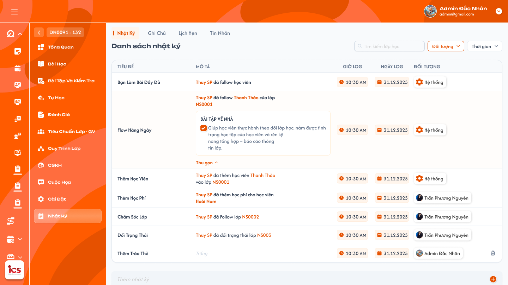
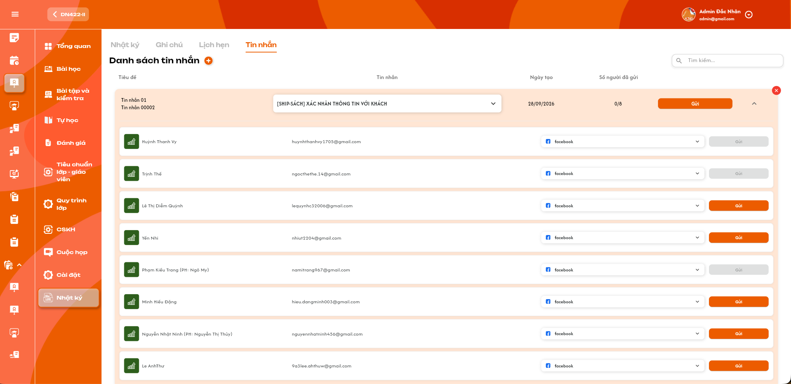
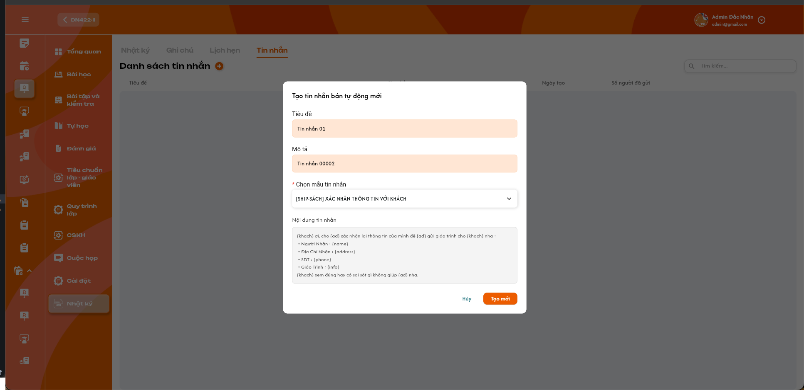
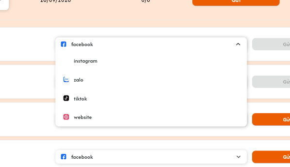

# Chi tiết lớp học — Menu Nhật ký — Tab Tin nhắn

## 1. UI

### Trang 1: ADM-LOP-050100 — Lớp học / Nhật ký / Nhật ký









**Mô tả:**
- Requirement **Chi tiết lớp học → Nhật ký → Tin Nhắn** (tab thứ tư cạnh `Nhật Ký`, `Ghi Chú`, `Lịch Hẹn`): thêm tin nhắn vào danh sách, chọn mẫu được định nghĩa sẵn, lấy các biến từ **CơmGao**, gửi toàn bộ học viên hoặc gửi từng học viên theo nền tảng đã chọn. Chức năng định nghĩa / quản lý mẫu tin nhắn được đặc tả riêng. Các tab [Nhật Ký](./class_detail_journal_requirements.md), [Ghi Chú](./class_detail_notes_requirements.md), [Lịch Hẹn](./class_detail_appointments_requirements.md) có requirement riêng.
- Tiêu đề màn hình là `Danh sách tin nhắn`; mỗi item là một tin nhắn bán tự động của chính lớp, có thể mở / thu gọn danh sách học viên. Ba ảnh phía trên (danh sách, popup tạo, chọn nền tảng) là UI của tab Tin Nhắn do người dùng cung cấp; frame Figma của trang này là khung tab Nhật ký chứa thanh tab (xem Q09).

**Điểm cần lưu ý:**
- Admin thao tác theo quyền quản trị chung, không yêu cầu được add vào lớp. Class Handler và Support chỉ được xem / tạo / gửi / đổi mẫu / xóa khi đã được add vào chính lớp đang mở. Quyền thao tác không giới hạn theo người tạo item.
- Tên mẫu, ngày, nội dung ví dụ và `0/8` trong ảnh là dữ liệu mẫu; hiển thị từ bản ghi thực tế.
- Chỉ tạo item vào danh sách khi thao tác Tạo mới thành công. Nhãn bán tự động không có nghĩa tự gửi ngay, chạy theo lịch hoặc gửi khi thay đổi dữ liệu CơmGao. Mở / thu gọn hay tải lại giữ đúng item và kết quả gửi đã lưu; không tự phát sinh lần gửi mới.
- `A01.01` Nút `+` mở popup `Tạo tin nhắn bán tự động mới`; không gửi tin nhắn khi chỉ mở popup.
- `A01.02` Tiêu đề: hiển thị Tiêu đề và Mô tả ở đầu item; là metadata của tin nhắn lớp, không tự thêm vào nội dung gửi.
- `A01.03` Tin nhắn: dropdown hiển thị tên mẫu đang dùng, không hiển thị placeholder mẫu như một tin nhắn đã gửi. Cho chọn mẫu theo quyền; đổi mẫu không reset count hoặc mở lại quyền gửi học viên đã thành công.
- `A01.04` Ngày tạo: ngày tạo item, định dạng `dd/MM/yyyy` (vd `28/09/2026`); không thay bằng ngày gửi của học viên.
- `A01.05` Số người đã gửi `S/T`: S là số học viên đã được xác nhận gửi thành công cho item, T là tổng người nhận trong danh sách (8 học viên chưa gửi hiển thị `0/8`). Gửi thất bại / đang chờ không tăng S.
- `A01.06` Gửi chung: nút cam `Gửi` ở đầu item gửi cho toàn bộ danh sách người nhận đủ điều kiện của item đó, không áp dụng cho mọi item.
- `A01.07` Mở / Thu gọn: chevron bên phải mở / thu gọn các dòng học viên; không tạo / gửi / cập nhật dữ liệu nghiệp vụ.
- `A01.08` Nút `×` đỏ hiện khi hover item; bấm mở popup xác nhận xóa, chỉ thực hiện sau confirm. Khác với chevron thu gọn.
- `A01.09` Tìm kiếm: ô `Tìm kiếm...` **chỉ search theo Tiêu đề tin nhắn** trong lớp hiện tại; không search Mô tả, tên mẫu, nội dung mẫu hoặc thông tin học viên. Không kế thừa debounce của Nhật Ký (xem Q07).
- `A01.10` Tải dữ liệu: có loading / rỗng / lỗi và `Thử lại`. Không trộn item hay số người đã gửi của lớp khác.
- `A02.01` Popup — Tiêu đề: **bắt buộc**, không giới hạn ký tự, không chấp nhận rỗng / chỉ khoảng trắng; hiển thị xuống dòng khi dài trên item, giữ toàn bộ giá trị đã lưu.
- `A02.02` Popup — Mô tả: **bắt buộc**, không giới hạn ký tự, không chấp nhận rỗng / chỉ khoảng trắng; là metadata bổ sung, không tự thêm vào nội dung gửi.
- `A02.03` Chọn mẫu tin nhắn * : bắt buộc, chọn một mẫu đã định nghĩa ở chức năng riêng; lưu đúng định danh mẫu, không dùng tên hiển thị làm khóa. Chọn mẫu khác phải hiển thị nội dung của đúng mẫu mới. Không có mẫu hoặc mẫu không còn khả dụng phải báo rõ, không tạo item với mẫu không hợp lệ.
- `A02.04` Nội dung tin nhắn: hiển thị nội dung mẫu đang chọn và các placeholder theo định nghĩa, giữ xuống dòng; **chỉ đọc**, không tạo bản nội dung chỉnh riêng. Muốn sửa phải vào chức năng define mẫu. Popup chưa chỉ định học viên nên preview có thể còn biến dạng `{name}`, `{phone}`…; nội dung thực tế được thay biến riêng cho từng người nhận trước khi gửi.
- `A02.05` `Hủy`: đóng popup, không thêm item, không gửi; không Toast CRUD.
- `A02.06` `Tạo mới`: kiểm tra dữ liệu / quyền / mẫu rồi lưu item vào đúng lớp; chống gửi lặp. Thành công đóng popup, cập nhật danh sách, một Toast tạo thành công. Lỗi giữ dữ liệu nhập để thử lại, không tạo nhiều item nếu bấm / callback lặp.
- `A03.01` Học viên: mỗi dòng có icon / avatar, tên học viên và email; thông tin PH nếu có hiển thị từ dữ liệu nguồn, không mặc nhiên chuyển người nhận sang phụ huynh chỉ vì tên có PH.
- `A03.02` Nguồn người nhận: dựa trên [Học viên của lớp](./class_detail_students_requirements.md) và liên kết sang đúng hồ sơ / cuộc hội thoại CơmGao của chính học viên đó (xem Q04).
- `A03.03` Dropdown nền tảng: Facebook, Instagram, Zalo, TikTok, Website; chọn một nền tảng trên từng dòng, icon / nhãn đúng platform. Lựa chọn của A không thay platform của B hay toàn lớp; Facebook trong ảnh không phải mặc định cho mọi học viên (xem Q05).
- `A03.04` Đích gửi: lấy tài khoản / cuộc hội thoại của đúng học viên trên nền tảng đã chọn từ CơmGao. Email trên UI chỉ để hiển thị, không phải đích gửi cho mọi nền tảng. Không ghép hồ sơ bằng tên / email trùng; liên kết không xác định duy nhất thì báo thiếu thông tin, không đoán.
- `A03.05` Gửi từng học viên: nút `Gửi` riêng chỉ gửi nội dung của item này cho học viên cùng dòng bằng platform của dòng đó. Nút cam khi có liên kết hợp lệ và đủ quyền / dữ liệu; **xám / disabled khi chưa liên kết nền tảng đang chọn**. Trong lúc gửi khóa thao tác để chống lặp. Học viên đã gửi thành công được đánh dấu đã gửi và chặn thao tác; không suy ra đã gửi chỉ từ màu xám.
- `A03.06` Thiếu liên kết nền tảng: không tự chuyển sang nền tảng khác hoặc user khác; hiển thị lý do không gửi được. Nền tảng chưa khả dụng phải có lý do rõ, không báo gửi thành công giả. Danh sách 5 nền tảng là thiết kế mục tiêu (xem Q10).
- `A04.01` Biến mẫu: danh sách biến / ý nghĩa do chức năng mẫu và CơmGao cung cấp. Ảnh có `{khach}`, `{ad}`, `{name}`, `{address}`, `{phone}`, `{info}` là ví dụ, không tự định nghĩa mapping trường nghiệp vụ tại tab này (xem Q06).
- `A04.02` Thay biến: trước khi gửi, lấy dữ liệu CơmGao của đúng người nhận theo mapping nguồn, tạo nội dung riêng và giữ văn bản / xuống dòng. Không điền giá trị giả, không gửi biến chưa thay hợp lệ, không dùng dữ liệu của người đang thao tác để thay mọi biến.
- `A04.03` Gửi một người: nút `Gửi` ở dòng chỉ xử lý một học viên của item; dùng template / nội dung và platform tương ứng.
- `A04.04` Gửi toàn bộ: nút `Gửi` ở đầu item xử lý các học viên đủ điều kiện trong danh sách nhận của item, dùng platform riêng của từng người; không đổi mọi người sang platform của dòng đầu.
- `A04.05` Đang gửi: khóa / chống gửi lặp cùng item / người nhận; gửi chung và riêng đồng thời không tạo hai lần gửi ngoài ý muốn.
- `A04.06` Kết quả từng người: ghi nhận người nhận, platform, nội dung thực tế sau thay biến, thời điểm và kết quả; lỗi của một người không làm những người đã thành công bị ghi nhận thất bại. Gửi chung ghi rõ số thành công / thất bại / bỏ qua / đang chờ, không báo toàn bộ thành công nếu có lỗi. Timeout chưa biết kết quả thì giữ trạng thái chưa xác định, kiểm tra kết quả trước thử lại, không tự phát lại.
- `A04.07` Số người đã gửi: chỉ tăng S sau xác nhận gửi thành công cho học viên chưa được tính; giữ qua tải lại; không khẳng định đã đọc / đã nhận chỉ dựa trên thao tác được tiếp nhận.
- `A04.08` Gửi lại: **không cho gửi lại** người đã thành công trong cùng item, cả nút riêng và Gửi chung (gửi chung bỏ qua người đã thành công). Đổi platform / mẫu, refresh hoặc user khác thao tác không xóa trạng thái đã gửi hay mở lại quyền gửi. Người chưa gửi thành công còn được gửi sau khi xử lý lỗi / thiếu liên kết.
- `A05.01` Dropdown mẫu trên item: cho Admin hoặc Class Handler / Support đã add vào lớp chọn mẫu có sẵn. Khi đổi, nội dung chưa gửi phải khớp mẫu mới; không sửa định nghĩa mẫu gốc; không reset count hay mở đợt gửi mới cho học viên đã thành công.
- `A05.02` Sửa Tiêu đề / Mô tả: chưa có editor hoặc cách mở sửa metadata; không tự thêm thao tác bấm dòng để sửa như Nhật Ký.
- `A05.03` Nút `×`: click mở popup có thông báo `Bạn có chắc muốn xóa tin nhắn này?`, nút `Hủy` / `Xóa`. Không thu hồi tin đã gửi (xem Q01).
- `A05.04` Tin nhắn đã gửi: thay mẫu / xóa item không thay nội dung thực tế đã gửi ra platform hoặc tự thu hồi tin nhắn.
- `A05.05` Xác nhận xóa: `Hủy` đóng popup, không request / Toast CRUD. `Xóa` kiểm tra lại role / thành viên lớp / item, khóa chống lặp; chỉ bỏ item sau lưu thành công, một Toast `Xóa tin nhắn thành công.`; lỗi giữ item và Toast `Không thể xóa tin nhắn. Vui lòng thử lại.`
- `A05.06` Dữ liệu kết quả gửi: không mất / đổi kết quả gửi đã xác nhận khi đổi dữ liệu hiển thị; thay đổi mẫu gốc ở define không viết lại nội dung đã gửi (xem Q03).
- `A06.01` Toast `Thành Công`: tạo `Tạo tin nhắn thành công.`; cập nhật `Cập nhật tin nhắn thành công.`; xóa `Xóa tin nhắn thành công.`; gửi riêng `Gửi tin nhắn thành công cho {Tên học viên}.`; gửi chung `Đã gửi tin nhắn thành công cho {Số người} học viên.`
- `A06.02` Toast `Thông Báo`: khi đang xử lý `Đang gửi tin nhắn. Vui lòng chờ cập nhật kết quả.`; không coi là thành công hoặc tăng count.
- `A06.03` Toast `Cảnh Báo`: thiếu Tiêu đề / Mô tả `Vui lòng nhập đầy đủ tiêu đề và mô tả.`; chưa chọn mẫu `Vui lòng chọn mẫu tin nhắn.`; thiếu biến / đích gửi nêu lý do của người nhận; kết quả hỗn hợp `Kết quả gửi: {S} thành công, {F} thất bại, {K} bỏ qua, {P} đang chờ.`
- `A06.04` Toast `Có Lỗi Xảy Ra`: tạo `Không thể tạo tin nhắn. Vui lòng thử lại.`; xóa `Không thể xóa tin nhắn. Vui lòng thử lại.`; gửi lỗi đã xác định `Không thể gửi tin nhắn cho {Tên học viên}. Vui lòng kiểm tra và thử lại.`; tải / timeout chưa rõ kết quả không dùng thông báo khẳng định đã thất bại.
- `A06.05` Đóng và thời lượng: icon / màu / vị trí / thời gian tự đóng và nút `×` theo Toast dùng chung; đóng Toast không hủy gửi hay hoàn tác dữ liệu. Mỗi kết quả logic một Toast, gửi chung không spam Toast từng dòng; không Toast CRUD khi chỉ xem / chọn platform / mở hoặc hủy popup.


---

## 2. Yêu cầu

### 2.1. Flow chính

**Flow 1: Xem tab Tin Nhắn**

```
Admin/Class Handler/Support mở lớp → Nhật ký → Tin Nhắn
      → Kiểm tra role và phạm vi lớp
      → Tải item và kết quả gửi của đúng lớp
      → Mở/thu gọn danh sách người nhận; hiển thị S/T và nền tảng từng người
      → Tìm kiếm chỉ đối chiếu Tiêu đề tin nhắn trong lớp đang xem
      → Không tự gửi khi xem/chuyển tab/tải lại
```

**Flow 2: Thêm tin nhắn từ mẫu sẵn có**

```
Người có quyền tạo bấm +
      → Nhập Tiêu đề/Mô tả bắt buộc, không giới hạn ký tự
      → Chọn mẫu có sẵn, xem nội dung/biến nguồn
      → Hủy: đóng, không lưu/không gửi
      → Tạo mới: kiểm tra dữ liệu, quyền, mẫu và lớp; chống tạo lặp
      → Thành công: thêm item, Toast Tạo tin nhắn thành công., chưa gửi học viên
      → Lỗi: giữ input, không thêm item, một Toast lỗi/cảnh báo
```

**Flow 3: Gửi cho một học viên**

```
Mở item → Chọn nền tảng tại dòng học viên
      → Bấm Gửi ở cùng dòng
      → Kiểm tra quyền, điều kiện gửi/gửi lại, mẫu, học viên và đích CơmGao
      → Lấy biến từ CơmGao theo mapping, cá nhân hóa nội dung của người nhận
      → Gửi qua platform đã chọn, chống request trùng
      → Xác nhận thành công: lưu kết quả, tăng S nếu học viên chưa được tính, một Toast kết quả
      → Thiếu dữ liệu/lỗi: không tăng S, nêu lý do; chưa rõ kết quả thì kiểm tra trước thử lại
```

**Flow 4: Gửi toàn bộ danh sách**

```
Người có quyền bấm Gửi ở đầu một item
      → Xác định các học viên đủ điều kiện trong danh sách nhận của item
      → Kiểm tra mẫu/biến/đích và dùng platform đã chọn riêng của từng người
      → Cá nhân hóa và gửi từng người; chống trùng với thao tác riêng đang chạy
      → Ghi nhận thành công/thất bại/bỏ qua/đang chờ riêng từng người
      → Cập nhật S/T đúng số người thành công, hiển thị một tổng kết kết quả
      → Không gửi lại học viên đã thành công; bỏ qua trong gửi chung và chặn nút riêng
```

**Flow 5: Xác nhận xóa item**

```
Admin hoặc Class Handler/Support đã add vào lớp hover item → Hiện ×
      → Click ×: mở popup xác nhận, chưa xóa ngay
      → Hủy: đóng popup, giữ item, không request/Toast CRUD
      → Xóa: backend kiểm tra quyền và item, chống gửi lặp
      → Thành công: bỏ item khỏi danh sách, một Toast Xóa tin nhắn thành công.
      → Thất bại: giữ item, một Toast Không thể xóa tin nhắn. Vui lòng thử lại.
      → Không thu hồi tin đã gửi trên nền tảng
```

### 2.2. Ngoại lệ

- **EX01:** Tải danh sách/người nhận/mẫu lỗi → trạng thái lỗi và Thử lại, không coi là rỗng hay dữ liệu hợp lệ để gửi.
- **EX02:** Response thuộc lớp/item/tab cũ → không ghi đè giao diện hiện tại; kết quả đã gửi vẫn liên kết đúng item/người nhận gốc.
- **EX03:** Thiếu quyền tab/lớp/thao tác → từ chối UI/request trực tiếp; không trả dữ liệu ngoài quyền và không gửi.
- **EX04:** Mẫu trống/không tồn tại/không được dùng hoặc metadata vi phạm validation đã chốt → không tạo/cập nhật/gửi, báo field/lý do và Toast phù hợp.
- **EX05:** Tạo/cập nhật item lỗi hoặc gửi lặp → không nhân bản item, không lưu một phần; giữ input để thử lại.
- **EX06:** Thiếu liên kết CơmGao/đích platform hoặc platform chưa khả dụng → không tự chuyển đích/nền tảng, báo lý do của người nhận, không tăng S.
- **EX07:** Thiếu mapping/biến hợp lệ hoặc nguồn CơmGao lỗi → không gửi nội dung sai/chưa thay biến; giữ kết quả riêng từng người.
- **EX08:** Gửi chung/riêng hoặc callback trùng → chống gửi lặp cùng item/người nhận đang xử lý, không tính S hai lần. Học viên đã thành công không được gửi lại dù đổi mẫu/platform hay user thao tác.
- **EX09:** Timeout chưa biết kết quả gửi → không tự gửi lại/đánh dấu chắc chắn thất bại, kiểm tra/reconcile kết quả trước thử lại.
- **EX10:** Học viên đã gửi thành công → chặn gửi lại qua UI/request, kể cả đổi mẫu/platform, không gửi lần mới hoặc tăng count.
- **EX11:** Xóa lỗi/gửi lặp hoặc item không còn hợp lệ → không xóa nhầm/nhân đôi thao tác; giữ dữ liệu hiển thị phù hợp, một Toast kết quả.

### 2.3. Yêu cầu khác

| Mã | Tên yêu cầu | Mô tả |
|---|---|---|
| REQ01 | Danh sách | Item thuộc lớp hiện tại, đủ Tiêu đề/Mô tả/Mẫu/Ngày tạo/Số người đã gửi, + tạo, Gửi chung, mở/thu gọn và **search chỉ theo Tiêu đề tin nhắn** trong lớp hiện tại. Không tự gửi khi tạo/xem/chọn dữ liệu. |
| REQ02 | Mẫu tin nhắn | Tiêu đề/Mô tả đều bắt buộc, không giới hạn ký tự, không chấp nhận chỉ khoảng trắng. Chọn một mẫu có sẵn bắt buộc; template/nội dung/biến từ chức năng nguồn. Tab này không định nghĩa hay sửa mẫu gốc. Metadata và preview theo popup; **nội dung chỉ đọc**, muốn sửa vào chức năng define mẫu. Đổi mẫu không reset count hoặc cho gửi lại người đã thành công. |
| REQ03 | Biến CơmGao | Lấy các biến của đúng học viên theo mapping nguồn trước gửi; mỗi người có nội dung riêng. Không định nghĩa mapping từ ví dụ ảnh hoặc dùng dữ liệu giả. Lưu được kết quả/nội dung đã gửi mà thay mẫu sau này không viết lại lịch sử. |
| REQ04 | Người nhận và nền tảng | Học viên thuộc lớp, liên kết đúng CơmGao; mỗi dòng chọn Facebook/Instagram/Zalo/TikTok/Website theo UI. Đích gửi phụ thuộc platform đã chọn, không lấy email hiển thị làm địa chỉ chung hoặc tự fallback. |
| REQ05 | Gửi | Gửi một người bằng nút dòng hoặc toàn bộ người đủ điều kiện chưa thành công bằng nút đầu item. Không cho gửi lại học viên đã thành công trong cùng item, kể cả đổi mẫu/platform hoặc user thao tác. Cá nhân hóa theo người, dùng platform riêng, chống lặp chung/riêng. Kết quả hỗn hợp giữ từng kết quả; timeout cần xác định kết quả trước thử lại. |
| REQ06 | Kết quả và count | S/T đếm học viên duy nhất đã được xác nhận gửi thành công / tổng danh sách nhận của item. Không tăng khi đang chờ/lỗi hoặc đếm thêm vì cùng người gửi nhiều lần. Ghi nhận đúng item/người/platform/nội dung thực tế/thời điểm/kết quả; không suy ra đã đọc. |
| REQ07 | Notification | Tạo/quản lý/gửi có một Toast kết quả logic theo UI chung; gửi chung có tổng kết, không spam từng dòng. Chỉ báo thành công khi được xác nhận; Hủy/chỉ xem/chọn platform không Toast CRUD. |
| REQ08 | Quyền và phạm vi | Admin theo quyền quản trị chung không cần add vào lớp; Class Handler/Support phải được add vào lớp mới được xem/tạo/gửi/đổi mẫu/xóa. Không giới hạn theo người tạo item và không kế thừa owner từ tab khác; Sale/role khác không vào tab. Kiểm tra lại quyền/người nhận/đích trước thay đổi và gửi, kể cả request trực tiếp. |
| REQ09 | Xóa có xác nhận | Hover item hiện ×; click mở popup, chưa xóa ngay. Hủy không đổi dữ liệu, confirm mới xóa sau kiểm tra quyền. Xóa thành công bỏ item và một Toast; lỗi giữ item. Không thu hồi tin đã gửi. |

### 2.4. Ràng buộc

#### Quyền

| Role | Xem item/người nhận/kết quả | Tạo item | Gửi chung/riêng | Chọn/Đổi mẫu | Thao tác × | Sửa nội dung mẫu ở tab |
|---|:---:|:---:|:---:|:---:|:---:|:---:|
| Admin (phạm vi quản trị) | ✅ | ✅ | ✅ | ✅ | ✅ | ❌ |
| Class Handler đã được add vào lớp | ✅ | ✅ | ✅ | ✅ | ✅ | ❌ |
| Support đã được add vào lớp | ✅ | ✅ | ✅ | ✅ | ✅ | ❌ |
| Class Handler/Support chưa được add vào lớp | ❌ | ❌ | ❌ | ❌ | ❌ | ❌ |
| Sale và các role khác | ❌ | ❌ | ❌ | ❌ | ❌ | ❌ |

#### Ràng buộc khác

- Admin theo quyền quản trị chung; Class Handler/Support phải được add vào chính lớp. Được quản lý item của người khác trong phạm vi này, không kiểm tra owner như Ghi Chú/Lịch Hẹn. Gỡ khỏi lớp phải mất quyền ngay khi kiểm tra request.
- Chức năng quản lý mẫu là feature khác; quyền vào tab này không tự cấp quyền tạo/sửa định nghĩa mẫu.
- Dùng định danh lớp/item/mẫu/học viên/liên kết CơmGao/cuộc hội thoại và platform, không ghép theo tên/email hiển thị. Kết quả gửi vẫn thuộc đúng item/người nhận khi giao diện đã chuyển lớp/tab.
- Nguồn mẫu/biến và đích CơmGao phải được đối chiếu đúng người. Tab này chỉ sử dụng dữ liệu nguồn, không tự sửa hồ sơ CơmGao hay tạo tài khoản platform mới.
- Không tự gửi tới học viên lớp khác, mọi người trong CơmGao hoặc phụ huynh không được cấu hình làm đích nhận. Gửi full chỉ áp dụng danh sách của một item.
- Không thêm lịch gửi tự động, tạo mẫu mới, thu hồi tin đã gửi hay nhật ký Hệ thống tự ghi action gửi tin nhắn khi chưa có yêu cầu riêng.

---

## 3. Testcase

### Feature: Chi tiết lớp học — Menu Nhật ký — Tab Tin nhắn

| Tên testcase | Priority | Scenario | Role | Pre-condition | Given/When/Then | Expected Result |
|---|---|---|---|---|---|---|
| Case 1: Xem danh sách, mở/thu gọn, count và search | High | Flow 1 / REQ01 / REQ06 | Admin / Class Handler / Support có quyền | Lớp A/B có item khác nhau; item có 8 học viên (3 thành công, 2 đang chờ, 3 lỗi/chưa gửi); item X có từ khóa ở Tiêu đề, item Y chỉ có ở Mô tả/mẫu/thông tin học viên | **Given:** mở Chi tiết lớp A, chọn Tin Nhắn<br>**When:** mở rồi thu gọn item, search từ khóa<br>**Then:** chỉ tải item của A, count `3/8`, search chỉ trả item X | - Đúng Tiêu đề/Tin nhắn/Ngày tạo/Số người đã gửi, không trộn lớp B<br>- Mở/thu gọn không gửi, không đổi count<br>- Không tính đang chờ/lỗi, không đếm số lần gửi<br>- Xóa từ khóa khôi phục danh sách; search không tạo/gửi |
| Case 2: Tải rỗng/lỗi và response cũ | High | EX01 / EX02 | Admin / Class Handler / Support có quyền | Request chậm/lỗi hoặc chuyển lớp | **Given:** mở tab lớp A rồi chuyển B<br>**When:** response A về muộn hoặc tải B lỗi<br>**Then:** chỉ cập nhật đúng lớp và trạng thái | - Không coi lỗi là rỗng, có Thử lại<br>- Không tự gửi lại<br>- Kết quả đã gửi vẫn đúng item/người nhận gốc |
| Case 3: Quyền xem tab và thành viên lớp | High | EX03 / REQ08 / Ràng buộc quyền | Admin / Class Handler / Support / Sale và role khác | Admin chưa add vào lớp; Class Handler/Support có và không có trong lớp; item do A tạo | **Given:** mở tab hoặc gửi request trực tiếp bằng từng tài khoản<br>**When:** kiểm tra quyền, rồi gỡ Class Handler khỏi lớp<br>**Then:** Admin thao tác được, Class Handler/Support chỉ khi đã add vào lớp, Sale/role khác bị chặn | - Không trả người nhận/nội dung/count ngoài quyền<br>- Gỡ khỏi lớp mất quyền ngay<br>- Không giới hạn theo người tạo item<br>- Backend kiểm tra lại khi lưu/gửi |
| Case 4: Tạo item thành công và validation | High | Flow 2 / REQ02 / REQ07 / EX04 | Admin / Class Handler / Support có quyền | Mẫu hợp lệ; popup mở từ `+` | **Given:** nhập đủ Tiêu đề/Mô tả (kể cả rất dài), chọn mẫu; hoặc để rỗng/chỉ khoảng trắng, hoặc chưa chọn mẫu<br>**When:** bấm Tạo mới<br>**Then:** hợp lệ tạo một item cho đúng lớp; thiếu dữ liệu không tạo | - Count ban đầu `0/T`, không gửi tự động, Toast `Tạo tin nhắn thành công.`<br>- Thiếu field báo đúng field và Cảnh Báo, giữ dữ liệu nhập<br>- Không cắt hoặc từ chối vì giới hạn ký tự<br>- Metadata không thêm vào nội dung gửi |
| Case 5: Đổi mẫu, preview chỉ đọc, mẫu hết hiệu lực | High | REQ02 / EX04 | Admin / Class Handler / Support có quyền | Có 2 mẫu khác nội dung; một mẫu không còn khả dụng | **Given:** popup đang mở, chọn mẫu A rồi B, thử sửa nội dung hoặc gửi request nội dung tùy ý, chọn mẫu hết hiệu lực<br>**When:** bấm Tạo mới<br>**Then:** preview thuộc B; không sửa được; mẫu hết hiệu lực không tạo item | - Tên/định danh/nội dung khớp, giữ xuống dòng/placeholder<br>- UI chỉ đọc, không ghi đè mẫu gốc<br>- Lỗi field và Cảnh Báo, không tự chọn mẫu khác |
| Case 6: Hủy, tạo lỗi và chống lặp | High | EX05 / REQ02 / REQ07 | Admin / Class Handler / Support có quyền | Có dữ liệu chưa lưu hoặc backend lỗi | **Given:** bấm Hủy; hoặc bấm Tạo mới lặp/backend lỗi<br>**When:** xử lý đóng/lưu<br>**Then:** Hủy không lưu; lưu lỗi không thêm item | - Hủy không Toast<br>- Lỗi giữ dữ liệu để thử lại, một Toast lỗi<br>- Một thao tác logic tạo tối đa một item |
| Case 7: Chọn nền tảng, đích gửi, thiếu liên kết | High | REQ04 / EX06 | Admin / Class Handler / Support có quyền | A có nhiều platform, B trùng tên/email; A chưa liên kết Facebook nhưng có Zalo hợp lệ; tên học viên có thông tin PH | **Given:** đổi platform của A sang Zalo; chọn Facebook cho A<br>**When:** xem nút Gửi và chuẩn bị gửi<br>**Then:** chỉ platform A đổi; Facebook nút xám/disabled có lý do; Zalo gửi được | - Đủ 5 lựa chọn đúng icon/nhãn, B không đổi, chọn không gửi<br>- Dùng đúng hồ sơ và đích A, không dùng email chung, không fallback, không suy ra đích PH từ tên<br>- Count không tăng, không báo thành công giả |
| Case 8: Thay biến riêng từng học viên | High | Flow 3 / REQ03 / EX07 | Admin / Class Handler / Support có quyền | A/B có name/address/phone khác nhau trong CơmGao; một người thiếu biến hoặc nguồn lỗi | **Given:** dùng cùng mẫu<br>**When:** chuẩn bị/gửi A và B<br>**Then:** nội dung từng người dùng dữ liệu của người đó; người thiếu biến không được gửi | - Không lẫn A/B, giữ xuống dòng<br>- Không gửi placeholder chưa thay, không dùng dữ liệu giả/user khác<br>- Báo lý do, count không tăng |
| Case 9: Gửi riêng một người | High | Flow 3 / REQ05 | Admin / Class Handler / Support có quyền | A đủ điều kiện theo cấu hình | **Given:** chọn platform A<br>**When:** bấm Gửi tại A<br>**Then:** chỉ gửi item này cho A | - Không gửi B hoặc item khác<br>- Kết quả/count chỉ cập nhật đúng item<br>- Toast `Gửi tin nhắn thành công cho {Tên}.` |
| Case 10: Gửi chung theo platform từng người, kết quả hỗn hợp | High | Flow 4 / REQ05 / REQ06 / REQ07 | Admin / Class Handler / Support có quyền | A chọn Facebook, B chọn Zalo, một người gửi lỗi | **Given:** item có A/B và người lỗi<br>**When:** bấm Gửi chung<br>**Then:** A gửi qua Facebook, B qua Zalo; giữ từng kết quả | - Không đồng loạt dùng platform đầu, nội dung cá nhân hóa<br>- Người thành công được tính S, lỗi/đang chờ chưa tính<br>- Một Toast tổng kết `Kết quả gửi: ...`, không báo tất cả thành công, không spam |
| Case 11: Chống lặp và timeout | High | EX08 / EX09 / REQ05 / REQ06 | Admin / Class Handler / Support có quyền | Cùng item/học viên đang gửi; hoặc platform timeout sau tiếp nhận; callback trùng | **Given:** bấm gửi lặp/chung và riêng cùng lúc; request đã gửi nhưng chưa rõ kết quả<br>**When:** xử lý thao tác<br>**Then:** chỉ một lần gửi logic cho cùng đích; timeout kiểm tra kết quả trước thử lại | - Count không tăng hai lần, A chỉ tính một người<br>- Không tự gửi lại, không báo thất bại/thành công chắc chắn khi chưa biết<br>- Kết quả lưu đúng item/người/platform, không mất lịch sử nội dung |
| Case 12: Không gửi lại người đã thành công | High | EX10 / REQ05 | Admin / Class Handler / Support | A đã thành công, B chưa gửi; cả hai có liên kết; hoặc tất cả đã gửi/không có liên kết | **Given:** mở item<br>**When:** bấm Gửi chung, thử Gửi riêng A hoặc request trực tiếp, đổi platform/mẫu, user khác thao tác<br>**Then:** chỉ B được gửi, A bị bỏ qua/chặn | - Không tăng S do A, không mở lại quyền gửi<br>- Không còn người gửi được thì không gọi gửi, không báo thành công cho 0 người giả, nêu lý do |
| Case 13: Đổi mẫu và quản lý item người khác tạo | High | REQ02 / REQ06 / REQ08 | Admin / Class Handler / Support | Item do A tạo dùng mẫu 1; B là Class Handler/Support đã add vào lớp, C là Admin | **Given:** B hoặc C mở item của A<br>**When:** đổi sang mẫu 2, gửi, thao tác ×<br>**Then:** không bị từ chối vì không phải người tạo; mẫu gốc và nội dung đã gửi giữ nguyên | - Không tự thu hồi/gửi lại, không reset S/T<br>- Admin không cần add vào lớp; Handler/Support ngoài lớp bị chặn<br>- Nội dung mẫu vẫn chỉ đọc |
| Case 14: Xóa item có xác nhận | High | Flow 5 / REQ09 / EX11 | Admin / Class Handler / Support có quyền | Item đủ điều kiện xóa; popup xóa đang mở; backend lỗi hoặc confirm lặp | **Given:** hover item, click ×; chọn Hủy; sau đó confirm Xóa (kể cả lặp/lỗi)<br>**When:** xử lý<br>**Then:** Hủy giữ item; xóa thành công mới bỏ item; lỗi giữ item | - Không nhầm với thu gọn, hủy không Toast CRUD<br>- Một Toast `Xóa tin nhắn thành công.` hoặc `Không thể xóa tin nhắn. Vui lòng thử lại.`<br>- Không thu hồi tin trên platform, không xóa nhầm/nhân đôi |
| Case 15: Toast tạo, gửi, đang gửi | Medium | REQ07 | Admin / Class Handler / Support có quyền | Một lần tạo/gửi có kết quả xác định; hoặc đang chờ kết quả | **Given:** tạo item, gửi riêng, gửi chung hỗn hợp, bấm `×` Toast<br>**When:** có kết quả<br>**Then:** Toast đúng trạng thái và đúng tên/số liệu | - Toast tạo không báo đã gửi, count vẫn `0/T`<br>- Đang gửi không phải thành công, không tăng count<br>- Đóng Toast không hủy gửi, callback lặp không nhân đôi Toast |

---

## 4. Câu hỏi cần xác nhận

- **Q01:** Xóa item là xóa mềm hay xóa cứng? Có cho xóa item đã gửi không và có phải lưu kết quả gửi sau khi xóa không?
- **Q02:** Thiết kế hiển thị `Đã gửi` và lý do không gửi được trên từng dòng chưa có ảnh chi tiết; cần bổ sung UI.
- **Q03:** Khi sửa mẫu gốc tại define, item dùng bản mới nhất hay bản chụp lúc tạo (version mẫu)?
- **Q04:** Tập người nhận gồm những trạng thái học viên nào; cố định lúc tạo hay theo danh sách lớp hiện tại; học viên rời / thêm lớp có thay T không?
- **Q05:** Platform mặc định là gì và lựa chọn platform có được lưu theo item / học viên giữa các lần tải và sau đổi mẫu không?
- **Q06:** Danh sách mẫu / mapping biến và ý nghĩa các placeholder cụ thể do chức năng mẫu / CơmGao cung cấp; thời điểm lấy dữ liệu, field bắt buộc và xử lý biến tùy chọn trống. Chưa có requirement nguồn mẫu tương ứng trong repo để dẫn chiếu.
- **Q07:** Thời điểm kích hoạt search (Enter hay debounce), sắp xếp mặc định, phân trang / số item mỗi trang?
- **Q08:** Đích gửi và cấu hình khả dụng của từng nền tảng, đặc biệt Website; cách xác định thành công / tình trạng gửi từ nguồn. Dropdown trong ảnh không thay đặc tả tích hợp gửi của CơmGao.
- **Q09:** Chưa có frame Figma riêng cho tab Tin Nhắn (frame ADM-LOP-050100 là khung tab Nhật ký); UI kết quả / lỗi từng người và lịch sử lần gửi chưa thể hiện rõ. Cần vẽ bổ sung?
- **Q10:** Danh sách 5 nền tảng (Facebook, Instagram, Zalo, TikTok, Website) có đủ khả dụng để gửi ngay, hay có nền tảng chưa tích hợp?
