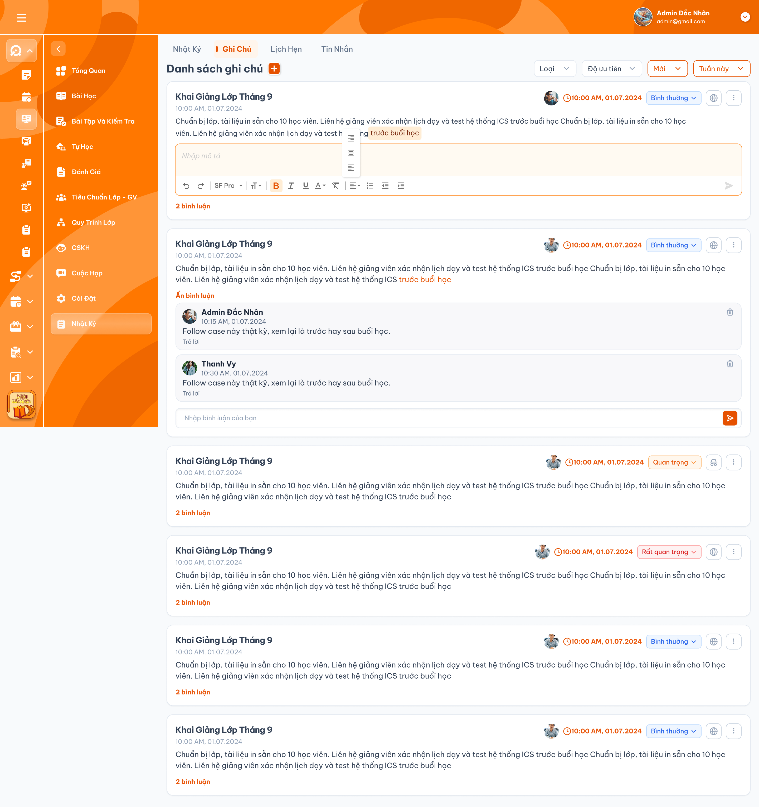
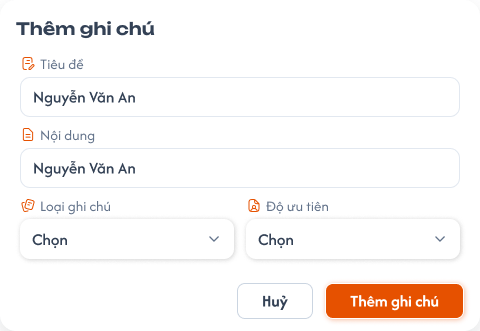

# Chi tiết lớp học — Menu Nhật ký — Tab Ghi chú

Tab **Chi tiết lớp học → Menu Nhật ký → Ghi Chú** có chức năng giống [Tab Ghi chú trong Chi tiết giáo viên](../teacher_management/teacher_detail_requirements.md#tab-ghi-chu): chức năng, quyền owner và quyền riêng tư được kế thừa; UI theo ảnh Ghi Chú lớp và các điểm xác nhận trong tài liệu này; đối tượng liên kết là **lớp đang xem**. Đây là ghi chú của lớp, không phải ghi chú của giáo viên. Tab [Nhật Ký](./class_detail_journal_requirements.md) được đặc tả riêng; tab [Lịch Hẹn](./class_detail_appointments_requirements.md) có requirement riêng; tab [Tin Nhắn](./class_detail_messages_requirements.md) có requirement riêng.

## 1. UI

### Trang 1: Tab Ghi Chú — Danh sách và bộ lọc


*UI Ghi Chú lớp do người dùng cung cấp — nhấn để xem ảnh gốc*

**Mô tả:**

- Trong menu Nhật ký của Chi tiết lớp, chọn tab `Ghi Chú` để xem danh sách ghi chú độc lập của đúng lớp đang mở.
- `Admin`, `Class Handler`, `Support` được truy cập/tạo ghi chú trong phạm vi lớp được phân quyền, theo cùng chức năng Ghi chú giáo viên.
- Owner là người tạo ghi chú, lấy từ danh tính đã xác thực. Người được phân công phụ trách lớp không mặc nhiên là owner của mọi ghi chú trong lớp.

**Giải thích field/thành phần:**

- `A01.01` **Tiêu đề**: Bắt buộc, không giới hạn ký tự; hiển thị ở đầu card và xuống dòng khi dài, không cắt nội dung đã lưu.
- `A01.02` **Nội dung**: Bắt buộc, không giới hạn ký tự; hỗ trợ xuống dòng và rich text theo toolbar UI, giữ đúng định dạng sau khi lưu/tải lại.
- `A01.03` **Loại**: Gồm `Công khai`, `Riêng tư`; mặc định `Công khai`.
- `A01.04` **Độ ưu tiên**: Gồm `Bình thường`, `Quan trọng`, `Rất quan trọng`; mặc định `Bình thường`.
- `A01.05` **Trạng thái**: Gồm `Mới`, `Đóng`; ghi chú mới mặc định là `Mới`.
- `A01.06` **Owner**: Hiển thị đúng người tạo theo chức năng nguồn; thời gian tạo dưới Tiêu đề có định dạng `hh:mm AM/PM, dd.MM.yyyy`, ví dụ `10:00 AM, 01.07.2024`.
- `A01.07` **Bình luận**: Hiển thị số lượng; cho phép mở/ẩn danh sách bình luận.
- `A01.08` **Hoạt động bình luận cuối**: Bên phải card hiển thị avatar người comment cuối và timestamp màu cam kèm icon đồng hồ, định dạng `hh:mm AM/PM, dd.MM.yyyy` như UI. Khi không có comment thì không hiển thị metadata comment cuối.
- `A01.09` **Thời gian cập nhật**: Ghi chú/comment đã sửa có thời điểm cập nhật và nhãn `Đã chỉnh sửa`; timestamp theo cùng định dạng UI. Hiển thị bổ sung, giữ nguyên thời gian tạo.
- `A01.10` **Control trên card**: Dropdown Độ ưu tiên, icon Công khai/Riêng tư và menu ba chấm theo UI; thao tác quản lý chỉ khả dụng cho owner.

**Điểm cần lưu ý:**

- `A01.11` **Ghi chú `Công khai` + `Mới`**: Owner: Xem, sửa, xóa, đóng, comment; Admin/Class Handler/Support khác: Xem và comment
- `A01.12` **Ghi chú `Riêng tư` + `Mới`**: Owner: Xem, sửa, xóa, đóng, comment; Admin/Class Handler/Support khác: Không nhìn thấy và không truy cập được
- `A01.13` **Ghi chú `Công khai` + `Đóng`**: Owner: Xem, sửa, xóa, mở lại; không comment khi đang đóng; Admin/Class Handler/Support khác: Không nhìn thấy và không truy cập được
- `A01.14` **Ghi chú `Riêng tư` + `Đóng`**: Owner: Xem, sửa, xóa, mở lại; không comment khi đang đóng; Admin/Class Handler/Support khác: Không nhìn thấy và không truy cập được

- Chỉ owner được cập nhật tiêu đề, nội dung, loại, độ ưu tiên và trạng thái; chỉ owner được xóa ghi chú.
- Chỉ owner được đóng ghi chú và mở lại ghi chú đã đóng.
- Trạng thái `Mới` là trạng thái hoạt động tương ứng với `Mở` trong chức năng Ghi chú giáo viên; ghi chú mới tạo mặc định Mới.
- Ghi chú đã đóng chỉ owner được xem; quy tắc này áp dụng cả khi Loại đang là `Công khai`.
- Người không phải owner chỉ được xem và comment ghi chú `Công khai` đang `Mới`.
- Backend phải áp dụng điều kiện quyền và tính riêng tư trước khi trả dữ liệu; không chỉ ẩn thao tác ở UI.

- Mọi bản ghi, comment, bộ lọc và số lượng kết quả đều thuộc lớp đang xem. Ghi chú của giáo viên, học viên hoặc lớp khác không được đưa vào đây, kể cả cùng owner/tên hoặc cùng giáo viên dạy hai lớp.
- Kế thừa validation của Ghi chú giáo viên: **Tiêu đề và Nội dung đều bắt buộc**. Field thời gian tạo không thay đổi khi sửa ghi chú; filter lấy thời gian tạo ghi chú, không lấy thời điểm sửa hoặc bình luận cuối.
- Control thêm/sửa/xóa/đóng/mở dùng cùng cách thao tác như Ghi chú giáo viên. Không áp dụng cơ chế nhập/sửa nhật ký viết tay của tab Nhật Ký cho tab này.

**Bộ lọc và phân trang:**

- `A01.15` **Loại**: Giá trị và quy tắc: `Công khai`, `Riêng tư`; trạng thái không chọn giá trị không giới hạn theo Loại. Kết quả vẫn phải tuân thủ quyền riêng tư.
- `A01.16` **Độ ưu tiên**: Giá trị và quy tắc: `Bình thường`, `Quan trọng`, `Rất quan trọng`; trạng thái không chọn giá trị không giới hạn theo độ ưu tiên.
- `A01.17` **Trạng thái ghi chú**: Giá trị và quy tắc: `Mới`, `Đóng`; trạng thái không chọn giá trị không giới hạn theo trạng thái. Ghi chú đóng vẫn chỉ owner được nhận trong kết quả.
- `A01.18` **Thời gian**: Giá trị và quy tắc: Mặc định `Hôm nay`; lọc theo thời gian tạo ghi chú (`created_at`) trong múi giờ nghiệp vụ.

**Khoảng thời gian:**

- `A01.19` **`Tới hạn`**: Phạm vi bao gồm: Từ thời điểm bắt đầu lưu dữ liệu của hệ thống đến hết ngày hôm nay.
- `A01.20` **`Hôm nay`**: Phạm vi bao gồm: Từ đầu ngày đến hết ngày hôm nay; là giá trị mặc định.
- `A01.21` **`Hôm qua`**: Phạm vi bao gồm: Toàn bộ ngày liền trước hôm nay.
- `A01.22` **`Hôm nay và hôm qua`**: Phạm vi bao gồm: Hợp của toàn bộ ngày hôm qua và ngày hôm nay.
- `A01.23` **`Tuần này`**: Phạm vi bao gồm: Từ đầu Thứ 2 đến hết Chủ Nhật của tuần hiện tại.
- `A01.24` **`Tuần trước`**: Phạm vi bao gồm: Từ đầu Thứ 2 đến hết Chủ Nhật của tuần liền trước.
- `A01.25` **`Tháng này`**: Phạm vi bao gồm: Từ ngày đầu đến ngày cuối của tháng hiện tại.
- `A01.26` **`Tháng trước`**: Phạm vi bao gồm: Từ ngày đầu đến ngày cuối của tháng liền trước.
- `A01.27` **`3 tháng trước`**: Phạm vi bao gồm: Từ đầu ngày cách ngày hiện tại ba tháng đến thời điểm hiện tại.
- `A01.28` **`Năm nay`**: Phạm vi bao gồm: Từ ngày 01/01 đến ngày 31/12 của năm hiện tại.
- `A01.29` **`Năm trước`**: Phạm vi bao gồm: Từ ngày 01/01 đến ngày 31/12 của năm liền trước.
- `A01.30` **`Tùy chọn`**: Phạm vi bao gồm: Người dùng chọn ngày bắt đầu và ngày kết thúc; bao gồm toàn bộ hai ngày biên.

- Loại, Độ ưu tiên và Trạng thái hỗ trợ chọn **một hoặc nhiều giá trị trong cùng filter**. Nhiều giá trị trong cùng filter kết hợp **OR**; giữa các filter áp dụng **AND**. Không chọn giá trị thì không giới hạn theo filter đó, nhưng vẫn kiểm tra quyền riêng tư/trạng thái. Thời gian chọn một khoảng tại một thời điểm.
- Thay đổi bất kỳ bộ lọc nào phải tải lại danh sách từ trang đầu và giữ nguyên các giá trị lọc còn lại.
- Điều kiện lọc không được làm lộ ghi chú riêng tư, ghi chú đóng hoặc dữ liệu ngoài phạm vi mà người dùng không có quyền xem.
- Chỉ response của tổ hợp bộ lọc mới nhất được phép cập nhật danh sách.
- Danh sách mặc định sắp xếp **mới tạo trước**, theo thời gian tạo giảm dần. Sửa ghi chú/comment không đưa ghi chú cũ lên đầu chỉ vì cập nhật mới.
- Mỗi trang hiển thị tối đa 50 ghi chú còn hoạt động sau khi loại bản ghi đã xóa mềm, áp dụng quyền riêng tư, trạng thái sở hữu và toàn bộ bộ lọc.
- Phân trang hiển thị khoảng dữ liệu đang xem, tổng số kết quả người dùng được phép xem, trang hiện tại, nút `Trước`, các số trang, dấu `...` khi cần và nút `Sau`; số lượng tổng không được làm lộ ghi chú Riêng tư/Đóng của người khác.
- `Trước` bị vô hiệu hóa ở trang đầu; `Sau` bị vô hiệu hóa ở trang cuối. Chuyển trang giữ nguyên toàn bộ bộ lọc đang áp dụng.
- Sau khi tạo ghi chú thành công, danh sách trở về trang đầu để hiển thị bản ghi mới. Cập nhật/đóng/mở giữ trang nếu bản ghi vẫn phù hợp bộ lọc; nếu thao tác làm trang hiện tại không còn hợp lệ, chuyển đến trang hợp lệ gần nhất.
- Khi chuyển trang hoặc đổi filter liên tục, chỉ response của trang và tổ hợp filter mới nhất được phép cập nhật danh sách; không lặp hoặc bỏ sót ghi chú giữa các trang.

### Trang 2: Popup tạo và cập nhật ghi chú lớp


*Ảnh tham chiếu chức năng Ghi chú tại Chi tiết giáo viên; triển khai tương tự cho lớp học — nhấn để xem ảnh gốc*

**Mô tả:** Nút `+` mở popup `Thêm` giống Ghi chú giáo viên. Owner dùng cùng chức năng cập nhật ghi chú của mình; ngữ cảnh lưu luôn là lớp hiện tại.

**Giải thích field/thành phần:**

- `A02.01` **Tiêu đề**: Bắt buộc, không giới hạn ký tự; từ chối rỗng/chỉ có khoảng trắng.
- `A02.02` **Nội dung**: Bắt buộc, không giới hạn ký tự; cho xuống dòng/rich text như UI. Từ chối nội dung chỉ có khoảng trắng, dòng trống hoặc chỉ chứa định dạng mà không có nội dung thực.
- `A02.03` **Loại**: Công khai/Riêng tư; tạo mới mặc định Công khai.
- `A02.04` **Độ ưu tiên**: Bình thường/Quan trọng/Rất quan trọng; tạo mới mặc định Bình thường.
- `A02.05` **Trạng thái**: Tạo mới mặc định Mới; đóng/mở lại theo quyền owner.
- `A02.06` **Owner và lớp**: Tự xác định từ tài khoản đăng nhập và lớp đang mở; không cho chuyển ghi chú sang user/lớp khác khi sửa.
- `A02.07` **Thêm / Xác nhận cập nhật**: Kiểm tra quyền, field và lưu theo cùng chức năng Ghi chú giáo viên; thành công mới thông báo/cập nhật danh sách.
- `A02.08` **Hủy / Đóng chưa lưu**: Đóng form, không tạo/cập nhật ghi chú; không có Toast thành công.

**Điểm cần lưu ý:**

- Nút dấu `+` mở popup `Thêm` gồm Tiêu đề, Nội dung, Loại và Độ ưu tiên; ghi chú mới tự nhận trạng thái `Mới` và owner là người dùng hiện tại.
- Tạo, cập nhật, xóa, đóng/mở ghi chú và tạo, cập nhật, xóa bình luận thành công hoặc thất bại đều phải có đúng một notification kết quả theo REQ03.
- Xóa ghi chú phải có bước xác nhận và không được xóa dữ liệu lớp học hoặc ghi chú khác.
- Request thay đổi phải chống gửi lặp; backend phải kiểm tra lại role, phạm vi, owner, trạng thái và quyền xem tại thời điểm xử lý.

- Cập nhật ghi chú giữ nguyên owner, lớp liên kết và thời gian tạo. Thay đổi Loại/Trạng thái phải có hiệu lực ngay trên quyền xem/comment.
- Tiêu đề/Nội dung ghi chú và comment **không có giới hạn ký tự**. Không cắt chuỗi hoặc từ chối dữ liệu chỉ vì dài. Dòng mới/định dạng được giữ khi lưu và đọc lại.
- Editor Nội dung dùng toolbar rich text trong UI: hoàn tác/làm lại, font/kiểu chữ, đậm/nghiêng/gạch chân, màu chữ/xóa định dạng, căn lề, danh sách và thụt lề. Thao tác định dạng không tạo comment hay thay đổi quyền sở hữu.
- Sau sửa, hiển thị `Đã chỉnh sửa` và thời điểm cập nhật theo UI; thời gian tạo không đổi, filter Thời gian vẫn dùng thời gian tạo.

### Trang 3: Xóa, đóng và mở lại ghi chú lớp
**Mô tả:** Owner quản lý ghi chú của mình bằng cùng thao tác/xác nhận như Ghi chú giáo viên. Xóa ghi chú có bước xác nhận.

**Giải thích field/thành phần:**

- `A03.01` **Xóa**: Chỉ owner; yêu cầu xác nhận trước khi **xóa mềm**. Bản ghi vẫn được giữ trong DB; Hủy xác nhận giữ nguyên trạng thái hoạt động.
- `A03.02` **Đóng**: Chỉ owner; sau khi đóng chỉ owner xem được, kể cả ghi chú Công khai.
- `A03.03` **Mở lại**: Chỉ owner; khi mở lại, quyền xem/comment áp dụng lại theo Loại.
- `A03.04` **Bình luận khi Đóng**: Chỉ đọc đối với owner; không ai được thêm/sửa/xóa comment cho đến khi owner mở lại ghi chú.

**Điểm cần lưu ý:**

- Role Admin không được bỏ qua owner để quản lý ghi chú người khác. Backend kiểm tra quyền/trạng thái tại thời điểm thao tác; không xóa lớp, nhật ký hoặc ghi chú khác khi xóa ghi chú được chọn.
- Ghi chú và comment đều xóa mềm; dữ liệu vẫn lưu trong DB, không bị xóa vật lý. Sau khi xóa mềm không trả bản ghi qua danh sách, filter, phân trang hoặc chức năng đọc thông thường bằng ID.
- Xóa mềm ghi chú làm ghi chú cùng phần comment của nó không còn truy cập qua tab; dữ liệu ghi chú/comment vẫn được giữ. Xóa mềm comment chỉ ẩn đúng comment đó, cập nhật count và metadata comment cuối từ các comment chưa xóa.
- Xóa mềm không tự cấp quyền khôi phục hoặc xem dữ liệu đã xóa qua UI; yêu cầu audit/khôi phục chưa được chốt.

### Trang 4: Bình luận ghi chú lớp


*Khu vực mở/ẩn bình luận và ô nhập bình luận theo UI Ghi Chú lớp — nhấn để xem ảnh gốc*

**Mô tả:** Người có quyền xem ghi chú đang Mới được bình luận. Chức năng bình luận giống Ghi chú giáo viên và gắn vào đúng ghi chú của lớp đang xem.

**Giải thích field/thành phần:**

- `A04.01` **Ô bình luận**: Nội dung bắt buộc, không giới hạn ký tự, hỗ trợ xuống dòng; placeholder `Nhập bình luận của bạn`, nút gửi icon mũi tên như UI. Chỉ gửi khi ghi chú đang Mới và user có quyền xem.
- `A04.02` **Danh sách bình luận**: Mỗi comment là card có avatar, tên người tạo, Nội dung và timestamp `hh:mm AM/PM, dd.MM.yyyy`, ví dụ `10:15 AM, 01.07.2024`, như UI.
- `A04.03` **Trả lời**: Bấm `Trả lời` tại một comment để đưa con trỏ vào ô `Nhập bình luận của bạn` của chính ghi chú đó. Nhập và gửi như một bình luận thông thường trong cùng danh sách; không tạo luồng con. Áp dụng cùng quyền/trạng thái như thêm bình luận.
- `A04.04` **Sửa/xóa**: Chỉ người tạo comment và ghi chú còn Mới được thao tác trên comment của mình. Xóa dùng icon thùng rác như UI và là xóa mềm.
- `A04.05` **Mở/ẩn bình luận**: `N bình luận` và `Ẩn bình luận` theo UI; count chỉ tính comment chưa xóa mềm.
- `A04.06` **Comment cuối trên card**: Avatar/thời gian của comment mới nhất chưa xóa mềm theo thời gian tạo comment.

**Điểm cần lưu ý:**

- Ghi chú đang `Mới` cho phép những người có quyền xem thêm bình luận.
- `Trả lời` dùng ô bình luận hiện tại của ghi chú; chỉ tập trung ô nhập, không tự gửi hay xóa nội dung đang nhập. Bình luận gửi từ đây có cùng quyền, validation, count và metadata như bình luận thông thường.
- Ghi chú đang `Đóng` không cho bất kỳ người dùng nào thêm, sửa hoặc xóa bình luận; owner phải mở lại ghi chú trước khi thao tác với bình luận.
- Mỗi bình luận hiển thị avatar, tên người comment và thời gian tạo theo `hh:mm AM/PM, dd.MM.yyyy` như ảnh; cùng múi giờ hiển thị dùng chung của hệ thống.
- Chỉ người tạo bình luận được sửa hoặc xóa bình luận của mình.
- Owner ghi chú không được sửa hoặc xóa bình luận của người khác.
- Sửa bình luận giữ nguyên người tạo/thời gian tạo; hiển thị thời gian cập nhật và nhãn `Đã chỉnh sửa`. Metadata comment cuối vẫn xác định theo thời gian **tạo** comment chưa xóa, không chuyển sang một comment cũ chỉ vì comment đó vừa sửa.
- Comment mới nhất được xác định theo thời gian tạo comment. Avatar và thời gian ở bên phải card phải cập nhật theo comment mới nhất chưa xóa mềm.
- Nếu comment mới nhất bị xóa, metadata bên phải phải quay về comment mới nhất chưa xóa còn lại; nếu không còn comment thì không hiển thị avatar/thời gian comment cuối.

- Số lượng comment, danh sách comment và metadata cuối phải thuộc đúng ghi chú/lớp; kiểm tra lại trạng thái/quyền khi gửi request.

### Trang 5: Toast phản hồi CRUD


*Phản hồi ghi chú và bình luận — nhấn để xem ảnh gốc*

**Mô tả:** Kế thừa notification của Ghi chú giáo viên: tạo/cập nhật/xóa/đóng/mở ghi chú và tạo/cập nhật/xóa comment đều có đúng một notification thành công/thất bại.

**Giải thích field/thành phần:**

- `A05.01` **Thành công**: Tiêu đề: Thành Công; Khi sử dụng: Sau khi backend xác nhận thao tác được lưu thành công.
- `A05.02` **Thông tin**: Tiêu đề: Thông Báo; Khi sử dụng: Nếu chức năng nguồn có trạng thái tiếp nhận nhưng đang đồng bộ.
- `A05.03` **Cảnh báo**: Tiêu đề: Cảnh Báo; Khi sử dụng: Dữ liệu chưa hợp lệ; đánh dấu đúng field liên quan.
- `A05.04` **Lỗi**: Tiêu đề: Có Lỗi Xảy Ra; Khi sử dụng: Backend/network hoặc quyền không cho phép hoàn tất thao tác.

**Điểm cần lưu ý:**

- Màu, icon, nền, tiêu đề và nút `×` theo ảnh Toast chuẩn; vị trí và thời gian tự đóng/đóng thủ công dùng cùng Toast UI của chức năng Ghi chú giáo viên, không tạo cơ chế riêng cho lớp.
- Mỗi thao tác chỉ có một notification kết quả. Không có Toast CRUD khi chỉ đọc, filter, phân trang, mở/ẩn comment hay Hủy. Notification không chứa token/stack trace hoặc dữ liệu ngoài quyền.
- Nội dung dòng hai dùng ngữ cảnh ghi chú lớp/comment theo bảng dưới; không dùng câu chữ thao tác dữ liệu giáo viên.

**Nội dung notification:**

- `A05.05` **Tạo ghi chú**: Thành công: `Đã thêm ghi chú lớp.`; Thất bại: `Không thể thêm ghi chú lớp. Vui lòng thử lại.`
- `A05.06` **Cập nhật ghi chú**: Thành công: `Đã cập nhật ghi chú lớp.`; Thất bại: `Không thể cập nhật ghi chú lớp. Vui lòng thử lại.`
- `A05.07` **Xóa ghi chú**: Thành công: `Đã xóa ghi chú lớp.`; Thất bại: `Không thể xóa ghi chú lớp. Vui lòng thử lại.`
- `A05.08` **Đóng ghi chú**: Thành công: `Đã đóng ghi chú lớp.`; Thất bại: `Không thể đóng ghi chú lớp. Vui lòng thử lại.`
- `A05.09` **Mở lại ghi chú**: Thành công: `Đã mở lại ghi chú lớp.`; Thất bại: `Không thể mở lại ghi chú lớp. Vui lòng thử lại.`
- `A05.10` **Tạo comment**: Thành công: `Đã thêm bình luận.`; Thất bại: `Không thể thêm bình luận. Vui lòng thử lại.`
- `A05.11` **Cập nhật comment**: Thành công: `Đã cập nhật bình luận.`; Thất bại: `Không thể cập nhật bình luận. Vui lòng thử lại.`
- `A05.12` **Xóa comment**: Thành công: `Đã xóa bình luận.`; Thất bại: `Không thể xóa bình luận. Vui lòng thử lại.`

- Validation nêu đúng field: `Vui lòng nhập tiêu đề ghi chú.`, `Vui lòng nhập nội dung ghi chú.` hoặc `Vui lòng nhập nội dung bình luận.`
- Thiếu quyền: `Bạn không có quyền thực hiện thao tác này.`; không hiện Toast thành công.

---

## 2. Yêu cầu

### 2.1. Flow chính

**Flow 1 / REQ01 / REQ04: Xem và lọc ghi chú lớp**

```text
Admin, Class Handler hoặc Support mở Chi tiết lớp → Nhật ký → Ghi Chú
      → Xác định lớp hiện tại và quyền trong phạm vi lớp
      → Áp dụng quyền owner/Loại/Trạng thái trước khi trả dữ liệu
      → Mặc định Hôm nay theo thời gian tạo; kết hợp Loại, Độ ưu tiên, Trạng thái, Thời gian
      → Mỗi trang tối đa 50 ghi chú được phép xem; giữ filter khi chuyển trang, đổi filter về trang đầu
      → Hiển thị metadata ghi chú và comment cuối như Ghi chú giáo viên
```

**Flow 2 / REQ02 / REQ03 / REQ04: Bình luận ghi chú lớp**

```text
Người dùng mở bình luận của ghi chú đang Mới và có quyền xem trong lớp hiện tại
      → Hiển thị đúng comment, người tạo và thời gian
      → Bấm Trả lời tại comment để focus ô bình luận hiện tại, nhập như bình thường
      → Gửi comment hợp lệ vào cùng danh sách; cập nhật count và metadata comment cuối
      → Chỉ người tạo comment sửa/xóa comment của mình khi ghi chú còn Mới
      → Ghi chú Đóng chặn mọi thao tác comment; chỉ owner ghi chú còn xem được
      → Xóa comment cuối thì tính lại metadata từ comment mới nhất chưa xóa còn lại
      → Thao tác lưu có đúng một notification thành công/thất bại
```

**Flow 3 / REQ01 / REQ03 / REQ04: Tạo và quản lý ghi chú lớp**

```text
Admin, Class Handler hoặc Support có quyền trên lớp bấm +
      → Popup nhập Tiêu đề, Nội dung, Loại, Độ ưu tiên giống Ghi chú giáo viên
      → Kiểm tra dữ liệu bắt buộc và quyền; tự lấy owner, lớp hiện tại, trạng thái Mới
      → Lưu thành công: hiển thị ghi chú đúng lớp, về trang đầu và một notification thành công
      → Owner có thể sửa/xóa mềm/đóng/mở lại ghi chú của mình; xóa có xác nhận
      → Cập nhật giữ nguyên owner/lớp/thời gian tạo; hiển thị thời gian cập nhật và Đã chỉnh sửa
      → Quyền xem/comment đổi theo Loại/Trạng thái; xóa mềm vẫn giữ dữ liệu trong DB
      → Lỗi không lưu dữ liệu sai; Hủy không thay đổi dữ liệu
```

### 2.2. Ngoại lệ

- **EX01:** Người không phải owner truy cập ghi chú Riêng tư hoặc Đóng qua danh sách/filter/ID → không trả nội dung, metadata hoặc số lượng ngoài quyền.
- **EX02:** Tiêu đề/Nội dung ghi chú hoặc Nội dung comment rỗng/chỉ có khoảng trắng → từ chối lưu, lỗi field và notification thất bại.
- **EX03:** Người không phải owner gửi request sửa/xóa/đóng/mở ghi chú → từ chối, giữ nguyên dữ liệu.
- **EX04:** User sửa/xóa comment người khác, kể cả owner ghi chú → từ chối, giữ nguyên comment.
- **EX05:** Tạo/sửa/xóa comment khi ghi chú Đóng → từ chối cho đến khi owner mở lại.
- **EX06:** Tải danh sách/trang lỗi → hiển thị lỗi, cho thử lại, không coi lỗi là danh sách rỗng.
- **EX07:** Chuyển lớp/trang/filter khi request cũ chưa xong → chỉ response đúng lớp và điều kiện mới nhất được cập nhật.
- **EX08:** Truy cập/thao tác ghi chú/comment sai lớp hoặc ngoài phạm vi → từ chối kể cả biết ID; không đổi lớp/owner theo request giả mạo.
- **EX09:** Khoảng ngày Tùy chọn có ngày bắt đầu sau ngày kết thúc → không áp dụng, giữ điều kiện hợp lệ trước đó và cho chỉnh lại.

### 2.3. Yêu cầu khác

| Mã | Tên yêu cầu | Mô tả |
|---|---|---|
| REQ01 | Ghi chú lớp | Kế thừa đầy đủ chức năng Ghi chú giáo viên, áp dụng cho lớp hiện tại: Admin/Class Handler/Support được tạo và xem Công khai + Mới; Riêng tư hoặc Đóng chỉ owner xem. Owner quản lý ghi chú của mình. Tiêu đề/Nội dung bắt buộc; mặc định Công khai, Bình thường, Mới. Filter thời gian tạo mặc định Hôm nay, đủ 12 khoảng như nguồn; sắp xếp mới tạo trước và phân trang tối đa 50 ghi chú được phép xem/trang. |
| REQ02 | Bình luận | Nút Trả lời dùng ô bình luận hiện tại, gửi bình luận thông thường cùng danh sách, không tạo luồng con. Người được xem ghi chú Mới được comment; Đóng chặn mọi thao tác comment. Chỉ người viết comment sửa/xóa comment của mình. Metadata cuối xác định bằng comment mới nhất chưa xóa mềm theo thời gian tạo; không nhầm với owner ghi chú. |
| REQ03 | Notification | Mọi CUD ghi chú/comment và đóng/mở ghi chú có đúng một notification kết quả theo chức năng nguồn; chỉ hiển thị thành công khi backend đã lưu. |
| REQ04 | Đối tượng lớp | Ghi chú liên kết lớp, comment liên kết đúng ghi chú của lớp. Thay đối tượng từ giáo viên sang lớp không thay owner, quyền riêng tư, validation, bộ lọc, phân trang hoặc chức năng bình luận. Không trộn/sao chép tự động ghi chú giáo viên vào lớp hoặc giữa các lớp. |
| REQ05 | Kế thừa nguồn và xác nhận | Chức năng kế thừa [Tab Ghi chú — Chi tiết giáo viên](../teacher_management/teacher_detail_requirements.md#tab-ghi-chu); UI Ghi Chú lớp và các xác nhận trong tài liệu này là nguồn cụ thể để triển khai lớp. Không dùng danh sách điểm chưa chốt cũ để phủ nhận các điểm đã xác nhận ở đây. |
| REQ06 | Nội dung và định dạng | Tiêu đề/Nội dung ghi chú và comment không giới hạn ký tự; cho xuống dòng, Nội dung ghi chú hỗ trợ rich text theo toolbar UI. Validation bắt buộc kiểm tra nội dung thực, không coi định dạng trống là nội dung hợp lệ. |
| REQ07 | Xóa mềm | Xóa ghi chú/comment chỉ đánh dấu xóa, vẫn lưu dữ liệu trong DB. Loại bản ghi đã xóa khỏi chức năng đọc thông thường, danh sách/filter/count/phân trang và metadata comment cuối; không xóa vật lý hay tự tạo chức năng khôi phục. |
| REQ08 | Timestamp và chỉnh sửa | Ghi chú/comment hiển thị `hh:mm AM/PM, dd.MM.yyyy` như UI. Sửa giữ thời gian tạo, có thời gian cập nhật/Đã chỉnh sửa; filter dùng thời gian tạo. Metadata comment cuối lấy theo thời gian tạo của comment chưa xóa mềm. |
| REQ09 | Filter nhiều giá trị | Loại/Độ ưu tiên/Trạng thái cho chọn một hoặc nhiều; OR trong cùng filter, AND giữa các filter. Phân trang tối đa 50 ghi chú chưa xóa và có quyền xem/trang, không làm lộ dữ liệu ngoài quyền. |

### 2.4. Ràng buộc

#### Quyền

| Role | Xem Công khai + Mới | Xem Riêng tư/Đóng của mình | Xem Riêng tư/Đóng người khác | Tạo ghi chú | Quản lý ghi chú của mình | Quản lý ghi chú người khác | Comment ghi chú được xem + Mới | Sửa/Xóa comment của mình | Sửa/Xóa comment người khác |
|---|:---:|:---:|:---:|:---:|:---:|:---:|:---:|:---:|:---:|
| Admin | ✅ | ✅ | ❌ | ✅ | ✅ | ❌ | ✅ | ✅ | ❌ |
| Class Handler | ✅ | ✅ | ❌ | ✅ | ✅ | ❌ | ✅ | ✅ | ❌ |
| Support | ✅ | ✅ | ❌ | ✅ | ✅ | ❌ | ✅ | ✅ | ❌ |
| Các role khác | ❌ | ❌ | ❌ | ❌ | ❌ | ❌ | ❌ | ❌ | ❌ |

- Bảng quyền chỉ áp dụng trong phạm vi lớp được phân quyền và ghi chú người dùng có quyền xem; không cấp quyền ngoài lớp.
- Quyền quản lý ghi chú của mình gồm sửa/xóa/đóng/mở lại. Sửa/xóa comment của mình chỉ được khi ghi chú đang Mới; Đóng chặn cả owner ghi chú.
- Admin không được vượt qua owner để xem ghi chú Riêng tư/Đóng hoặc quản lý ghi chú/comment người khác.

#### Ràng buộc khác

**Phạm vi dữ liệu**

- Dùng định danh nội bộ của lớp/ghi chú/comment và danh tính đã xác thực; không dùng mã lớp hoặc tên hiển thị làm khóa sở hữu/liên kết.
- Backend áp dụng quyền riêng tư, trạng thái và phạm vi trước khi trả dữ liệu và kiểm tra lại lúc lưu. Filter, tổng số, metadata và phân trang không được làm lộ ghi chú ngoài quyền.
- Response chỉ cập nhật đúng lớp/tab/trang/filter hiện tại. Không chuyển ghi chú hoặc comment sang lớp khác khi sửa.
- Thao tác ghi chú không tạo log Thêm Học Viên/Thêm Học Phí, không thay thế nhật ký viết tay dùng cho Follow và không làm thay đổi dữ liệu lớp/giáo viên/học viên.

---

## 3. Testcase

### Feature: Chi tiết lớp học — Menu Nhật ký — Tab Ghi chú

| Tên testcase | Priority | Scenario | Role | Pre-condition | Given/When/Then | Expected Result |
|---|---|---|---|---|---|---|
| Case 1: Xem ghi chú Công khai đang Mới | High · Smoke | Flow 1 / REQ01 | Admin / Class Handler / Support | Có ghi chú Công khai đang Mới do nhiều người tạo | **Given** người dùng có quyền với lớp học<br>**When** mở tab Ghi chú<br>**Then** hệ thống hiển thị ghi chú công khai đang Mới | - Hiển thị tiêu đề, nội dung, loại, ưu tiên, trạng thái, owner và thời gian tạo<br>- Không trộn dữ liệu lớp học khác |
| Case 2: Bảo vệ ghi chú Riêng tư | High | EX01 / REQ01 | Admin / Class Handler / Support | Có ghi chú Riêng tư của người dùng hiện tại và người khác | **Given** người dùng mở danh sách hoặc gọi API trực tiếp<br>**When** hệ thống xác định owner<br>**Then** chỉ trả ghi chú Riêng tư của chính người dùng | - Owner xem được ghi chú của mình<br>- Người khác không thấy và không truy cập được bằng ID<br>- Bộ lọc Riêng tư không làm lộ dữ liệu |
| Case 3: Ghi chú Đóng chỉ owner được xem và mở lại | High | Flow 1 / REQ01 | Admin / Class Handler / Support | Có ghi chú đã Đóng | **Given** owner và người khác cùng truy cập tab Ghi chú<br>**When** xem hoặc owner chọn mở lại<br>**Then** áp dụng đúng quyền trạng thái | - Chỉ owner xem được khi Đóng<br>- Không ai comment khi Đóng<br>- Chỉ owner mở lại được<br>- Sau khi mở lại, quyền xem/comment áp dụng theo Loại |
| Case 4: Người khác không được quản lý ghi chú | High | EX03 / REQ01 | Admin / Class Handler / Support | Ghi chú Công khai đang Mới do người khác tạo | **Given** người dùng không phải owner<br>**When** xem UI hoặc gọi API sửa/xóa/đóng/mở<br>**Then** hệ thống chỉ cho xem và comment | - UI không hiển thị thao tác quản lý<br>- Backend từ chối request trái quyền<br>- Ghi chú không thay đổi |
| Case 5: Hiển thị người và thời gian đầy đủ | High | REQ01 / REQ02 | Admin / Class Handler / Support | Ghi chú có nhiều comment | **Given** dữ liệu có owner, người comment và timestamp khác nhau<br>**When** card và danh sách comment hiển thị<br>**Then** hệ thống hiển thị đúng metadata | - Ghi chú có avatar/tên owner và ngày–tháng–năm–giờ–phút tạo<br>- Mỗi comment có avatar/tên người comment và timestamp<br>- Bên phải card dùng đúng avatar/timestamp comment mới nhất |
| Case 6: Lọc theo Loại, Độ ưu tiên và Trạng thái | High | Flow 1 / REQ01 | Admin / Class Handler / Support | Có dữ liệu thuộc nhiều loại, ưu tiên và trạng thái | **Given** người dùng chọn một hoặc nhiều điều kiện lọc<br>**When** hệ thống tải kết quả<br>**Then** áp dụng giao các điều kiện | - Chỉ trả dữ liệu phù hợp và người dùng có quyền xem<br>- Ghi chú đóng/riêng tư của người khác không xuất hiện<br>- Giữ các filter còn lại |
| Case 7: Chọn nhiều giá trị trong cùng filter | High | REQ09 | Admin / Class Handler / Support | Có ghi chú Bình thường/Quan trọng/Rất quan trọng và các Loại/Trạng thái khác nhau | **Given** chọn Bình thường và Quan trọng cùng các filter khác<br>**When** tải danh sách<br>**Then** nhận ghi chú thuộc một trong hai mức và đồng thời thỏa các filter khác | - OR trong một filter, AND giữa các filter<br>- Bỏ một giá trị vẫn giữ giá trị khác<br>- Không lộ ghi chú Riêng tư/Đóng của người khác |
| Case 8: Filter thời gian mặc định Hôm nay | High | Flow 1 / REQ01 | Admin / Class Handler / Support | Có ghi chú tạo hôm nay và ngày khác | **Given** người dùng mở tab lần đầu<br>**When** danh sách tải<br>**Then** filter thời gian mặc định là Hôm nay | - Lọc theo `created_at` từ đầu ngày đến hết ngày hôm nay<br>- Không dùng thời gian update hoặc comment cuối<br>- Đúng múi giờ nghiệp vụ |
| Case 9: Filter Tới hạn và các khoảng thời gian định sẵn | High | Flow 1 / REQ01 | Admin / Class Handler / Support | Có ghi chú tại các mốc biên | **Given** người dùng lần lượt chọn Tới hạn, Hôm qua, Hôm nay và hôm qua, tuần/tháng/năm hiện tại hoặc trước đó, 3 tháng trước<br>**When** danh sách tải<br>**Then** hệ thống áp dụng đúng khoảng thời gian theo `created_at` | - Tới hạn lấy từ đầu hệ thống đến hết hôm nay<br>- Bao gồm đầy đủ các mốc biên<br>- Không dùng thời gian update/comment để lọc |
| Case 10: Filter thời gian Tùy chọn | High | Flow 1 / REQ01 | Admin / Class Handler / Support | Có dữ liệu trong và ngoài khoảng chọn | **Given** người dùng chọn ngày bắt đầu và kết thúc hợp lệ<br>**When** áp dụng filter Tùy chọn<br>**Then** hệ thống lọc theo `created_at` trong khoảng | - Bao gồm toàn bộ hai ngày biên<br>- Từ chối ngày bắt đầu sau ngày kết thúc<br>- Giữ các filter khác |
| Case 11: Tải hoặc thay đổi bộ lọc thất bại | High | EX06 / EX07 / REQ01 | Admin / Class Handler / Support | API lỗi, hết thời gian chờ hoặc response trả sai thứ tự | **Given** người dùng mở tab hoặc đổi filter liên tục<br>**When** request thất bại hoặc request cũ trả về sau<br>**Then** hệ thống giữ đúng ngữ cảnh mới nhất | - Không coi lỗi là danh sách rỗng<br>- Response cũ không ghi đè kết quả mới<br>- Không làm lộ ghi chú không có quyền<br>- Cho phép thử lại |
| Case 12: Phân trang danh sách ghi chú | High | Flow 1 / REQ01 | Admin / Class Handler / Support | Có hơn 50 ghi chú mà người dùng được phép xem và phù hợp bộ lọc | **Given** danh sách Ghi chú đang có nhiều trang<br>**When** người dùng chọn số trang, `Trước` hoặc `Sau`<br>**Then** hệ thống tải đúng tối đa 50 ghi chú của trang được chọn | - Hiển thị đúng khoảng dữ liệu, tổng kết quả được phép xem và trang hiện tại<br>- Giữ nguyên filter khi chuyển trang; đổi filter về trang đầu<br>- `Trước`/`Sau` vô hiệu hóa đúng ở trang biên<br>- Không lộ số lượng ghi chú Riêng tư/Đóng của người khác<br>- Tạo mới về trang đầu; thao tác làm trang không hợp lệ chuyển đến trang hợp lệ gần nhất<br>- Chỉ response mới nhất được hiển thị |
| Case 13: Mới tạo trước và trạng thái Mới theo UI | High | REQ01 / REQ09 | Admin / Class Handler / Support | Có ghi chú tạo ở các thời điểm khác nhau, một ghi chú cũ vừa sửa | **Given** mở tab Ghi Chú<br>**When** tải danh sách hoặc tạo mới<br>**Then** danh sách theo thời gian tạo giảm dần, ghi chú mới có trạng thái Mới | - Sửa không tự đưa bản ghi cũ lên đầu<br>- Filter Trạng thái có Mới/Đóng, hỗ trợ chọn nhiều<br>- Mới giữ cùng quyền hoạt động của chức năng nguồn |
| Case 14: Cách ly dữ liệu ghi chú theo lớp | High | Flow 1 / REQ04 | Admin / Class Handler / Support | Lớp A/B có cùng giáo viên và owner; có thêm ghi chú giáo viên/học viên | **Given** mở Ghi Chú của lớp A<br>**When** tải danh sách, filter hoặc truy cập một ghi chú bằng ID<br>**Then** chỉ trả dữ liệu của A mà user có quyền xem | - Không lấy ghi chú của B/giáo viên/học viên<br>- Cùng giáo viên hoặc owner không làm trộn dữ liệu<br>- Số lượng/phân trang chỉ tính ghi chú được xem tại A |
| Case 15: Giữ thời gian tạo khi sửa ghi chú | High | REQ01 / REQ04 | Admin / Class Handler / Support | Owner có ghi chú tạo hôm qua, sửa hôm nay | **Given** cập nhật ghi chú thành công<br>**When** áp dụng Hôm nay theo thời gian tạo<br>**Then** ghi chú không trở thành ghi chú tạo hôm nay | - Giữ owner và thời gian tạo<br>- Không dùng thời điểm sửa như filter tab Nhật Ký |
| Case 16: Tạo ghi chú mới | High · Smoke | Flow 3 / REQ01 / REQ03 | Admin / Class Handler / Support | Tab Ghi chú đã tải | **Given** người dùng nhập Tiêu đề, Nội dung và chọn Loại/Độ ưu tiên hợp lệ<br>**When** chọn `Thêm`<br>**Then** hệ thống tạo ghi chú cho đúng lớp học | - Owner lấy từ tài khoản đăng nhập<br>- Trạng thái mặc định Mới<br>- Mặc định Loại Công khai và Độ ưu tiên Bình thường nếu không đổi<br>- Hiển thị đúng một notification thành công |
| Case 17: Validation nội dung ghi chú | High | EX02 / REQ01 | Admin / Class Handler / Support | Form tạo/cập nhật ghi chú đang mở | **Given** Tiêu đề hoặc Nội dung ghi chú rỗng/chỉ có khoảng trắng<br>**When** xác nhận thao tác<br>**Then** hệ thống từ chối lưu | - Hiển thị lỗi tại trường liên quan và notification thất bại<br>- Không tạo/cập nhật bản ghi không hợp lệ<br>- Giữ dữ liệu để chỉnh sửa |
| Case 18: Owner cập nhật ghi chú | High | Flow 3 / REQ01 / REQ03 | Admin / Class Handler / Support | Người dùng hiện tại là owner | **Given** owner thay đổi tiêu đề, nội dung, loại hoặc độ ưu tiên<br>**When** xác nhận cập nhật<br>**Then** hệ thống lưu thay đổi | - Không thay đổi owner hoặc thời gian tạo<br>- Quyền xem mới có hiệu lực ngay theo Loại/Trạng thái<br>- Hiển thị đúng một notification thành công |
| Case 19: Lưu nội dung dài, xuống dòng và rich text | High | REQ06 | Admin / Class Handler / Support | Owner đang tạo/sửa ghi chú | **Given** Tiêu đề/Nội dung dài, có dòng mới và định dạng đậm/nghiêng/màu/căn lề theo toolbar<br>**When** lưu rồi mở lại<br>**Then** giữ đầy đủ text, dòng mới và định dạng đã chọn | - Không giới hạn hoặc cắt ký tự<br>- Toolbar tác động đúng vùng Nội dung<br>- Nội dung chỉ có định dạng trống vẫn bị validation bắt buộc |
| Case 20: Hiển thị Đã chỉnh sửa và timestamp theo UI | High | REQ08 | Admin / Class Handler / Support | Owner sửa ghi chú tạo hôm qua | **Given** cập nhật thành công hôm nay<br>**When** xem card và filter Thời gian<br>**Then** có thời gian cập nhật/Đã chỉnh sửa, thời gian tạo giữ nguyên | - Timestamp đúng hh:mm AM/PM, dd.MM.yyyy<br>- Filter Hôm nay không lấy dòng chỉ vì vừa sửa<br>- Lưu thất bại không hiển thị cập nhật thành công |
| Case 21: Hủy tạo/cập nhật và chặn gửi lặp | High | Flow 3 / REQ01 / REQ03 | Admin / Class Handler / Support | Form đang có dữ liệu hoặc đang lưu | **Given** hủy form hoặc bấm xác nhận lặp<br>**When** xử lý thao tác<br>**Then** hủy không lưu, cùng thao tác tạo chỉ có một ghi chú | - Không có Toast thành công khi hủy<br>- Lưu lỗi giữ dữ liệu để sửa/thử lại<br>- Không đổi lớp/owner theo request giả mạo |
| Case 22: Owner xóa ghi chú | High · Smoke | Flow 3 / REQ01 / REQ03 | Admin / Class Handler / Support | Người dùng hiện tại là owner | **Given** owner chọn xóa ghi chú<br>**When** xác nhận xóa<br>**Then** hệ thống xóa đúng ghi chú | - Không xóa ghi chú khác hoặc dữ liệu lớp học<br>- Không còn truy cập được ghi chú đã xóa<br>- Hiển thị đúng một notification thành công |
| Case 23: Xóa mềm ghi chú vẫn giữ DB | High | REQ07 | Admin / Class Handler / Support | Owner có ghi chú kèm comment | **Given** xác nhận xóa ghi chú<br>**When** backend thành công<br>**Then** dữ liệu ghi chú/comment vẫn lưu trong DB nhưng không trả qua tab | - Không có dòng trong danh sách/filter/count/phân trang<br>- Đọc thông thường bằng ID không trả bản ghi đã xóa<br>- Không xóa lớp hoặc dữ liệu khác |
| Case 24: Hủy xác nhận xóa | Medium | Flow 3 / REQ01 / REQ03 | Admin / Class Handler / Support | Owner đã mở xác nhận xóa | **Given** chưa xác nhận xóa<br>**When** Hủy/Đóng<br>**Then** ghi chú giữ nguyên | - Không gửi yêu cầu xóa<br>- Không có Toast thành công |
| Case 25: Đóng/mở lại theo đúng owner và Loại | High | Flow 3 / REQ01 | Admin / Class Handler / Support | Có ghi chú Công khai hoặc Riêng tư đang Mới | **Given** owner đóng ghi chú<br>**When** người khác truy cập rồi owner mở lại<br>**Then** khi Đóng chỉ owner xem, khi Mới áp dụng lại quyền theo Loại | - Người khác không đóng/mở bằng request trực tiếp<br>- Đóng không cho comment<br>- Mỗi thao tác có một notification kết quả |
| Case 26: Thêm comment vào ghi chú đang Mới | High | Flow 2 / REQ02 / REQ03 | Admin / Class Handler / Support | Người dùng được xem ghi chú đang Mới | **Given** người dùng nhập comment hợp lệ<br>**When** gửi comment<br>**Then** hệ thống thêm comment | - Hiển thị đúng người, ngày, tháng, năm và thời gian<br>- Số lượng comment tăng<br>- Metadata comment cuối bên phải cập nhật avatar và thời gian mới<br>- Hiển thị đúng một notification thành công |
| Case 27: Người comment sửa/xóa comment của mình | High | Flow 2 / REQ02 / REQ03 | Admin / Class Handler / Support | Người dùng là người tạo comment và ghi chú đang Mới | **Given** người dùng chọn sửa hoặc xóa comment của mình<br>**When** xác nhận thao tác<br>**Then** hệ thống cập nhật đúng comment | - Không thay đổi comment khác<br>- Metadata comment cuối được tính lại nếu cần<br>- Hiển thị đúng một notification kết quả |
| Case 28: Owner ghi chú không được xóa comment người khác | High | EX04 / REQ02 | Admin / Class Handler / Support | Owner ghi chú không phải người tạo comment | **Given** owner xem comment của người khác<br>**When** kiểm tra UI hoặc gọi API sửa/xóa comment<br>**Then** hệ thống từ chối | - Không hiển thị thao tác sửa/xóa comment đó<br>- Backend từ chối request<br>- Comment không thay đổi |
| Case 29: Ghi chú Đóng chặn mọi thao tác comment | High | EX05 / REQ02 | Admin / Class Handler / Support | Ghi chú đang Đóng và có comment cũ | **Given** owner đang xem ghi chú Đóng<br>**When** thử thêm/sửa/xóa comment<br>**Then** hệ thống từ chối cho đến khi ghi chú được mở lại | - Comment cũ chỉ đọc<br>- Không có dữ liệu comment bị thay đổi<br>- API trực tiếp cũng bị từ chối |
| Case 30: Validation comment rỗng | High | EX02 / REQ02 | Admin / Class Handler / Support | Ghi chú đang Mới và user có quyền xem | **Given** Nội dung comment rỗng/chỉ có khoảng trắng<br>**When** gửi hoặc cập nhật<br>**Then** từ chối lưu | - Báo lỗi tại ô comment và notification thất bại<br>- Không đổi số lượng hoặc metadata cuối |
| Case 31: Xóa comment cuối và tính lại metadata | High | Flow 2 / REQ02 | Admin / Class Handler / Support | User là người tạo comment cuối, ghi chú đang Mới | **Given** xóa comment cuối của mình<br>**When** thao tác thành công<br>**Then** avatar/thời gian bên phải chuyển về comment mới nhất chưa xóa còn lại | - Số lượng comment giảm đúng<br>- Nếu không còn comment thì không hiển thị metadata cuối |
| Case 32: Comment dài/xuống dòng và xóa mềm | High | REQ06 / REQ07 | Admin / Class Handler / Support | User có quyền comment và ghi chú đang Mới | **Given** nhập comment dài, có nhiều dòng rồi xóa comment của mình<br>**When** gửi/tải lại và xóa thành công<br>**Then** giữ text/dòng mới khi còn hoạt động, sau xóa vẫn lưu bản ghi trong DB | - Không giới hạn ký tự<br>- Comment đã xóa không xuất hiện hoặc tính trong count<br>- Metadata cuối bỏ qua comment xóa mềm |
| Case 33: Sửa comment giữ metadata theo thời gian tạo | High | REQ08 | Admin / Class Handler / Support | A là comment cũ, B là comment tạo sau; user sở hữu A | **Given** sửa A thành công<br>**When** xem A và metadata comment cuối<br>**Then** A có thời gian cập nhật/Đã chỉnh sửa, metadata cuối vẫn theo B | - Không đổi thời gian tạo A<br>- Timestamp đúng UI<br>- Owner ghi chú không được sửa A nếu không phải người viết |
| Case 34: Trả lời bằng ô bình luận hiện tại | High | Flow 2 / REQ02 | Admin / Class Handler / Support | Ghi chú đang Mới, user có quyền xem và có comment | **Given** user bấm Trả lời tại một comment<br>**When** nhập nội dung trong ô bình luận của ghi chú và gửi<br>**Then** tạo một bình luận thông thường trong danh sách hiện tại | - Focus đúng ô của ghi chú, giữ nội dung đang nhập<br>- Không tạo luồng con hoặc tự gửi lúc bấm Trả lời<br>- Count/metadata cuối cập nhật sau gửi thành công<br>- Ghi chú Đóng chặn gửi như bình thường |
| Toast Case 1: Kết quả lưu ghi chú/comment | High | REQ03 | Admin / Class Handler / Support | Thao tác có quyền và dữ liệu hợp lệ | **Given** tạo/sửa/xóa/đóng/mở ghi chú hoặc CUD comment<br>**When** backend trả thành công/thất bại<br>**Then** hiển thị đúng một notification tương ứng | - Không báo thành công trước khi lưu<br>- Đúng ngữ cảnh ghi chú lớp/comment |
| Toast Case 2: Validation và thao tác chỉ đọc | High | EX02 / REQ03 | Admin / Class Handler / Support | Form thiếu field hoặc user đang filter/phân trang/Hủy | **Given** kiểm tra validation hoặc thao tác không lưu<br>**When** hệ thống phản hồi<br>**Then** lỗi field có thông báo phù hợp; chỉ đọc/Hủy không có Toast CRUD | - Không lưu dữ liệu rỗng<br>- Không tạo Toast trùng khi callback/gửi request lặp |

---

## 4. Câu hỏi cần xác nhận

- **Q01:** Xóa mềm và giữ DB đã chốt; chưa có yêu cầu bổ sung UI khôi phục hoặc lịch sử audit.
