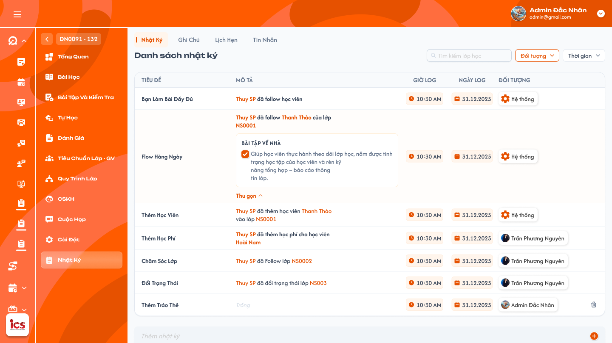

# Chi tiết lớp học — Menu Nhật ký — Tab Ghi chú

## 1. UI

### Trang 1: ADM-LOP-050100 — Lớp học / Nhật ký (tab Ghi Chú)



**Mô tả:**
- Trong menu Nhật ký của Chi tiết lớp, chọn tab `Ghi Chú` để xem danh sách ghi chú độc lập của đúng lớp đang mở. Tab có chức năng giống Tab Ghi chú trong Chi tiết giáo viên: chức năng, quyền owner và quyền riêng tư được kế thừa; đối tượng liên kết là **lớp đang xem** (không phải ghi chú của giáo viên).
- `Admin`, `Class Handler`, `Support` được truy cập/tạo ghi chú trong phạm vi lớp được phân quyền.
- Owner là người tạo ghi chú, lấy từ danh tính đã xác thực. Người được phân công phụ trách lớp không mặc nhiên là owner của mọi ghi chú trong lớp.
- Nút `+` mở popup `Thêm`; owner dùng cùng chức năng cập nhật ghi chú của mình; ngữ cảnh lưu luôn là lớp hiện tại.

**Điểm cần lưu ý:**
- `A01.01` Tiêu đề: bắt buộc, không giới hạn ký tự; hiển thị ở đầu card và xuống dòng khi dài, không cắt nội dung đã lưu.
- `A01.02` Nội dung: bắt buộc, không giới hạn ký tự; hỗ trợ xuống dòng và rich text theo toolbar UI (hoàn tác/làm lại, font/kiểu chữ, đậm/nghiêng/gạch chân, màu chữ/xóa định dạng, căn lề, danh sách và thụt lề), giữ đúng định dạng sau khi lưu/tải lại.
- `A01.03` Loại: `Công khai`, `Riêng tư`; mặc định `Công khai`.
- `A01.04` Độ ưu tiên: `Bình thường`, `Quan trọng`, `Rất quan trọng`; mặc định `Bình thường`.
- `A01.05` Trạng thái: `Mới`, `Đóng`; ghi chú mới mặc định `Mới`. `Mới` là trạng thái hoạt động tương ứng với `Mở` trong chức năng Ghi chú giáo viên.
- `A01.06` Owner: hiển thị đúng người tạo; thời gian tạo dưới Tiêu đề có định dạng `hh:mm AM/PM, dd.MM.yyyy`, ví dụ `10:00 AM, 01.07.2024`.
- `A01.07` Bình luận: hiển thị số lượng (chỉ tính comment chưa xóa mềm); cho phép mở/ẩn danh sách bình luận.
- `A01.08` Hoạt động bình luận cuối: bên phải card hiển thị avatar người comment cuối và timestamp màu cam kèm icon đồng hồ, định dạng `hh:mm AM/PM, dd.MM.yyyy`. Khi không có comment thì không hiển thị metadata này.
- `A01.09` Thời gian cập nhật: ghi chú/comment đã sửa có thời điểm cập nhật và nhãn `Đã chỉnh sửa`; hiển thị bổ sung, giữ nguyên thời gian tạo.
- `A01.10` Control trên card: dropdown Độ ưu tiên, icon Công khai/Riêng tư và menu ba chấm; thao tác quản lý chỉ khả dụng cho owner.
- `A01.11` Ghi chú `Công khai` + `Mới`: owner xem, sửa, xóa, đóng, comment; Admin/Class Handler/Support khác xem và comment.
- `A01.12` Ghi chú `Riêng tư` + `Mới`: owner xem, sửa, xóa, đóng, comment; người khác không nhìn thấy và không truy cập được.
- `A01.13` Ghi chú `Công khai` + `Đóng`: owner xem, sửa, xóa, mở lại, không comment khi đang đóng; người khác không nhìn thấy và không truy cập được.
- `A01.14` Ghi chú `Riêng tư` + `Đóng`: như trên, người khác không nhìn thấy và không truy cập được.
- Chỉ owner được cập nhật tiêu đề, nội dung, loại, độ ưu tiên và trạng thái; chỉ owner được xóa, đóng và mở lại ghi chú. Ghi chú đã đóng chỉ owner được xem, kể cả khi Loại là `Công khai`. Người không phải owner chỉ được xem và comment ghi chú `Công khai` đang `Mới`.
- Backend phải áp dụng điều kiện quyền và tính riêng tư trước khi trả dữ liệu; không chỉ ẩn thao tác ở UI.
- Mọi bản ghi, comment, bộ lọc và số lượng kết quả đều thuộc lớp đang xem. Ghi chú của giáo viên, học viên hoặc lớp khác không được đưa vào đây, kể cả cùng owner/tên hoặc cùng giáo viên dạy hai lớp.
- Kế thừa validation của Ghi chú giáo viên: **Tiêu đề và Nội dung đều bắt buộc**. Field thời gian tạo không thay đổi khi sửa ghi chú; filter lấy thời gian tạo ghi chú, không lấy thời điểm sửa hoặc bình luận cuối.
- Không áp dụng cơ chế nhập/sửa nhật ký viết tay của tab Nhật Ký cho tab này.
- Bộ lọc: Loại, Độ ưu tiên và Trạng thái hỗ trợ chọn **một hoặc nhiều giá trị trong cùng filter**; nhiều giá trị trong cùng filter kết hợp **OR**, giữa các filter áp dụng **AND**. Không chọn giá trị thì không giới hạn theo filter đó, nhưng vẫn kiểm tra quyền riêng tư/trạng thái. Thời gian chọn một khoảng tại một thời điểm.
- `A01.15` Bộ lọc Loại: `Công khai`, `Riêng tư`. Kết quả vẫn phải tuân thủ quyền riêng tư.
- `A01.16` Bộ lọc Độ ưu tiên: `Bình thường`, `Quan trọng`, `Rất quan trọng`.
- `A01.17` Bộ lọc Trạng thái ghi chú: `Mới`, `Đóng`. Ghi chú đóng vẫn chỉ owner được nhận trong kết quả.
- `A01.18` Bộ lọc Thời gian: mặc định `Hôm nay`; lọc theo thời gian tạo ghi chú (`created_at`) trong múi giờ nghiệp vụ.
- `A01.19` `Tới hạn`: từ thời điểm bắt đầu lưu dữ liệu của hệ thống đến hết ngày hôm nay.
- `A01.20` `Hôm nay`: từ đầu ngày đến hết ngày hôm nay; giá trị mặc định.
- `A01.21` `Hôm qua`: toàn bộ ngày liền trước hôm nay.
- `A01.22` `Hôm nay và hôm qua`: hợp của toàn bộ ngày hôm qua và ngày hôm nay.
- `A01.23` `Tuần này`: từ đầu Thứ 2 đến hết Chủ Nhật của tuần hiện tại.
- `A01.24` `Tuần trước`: từ đầu Thứ 2 đến hết Chủ Nhật của tuần liền trước.
- `A01.25` `Tháng này`: từ ngày đầu đến ngày cuối của tháng hiện tại.
- `A01.26` `Tháng trước`: từ ngày đầu đến ngày cuối của tháng liền trước.
- `A01.27` `3 tháng trước`: từ đầu ngày cách ngày hiện tại ba tháng đến thời điểm hiện tại.
- `A01.28` `Năm nay`: từ ngày 01/01 đến ngày 31/12 của năm hiện tại.
- `A01.29` `Năm trước`: từ ngày 01/01 đến ngày 31/12 của năm liền trước.
- `A01.30` `Tùy chọn`: người dùng chọn ngày bắt đầu và ngày kết thúc; bao gồm toàn bộ hai ngày biên.
- Thay đổi bất kỳ bộ lọc nào phải tải lại danh sách từ trang đầu và giữ nguyên các giá trị lọc còn lại. Điều kiện lọc không được làm lộ ghi chú riêng tư, ghi chú đóng hoặc dữ liệu ngoài phạm vi mà người dùng không có quyền xem. Chỉ response của tổ hợp bộ lọc mới nhất được phép cập nhật danh sách.
- Danh sách mặc định sắp xếp **mới tạo trước**, theo thời gian tạo giảm dần. Sửa ghi chú/comment không đưa ghi chú cũ lên đầu chỉ vì cập nhật mới.
- Mỗi trang hiển thị tối đa 50 ghi chú còn hoạt động sau khi loại bản ghi đã xóa mềm, áp dụng quyền riêng tư, trạng thái sở hữu và toàn bộ bộ lọc. Phân trang hiển thị khoảng dữ liệu đang xem, tổng số kết quả người dùng được phép xem, trang hiện tại, nút `Trước`, các số trang, dấu `...` khi cần và nút `Sau`; số lượng tổng không được làm lộ ghi chú Riêng tư/Đóng của người khác.
- `Trước` bị vô hiệu hóa ở trang đầu; `Sau` bị vô hiệu hóa ở trang cuối. Chuyển trang giữ nguyên toàn bộ bộ lọc đang áp dụng.
- Sau khi tạo ghi chú thành công, danh sách trở về trang đầu để hiển thị bản ghi mới. Cập nhật/đóng/mở giữ trang nếu bản ghi vẫn phù hợp bộ lọc; nếu thao tác làm trang hiện tại không còn hợp lệ, chuyển đến trang hợp lệ gần nhất. Không lặp hoặc bỏ sót ghi chú giữa các trang.
- `A02.01` Popup Tiêu đề: bắt buộc, không giới hạn ký tự; từ chối rỗng/chỉ có khoảng trắng.
- `A02.02` Popup Nội dung: bắt buộc, không giới hạn ký tự; cho xuống dòng/rich text như UI. Từ chối nội dung chỉ có khoảng trắng, dòng trống hoặc chỉ chứa định dạng mà không có nội dung thực. Thao tác định dạng không tạo comment hay thay đổi quyền sở hữu.
- `A02.03` Popup Loại: Công khai/Riêng tư; tạo mới mặc định Công khai.
- `A02.04` Popup Độ ưu tiên: Bình thường/Quan trọng/Rất quan trọng; tạo mới mặc định Bình thường.
- `A02.05` Popup Trạng thái: tạo mới mặc định Mới; đóng/mở lại theo quyền owner. Popup `Thêm` gồm Tiêu đề, Nội dung, Loại và Độ ưu tiên.
- `A02.06` Owner và lớp: tự xác định từ tài khoản đăng nhập và lớp đang mở; không cho chuyển ghi chú sang user/lớp khác khi sửa. Cập nhật giữ nguyên owner, lớp liên kết và thời gian tạo; thay đổi Loại/Trạng thái có hiệu lực ngay trên quyền xem/comment.
- `A02.07` Thêm / Xác nhận cập nhật: kiểm tra quyền, field và lưu theo cùng chức năng Ghi chú giáo viên; thành công mới thông báo/cập nhật danh sách. Request thay đổi chống gửi lặp; backend kiểm tra lại role, phạm vi, owner, trạng thái và quyền xem tại thời điểm xử lý. Sau sửa hiển thị `Đã chỉnh sửa` và thời điểm cập nhật; thời gian tạo không đổi.
- `A02.08` Hủy / Đóng chưa lưu: đóng form, không tạo/cập nhật ghi chú; không có Toast thành công.
- `A03.01` Xóa: chỉ owner; yêu cầu xác nhận trước khi **xóa mềm**. Bản ghi vẫn được giữ trong DB; Hủy xác nhận giữ nguyên trạng thái hoạt động. Không xóa lớp, nhật ký hoặc ghi chú khác.
- `A03.02` Đóng: chỉ owner; sau khi đóng chỉ owner xem được, kể cả ghi chú Công khai.
- `A03.03` Mở lại: chỉ owner; khi mở lại, quyền xem/comment áp dụng lại theo Loại.
- `A03.04` Bình luận khi Đóng: chỉ đọc đối với owner; không ai được thêm/sửa/xóa comment cho đến khi owner mở lại ghi chú.
- Role Admin không được bỏ qua owner để quản lý ghi chú người khác. Ghi chú và comment đều xóa mềm; sau khi xóa mềm không trả bản ghi qua danh sách, filter, phân trang hoặc chức năng đọc thông thường bằng ID. Xóa mềm ghi chú làm ghi chú cùng comment của nó không còn truy cập qua tab; xóa mềm comment chỉ ẩn đúng comment đó, cập nhật count và metadata comment cuối từ các comment chưa xóa. Xóa mềm không tự cấp quyền khôi phục hoặc xem dữ liệu đã xóa qua UI.
- `A04.01` Ô bình luận: nội dung bắt buộc, không giới hạn ký tự, hỗ trợ xuống dòng; placeholder `Nhập bình luận của bạn`, nút gửi icon mũi tên. Chỉ gửi khi ghi chú đang Mới và user có quyền xem.
- `A04.02` Danh sách bình luận: mỗi comment là card có avatar, tên người tạo, Nội dung và timestamp `hh:mm AM/PM, dd.MM.yyyy`, ví dụ `10:15 AM, 01.07.2024`.
- `A04.03` Trả lời: bấm `Trả lời` tại một comment để đưa con trỏ vào ô `Nhập bình luận của bạn` của chính ghi chú đó; chỉ tập trung ô nhập, không tự gửi hay xóa nội dung đang nhập. Gửi như một bình luận thông thường trong cùng danh sách, không tạo luồng con; cùng quyền/validation/count/metadata.
- `A04.04` Sửa/xóa: chỉ người tạo comment và ghi chú còn Mới được thao tác trên comment của mình. Xóa dùng icon thùng rác và là xóa mềm. Owner ghi chú không được sửa hoặc xóa comment của người khác. Sửa comment giữ nguyên người tạo/thời gian tạo; hiển thị thời gian cập nhật và nhãn `Đã chỉnh sửa`.
- `A04.05` Mở/ẩn bình luận: `N bình luận` và `Ẩn bình luận`; count chỉ tính comment chưa xóa mềm.
- `A04.06` Comment cuối trên card: avatar/thời gian của comment mới nhất chưa xóa mềm, xác định theo thời gian **tạo** comment (sửa comment cũ không làm nó thành comment cuối). Nếu comment mới nhất bị xóa, quay về comment mới nhất chưa xóa còn lại; không còn comment thì không hiển thị avatar/thời gian.
- Ghi chú đang `Đóng` không cho bất kỳ người dùng nào thêm, sửa hoặc xóa bình luận; owner phải mở lại ghi chú trước. Số lượng comment, danh sách comment và metadata cuối phải thuộc đúng ghi chú/lớp; kiểm tra lại trạng thái/quyền khi gửi request.
- `A05.01` Toast Thành công: tiêu đề `Thành Công`, sau khi backend xác nhận thao tác được lưu thành công.
- `A05.02` Toast Thông tin: tiêu đề `Thông Báo`, nếu chức năng nguồn có trạng thái tiếp nhận nhưng đang đồng bộ.
- `A05.03` Toast Cảnh báo: tiêu đề `Cảnh Báo`, dữ liệu chưa hợp lệ; đánh dấu đúng field liên quan.
- `A05.04` Toast Lỗi: tiêu đề `Có Lỗi Xảy Ra`, backend/network hoặc quyền không cho phép hoàn tất thao tác.
- `A05.05` Tạo ghi chú: thành công `Đã thêm ghi chú lớp.`; thất bại `Không thể thêm ghi chú lớp. Vui lòng thử lại.`
- `A05.06` Cập nhật ghi chú: thành công `Đã cập nhật ghi chú lớp.`; thất bại `Không thể cập nhật ghi chú lớp. Vui lòng thử lại.`
- `A05.07` Xóa ghi chú: thành công `Đã xóa ghi chú lớp.`; thất bại `Không thể xóa ghi chú lớp. Vui lòng thử lại.`
- `A05.08` Đóng ghi chú: thành công `Đã đóng ghi chú lớp.`; thất bại `Không thể đóng ghi chú lớp. Vui lòng thử lại.`
- `A05.09` Mở lại ghi chú: thành công `Đã mở lại ghi chú lớp.`; thất bại `Không thể mở lại ghi chú lớp. Vui lòng thử lại.`
- `A05.10` Tạo comment: thành công `Đã thêm bình luận.`; thất bại `Không thể thêm bình luận. Vui lòng thử lại.`
- `A05.11` Cập nhật comment: thành công `Đã cập nhật bình luận.`; thất bại `Không thể cập nhật bình luận. Vui lòng thử lại.`
- `A05.12` Xóa comment: thành công `Đã xóa bình luận.`; thất bại `Không thể xóa bình luận. Vui lòng thử lại.`
- Validation nêu đúng field: `Vui lòng nhập tiêu đề ghi chú.`, `Vui lòng nhập nội dung ghi chú.` hoặc `Vui lòng nhập nội dung bình luận.` Thiếu quyền: `Bạn không có quyền thực hiện thao tác này.`; không hiện Toast thành công.
- Mỗi thao tác chỉ có một notification kết quả. Không có Toast CRUD khi chỉ đọc, filter, phân trang, mở/ẩn comment hay Hủy. Notification không chứa token/stack trace hoặc dữ liệu ngoài quyền. Màu, icon, vị trí và thời gian tự đóng dùng cùng Toast UI của Ghi chú giáo viên.


---

## 2. Yêu cầu

### 2.1. Flow chính

**Flow 1: Xem và lọc ghi chú lớp**

```
Admin, Class Handler hoặc Support mở Chi tiết lớp → Nhật ký → Ghi Chú
      → Xác định lớp hiện tại và quyền trong phạm vi lớp
      → Áp dụng quyền owner/Loại/Trạng thái trước khi trả dữ liệu
      → Mặc định Hôm nay theo thời gian tạo; kết hợp Loại, Độ ưu tiên, Trạng thái, Thời gian
      → Mỗi trang tối đa 50 ghi chú được phép xem; giữ filter khi chuyển trang, đổi filter về trang đầu
      → Hiển thị metadata ghi chú và comment cuối như Ghi chú giáo viên
```

**Flow 2: Bình luận ghi chú lớp**

```
Người dùng mở bình luận của ghi chú đang Mới và có quyền xem trong lớp hiện tại
      → Hiển thị đúng comment, người tạo và thời gian
      → Bấm Trả lời tại comment để focus ô bình luận hiện tại, nhập như bình thường
      → Gửi comment hợp lệ vào cùng danh sách; cập nhật count và metadata comment cuối
      → Chỉ người tạo comment sửa/xóa comment của mình khi ghi chú còn Mới
      → Ghi chú Đóng chặn mọi thao tác comment; chỉ owner ghi chú còn xem được
      → Xóa comment cuối thì tính lại metadata từ comment mới nhất chưa xóa còn lại
      → Thao tác lưu có đúng một notification thành công/thất bại
```

**Flow 3: Tạo và quản lý ghi chú lớp**

```
Admin, Class Handler hoặc Support có quyền trên lớp bấm +
      → Popup nhập Tiêu đề, Nội dung, Loại, Độ ưu tiên giống Ghi chú giáo viên
      → Kiểm tra dữ liệu bắt buộc và quyền; tự lấy owner, lớp hiện tại, trạng thái Mới
      → Lưu thành công: hiển thị ghi chú đúng lớp, về trang đầu và một notification thành công
      → Owner có thể sửa/xóa mềm/đóng/mở lại ghi chú của mình; xóa có xác nhận
      → Cập nhật giữ nguyên owner/lớp/thời gian tạo; hiển thị thời gian cập nhật và Đã chỉnh sửa
      → Quyền xem/comment đổi theo Loại/Trạng thái; xóa mềm vẫn giữ dữ liệu trong DB
      → Lỗi không lưu dữ liệu sai; Hủy không thay đổi dữ liệu
```

### 2.2. Ngoại lệ

- **EX01:** Người không phải owner truy cập ghi chú Riêng tư hoặc Đóng qua danh sách/filter/ID → không trả nội dung, metadata hoặc số lượng ngoài quyền.
- **EX02:** Tiêu đề/Nội dung ghi chú hoặc Nội dung comment rỗng/chỉ có khoảng trắng → từ chối lưu, lỗi field và notification thất bại.
- **EX03:** Người không phải owner gửi request sửa/xóa/đóng/mở ghi chú → từ chối, giữ nguyên dữ liệu.
- **EX04:** User sửa/xóa comment người khác, kể cả owner ghi chú → từ chối, giữ nguyên comment.
- **EX05:** Tạo/sửa/xóa comment khi ghi chú Đóng → từ chối cho đến khi owner mở lại.
- **EX06:** Tải danh sách/trang lỗi → hiển thị lỗi, cho thử lại, không coi lỗi là danh sách rỗng.
- **EX07:** Chuyển lớp/trang/filter khi request cũ chưa xong → chỉ response đúng lớp và điều kiện mới nhất được cập nhật.
- **EX08:** Truy cập/thao tác ghi chú/comment sai lớp hoặc ngoài phạm vi → từ chối kể cả biết ID; không đổi lớp/owner theo request giả mạo.
- **EX09:** Khoảng ngày Tùy chọn có ngày bắt đầu sau ngày kết thúc → không áp dụng, giữ điều kiện hợp lệ trước đó và cho chỉnh lại.

### 2.3. Yêu cầu khác

| Mã | Tên yêu cầu | Mô tả |
|---|---|---|
| REQ01 | Ghi chú lớp | Kế thừa đầy đủ chức năng Ghi chú giáo viên, áp dụng cho lớp hiện tại: Admin/Class Handler/Support được tạo và xem Công khai + Mới; Riêng tư hoặc Đóng chỉ owner xem. Owner quản lý ghi chú của mình. Tiêu đề/Nội dung bắt buộc; mặc định Công khai, Bình thường, Mới. Filter thời gian tạo mặc định Hôm nay, đủ 12 khoảng như nguồn; sắp xếp mới tạo trước và phân trang tối đa 50 ghi chú được phép xem/trang. |
| REQ02 | Bình luận | Nút Trả lời dùng ô bình luận hiện tại, gửi bình luận thông thường cùng danh sách, không tạo luồng con. Người được xem ghi chú Mới được comment; Đóng chặn mọi thao tác comment. Chỉ người viết comment sửa/xóa comment của mình. Metadata cuối xác định bằng comment mới nhất chưa xóa mềm theo thời gian tạo; không nhầm với owner ghi chú. |
| REQ03 | Notification | Mọi CUD ghi chú/comment và đóng/mở ghi chú có đúng một notification kết quả theo chức năng nguồn; chỉ hiển thị thành công khi backend đã lưu. |
| REQ04 | Đối tượng lớp | Ghi chú liên kết lớp, comment liên kết đúng ghi chú của lớp. Thay đối tượng từ giáo viên sang lớp không thay owner, quyền riêng tư, validation, bộ lọc, phân trang hoặc chức năng bình luận. Không trộn/sao chép tự động ghi chú giáo viên vào lớp hoặc giữa các lớp. |
| REQ05 | Kế thừa nguồn và xác nhận | Chức năng kế thừa Tab Ghi chú — Chi tiết giáo viên; UI Ghi Chú lớp và các xác nhận trong tài liệu này là nguồn cụ thể để triển khai lớp. Không dùng danh sách điểm chưa chốt cũ để phủ nhận các điểm đã xác nhận ở đây. |
| REQ06 | Nội dung và định dạng | Tiêu đề/Nội dung ghi chú và comment không giới hạn ký tự; cho xuống dòng, Nội dung ghi chú hỗ trợ rich text theo toolbar UI. Validation bắt buộc kiểm tra nội dung thực, không coi định dạng trống là nội dung hợp lệ. |
| REQ07 | Xóa mềm | Xóa ghi chú/comment chỉ đánh dấu xóa, vẫn lưu dữ liệu trong DB. Loại bản ghi đã xóa khỏi chức năng đọc thông thường, danh sách/filter/count/phân trang và metadata comment cuối; không xóa vật lý hay tự tạo chức năng khôi phục. |
| REQ08 | Timestamp và chỉnh sửa | Ghi chú/comment hiển thị `hh:mm AM/PM, dd.MM.yyyy` như UI. Sửa giữ thời gian tạo, có thời gian cập nhật/Đã chỉnh sửa; filter dùng thời gian tạo. Metadata comment cuối lấy theo thời gian tạo của comment chưa xóa mềm. |
| REQ09 | Filter nhiều giá trị | Loại/Độ ưu tiên/Trạng thái cho chọn một hoặc nhiều; OR trong cùng filter, AND giữa các filter. Phân trang tối đa 50 ghi chú chưa xóa và có quyền xem/trang, không làm lộ dữ liệu ngoài quyền. |

### 2.4. Ràng buộc

#### Quyền

| Role | Xem Công khai + Mới | Xem Riêng tư/Đóng của mình | Xem Riêng tư/Đóng người khác | Tạo ghi chú | Quản lý ghi chú của mình | Quản lý ghi chú người khác | Comment ghi chú được xem + Mới | Sửa/Xóa comment của mình | Sửa/Xóa comment người khác |
|---|:---:|:---:|:---:|:---:|:---:|:---:|:---:|:---:|:---:|
| Admin | ✅ | ✅ | ❌ | ✅ | ✅ | ❌ | ✅ | ✅ | ❌ |
| Class Handler | ✅ | ✅ | ❌ | ✅ | ✅ | ❌ | ✅ | ✅ | ❌ |
| Support | ✅ | ✅ | ❌ | ✅ | ✅ | ❌ | ✅ | ✅ | ❌ |
| Các role khác | ❌ | ❌ | ❌ | ❌ | ❌ | ❌ | ❌ | ❌ | ❌ |

#### Ràng buộc khác

- Bảng quyền chỉ áp dụng trong phạm vi lớp được phân quyền và ghi chú người dùng có quyền xem; không cấp quyền ngoài lớp.
- Quyền quản lý ghi chú của mình gồm sửa/xóa/đóng/mở lại. Sửa/xóa comment của mình chỉ được khi ghi chú đang Mới; Đóng chặn cả owner ghi chú.
- Admin không được vượt qua owner để xem ghi chú Riêng tư/Đóng hoặc quản lý ghi chú/comment người khác.
- Dùng định danh nội bộ của lớp/ghi chú/comment và danh tính đã xác thực; không dùng mã lớp hoặc tên hiển thị làm khóa sở hữu/liên kết.
- Backend áp dụng quyền riêng tư, trạng thái và phạm vi trước khi trả dữ liệu và kiểm tra lại lúc lưu. Filter, tổng số, metadata và phân trang không được làm lộ ghi chú ngoài quyền.
- Response chỉ cập nhật đúng lớp/tab/trang/filter hiện tại. Không chuyển ghi chú hoặc comment sang lớp khác khi sửa.
- Thao tác ghi chú không tạo log Thêm Học Viên/Thêm Học Phí, không thay thế nhật ký viết tay dùng cho Follow và không làm thay đổi dữ liệu lớp/giáo viên/học viên.

---

## 3. Testcase

### Feature: Chi tiết lớp học — Menu Nhật ký — Tab Ghi chú

| Tên testcase | Priority | Scenario | Role | Pre-condition | Given/When/Then | Expected Result |
|---|---|---|---|---|---|---|
| Case 1: Xem ghi chú Công khai đang Mới | High | Flow 1 / REQ01 / REQ08 | Admin / Class Handler / Support | Có ghi chú Công khai đang Mới do nhiều người tạo, có nhiều comment | **Given:** người dùng có quyền với lớp học<br>**When:** mở tab Ghi chú<br>**Then:** hiển thị ghi chú công khai đang Mới | - Hiển thị tiêu đề, nội dung, loại, ưu tiên, trạng thái, owner và thời gian tạo `hh:mm AM/PM, dd.MM.yyyy`<br>- Bên phải card dùng đúng avatar/timestamp comment mới nhất<br>- Không trộn dữ liệu lớp học khác |
| Case 2: Bảo vệ ghi chú Riêng tư và Đóng | High | EX01 / EX03 / Ràng buộc quyền | Admin / Class Handler / Support | Có ghi chú Riêng tư và ghi chú Đóng của người dùng hiện tại và của người khác | **Given:** người dùng mở danh sách, hoặc gọi API/ID trực tiếp, hoặc gửi request sửa/xóa/đóng/mở<br>**When:** hệ thống xác định owner<br>**Then:** chỉ trả ghi chú Riêng tư/Đóng của chính người dùng; người khác chỉ xem và comment ghi chú Công khai đang Mới | - Người khác không thấy và không truy cập được bằng ID; Admin không vượt owner<br>- UI không hiển thị thao tác quản lý cho người khác, backend từ chối request trái quyền<br>- Bộ lọc Riêng tư/Đóng không làm lộ dữ liệu hay số lượng |
| Case 3: Lọc nhiều giá trị theo Loại, Độ ưu tiên, Trạng thái | High | Flow 1 / REQ09 | Admin / Class Handler / Support | Có ghi chú thuộc nhiều loại, ưu tiên và trạng thái | **Given:** chọn Bình thường và Quan trọng cùng các filter Loại/Trạng thái khác<br>**When:** tải danh sách<br>**Then:** nhận ghi chú thuộc một trong hai mức và đồng thời thỏa các filter khác | - OR trong một filter, AND giữa các filter<br>- Bỏ một giá trị vẫn giữ giá trị khác<br>- Không lộ ghi chú Riêng tư/Đóng của người khác |
| Case 4: Filter thời gian | High | Flow 1 / REQ01 / EX09 | Admin / Class Handler / Support | Có ghi chú tạo hôm nay, ngày khác và tại các mốc biên; ghi chú tạo hôm qua nhưng sửa hôm nay | **Given:** mở tab lần đầu, sau đó chọn lần lượt Tới hạn, Hôm qua, tuần/tháng/năm, 3 tháng trước và Tùy chọn (kể cả ngày bắt đầu sau ngày kết thúc)<br>**When:** danh sách tải<br>**Then:** mặc định Hôm nay; mỗi khoảng áp dụng đúng theo `created_at` trong múi giờ nghiệp vụ | - Bao gồm đầy đủ các mốc biên, Tới hạn lấy từ đầu hệ thống đến hết hôm nay<br>- Không dùng thời gian update/comment cuối; ghi chú tạo hôm qua vừa sửa không thành ghi chú hôm nay<br>- Từ chối ngày bắt đầu sau ngày kết thúc, giữ các filter khác |
| Case 5: Phân trang, sắp xếp, lỗi tải và response cũ | High | Flow 1 / EX06 / EX07 / REQ01 / REQ09 | Admin / Class Handler / Support | Có hơn 50 ghi chú được phép xem; ghi chú cũ vừa sửa; API lỗi, hết thời gian chờ hoặc response trả sai thứ tự | **Given:** danh sách có nhiều trang, đổi filter/trang liên tục hoặc API lỗi<br>**When:** chọn số trang, `Trước`/`Sau`, hoặc request thất bại<br>**Then:** tải tối đa 50 ghi chú theo thời gian tạo giảm dần; giữ đúng ngữ cảnh mới nhất | - Hiển thị khoảng dữ liệu, tổng kết quả được phép xem; `Trước`/`Sau` vô hiệu hóa đúng ở trang biên<br>- Giữ filter khi chuyển trang; đổi filter về trang đầu; sửa không đưa bản ghi cũ lên đầu<br>- Không coi lỗi là rỗng, cho thử lại; response cũ không ghi đè |
| Case 6: Cách ly dữ liệu theo lớp | High | EX08 / REQ04 | Admin / Class Handler / Support | Lớp A/B có cùng giáo viên và owner; có thêm ghi chú giáo viên/học viên | **Given:** mở Ghi Chú của lớp A<br>**When:** tải danh sách, filter hoặc truy cập một ghi chú bằng ID của lớp khác<br>**Then:** chỉ trả dữ liệu của A mà user có quyền xem | - Không lấy ghi chú của B/giáo viên/học viên<br>- Số lượng/phân trang chỉ tính ghi chú được xem tại A<br>- Không đổi lớp/owner theo request giả mạo |
| Case 7: Tạo ghi chú mới | High | Flow 3 / REQ01 / REQ03 | Admin / Class Handler / Support | Tab Ghi chú đã tải | **Given:** nhập Tiêu đề, Nội dung, chọn Loại/Độ ưu tiên hợp lệ (hoặc để mặc định)<br>**When:** chọn `Thêm`<br>**Then:** tạo ghi chú cho đúng lớp học | - Owner lấy từ tài khoản đăng nhập, trạng thái mặc định Mới, mặc định Công khai và Bình thường<br>- Danh sách về trang đầu<br>- Toast `Đã thêm ghi chú lớp.` |
| Case 8: Validation, nội dung dài và rich text | High | EX02 / REQ06 | Admin / Class Handler / Support | Form tạo/cập nhật ghi chú hoặc ô bình luận đang mở | **Given:** Tiêu đề/Nội dung rỗng, chỉ khoảng trắng hoặc chỉ định dạng trống; hoặc nhập nội dung dài, nhiều dòng, định dạng đậm/nghiêng/màu/căn lề<br>**When:** xác nhận rồi mở lại<br>**Then:** nội dung không hợp lệ bị từ chối; nội dung hợp lệ giữ đủ text, dòng mới và định dạng | - Lỗi tại trường liên quan (`Vui lòng nhập tiêu đề ghi chú.` / `Vui lòng nhập nội dung ghi chú.` / `Vui lòng nhập nội dung bình luận.`), giữ dữ liệu để sửa<br>- Không giới hạn hoặc cắt ký tự<br>- Không tạo/cập nhật bản ghi không hợp lệ |
| Case 9: Owner cập nhật ghi chú | High | Flow 3 / REQ01 / REQ03 / REQ08 | Admin / Class Handler / Support | Người dùng hiện tại là owner; ghi chú tạo hôm qua | **Given:** owner đổi tiêu đề, nội dung, loại hoặc độ ưu tiên<br>**When:** xác nhận cập nhật<br>**Then:** lưu thay đổi, hiển thị thời gian cập nhật/`Đã chỉnh sửa` | - Không đổi owner hoặc thời gian tạo; filter Hôm nay không lấy ghi chú chỉ vì vừa sửa<br>- Quyền xem mới có hiệu lực ngay theo Loại/Trạng thái<br>- Toast `Đã cập nhật ghi chú lớp.`; lưu thất bại không hiển thị cập nhật thành công |
| Case 10: Hủy form và chặn gửi lặp | High | Flow 3 / REQ01 / REQ03 | Admin / Class Handler / Support | Form đang có dữ liệu hoặc đang lưu | **Given:** hủy form hoặc bấm xác nhận lặp<br>**When:** xử lý thao tác<br>**Then:** hủy không lưu; cùng thao tác tạo chỉ có một ghi chú | - Không có Toast thành công khi hủy<br>- Lưu lỗi giữ dữ liệu để sửa/thử lại |
| Case 11: Xóa mềm ghi chú | High | Flow 3 / REQ07 | Admin / Class Handler / Support | Owner có ghi chú kèm comment; owner đã mở xác nhận xóa | **Given:** owner chọn xóa, thử `Hủy`, rồi xác nhận xóa<br>**When:** backend thành công<br>**Then:** Hủy giữ nguyên ghi chú; xác nhận thì dữ liệu ghi chú/comment vẫn lưu trong DB nhưng không trả qua tab | - Không có dòng trong danh sách/filter/count/phân trang; đọc bằng ID không trả bản ghi đã xóa<br>- Không xóa ghi chú khác hoặc dữ liệu lớp học<br>- Toast `Đã xóa ghi chú lớp.`; Hủy không gửi request, không có Toast |
| Case 12: Đóng và mở lại ghi chú | High | Flow 3 / REQ01 / REQ03 | Admin / Class Handler / Support | Có ghi chú Công khai hoặc Riêng tư đang Mới | **Given:** owner đóng ghi chú, người khác truy cập, sau đó owner mở lại<br>**When:** thao tác<br>**Then:** khi Đóng chỉ owner xem; khi Mới áp dụng lại quyền theo Loại | - Người khác không đóng/mở được bằng request trực tiếp<br>- Đóng không cho comment<br>- Toast `Đã đóng ghi chú lớp.` / `Đã mở lại ghi chú lớp.` |
| Case 13: Thêm, trả lời, sửa, xóa comment | High | Flow 2 / REQ02 / REQ03 / REQ06 / REQ07 | Admin / Class Handler / Support | Người dùng được xem ghi chú đang Mới, là người tạo comment | **Given:** nhập comment hợp lệ (dài, nhiều dòng); bấm Trả lời tại một comment rồi nhập; sửa và xóa comment của mình<br>**When:** gửi và xác nhận<br>**Then:** comment thêm vào cùng danh sách (không tạo luồng con), sửa/xóa đúng comment | - Hiển thị đúng người và thời gian; Trả lời chỉ focus ô nhập, giữ nội dung đang nhập<br>- Số lượng comment đổi đúng; comment đã xóa mềm không còn trong count<br>- Toast `Đã thêm bình luận.` / `Đã cập nhật bình luận.` / `Đã xóa bình luận.` |
| Case 14: Chặn thao tác comment trái quyền | High | EX02 / EX04 / EX05 / REQ02 | Admin / Class Handler / Support | Owner ghi chú không phải người tạo comment; ghi chú Đóng có comment cũ | **Given:** owner thử sửa/xóa comment của người khác; thử thêm/sửa/xóa comment khi ghi chú Đóng; gửi comment rỗng<br>**When:** kiểm tra UI hoặc gọi API<br>**Then:** hệ thống từ chối | - Không hiển thị thao tác sửa/xóa comment người khác; backend từ chối, comment không đổi<br>- Comment cũ khi Đóng chỉ đọc cho đến khi mở lại<br>- Lỗi tại ô comment, không đổi số lượng hoặc metadata cuối |
| Case 15: Metadata comment cuối | High | Flow 2 / REQ02 / REQ08 | Admin / Class Handler / Support | A là comment cũ, B là comment tạo sau; user sở hữu A và B | **Given:** sửa A, sau đó xóa B (comment cuối) của mình<br>**When:** xem card<br>**Then:** sửa A vẫn có `Đã chỉnh sửa` và metadata cuối theo B; sau khi xóa B, metadata về A; xóa hết thì không hiển thị | - Không đổi thời gian tạo A<br>- Số lượng comment giảm đúng<br>- Owner ghi chú không sửa được A nếu không phải người viết |
| Case 16: Toast phản hồi CRUD | Medium | REQ03 | Admin / Class Handler / Support | Thao tác có quyền; form thiếu field; hoặc user đang filter/phân trang/Hủy | **Given:** tạo/sửa/xóa/đóng/mở ghi chú hoặc CUD comment thành công/thất bại; thao tác chỉ đọc<br>**When:** backend phản hồi, callback lặp<br>**Then:** đúng một notification tương ứng; thao tác chỉ đọc/Hủy không có Toast CRUD | - Không báo thành công trước khi lưu<br>- Thiếu quyền: `Bạn không có quyền thực hiện thao tác này.`<br>- Không tạo Toast trùng khi gửi lặp |

---

## 4. Câu hỏi cần xác nhận

- **Q01:** Xóa mềm và giữ DB đã chốt; chưa có yêu cầu bổ sung UI khôi phục hoặc lịch sử audit.
