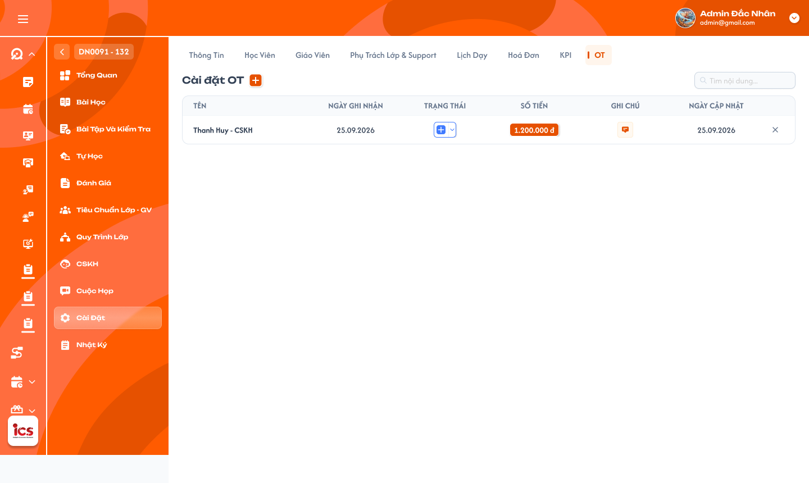
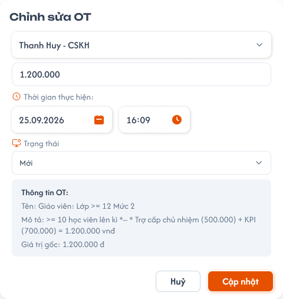
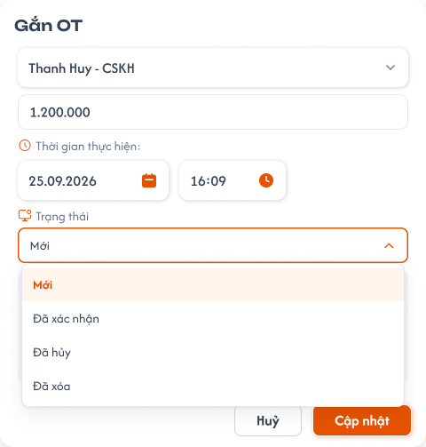

# Chi tiết lớp học — Tab OT của Phụ trách lớp

## 1. UI

### Trang 1: ADM-LOP-040800 — Lớp học / Cài đặt / OT



**Mô tả:**
- Danh sách khoản OT của lớp. `Admin` và `Class Handler` xem, thêm, sửa, xóa và xác nhận OT trong phạm vi lớp; Handler được xác nhận khoản của chính mình.
- Tab OT dùng cùng logic phân quyền, người nhận, trạng thái và ghi chú của Tab KPI (`class_detail_kpi_requirements.md`). Khác biệt: OT quản lý riêng, không hiển thị hoặc cộng vào Chi phí PTL/Tổng chi PTL ở Danh sách lớp. Tên người nhận và thông tin OT theo dữ liệu thực tế; nội dung mẫu nhắc Giáo viên/KPI không đổi quyền hay tự sinh khoản KPI.

**Điểm cần lưu ý:**
- Chỉ `Admin`/`Class Handler` truy cập; `Support`, `Teacher` và role khác không xem hay CRUD, kể cả gọi API trực tiếp. Một Handler có thể có nhiều khoản OT trong cùng lớp, không gộp khoản chỉ vì trùng tên. Bấm tên/vùng thông tin mở popup sửa hoặc xem; thao tác trạng thái, ghi chú, X không đồng thời mở form sửa.
- `A01.01` Cài đặt OT và `+`: mở popup `Gắn OT`.
- `A01.02` Tìm kiếm: theo tên Handler nhận OT, tìm toàn bộ dữ liệu lớp (không chỉ dòng đã tải); `Đã hủy` vẫn được tìm, `Đã xóa` không.
- `A01.03` Tên: người nhận của khoản OT, mỗi khoản đúng một Handler.
- `A01.04` Ngày ghi nhận: ngày của Thời gian thực hiện nhập trong popup, lưu cả giờ.
- `A01.05` Trạng thái: `Mới`, `Đã xác nhận`, `Đã hủy`; `Đã xóa` không hiển thị trong bảng.
- `A01.06` Số tiền: tiền thực tế đã lưu, định dạng VND có dấu phân cách hàng nghìn.
- `A01.07` Ghi chú: mở ghi chú/lịch sử của đúng khoản OT.
- `A01.08` Ngày cập nhật: lần cập nhật gần nhất do máy chủ ghi; lấy khi tạo/sửa/trạng thái/ghi chú thành công; xem/search/Hủy draft/Copy không đổi mốc này.
- `A01.09` X: mở popup xác nhận xóa khoản chưa xác nhận.
- `A03.01` Trạng thái `Mới`: hiển thị; sửa, xác nhận, hủy hoặc xóa được; không tính chi PTL.
- `A03.02` Trạng thái `Đã xác nhận`: hiển thị; khóa mọi thay đổi (không sửa tiền/người/thời gian/ghi chú, không về Mới, hủy hay xóa); Handler được tự xác nhận khoản của mình; không tính chi PTL, không tự tạo điều chỉnh bảng lương; không có flow mở lại/đảo OT; không đồng nghĩa đã thanh toán cho Handler.
- `A03.03` Trạng thái `Đã hủy`: vẫn hiển thị, giữ để xem; xóa được nếu chưa xác nhận; không tính chi PTL; khả năng sửa/phục hồi chưa chốt (xem Q04).
- `A03.04` Trạng thái `Đã xóa`: xóa mềm, ẩn khỏi danh sách, giữ audit; chọn `Đã xóa` trong dropdown dùng cùng popup xác nhận như X. Dropdown tại dòng lưu sau khi chọn và backend thành công; trong popup chỉ là draft đến khi `Cập nhật`.
- `A04.01` Popup xóa: `Xóa khoản OT?` — `Khoản OT của {Handler} với số tiền {tiền} sẽ được ẩn khỏi danh sách. Lịch sử vẫn được lưu.` Không có X hoạt động trên khoản đã xác nhận (API cũng chặn); xóa lặp không tạo nhiều thao tác logic; không xóa tài khoản, cấu hình mẫu hay audit.
- `A04.02` Hủy bỏ (popup xóa): đóng, giữ dữ liệu, không đổi trạng thái, không Toast thành công.
- `A04.03` Xác nhận xóa: kiểm tra quyền/trạng thái mới nhất, chuyển `Đã xóa` rồi ẩn dòng.
- `A05.01` Popup ghi chú: click icon ghi chú tại dòng mở popup/popover giống Tab Học viên (`class_detail_students_requirements.md`), tiêu đề `Ghi chú OT` và icon lịch sử cạnh tiêu đề; không mở đồng thời form sửa OT. Chỉ `Admin`/`Class Handler` dùng, không kế thừa quyền `Support` của tab Học viên. Dữ liệu lưu theo `class_id + ot_id`, không dùng `student_id` hay tên Handler.
- `A05.02` Ô nhập nội dung (textarea): hiển thị nội dung hiện tại (trống nếu chưa có), gõ/chỉnh nhiều dòng ở khoản `Mới`; không có dropdown loại ghi chú; gõ chỉ là draft, không tạo lịch sử sau từng phím hay khi mở popup. Khoản `Đã xác nhận` chỉ xem/Copy.
- `A05.03` Lưu nội dung: theo cơ chế lưu ghi chú của tab Học viên; mỗi lần lưu thành công tạo một phiên bản và cập nhật Ngày cập nhật. Hai người sửa cùng phiên bản thì cảnh báo xung đột và cho tải lại; lưu lỗi giữ draft, không tạo lịch sử thành công giả. Sửa ghi chú không đổi tiền, trạng thái OT hay Tổng chi PTL; quyền sửa khoản `Đã hủy` cần chốt (xem Q04).
- `A05.04` Icon lịch sử: mở popup `Lịch sử ghi chú` của đúng khoản OT trong lớp, giống UI lịch sử tab Học viên.
- `A05.05` Mỗi phiên bản: nội dung đầy đủ, avatar/tên người tạo hoặc chỉnh sửa, thời điểm máy chủ; mới nhất trước; không ghi đè hay sửa/xóa phiên bản cũ; không thực thi HTML/script.
- `A05.06` Copy: icon ở từng bản ghi, copy đúng nội dung phiên bản được bấm, không kèm metadata; không tạo phiên bản hay đổi ngày cập nhật.
- `A06.01` Chi phí PTL của lớp: giữ công thức chỉ cộng KPI `Đã xác nhận`; không cộng bất kỳ khoản OT nào. Ví dụ KPI xác nhận 500.000đ và OT xác nhận 200.000đ thì vẫn 500.000đ, không phải 700.000đ.
- `A06.02` Tổng chi PTL: giữ tổng từ KPI của tập lớp thỏa filter; CRUD/search OT không đổi số này.
- `A06.03` Chỉ số OT tại danh sách lớp: không thêm cột/thẻ tổng chi OT vào Danh sách lớp. OT có định danh và loại khoản riêng, không dùng chung bản ghi KPI đổi nhãn. Nghiệp vụ tổng hợp/chi trả OT ở màn khác nằm ngoài phạm vi.
- `A07.01` Loading/rỗng/lỗi: loading khi tải; rỗng `Chưa có khoản OT.`; lỗi có Thử lại và không biến thành 0 khoản.
- `A07.02` Toast `Thành Công`: `Đã thêm OT.`, `Đã cập nhật OT.`, `Đã xác nhận OT.`, `Đã xóa OT.`
- `A07.03` Toast `Cảnh Báo`: `OT đã được xác nhận và không thể chỉnh sửa.` hoặc lỗi field.
- `A07.04` Toast `Có Lỗi Xảy Ra`: `Không thể cập nhật OT. Vui lòng thử lại.`; lỗi lưu giữ draft và tiền/trạng thái cũ.
- `A07.05` Toast `Thông Báo`: chỉ khi chờ đồng bộ thực tế. Một thao tác một kết quả, không báo thành công sớm; mở form/Hủy draft/search/Copy không có Toast CRUD thành công.


### Trang 2: ADM-LOP-040810 — Lớp học / Cài đặt / OT / Popup chỉnh sửa OT



**Mô tả:**
- Popup `Chỉnh sửa OT` mở từ khoản `Mới`; nút `+` mở `Gắn OT` dùng cùng field. Khoản `Đã xác nhận` chỉ đọc; khả năng sửa/phục hồi khoản `Đã hủy` cần chốt riêng (xem Q04).

**Điểm cần lưu ý:**
- `A02.01` Người nhận: bắt buộc một `Class Handler`, không multi-select, không chọn role khác; khoản xác nhận khóa người nhận. Một người được thêm nhiều khoản độc lập; bấm lặp cùng request tạo chỉ một khoản.
- `A02.02` Số tiền: nhập tùy ý, không ép bằng giá trị gốc, không áp trần mẫu hay kiểm tra điều kiện trong mô tả; phải là giá trị số đọc/lưu được. Không tự tính tiền theo số học viên lên kỳ. Rule tiền âm/0/phần lẻ chưa chốt (xem Q03).
- `A02.03` Thời gian thực hiện: ngày và giờ ghi nhận người dùng nhập; tách biệt với ngày cập nhật do máy chủ ghi.
- `A02.04` Trạng thái: mặc định `Mới` khi thêm; trong popup chỉ là draft đến khi `Cập nhật`.
- `A02.05` Thông tin OT: khối chỉ đọc gồm Tên, Mô tả, Giá trị gốc của cấu hình OT; giá trị gốc chỉ để tham chiếu. Không có nút `Dùng giá trị gốc` như KPI, không tự thêm; không tự sinh KPI từ mô tả mẫu.
- `A02.06` Hủy bỏ: đóng form và bỏ draft; không chuyển trạng thái `Đã hủy`, không lưu backend.
- `A02.07` Cập nhật: validate rồi lưu khoản được gắn/chỉnh và cập nhật danh sách OT sau khi thành công.

### Trang 3: ADM-LOP-040812 — Lớp học / Cài đặt / OT / Popup chỉnh sửa OT / Đang mở



**Mô tả:**
- Popup `Gắn OT` với dropdown Trạng thái đang mở (các lựa chọn `Đã xác nhận`, `Đã hủy`, `Đã xóa`), cùng khối Thông tin OT và nút `Huỷ` / `Cập nhật`. Ảnh dropdown mở có tiêu đề `Gắn OT` dù tên file là Chỉnh sửa OT.

---

## 2. Yêu cầu

### 2.1. Flow chính

**Flow 1 / REQ01–REQ02: Xem và tìm OT**

```
Mở lớp → Kiểm tra Admin/Class Handler và phạm vi → Tải OT chưa xóa → Tìm theo tên Handler
```

**Flow 2 / REQ03: Thêm và sửa OT**

```
"+" mở Gắn OT (hoặc khoản Mới mở Chỉnh sửa OT) → Chọn một Handler, nhập tiền, ngày/giờ, trạng thái
  → Cập nhật → Backend lưu → Toast
```

**Flow 3 / REQ04, REQ07: Xác nhận OT**

```
Chọn Đã xác nhận → Kiểm tra phiên bản/quyền → Ghi audit → Khóa khoản OT
  → Cập nhật danh sách OT (không đổi chi PTL)
```

**Flow 4 / REQ05: Xóa OT**

```
Bấm X hoặc chọn Đã xóa → Popup xác nhận → Kiểm tra chưa xác nhận
  → Xóa mềm → Ẩn dòng → Toast
```

**Flow 5 / REQ06: Ghi chú, lịch sử và Copy**

```
Click icon ghi chú → Popup giống tab Học viên → Gõ/chỉnh trong ô văn bản (khoản Mới)
  → Lưu nội dung tạo phiên bản → Icon lịch sử cạnh tiêu đề → Xem / Copy từng bản
  Khoản Đã xác nhận: chỉ đọc
```

### 2.2. Ngoại lệ

- **EX01:** Sai role/ngoài phạm vi → chặn API/dữ liệu.
- **EX02:** Thiếu/sai người nhận, nhiều người, tiền hoặc ngày/giờ không đọc/lưu được → lỗi đúng field, không lưu một phần.
- **EX03:** `Đã xác nhận` bị sửa/hủy/xóa → từ chối; không đảo OT/bảng lương.
- **EX04:** Request lặp hoặc xung đột version → một kết quả; không sửa khoản vừa khóa hoặc tạo trùng OT/audit.
- **EX05:** Lỗi lưu → giữ dữ liệu cũ/draft, cho thử lại.
- **EX06:** Response search/lớp cũ → bỏ qua.

### 2.3. Yêu cầu khác

| Mã | Tên yêu cầu | Mô tả |
|---|---|---|
| REQ01 | Quyền | Chỉ Admin/Class Handler xem và CRUD/xác nhận; tự xác nhận OT được phép. |
| REQ02 | Danh sách | Mỗi khoản một dòng; search tên Handler; giữ `Đã hủy`, ẩn `Đã xóa`. |
| REQ03 | Thêm/sửa | Một người mỗi khoản, nhiều khoản/người; tiền tùy ý; khối Thông tin OT chỉ đọc với giá trị gốc, không có nút `Dùng giá trị gốc`; ngày thực hiện và ngày cập nhật riêng. |
| REQ04 | Trạng thái | Bốn trạng thái; xác nhận khóa khoản, không mở lại/đảo. |
| REQ05 | Xóa | Xóa có xác nhận, xóa mềm khoản chưa xác nhận. |
| REQ06 | Ghi chú | UI ghi chú giống tab Học viên: click icon mở popup có ô gõ/chỉnh nhiều dòng và icon lịch sử; dữ liệu theo `class_id + ot_id`, lịch sử người/thời điểm và Copy từng bản; chỉ Admin/Class Handler; khoản xác nhận chỉ đọc. |
| REQ07 | Tách OT khỏi KPI | Không hiển thị/cộng OT vào Chi phí PTL/Tổng chi PTL ở danh sách lớp, bất kể trạng thái. |
| REQ08 | Toast và tải | Toast CRUD; tải/rỗng/lỗi rõ ràng. |

### 2.4. Ràng buộc

#### Quyền

| Role | Xem OT | Thêm/sửa OT | Xác nhận OT | Xóa OT | Ghi chú OT |
|---|:---:|:---:|:---:|:---:|:---:|
| Admin | ✅ | ✅ | ✅ | ✅ | ✅ |
| Class Handler | ✅ | ✅ | ✅ | ✅ | ✅ |
| Support, Teacher và role khác | ❌ | ❌ | ❌ | ❌ | ❌ |

#### Ràng buộc khác

- Dùng `ot_id`, `class_id`, `handler_id`; không cập nhật theo tên hay vị trí dòng.
- Backend kiểm tra quyền/phạm vi, trạng thái/version tại thời điểm lưu.
- Audit người tạo/sửa/xác nhận/xóa và thời điểm máy chủ; lịch sử bất biến.
- Một request tạo lặp chỉ một khoản; hai thao tác tạo độc lập cho cùng Handler được phép.
- Không bỏ khóa khoản xác nhận qua request trực tiếp hoặc lớp test.
- `Đã xác nhận` không đồng nghĩa đã thanh toán; trả lương thuộc function khác.

---

## 3. Testcase

### Feature: Chi tiết lớp học — Tab OT

| Tên testcase | Priority | Scenario | Role | Pre-condition | Given/When/Then | Expected Result |
|---|---|---|---|---|---|---|
| Case 1: Mở đúng lớp và tìm theo tên Handler | High | Flow 1 / REQ01 / REQ02 / EX06 | Admin / Class Handler | Có OT ở nhiều lớp; nhiều Handler; một Handler có hai khoản; có khoản Đã hủy và Đã xóa | **Given:** mở lớp A, chọn tab OT; nhập tên Handler, search liên tục<br>**When:** tải và tìm<br>**Then:** lọc theo người nhận | - Đúng các cột, không trộn lớp B, không trả `Đã xóa`, giữ `Đã hủy`<br>- Tìm toàn bộ dữ liệu lớp, không dùng tên mẫu thay tên Handler<br>- Hai khoản của một người là hai dòng độc lập, tiền/trạng thái đúng từng ID<br>- Response cũ về sau không đè kết quả mới |
| Case 2: Chặn role khác | High | EX01 / REQ01 / Ràng buộc quyền | Support / Teacher / role khác | Có ID lớp | **Given:** truy cập tab hoặc gọi API OT<br>**When:** kiểm tra quyền<br>**Then:** từ chối | - Không trả tiền hoặc người nhận, không ghi dữ liệu |
| Case 3: Gắn OT với một Handler | High | Flow 2 / REQ03 | Admin / Class Handler | Dữ liệu hợp lệ | **Given:** bấm `+` mở Gắn OT, chọn một người<br>**When:** `Cập nhật` với trạng thái Mới<br>**Then:** tạo khoản OT | - Một người nhận; được tạo khoản khác cho cùng người<br>- Bấm lặp chỉ một khoản<br>- Không đổi chi PTL; Toast `Đã thêm OT.` |
| Case 4: Validation người nhận và số tiền | High | EX02 / REQ03 | Admin / Class Handler | Request bị sửa hoặc dữ liệu sai; giá trị gốc 1.200.000đ | **Given:** gửi nhiều người/Support/Teacher, thiếu người nhận, ngày/giờ hoặc tiền không đọc được; nhập 800.000đ hoặc 1.500.000đ<br>**When:** lưu<br>**Then:** từ chối dữ liệu sai, giữ đúng tiền nhập hợp lệ | - Lỗi đúng field, không lưu một phần, không tin role từ client<br>- Tiền nhập khác giá trị gốc vẫn lưu đúng, không áp trần mẫu hay kiểm tra điều kiện mô tả |
| Case 5: UI popup, Hủy bỏ draft và hai mốc ngày | Medium | REQ03 | Admin / Class Handler | Popup Gắn/Chỉnh sửa OT mở; Thời gian thực hiện khác ngày hiện tại | **Given:** khối Thông tin OT, nhập tiền khác giá trị gốc và ngày/giờ riêng<br>**When:** `Hủy bỏ`, sau đó lưu lần khác<br>**Then:** bỏ draft hoặc lưu đúng hai mốc | - Không có nút `Dùng giá trị gốc`; Hủy bỏ không lưu backend, không chuyển `Đã hủy`, không tự sinh KPI<br>- Ngày ghi nhận theo input, ngày cập nhật theo máy chủ; xem không đổi thời gian |
| Case 6: Tự xác nhận và khóa khoản đã xác nhận | High | Flow 3 / REQ04 / EX03 | Class Handler; Admin | Khoản Mới của chính Handler | **Given:** chọn `Đã xác nhận`, lưu; sau đó mở form hoặc gửi request sửa tiền/người/ngày/ghi chú, chuyển Mới/Hủy/Xóa<br>**When:** xử lý<br>**Then:** xác nhận được rồi khóa | - Ghi audit người/thời điểm; Toast `Đã xác nhận OT.`<br>- Form chỉ đọc, request sửa/đảo bị từ chối, Toast `OT đã được xác nhận và không thể chỉnh sửa.`<br>- Chi phí PTL/Tổng chi PTL giữ nguyên |
| Case 7: Đã hủy vẫn hiển thị | High | REQ04 | Admin / Class Handler | OT Mới | **Given:** chuyển `Đã hủy`<br>**When:** lưu<br>**Then:** dòng vẫn hiện | - Không tính chi PTL, không xóa dòng |
| Case 8: Sửa đồng thời và xác nhận lặp | High | EX04 / REQ04 / REQ07 | Hai role có quyền | Cùng bản dữ liệu; khoản OT 200.000đ | **Given:** A xác nhận trước (hoặc gửi xác nhận lặp), B sửa từ bản cũ<br>**When:** xử lý<br>**Then:** từ chối và tải lại | - Không sửa khoản đã khóa, không tạo trùng OT/audit xác nhận<br>- Xác nhận lặp chỉ một xác nhận, không cộng chi PTL, không tự sinh KPI |
| Case 9: Xóa mềm OT | High | Flow 4 / REQ05 | Admin / Class Handler | Khoản chưa xác nhận (Mới hoặc Đã hủy) | **Given:** bấm X hoặc chọn `Đã xóa`; thử `Hủy bỏ` rồi lặp lại và `Xác nhận xóa`<br>**When:** xác nhận<br>**Then:** ẩn dòng | - Popup `Xóa khoản OT?`; `Hủy bỏ` giữ khoản, không đổi trạng thái, không Toast thành công<br>- Xóa: ẩn khỏi search/tải lại, audit và tài khoản còn, không tính chi PTL, Toast `Đã xóa OT.`<br>- Khoản đã xác nhận không có X hoạt động, API chặn |
| Case 10: Ghi chú, lịch sử và Copy | High | Flow 5 / REQ06 | Admin / Class Handler | OT Mới có hoặc chưa có ghi chú; nhiều phiên bản; một khoản Đã xác nhận | **Given:** click icon ghi chú, gõ nhiều dòng, lưu; click icon lịch sử; Copy một bản<br>**When:** thao tác<br>**Then:** ghi đúng OT, mở đúng lịch sử, copy đúng nội dung | - Tiêu đề `Ghi chú OT`, không mở form sửa OT, không có dropdown loại ghi chú<br>- Chưa lưu thì không tạo phiên bản/đổi Ngày cập nhật; lưu tạo phiên bản có người/thời điểm, mới nhất trước<br>- Copy chỉ nội dung, không tạo phiên bản; khoản xác nhận vẫn xem/Copy |
| Case 11: Xung đột hoặc lỗi lưu ghi chú | High | EX04 / EX05 / REQ06 | Admin / Class Handler | Hai người mở cùng phiên bản hoặc backend lỗi | **Given:** A lưu trước B, hoặc lưu thất bại<br>**When:** B gửi nội dung draft<br>**Then:** cảnh báo xung đột/lỗi | - Giữ draft để xử lý/thử lại, giữ các phiên bản thành công trước<br>- Không tạo lịch sử thành công giả; tiền/trạng thái/Tổng chi PTL không đổi |
| Case 12: OT không cộng vào chi PTL | High | REQ07 | Admin / Class Handler | KPI xác nhận 500.000đ, OT xác nhận 200.000đ cùng lớp; Chi PTL từ KPI của lớp A/B là 1.200.000đ | **Given:** mở Danh sách lớp; tạo/sửa/hủy/xóa/tìm OT rồi tải lại với filter A/B<br>**When:** tải Chi phí PTL và Tổng chi PTL<br>**Then:** chỉ lấy KPI | - Chi phí PTL vẫn 500.000đ (không phải 700.000đ), Tổng chi PTL vẫn 1.200.000đ<br>- Không thêm cột/thẻ chi OT; bản ghi KPI không đổi |
| Case 13: Toast, lỗi lưu và trạng thái tải | High | REQ08 / EX05 | Admin / Class Handler | CRUD hợp lệ; backend lỗi; lớp rỗng | **Given:** lưu thành công, lưu lỗi, mở lớp chưa có OT, tải lỗi<br>**When:** xử lý<br>**Then:** hiển thị đúng trạng thái | - Thành công: một Toast đúng thao tác, danh sách đồng bộ, không nhân Toast<br>- Lỗi lưu: `Không thể cập nhật OT. Vui lòng thử lại.`, giữ draft, tiền/trạng thái/tổng không đổi, thử lại được<br>- Rỗng: `Chưa có khoản OT.`; lỗi tải có Thử lại, không biến thành 0 khoản |

---

## 4. Câu hỏi cần xác nhận

- **Q01:** Nguồn cấu hình Tên/Mô tả/Giá trị gốc và cách chọn mẫu OT chưa rõ trong Figma (người nhận đã chốt là một Handler).
- **Q02:** Picker người nhận giới hạn ở Handler đã thêm vào lớp hay lấy từ danh sách hệ thống?
- **Q03:** Số tiền âm, 0, phần lẻ xử lý thế nào (hiện chỉ chốt nhập tùy ý, không kiểm tra điều kiện mẫu)?
- **Q04:** `Đã hủy` có được sửa/phục hồi về `Mới` hoặc xác nhận không (hiện chỉ chốt giữ hiển thị và xóa khi chưa xác nhận)? Có được sửa ghi chú của khoản `Đã hủy` không?
- **Q05:** Danh sách OT dùng load-more hay phân trang (search theo tên Handler đã chốt, cơ chế tải thêm chưa có)?
