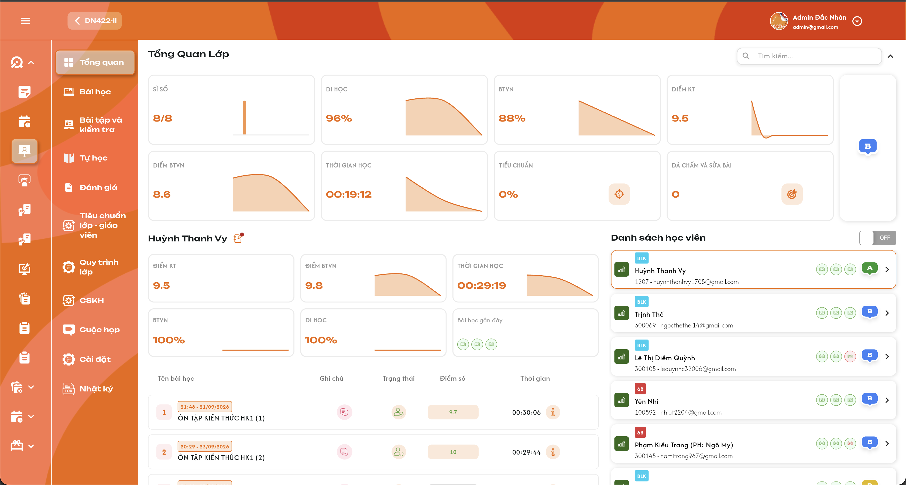
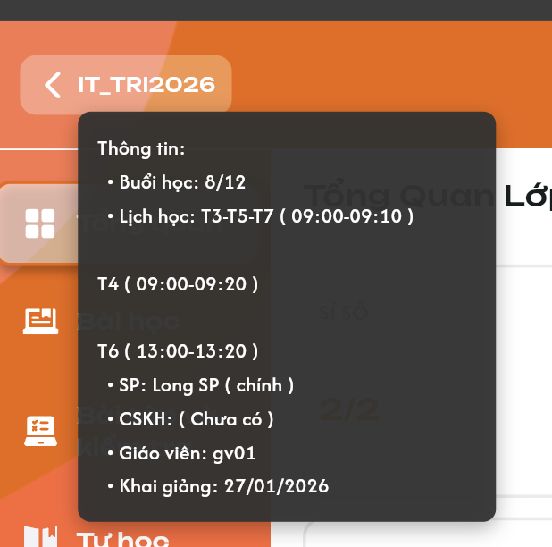
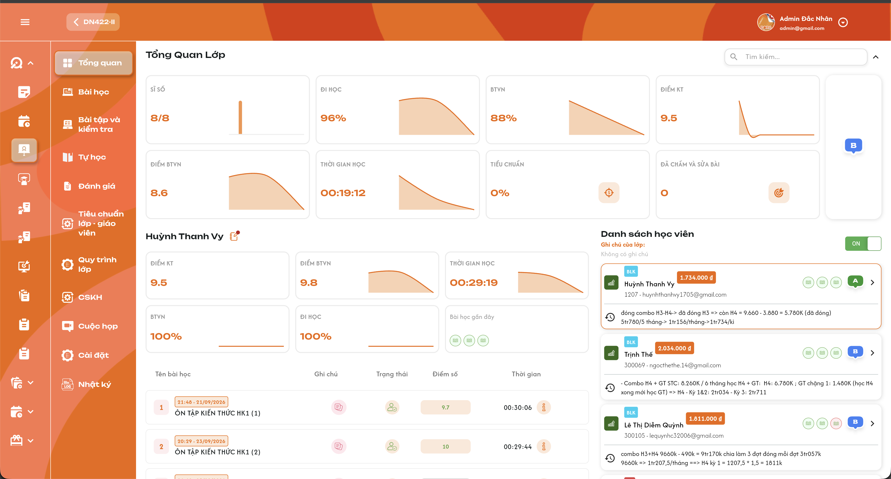
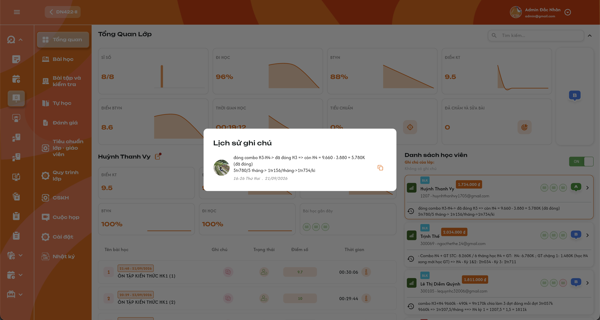
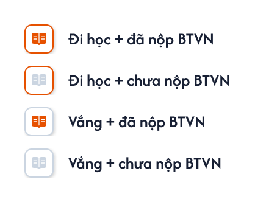
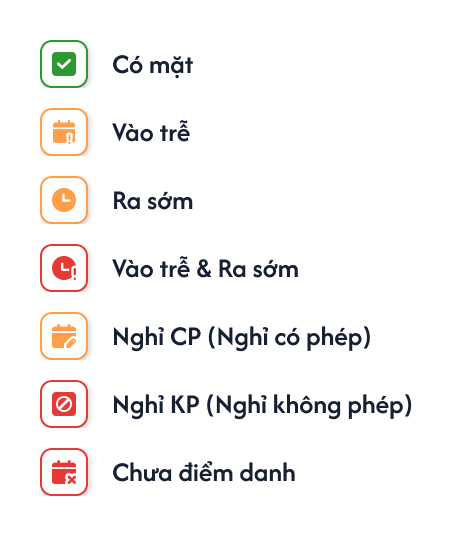
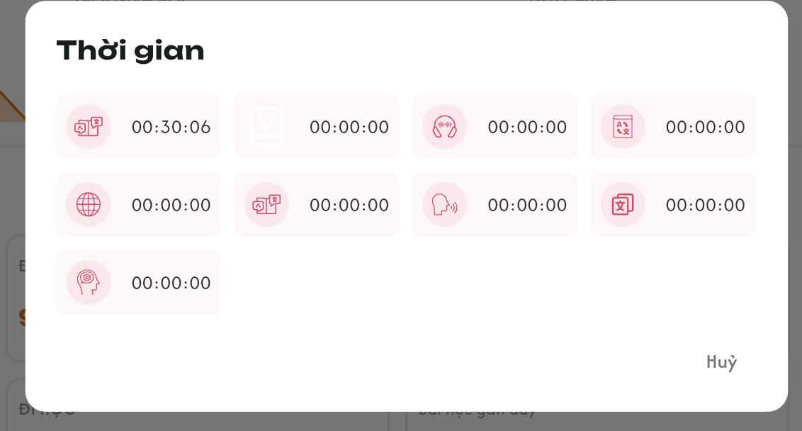

# Chi tiết lớp học — Menu Tổng quan

Đặc tả menu **Tổng quan** của một lớp, không phải các thẻ tổng hợp nhiều lớp ở [Danh sách lớp](./class_management_requirements.md), cũng không phải tab Thông tin trong Cài đặt. Dữ liệu học viên/ghi chú cài đặt dẫn chiếu [Tab Học viên](./class_detail_students_requirements.md); ghi chú lớp dẫn chiếu [Tab Thông tin](./class_detail_information_requirements.md). UI trong ảnh là tham chiếu; số tiền, điểm và nội dung mẫu không phải giá trị cố định.

## 1. UI

### Trang 1: Màn Tổng quan và phân quyền

*Thống kê lớp phía trên; học viên được chọn bên trái; danh sách học viên bên phải.*

**Mô tả:** Admin, Class Handler, Support, Teacher và Sale xem Tổng quan trong phạm vi lớp được phân quyền. Teacher không có công tắc ON/OFF để xem học phí và ghi chú cài đặt.

**Giải thích field/thành phần:**

- `A01.01` **Tổng Quan Lớp**: Dữ liệu của đúng class_id đang mở.
- `A01.02` **Nút Back / mã lớp**: Hover hiển thị tooltip Thông tin lớp; click quay về Danh sách lớp. Chi tiết ở UI Nút Back bên dưới.
- `A01.03` **Thống kê phía trên**: Các chỉ số toàn lớp; không đổi thành chỉ số của học viên đang chọn.
- `A01.04` **Vùng bên trái**: Tên, chỉ số và bảng bài học của học viên đang chọn.
- `A01.05` **Danh sách bên phải**: Các học viên của lớp, trạng thái quan hệ lớp, tag, chấm đỏ số lịch hẹn (Admin/Class Handler/Support), tên, mã, email, bài gần đây, đánh giá và dấu >.
- `A01.06` **Search**: Tìm theo tên học viên; không kế thừa rule không-search của tab Học viên trong Cài đặt.
- `A01.07` **Công tắc ON/OFF**: Admin/Class Handler/Support/Sale sử dụng; Teacher không có control này.
- `A01.08` **Dấu ⌃ cạnh search**: Bấm để thu gọn vùng thống kê Tổng quan toàn lớp phía trên; bấm lại mở rộng. Không thu gọn danh sách hoặc vùng chi tiết học viên.

**Điểm cần lưu ý:**

- Role/phạm vi phải được kiểm tra ở backend; không chỉ ẩn nút trên giao diện.
- Cột Role trong testcase ghi trực tiếp tên role. Khi một case liệt kê nhiều role, chạy riêng cho từng role trong đúng phạm vi lớp; không dùng nhãn chung thay cho nhóm role cụ thể.
- Teacher không nhận học phí, ghi chú cài đặt học viên và ghi chú cài đặt lớp qua payload/API Tổng quan chỉ vì các field đang được ẩn. Quyền ghi chú bài học là nghiệp vụ khác, xem phần dưới.
- Màn này phục vụ xem dữ liệu; không tự thêm quyền chấm điểm, sửa điểm danh, sửa ghi chú giáo viên hoặc thay trạng thái học viên.
- Badge trạng thái học viên thuộc bộ trạng thái quan hệ lớp đã chốt; không nhầm với trạng thái điểm danh từng bài.

### Trang 2: Nút Back và tooltip thông tin lớp

*Tooltip thông tin lớp khi hover nút Back — UI ngày 29/09/2026, nhấn để xem ảnh gốc.*

**Mô tả:**

Nút Back ở góc trên trái gồm mũi tên quay lại và mã lớp đang xem. Khi hover vào nút này, hiển thị tooltip **Thông tin:** của đúng lớp; khi click nút, quay về **Danh sách lớp**. Áp dụng cho Admin, Class Handler, Support, Teacher và Sale có quyền xem Tổng quan lớp theo phạm vi hiện có.

**Giải thích field/thành phần:**

- `A02.01` **Nút Back / mã lớp**: Hover vùng nút gồm mũi tên và mã lớp để xem tooltip. Click nút quay về Danh sách lớp; hover chỉ hiển thị thông tin, không điều hướng. Mã lớp lấy từ lớp đang mở, ví dụ `IT_TRI2026`.
- `A02.02` **Tooltip**: Khung nền tối, chữ sáng, bo góc và hiển thị ngay dưới nút như ảnh. Tiêu đề `Thông tin:`; các thông tin theo thứ tự Buổi học, Lịch học, SP, CSKH, Giáo viên, Khai giảng.
- `A02.03` **Buổi học**: Số buổi dạng `đã thực hiện/tổng số buổi`, cùng nguồn tiến độ của lớp tại Danh sách lớp, ví dụ `8/12`. Giữ quy tắc xác định buổi đã thực hiện của nguồn; không lấy sĩ số hoặc số học viên nộp BTVN thay số buổi.
- `A02.04` **Lịch học**: Hiển thị đầy đủ lịch học của lớp theo thứ và giờ `HH:mm-HH:mm`. Có thể nhóm các thứ cùng khung giờ như `T3-T5-T7 (09:00-09:10)`; các lịch khác xuống dòng riêng như `T4 (09:00-09:20)` và `T6 (13:00-13:20)`. Không cắt chỉ còn lịch đầu tiên.
- `A02.05` **SP**: Hiển thị tên Support được gán cho lớp; người phụ trách chính có nhãn `(chính)` như `Long SP (chính)`. Nếu có nhiều Support, hiển thị đầy đủ người được gán và đúng nhãn chính từ nguồn phân công.
- `A02.06` **CSKH**: Hiển thị nhân sự CSKH của lớp; chưa được gán thì hiển thị `(Chưa có)` như ảnh.
- `A02.07` **Giáo viên**: Hiển thị tên giáo viên được gán cho lớp từ nguồn phân công; ví dụ `gv01`. Khi có nhiều giáo viên, hiển thị đầy đủ danh sách.
- `A02.08` **Khai giảng**: Hiển thị ngày khai giảng của lớp theo `DD/MM/YYYY`, ví dụ `27/01/2026`; không dùng ngày tạo lớp thay ngày khai giảng.

**Điểm cần lưu ý:**

- Tooltip chỉ đọc, dùng thông tin lớp từ các chức năng quản lý hiện có; mã lớp, lịch học, nhân sự và ngày khai giảng trong ảnh là dữ liệu mẫu.
- Rời vùng nút/tooltip thì ẩn tooltip; click Back điều hướng về Danh sách lớp và đóng tooltip. Tooltip không giữ lại trên màn đích.
- Không có nhân sự được gán thì hiển thị `(Chưa có)`; dữ liệu tải lỗi không được coi là chưa có phân công. Giữ cách xử lý loading/lỗi của màn Tổng quan.
- Khi đổi lớp, tooltip phải theo class_id mới; response lớp cũ không ghi đè. Tooltip không phụ thuộc học viên đang chọn hoặc công tắc ON/OFF.
- Hover/ẩn/click Back không thay dữ liệu và không hiển thị Toast CRUD.

### Trang 3: Thống kê học tập trung bình của lớp
**Mô tả:** Hiển thị các chỉ số toàn lớp: Sĩ số, Đi học, BTVN, Điểm KT, Điểm BTVN, Thời gian học, Tiêu chuẩn và Đã chấm và sửa bài; cạnh khối có badge đánh giá lớp.

**Giải thích field/thành phần:**

- `A03.01` **Sĩ số**: Tử số = số học viên Đang học + Dự thính; mẫu số = tất cả học viên của lớp thuộc đủ 7 trạng thái: Đang học, Dự thính, Hoàn thành, Nghỉ học, Rời lớp, Chỉ xem, Xóa. Dấu / phân cách hai số, không đổi sang %.
- `A03.02` **Đi học**: Trung bình cộng tỷ lệ đi học của học viên có dữ liệu trong lớp, dùng cùng công thức mức lớp đã chốt tại Danh sách lớp. Không có dữ liệu thì để trống.
- `A03.03` **BTVN**: Trung bình cộng tỷ lệ làm BTVN của học viên có dữ liệu trong lớp, dùng cùng công thức mức lớp đã chốt tại Danh sách lớp. Không có dữ liệu thì để trống.
- `A03.04` **Điểm KT**: Cộng điểm các bài kiểm tra đã chấm của học viên trong lớp rồi chia số bài đã chấm. Giữ bài của học viên trước đó dù đã Rời lớp/Xóa. Làm tròn kết quả đến 1 chữ số thập phân.
- `A03.05` **Điểm BTVN**: Cộng điểm các bài BTVN đã chấm rồi chia số bài BTVN đã chấm, kể cả bài của học viên đã Rời lớp/Xóa. Tính riêng với KT, làm tròn đến 1 chữ số thập phân.
- `A03.06` **Thời gian học**: Lấy trung bình tổng thời gian từng bài học của từng học viên trên app: cộng các tổng thời gian học viên–bài, chia số bản ghi học viên–bài trong tập tính. Không lấy trung bình các trung bình học viên, không lấy tổng lịch dạy; hiển thị HH:mm:ss.
- `A03.07` **Tiêu chuẩn**: % hoàn thành tiêu chuẩn lớp–giáo viên, lấy dữ liệu từ function Tiêu chuẩn; không tự suy ra từ Đi học/BTVN/điểm. Chưa có icon chính thức, không điều hướng khi click.
- `A03.08` **Đã chấm và sửa bài**: Số bài **BTVN và Kiểm tra** của lớp đã có ít nhất một lần giáo viên bấm `Đã Chấm và Sửa Bài Trên Lớp` (xem [Giảng dạy — role Giáo viên](../../teacher_role/class/class_teaching_requirements.md)). Mỗi bài tính một lần; bấm lại không tăng. Chưa có icon chính thức, không điều hướng khi click.
- `A03.09` **Đánh giá lớp**: Badge theo giá trị được nguồn dữ liệu cung cấp; chưa có công thức tự tính, không click để điều hướng.

**Điểm cần lưu ý:**

- Tách tập quan hệ học viên hiện tại để hiển thị/sĩ số với dữ liệu kết quả học tập lịch sử. Không INNER JOIN chỉ học viên còn trong lớp rồi làm mất các bài BTVN/KT đã làm.
- Rời lớp/xóa quan hệ không xóa bài đã làm, điểm đã chấm hoặc liên kết lịch sử học viên–lớp–bài.
- Quy tắc giữ lịch sử đã chốt cho trung bình Điểm BTVN/KT; không tự suy rộng sang Đi học, tỷ lệ BTVN hoặc Thời gian học khi chưa xác nhận.
- Chưa nộp/Chưa chấm không tham gia tử số hoặc mẫu số trung bình điểm. Bài đã chấm điểm 0 vẫn tính vào cả hai. Không có bài đã chấm thì để trống điểm trung bình, không tạo 0 giả.
- Lấy trung bình trực tiếp các bài đã chấm, không trung bình hai cấp qua từng học viên. Giữ độ chính xác khi tính và chỉ làm tròn kết quả cuối đến 1 chữ số thập phân.
- Chỉ số điểm/thời gian của một học viên áp dụng cùng cách lấy trung bình nhưng tập dữ liệu giới hạn theo học viên đó.
- Với thời gian, mỗi giá trị là tổng thời gian app của một cặp học viên–bài, đếm một lần trong tập tính. Bản ghi có tổng thời gian thực tế 0 vẫn là dữ liệu 0; bản ghi thiếu dữ liệu không tự biến thành thời gian 0. Chính sách bản ghi chưa có thời gian và làm tròn giây cần chốt với nguồn app.
- Search/chọn học viên/ON/OFF không làm thay đổi thống kê toàn lớp.
- Công thức sĩ số thường này thay công thức cũ tính Hoàn thành ở tử số và loại Chỉ xem/Xóa khỏi mẫu số; dùng thống nhất với Danh sách lớp. Không đổi công thức Sĩ số KPI có điều kiện học phí.
- Mẫu số sĩ số phải lấy cả quan hệ học viên–lớp trạng thái Xóa, không chỉ đếm danh sách đang hiển thị. Ví dụ mỗi trạng thái có một học viên thì sĩ số là 2/7.

### Trang 4: Biểu đồ theo bài học
**Mô tả:** Các chỉ số học tập có biểu đồ đường màu cam theo số bài học, có thể tô vùng dưới đường như ảnh.

**Giải thích field/thành phần:**

- `A04.01` **Trục bài học**: Theo thứ tự bài học, không theo ngày/tuần lịch.
- `A04.02` **Giá trị**: Mỗi điểm là dữ liệu của bài học tương ứng, không phải trung bình lũy kế qua các bài trước. Đúng phạm vi: biểu đồ lớp ở trên; biểu đồ học viên đang chọn ở bên trái.
- `A04.03` **Giới hạn chart học viên**: Lấy theo bài học của học viên đang chọn; học tới bài nào thì chart hiển thị tới bài đó. Không vẽ các bài phía sau chỉ vì lớp đã mở hoặc học viên khác đã học.
- `A04.04` **Đường/vùng cam**: Dùng dữ liệu thực tế; không vẽ đường trang trí giống ảnh khi dữ liệu khác.
- `A04.05` **Tooltip**: Nội dung/khả năng hover chưa chốt.

**Điểm cần lưu ý:**

- Không dùng cùng một chuỗi dữ liệu cho tất cả thẻ hoặc tất cả học viên.
- Không dùng ngày mở bài như thứ tự duy nhất nếu thứ tự bài trong lớp khác.
- Xác định bài học viên đã học từ dữ liệu tiến độ học viên–bài; không dùng bài mới nhất giáo viên mở cho cả lớp thay cho tiến độ từng người.
- Thiếu dữ liệu không dựng thành đường 0 như kết quả hợp lệ.

### Trang 5: Danh sách, tìm kiếm và chọn học viên
**Mô tả:** Mặc định chọn học viên đầu tiên khi mở màn. Click thẻ chọn học viên và cập nhật vùng trái; dấu > vào detail học viên.

**Giải thích field/thành phần:**

- `A05.01` **Thẻ học viên**: Tag, icon trạng thái quan hệ lớp, chấm đỏ số lịch hẹn, tên, mã, email, 3 bài gần nhất, badge đánh giá và >.
- `A05.02` **Chấm đỏ lịch hẹn**: Chấm đỏ có số ngay trước tên học viên = số lịch hẹn loại đối tượng Học viên của học viên đó có trạng thái `Mới`, `Chưa xử lý`, `Đang xử lý` mà người xem được thấy theo [requirement Lịch hẹn](../../appointment_requirement/appointment_requirements.md): Admin thấy toàn bộ; Class Handler, Support thấy lịch hẹn mình là Người phụ trách hoặc Theo dõi. Bằng 0 thì ẩn. Chỉ Admin, Class Handler, Support thấy; Teacher và Sale không thấy.
- `A05.03` **Hover chấm đỏ**: Mở popup `Danh sách lịch hẹn` chỉ đọc của học viên, cùng cột và quy tắc với popup Danh sách lịch hẹn ở [Danh sách giáo viên](../teacher_management/teacher_management_requirements.md): Thời gian, Nội dung, Ghi chú, Người phụ trách, Người theo dõi, Đối tượng, Trạng thái; sắp theo thời gian tăng dần; số dòng bằng số trên chấm đỏ. Không chọn học viên, không điều hướng.
- `A05.04` **Thẻ đang chọn**: Viền cam theo UI. Chỉ một học viên được chọn.
- `A05.05` **Click thẻ**: Chọn theo student_id và class_id; tải chỉ số/bài của học viên đó.
- `A05.06` **Dấu >**: Điều hướng detail đúng học viên, không kích hoạt click chọn thẻ do bubbling.
- `A05.07` **Search tên**: Tìm theo tên học viên trong phạm vi lớp trên toàn bộ dữ liệu, không chỉ phần đã tải.
- `A05.08` **Toàn bộ danh sách**: Hiển thị đầy đủ học viên thuộc mọi trạng thái của lớp, kể cả Xóa; không load-more, không phân trang. Không phải chỉ tải 3 hoặc một trang đầu.
- `A05.09` **Vùng trái**: Điểm KT, Điểm BTVN, Thời gian học, tỷ lệ BTVN, Đi học, Bài học gần đây (6 bài) và bảng chi tiết.

**Điểm cần lưu ý:**

- Search không lọc lại các chỉ số thống kê lớp phía trên.
- Chấm đỏ lịch hẹn chỉ để xem; sửa, xoá, đổi trạng thái lịch hẹn thực hiện tại menu `Lịch Hẹn` → tab `Học viên`. API không trả số lịch hẹn cho Teacher và Sale.
- Danh sách hiển thị toàn bộ đủ 7 trạng thái: Đang học, Dự thính, Hoàn thành, Nghỉ học, Rời lớp, Chỉ xem, Xóa. Không có filter ngầm loại Xóa/Rời lớp/Nghỉ học. Thứ tự học viên cần chốt riêng.
- Khi search không khớp học viên đang chọn, chính sách giữ lựa chọn hay chuyển sang kết quả đầu cần chốt; không trộn tên A với dữ liệu B.
- Học viên Rời lớp/Xóa vẫn có thẻ trong Tổng quan theo rule mọi trạng thái; click xem dữ liệu học tập lịch sử theo quyền. Hiển thị Xóa ở Tổng quan không khôi phục quan hệ hoặc đổi rule ẩn Xóa tại tab Học viên trong Cài đặt.

### Trang 6: Công tắc ON/OFF: học phí và ghi chú cài đặt

*ON: thêm học phí, ghi chú lớp và ghi chú từng học viên.*

**Mô tả:** ON hiển thị ghi chú cài đặt lớp, tổng học phí học viên đã đóng cho lớp và ghi chú cài đặt từng học viên. OFF ẩn các vùng bổ sung này.

**Giải thích field/thành phần:**

- `A06.01` **ON/OFF**: Admin/Class Handler/Support/Sale; mặc định OFF khi mở màn. Không tự khôi phục ON từ lần mở trước.
- `A06.02` **Học phí**: Tổng học phí học viên đã đóng cho lớp hiện tại, cùng dữ liệu cột Số tiền của tab Học viên; không phải tổng giá trị hóa đơn.
- `A06.03` **Ghi chú của lớp**: Dùng field Ghi chú trong Cài đặt lớp/Tab Thông tin; rỗng hiển thị Không có ghi chú.
- `A06.04` **Ghi chú dưới từng thẻ**: Nội dung hiện tại của ghi chú quan hệ học viên–lớp trong Cài đặt → Học viên.
- `A06.05` **Icon lịch sử cạnh ghi chú**: Mở lịch sử của đúng ghi chú cài đặt học viên–lớp; nội dung, người sửa/thời điểm, Copy.

**Điểm cần lưu ý:**

- Công tắc chỉ thay cách xem, không tạo/sửa ghi chú hoặc học phí, không cập nhật audit dữ liệu.
- Không dùng ghi chú bài học từ giáo viên thay cho ghi chú cài đặt; đó là hai nguồn khác nhau.
- Teacher không có cách bật các vùng này trong Tổng quan; không sử dụng OFF như biện pháp phân quyền duy nhất.
- Các role khác được xem ON trong Tổng quan không vì thế được quyền xem tab Hóa đơn: tab Hóa đơn vẫn chỉ Admin/Class Handler/Support theo requirement riêng.
- Không cho sửa ghi chú cài đặt ngay tại Tổng quan với mọi role; chỉ xem/lịch sử/Copy. Quyền sửa ở function Cài đặt không thay đổi.

### Trang 7: Ghi chú cài đặt và lịch sử

**Mô tả:** Ghi chú học viên dùng cùng nguồn với tab Học viên trong Cài đặt; có thể chứa các ghi chú bất thường như học kém/cảnh báo nghỉ học. Lịch sử và Copy dùng dữ liệu phiên bản đã lưu.

**Giải thích field/thành phần:**

- `A07.01` **Icon cạnh tên học viên đang chọn**: Mở xem ghi chú cài đặt học viên–lớp và lịch sử theo quyền, không có ô chỉnh/nút lưu. Teacher không được mở nguồn ghi chú cài đặt qua Tổng quan.
- `A07.02` **Popup Lịch sử ghi chú**: Nội dung, avatar/tên người tạo/chỉnh, thời điểm máy chủ; mới nhất trước, đúng class_id + student_id.
- `A07.03` **Copy**: Copy nội dung của bản được chọn, không kèm metadata; không tạo phiên bản.
- `A07.04` **Ghi chú bất thường**: Hiển thị đúng text được nhập; chưa có rule tự phân loại/tự tạo cảnh báo từ chỉ số.

**Điểm cần lưu ý:**

- Không tự sinh cảnh báo “học kém” từ điểm hoặc “nghỉ học” từ tỷ lệ nếu chưa có công thức.
- Xem lịch sử không được chỉnh/xóa các phiên bản. Đọc/Copy không có Toast CRUD.
- Mọi ghi chú tại Tổng quan đều chỉ xem; không dùng component ghi chú có mode chỉnh sửa chỉ vì role có quyền sửa ở màn nguồn.
- Ghi chú cài đặt và ghi chú giáo viên theo bài có định danh/phạm vi riêng, không dùng chung nội dung vì cùng học viên.
- Không lấy ảnh avatar làm định danh người sửa; backend phải giữ người và thời điểm audit.

### Trang 8: ADM-LOP-020100 — Đánh giá tổng và bài học gần đây
**Mô tả:** Mỗi học viên có badge đánh giá tổng và trạng thái 3 bài gần nhất. Vùng trái hiển thị Bài học gần đây gồm 6 bài gần nhất của người được chọn.

*Bộ icon `Class Session Status` cho Bài học gần đây (Figma component 2425:105717) — nhấn để xem ảnh gốc*

**Giải thích field/thành phần:**

- `A08.01` **Badge đánh giá**: F màu đỏ, D màu nâu, E màu cam theo xác nhận; A xanh lá và B xanh dương theo UI tham chiếu. C hoặc màu khác chưa có quy tắc.
- `A08.02` **Giá trị đánh giá**: Hiển thị giá trị nguồn cung cấp; chưa có công thức tự tính từ điểm/đi học/BTVN.
- `A08.03` **Số bài hiển thị**: Thẻ học viên ở danh sách bên phải: 3 bài gần nhất. Khối Bài học gần đây ở vùng trái khi chọn học viên: 6 bài gần nhất. Chỉ tính bài **đã được điểm danh** của học viên trong lớp; bài học viên còn Chưa điểm danh không tính. Ít hơn số bài quy định thì chỉ hiện số bài có dữ liệu; sắp từ bài mới nhất.
- `A08.04` **Đi học / vắng**: Đi học: Có mặt, Vào trễ, Ra sớm, Vào trễ & Ra sớm. Vắng: Nghỉ CP, Nghỉ KP.
- `A08.05` **Đã nộp BTVN**: Học viên đã nộp BTVN của bài; nộp chưa chấm hoặc điểm 0 vẫn là đã nộp.
- `A08.06` **Icon bài gần đây**: Viền cam = đi học, viền xám = vắng; sách cam = đã nộp BTVN, sách xám = chưa nộp.
- `A08.07` **Đi học + đã nộp BTVN**: Viền cam, sách cam.
- `A08.08` **Đi học + chưa nộp BTVN**: Viền cam, sách xám.
- `A08.09` **Vắng + đã nộp BTVN**: Viền xám, sách cam.
- `A08.10` **Vắng + chưa nộp BTVN**: Viền xám, sách xám.
- `A08.11` **Hover icon bài gần đây**: Hiển thị tên tổ hợp của bài tương ứng.

**Điểm cần lưu ý:**

- Đi học/vắng của icon bài gần đây suy ra từ điểm danh theo bảng trên; bộ icon bài gần đây khác bộ icon điểm danh ở cột Trạng thái của bảng bài.
- Khác Figma ADM-LOP-020100: khối Bài học gần đây ở vùng trái đang vẽ 4 icon, requirement là 6 bài.
- Badge đánh giá không có điều hướng. Hover icon bài gần đây để xem trạng thái; không tự thêm thao tác click cập nhật/điều hướng.

### Trang 9: ADM-LOP-020100 — Bảng bài học của học viên và điểm danh
**Mô tả:** Bảng bên trái gồm Tên bài học, Ghi chú, Trạng thái, Điểm số và Thời gian của học viên đang chọn.

**Giải thích field/thành phần:**

- `A09.01` **Tên bài học**: Thứ tự bài; tag thời điểm giáo viên mở bài cho lớp dạng `HH:mm - dd/MM/yyyy` (ví dụ `19:18 - 13/07/2026`) đặt **phía trên** tên bài; tên bài. Cùng lớp/cùng bài thì mốc này giống nhau ở mọi học viên, không phải giờ học/nộp của từng người. Bài chưa mở không có tag.
- `A09.02` **Ghi chú**: Ghi chú giáo viên theo học viên–bài; có nội dung dùng icon đỏ và click xem. Không có nội dung dùng icon xám, không click được. Không chỉnh tại Tổng quan.
- `A09.03` **Trạng thái**: Icon điểm danh của đúng học viên ở bài/buổi theo bảng bên dưới; không phải trạng thái Đang học/Rời lớp. Hover icon hiển thị tên trạng thái điểm danh tương ứng.
- `A09.04` **Điểm số**: Điểm BTVN của học viên tại bài đó: điểm cụ thể, Chưa nộp hoặc Chưa chấm. Không lấy điểm kiểm tra thay cho cột này.
- `A09.05` **Thời gian**: Thời gian học trên app của học viên cho bài; HH:mm:ss; icon i mở chi tiết từng phần.

*Bộ icon `Trạng thái đi học` (Figma component 2456:110608) — nhấn để xem ảnh gốc*

- `A09.06` **Có mặt**: Tooltip: Có mặt; Icon: Ô viền xanh lá, dấu tick trắng nền xanh lá.
- `A09.07` **Vào trễ**: Tooltip: Vào trễ; Icon: Ô viền cam, lịch có dấu `!` màu cam.
- `A09.08` **Ra sớm**: Tooltip: Ra sớm; Icon: Ô viền cam, đồng hồ màu cam.
- `A09.09` **Vào trễ & ra sớm**: Tooltip: Vào trễ & ra sớm; Icon: Ô viền đỏ, đồng hồ có dấu `!` màu đỏ.
- `A09.10` **Nghỉ có phép**: Tooltip: Nghỉ có phép (cp); Icon: Ô viền cam, lịch có bút màu cam.
- `A09.11` **Nghỉ không phép**: Tooltip: Nghỉ không phép (kp); Icon: Ô viền đỏ, biểu tượng cấm màu đỏ.
- `A09.12` **Chưa điểm danh**: Tooltip: Chưa điểm danh; Icon: Ô viền đỏ, lịch có dấu `x` màu đỏ.

**Điểm cần lưu ý:**

- Chỉ xem: không chỉnh điểm, điểm danh hoặc ghi chú bài học bằng icon ở đây. Quyền chấm BTVN/KT chính thức vẫn thuộc giáo viên phụ trách chính ở function khác.
- Điểm cụ thể 0 là một điểm hợp lệ khác với Chưa nộp/Chưa chấm; không dùng falsy để thay 0 thành trạng thái chưa có điểm.
- Bộ icon điểm danh dùng component `Trạng thái đi học`; mỗi icon có tooltip tên trạng thái. Cùng bộ icon được dùng ở cột Đi học của menu Bài học.
- Bảng bài hiển thị toàn bộ, không load-more/phân trang; sắp theo số thứ tự bài học tăng dần. Không cắt bảng theo số bài của vùng Bài học gần đây.
- Khác Figma ADM-LOP-020100: bảng bài chưa có tag thời điểm mở bài phía trên tên bài.

### Trang 10: Popup ghi chú giáo viên theo bài học

**Mô tả:** Click ghi chú bài mở popup Ghi chú, có hai vùng theo UI mới: Ghi chú từ Giáo viên cho Học viên và Ghi chú từ Giáo viên cho Team Support.

**Giải thích field/thành phần:**

- `A10.01` **Cho Học viên**: Nội dung giáo viên đã ghi theo bài và học viên; chỉ đọc.
- `A10.02` **Cho Team Support**: Nội dung giáo viên cho team hỗ trợ; chỉ đọc. Admin/Class Handler/Sale/Support và Teacher của lớp được xem cả vùng này và vùng Cho Học viên.
- `A10.03` **Hủy**: Đóng popup, không lưu hay đổi ghi chú.

**Điểm cần lưu ý:**

- Dữ liệu dùng class_id + student_id + lesson/session_id, không chỉ student_id.
- Không có quyền sửa tại Tổng quan, kể cả Teacher; việc giáo viên tạo/sửa ghi chú nằm trong function bên role Giáo viên.
- Admin/Class Handler/Sale/Support và Teacher (mọi giáo viên của lớp) được xem cả hai vùng theo quyền lớp; Teacher xem cả ghi chú do giáo viên khác của lớp viết, theo [Tổng quan — role Giáo viên](../../teacher_role/class/class_overview_requirements.md).
- Không tự nối hai vùng thành một ghi chú; xử lý nội dung trống riêng từng vùng.
- Icon xám không click được: không mở popup rỗng, không gửi request tải ghi chú và không có thao tác lưu.

### Trang 11: Popup Thời gian từng phần trên app

**Mô tả:** Click icon i tại một dòng bài học mở Thời gian, hiển thị thời gian học của đúng học viên và bài đó theo từng phần trên app.

**Giải thích field/thành phần:**

- `A11.01` **Chín phần**: BTVN, Từ vựng, Nghe, Học flashcard, Duyệt kiến thức, Ngữ pháp, Đọc, Lật flashcard, Luyện nhớ.
- `A11.02` **Mỗi ô**: Icon đúng loại hoạt động, thời gian HH:mm:ss; có nhãn/tooltip phân biệt hoạt động.
- `A11.03` **00:00:00**: Thời gian ghi nhận thực tế bằng 0; không dùng 0 để che lỗi tải hoặc thiếu dữ liệu chưa xác định.
- `A11.04` **Hủy**: Đóng popup, không thay dữ liệu thời gian.

**Điểm cần lưu ý:**

- Học flashcard và Lật flashcard là hai phần riêng; không gộp vì icon tương tự.
- Popup không hiển thị thời gian toàn lớp hoặc tổng nhiều bài thay cho bài được bấm.
- Giá trị dùng tính trung bình là tổng thời gian từng bài của từng học viên trên app, không phải từng ô hoạt động riêng lẻ. Cách nguồn thời gian tổng loại trùng giữa chín hoạt động cần xác nhận với function app; không tự cộng trùng.
- Mapping icon/thứ tự ô không được đoán từ hình; cần dùng định danh hoạt động và asset chuẩn.

### Trang 12: Loading, rỗng, lỗi và an toàn dữ liệu
**Mô tả:** Phân biệt tải/chưa có dữ liệu/lỗi ở thống kê, danh sách, bảng bài và popup; chống response cũ ghi đè học viên đang chọn.

**Giải thích field/thành phần:**

- `A12.01` **Loading**: Hiển thị tại vùng đang tải; không giữ dữ liệu A dưới tên B.
- `A12.02` **Empty**: Chưa có học viên, Không tìm thấy học viên, Chưa có bài học hoặc Chưa có ghi chú tùy nguồn.
- `A12.03` **Error**: Thông báo phù hợp và Thử lại; không biến lỗi thành chỉ số 0.
- `A12.04` **Toast**: Các thao tác xem/search/chọn/ON-OFF/Copy/Hủy popup không có Toast CRUD thành công.

**Điểm cần lưu ý:**

- Render text ghi chú an toàn, không thực thi HTML/script.
- Request/response phải xác định đúng lớp, học viên, bài và quyền hiện tại.
- Không cache/chia sẻ payload có học phí/ghi chú cài đặt cho Teacher hoặc role khác phạm vi; ghi chú bài học tuân quyền nguồn riêng.

---

## 2. Yêu cầu

### 2.1. Flow chính

- **Flow 1 / REQ01–REQ03:** Mở Tổng quan → kiểm tra role/phạm vi → tải thống kê lớp và danh sách → chọn học viên đầu tiên → tải chỉ số/bảng bài.
- **Flow 2 / REQ04, REQ06, REQ09:** Search theo tên hoặc click thẻ → ngữ cảnh học viên mới → cập nhật vùng trái; click > → detail học viên theo quyền màn đích; Admin/Class Handler/Support hover chấm đỏ lịch hẹn → popup Danh sách lịch hẹn chỉ đọc.
- **Flow 3 / REQ05:** Admin/Class Handler/Support/Sale bật ON → hiện học phí/ghi chú cài đặt của lớp và học viên; OFF → ẩn; Teacher không có công tắc, không thay dữ liệu học tập hoặc quyền màn khác.
- **Flow 4 / REQ07:** Icon lịch sử ghi chú cài đặt → popup theo học viên–lớp → xem các phiên bản → Copy nội dung bản chọn.
- **Flow 5 / REQ10:** Icon ghi chú bài → kiểm tra quyền từng vùng → popup hai nguồn ghi chú giáo viên → chỉ xem → Hủy.
- **Flow 6 / REQ11:** i của bài → thời gian học viên–bài → chín phần trên app → Hủy, giữ lựa chọn.
- **Flow 7 / REQ13:** Hover nút Back/mã lớp → tooltip Thông tin của lớp đang mở → rời hover thì ẩn; click Back → đóng tooltip và về Danh sách lớp.

### 2.2. Ngoại lệ

- **EX01:** Sai role/ngoài lớp/sai quyền ghi chú nội bộ → chặn backend và không trả nội dung không được phép.
- **EX02:** Thiếu điểm hoặc enum khác giá trị đã chốt → không tự đổi thành 0/đánh giá/điểm danh khác.
- **EX03:** Response ngữ cảnh cũ → bỏ qua; không ghi đè học viên/search/lớp hiện tại.
- **EX04:** Danh sách/search/bảng bài rỗng → empty state đúng vùng, không dữ liệu giả.
- **EX05:** Lỗi tải → giữ phần hợp lệ, báo lỗi/thử lại; không coi là kết quả 0 hoặc không có ghi chú.
- **EX06:** Học viên rời/xóa → bảo toàn bài đã làm/điểm BTVN và KT trong tập tính thống kê lịch sử; không xóa dữ liệu theo quan hệ hiện tại.

### 2.3. Yêu cầu khác

| Mã | Tên yêu cầu | Mô tả |
|---|---|---|
| REQ01 |  | Admin/Class Handler/Support/Teacher/Sale được xem theo phạm vi; Teacher không có ON/OFF hoặc payload học phí/ghi chú cài đặt qua Tổng quan. |
| REQ02 |  | Sĩ số = (Đang học + Dự thính) / tất cả 7 trạng thái kể cả Xóa; Đi học/BTVN dùng công thức đã chốt; thời gian trung bình của tổng thời gian từng học viên–bài; Tiêu chuẩn lớp–giáo viên; Đã chấm và sửa bài = số bài BTVN + Kiểm tra đã bấm nút Đã Chấm và Sửa Bài Trên Lớp, mỗi bài một lần; không điều hướng các thẻ. |
| REQ03 |  | Trung bình trực tiếp bài đã chấm, tính KT và BTVN riêng, giữ bài người rời/xóa, loại Chưa nộp/Chưa chấm khỏi cả tử/mẫu, giữ điểm 0 đã chấm, làm tròn kết quả cuối 1 chữ số thập phân. |
| REQ04 |  | Mỗi điểm chart theo bài, không lũy kế; chart học viên chỉ tới bài người đó đã học, không hiển thị bài phía sau; đúng phạm vi lớp/học viên. |
| REQ05 |  | Mặc định OFF; ON hiển thị học phí và ghi chú cài đặt, OFF ẩn; Teacher không có control; không mở rộng tab Hóa đơn/quyền sửa. |
| REQ06 |  | Toàn bộ danh sách đủ mọi trạng thái kể cả Xóa, không load-more/phân trang; chọn người đầu tiên; click thẻ cập nhật vùng trái; > vào detail; search tên không lọc thống kê lớp. Chấm đỏ số lịch hẹn chưa hoàn tất (Mới, Chưa xử lý, Đang xử lý) của học viên theo phạm vi xem lịch hẹn, chỉ Admin/Class Handler/Support; hover mở popup Danh sách lịch hẹn chỉ đọc; Teacher và Sale không thấy. |
| REQ07 |  | Ghi chú cài đặt cùng nguồn ở Cài đặt, chỉ xem bất thường/lịch sử/Copy với mọi role ở Tổng quan, không tự sinh cảnh báo. |
| REQ08 |  | Đánh giá nguồn chưa có công thức, không điều hướng; F đỏ/D nâu/E cam; bài gần nhất đã được điểm danh (bỏ bài Chưa điểm danh): thẻ học viên tối đa 3 bài, vùng trái tối đa 6 bài; bốn icon `Class Session Status` theo đi học (Có mặt, Vào trễ, Ra sớm, Vào trễ & Ra sớm) / vắng (Nghỉ CP, Nghỉ KP) và đã nộp / chưa nộp BTVN; hover xem tên tổ hợp. |
| REQ09 |  | Toàn bộ bảng bài theo số thứ tự tăng dần, không load-more/phân trang; bảy enum điểm danh hiển thị bằng bộ icon `Trạng thái đi học` kèm tooltip; điểm từng dòng là BTVN; tag thời điểm giáo viên mở bài `HH:mm - dd/MM/yyyy` phía trên tên bài, giống nhau cho mọi học viên, bài chưa mở không có tag; icon ghi chú xám không click; chỉ đọc. |
| REQ10 |  | Popup hai vùng ghi chú giáo viên theo bài; Admin/Class Handler/Sale/Support và Teacher của lớp xem cả hai (Teacher gồm ghi chú của giáo viên khác trong lớp); không sửa ở Tổng quan, Teacher nhập ghi chú tại function role Giáo viên. |
| REQ11 |  | i mở chín phần thời gian trên app, HH:mm:ss, không gộp flashcard, không thay 0 cho lỗi. |
| REQ12 |  | Loading/empty/error rõ ràng, chống stale response, text an toàn, không Toast CRUD cho thao tác đọc; ⌃ chỉ thu gọn/mở vùng thống kê Tổng quan. |

| Mã | Tên yêu cầu | Mô tả |
|---|---|---|
| REQ13 | Tooltip nút Back | Hover mũi tên/mã lớp hiển thị Thông tin gồm Buổi học, toàn bộ Lịch học, SP và nhãn chính, CSKH, Giáo viên, Khai giảng DD/MM/YYYY của đúng lớp. Chưa phân công hiển thị (Chưa có); rời hover thì ẩn; click vẫn quay về Danh sách lớp. Chỉ đọc, không phụ thuộc ON/OFF hoặc học viên được chọn; cùng quyền xem Tổng quan. |

### 2.4. Ràng buộc

- Dùng class_id + student_id và lesson/session_id phù hợp; không dùng tên/email/vị trí dòng làm khóa.
- Tập dữ liệu tính trung bình không bị giới hạn ở số thẻ/bài đã tải trên client.
- Dữ liệu lịch sử phải còn liên kết nguồn để tính điểm ngay khi học viên không còn trong danh sách hiện tại; không join theo quan hệ hoạt động rồi mất điểm.
- Ghi chú cài đặt lớp, ghi chú cài đặt học viên, ghi chú giáo viên cho học viên và cho Team Support là bốn nguồn khác nhau.
- Tổng quan không cho chấm điểm, sửa điểm danh, tự tính đánh giá hoặc sửa ghi chú giáo viên. Quyền giáo viên phụ trách chính tại function chấm điểm không thay đổi.
- Không suy role Assistant Teacher riêng; Trợ giảng là Support theo thuật ngữ đã chốt.
- Các công thức chưa chốt phải được xác nhận trước triển khai tính toán, không dùng đường biểu đồ/số mẫu trong ảnh làm công thức.

---

## 3. Testcase

### Feature: Chi tiết lớp học — Menu Tổng quan

| Tên testcase | Priority | Scenario | Role | Pre-condition | Given/When/Then | Expected Result |
|---|---|---|---|---|---|---|
| Case 1: Mở Tổng quan đúng lớp | High · Smoke | Flow 1 / REQ01 | Admin/Class Handler/Support/Teacher/Sale | Có quyền với lớp A | **Given** mở A **When** vào Tổng quan **Then** tải theo class_id | - Đúng ba vùng UI - Không trộn lớp B - Chỉ đọc dữ liệu |
| Case 2: Teacher không có ON/OFF | High | REQ01 / REQ05 | Teacher | Được xem lớp | **Given** mở Tổng quan **When** render hoặc sửa request để yêu cầu ON **Then** giữ đúng quyền Teacher | - Không có công tắc - Không trả học phí/ghi chú cài đặt qua API Tổng quan - Vẫn xem chỉ số học tập được phép |
| Case 3: Chặn ngoài quyền/phạm vi | High | EX01 / REQ01 | Student; Admin / Class Handler / Support / Teacher / Sale ngoài phạm vi lớp | Student hoặc tài khoản thuộc một trong năm role nhưng không được xem lớp | **Given** biết ID lớp/học viên và truy cập URL/API trực tiếp **When** kiểm tra role/phạm vi **Then** từ chối | - Student không được vào Tổng quan lớp này - Năm role không vượt phạm vi lớp - Không lộ học tập, tài chính hoặc ghi chú |
| Case 45: Thu gọn và mở thống kê | Medium | REQ01 / REQ12 | Admin / Class Handler / Support / Teacher / Sale | Thống kê đang mở, một học viên đang chọn | **Given** bấm ⌃ **When** thu gọn rồi mở lại **Then** chỉ thay vùng thống kê lớp | - Danh sách/vùng trái vẫn hiện - Giữ học viên/search/ON-OFF - Không đổi dữ liệu hoặc Toast CRUD |
| Case 55: Hover nút Back hiển thị đúng lớp | High | Flow 7 / REQ13 | Admin / Class Handler / Support / Teacher / Sale | Có quyền xem lớp A và dữ liệu thông tin lớp | **Given** Tổng quan A đang mở **When** hover mũi tên hoặc mã lớp trên nút Back **Then** tooltip Thông tin hiện dưới nút với đủ sáu nhóm theo UI | - Đúng mã/phân công/lịch/ngày của A - Không điều hướng khi hover - Không phụ thuộc học viên chọn hoặc ON/OFF |
| Case 56: Nhiều lịch và nhân sự | High | REQ13 | Admin / Class Handler / Support / Teacher / Sale | Lớp có tiến độ 8/12, lịch T3-T5-T7 và hai lịch T4/T6, nhiều Support/giáo viên | **Given** thông tin nguồn đã có **When** mở tooltip **Then** đủ lịch và nhân sự, Support chính có nhãn (chính) | - Hiện 8/12 cùng nguồn tiến độ - Các khung giờ khác xuống dòng - Không chỉ hiển thị phần tử đầu |
| Case 57: Chưa phân công và đúng ngày khai giảng | Medium | REQ13 / EX05 | Admin / Class Handler / Support / Teacher / Sale | CSKH chưa được gán; ngày tạo khác ngày khai giảng 27/01/2026 | **Given** dữ liệu lớp tải thành công **When** hover nút Back **Then** CSKH (Chưa có), Khai giảng 27/01/2026 | - Không lấy ngày tạo thay thế - Lỗi tải không hiển thị thành Chưa có giả |
| Case 58: Rời hover, click Back và đổi lớp | High | Flow 7 / REQ13 / EX03 | Admin / Class Handler / Support / Teacher / Sale | Tooltip A đang hiển thị | **Given** đang xem thông tin A **When** rời vùng hover hoặc click Back; sau đó mở lớp B **Then** tooltip ẩn, click quay về Danh sách lớp, hover ở B chỉ hiển thị B | - Hover không điều hướng, click vẫn quay về danh sách - Không lưu dữ liệu/Toast CRUD - Response A không ghi đè B |
| Case 4: Tử số sĩ số đúng rule mới | High | REQ02 | Admin / Class Handler / Support / Teacher / Sale | 3 Đang học, 2 Dự thính, 1 Hoàn thành | **Given** tính sĩ số Tổng quan **When** tính tử số **Then** 3 + 2 = 5 | - Không cộng Hoàn thành vào tử số - Không dùng sĩ số KPI có điều kiện học phí |
| Case 5: Đi học/BTVN trung bình | High | REQ02 | Admin / Class Handler / Support / Teacher / Sale | Tỷ lệ hai học viên 80% và 100%, người khác không có dữ liệu | **Given** tính chỉ số lớp **When** tổng hợp **Then** (80 + 100) / 2 = 90% | - Bỏ học viên không có dữ liệu - Không có dữ liệu toàn lớp thì để trống, không 0% |
| Case 6: Giữ bài của học viên rời/xóa | High | REQ03 | Admin / Class Handler / Support / Teacher / Sale | Có điểm BTVN/KT của học viên trước đó | **Given** điểm đã được ghi nhận ở lớp **When** học viên Rời lớp/Xóa rồi tải Tổng quan **Then** vẫn đưa bài đã làm vào tập tính trung bình | - Không mất đóng góp vì quan hệ bị ẩn/xóa mềm - Không xóa dữ liệu lịch sử |
| Case 7: Chỉ tính bài đã chấm | High | REQ03 / EX02 | Admin / Class Handler / Support / Teacher / Sale | Có điểm đã chấm 8 và 0, một Chưa nộp, một Chưa chấm | **Given** tính trung bình **When** lọc bài đã chấm **Then** (8 + 0) / 2 = 4.0 | - Hai trạng thái chưa có điểm bị loại cả tử/mẫu - Điểm 0 đã chấm vẫn tính - Toàn bộ chưa chấm thì để trống |
| Case 8: Thời gian học là trung bình | High | REQ02 | Admin / Class Handler / Support / Teacher / Sale | Backend có thời gian trung bình 00:19:12 | **Given** tải chỉ số **When** hiển thị **Then** 00:19:12 | - Đúng HH:mm:ss - Không cộng thành tổng lớp hoặc dùng giờ lịch dạy |
| Case 9: Tiêu chuẩn đúng nguồn | High | REQ02 | Admin / Class Handler / Support / Teacher / Sale | Tiêu chuẩn lớp–giáo viên là 40% | **Given** Đi học/BTVN có tỷ lệ khác **When** render Tiêu chuẩn **Then** 40% | - Không tự tính lại từ tỷ lệ khác - Không suy ra đánh giá A–F |
| Case 41: Sĩ số đủ mọi trạng thái kể cả Xóa | High | REQ02 | Admin / Class Handler / Support / Teacher / Sale | Mỗi trạng thái trong bộ 7 có một học viên | **Given** tải thống kê **When** tính sĩ số **Then** (Đang học + Dự thính) / tất cả = 2/7 | - Hoàn thành không vào tử số - Xóa và Chỉ xem vẫn vào mẫu số - Không phụ thuộc học phí hoặc số thẻ hiển thị |
| Case 42: Trung bình theo bài và làm tròn | High | REQ03 | Admin / Class Handler / Support / Teacher / Sale | A có bài đã chấm 8 và 9, B có bài đã chấm 9 | **Given** tính riêng KT hoặc BTVN **When** cộng điểm và chia số bài **Then** 26 / 3 làm tròn thành 8.7 | - Không trung bình các trung bình học viên - Chỉ làm tròn kết quả cuối - Điểm lịch sử của người rời/xóa vẫn tính |
| Case 43: Trung bình tổng thời gian học viên–bài | High | REQ02 / REQ11 | Admin / Class Handler / Support / Teacher / Sale | A có tổng thời gian hai bài 10 và 30 phút, B một bài 50 phút | **Given** tính thời gian lớp **When** cộng ba tổng thời gian và chia 3 **Then** 00:30:00 | - Không hiện tổng 01:30:00 - Không lấy trung bình hai trung bình học viên thành 00:35:00 - Thời gian A là 00:20:00 |
| Case 51: Đã chấm và sửa bài đếm số bài BTVN + KT | High | REQ02 | Admin / Class Handler / Support / Teacher / Sale | 3 BTVN và 2 bài kiểm tra đã được bấm nút, một BTVN được bấm 4 lần; 1 BTVN đã chấm nhưng chưa bấm nút | **Given** tải thống kê lớp **When** tính Đã chấm và sửa bài **Then** hiển thị 5 | - Không đếm số lần bấm thành 8 - Không bỏ bài kiểm tra - Bài chưa bấm nút không tính - Không click điều hướng |
| Case 10: Theo thứ tự bài | High | REQ04 | Admin / Class Handler / Support / Teacher / Sale | Có nhiều bài với ngày khác nhau | **Given** tải biểu đồ **When** sắp dữ liệu **Then** theo thứ tự bài học | - Không tự chia theo ngày/tuần - Đúng chỉ số đang hiển thị |
| Case 11: Đổi học viên không lẫn biểu đồ | High | Flow 2 / EX03 | Admin / Class Handler / Support / Teacher / Sale | A/B có chuỗi khác nhau | **Given** chọn A rồi B **When** response A về muộn **Then** giữ dữ liệu B | - Các biểu đồ trái đúng B - Biểu đồ toàn lớp không đổi |
| Case 48: Chart theo bài và dừng đúng tiến độ | High | REQ04 | Admin / Class Handler / Support / Teacher / Sale | Lớp có 10 bài, A học tới bài 4, B học tới bài 7 | **Given** chọn A rồi B **When** render chart học viên **Then** A tới bài 4, B tới bài 7 | - Không vẽ cả 10 bài hoặc bổ sung điểm 0 cho bài chưa học - Mỗi điểm lấy giá trị của bài đó, không lũy kế - Không dùng tiến độ B để kéo dài chart A |
| Case 12: Chọn học viên đầu tiên | High | Flow 1 / REQ06 | Admin / Class Handler / Support / Teacher / Sale | Có ít nhất một học viên | **Given** mở Tổng quan **When** danh sách tải thành công **Then** chọn người đầu tiên của danh sách trả về | - Viền cam đúng thẻ - Vùng trái cùng student_id |
| Case 13: Click thẻ cập nhật vùng trái | High | Flow 2 / REQ06 | Admin / Class Handler / Support / Teacher / Sale | A đang chọn, có B | **Given** click thẻ B **When** dữ liệu tải xong **Then** đổi tên/chỉ số/bài/biểu đồ sang B | - Không đổi thống kê lớp - Không mở detail |
| Case 14: Dấu > mở detail | High | Flow 2 / REQ06 | Admin / Class Handler / Support / Teacher / Sale | Có thẻ B | **Given** click > của B **When** điều hướng **Then** vào detail B theo quyền màn đích | - Không dùng tên/email làm khóa - Không chạy thêm click thẻ |
| Case 15: Search theo tên | High | REQ06 | Admin / Class Handler / Support / Teacher / Sale | Có nhiều học viên | **Given** nhập tên **When** tìm **Then** trả kết quả đúng lớp/tên | - Tìm toàn bộ dữ liệu - Không tự đổi sang search mã/email - Thống kê lớp không đổi |
| Case 16: Không có học viên/kết quả | Medium | EX04 / REQ06 | Admin / Class Handler / Support / Teacher / Sale | Danh sách hoặc search rỗng | **Given** tải thành công nhưng rỗng **When** render **Then** hiển thị empty state | - Không dựng học viên giả - Không hiển thị nhầm dữ liệu lớp khác |
| Case 44: Hiển thị toàn bộ danh sách và bài | High | REQ06 / REQ09 | Admin / Class Handler / Support / Teacher / Sale | Có nhiều học viên và nhiều bài | **Given** mở Tổng quan/chọn học viên **When** tải thành công và cuộn **Then** đủ danh sách học viên và toàn bộ bảng bài | - Không control phân trang/load-more - Không cắt ở kích thước trang đầu - Bài học sắp theo số thứ tự tăng dần |
| Case 59: Chấm đỏ đếm lịch hẹn chưa hoàn tất theo phạm vi | High | REQ06 | Admin / Class Handler / Support | A có 2 lịch hẹn `Mới` (Support X phụ trách 1), 1 `Đang xử lý`, 1 `Đã xử lý` | **Given** mở Tổng quan **When** Admin và Support X xem thẻ A **Then** Admin thấy 3, X thấy 1 | - Không đếm `Đã xử lý` - Bằng 0 thì ẩn chấm - Hover mở popup đúng số dòng, chỉ đọc |
| Case 60: Teacher và Sale không thấy chấm đỏ | High | REQ06 / EX01 | Teacher / Sale | A có lịch hẹn chưa hoàn tất | **Given** mở Tổng quan **When** render thẻ A hoặc gọi API **Then** không có chấm đỏ và số lịch hẹn | - Không mở được popup lịch hẹn |
| Case 49: Hiện và tìm đủ mọi trạng thái | High | REQ06 | Admin / Class Handler / Support / Teacher / Sale | Mỗi trạng thái có học viên, gồm Xóa/Rời lớp/Nghỉ học | **Given** mở danh sách và search tên người trạng thái Xóa **When** trả kết quả **Then** vẫn có thẻ phù hợp theo tên | - Không loại bất kỳ trạng thái hợp lệ nào - Click thẻ chọn/xem lịch sử học tập theo quyền - Không tự khôi phục người đã Xóa |
| Case 17: Mặc định OFF rồi bật ON | High | Flow 3 / REQ05 | Admin/Class Handler/Support/Sale | Có ghi chú lớp, học viên và học phí | **Given** mở màn mới ở OFF **When** bật ON **Then** hiện các vùng bổ sung | - Không tự mở ON từ lựa chọn cũ - Ghi chú lớp từ Cài đặt lớp - Ghi chú học viên từ Cài đặt Học viên - Học phí đúng lớp, không phải giá trị hóa đơn |
| Case 18: OFF ẩn dữ liệu bổ sung | High | REQ05 | Admin / Class Handler / Support / Sale | ON đang hiện | **Given** tắt OFF **When** UI cập nhật **Then** ẩn học phí và ghi chú cài đặt | - Vẫn có thẻ/chỉ số học tập - Không sửa dữ liệu hoặc tạo lịch sử |
| Case 19: Sale xem ON không mở rộng quyền | High | REQ01 / REQ05 | Sale | Được xem Tổng quan | **Given** ON **When** xem dữ liệu hoặc truy cập Hóa đơn **Then** áp quyền riêng từng màn | - Xem dữ liệu ON được phép - Không vì ON mà được tab Hóa đơn hoặc sửa ghi chú |
| Case 20: Không trộn học phí giữa lớp | High | REQ05 | Admin / Class Handler / Support / Sale | Cùng học viên ở A/B với học phí khác | **Given** mở A và bật ON **When** hiển thị tiền **Then** chỉ học phí thuộc A | - Không cộng học phí B - Không dùng tổng giá trị hóa đơn |
| Case 21: Lịch sử đúng học viên/lớp | High | Flow 4 / REQ07 | Admin / Class Handler / Support / Sale | ON và có lịch sử | **Given** click lịch sử dưới thẻ A **When** popup mở **Then** dữ liệu A của lớp hiện tại | - Nội dung/người/thời điểm đầy đủ - Mới nhất trước - Không sửa/xóa lịch sử |
| Case 22: Copy đúng phiên bản | Medium | REQ07 | Admin / Class Handler / Support / Sale | Nhiều phiên bản | **Given** popup lịch sử mở **When** Copy một bản **Then** đúng nội dung bản chọn | - Không nối metadata - Không đổi Ngày cập nhật/audit - Không có Toast CRUD |
| Case 23: Ghi chú bất thường theo dữ liệu | High | REQ07 | Admin / Class Handler / Support / Sale | Có text học kém/cảnh báo nghỉ học | **Given** xem ghi chú **When** render **Then** đầy đủ nội dung đã lưu | - Không tự tạo cảnh báo từ điểm/tỷ lệ - Không thực thi HTML/script |
| Case 46: Mọi ghi chú tại Tổng quan chỉ xem | High | REQ07 / REQ10 | Admin/Class Handler/Support/Sale | Có ghi chú cài đặt và ghi chú giáo viên | **Given** mở các popup ghi chú **When** xem/lịch sử/Copy rồi đóng **Then** không có chỉnh sửa hoặc lưu | - Không kế thừa mode sửa của màn Cài đặt - Không thay nội dung/người/thời điểm - Teacher xem popup ghi chú giáo viên cũng chỉ đọc; ghi chú được nhập tại function role Giáo viên |
| Case 24: Badge F/D/E đúng màu | High | REQ08 | Admin / Class Handler / Support / Teacher / Sale | Có học viên F, D, E | **Given** danh sách trả đánh giá **When** render **Then** F đỏ, D nâu, E cam | - Không tự tính lại đánh giá - Có chữ, không chỉ dựa màu |
| Case 25: Thẻ học viên chỉ 3 bài gần nhất đã điểm danh | High | REQ08 | Admin / Class Handler / Support / Teacher / Sale | A có bài 5 Chưa điểm danh, bài 1–4 đã điểm danh; B có 2 bài đã điểm danh | **Given** xem thẻ A và B **When** render **Then** A hiện bài 4, 3, 2; B hiện 2 bài | - Bài Chưa điểm danh không tính - Ít bài không dựng placeholder - Đúng người/lớp |
| Case 61: Vùng trái hiển thị 6 bài gần nhất | High | REQ08 | Admin / Class Handler / Support / Teacher / Sale | A có 8 bài đã điểm danh, B có 4 bài | **Given** chọn A rồi chọn B **When** khối Bài học gần đây vùng trái render **Then** A có 6 icon (bài 8 → 3), B có 4 icon | - Thẻ A ở danh sách vẫn chỉ 3 icon - Không dựng placeholder |
| Case 26: Phân biệt bốn tổ hợp | High | REQ08 | Admin / Class Handler / Support / Teacher / Sale | Các bài: Vào trễ + đã nộp, Có mặt + chưa nộp, Nghỉ CP + đã nộp, Nghỉ KP + chưa nộp | **Given** xem icon từng bài **When** render **Then** đúng bốn icon theo bảng | - Vào trễ tính đi học - Nghỉ CP/KP tính vắng - Không nhầm với trạng thái quan hệ lớp |
| Case 47: Không điều hướng hoặc tự chốt icon | Medium | REQ02 / REQ08 / REQ09 | Admin / Class Handler / Support / Teacher / Sale | Có Tiêu chuẩn/Đã chấm và sửa bài/đánh giá | **Given** xem hoặc click các thẻ/badge này **When** tương tác **Then** không chuyển menu | - Chưa có icon chính thức cho thẻ Tiêu chuẩn/Đã chấm và sửa bài - Không làm thay đổi dữ liệu |
| Case 50: Hover xem trạng thái bài gần đây | High | REQ08 | Admin / Class Handler / Support / Teacher / Sale | Các bài gần nhất có tổ hợp trạng thái khác nhau | **Given** vùng bài gần đây hiển thị **When** hover từng icon **Then** hiện đúng trạng thái của bài đó | - Không trộn bài/học viên - Phân biệt đủ bốn tổ hợp - Không tự tạo click điều hướng hoặc cập nhật |
| Case 27: Bảng đúng học viên được chọn | High | Flow 2 / REQ09 | Admin / Class Handler / Support / Teacher / Sale | A/B có bài khác dữ liệu | **Given** chọn B **When** tải bảng **Then** bài/ghi chú/điểm danh/điểm/thời gian đúng B | - Không dùng dữ liệu A - Không giới hạn 3 bài chỉ vì vùng gần đây |
| Case 28: Đủ bảy trạng thái điểm danh | High | REQ09 | Admin / Class Handler / Support / Teacher / Sale | Có các trạng thái hợp lệ | **Given** tải bảng **When** hiển thị trạng thái **Then** khớp đủ 7 giá trị, đúng icon và tooltip | - Phân biệt trễ, sớm, trễ & sớm, cp, kp, chưa điểm danh - Không thay bằng enum học viên–lớp |
| Case 29: Điểm BTVN và trạng thái chưa có điểm | High | REQ09 | Admin / Class Handler / Support / Teacher / Sale | BTVN có 9.7, 0, Chưa nộp, Chưa chấm; KT có điểm khác | **Given** tải điểm từng dòng **When** render **Then** lấy đúng BTVN và giữ từng loại | - Không dùng điểm KT - 0 vẫn là điểm số - Không đổi trạng thái thành 0 - Không tự chấm điểm |
| Case 30: Icon ghi chú đỏ/xám | High | REQ09 / REQ10 | Admin / Class Handler / Support / Teacher / Sale | Được xem lớp, có bài có/không có ghi chú | **Given** bảng hiển thị **When** đối chiếu nội dung **Then** có ghi chú đỏ, không có xám | - Icon đỏ mở xem hai vùng ghi chú đã được chốt - Icon xám không click - Không chuyển ghi chú cài đặt vào cột này |
| Case 53: Mốc mở bài giống nhau ở mọi học viên | High | REQ09 | Admin / Class Handler / Support / Teacher / Sale | Giáo viên mở bài 3 lúc 21:18 ngày 25/09; A/B học hoặc nộp vào giờ khác | **Given** chọn A rồi B **When** xem dòng bài 3 **Then** cùng mốc giáo viên mở 21:18 ngày 25/09 | - Không lấy giờ học/nộp cá nhân - Vẫn giữ thời gian app/điểm/điểm danh riêng của A/B |
| Case 62: Tag thời gian phía trên tên bài | Medium | REQ09 | Admin / Class Handler / Support / Teacher / Sale | Bài 1 mở lúc 19:18 ngày 13/07/2026; bài 4 chưa mở | **Given** xem bảng bài vùng trái **When** render cột Tên bài học **Then** dòng bài 1 có tag `19:18 - 13/07/2026` phía trên tên bài | - Dòng bài 4 không có tag - Không lấy giờ học/nộp của học viên |
| Case 31: Mở ghi chú đúng bài/học viên | High | Flow 5 / REQ10 | Admin / Class Handler / Support / Teacher / Sale | Có ghi chú bài | **Given** click icon đỏ tại bài của B **When** popup mở **Then** ghi chú đúng lớp/B/bài | - Hai vùng đúng nguồn - Chỉ đọc - Không trộn ghi chú cài đặt |
| Case 32: Năm role xem cả hai vùng ghi chú | High | REQ10 / EX01 | Admin / Class Handler / Sale / Support / Teacher | Được xem lớp, có hai vùng ghi chú | **Given** mở popup/API ghi chú **When** tải nội dung **Then** xem cả Cho Học viên và Cho Team Support | - Đúng role/phạm vi lớp - Không có lưu/chỉnh - Hủy không đổi dữ liệu - Teacher xem cả ghi chú do giáo viên khác của lớp viết |
| Case 52: Icon ghi chú xám không click | High | REQ09 / REQ10 | Admin / Class Handler / Support / Teacher / Sale | Bài không có ghi chú, icon xám | **Given** click hoặc kích hoạt icon xám **When** xử lý tương tác **Then** không thao tác | - Không mở popup rỗng - Không request tải ghi chú - Không Toast hoặc thay dữ liệu |
| Case 33: i mở đúng thời gian theo bài | High | Flow 6 / REQ11 | Admin / Class Handler / Support / Teacher / Sale | Có nhiều bài/học viên | **Given** click i tại bài của B **When** popup mở **Then** đúng class/student/lesson | - Không hiện thời gian A/toàn lớp - Chỉ đọc |
| Case 34: Đủ chín phần riêng biệt | High | REQ11 | Admin / Class Handler / Support / Teacher / Sale | Có dữ liệu thời gian | **Given** popup mở **When** render **Then** đủ chín hoạt động đã chốt | - Không gộp hai flashcard - Thời gian đúng HH:mm:ss - Có nhãn/tooltip hoạt động |
| Case 35: Giá trị 0 khác lỗi tải | High | EX05 / REQ11 | Admin / Class Handler / Support / Teacher / Sale | Một phần có 0, hoặc API lỗi | **Given** tải popup **When** nhận dữ liệu/lỗi **Then** phân biệt hai tình huống | - 0 hợp lệ hiển thị 00:00:00 - Lỗi có thông báo/thử lại, không dựng chín số 0 |
| Case 36: Đóng Thời gian | Medium | REQ11 | Admin / Class Handler / Support / Teacher / Sale | Popup đang mở | **Given** click Hủy **When** đóng **Then** giữ nguyên lựa chọn/dữ liệu | - Không lưu/audit/Toast CRUD - Không đổi học viên đang chọn |
| Case 37: Đổi học viên/search liên tục | High | EX03 / REQ12 | Admin / Class Handler / Support / Teacher / Sale | Request cũ trả muộn | **Given** A rồi B hoặc search mới **When** response cũ về **Then** bỏ qua response cũ | - Tên/chỉ số/bài/ghi chú cùng ngữ cảnh mới - Không trộn kết quả |
| Case 38: Lỗi tải từng vùng | High | EX05 / REQ12 | Admin / Class Handler / Support / Teacher / Sale | API thống kê/bảng bài/popup Thời gian lỗi | **Given** tải dữ liệu **When** thất bại **Then** lỗi và Thử lại tại vùng đó | - Không số 0 giả - Không xóa dữ liệu hợp lệ vùng khác - Lỗi không làm lộ ghi chú cho người ngoài lớp |
| Case 39: Text ghi chú an toàn | High | REQ12 | Admin / Class Handler / Support / Teacher / Sale | Nội dung có HTML/script | **Given** popup hoặc thẻ mở **When** render **Then** chỉ text an toàn | - Không chạy script - Không mất nội dung nghiệp vụ |
| Case 40: Chỉ đọc không tạo CRUD | Medium | REQ12 | Admin / Class Handler / Support / Sale | Dữ liệu đang có, được xem học phí/ghi chú trong lớp | **Given** search/chọn/ON-OFF/xem lịch sử/Copy/đóng popup **When** thao tác xong **Then** không thay dữ liệu | - Không Toast CRUD - Không tự lưu điểm/ghi chú/điểm danh |
| Case 54: Thao tác đọc của Teacher không tạo CRUD | Medium | REQ01 / REQ12 | Teacher | Được xem lớp, có dữ liệu học tập | **Given** search tên/chọn học viên/xem chart/hover trạng thái/mở và đóng Thời gian **When** thao tác xong **Then** không thay dữ liệu | - Không ON/OFF, không học phí/ghi chú cài đặt - Không Toast CRUD - Không tự sửa điểm/điểm danh/ghi chú bài |

---

## 4. Câu hỏi cần xác nhận

1. Tooltip chart cụ thể; nguồn tổng thời gian app chống trùng chín hoạt động, xử lý bản ghi thiếu thời gian/làm tròn giây và có tính thời gian người rời/xóa không? Chart theo bài, chỉ tới bài học viên đã học và công thức trung bình thời gian đã chốt.
2. Thứ tự học viên; search không còn khớp người đang chọn thì giữ hay chuyển lựa chọn? Đã chốt tìm theo tên và hiển thị mọi trạng thái kể cả Xóa, full danh sách/bảng bài không tải thêm.
3. Công thức đánh giá và màu C vẫn chưa có; không tự tính. Đã chốt Đã chấm và sửa bài đếm số bài BTVN + Kiểm tra đã bấm nút, mốc thời gian là lúc giáo viên mở bài, icon ghi chú xám không click.
